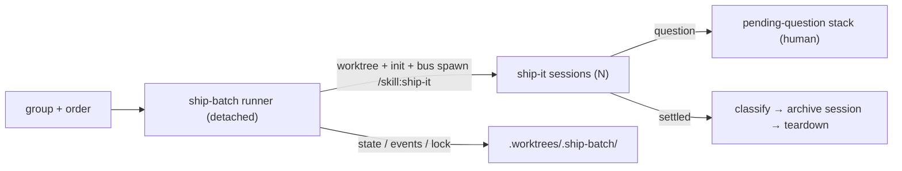

# ship-batch

Runs `ship-it` for every active change of one OpenSpec **group** (the board's
group + its persisted order), `N` at a time, each in its own worktree
`.worktrees/os-<change>` / branch `os/<change>`. A standalone TypeScript runner
does the scheduling — **not an agent loop** — so a multi-hour run has no context
growth or turn limit. This skill only launches and inspects it.



## When to use

- Several planned changes in one group are ready to ship and you want them landed
  without babysitting each session.
- Not for a single change — run `ship-it` in its worktree. Not for planning
  (`plan-proposal`). The runner is project-scoped: base branch `develop`, remote `origin`.

## Procedure

1. **Dry run first** — prints order, dependency waits, cycle skips and the
   out-of-batch blockers `ship-it` will ask about; changes nothing:

   ```bash
   npx tsx .pi/skills/ship-batch/scripts/ship-batch.ts --group <id|name> --dry-run
   ```

2. **Launch detached** (a run spans CI and review for hours; the runner does not
   need this session):

   ```bash
   nohup npx tsx .pi/skills/ship-batch/scripts/ship-batch.ts --group <id|name> > /tmp/ship-batch-<group>.log 2>&1 &
   ```

3. **Status** (read-only, works while the dashboard is down):

   ```bash
   npx tsx .pi/skills/ship-batch/scripts/ship-batch.ts --status [--group <id|name>]
   ```

   Shows each change's state, session, age, reason and kept path, and
   `dashboard unreachable since <ts>` during an outage. Events:
   `<repo>/.worktrees/.ship-batch/<groupId>.events.jsonl`.

4. **Resume** — re-run the same launch command. A state file with unfinished items
   re-attaches the recorded sessions and **never spawns a second session** for a
   change. A fully finished run is rotated to `<groupId>.<ts>.json` and planned
   fresh: still-active members are re-queued (a kept worktree is reused); a member
   whose worktree hosts a live session is skipped.

5. **Stop** — `SIGINT`/`SIGTERM` (exit 130/143): no new starts, state persisted,
   lock released; live sessions keep running and are re-attached on resume.

## Flags and defaults

| Flag | Default | Meaning |
|---|---|---|
| `--group <id\|name>` | required | Group id, else case-insensitive name; unknown/ambiguous aborts listing the ids |
| `--cwd <dir>` | `.` | Any checkout/worktree of the repo (state lives in the main checkout) |
| `--parallel N` | `2` | Concurrent active changes; integer `1 ≤ N < max-live` |
| `--max-live M` | `2×N` | Live-session ceiling (active + questioned); bounds docker harnesses |
| `--model <ref>` | `@coding` | Model for the spawned `ship-it` sessions |
| `--nudges K` | `1` | Continue-prompts per change when a session stops early |
| `--settle <dur>` | `30s` | Idle window before a session counts as settled |
| `--start-timeout <dur>` | `5m` | A prompt that never streams settles after this |
| `--dry-run` | off | Print the schedule, no side effects |
| `--status` | off | Print the state table |

Exit codes: `0` every change `shipped` · `2` any `kept | incomplete | failed | skipped` ·
`1` usage, preflight, lock refusal or fatal · `130`/`143` signalled.

## How it behaves

- **Preflight** (before any side effect): `git` + `openspec` on PATH, dashboard
  reachable, `spawnStrategy === "headless"`, `origin` remote, valid flags.
- **Order + gating**: the group's persisted order; an open in-batch `blockedBy`
  waits for its blocker to ship; a blocker that ends unshipped skips its dependent;
  an in-batch cycle is skipped. Out-of-batch open blockers do not gate — `ship-it`
  asks (a question frees the slot).
- **A question frees its slot**: a questioned session does not count toward `N`
  and is never torn down, nudged or timed out. It counts toward `--max-live`.
  An answered session returns to `running` even when that is over `N`; nothing is
  pre-empted, new starts just wait. The runner exits only when every change is
  terminal, so a pending question keeps it alive.
- **Settle → outcome**: a session is settled when `ended`, or idle for the settle
  window after it streamed (or after `--start-timeout` when it never did).
  `git fetch origin develop` then decides: `shipped` (a new `archive/<date>-<change>`
  dir), `blocked` (`SHIP_IT_BLOCKED.md` in the worktree), `incomplete`, or `unknown`
  (fetch failed). `incomplete` + alive idle session gets one bounded nudge.
- **No decision without a live view**: while the bus is down the runner reconnects
  (1 s doubling, cap 60 s, forever) and decides nothing.

## Teardown

Every finished change first has its **session archived** (waits for `ended`,
re-archives an expired intent, ≤ 3 min), then the harness is brought down
(`docker/test-down.sh` when `.pi-test-harness.json` exists), then the worktree is
handled by outcome:

| Outcome | Git / worktree |
|---|---|
| `shipped`, worktree already gone | `git worktree prune`, `git branch -D os/<change>` |
| `shipped`, only `.pi/settings.json` dirt | remove (force), `git branch -D` |
| `shipped`, other dirt | **kept** (unpushable) |
| `blocked` | WIP commit + push, worktree **kept** (the hand-back file is gitignored) |
| `incomplete` / `failed`, nothing to save | remove, delete branch only if no commits ahead |
| `incomplete` / `failed`, work | WIP commit (`wip(ship-batch): <change> <outcome>`) + push, then remove; push fails → **kept** |
| merge/rebase in progress, detached HEAD, `unknown` | **kept**, nothing committed |
| another live session in the worktree | **kept** |

An init hook that is not trusted (`init_untrusted`) fails that change, tears its
fresh worktree down and **halts scheduling**; live items finish. Trust the hook
once in the dashboard, then resume.

## Guardrails

- **Never answer questions.** Questions raised by `ship-it` belong on the
  dashboard's pending-question stack; the runner and this skill never answer one.
- **Never remove a worktree with unpushed work.** Remove only after the work is on
  `origin` (or there is none); anything unpushable keeps the worktree and is
  listed in the final report with its path.
- **Never auto-trust the init hook** and never set `PI_HARNESS_ALLOW_OVERSUBSCRIBE`.
- One runner per repository (lock beside the state file); a second one is refused
  naming the holder's pid.
- Never edit the state file or the lock by hand while a runner is alive; to abort,
  signal the runner.

## Verification

- `npx vitest run --project ship-batch` is green.
- A dry run on the group lists the expected order and waits and leaves no
  `.worktrees/os-*`, state, lock or events file behind.
