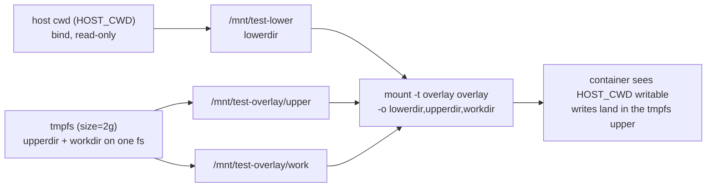

# pi-dashboard Docker test harness

A **disposable, fully isolated** pi-dashboard for manual browser QA and
clean-install verification. It runs the exact image `docker-packaging` builds,
and is structurally incapable of colliding with a dashboard already running on
your host.

> Layers on `compose.yml`. Adds no new image build — just a compose overlay,
> an entrypoint wrapper, two scripts, and baked VCS fixtures.

## Quick start

```bash
# From the project you want to test (its files are mounted, never modified):
cd /path/to/my-project
/path/to/pi-agent-dashboard/docker/test-up.sh        # build + run, attached

# Open the dashboard:
#   http://localhost:18000
# Manual QA with agent-browser:
#   agent-browser open http://localhost:18000

# In another terminal, tear everything down (discards all state):
/path/to/pi-agent-dashboard/docker/test-down.sh
```

First run builds the image (a few minutes). Subsequent runs reuse it.

## Isolation guarantees

A test instance cannot touch the host dashboard across any collision vector:

| Vector | Host dashboard | Test harness | Mechanism |
|---|---|---|---|
| home-lock | holds `~/.pi/dashboard` lock | own `$HOME=/home/pi` | container filesystem |
| `~/.pi` state | persists | wiped every run | `pi-state` → tmpfs |
| HTTP port | 8000 | dynamic 18000–18999 | hash-derived + probed, published port remap |
| pi gateway port | 9999 | dynamic 19000–19999 (loopback only) | port remap + `PI_GATEWAY_BIND=127.0.0.1` |
| mDNS advertise/browse | on | off | `PI_DASHBOARD_NO_MDNS=1` |
| LAN multicast | — | none | default bridge network (NAT) |
| zrok tunnel | optional | off | `TUNNEL_ENABLED=false` |

Verify after a run: `~/.pi` is byte-identical and your project is untouched.

## Parallel worktrees

Two `test-up.sh` instances from different git worktrees no longer collide.
Each derives a stable, free port pair and a unique compose project name from a
hash of `HOST_CWD` (`$PWD`). See change: parallelize-test-harness.

- **Ports** — `cksum(HOST_CWD)` picks a base offset inside a fixed window
  (dashboard `18000–18999`, gateway `19000–19999`), then probes for a free port,
  wrapping at the window edge. Same worktree → same ports across restarts.
- **Project name** — `pi-dash-test-<hash>`, a pure function of `HOST_CWD`, passed
  as `docker compose -p`. Distinct project → distinct containers/network/volume,
  so one worktree never recreates another's stack.
- **State file** — `${HOST_CWD}/.pi-test-harness.json` =
  `{ project, dashboardPort, gatewayPort }`. Gitignored. `test-down.sh`
  re-derives the project from `$PWD` (works even if the file is missing/corrupt)
  and removes it after `down`.
- **Override** — export **both** `DASHBOARD_PORT` and `PI_GATEWAY_PORT` to skip
  derivation (exactly one = error). The Playwright lifecycle uses this path.
- **Playwright** — `tests/e2e/lifecycle.ts` probes a free port (managed) or reads
  `PW_E2E_PORT` (default 18000) when attaching with `PW_E2E_USE_RUNNING=1`, and
  keeps `use.baseURL` in sync with the container.

## Co-resident harness guard (#451 part 2)

Two 4 GiB harnesses on 8 GB VM saturate daemon. Red run under contention cannot be attributed.

`docker/test-up.sh` lists other running `pi-dash-test-*` compose projects via `list_running_harness_projects` in `docker/lib-ports.sh`.

Refuses when `(n+1) × MEM_LIMIT >= MemTotal`. Default `MEM_LIMIT` = `4g` (`docker/compose.yml`). `>=` intentional: host must keep running; limits equal to MemTotal already oversubscribed.

Refusal runs before image build and before `.pi-test-harness.json` write. Refused start costs nothing, leaves no state.

Refusal message names other project(s) and arithmetic. Override: `PI_HARNESS_ALLOW_OVERSUBSCRIBE=1`.

Arithmetic runs with n = 0 too. Lone harness with `MEM_LIMIT >= MemTotal` → refused; headline `harness memory cap exceeds the daemon` (no "co-resident"). Override → one `oversubscribed` warning. See change: close-e2e-tooling-followups.

Limits fit but peer up → one warning (attribution degraded). No peer + fits → silent.

Unparseable `MEM_LIMIT` or failed `docker info` → peer up: warning + proceed; no peer: silent. Never refuse on missing data.

One code path in and out of CI (CI runner has one harness → only lone cap check; silent when it fits).

Tests: `scripts/__tests__/test-up-oversubscribe-guard.test.mjs`.

## Harness audit (#451 part 1)

Worktree harness container destroyed mid-run by outside action.

Grep audit of every `docker … down|rm|prune|stop|kill` in-tree: all `-p`-scoped or own-container-named. Nothing in-repo reaches foreign `pi-dash-test-*` project. Destroy came from outside repo (manual action, Docker Desktop restart, out-of-tree prune).

Not fix. Part 1 of #451 stays open until an occurrence is attributed. Change `add-missing-ci-legs` makes the next one self-attributing.

### Automatic capture (default, local-only)

`docker/test-up.sh` starts a per-harness lifecycle recorder (`docker/harness-audit.sh <file> <project>`) BEFORE `compose up`, scoped to its own compose project. Every caller gets it: Playwright managed mode, `ship-it`, a manual harness. No second shell needed.

- Events file: `${TMPDIR:-/tmp}/pi-dash-test/<project>.events.log`. Outside the worktree on purpose — `ship-it` removes the worktree right after teardown. Appended across boots; retention = OS temp policy (macOS purges `$TMPDIR` files unused ~3 days).
- Lines: `<epoch> create|start|die|kill|destroy <name> project=<project> id=<container id>`, plus `boot <ISO ts> <project> <id>` per new container and `teardown-begin <ISO ts> <project> <id>` from `test-down.sh`.
- State file `.pi-test-harness.json` gains `recorderPid`, `eventsFile`, `containerId`.
- Re-up reuses a live recorder (one per project). A failed `compose up` kills the recorder it started.
- Recorder self-terminates: unarmed until it has seen its container; once armed, exits on the first empty 30 s poll. Hard 12 h cap. Tunables: `PI_HARNESS_AUDIT_POLL_SECS`, `PI_HARNESS_AUDIT_MAX_SECS`.
- Best-effort: `docker events` unusable or events dir unwritable → one stderr line `harness-audit: lifecycle capture unavailable (<reason>); continuing`, harness boots normally.
- `test-down.sh` appends `teardown-begin` BEFORE `compose down`, waits ≤10 s (`PI_HARNESS_DESTROY_WAIT_SECS`) for the `destroy` line of that container id, stops the recorder, prints the events path. Dead/absent recorder → one warning, marker still written, no wait, exit 0.
- Attribution is by container id, never by project: project name is stable across boots, id is not.
- Playwright managed mode: harness-down message says "foreign actor" + quotes the `destroy` line when the file holds a `destroy` for this boot's container id with no earlier `teardown-begin` for the same id. Attach mode (`PW_E2E_USE_RUNNING=1`): cause undetermined, message points at `${TMPDIR:-/tmp}/pi-dash-test/`.
- CI legs do not upload the file: each runner has a private daemon.

Tests: `scripts/__tests__/test-up-recorder.test.mjs`, `test-down-recorder.test.mjs`, `harness-audit-armed.test.mjs`, classifier in `e2e-reap-core.test.mjs`; L2 `qa/tests/17-…`, `18-…`, `19-…`.

### Manual recorder (unscoped)

`docker/harness-audit.sh <outfile>` (no project) still records every `pi-dash-test-*` event until Ctrl-C. Use it to watch several worktrees at once.

### Forbidden operator recipes

The two destroyers seen in session logs are operator commands, not repo code. Never run while ANY harness is up:

```bash
docker ps -aq --filter 'name=pi-dash-test' | xargs -r docker rm -f   # prefix-matches EVERY worktree's harness
docker container prune -f                                          # daemon-wide
```

Supported teardown: `docker/test-down.sh` run from the owning worktree (scoped to its own compose project).

## Path-parity mount

The directory you launch `test-up.sh` from (`$PWD`) is mounted into the
container at its **identical absolute path** (`HOST_CWD`), so logs, session
CWDs, and VCS roots read exactly as they do on the host.

Writes never reach the host. The host directory is the read-only *lower* layer
of an in-container overlayfs; the *upper* layer is a throwaway tmpfs:



Container sees `${HOST_CWD}` writable; reads fall through to the host (ro);
writes land in the tmpfs upper; teardown discards the upper → host pristine.

### Overlay vs copy-mode

| Mode | Trigger | Capability | Cost |
|---|---|---|---|
| overlay (default) | — | `CAP_SYS_ADMIN` (added via `compose.test.cap.yml`) | instant spin-up; only written bytes use RAM |
| copy | `TEST_COPY_MODE=1` | none — cap file is not layered | `cp -a` upfront; RAM-heavy for big trees |

`test-up.sh` layers `compose.test.cap.yml` (which grants `CAP_SYS_ADMIN`) only in
overlay mode; with `TEST_COPY_MODE=1` it is omitted, so the container runs with
no added capability. Use copy-mode on hosts that forbid `SYS_ADMIN`:

```bash
cd /path/to/my-project
TEST_COPY_MODE=1 /path/to/pi-agent-dashboard/docker/test-up.sh
```

## Fixtures vs path-parity mount

Two orthogonal ways to get a workspace; neither required:

- **Baked fixtures** — `/fixtures/sample-git` is initialized as a real git repo
  at startup. Pin it from the UI to exercise the VCS panels with zero host
  coupling.
- **Path-parity mount** — the "open my real project" path (above). Launch
  `test-up.sh` from the project; it appears at its identical host path.

## UI-only vs end-to-end (key seeding)

By default **no provider keys are seeded** → panels render and navigate, but
agents do not run (UI-only QA).

For full agent runs, drop a key into a gitignored `docker/.env`:

```bash
# docker/.env  (gitignored)
ANTHROPIC_API_KEY=sk-ant-...
```

The base entrypoint seeds it into `auth.json` on first run (use a throwaway
test key — state is ephemeral anyway).

## Fail-fast smoke check

Before printing the ready URL, the entrypoint probes `GET /api/health` (200)
and a single `/ws` WebSocket connect. A broken image/build exits non-zero
**before** you open a browser.

## Files

| File | Role |
|---|---|
| `compose.test.yml` | overlay: isolation env, SYS_ADMIN, tmpfs state, mounts, entrypoint; container `DASHBOARD_PORT`/`PI_GATEWAY_PORT` interpolate `${…:-default}` |
| `lib-ports.sh` | sourced pure helpers: `derive_hash`, `derive_project`, `is_free`, `find_free_in_window`, `list_running_harness_projects` (peer `pi-dash-test-*` projects), `parse_memory_bytes`, `human_bytes` |
| `harness-audit.sh` | `docker events` capture for the `pi-dash-test-*` namespace (`create`/`start`/`die`/`destroy`/`kill`) -> file; evidence for a foreign destroy (#451 part 1). Start before `test-up.sh` |
| `test-entrypoint.sh` | builds overlay, inits fixtures, smoke check, execs base entrypoint |
| `test-up.sh` | derives port pair + project from `HOST_CWD`, writes state file, `compose -p … up`, prints chosen URL |
| `test-down.sh` | re-derives project from `$PWD`, `compose -p … down -v`, removes state file |
| `fixtures/sample-git/` | git fixture source files |
