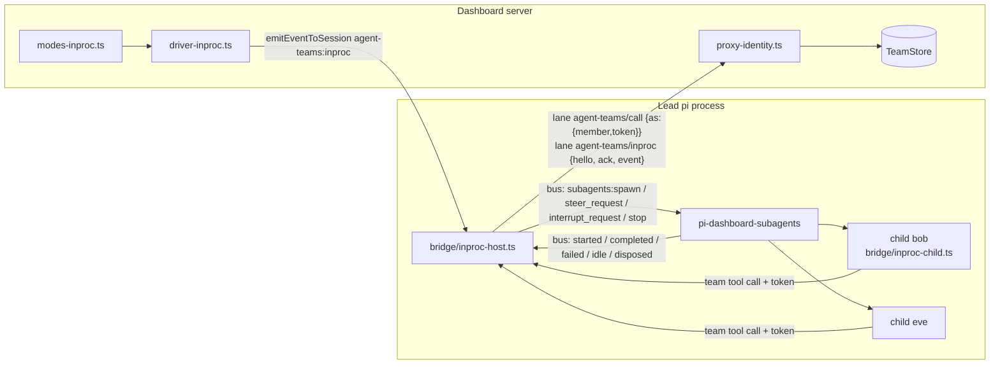

# Agent Teams — in-process teammate mode

Plugin `agent-teams` (`packages/agent-teams-plugin/`). Base guide: [agent-teams.md](agent-teams.md). Core + Team view: [architecture.md](architecture.md) § Agent Teams Plugin. Security baseline: [security/agent-teams-hooks-and-plans.md](security/agent-teams-hooks-and-plans.md).

Second teammate mode next to `session`. Teammates = background children of lead. Children run inside lead pi process. Spawned + stopped through external pi extension `@blackbelt-technology/pi-dashboard-subagents`.

Store, task list, mailbox, idle notice, shutdown handshake, guards = core's. Same tool contract for models.

See change: add-agent-teams-in-process.

## Upstream requirement

Mode needs `pi-dashboard-subagents` release newer than 0.8.1. Target 0.9.0. **Not published yet.**

- Gate = runtime handshake. Bridge queries bus channel `subagents:capabilities` at `session_start`, on first `subagents:*` event, after any empty reply.
- Available iff answered + `apiVersion >= REQUIRED_API_VERSION` (1) + all `REQUIRED_FEATURES` present: `spawn`, `steer`, `managed`, `loader`.
- Optional features degrade only: `loader_skills`, `interrupt`, `cwd_scope`.
- Contract types: `src/shared/subagents-contract.ts`.
- Not installed ⇒ `mode_unavailable`, reason `subagents_extension_missing` (no answer within 500 ms).
- Too old ⇒ `mode_unavailable`, reason `subagents_extension_outdated` (lower version or missing features; message names them).
- Not ready ⇒ reason `no_context`; re-probed on next trigger.
- Until installed: session mode = only usable mode. Session mode unaffected.
- Manifest has no `requires.piExtensions` for this package. Name-only probe cannot express version. Session-only users get no warning pill.
- Install/update: Packages tab (`updateAvailable`).
- Plugin tests use fake subagents fixture. Real-upstream checks (task 6.6, smoke) wait for 0.9.0.

## Choosing a mode

| Need | Mode |
|---|---|
| Teammate with own chat, resume, survives lead `/reload` | `session` (default) |
| Many cheap parallel workers, no per-teammate dashboard session | `in-process` |
| OS-process isolation per teammate | `session` |
| MCP tools in teammate | `session` |

Mode fixed per team at creation. No mixed teams. `TeammateSpawn` has no mode parameter.

### Precedence

Highest first:

1. `TeamCreate {mode}` argument.
2. Template frontmatter `mode`.
3. Config `teammateMode`.
4. `session`.

- Template without `mode` ⇒ falls to config.
- Resolver: `server/modes.ts` `resolve(requested, configDefault, callerSessionId)`.
- `in-process` registered by `server/modes-inproc.ts`. Availability per lead session (from `inproc hello`).
- Unavailable ⇒ `mode_unavailable` with reason + install/update hint.
- Template resolving to `in-process` listed `mode_unavailable` unless some connected session reports available.
- Authoritative check = lead's first `inproc hello` after `team.start`. Mismatch ⇒ team closed, `closeReason: mode_unavailable`, before any teammate spawns.
- Open in-process team found on load while mode unavailable ⇒ closed `mode_unavailable`, members `gone`.

### Config keys

Schema `packages/agent-teams-plugin/src/configSchema.json`. Out-of-range values rejected at settings write by schema `minimum`/`maximum`. Never clamped.

| Key | Default | Meaning |
|---|---|---|
| `teammateMode` | unset ⇒ `session` | default mode when `TeamCreate` + template give none. `session` \| `in-process` |
| `inProcessIdleTtlSec` | absent | free idle child after N s. Integer ≥ 1. Absent ⇒ idle children live until stopped |
| `inProcessLeanChildren` | `false` | child loads no discovered extensions. Built-in tools + team extension only. Cheaper. Isolates foreign extensions |
| `inProcessCmdTimeoutMs` | 10000 | command ack deadline to lead bridge. Integer 1000–120000. Expiry ⇒ `delivery_timeout` |
| `inProcessQueueTimeoutMs` | absent | opt-in. Teammate queued longer for subagents slot ⇒ `spawn_timeout`. Absent ⇒ never fails queued teammate |

Rollback: set `teammateMode: "session"`. Default stays `session`.

## Parity vs session mode

| Aspect | `session` | `in-process` |
|---|---|---|
| User chats with teammate | yes | **no**. Read-only subagent view. Steer via lead |
| Session link | yes | **no**. Team view card shows "Open subagent view" (by `childAgentId`) |
| Resume gone teammate | yes | **no**. `resume_unsupported_in_process`. Same name again ⇒ fresh context |
| Dashboard server restart | members survive | members survive. Lead process keeps children. Members `disconnected` until lead `inproc hello` (same incarnation) + snapshot. Absent from snapshot ⇒ `gone: not_alive` |
| Lead `/reload` | orphan window | members `gone: lead_reloaded` (incarnation changed) |
| Lead `/new`, `/fork` | orphan window | team closed `lead_ended` |
| Lead process ends / heartbeat lapses | orphaned, `orphanTtlMs` window | team closed at once. No orphan window. Best-effort `stop` for known children on same incarnation's next `inproc hello` (`pendingStops`) |
| Parallelism | `maxTeammates` | `min(maxTeammates, subagents maxConcurrent)`. Pool shared with lead's own subagents. Foreground `Agent` served first |
| Extra teammates over free slots | n/a | spawn reply `queued`. Member stays `spawning`, `queuePosition` (1-based) set. Team header + `TeammateSpawn` result show "N of M run in parallel" |
| Urgent interrupt | `abortSession` | upstream `interrupt` feature. Absent ⇒ urgent mail goes as steer, result `details.degraded: "urgent_as_steer"` + warning. User `abortMember` ⇒ `interrupt_unavailable` (dock Stop ends member) |
| Mail form | typed custom message | user-role text. One quoted block per mail |
| Skills | 4 guard layers | layers 2–4 always. Non-empty grant needs `loader_skills`, else `skills_unavailable_in_process`. No grant ⇒ child sees only extension-contributed skills, no project/user skills |
| MCP | spawn scope `noMcp` | none in children |
| Member `cwd` outside lead git repo | allowed after core check | needs `cwd_scope`, else `cwd_outside_scope` |
| Idle report | `agent_settled` in teammate | lead observes `subagents:idle`. Durable outbox |
| Plan mode | `setActiveTools` + `tool_call` backstop | re-narrow in `before_agent_start` each run + `tool_call` backstop |
| Hooks (`TeammateIdle`/`TaskCreated`/`TaskCompleted`) | server-side | unchanged |
| Crash / CPU domain | OS process per teammate | shared lead process |
| Dashboard surface | session cards | Processes lane rows (Stop / Open) + popout + Team view card |

Other behaviours:

- Dock Stop ⇒ member `gone: stopped`, tasks released, waking notice.
- Dock row leaves lane at run end. Idle child stays alive. Team view = source of truth for member state.
- Dock row: `subagent_type` `teammate`, `description` `<member> — <task or spawn summary>` (≤ 80 chars).
- Idle child kept alive (`managed.keepAlive`). Upstream default TTL 600 s + cap 4 would free waiting teammates.
- No run watchdog. Child whose run never settles stays `busy` until user/lead stops it.
- Snapshot exposes `childAgentId`, `queuePosition`, `mode`. Never `proxyToken`.
- Stable test ids: `team-member-open-subagent`, `team-member-status` (`data-status`), `team-header-mode`, `team-header-parallel`.

## Architecture

Server cannot reach child. Child cannot reach server except through lead's process-global request lane. Lead bridge = host for commands + proxy for child tool calls.

| File | Role |
|---|---|
| `server/modes-inproc.ts` | registers `in-process` in `modes.ts`. Availability from `inproc hello` map |
| `server/driver-inproc.ts` | `MemberDriver` impl. Commands, ack correlation, timeouts, reconcile, event intake |
| `server/inproc-lifecycle.ts` | lifecycle mapping of host reports to member state |
| `server/inproc-lead.ts` | lead-side handling (hello, incarnation, close) |
| `server/proxy-identity.ts` | token mint/compare. `as` branch for `resolveCaller` |
| `bridge/inproc-host.ts` | capability probe, command executor (`cmdId` map), event mapper, member registry, outbox |
| `bridge/inproc-child.ts` | `createChildTeamExtension(identity, transport, env)`. Inline factory per child |
| `shared/subagents-contract.ts` | upstream contract types, `REQUIRED_API_VERSION`, `REQUIRED_FEATURES` |
| `shared/inproc-protocol.ts` | `agent-teams:inproc` command + `agent-teams/inproc` ack/event/hello types |

### Command channel

- Server → lead: `emitEventToSession(leadSid, "agent-teams:inproc", {cmdId, cmd, …})`. Commands: `spawn`, `steer`, `interrupt`, `stop`, `snapshot`.
- Event type declared in manifest `emits`. Undeclared ⇒ host refuses ⇒ `emit_refused`.
- Lead → server: lane `agent-teams/inproc` ops `hello`, `ack`, `event`.
- At-least-once, executed once. Bridge keeps `cmdId → result` map. Repeated `cmdId` ⇒ stored ack replayed.
- One outstanding command per member.
- Unacked past `inProcessCmdTimeoutMs` ⇒ `delivery_timeout`. Timed-out `spawn` ⇒ `stop` + `snapshot` reconcile before name reuse.
- Lifecycle reports (`started`, `idle`, `gone`) go through ordered outbox. Entry leaves only on `{ok:true}`. Flushed after each `inproc hello`. Server dedupes by `lastSettleId` (child run counter).
- Outbox + queue cap ~1000 entries / 8 MiB, oldest first.

### Mail delivery

- Each queued mail = own block. Header from `formatEnvelope`. Every body line prefixed `│ `. Blocks sent in one `subagents:steer_request`.
- Running child gets it after current tool. Idle child starts new run on same history.
- Block cap 150 lines incl. envelope. Marker `… N lines truncated`.
- Mail with `wake:false` for idle member stays queued until next waking mail.
- Handover ledger `deliveredMailIds` (200 per member) ⇒ each mail id handed over once.
- Steer acked `queued` but run ended first ⇒ one content-free nudge (`inproc_nudges` counter). Mail not re-sent.
- Teammate prompt: only unquoted envelope lines are runtime-authored. Repeated mail id ignored.

### Lifecycle mapping

| Upstream event | Member effect |
|---|---|
| spawn reply `queued` | stays `spawning`, `queuePosition` set |
| `subagents:started` | `spawning→busy` or `idle→busy` |
| `completed` + `idle {run}` same tick | `idle` report, `settleId = run`, `finalText = result` |
| `failed` + `idle` | `idle` report with `error`. No auto-claim |
| `idle` with `aborted:true` | `idle` report, silent for lead |
| `completed`/`failed` stopped, no `idle` | `gone: stopped` (`timeout` if `stoppedBy: timeout`); `failed` ⇒ `child_failed` |
| `subagents:disposed` | `ttl`/`cap` ⇒ `idle_disposed`; `cancel` ⇒ `stopped`; `shutdown` ⇒ `lead_ended` |

- Bridge decides after current tick (`queueMicrotask`).
- Empty final reply ⇒ idle report with error.
- Final text capped (`maxFinalTextChars`, else 256 KiB).
- `goneReason` values added: `lead_ended`, `lead_reloaded`, `idle_disposed`, `stopped`, `timeout`, `child_failed`, `not_alive`.
- `Team.closeReason` added: `lead_ended`, `lead_reloaded`, `mode_unavailable`.

### Child build

- Built from same `ResolvedSpawnSpec` as session member: `tools`, `noContextFiles`, ordered `promptFiles` (as `loader.appendSystemPrompt`).
- `ResolvedSpawnSpec.env` not exported to process. Reaches child extension as closure map.
- Isolated context: spawn prompt only (text of `spawn_prompt` mail).
- Child extension: teammate row of `TEAM_TOOLS_BY_ROLE` via `createTeamTools(transport)`, guard layers, plan-mode backstop, proxied `hello`.
- Package strips `Agent`/`AgentControl` from children ⇒ teammates cannot spawn teammates.
- `agent-teams` bridge entry inert in child (re-entry detection on `process[Symbol.for("agent-teams.bridge")]`).
- Default loads all discovered extensions in child. Upstream strips only settlement hooks. Foreign `before_agent_start`/`input`/`tool_call` handlers run in child. Mitigate: `inProcessLeanChildren`.

## Security

Process isolation weaker than session mode. Teammate shares lead credentials, memory, crash domain.

| Surface | Control |
|---|---|
| Child identity on shared lane | Lane carries lead's socket `sessionId` for every child call. Per-member `proxyToken` (32 random bytes hex) minted at spawn. Persisted in team file (dataDir `0700`). Sent only in `spawn` command. Held in member registry + child closure |
| `as:{member,token}` acceptance | `resolveCaller` honours `as` only if socket = lead of an `in-process` team, member exists + not `gone`, token matches (constant-time). Invalid `as` ⇒ `forbidden`, no fallback to socket identity. Token check first; gone member ⇒ `member_gone` |
| Token lifecycle | Rotates on respawn. Deleted with member. Excluded from snapshot + `TeamStatus` |
| Command forgery on bus | Per-activation `commandSecret` minted by bridge, echoed in each `agent-teams:inproc` command. Wrong/missing ⇒ ignored, counted `inproc_bad_command` |
| Peer text forgery | Quoted-body framing per mail. Forged envelope or "plan approved" in body stays inert. Approval state only from server's proxied `hello` reply `planMode` |
| Managed child hijack | Upstream refuses every model-initiated `AgentControl` action on managed child (`managed_child`). `before_spawn` patches ignored for managed spawns |
| Spawn input | Built from server-validated fields. Bridge re-checks `cwd` through upstream scope check |
| Secret logging | Token never logged, never in `description`/prompt |

Accepted risks (owner decision):

- Token + `commandSecret` travel on lead's in-process bus. Any extension in lead process can read them. Same trust domain as every in-process extension. Not mitigated further.
- Runaway teammate (CPU, memory) can degrade lead + all teammates. Can starve lead heartbeat ⇒ team closes. No OS isolation. No per-child kill besides `subagents:stop`.
- Teammate with `bash` = same OS user as lead.
- Mail arrives as user-role text. Weaker peer/human distinction than typed custom message. Contained by: no human user in child, quoted framing, prompt rule.
- No run watchdog.
- No user chat with teammate in v1. No per-steer split of oversized mail.
- Until upstream 0.9.0 installed, mode unusable (`mode_unavailable`).

## Error codes

Reuses core codes (cap, name in use, `invalid_args`). In-process additions:

| Code | Meaning |
|---|---|
| `mode_unavailable` | upstream missing/outdated/not ready. Message carries reason + hint |
| `resume_unsupported_in_process` | `TeammateSpawn {resume:true}` |
| `skills_unavailable_in_process` | non-empty skills grant without `loader_skills` |
| `interrupt_unavailable` | `abortMember` without `interrupt` feature |
| `cwd_outside_scope` | member cwd outside lead repo without `cwd_scope` |
| `delivery_timeout` | command unacked past `inProcessCmdTimeoutMs` |
| `spawn_timeout` | slot wait past `inProcessQueueTimeoutMs`, or `no_context` retry deadline |
| `spawn_vetoed` | upstream `before_spawn` veto |
| `emit_refused` | host refused `agent-teams:inproc` (undeclared in `emits`) |
| `member_gone` | child tool call after member `gone` |
| `forbidden` | `as` from non-lead socket or wrong token |
