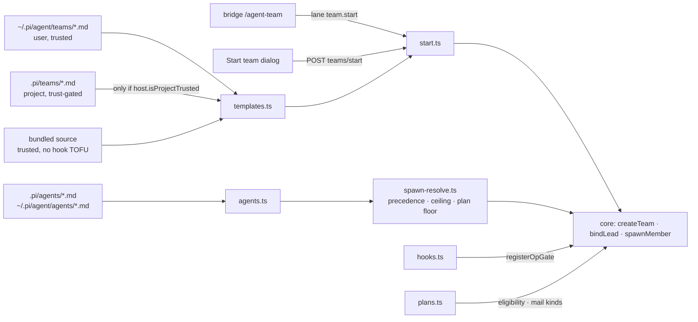
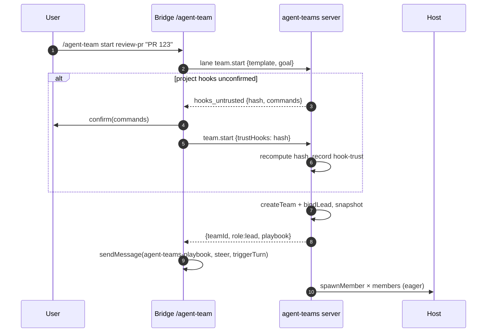
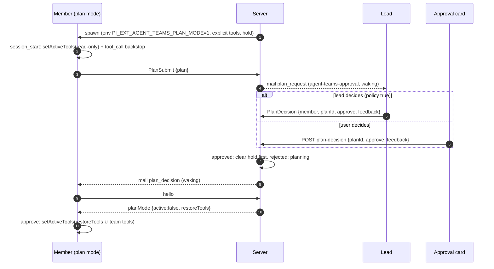

# Agent Teams — templates, teammate types, hooks, plan approval

Plugin `agent-teams` (`packages/agent-teams-plugin/`). Core + UI: [architecture.md](architecture.md) § Agent Teams Plugin / Team view. Security: [security/agent-teams-hooks-and-plans.md](security/agent-teams-hooks-and-plans.md). Seams: [plugin-seams.md](plugin-seams.md) § Consumer: agent-teams.

Templates, hooks, plan approval = additive over core. No core edits. Consumes core seams: `registerOpGate`, `registerDispatchEligibility`, `registerSpawnContributor`, `registerMailKind`, `Team.overrides`, `Member.hold`.

See change: add-agent-teams-templates-hooks.

In-process teammate mode (`mode: in-process`, `teammateMode`, `inProcess*` keys, parity table, security): [agent-teams-in-process.md](agent-teams-in-process.md).

## Architecture



## Templates

Markdown file = YAML frontmatter + body. Body = lead playbook.

Sources, precedence project → user:

| Source | Path | Trust |
|---|---|---|
| `user` | `<piAgentDir>/teams/<name>.md` | trusted |
| `project` | `<cwd>/.pi/teams/<name>.md` | read only if `host.isProjectTrusted(cwd)`. Service absent ⇒ untrusted (fail closed) |
| `bundled` | none shipped yet | trusted, no hook TOFU |

- Project beats user for same name only when project trusted.
- Untrusted project stem listed `trusted:false`, not parsed, never shadows user template.
- File = regular file, realpath inside source dir. Symlink escape ⇒ invalid.
- Filename stem == frontmatter `name`. Regex `^[a-z][a-z0-9-]{0,39}$`.
- Size ≤ `maxTemplateBytes` (65 536). Listing ≤ 200 templates (extras ⇒ warning).
- YAML strict: `maxAliasCount: 0`, `uniqueKeys`. Alias/anchor/merge key/custom tag ⇒ `frontmatter_invalid`.
- Unknown frontmatter key ⇒ warning. Type/range error ⇒ listed `invalid`, not startable.
- Integers only. `count`, `maxTeammates`, hook `timeoutMs` < 1 or non-integer ⇒ `field_invalid`.

Example:

```markdown
---
name: review-pr
description: Three-reviewer parallel code review
mode: session
lead: { model: "@review" }
maxTeammates: 4
autoDispatch: true
spawn: eager
requirePlanApproval: false
defaultModel: "@coding"
defaultTools: [read, grep, find, ls]
defaultSkills: []
notify: { coalesceMs: 2000 }
members:
  - { name: security, agent: Audit, model: "@research", count: 1, tools: [read, bash], prompt: "Focus on auth." }
  - { name: style, agent: Explore, count: 2, requirePlanApproval: true }
hooks:
  TaskCompleted: [{ command: "npm test --silent", timeoutMs: 10000 }]
---
You are the lead for a code review of {{goal}} in {{cwd}}. …
```

Frontmatter fields:

| Field | Rule |
|---|---|
| `name` | required. Equals filename stem |
| `description` | text for listing |
| `mode` | optional. Must be registered core mode, else `mode_unavailable`. Absent ⇒ config `teammateMode` (default `session`) |
| `lead.model` | applies only on REST start (dashboard spawns lead). Command path ignores it, reports once |
| `maxTeammates` | caps TOTAL = roster + lead-spawned. ≤ config `maxTeammates`. Roster over ⇒ `roster_exceeds_max` |
| `autoDispatch` | → core `Team.overrides.autoDispatch` |
| `notify.coalesceMs` | 0–10 000. → `Team.overrides.notifyCoalesceMs` |
| `spawn` | `eager` (default) or `lead` |
| `requirePlanApproval` | `false` \| `true` \| `"user"`. Team default. Acts as floor |
| `defaultModel` | lives in stored snapshot. No core field |
| `defaultTools` / `defaultSkills` | → core `Team.defaultTools` / `Team.defaultSkills` |
| `members[]` | `name`, `agent?`, `model?`, `count?`, `tools?`, `skills?`, `cwd?`, `prompt?`, `requirePlanApproval?` |
| `hooks` | `TeammateIdle` \| `TaskCreated` \| `TaskCompleted`. ≤ 3 commands/event, command ≤ 2000 chars |

Member rules:

- `count` n>1 expands to `<name>-1…-n`. n=1 keeps `<name>`.
- Names obey core rule. Reserved `lead|server|system|all|user` ⇒ `name_reserved`.
- Expanded name over 32 chars ⇒ `roster_name_invalid`. Duplicate ⇒ `duplicate_member`.
- `spawn: eager` ⇒ server spawns whole roster after lead bound. `spawn: lead` ⇒ roster = suggestion in playbook. Lead spawns via `TeammateSpawn {agent, name}`.

Variables:

- Only `{{goal}}` and `{{cwd}}`. Replaced in body + each member `prompt`.
- No expressions, nesting, includes. Unknown `{{x}}` stays literal + warning.
- `goal` required, ≤ 4000 code points. Data, inserted verbatim.
- `goal` single-line: control chars, newline, tab → one space, trim. Empty ⇒ `invalid_args`.

Playbook size:

- Rendered text ≤ `maxMessageChars` − 500 and 120 lines. Never truncated.
- Body alone over ⇒ template `playbook_too_long` at listing. Body+goal+roster over ⇒ `playbook_too_long` before `createTeam`.

Snapshot at start:

- Persisted on team: `template {name, source, hash}`, resolved `hooks`, plan default, `defaultModel`, expanded members, `goal`, playbook, `lead.model`, `spawn`.
- Only source for post-restart eager spawn, respawn, ceilings.
- Later file edits affect only future starts.

## Start paths

One server op `team.start {template, goal, trustHooks?}`. Lane payload carries no `cwd`. No agent tool exposes it. Refused for session already lead/teammate.

### Command `/agent-team`

- `/agent-team start <template> <goal…>` — current session becomes lead.
- `/agent-team templates` — list folder templates (source, validity, trust).
- Registered by bridge (`bridge/command.ts`) in every session. Argument completion from cached `team.templates` reply.
- Named `agent-team`, not `team`: bare `team` reserved for `packages/team-plugin`.
- Handler outcome not surfaced by host. Handler catches all, reports via `ctx.ui.notify`.
- Server: `createTeam` + `bindLead(caller)`. Core guards apply: `already_in_team`, `nested_team_forbidden`, `lead_confined`, `team_cap_reached`.
- Reply `{teamId, role:"lead", playbook}`. Bridge registers lead tools, sends playbook via `pi.sendMessage` (customType `agent-teams-playbook`, `deliverAs:"steer"`, `triggerTurn:true`).
- Unconfirmed project hooks ⇒ reply `hooks_untrusted {hash, commands}`. Bridge `ctx.ui.confirm` shows exact commands. Retry with `trustHooks: <hash>`.

### Start team dialog (dashboard)

- Claim `sidebar-folder-section` → compact "Start team" action per workspace folder. Opens `StartTeamDialog`.
- Dialog: template select (source / validity / untrusted badges), goal textarea, hook-confirmation step (exact commands, retries with shown hash).
- Calls `POST /api/plugins/agent-teams/teams/start {template, goal, cwd, trustHooks?}`.
- Server cannot make existing session lead. Creates lead-less team (`starting`), spawns lead session (`pluginRef {"agent-teams": {teamId, role:"lead"}}`, `lead.model`, no `initialPrompt`).
- `lead_bound` ⇒ playbook mail (kind `playbook`, waking) + eager members.
- Persisted `leadSpawnToken` + `leadBindDeadline = now + spawnTimeoutMs`. Deadline pass while `starting` ⇒ `teamDelete(server, force)` with `closeReason: "lead_spawn_failed"`.
- Server restart reconciles `starting` teams: re-arm timer or close. Eager spawn reconcile idempotent: only missing snapshot members spawned; playbook not re-sent.
- `Team.owner` = request principal. Lead gets same `principalOwner` stamp.
- Double submit: no server dedupe. Client disables button in flight. `maxActiveTeams` = guard.
- Cards: `agent-teams-playbook` (collapsed, template + goal), `agent-teams-approval` (plan request controls).



## Teammate types

Member `agent: <Name>` reuses `.pi/agents` definition. Reader re-implemented in `server/agents.ts`. No dependency on `pi-dashboard-subagents`.

- Lookup: `<leadCwd>/.pi/agents/<Name>.md` (only if project trusted), then `<piAgentDir>/agents/<Name>.md`. Untrusted project file never shadows user file.
- No bundled/package tiers in v1.
- Name regex `^[A-Za-z0-9][A-Za-z0-9_.-]{0,63}$`. File ≤ 64 KiB. Regular file inside dir.
- Fields honoured: `description` → default `role`; `model` verbatim (`@role`, `provider/id`, `provider/id:level`, bare id); `thinking` (known level only, else ignored + warning); `tools` (YAML array ONLY); `prompt:` else markdown body.
- `tools` as comma string or non-array ⇒ hard `agent_invalid`. Stricter than subagents reader on purpose.
- `inherit_context` ignored. Teammates get no lead history. No `skills` field.
- Prompts rendered to `<dataDir>/prompts/<teamId>/<member>.agent.md` and `<member>.member.md`. Appended after protocol file by spawn contributor, in that order.
- Failures: `agent_not_found`, `agent_untrusted`, `agent_invalid`. Member `failed`, lead gets waking notice. Others continue. Simultaneous failures merge into ONE waking notice.

### Precedence, ceiling, plan floor

`spawn-resolve.ts` wraps `TeammateSpawn` (additive params `agent`, `requirePlanApproval`) and eager spawn. Per field first defined wins:

| Field | spawn arg | template member | agent def | team default | else |
|---|---|---|---|---|---|
| `model` | 1 | 2 | 3 | 4 `defaultModel` | host default |
| `thinkingLevel` | – | – | 1 | – | host default |
| `tools` | 1 | 2 | 3 | 4 `defaultTools` | unrestricted |
| `skills` | 1 | 2 | – | 3 `defaultSkills` | unrestricted |
| `cwd` | 1 | 2 | – | team cwd | lead cwd |
| `requirePlanApproval` | floor | 2 | – | 3 | false |

- Ceiling: template-declared `tools`/`skills` = ceiling. Lead-supplied list intersected. Outside ⇒ `tools_outside_template` / `skills_outside_template`.
- Present key = ceiling. `[]` allows nothing optional (team tools only).
- Agent-definition `tools` not a ceiling.
- Plan floor: spawn arg may only strengthen `false → true → "user"`. Injected lead cannot drop owner policy.
- `model` NOT floored. Spawn-arg model beats template model (cost steering = lead's call; bounded by `maxTeammates`/`maxActiveTeams`).
- `cwd` always through core confinement.
- Team tools from `TEAM_TOOLS_BY_ROLE` appended after resolution. `PlanSubmit` (member) + `PlanDecision` (lead) always registered, inert unless plan approval in play.

## Hooks

Events: `TeammateIdle`, `TaskCreated`, `TaskCompleted`. Server-run shell commands. Source = template `hooks` only. Team without template has no hooks.

Installed as core op gates: `registerOpGate("TaskCreate")`, `registerOpGate("TaskUpdate")` (acts only on completing), idle gate. In-process callers with `{skipGates:true}` run no hooks.

### Exit codes

| Exit | Result |
|---|---|
| 0 | allow |
| 2 | block + stderr feedback (control chars stripped, ≤ 2000 chars). Empty stderr ⇒ `hook blocked (no output)`. Output > 64 KiB still blocks, feedback = first 2000 chars |
| other / timeout / overflow | log + count, ALLOW (fail-open) |
| spawn error (e.g. no `bash`) | allow, loud: lead notice on first `spawn_error` per team |

First timeout per event per team ⇒ non-waking lead notice. 3 consecutive errors ⇒ lead notice.

### Runner

- `spawn("bash", ["-c", command])` via `platform/exec.js`, detached. cwd = `Team.leadCwd`. Event JSON on stdin, then closed.
- Stdin built from store, never from agent-supplied input: `hook_event_name`, `team`, `cwd`, `member?`, `task?`, `idle?`.
- Env allowlist: `PATH HOME USER LANG LC_* TMPDIR SHELL` + `AGENT_TEAMS_EVENT/TEAM_ID/MEMBER/TASK_ID`. Not server env.
- Streams ≤ 64 KiB each. stdout ignored except logged length.
- Tree kill: SIGTERM, SIGKILL after 2 s (`platform/process.js killProcess`). Also on `ctx.onShutdown`.

### Budget + concurrency

- One deadline per event = `opGateBudgetMs` (12 000 ms incl. queue wait; lane timeout 15 s).
- Per-command `timeoutMs` (default `hookTimeoutMs` 10 000) capped by remaining budget.
- Concurrency: ≤ 2 running per team, ≤ 4 server-wide. Excess queues inside same deadline.
- Hook not started by deadline: task gates fail `hook_blocked` + feedback `hook_busy` (retryable, no state change). Idle gate lets idle through, counted.
- Gate commits inside the call. Call either committed or failed before reply. Agent retry cannot double-commit.
- Perf gates (regression, not SLO): `true` hook overhead p95 ≤ 150 ms, p99 ≤ 400 ms.
- Long-gate guidance: gate > ~10 s (full test suite) = wrong tool. Use quick check, or async pattern (hook records request, later task verifies).

### Event semantics

| Event | Gate | Exit 2 effect |
|---|---|---|
| `TaskCreated` | `TaskCreate` | tool error `hook_blocked` + feedback. Core re-validates (cap, cycle, open) then commits |
| `TaskCompleted` | `TaskUpdate`→completed | task stays `in_progress`. Concurrent completion ⇒ `hook_blocked` + `hook_pending` |
| `TeammateIdle` | idle report | core keeps member `busy`, no lead notice. Server sends `hook_feedback` mail (waking) |

- `TeammateIdle` skipped for `shutdown_pending` members, idles carrying `error`/`aborted`, `pending` plan members.
- Retry cap `hookMaxRetries` (3): consecutive blocks per member. Reset on accepted idle. After cap idle accepted + lead notice. `0` = idle hooks never block.
- Waking mail arrives during hook ⇒ idle dropped.

### Trust (TOFU)

- `user` source ⇒ trusted.
- `project` source ⇒ `host.isProjectTrusted(cwd)` AND recorded confirmation for `realpath(cwd) + sha256(canonical hooks)`.
- Store: `<dataDir>/hook-trust.json` (`server/hook-trust.ts`). Key = `realpath(cwd)` + hash.
- Hash (`hook-hash.ts`): SHA-256 over event names, command text, order, effective `timeoutMs`. Key order, comments, whitespace ignored. Any edit re-prompts.
- No confirmation ⇒ `team.start` returns `hooks_untrusted {hash, commands}`. Retry with `trustHooks: "<hash>"`. Server recomputes; mismatch ⇒ `hash_mismatch`. No confirm-then-edit TOCTOU.
- `POST /hook-trust {cwd, hash}` records only if hash = current hash of a project template in that cwd.
- `DELETE /hook-trust?cwd=&hash=` revokes. Query string (proxies strip DELETE bodies). No `hash` ⇒ all for that cwd.
- Frozen at start: resolved hooks copied into team record. No op, tool, route edits them after. Agent input never adds or changes a hook.
- Revoking trust/confirmation does NOT stop a running team. Gates later starts only.

## Plan approval

Member with resolved policy `true` or `"user"` starts read-only.

States: `planning → pending → approved`. Reject ⇒ back to `planning`.



### Three enforcement layers

1. **Spawn.** Explicit tool list = (resolved list or pi default `read bash edit write`) ∪ `planModeTools` ∪ team tools. Env `PI_EXT_AGENT_TEAMS_PLAN_MODE=1`. Server sets `planApproval:"planning"` + `Member.hold` (dispatcher skips). Trade-off: plan member loses non-default extension/MCP tools unless its `tools` names them.
2. **Narrowing.** Bridge `session_start` reads env hint, calls `pi.setActiveTools(planTools)`. `planTools = (getAllTools() ∩ planModeTools) ∪ team tools ∪ {PlanSubmit}`. `hello` reply carries authoritative `planMode {active, restoreTools}`. Reload re-derives.
3. **Backstop.** `tool_call` handler (`bridge/plan-mode.ts`) blocks tool outside `planTools` while plan mode on. Independent of `setActiveTools` success.

- Narrowing unavailable or `PlanSubmit` missing at hello ⇒ member `degraded:"plan_tools_unavailable"`, lead told. Backstop still refuses.

### Tools + routes

- `PlanSubmit {plan}` (member). ≤ `planMaxChars` (6000), never above `maxMessageChars` − 500, ≤ 120 lines. Over ⇒ `message_too_long`, never cut. Empty/whitespace ⇒ `invalid_args`. Outside plan mode or after approval ⇒ `plan_not_required`.
- Server stores `PlanRequest {id:"p<N>", member, plan, status, createdAt}`. Status `pending | approved | rejected | superseded | cancelled`. New submit supersedes pending. ≤ 20 per team; oldest decided dropped; pending never dropped.
- `plan_request` mail first lines: `plan <id> · team <teamId> · member <name>`. Card needs no fetch.
- `PlanDecision {member, planId, approve, feedback?}` (lead-only tool) or `POST …/teams/:id/members/:name/plan-decision {planId, approve, feedback?}`.
- Decision binds to named plan only. Decided/superseded/cancelled ⇒ `already_decided`. Unknown id ⇒ `unknown_plan`. Stale card cannot approve unseen newer plan.
- Feedback uses plan bound. Over ⇒ `message_too_long`, decision not recorded.
- Policy `"user"`: lead decision ⇒ `user_decision_required`. User (REST) may always decide.
- Approve: server sets `approved`, clears hold FIRST, then sends `plan_decision` mail. Bridge re-sends `hello`; restores server-provided `restoreTools` ∪ team tools. Never in-memory snapshot.
- `decidedBy` = server-verified caller (socket session for tool, request principal for REST). Never message text.
- Dispatch: `registerDispatchEligibility` excludes `planning` + `pending` members. `planning` member may still claim explicitly. `pending` member ending turn ⇒ no idle notice (lead already got `plan_request`).
- Pending plan whose member session ends ⇒ `cancelled`.

### Restart

- States, holds, plans persist.
- Member not re-registered within `spawnTimeoutMs` of restart ⇒ pending plan `cancelled`.
- Bridge reload mid plan mode: `hello` re-derives `planMode`; narrowing re-applied, or restore applied if already approved.
- Rollback of change with member awaiting approval: member keeps read-only scope until session ends.

## Config keys

Schema `packages/agent-teams-plugin/src/configSchema.json`. Invalid values fall back to default + startup warning.

| Key | Default | Meaning |
|---|---|---|
| `maxTemplateBytes` | 65536 | max template file size. Over ⇒ `template_too_large` |
| `hookTimeoutMs` | 10000 | default per-command hook timeout. Min 1. Capped by `opGateBudgetMs` remainder |
| `hookMaxRetries` | 3 | consecutive idle blocks per member before accept. Min 0 |
| `planMaxChars` | 6000 | plan + decision feedback cap. Effective `min(planMaxChars, maxMessageChars − 500)` and 120 lines |
| `planModeTools` | `[read, grep, find, ls]` | read-only set. `bash`, `edit`, `write`, unknown names dropped + warning |
| `opGateBudgetMs` | 12000 | total gate budget per call. Max 14000 |
| `teammateMode`, `inProcessIdleTtlSec`, `inProcessLeanChildren`, `inProcessCmdTimeoutMs`, `inProcessQueueTimeoutMs` | see guide | in-process mode keys. See [agent-teams-in-process.md](agent-teams-in-process.md) § Config keys |

## REST routes

Prefix `/api/plugins/agent-teams`. Tiers in `packages/shared/src/route-tiers.ts`. Unlisted ⇒ fails closed to `operate`.

| Method | Path | Tier | Guard |
|---|---|---|---|
| GET | `/templates?cwd=` | observe | `admitRouteCwdParam` + `host.knownFolderCwds` |
| GET | `/teams/:id/plans` | observe | core `routeVisibility`. Invisible ⇒ 404 |
| POST | `/teams/start` | operate | cwd admitted. `Team.owner` = request principal |
| POST | `/teams/:id/members/:name/plan-decision` | operate | visible AND controllable, else unknown-team 404 |
| POST | `/hook-trust` | operate | cwd admitted. Hash must equal current project hook hash |
| DELETE | `/hook-trust?cwd=&hash=` | operate | cwd admitted |

- Start, plan decision, hook trust = `operate`: spawn sessions, widen tool scope, grant code execution. Supervision (stop/shutdown) = `control`.
- Writes use `writeLimit`. 429 ⇒ `rate_limited`.
- Failure body `{ok:false, error, message?, details?}`. `details` carries `hooks_untrusted` hash + commands.

## Error codes

| Code | HTTP | Meaning |
|---|---|---|
| `invalid_args`, `cwd_required`, `invalid_cwd`, `message_too_long` | 400 | bad input |
| `project_untrusted` | 403 | project not trusted |
| `template_not_found`, `unknown_plan`, `not_found` | 404 | unknown target |
| `hooks_untrusted` | 409 | unconfirmed project hooks. `details {hash, commands}` |
| `hash_mismatch` | 409 | confirmed hash ≠ current |
| `team_cap_reached`, `team_closed` | 409 | core limits |
| `already_decided` | 409 | plan not pending |
| `playbook_too_long`, `template_invalid`, `mode_unavailable` | 422 | template/start refusal |

Template load codes: `template_too_large`, `name_invalid`, `frontmatter_invalid`, `field_invalid` (+ field path), `hook_command_too_long`, `duplicate_member`, `roster_name_invalid`, `roster_exceeds_max`, `name_reserved`.

Spawn/agent codes: `agent_not_found`, `agent_untrusted`, `agent_invalid`, `tools_outside_template`, `skills_outside_template`.

Tool-side codes: `hook_blocked` (+ feedback `hook_busy` / `hook_pending`), `plan_not_required`, `user_decision_required`. Degraded member: `plan_tools_unavailable`. Team close reason: `lead_spawn_failed`.

## Deferred

- Automation action `agent-teams.start`. Needs completion event, orphan policy, unattended hook trust.
- OpenSpec templates, in-process mode, bundled agent tiers, global hooks, fail-closed hooks, `wakeOnIdle`.
