# PI Dashboard Architecture

> **Adjacent artifact:** public marketing site lives at `/site`. Product-adjacent, not part of dashboard runtime. No framework — one hand-written static page: `site/index.html`, `site/404.html`, `site/field.js` (three.js background), `site/vendor/`, `site/media/`. Zero dependencies. `npm run build -w site` = `node site/build.mjs`: copies explicit allowlist into `site/dist`, verifies every local ref in `index.html` resolves. Artifact path unchanged — `.github/workflows/deploy-site.yml` still uploads `site/dist`, copies `packages/shell` into `site/dist/app`. Release data (download URLs + byte sizes) inline in `index.html`; `site/design-scratch/scripts/sync-release.mjs` rewrites it from GitHub API on `release: published` (`.github/workflows/sync-release-version.yml`), commits to develop. `site/design-scratch/` = design source, not deployed (excluded from build allowlist + deploy push-path filter). Theme: System/Light/Dark modes, storage key `pi-theme`, inline `<head>` script resolves before first paint; dark = absence of `data-theme="light"`. See `/site/README.md` for details.


## Overview

PI Dashboard: web-based dashboard for monitoring + interacting with pi agent sessions. Three components:

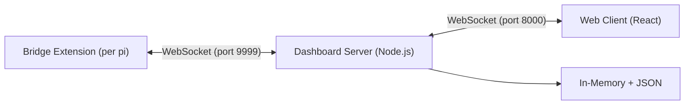

## Components

### 1. Bridge Extension (`src/extension/`)
Global pi extension running in every pi session. It:
- Detects session source (TUI, Zed, tmux, dashboard-spawned) via `.meta.json` sidecar files + env vars
- Forwards all pi events to dashboard server via WebSocket
- Relays commands from dashboard back to pi
- Handles reconnection with exponential backoff + event buffering
- Sends heartbeats every 15s with process metrics (CPU%, RSS, heap, event loop max delay, load average); server responds with `heartbeat_ack`
- Server liveness watchdog: forces reconnect if no message received for 60s
- Server-side WS ping/pong (60s interval) detects dead TCP connections; requires 2 consecutive missed pongs before killing (tolerates long-running bash commands blocking event loop)
- Detects OpenSpec activity (phase/change) from tool events; server auto-attaches the change when `changeName` is detected (phase is not required — skills loaded via prompt templates don't emit a SKILL.md read event). The session card's OpenSpec activity badge displays when either `openspecPhase` or `openspecChange` is detected (not just phase).
- **Attached-proposal artifact summary** in the content-window header (`SessionHeader.tsx`, both desktop branch and `MobileHeader`): when `session.attachedProposal` matches an entry in the polled `openspecChanges` list, the header renders the `ArtifactLettersButton` (P/D/T/S letters colored by per-artifact status, single button → opens the proposal artifact) plus a `(completedTasks/totalTasks)` counter. Surface is gated on the explicit user attach only — auto-detected `openspecChange` does not trigger it. Wired via the new `onReadArtifact` prop, threaded from `App.tsx` (`handleReadArtifact` from `useContentViews`). See change: add-attached-proposal-header-summary.
- **Duplicate bridge prevention**: Uses `process`-level shared state (not `globalThis`) with a monotonic generation counter. When the extension is loaded multiple times (e.g., local + global npm package), only the latest instance's event handlers are active — stale listeners bail out immediately. All previous connections and timers are tracked and cleaned up on re-init.
- **Subagent re-entry guard**: When pi-subagents launches an Agent tool, the subagent creates its own `AgentSession` which loads extensions (including the bridge) in the same process. Without protection, this would overwrite the parent bridge's global state, disconnect its WebSocket, and prevent `tool_execution_end`/`agent_end` from being forwarded — leaving the parent session stuck at "streaming" forever. The bridge stores a reference to its owning `pi` instance and skips initialization when called from a different instance (subagent).
- Routes `ctx.ui` dialog methods (confirm, select, input, editor, multiselect) through `PromptBus` (`prompt-bus.ts`). `notify` split out — direct `notify` frame via `notify-proxy.ts`, never PromptBus. See Notify Flow.
  - Adapters register to handle prompts: `DashboardDefaultAdapter` renders generic dialogs inline; extensions (e.g. pi-flows) can register custom adapters via `prompt:register-adapter` event
  - First-response-wins: multiple adapters (TUI, dashboard, custom) can claim a prompt; the first to respond resolves it, others are dismissed
  - Bridge's TUI adapter is registered inline (captures original `ctx.ui` methods before patching) and presents `select`/`input`/`confirm`/`editor` prompts in the terminal with AbortController-based cancellation. Multiselect bypasses the TUI adapter entirely and uses the bus-routed `ctx.ui.multiselect` patch → `DashboardDefaultAdapter` → client `MultiselectRenderer` exclusively (pi 0.70 RPC's `ctx.ui.custom` is a no-op, so a TUI arm would auto-cancel the dashboard render in <1s). See changes: fix-multiselect-auto-cancel-on-dashboard, fix-multiselect-tui-arm-self-cancel.
  - Patched `ctx.ui` methods forward the `message` field (from opts) via `metadata` in the PromptBus request
  - Client-side `prompt-component-registry.ts` maps component type strings to render placement (inline, widget-bar, overlay)
  - Protocol messages: `prompt_request`, `prompt_dismiss`, `prompt_cancel`, `prompt_response`

### 2. Dashboard Server (`src/server/`)
Node.js HTTP + WebSocket server that:
- Accepts connections from bridge extensions (Pi Gateway, port 9999)
- Accepts connections from web browsers (Browser Gateway, port 8000)
- Stores events in an in-memory buffer with LRU eviction (default 32 sessions via `memoryLimits.maxCachedSessions`; bounded by count and serialized byte budgets)
- Truncates large event payloads (tool results, file content, thinking blocks) to bound memory
- Applies WebSocket backpressure on browser connections (drops messages when send buffer > 4MB)
- Manages sessions in a pure in-memory registry (populated from bridge connections and direct disk discovery)
- Persists global preferences (pinned directories, session order) in `~/.pi/dashboard/preferences.json`
- Discovers historical sessions directly from disk via `SessionManager.list()` (DirectoryService)
- Loads session events on demand directly from disk via `SessionManager.open()` (DirectoryService)
- Polls OpenSpec CLI per directory every 60s, broadcasting changes to browsers (DirectoryService).
  - **Design-artifact override**: after CLI's per-change `status`, `buildOpenSpecData` post-processes `design` artifact: when CLI says `design: ready`, dashboard checks local fs evidence (R1: `^design.*\.md$` present; R2: `design/*.md` present; R3: `tasks.md` contains Markdown checkbox) + promotes `design.status` to `"done"` if any rule fires. **Promote-only + design-only** — never demotes, never touches other artifact ids, never promotes from `"blocked"`. Change-level `isComplete` re-derived locally; CLI `isComplete: true` never demoted. Same R1/R2/R3 mirrored in `.pi/skills/openspec-shared/scripts/effective-status.sh` so OpenSpec workflow skills + dashboard session-card buttons cannot disagree about next-ready artifact. See change: fix-openspec-design-detection.
- Serves the built web client as static files (production) or proxies to Vite dev server (dev mode)
- Writes per-session `.meta.json` sidecar files with dashboard state and cached stats
- Exposes REST API for session management, event content fetch, pinned directories, and file reading
- Provides session control REST endpoints (`/api/session/:id/*`) wrapping WebSocket-only operations (prompt, abort, spawn, resume, rename, hide, flow-control, model, thinking-level, attach/detach-proposal) — see `src/server/session-api.ts`

**Bind model.** HTTP listener + pi gateway WS listener bind `127.0.0.1` by default. Loopback removes socket from wire.

- Resolution chain: `--host <ip>` → `PI_DASHBOARD_HOST` env → `config.bindHost` (config.json) → `"127.0.0.1"`. Mirrors `port`.
- One `bindHost` governs both HTTP + pi gateway. Shared trust boundary.
- Model-proxy second port stays hardcoded `127.0.0.1` (SDK-local).
- `bindHost` restart-required (in `RESTART_FIELDS`). Live sockets do not hot-rebind; new value applies next start.
- Docker all-in-one sets `PI_DASHBOARD_HOST=0.0.0.0` to opt into exposure through published ports.
- Defense-in-depth: app-layer request guard (loopback + `trustedNetworks` + optional auth) still enforces trust at request time. Loopback bind removes socket from wire, so guard regression cannot leak.

See change: configurable-bind-host.

**Bind-vs-trust reachability.** Two settings on two different Settings pages govern whether a LAN device can reach the dashboard. `bindHost` (Server page, default `127.0.0.1`, restart-required) + `auth.bypassHosts` / top-level `trustedNetworks` (Security page, live-reloaded). A loopback or specific-NIC bind silently voids a trusted entry outside its range: TCP refused before any handler runs, so `blockEvents.record()` never fires. The entries stay listed and configured — what is missing is any SIGNAL: no block event, so `BlockEventTrustBanner` early-returns `null` and the operator gets no hint the entries are inert.

- Coupling pre-existed one direction. `SettingsPanel.tsx` passes `hasGuardConfig(config)` into `ListenInterfaceField`. Server page reads Security state for the all-interfaces exposure warning. Return edge (Security reads bind state) = this change.
- Predicate home: `packages/shared/src/bind-reachability.ts`. ONE implementation, imported by both client + server. No per-package copy, so drift structurally impossible.
- `unreachableTrustedEntries(bindHost, entries)` returns offending ENTRIES, not a boolean. Evaluation order per entry: (1) loopback-only entry → reachable; (2) bind host not IPv4 literal (`::`, hostname) → FAIL OPEN; (3) bind host `0.0.0.0` → reachable; (4) malformed entry → skipped, never reported; (5) bind host in `127.0.0.0/8` → unreachable; (6) otherwise reachable iff entry covers bind host.
- `127.0.0.0/8` loopback-only. `127.0.0.0/7` NOT — also covers `126.x`.
- Predicate reads UNION of `trustedNetworks` + `auth.bypassHosts` (`collectTrustedEntries`). Mirrors `hasGuardConfig()` + runtime guard.
- ADVISORY only. Guard code untouched — no request allowed or denied differently. ADDRESS test, not routing test: trusted `10.0.0.0/8` scores reachable for bind `10.0.0.5` even with no route to wider network.
- Bind-host chain: `--host` → `PI_DASHBOARD_HOST` → `config.bindHost` → `127.0.0.1` (`resolveBindHost`). `resolvedBindHost` = frozen at boot, what THIS process bound. `pendingBindHost` = re-resolved against current config, what NEXT start binds. `ServerConfig.hostFlag` retains raw `--host`, so flag still wins on re-resolution. Unsaved client draft outranks both (`pendingEffectiveHost`).
- Predicate input = RESOLVED bind host, never `config.bindHost`. Container seeds no `bindHost` key, so `config.bindHost` reads as `127.0.0.1` default while server binds `0.0.0.0` from `PI_DASHBOARD_HOST` (`docker/compose.yml`). Scoring config value would fire advisory in every container with a trusted network.
- Surfaces: (a) `console.warn` prefixed `[bind-reachability]` at startup, matching `[openspec-poll]` / `[hydration]` convention; (b) top-level `reachability` object `{ resolvedBindHost, pendingBindHost, unreachable[] }` on `GET /api/config`, failure-isolated like `eventLoopDelay` / `storeTrim` / `notifyLog`; (c) `reachability_updated` `ServerToBrowserMessage` broadcast when `pendingBindHost` changes, replayed on connect.
- `reachability` COMPUTED, never persisted. Stripped on config write path in `packages/server/src/config-api.ts`, alongside `resolvedTrustedNetworks`.
- Deliberately NOT on `/api/health`. `/api/health` carries no `preHandler`; `/api/config` carries `networkGuard`. Resolved bind host + unreachable entries describe operator's private network topology, not server health — publishing unguarded hands any peer that can reach the port a map of internal subnets.
- Advisory + `BlockEventTrustBanner` INDEPENDENT, not mutually exclusive. `bindHost=10.0.0.5` + trusted `192.168.1.0/24`: peer at `10.0.0.9` accepted by NIC, denied by guard, recorded — both banners render, advisory first.
- `/api/network-interfaces` entries gain `label`, `pointToPoint`, `suggestions`. ONE entry per address kept: `ListenInterfaceField` renders one option per address and keys on it, so server-side dedupe would make a bind address unselectable. Trusted-networks dropdown dedupes at render time, keyed on suggestion `value` — two tunnels with different `/32` cidrs both offer `100.64.0.0/10`.
- Interface offer table: broadcast NIC (`/24`, `/16`, …) → netmask-derived CIDR, narrow. Point-to-point `/32` in a known range → containing range, wide. Point-to-point outside every known range → no offer, shown unofferable with explanation.
- Tailscale gives each node its own `/32` from `100.64.0.0/10`. Old netmask-only offer was `<self>/32` — an entry trusting nobody new, host already loopback-exempt.
- One well-known-range table backs BOTH interface path + block-event path (`suggestTrustEntries`). Two routes to same decision cannot contradict.

See change: warn-unreachable-trusted-networks.

### Passkey users + tiers (`add-passkey-user-auth`)

Native passkey login, user directory (`~/.pi/dashboard/users.json`), tier gates REST + WS, phone sign-in, RP ID stability rule. Full ref: [`passkey-users.md`](passkey-users.md). See change: add-passkey-user-auth.

**Server decomposition:** The server is split into focused modules:
- `server.ts` — Orchestrator: creates services, composes modules, manages lifecycle
- `routes/` — REST API routes grouped by domain (session, git, file, openspec, system)
- `event-wiring.ts` — Pi gateway → browser gateway event forwarding
- `idle-timer.ts` — Auto-shutdown idle timer
- `session-bootstrap.ts` — Startup session discovery and OpenSpec polling init
- `extension-register.ts` — Auto-registers bundled bridge extension in pi's global settings (`~/.pi/agent/settings.json`) on startup; no-op in dev mode
- `browser-handlers/` — Browser WebSocket message handlers by domain (subscription, session-actions, session-meta, terminal, directory)
- `services/` — Managed services (long-lived endpoints, lifecycle, leases). → see `docs/managed-services.md`

### 3. Web Client (`src/client/`)
React-based responsive web UI that:
- Shows all active sessions organized by directory, with pinned directories always visible at the top
- Renders chat messages with markdown, syntax highlighting, streaming, and a small raw-HTML pass that strips React-only `ref` attributes before render
- Persists scroll position per session — switching sessions restores exact scroll position if locked, or scrolls to bottom if following
- Animates live arrivals, paces streamed text, glides follow-scroll; `chatMotion` pref (rollback: `PATCH /api/preferences/display {"chatMotion":false}`). Full ref: [`chat-motion.md`](chat-motion.md)
- Displays collapsed tool call steps with lazy-loaded content and elapsed time badges
- Shows live ticking elapsed counters on running operations (thinking, tool calls) and final duration on completed ones
- Provides command autocomplete with `/` prefix
- Supports bidirectional interaction (send prompts, run commands)
- Works on mobile with responsive layout and swipe gestures
- Shows an onboarding `LandingPage` whenever the main pane is empty, narrating the three steps needed to go from install → first running session (Setup credentials → Add folder → Start session). Each step is a card in **pending**, **done**, or **locked** state, derived purely from client state: `useProvidersReady()` (from `GET /api/providers`), `pinnedDirectories.length`, and `sessions.size`. Satisfied steps collapse to single-line ✔ rows, so returning users see a compact status strip rather than a full onboarding wall. Step ② sidebar "Add folder" button opens multi-select `AddFoldersDialog` (destination: None); pinning implicit (adding folder pins it). App uses `pinDialogOpen` state to gate dialog.

**Unified dialog system** (`packages/client-utils/`): `Dialog` primitive + `Confirm` preset + `useFocusTrap` hook. `Dialog` owns portal/overlay (`bg-black/60`)/Esc/click-outside/focus-trap/ARIA/`z-dialog`/size variants (sm/md/lg)/header+footer slots (`Dialog.Footer`/`Dialog.Cancel`/`Dialog.Action`). `Confirm` wraps `Dialog` (size sm) for confirm flows. `ui:dialog` registry key exposes shell to plugins; `ui:confirm-dialog` re-skinned as adapter over `Confirm`. ~20 dialogs migrated. Legacy `ConfirmDialog` removed. See changes: unify-dialog-system, add-route-backed-overlay-dialogs.

**Global Escape dismissal** (`packages/client-utils/src/escape-stack.ts`): single module-stable `document` `keydown` listener arbitrates Escape dismissal for portaled dismissible surfaces via LIFO stack. On Escape, only TOPMOST registered layer's `onEscape` fires (`preventDefault` + `stopImmediatePropagation`). Guarded against `e.repeat` + `e.defaultPrevented`. Listener attaches once on first registration; never detaches. New dismissible portaled overlays SHOULD use `useEscapeDismiss(active, onEscape)` hook; stacked surfaces peel one layer per Escape instead of collapsing multiple layers at once. Adopted by `Dialog`, `ImageLightbox`, `FilePreviewOverlay`; `MermaidBlock` deferred (inline, not portaled). See change: fix-stacked-escape-closes-layers.

**Overlay layering (z-index)** (change: add-overlay-layering-system): single stacking order source. `packages/client/src/index.css` defines CSS custom properties `--z-base:0`, `--z-raised:10`, `--z-sidebar:20`, `--z-overlay:30`, `--z-popover:40`, `--z-dialog:50`, `--z-toast:60`, `--z-lightbox:70`. Ascending values = paints later = on top. Theme-independent; one scale covers all themes. Matching Tailwind utilities `z-base` through `z-lightbox` bind to the vars. Layer roles: base = flow content; raised = sticky headers; sidebar = sidebar/folder chrome; overlay = scrims/mobile backdrops; popover = menus/dropdowns/folder flyouts; dialog = modals/full-pane; toast = notifications; lightbox = full-screen media. Toast (60) > dialog (50) intentional — notification visible over modal. Shared `Dialog` (`packages/client-utils/src/Dialog.tsx:77`) uses `z-dialog` utility (`--z-dialog: 50`), not raw `z-[60]`. Nested dialogs tie at 50; later portal/DOM mount wins — repo-standard for stacked dialogs. Gate gap: `z-layer-lint` `SCAN_DIR = "packages/client/src"` excludes `packages/client-utils`; raw `z-[60]` survived there (raw-z gate blind spot). See change: add-route-backed-overlay-dialogs.

**Portal-or-perish rule:** any box-escaping overlay (menu/popover/dropdown/dialog/toast/lightbox) MUST portal to top-level layer root (`document.body`), never inline `position:absolute`. Reason: numeric z-index orders only within nearest ancestor stacking context. Inline absolute overlay trapped by ancestor `transform`/`will-change`/`opacity`/`isolate`/`z-*`. `SessionCard` sets `isolate` per card → trapped folder popover UNDERLAPS cards. Portaling escapes contexts; token then orders portaled layers. Portal primitives: `packages/client-utils/src/LayerPortal.tsx` (portal to body, no scroll lock) for menus/popovers; `DialogPortal.tsx` (portal + body scroll lock) for modals. Portaled panel positions `fixed` from `usePopoverFlip` `triggerRect`; capture-phase window scroll re-measure → tracks ancestor (sidebar) scroll.

**Enforcement:** `scripts/z-layer-lint.mjs` frozen baseline ratchet (`scripts/z-layer-baseline.json`). Freezes current raw `z-[NNNN]`/`z-<n>` in `packages/client/src`; FAILS on new occurrence outside `z-<layer>` utilities; baseline may only shrink. Wired into `quality:changed`. Phased: FolderActionsMenu fixed + Tier-A already-portaled overlays token-swapped now. ~12 inline-absolute popovers + FilePreviewOverlay deferred to follow-up `portal-inline-popovers` (allowlisted in baseline). Spec: `openspec/changes/add-overlay-layering-system/specs/overlay-layering/spec.md`.

### 4. Shared Types (`src/shared/`)
TypeScript type definitions shared across all components:

- `protocol.ts` - Extension↔Server WebSocket messages
- `browser-protocol.ts` - Server↔Browser WebSocket messages (includes PromptBus messages: `prompt_request`, `prompt_dismiss`, `prompt_cancel`)
- `types.ts` - Data models (Session, Workspace, Event, etc.)

### ACP agent sessions (change: add-acp-session-driver)

Non-pi agents via Agent Client Protocol. Code: `packages/server/src/acp-bridge/`, shared model `packages/shared/src/acp/`.

- Core: `acp-session-adapter.ts`. Bridge msgs (`ExtensionToServerMessage` / `ServerToExtensionMessage`) ⇄ ACP JSON-RPC NDJSON stdio. No sockets.
- Host A (`durable: false`): in-process. `LocalBridgeSocket` → `PiGateway.attachLocalConnection`. Ends on server stop.
- Host B (`durable: true`): `bin/acp-bridge.mjs` under rpc-keeper. WebSocket to gateway. Survives restart; replays `~/.pi/dashboard/acp/<id>.events.jsonl`.
- Pi-only ops refused: `acp-guard.ts` → `unsupported_for_acp`. Config: [docs/acp-sessions.md](acp-sessions.md).

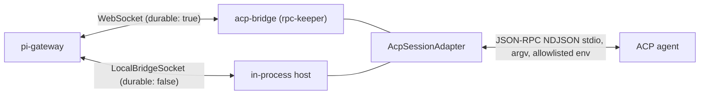

See change: add-acp-session-driver.

## Data Flow

### Event Flow (pi → browser)
1. Pi emits event (e.g., `message_update`)
2. Bridge extension converts to `event_forward` protocol message
3. Server receives, stores in in-memory buffer, assigns sequence number
4. Server broadcasts to all subscribed browsers via `event` message
5. Browser's event reducer processes event, React renders update

**Last-activity stamping** (change: session-card-last-activity-badge): in step 3, before other event-derived updates, server checks `isActivityEvent(eventType)` against curated allowlist (`prompt_send`, `message_*`, `turn_end`, `tool_execution_*`, `agent_*`, `bash_output`, `flow_*`, `architect_*`). On match — only when session NOT in replay — stamps `session.lastActivityAt = Date.now()`. In-memory write unconditional; `session_updated` broadcast throttled to **≤ 1×/30 s/session** via `lastActivityBroadcastAt: Map<sessionId, ms>`. Map entry dropped on `session_unregister` so fast re-register can't lose first broadcast. Heartbeat/metrics/UI-state events (`process_metrics`, `git_info_update`, `model_select`, `ui_data_list`, `ext_ui_decorator`, …) excluded so idle pi process emitting periodic metrics doesn't keep badge artificially fresh. At server boot, `session-scanner.ts` cold-start-seeds `lastActivityAt` from `events.jsonl` mtime so idle sessions retain meaningful relative-time label across restarts. Client `selectBadgeTimestamp(session)` (`packages/client/src/lib/session-card-time.ts`) renders `endedAt ?? lastActivityAt ?? startedAt` for ended sessions, `lastActivityAt ?? startedAt` for active.

**Unread state machine** (change: session-card-unread-stripes): every session carries a `unread: boolean` field that flips to `true` when an attention-worthy event fires while no browser has the session displayed, and clears to `false` when any browser opens the session. The visual is cyan scrolling stripes (`card-unread-pulse`, Tailwind `cyan-400`) on the session card, lower priority than the yellow streaming and purple ask_user pulses.

- **Triggers** (evaluated by the pure helper `isUnreadTrigger(eventType, before, after, payload)` in `event-status-extraction.ts`):
  1. Session status transitions from `streaming` to `idle` or `active` — a turn finished.
  2. Session's `currentTool` becomes `"ask_user"` — input is requested.
  3. An `agent_end` event arrives with a truthy `payload.error` — something broke.
  Other events (assistant `message_end`, tool execution start/end, model/git/metrics noise) deliberately do NOT trigger unread — they would be too noisy on long turns.
- **"Currently viewing" registry**: `viewed-session-tracker.ts` exposes `Map<sessionId, Set<WebSocket>>`. Browsers populate it via two new browser→server messages, `session_view` and `session_unview`, sent by the client hook `useViewDispatcher` (mounted in `App.tsx`). The hook watches the `/session/:id` route and the WebSocket connection status; on every transition INTO `connected` it re-sends `session_view` for the current id so server-side state re-syncs after reconnect. On WS `close`, the gateway calls `tracker.unviewAll(ws)` so disconnected browsers cannot hold sessions in the viewed state. Read state is GLOBAL across browsers (mirrors mail/Slack: opening on phone clears unread on laptop).
- **State transitions** in `event-wiring.ts`: right after the `extractSessionUpdates` block, the wiring snapshots `{status, currentTool}` before/after the update and calls `isUnreadTrigger`. If true AND `viewedSessionTracker.isViewedByAnyone(sessionId) === false` AND `!replayingSessions.has(sessionId)`, the wiring stamps `session.unread = true` and broadcasts `session_updated`. The browser-gateway's `session_view` arm clears the bit (`unread: false`) and broadcasts. The clear-on-already-read path is a no-op (no spurious broadcast).
- **Persistence**: the bit lives in `.meta.json` (`SessionMeta.unread`). `server.ts onChange` writes it on every session update; `session-scanner.ts::sessionFromMeta` restores it on cold start. The cold-start "force `status = ended`" override at `server.ts:273-279` is intentionally non-destructive on `unread` — a session that was unread when the server stopped is still unread when it starts back up, even before its bridge reattaches.
- **Render precedence** (`SessionCard.tsx::getCardPulseClass`): `ask_user` (purple) > `streaming || resuming` (yellow) > `unread` (cyan) > none. Streaming with `unread: true` shows yellow stripes; when streaming ends with the session still unviewed, the trigger fires, the card flips to cyan. The `card-unread-pulse` CSS class reuses the `card-working-stripes-scroll` and `card-working-opacity-pulse` keyframes verbatim — only the stripe and tint colors change to cool cyan (`rgba(34, 211, 238, 0.18)` and `rgba(34, 211, 238, 0.07)`). Cyan was selected to occupy its own corner of the dashboard palette (distant from yellow, purple, green, red). Reduced-motion users see a static cyan-tinted background, matching the working-pulse arm. Cyan now theme token `--status-unread` (dark `#22d3ee`, light `#0891b2`) in `index.css`; `.card-stripes-unread` uses `color-mix` of it (change: session-list-group-by).

**Attention routing & status semantics** (change: improve-dashboard-attention-routing):
- **Semantic status tokens.** `--status-needs-you` / `--status-working` / `--status-idle` / `--status-error` derive per-theme from accents (`var(--accent-purple/yellow/green/red)`). `themes.ts::statusVars` + `withStatus` merge into every theme dark+light; `index.css` `:root` defines base fallback. Session visuals reference tokens only — no raw palette literals.
- **Needs-you precedence.** `error > ask_user(chat-routed) > resuming/retry > working(streaming) > active/idle > ended`. Applied uniformly across left-gutter dot (`deriveDotColorWithFlags`), rail (`deriveRailBgColor`), icon tint (`deriveIconStatusColor`, converts `bg-[var(...)]`→`text-[var(...)]`). All in `session-status-visuals.ts`. `flags.hasWidgetBarPrompt` excludes widget-bar ask_user from needs-you so only chat-routed prompts escalate (`isChatRoutedAskUser`).
- **Non-hue shape channel.** `deriveStatusShape` + `statusShapeIcon` map status to filled/half/ring/cross marker. `SessionCard.tsx::StatusShapeBadge` overlays marker on session-status-icon (`data-status-shape`). Color-blind-safe redundant encoding.
- **Label split.** `ActivityIndicator`: ask_user → "Needs you" (`--status-needs-you`); idle/active → "Idle" (muted). "Waiting for input" retired.
- **Folder status capsule** (change: unify-folder-status-capsule). `FolderStatusCapsule` = folder header's ONLY liveness surface. Renders in BOTH collapse states. Replaces `FolderNeedsYouPill` + collapsed-only `FolderStatusRollup` + raw `(N)` count — all DELETED, incl. `countStatusRollup`. Segments by `countStatusCapsule(sessions, flags)` (`packages/client/src/lib/session/session-status-visuals.ts`). Fixed severity order `CAPSULE_SEGMENT_ORDER` = needs-you > error > working > idle; magnitude never reorders. Zero-count segments absent; no countable sessions → no capsule at all (all-ended folder shows none; its `N ended` disclosure row still reports size). Excludes `ended` + `hidden` before shape derivation. `flags.widgetBar` tri-state `(id) => boolean | undefined`; `true` or `undefined` excludes that ask_user session from EVERY bucket. Still per-session `WidgetBarProbe` + `useHasWidgetBarPrompt`, now capsule-owned. needs-you uses explicit predicate, not `deriveStatusShape`; re-adds `!hasError` guard — errored ask_user counts once, as error. `notice` shape folds into `idle` bucket; retrying counts as `working`. Counts cap at `999+`. Non-idle segments = `<button>`s → first session of that state via `firstIds[bucket]`; idle = inert `<span>` + aria-label. Activation `stopPropagation()` → SessionList reveal path (`onSeekToCard` / `revealRequest`): inherits guarded expand, layout-settled scroll, hidden/filtered degrade toasts. Colors from `--status-*` family only, never `--severity-*`; no new CSS custom property. Capsule `flex-none` + `whitespace-nowrap`; sheds nothing; folder name absorbs width pressure. Test ids: `folder-status-capsule-<cwd>`, `folder-capsule-seg-{needs-you,error,working,idle}-<cwd>`.
- **Urgency sort RETIRED** (change: session-list-group-by). `useFolderUrgencySort` + `floatAskUserFirst` deleted. Folder menu item `urgency-sort` removed. Superseded by Group by ▸ Status "Needs you" lane. One-shot client migration `runUrgencyMigration` (`packages/client/src/lib/session/group-by-migration.ts`) runs after first `group_by_prefs_updated`: each legacy `dashboard:folder-urgency-sort` folder without explicit mode → `set_folder_group_by {mode:"status"}`; explicit modes kept; localStorage key then removed.

**Session list Group by** (change: session-list-group-by):
- **Modes.** `GroupByMode` = `none` | `status` | `location` (`packages/shared/src/session-group-by.ts`). Per-folder override > `defaultGroupBy` > `none` (`resolveEffectiveGroupBy`, `pathKey` lookup).
- **Persistence.** `preferences.json` optional `defaultGroupBy`, `folderGroupBy: Record<pathKey, mode>`, `collapsedLanes: string[]` (`<pathKey>::<laneId>`). `preferences-store.ts`: `getGroupByPrefs`, `setFolderGroupBy(path, mode|null)`, `setDefaultGroupBy`, `setLaneCollapsed`. Validate enums. `pathKey`-canonicalize like `collapsedFolders`. Never realpath. Never prune. Return true only on real change.
- **Protocol.** Browser→server `set_folder_group_by {path, mode|null}` (null = use default), `set_default_group_by {mode}`, `set_lane_collapsed {path, lane, collapsed}`. Server→browser aggregate `group_by_prefs_updated {defaultGroupBy, folderGroupBy, collapsedLanes}`. Handlers `browser-handlers/directory-handler.ts` broadcast only on change. Connect burst: right after `collapsed_folders_updated`, before `pinned_dirs_updated` / `workspaces_updated` / `sessions_snapshot` → lanes on first paint. `frameClassOf` = `state`.
- **Lanes = client-only view** over unchanged `sessionOrder`. `partitionIntoLanes` stable partition via `sortSessionsByOrder` (`packages/client/src/lib/session/session-lanes.ts`). Status lane order `needs-you, error, working, review, idle`. `classifyStatusLane` wraps `deriveStatusShape`; compacting → working; unread idle / notice → review; ended → ended bucket. Location lanes `main` / `worktrees` (`gitWorktree` set).
- **Render rules.** `SessionList.tsx` `lanesForGroup` → null (plain list, unchanged DOM) when mode none, search/tag filter active, or ≤1 non-empty lane. One `SortableContext` per lane. `LaneHeader` (`components/session/LaneHeader.tsx`): glyph on rail; label never status-colored; collapsed location lane shows inert status rollup. Ended bucket stays plain below lanes. Per-folder layout cache keyed on mode + order + `laneFingerprint` → token/cost ticks never re-partition.
- **Drag.** `resolveLaneDrop`: same lane → slot-preserving `mergeLaneOrder` → `onReorderSessions`. Cross-lane → rejected + toast. Ended involved → legacy drag-to-resume path.
- **Stability.** `useLaneHysteresis` (`hooks/useLaneHysteresis.ts`) holds working→review/idle demotion 3000 ms (`LANE_HOLD_MS`). needs-you / error immediate. Held card shows `.lane-hold-bar` in destination lane color. `useFlipOnLaneChange` FLIP 220 ms; skipped under `prefers-reduced-motion` and during drag. Selected card lane change → polite `lane-live-region` announcement + `scrollIntoView`. Reveal expands collapsed target lane.
- **UI entry points.** Folder menu `radioGroup` (`FolderActionsMenu`, `role=menuitemradio`: Use default (<Mode>) / None / Status / Location). Header `GroupByChip` on secondary row (`<Mode>` / `<Mode> · default`). Settings ▸ Sessions ▸ Session list `DefaultGroupingField` (instant-apply WS, outside Save-bar draft).
- **Rollback.** Extra `preferences.json` keys ignored by old loader; dropped on next write.

### Bridge Streaming Coalescing (change: coalesce-bridge-message-update-snapshots)

**Problem.**
- pi `message_update` carries FULL accumulated text snapshot, not delta.
- Bridge forwarded every update synchronously on pi single-threaded loop.
- Paid `JSON.stringify` + `ws.send` per source token.
- Strings grow O(N) over N tokens → O(N²) bytes per turn; stalled host event loop.

**Mechanism & state machine.**
- File: `packages/extension/src/message-update-coalescer.ts`.
- Transport-agnostic single-slot state machine (`MessageUpdateCoalescer`).
- Bridge injects callbacks: `send`, `setTimer`, `clearTimer`, `isActive`.
- `COALESCE_WINDOW_MS = 50`.
- FIXED window anchored at FIRST pending update arrival.
- NOT debounce: continuous stream never gaps; debounce starves stream until `message_end`.
- Fixed window caps added latency at ≤ 50 ms non-cumulative.
- Last-wins single slot; stores live event reference; client takes cumulative latest snapshot.

**Family split (sub-event routing).**
- Text-carrying sub-events park: `text_start`, `text_delta`, `text_end`.
- Non-text sub-events bypass park: `thinking_start`, `thinking_delta`, `thinking_end`, `toolcall_start`, `toolcall_delta`, `toolcall_end`, `start`, and unknown types.
- Non-text handler flushes parked text snapshot first, then forwards immediately and unmodified.
- Preserves thinking deltas: thinking deltas ADDITIVE, not snapshots; coalescing drops tokens.
- Unknown sub-events fail-safe: pass through immediately to prevent swallowing additive extensions.

**Identity barrier.**
- Per-message generation counter `assistantMessageGen` in `bridge.ts`.
- Increments on EVERY `message_start` (user + assistant) across turns and retries.
- Key format: `${gen}:${role}:${timestamp}` via `messageKeyOf`.
- `message.id` unusable: pi assigns id post-handler during session persistence.
- `timestamp` required on `AssistantMessage`/`UserMessage`; fallback uses WeakMap object counter.

**Drop rule & fail-open lifecycle.**
- ONLY updates whose identity closed via `messageEnd` drop.
- Updates with unknown identity or no open message open new slot instead (fail-open).
- Guard: `npm run reload` re-initializes bridge mid-turn; dropping unknown identity silences active turn.
- Bounded FIFO (`CLOSED_KEY_MEMORY = 64`) retains closed keys.

**Flush choke points.**
- Entry choke point: enriched + pass-through loops call `if (flushesParkedText(eventType)) coalescer.flush()` at handler entry.
- Runs before ANY early return; prevents latent ordering bugs from new branches.
- Out-of-loop chat sinks flush explicitly: `wrapCustomPersistenceForCtx` (`appendCustomMessageEntry`, `appendCustomEntry`) and `sendSyntheticRetryEvent`.
- `message_end` flushes text before scheduling deferred id-stamping `setTimeout(0)`.

**Lifecycle & transport boundaries.**
- `onReconnect`: flushes pending text BEFORE `sendStateSync()` + replay. Reconnect = transport boundary; preserves in-flight turn tail, forbids post-replay delivery.
- Session change / `session_shutdown`: call `coalescer.clear()`. Session transition = state invalidation; discards parked snapshot, cancels window.
- Window timer registered in bridge registry (`prev.timers`); released on fire/clear to prevent leak across reload.
- Timer callback re-checks `isActive()` at fire time; prevents writing to closed socket after bridge teardown.
- Image inliner: `maybeInlineAssistantImages` runs inside `coalescer.send` callback; executes once per flushed window instead of once per token. Authoritative `message_end` inliner retained.

**Architectural boundary (scope).**
- Cuts BRIDGE forwarding cost only (`JSON.stringify` + wire transmission).
- Does NOT replace server fold (`live-event-frame-coalescing-fold`) or client batching (`chat-event-render-batching`).
- Downstream layers cut RENDER cost; bridge coalescer cuts WIRE/SERIALIZATION cost.
- Wire protocol format unchanged (`event_forward` message carrying `message_update`).

**Measured baseline & scaling.**
- Baseline (harness uncoalesced): 169 `message_update` frames, 616,534 bytes over 13.4 s stream = 12.6 deltas/s, 1:1 forward.
- Reduction factor: `max(1, sourceDeltasPerSecond ÷ 20)`.
- Win activates when provider emits > 20 deltas/s (< 50 ms delta interval). Real providers stream 1–4-token deltas at 20–150 tok/s (2.5×–7.5× reduction).
- `FAUX_TPS=50` chunks 3–5 tokens (~12.5 deltas/s); harness measures ~1× by design.

**References.**
- Spec: `openspec/specs/bridge-message-update-coalescing/spec.md`.
- Design decisions: `openspec/changes/archive/2026-09-19-coalesce-bridge-message-update-snapshots/design.md` (D1–D9).
- Unit tests: `packages/extension/src/__tests__/message-update-coalescer.test.ts`, `packages/extension/src/__tests__/bridge-coalesced-chat-order.test.ts`.
- E2E test: `tests/e2e/coalesced-streaming.spec.ts`.

### Bridge Event Forwarding Exclusions (change: filter-system-role-message-forwarding)

**Why.**
- pi `>= 0.86.0` makes system prompt + tool loadout transcript-backed.
- First request of a session persists a `role:"system"` message carrying every prompt `section` + full `toolsAdded` declaration list.
- Later prompt/tool changes persist further system messages.
- `pi-agent-core` `agent-loop.js` emits that message as a BACK-TO-BACK `message_start` + `message_end` pair (same object); bridge forwarded both.
- Measured ~150 KB per system message on a live 0.86.1 session.
- `session_compact.compactionEntry` carries the SAME prompt-sections + tool-declaration blob in `compactionEntry.systemMessage`, plus the compaction `summary`.
- `session_compact` had no dedicated bridge arm; it fell through to the shared forward tail and was serialized whole.

**What changed.**
- File: `packages/extension/src/bridge.ts`. Three sites.
- `message_start` arm: early-return when `event.message?.role === "system"`, placed immediately AFTER the existing `role === "custom"` return.
- `message_end` arm: same early-return, same placement.
- New exported helper `redactCompactionEntry(event)` in `packages/extension/src/event-forwarder.ts`: returns a shallow COPY of the event with `compactionEntry` deleted.
- Bridge applies it on the shared tail only for `session_compact`: `const forwardEvent = eventType === "session_compact" ? redactCompactionEntry(event as Record<string, unknown>) : event;` before `mapEventToProtocol`.
- No version gate: pi `< 0.86` never emits the role; field omission is safe wherever the field is absent.
- `assistantMessageGen` comment in `bridge.ts` widened from "(user and assistant)" to include the barrier-only `system` start.

**Placement (why after the barrier).**
- Both returns sit AFTER the coalescing barrier (`assistantMessageGen += 1;` + `coalescer.messageStart(...)` / `coalescer.messageEnd(...)`).
- Barrier contract unchanged.
- Entry-level flush choke point (`if (flushesParkedText(eventType)) coalescer.flush()` at handler entry) still runs first.
- Placement is a consistency choice, not behavioural; the parked-snapshot ordering guarantee belongs to the entry choke point.

**Redaction on a copy.**
- Copy, never mutate: pi hands the SAME event object to every subscribed extension.
- Generic `mapEventToProtocol` stays generic.

**Why safe (no consumer).**
- Client `session_compact` arm (`packages/client/src/lib/chat/event-reducer.ts`) reads only `reason`, `willRetry`, `estimatedPostCompactionTokens`; renders the compaction divider from the event's presence.
- Server uses the event only to clear the `compacting` latch (`packages/server/src/session/event-status-extraction.ts`).
- Replay path already synthesizes a metadata-free `session_compact` (`packages/shared/src/state-replay.ts`).
- Live-vs-replay parity is defined on event type/position/timestamp only; this change does not alter that contract.

**Accepted trade-offs.**
- Sessions that already persisted system events are not evicted (forward-only); they replay until normal rotation removes them.

**References.**
- Design: `openspec/changes/filter-system-role-message-forwarding/` (D2/D6/D7).
- Spec delta: `openspec/changes/filter-system-role-message-forwarding/specs/catch-all-event-forwarding/spec.md`.
- Tests: `packages/extension/src/__tests__/bridge-coalesced-chat-order.test.ts`, `packages/extension/src/__tests__/event-forwarder.test.ts`.

### EventBus Forwarding Mechanism (subscription-based, change: fix-automation-run-lifecycle)

**Host topology.**

- `EventBus` = `node:events` wrapper. `pi-coding-agent/dist/core/event-bus.js`. Methods: `emit` / `on` / `clear`. NO wildcard channel.
- One bus per pi process. Shared by all extensions.
- `pi.events` = PER-EXTENSION facade over that bus. `createExtensionAPI` -> `events: { emit, on }`. `pi-coding-agent/dist/core/extensions/loader.js`.

**Why NOT an emit intercept.**

- Patching `pi.events.emit` mutates only the patching extension's facade.
- Foreign emissions bypass the patch. Emitters affected: pi-flows, pi-subagents.
- Old bridge patched `emit`. Consequence: zero live `flow_*` / `subagent_*` `event_forward` ever left the bridge.
- Flow cards rebuilt from persisted `custom/flow-event` JSONL. `packages/shared/src/state-replay.ts`.
- Automation runs with a `flows.run` action stayed `status: "running"`.
- Stale-run reaper finalized them `error: "run exceeded max age"` ~30 min later.
- Measured: 101 runs, 0 reached `done`.
- Proof: bridge `pi.events.on("flow:complete")` fired; patched `emit` never entered for that channel.

**Current mechanism.**

- `registerEventBusForwarding`. `packages/extension/src/flow-event-wiring.ts`.
- ONE `pi.events.on(channel, ...)` subscription per declared channel.
- `on()` observes every emitter.
- Declared set = keys of `FLOW_EVENT_MAP` + `SUBAGENT_EVENT_MAP` + optional `extraMaps` (currently none passed).
- Channel list IS the contract. Undeclared channel -> never forwarded.
- New channel -> new map entry. Identity entry when no rename wanted.
- Retired: wildcard forwarding of any unknown channel. Unimplementable without an emit intercept.

**Forward gates.** `forwardBusEvent`, same file.

- Subagent channel -> forward only when `sessionReady && isActive() && connection.isConnected`.
- Else buffer latest-wins per agent in `SubagentFrameBuffer`. Flushed on re-register / reconnect.
- Other declared channel -> forward when `sessionReady && isActive()`.
- Forwarding failure never propagates to the emitter.
- Forwarding failure drops that live frame. Nothing re-sends it. Subagent frames are the exception (buffered).

**Teardown.** dispose returned by `registerEventBusForwarding`.

- Removes only the bridge's own subscriptions.
- Restores nothing. Bridge never replaces a host function.

### Plugin-declared event forwarding (change: add-plugin-bridge-contributions)

**Declaration.**
- Core no longer names plugin channels. Plugin declares forwarded bus channels from own bridge entry (`src/bridge/index.ts`, manifest `pi-dashboard-plugin.bridge`).
- Plugin emits `dashboard:register-event-forward` `{ pluginId, channels: { "<channel>": { as?, delivery: "live"|"latest"|"stream", key? } } }`.
- Constants `REGISTER_EVENT_FORWARD_CHANNEL`, `BRIDGE_READY_CHANNEL` — `packages/shared/src/event-forward-declaration.ts`.

**Load order.** pi bus has no replay.
- `PluginForwardRegistry.attach()` (`packages/extension/src/plugin-event-forward-registry.ts`) — called in `initBridge` after `registerEventBusForwarding`.
- `attach()` registers listener, then emits `dashboard:bridge-ready`.
- Plugin re-declares on every bridge-ready. Idempotent.

**Validation.** `validateDeclaration` — untrusted input.
- Channel regex requires `:`. Caps: 32 channels/plugin, 256 total.
- Rejected: `RESERVED_EVENT_TYPES`, channel already in core `EVENT_BUS_MAP`. First owner wins on conflict (counted).
- `pluginId`/key regex-validated. Key value string or finite number ≤128 chars, else delivered live-only.

**Delivery.**
- `live` — forward only while session ready+active, else drop.
- `latest` — keep newest per key until ready.
- `stream` — keep all, in order, never coalesced.

**Retention.** `StreamForwardBuffer` (`packages/extension/src/stream-forward-buffer.ts`).
- One buffer keyed by (pluginId, key value) — cross-channel order (delta vs entry) survives.
- ≤2000 msgs or 2MiB per key; 64-key budget shared by latest+stream across plugins, drop-oldest, counted.
- Flushed in `flushPendingSubagentFrames` when ready+active+connected; disposed on shutdown.

**Observability.**
- Heartbeat metrics `pluginForwardDeclared/Rejected/Conflicts/Retained/Dropped`.
- `/api/health` → `pluginEventForward { declared, rejected, conflicts, retained, dropped }`.

**Enablement.**
- Server boot calls `syncPluginBridges` (`packages/shared/src/plugin-bridge-register.ts`) with `resolvePluginEnabled(cfg, manifest.defaultEnabled)`; disabled bridges deregistered.
- Toggle route returns `restartRequired: true`; no toggle-time write.

**Example consumer.** `packages/subagents-plugin/src/bridge/index.ts`.
- Declares `subagents:entry`→`subagent_entry`, `subagents:delta`→`subagent_delta`; both `stream`, key `agentId`.
- Needs producer `pi-dashboard-subagents` ≥0.4.0.

**Server store.** `packages/server/src/persistence/memory-event-store.ts`.
- Head+tail timeline truncation removed (no "steps hidden"); `subagent_delta` text exempt from per-string cap.
- Over-ceiling delta stored as envelope `text: ''` + `omittedLength`.
- `collapseStreamDeltas` drops delta rows once block's entry or terminal event arrives (`storeTrim.collapsedDeltas`).
- Over-ceiling terminal frame elides `entries` to `[]` only when all indices `0..entryCount-1` resident.

**Client.** `packages/client/src/lib/chat/event-reducer.ts`.
- Arm `subagent_entry` by index; arm `subagent_delta` assembles by blockId/offset, gap marker, late deltas tombstoned via `closedBlockMax`.
- Inspector in-progress block grows (`SubagentState.liveBlock`); card ticker keeps 280-char `liveTail`.

**Second consumer.** `packages/roles-plugin/src/bridge/index.ts`.
- `before_agent_start` appends one `toolGuidelines.Agent` bullet. Prefer `model:"@role"`, ≤12 configured roles. Only when Agent tool selected.

### Subagent Timeline Push/Pull Split (change: reduce-subagent-details-payload)

**Why thin ticks.**

- Producer builds ONE `snapshotDetails()` object.
- Feeds BOTH carriers: `subagents:*` EventBus frame + pi-core `tool_execution_update`.
- `entries[]` append-only → tick size grows linearly with run length.
- Long run = fat intermediate ticks.
- Solution: strip timeline from intermediate ticks.
- Push terminal frame fat.
- Pull full timeline on demand.

**Strip module.**

- File: `packages/extension/src/subagent-frame-strip.ts`.
- Exports `stripSubagentEntries`, `stripForForward`, `NON_TERMINAL_STATUSES`.
- Strips `details.entries` on FORWARD path when frame status `queued` or `running`.

**Allowlist, never negation.**

- `NON_TERMINAL_STATUSES` = explicit allowlist.
- Never `!terminal`.
- `AgentStatus` also has `stopped`; negation would strip it and lose that run's timeline.
- `stopped` counts as terminal: never stripped.

**Strip clones.**

- Strip CLONES data.
- `SubagentFrameBuffer` retains frames BY REFERENCE.
- Mutating strip would corrupt the pull source.
- Fat snapshot survives intact for resync.

**Call-site allowlist.**

- Strip applied at explicit call sites.
- NEVER inside `sendEventForward`.
- Sites: EventBus forward path (`flow-event-wiring.ts` `forwardBusEvent`).
- Sites: buffered-frame flush + resync reply (`packages/extension/src/subagent-forward-sites.ts` — `flushBufferedSubagentFrames` strips, `serveSubagentResync` does NOT).
- Sites: `tool_execution_update` carrier in `bridge.ts`.
- Strip inside `sendEventForward` would strip the resync reply.
- EventBus-only strip would leak every frame drained by the buffer.

**Terminal frames never stripped.**

- `completed`/`failed`/`aborted`/`stopped`/`error` forward full.
- Terminal frame = durable record behind `tool_execution_end` backfill.
- Second independent terminal guard: `stripForForward(data, channel)` never strips when `channel` in `TERMINAL_CHANNELS` (`subagents:completed`, `subagents:failed`).
- Guard fires regardless of `details.status`.
- Both signals must be wrong to lose a timeline.

**Full-snapshot invariant preserved.**

- Every frame still an idempotent FULL snapshot.
- Latest-supersedes.
- No delta encoding.
- No wire key.
- No version negotiation.
- No producer change.
- Dropped thin tick leaves no permanent hole.

**Pull path.**

- Client requests `subagent_resync_request`.
- Bridge answers from retained fat snapshot as synthetic `subagents:started` frame.

**Server resync locator.**

- `locateSubagentTimeline` (`packages/server/src/persistence/memory-event-store.ts`) now also matches `subagent_*` eventTypes carrying `details.entries`.
- Before: resync reply fell to generic pass.
- Before: any array > 20 items became string `"[array truncated]"`.
- Before: reducer rendered no timeline.
- Head-tail budget now applies: head + `⋯ N steps hidden ⋯` sentinel + tail.
- `DEFAULT_MAX_EVENT_DATA_SIZE` = 262144.

**Open-inspector liveness.**

- File: `packages/client/src/hooks/useSubagentResyncCadence.ts`.
- Mounted detail view re-fires `subagent_resync_request` on backoff cadence.
- Base 2000 ms, doubles per idle tick, ceiling 30000 ms, resets on entry growth.
- ONE timer per subagent → inline inspector + popout do not double-fire.
- No `emptyTimeline` precondition on this trigger (open-time trigger keeps it).

**Requester-scoped delivery.**

- Request carries `requestId`.
- Bridge echoes it on reply as `__resyncRequestId`.
- Server routes reply to that one connection (`packages/server/src/pairing/subagent-resync-routing.ts`, `ResyncRequesterRegistry`, TTL 30000 ms).
- Unknown/expired token falls back to normal broadcast.

**Counters.**

- `storeTrim.subagentTicks` / `subagentTickBytes` / `subagentFatTicks` / `subagentTickFatBytes` on `/api/health` (additive).
- Bridge `SubagentFrameStats.resyncCadence` counts pull-loop requests.

**Rollback. PARTIAL, not total.**

- One flag: `PI_DASHBOARD_SUBAGENT_STRIP=0` forwards unstripped.
- Flag disables STRIPPING ONLY.
- Wire payload returns to pre-change shape: intermediate ticks fat again.
- These stay ACTIVE under the flag: `locateSubagentTimeline` `subagent_*` gate.
- Stay active: resync cadence in `useSubagentResyncCadence.ts`.
- Stay active: requester-scoped routing (`requestId` / `__resyncRequestId`).
- Stay active: additive `storeTrim` subagent-tick counters.
- Each of those is additive or a bug fix. None depends on the strip.
- No producer, protocol, or store rollback exists to do.

**Known regression, stated deliberately.**

- Run dying with NO terminal frame (crash/kill) leaves only thin ticks in store.
- Recovery needs a LIVE bridge with agent still in the 64-slot `SubagentFrameBuffer`.
- Evicted or post-reset agents answer `resyncNoop`.
- Client keeps its last rendered state.

### Subagent Fan-out Admission (change: bound-subagent-fanout-under-host-pressure)

**Problem.**

- Wide `Agent` fan-out on loaded host stalls parent event loop.
- 13/14 census sessions died with unanswered fan-out as final transcript entry.
- Stall triggers `hostPressure` unresponsive verdict; host reaps parent process.

**Registration and ordering.**

- Bridge registers admission gate on `tool_call` (`packages/extension/src/subagent-fanout-admission.ts`).
- Registered AFTER pass-through forwarder in `bridge.ts`.
- `runner.emitToolCall` stops at first `{block: true}` handler.
- Earlier registration starves forwarder; dashboard misses `tool_call` while seeing `tool_execution_end`. Order load-bearing.

**Concurrency bound.**

- Bound measures in-flight concurrency per session, not batch width.
- Platform drops assistant message before extension sees `tool_call`; batch size and batch identity unknowable.
- In-flight counter increments at admission, not execution.
- Siblings preflight sequentially before any executes; execution-time counter reads zero across whole batch.
- Synchronous reject-only decision. Gate never awaits child; awaiting deadlocks preflight sequence.

**Configuration.**

- Default cap: `DEFAULT_MAX_CONCURRENT_SUBAGENTS = 2` (`packages/shared/src/config.ts`).
- Config key: `maxConcurrentSubagents`.
- Value `0` disables gate (rollback).
- Absent value resolves to active default (2).
- Malformed non-integer or negative value resolves to `Infinity` (fail-open).

**Resource saturation.**

- Saturation narrows effective cap to 1 (never 0); saturated session still makes progress.
- Private sampler: `subagent-saturation.ts`.
- Dedicated `monitorEventLoopDelay` over fixed 5 s window plus own CPU baseline.
- Never reads `collectMetrics()`: destructive read resets 15 s heartbeat histogram, corrupting crash telemetry.
- Separates process domain (`process.cpuUsage()`, event loop delay) from machine domain (`os.loadavg()`).
- Hysteresis: enter at threshold, exit only when all metrics fall below 80 % of threshold (`SATURATION_EXIT_RATIO = 0.8`).

**Permit release.**

- Releases permit on `tool_execution_end`.
- Fires on normal, blocked, and aborted execution paths.
- Never releases on `tool_result`: aborted call (Esc) skips result hook, leaking permits and starving session.

**Refusal semantics.**

- Refusal returns `{block: true, reason}`.
- Produces real errored tool result; renders terminal card with actionable retry reason.
- Never sets `terminate`: refusal means re-issue later, not session abort.

**Observability and durability.**

- Refusal writes durable session entry `subagent-admission-refused` via `pi.appendEntry`. Survives process reap.
- Admissions skip disk writes to protect hot path.
- Live counters on `ProcessMetrics`: `fanoutAdmitted`, `fanoutRefused`, `fanoutSaturationRefused`.

**Scope boundary.**

- Gate runs per gated session, not per host process.
- Subagent sessions skip bridge initialization via re-entry guard.
- Grandchildren and `flow_agents` run ungated.

### Retry Lifecycle (change: retry-forever-with-stop-control)

Pi owns the retry loop. Dashboard configures + observes + renders it. Attempts fire sequentially; each produces ONE complete `agent_start` … `agent_end` event cycle. Final attempt produces ONE `agent_settled` event terminal marker.

**1. Retry ownership & settings.**

- Pi `RetrySettings` = `{ enabled, maxRetries, baseDelayMs, provider: {timeoutMs, maxRetries, maxRetryDelayMs} }`.
- Session-layer delay = `baseDelayMs * 2^(attempt-1)`. Uncapped. No ceiling.
- `retry.maxDelayMs` REMOVED from session layer. pi migrates to `retry.provider.maxRetryDelayMs` (different layer, different semantics).
- Overshoot consequence: next attempt lands ~2x elapsed. Scale-invariant. Tuning `baseDelayMs` shifts which attempt lands where, never the ratio.
- Dashboard runs NO retry loop. Raising `retry.maxRetries` is the whole "retry forever" mechanism.
- `resume mode:"continue"` cannot re-drive live turn (refused `resume.already_active`). For ended session resolves to `pi --session <file>` which reopens IDLE + drives no turn. No re-drive mechanism exists — none needed, since pi never settles turn while budget remains.

**2. Bridge observation model** (`packages/extension/src/retry-tracker.ts`).

- pi fires ONE FULL `agent_start` … `agent_end` cycle PER ATTEMPT. Exactly one `agent_settled` after final `agent_end`.
- Old model keyed on "error `message_end` then fresh assistant `message_start` in same turn". Never matched. Emitted ZERO events. Retry surface was dead in production.
- New rules: error `message_end` records pending error text → emits nothing. Error `agent_end` = attempt over + another coming → emits `auto_retry_start` + `auto_retry_waiting` (carries `attempt`, `delayMs`, `nextAttemptAt`), does NOT clear chain. `agent_settled` = SOLE terminal → emits `auto_retry_end`, clears chain.
- Waiting signal suppressed once `attempt >= maxAttempts`.
- `agent_settled` carries NO `messages` (verified pi 0.81.1/0.83), so tracker remembers terminal disposition via `lastEndWasError` at `agent_end`.
- `-1` sentinels REMOVED. `maxAttempts` / `delayMs` sourced read-only from pi settings via `packages/extension/src/pi-retry-settings.ts` (defaults 3 / 2000; unreadable → `delayMs: 0` → surface renders elapsed-only).
- pi 0.83 exposes retry lifecycle events to RPC/SDK consumers ONLY. ExtensionAPI has no `auto_retry_*` and nothing on EventBus. `willRetry` in 0.83 is compaction-only (`session_before_compact`/`session_compact`). Bridge is extension → must observe-synthesize.
- Native `agent_settled` guaranteed at the 1.3.0 lockstep floor (`piCompatibility.minimum == recommended == 1.3.0`). Bridge consumes the native settle unconditionally — no version gate, no floor-pi synthesis. Floor-pi synthesis module `packages/extension/src/agent-settled.ts` DELETED. `agent_settled` remains the SOLE terminal retry signal. See change: update-pi-core-0-85-adopt-apis.
- Bridge follow-up drain (`bridgeFollowUp`) triggers on `agent_settled`, not `agent_end`. Forwarder schedules `drainFollowupQueue()` via `setTimeout(0)`; pi clears run-active before `agent_settled`, so `isIdle()` is true. No retry loop: a false `isIdle()` returns, the next `agent_settled` drains. Gate sequence: `packages/extension/src/followup-drain.ts`. See change: update-pi-core-1-3-adopt-apis.

**3. Settings write + reload-on-save** (`packages/server/src/pi-agent-settings.ts`).

- Reads/writes all SIX native fields: `retry.{enabled,maxRetries,baseDelayMs}` + `retry.provider.{timeoutMs,maxRetries,maxRetryDelayMs}` in GLOBAL `~/.pi/agent/settings.json`. Blank `provider.timeoutMs` OMITTED on write (never `0`/`null`).
- Write is MERGE-PRESERVING: every other key survives, including `retry.provider.*`.
- Project `<cwd>/.pi/settings.json` NEVER written.
- Distinct from `config-api.ts`, which writes dashboard's own `~/.pi/dashboard/config.json`.
- Validation: `maxRetries` non-negative integer; `baseDelayMs` positive integer. Invalid → nothing written.
- No UI cap on `maxRetries`; long tail WARNED, never capped.
- REST: `GET/PUT /api/pi-retry` (`packages/server/src/routes/pi-retry-routes.ts`), auth-gated by same network guard as `/api/config`.
- pi reads settings only at session construction. Write alone inert for running sessions.
- On successful save server routes every target through `dispatchReload`.
- Target set = `reloadTargetSessionIds` = `piGateway.getConnectedSessionIds()` ∪ `headlessPidRegistry.listSessions()`.
- Connected-only set missed headless sessions with dead bridge WS. See change: fix-out-of-band-reload.
- Failed write reloads nothing.
- **UI placement + save.** Editor renders on Settings **Sessions** tab (NOT Providers). Reason: 3 fields (`enabled`, `maxRetries`, `baseDelayMs`) turn-level not provider-scoped; observable effect on session (waiting / attempt n / countdown / Stop). Sibling turn-lifecycle settings co-located.
- Enclosing section titled "Retry".
- NO private Save button. Registers with panel unified-Save draft registry via `useSettingsDraftSource({id:"pi-retry", page:"sessions", isDirty, commit, reset})`. See change: unify-settings-save-contract.
- Consequences: one Save commits every dirty store. Sessions nav shows per-page dirty dot. Leave guard offers Save / Discard / Cancel.
- `commit` THROWS on invalid input or failed PUT → host `Promise.allSettled` keeps source dirty + names it in `settings.savePartialFail`. Never false success.
- `reset` restores loaded policy (powers Discard).
- Registered `page` MUST match mount tab or dirty dot lands on wrong nav item.
- `retry.provider.*` fields surfaced in UI under subheading "Provider / SDK request controls". WARNING: wait routed through that layer emits no event and no callback → renders as ordinary streaming with no attempt count, no countdown. Invisible-wait fact true + reason warning exists.

**4. Collapse-vs-dismiss rule** (`packages/client/src/components/session/SessionBanner.tsx`).

- While retry pending, dismiss DEGRADES TO COLLAPSE. Never clears state.
- Collapsed pill carries: error text, bare attempt number, countdown, Stop retrying, expand control.
- State-clearing dismiss offered ONLY when no retry sub-status carried.
- Collapse sticky PER FAILURE CHAIN: later attempts of same chain stay collapsed; new chain renders expanded.
- Attempt rendered BARE ("attempt 7"), never "of N" — `maxRetries` user-set + typically large.
- Countdown from `nextAttemptAt`, else computed `startedAt + delayMs`; degrades to "still waiting… (N s elapsed)" on overrun or when `delayMs` is 0.
- "Stop retrying" aborts session → cancels pi's chain. Sole abort control in banner. Session Stop has identical effect, honored even while collapsed. Measured: abort during 16 s backoff terminated chain in 2 ms (`ctx.abort()` → `AgentSession.abort()` → `abortRetry()`).
- NO Retry control on settled surface (would need missing re-drive mechanism).
- Sidebar session card shows only amber working-token mark (no per-card countdown — avoids N timers in render-hot component).

### Interactive UI Flow (PromptBus — extension dialog → browser → response)
1. Extension calls `ctx.ui.confirm()` / `select()` / `input()` / `editor()` / bridge-patched `multiselect()`
2. Bridge PromptBus intercepts via patched `ctx.ui` methods, creates a `PromptRequest` with a unique `promptId` and `pipeline` tag (e.g. `"command"`, `"architect"`)
3. Registered adapters claim the prompt:
   - `DashboardDefaultAdapter` (always registered) returns a `PromptClaim` with `component: { type: "generic-dialog", props }` and `placement: "inline"`
   - Custom adapters (e.g. `ArchitectUIAdapter` from pi-flows) can claim with custom component types and widget-bar placement
   - TUI adapters (registered via `prompt:register-adapter` event) can claim to show a terminal dialog
4. Bus sends `prompt_request` to server with the winning adapter's component info
5. Server forwards to subscribed browsers
6. Browser's `prompt-component-registry.ts` resolves the component type to a React renderer and placement
7. User responds in browser → `prompt_response` sent to server → routed to bridge
8. Bus resolves the original dialog promise and calls `onResponse()` on all adapters for cleanup

**Multiselect note:** pi's upstream `ExtensionUIContext` has no native `multiselect`, so bridge attaches `ctx.ui.multiselect` during `session_start`. `ask_user` dispatches multiselect through `polyfillMultiselect`, which delegates to that patched PromptBus method when present + falls back to `ctx.ui.custom` + `MultiSelectList` for legacy / non-bridge contexts (fallback is no-op in pi 0.70 RPC mode — dashboard headless — because pi-coding-agent defines `custom` as `async () => undefined` there). Bridge intentionally registers NO TUI adapter arm for multiselect; routing bus-only. Browser responses encode `{ values: string[] }` as `JSON.stringify(values)` in `prompt_response.answer`, preserving `[]` as real empty selection distinct from cancellation.

**First-response-wins (multi-adapter):**
- Multiple adapters can claim the same prompt (e.g. TUI + dashboard)
- The first adapter to respond wins; the bus sends `prompt_dismiss` to the server for the losing adapter's dashboard component
- Adapters implement `onCancel()` for cleanup when another adapter wins

**Custom UI components:**
- Extensions register adapters via `pi.events.emit("prompt:register-adapter", adapter)`
- Adapters return custom `PromptClaim` with arbitrary component types (e.g. `"architect-prompt"`)
- Client-side registry maps type strings to render placement; unknown types fall back to `"generic-dialog"`

**Message passthrough:**
- The `message` field from `ask_user` tool (and other `ctx.ui` callers) is forwarded via `metadata.message` in the PromptBus request, through the `prompt_request` protocol message, and extracted by the client into the interactive renderer's `params.message`.

**Type safety:**
- `prompt_request`, `prompt_dismiss`, and `prompt_cancel` **must** be in the `ServerToBrowserMessage` union in `browser-protocol.ts`. If they are only handled via `case "..." as any:` in switch statements, esbuild's dead-code elimination will strip the handlers in production builds, silently breaking the interactive UI.

**Resilience:**
- **Page refresh**: Server replays pending `prompt_request` messages when a browser subscribes. Client deduplicates by `requestId` or pending title match.
- **Bridge reconnect**: Bridge replays pending PromptBus requests on WebSocket reconnect so dashboard dialogs survive server restarts.

### Pending-Prompt Recovery (change: fix-pending-prompt-lost-on-replay)

A live `ask_user` prompt could go permanently invisible: the server held it, the browser never rendered it, and neither Refresh nor reload recovered it. Two independent defects — a frame shed on a saturated socket, and client state wiped by a replay rebuild.

**Critical-frame delivery (server).** `replayPendingUiRequests` runs in the replay-completion callback, so the tiny `prompt_request` frame lands on a socket the just-finished full replay saturated; `sendTo` silently drops any frame while `ws.bufferedAmount > MAX_WS_BUFFER` (4 MB default). The pending-*prompt* leg now sends under a `critical` frame class, exempt from that shed, bounded twice (`packages/server/src/pairing/browser-gateway.ts`):
- per-delivery cap: **4 frames** (`CRITICAL_FRAMES_PER_DELIVERY`)
- absolute ceiling: **`MAX_WS_BUFFER` + 1 MB**

Past either bound the frame is dropped and counted as a **blocking** drop; the dead `extension_ui_request` leg and `replayNotifyLog` stay fully guarded. `getDroppedFrameStats()` reports transcript drops under `total`/`bySession` (back-compat) and blocking drops under `blocking: { total, bySession }` → `/api/health#droppedFrames.serverToBrowser`.

**Resync round trip.** `prompt_resync_request` asks the bridge to re-emit every prompt its PromptBus still holds — the bridge's pending set, never the server's derived registry.

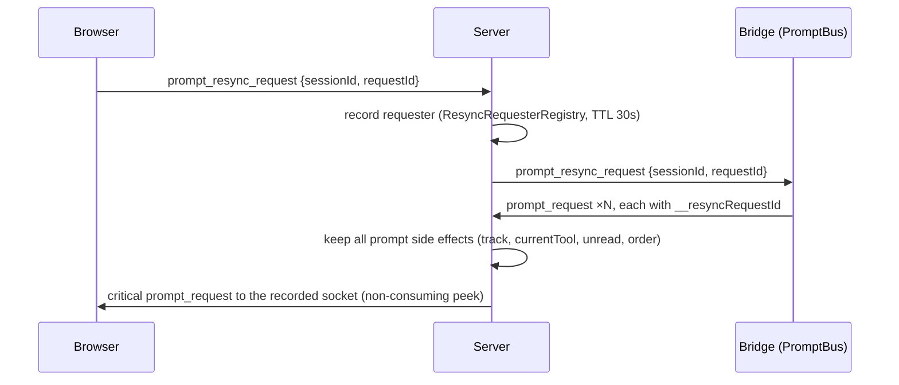

- Requester lookup is **non-consuming** (`peek`) so every prompt of a multi-prompt reply routes to the same socket, not just the first.
- `deliverPromptResyncReply` unicasts to the requester as a critical frame; unknown/expired token, requester gone, or no bridge → ordinary fan-out (or drop). Mid-replay requesters are NOT suppressed.
- Bridge: `emitPendingPrompts` (`packages/extension/src/pending-prompt-emitter.ts`) is the ONE emitter shared by `onReconnect` and the resync handler.

**Client state carry.** `carryInteractiveRequests` (`packages/client/src/lib/chat/event-reducer.ts`) preserves `pending` interactive requests **and** their paired `ui-<requestId>` rows across all FIVE reset sites: `useMessageHandler` `event_replay` + `session_state_reset`; `useSessionState` `applyReplay` + `session_state_reset`; the refresh reset in `App.tsx`. `retailPendingInteractiveRows` re-appends those rows at the tail after EVERY replay batch — a multi-batch full replay otherwise folds later transcript rows after the carried dialog, burying it mid-transcript (virtualized off-screen) while its entry keeps the desync detector suppressed.

**Refresh + desync affordance.** `refreshChat` fires `prompt_resync_request` unconditionally, failure-isolated from the transcript refresh. When the session reports `currentTool === "ask_user"` but the client holds no pending request — not ended, no replay in flight, held ≥ `PROMPT_DESYNC_GRACE_MS` (5 s) — the `prompt-desync-resync` pill (`packages/client/src/lib/session/prompt-desync.ts`, rendered in `ChatView`) surfaces and fires the same resync.

See change: `fix-pending-prompt-lost-on-replay`.

### Frame delivery policy (changes: fix-connect-snapshot-frame-loss, close-registry-frame-shed-gaps)

Every server→browser frame carries exactly one delivery class. `frameClassOf(msg) -> { cls, key }` (`packages/server/src/pairing/browser-gateway.ts`) — static `switch` on `msg.type`, never on socket condition. No `cls` field on the wire (server concern; old bundles untouched).

- **`transcript`** — per-session event stream + session-registry broadcasts (`session_updated`, `session_added`, `session_removed`). Recoverable via history backfill / replay.
- **`blocking`** — pending-prompt frames only (`ctx.critical === true`). Exempt from shed under pending-prompt-recovery bounds (4 frames/delivery, `MAX_WS_BUFFER + 1 MB` ceiling). Unchanged.
- **`state`** — idempotent snapshots keyed by `(type, entityKey)`: `sessions_snapshot`, `pinned_dirs_updated`, `workspaces_updated`, `card_sections_updated`, `favorite_models_updated`, `display_prefs_updated`, `reachability_updated`, `openspec_update` / `openspec_get_result` / `git_head_update` / `sessions_page_result` / `sessions_reordered` (key `cwd`, `sessions_reordered:<cwd>`), `terminal_added` / `terminal_updated` / `terminal_removed` (one shared key `terminal:<id>` per terminal, later lifecycle frame supersedes earlier). `sessions_reordered` is already a window-projected FULL per-cwd ordering snapshot at the `broadcast()` choke point, so per-cwd latest-wins is exact; deferred under back-pressure, never shed.

**Shed rule per class.** Socket over threshold (`ws.bufferedAmount > MAX_WS_BUFFER`, 4 MB default): `transcript` frame dropped + counted (pre-change counters `total`/`bySession`); `state` frame NEVER shed — deferred; `blocking` exempt within bounds. Transcript sends first flush the socket's pending map — a flushable state frame is never overtaken by a later transcript frame.

**State deferral.** Per-socket side-table `pendingState: Map<WebSocket, { map: Map<key, serialized>, bytes, timer }>` (distinct from `subscriptions`). `sendState(ws, key, serialized)` sends inline when socket under threshold + map empty, else defers. Latest-wins per type-qualified key — newer frame replaces older, superseded entry counted `coalescedState`. Map total bytes over `MAX_WS_BUFFER` → `ws.terminate()`, counted `stalledSocketsTerminated` (browser reconnect path re-bootstraps; retained bytes released). Flush in key-insertion order (FIFO; superseded key keeps its slot — state never overtakes earlier pending state), triggered BOTH by send-callback re-flush AND `setInterval(flush, STATE_FLUSH_INTERVAL_MS = 250 ms)` while map non-empty (drain without further sends still flushes). `close`/`error` clears map + timer. Every state-class send routes through `sendState` — `fanout`/`broadcast`, connect bootstrap, handler unicasts; `sendTo` dispatches on `frameClassOf`, so a handler cannot route a state frame onto the shedding path.

**Connect bootstrap order.** `sessions_snapshot` last — after `terminal_added` loop and `gateway.onConnect(ws)`. Every other bootstrap frame (`pinned_dirs_updated`, `workspaces_updated`, `card_sections_updated` (always, incl. `{}`), `favorite_models_updated`, `display_prefs_updated`, `reachability_updated`, per-cwd `openspec_update`, per-cwd `git_head_update`, `terminal_added`) precedes it. No session-registry send before `sessions_snapshot`.

**Health.** `/api/health#droppedFrames` gains `coalescedState` (superseded pending entries) + `stalledSocketsTerminated` beside transcript/blocking counters. No dropped-state counter — no code path drops one. Coalesce ≠ drop: `total` does not increment. Accepted counter shift: shed reorders move from `droppedFrames.total` to `coalescedState`.

### Status reconcile — shed session-registry frame is a debt (changes: fix-backpressure-status-and-subagent-frames, close-registry-frame-shed-gaps)

`session_updated`, `session_added`, and `session_removed` stay transcript-class. Carry no seq. No backfill answers them. No successor frame guaranteed. Long tool call emits status once, or session spawns/ends during saturation — shed registry frame leaves browser state unbounded-stale until reconnect/reload. Server treats shed session-registry frame as **debt owed to that socket**. `sessions_reordered` is `state`-class, never shed, needs no debt.

**Debt shape.** Per-socket `statusDebt: Map<WebSocket, { entries: Map<string, { kind: "updated" | "added" | "removed", spawnRequestId?: string, sawAdd: boolean }>, timer }>`. Identifiers + kind tag + boolean + at most one short correlation id. Still zero payload bytes; cannot reach pending-state byte ceiling; cannot move `stalledSocketsTerminated`.

**Debt capture.** `broadcast()` derives delivery info (`id`, `kind`, `spawnRequestId`) via `deliveryInfoOf(msg)`. `session_added` carries id at `msg.session.id` (NOT top-level `msg.sessionId`), so shared `deliveryInfoOf` derivation must not read `msg.sessionId` blindly. Shed site records entry in `statusDebt.entries`.

**Kind precedence.** Last-write-wins across lifecycle kinds `added` / `removed`; newly recorded `updated` overwrites existing `updated`, never downgrades pending `added` or `removed`. `sawAdd` set when `added` recorded; survives supersede by `removed` (preserves memory that browser never received creation); shed `session_added`'s `spawnRequestId` also survives supersede by `removed` (`sawAdd`-branch reconcile clears matching spawn placeholder instead of waiting for timeout).

**Own timer.** `STATUS_RECONCILE_INTERVAL_MS = 250`, started when entries map becomes non-empty, stopped when it empties. Deliberately NOT pending-state interval: that one exists only when *state* frame defers, and socket saturated purely by transcript traffic never creates it.

**Flush dispatch order.** `flushStatusDebt(ws)` rebuilds from CURRENT server state while socket is under threshold:
1. Owed `removed`, record `s = sessionManager.get(id)` absent → send `session_removed {sessionId}`.
2. Owed `removed`, `s.status !== "ended"` → re-registered after removal, removal superseded → send `session_added {session: s, reconciled: true}`.
3. Owed `removed`, `s.status === "ended"`, `sawAdd: true` → creation and ending both shed, browser holds no row → send `session_added {session: s, reconciled: true, spawnRequestId?}` carrying ended record (creation and ending both shed; renders in ended tier).
4. Owed `removed`, `s.status === "ended"`, `!sawAdd` → browser holds row, removal stands → send `session_removed {sessionId}`.
5. Otherwise record `!s` → send `session_removed {sessionId}`.
6. Otherwise owed `added` → send `session_added {session: s, spawnRequestId?, reconciled: true}`.
7. Otherwise owed `updated` → send `session_updated {status, currentTool, hostPressure}`. Both optional fields use `null`, never `undefined`, as clearing value (`?? null` preserves fix from `fix-false-unresponsive-badge`).
Status-based dispatch rests on invariant: `register()` is only path to non-ended record.

**Lifecycle clear and self-healing.** Delivered lifecycle frame (`session_added`, `session_removed`) clears socket's debt for that id (delivered frame is socket's current truth). Delivered `session_updated` is partial; does NOT clear. Reconcile sends via `sendTo`; `sendTo` shed site re-records SAME kind (all three kinds, `sendTo` shed site widened) — self-healing, eventually-delivered. Reconcile carries CURRENT value; intermediate transitions within single flood window not recovered.

**Client handling (`reconciled: true`).** Additive flag on `session_added`. Reconciled payload carries server's authoritative full current record: client replaces server-owned fields; absent `currentTool`/`hostPressure` clears on re-registered row (plain merge retains previous incarnation's stale value). Client carries over only client-local fields server record does not own: `resuming`, `closing`, `assets`. Add flipping held ended row to non-ended status (owed removal superseded by re-registration) removes group `endedTotals` contribution (prevents stale count; expander never offers page that cannot fill). On `reconciled: true`, client clears spawn placeholder and consumes pending spawn ONLY on exact `spawnRequestId` match (no match → touches no spawn state; prevents clearing unrelated concurrent user spawn in same cwd). Client navigates on NO tier (`reconciled: true` suppresses exact-match, cwd fallback, worktree fallback).

**Teardown.** Map + timer released on socket `close`, on socket `error`, and on `sendState` stalled-socket `ws.terminate()` path.

**Scope.** `session_updated`, `session_added`, `session_removed`. `sessions_reordered` is `state`-class, never shed, needs no debt.

**Health.** `/api/health#droppedFrames` counters `statusReconcileQueued` (entries recorded owed) + `statusReconcileSent` (reconcile frames re-sent) count every registry kind. No new `/api/health` field. Accepted health-counter shift: shed reorders move from `droppedFrames.total` to `coalescedState`. `/api/health#socketBufferOccupancy` = `{ max, p95, msAboveThreshold }` over browser-socket `bufferedAmount`; typed-zero fallback `EMPTY_SOCKET_BUFFER_OCCUPANCY`. Sampled at the send-decision sites, which already read `bufferedAmount` for the shed predicate — **not** on a timer. A periodic sampler was implemented first and rejected: it breaks the "zero timers on an unsaturated socket" invariant (`browser-gateway-critical-frames` P3/E9). Time-above-threshold uses a per-socket entry/exit span (`occupancyAboveSince`); the hot exit branch is gated on `size > 0`.

**`msAboveThreshold` is OBSERVATION-based, not continuous wall-clock.** Sampling happens at send decisions, so a crossing that starts and ends between two decisions is never observed, and a reported duration is bounded by the samples that delimit it. `getSocketBufferOccupancy()` adds spans still open at read time (else an in-progress stall reports 0), and SETTLES a span whose socket has since drained or closed — without that, an event-driven sampler leaves such a span open forever and it grows on every health read (unbounded over-report). Settling deletes the entry, so a later exit cannot accrue it twice.

**Test-only injector.** `POST /api/test/force-shed { enabled }` forces transcript-class frames to shed while leaving `bufferedAmount` untouched. Registered ONLY under `PI_E2E_FORCE_SHED=1` (set in `docker/compose.test.yml`, never a real image); still `networkGuard`-gated. Returns the effective state, so an unflagged server reports refusal instead of a silent no-op. Exists because real saturation is a browser failing to drain its own socket, which Playwright cannot induce. Drives `tests/e2e/status-reconcile.spec.ts`.

### Sessions snapshot window + paging (changes: fix-connect-snapshot-frame-loss, close-registry-frame-shed-gaps)

On browser connect, gateway emits ONE `sessions_snapshot { sessions, orders, endedTotals }` — replaces per-session `session_added` / per-cwd `sessions_reordered` bootstrap loops; sent LAST (see Frame delivery policy). Live updates after snapshot keep incremental `session_added` / `session_updated` / `session_removed` / `sessions_reordered`.

- **Window.** `snapshotVisibleIds(pinned)` (`packages/server/src/session/memory-session-manager.ts`) = all non-ended sessions ∪ `SNAPSHOT_ENDED_GLOBAL = 120` newest ended overall (by `endedAt ?? lastActivityAt ?? startedAt` desc, id tiebreak) ∪ first `SNAPSHOT_ENDED_PER_GROUP = 3` of `endedSequence(g)` for each group with a non-ended session or pinned.
- **Group key.** `resolveOrderKey(session)` (`packages/server/src/session/resolve-order-key.ts`): pin > `gitWorktree.mainPath` > `cwd`. Same key sidebar groups/orders by (`resolveSessionGroupPath`, `session-grouping.ts`). `orders` keys, `endedTotals` keys, `sessions_page.cwd` carry this key — worktree session counts within parent group.
- **Ended sequence.** `endedSequence(groupKey)` = persisted order restricted to ended ids, then ended ids without persisted position by `startedAt` desc — matches client `sortSessionsByOrder` render order.
- **`endedTotals`.** Ended count per group key regardless of window, every group with ≥1 ended session.
- **Row slimming.** Snapshot + page rows stripped via `stripNotifyLog` — `notifyLog` replayed on subscribe (`replayNotifyLog`).
- **Live reorder projection.** `sessions_reordered` broadcast rewritten through the window at the `broadcast()` choke point (`projectOrderThroughWindow` → `snapshotVisibleIds`); all broadcast sites covered, none touched individually.
- **Bound.** Snapshot ≤ 400 KB at 25 live + 4,000 ended / 400 groups / 20 pinned — L1 bound test pins it; row-shape growth fails loudly.
- **Paging.** `sessions_page { cwd: groupKey, offset }` served from in-memory registry (`packages/server/src/browser-handlers/session-meta-handler.ts`, `SESSIONS_PAGE_SIZE = 50`); `pageable(g)` = `endedSequence(g)` minus window ids; reply `sessions_page_result { cwd, sessions, order, hasMore }` unicast (state class, key `sessions_page_result:<g>`), rows `stripNotifyLog`, `order` = page ids in sequence order.
- **Client merge semantics.** Snapshot REPLACES `sessions` + `sessionOrderMap` atomically (paged rows discarded on reconnect — documented trade-off); `sessions_page_result` merges — sessions overwrite by id, order appends after current with held ids deduped. Stub group renders for any group key with `endedTotals > 0` and no held session (header + ended expander only); expander / "more" click pages while `heldEnded < endedTotal`; one in-flight `sessions_page` per cwd: in-flight mark released on ANY `sessions_page_result` for cwd via per-group reply generation `pageReplyGen` (incl. empty reply), plus 15 s timeout and socket-open reset. `hasMore: false` reply marks group `pageExhausted` — hides "more" affordance and suppresses `sessions_page` until `endedTotals` for that group changes by ANY path (ended transition, removal, archive, `session_added` of not-previously-held ended session, snapshot); snapshot clears it unconditionally (snapshot also resets offset). Both marks keyed in same group-key space as `endedTotals`.

See change: `fix-connect-snapshot-frame-loss`.

### Session route resolution + deep links (change: add-session-ui-deep-links-for-agents)

Agents open `/session/:id[/diff|/editor]` with any id form. Client resolves to canonical held id.

- **Raw param.** Route `:id` stays RAW. `useSessionRouteResolution` (`packages/client/src/hooks/useSessionRouteResolution.ts`) resolves synchronously during render. `selectedId` in `App.tsx` = canonical id (`undefined` while pending / not found). Status: `none|pending|ok|ambiguous|notFound|vanished`.
- **Matching.** `resolveSessionRouteId` (`lib/session/resolve-session-route-id.ts`): raw exact wins; else case-insensitive exact; else unique prefix ≥ 8 chars (`MIN_SESSION_PREFIX`). Several prefix hits → `ambiguous` (candidate links). < 8 chars → `none`. Returned id = held live-cased id.
- **Prefix verification.** Prefix-only match commits only after this connection's `GET /api/sessions?id=` lookup merged. Prefix unique among held ids can be ambiguous across owner-visible registry (older ended sessions outside snapshot window). Merge → `ambiguous` (candidate links). Status `pending` meanwhile. Lookup network / 5xx failure → fall back to held match. Full id or case-only difference commits without lookup.
- **Canonical URL.** `useCanonicalRouteUrl` navigates with `replace` to canonical id. Keeps suffix + query.
- **Snapshot window gap.** Snapshot holds non-ended + newest ended only (see Sessions snapshot window). Older ended arrive via `sessions_page`. Miss after snapshot → one `GET /api/sessions?id=<routeId>` per route id per connection (`lib/api/sessions-lookup-api.ts`).
- **Server filter.** Single-valued `id`. Case-insensitive exact or prefix ≥ 8 chars. Applied after `filterOwned`. Array `id` → 400.
- **Merge.** Lookup rows merge into `sessions` Map ONLY. Stripped of `notifyLog`, `uiUrl`, `diffUrl`. Order map, `endedTotals`, paging untouched.
- **`lookupOnlyIds`.** Tracks merged ids. Excluded from held-ended count (`heldEndedByGroup`) until `sessions_page_result` delivers them or snapshot clears the set.
- **Reconnect / server switch.** `snapshotGeneration` resets to 0. Resolved id sticky per route visit → open session never blanks.
- **Stale lookup replies.** Connection epoch bumps every time snapshot gate flips (snapshot lands; reconnect / server switch resets `snapshotGeneration` to 0). Lookup started in one epoch discarded if epoch changed before reply. Reply from server A never merges into server B `sessions` / `lookupOnlyIds`.
- **Vanished.** Was held, lookup returns empty (archived while viewing, or switch to server lacking it) → `useVanishedRedirect` does `navigate("/", { replace: true })` once.
- **Never existed.** Inline `SessionNotFound` (`data-testid="session-not-found"`). No redirect — agent must see evidence.
- **Pending.** `session-resolving` placeholder.
- **Lookup errors.** 401/403 → auth-loss path (`loginRedirectFor`). Network / 5xx → `notFound` + retry.
- **`ShellContent`.** Takes `sessionRoute` prop. Ignored when `frozen`.

**Deep-link URLs.** `GET /api/sessions` rows carry `uiUrl` / `diffUrl` (`SessionListItem`, `packages/shared/src/rest-api.ts`; helper `sessionUiPath`, `packages/shared/src/session-ui-path.ts`).

- Base from `resolveRequestUiBase` (`packages/server/src/routes/ui-link-base.ts`).
- Order: configured origin (public bases, live tunnels, `auth.redirectBaseUrl`) whose hostname matches first `X-Forwarded-Host`, then `Host`; else admitted `Host`; else `http://localhost:<port>`.
- `X-Forwarded-Host` only selects among configured origins. Never mints one.
- `trustProxy` stays off.
- zrok public share forwards `Host: <share>.shares.zrok.io`. No `X-Forwarded-Host`. `X-Forwarded-Proto: https`.
- Agent panes append `?embed=1` (see `docs/embedding-chat-view.md`).

See change: `add-session-ui-deep-links-for-agents`.

### Notify Flow (`ctx.ui.notify` → browser, split from prompt_request)

Change: `split-notify-from-prompt-request`. `ctx.ui.notify` used to ship over `prompt_request`. Every consumer treated it as an unanswered ask → `trackPromptRequest` → `currentTool="ask_user"` re-armed on every quiescent moment → permanent "Needs you", false unread, `questionFirst` reorder, and a session the embed-lifecycle reaper could never reclaim. Now a dedicated `notify` message type end to end.

**Protocol:**
- `NotifyMessage` in `packages/shared/src/protocol.ts` (`ExtensionToServerMessage`): `{ type: "notify", sessionId, notifyId, message, level? }`. No `promptId`, no `component`, no `placement`.
- `BrowserNotifyMessage` in `packages/shared/src/browser-protocol.ts` (`ServerToBrowserMessage`), same shape.
- `NotifyLevel` = `"info" | "success" | "warning" | "error"` in `packages/shared/src/types.ts`. Normalized by `normalizeNotifyLevel` (`packages/shared/src/notify.ts`): unrecognized → `"info"`; omitted when caller passes none.

**Bridge** (`packages/extension/src/notify-proxy.ts`): `createNotifyProxy` builds the `ctx.ui.notify` replacement `bridge.ts` installs. Calls pi's original notify, then sends the `notify` frame. Never PromptBus.

**Server routing** (`packages/server/src/event-wiring.ts`): `msg.type === "notify"` branch = owner/`ended` guard → append to notify log → `sendToSubscribers`. No `trackPromptRequest`, no `currentTool` write, no unread stamp, no `questionFirst` reorder, no `session_updated` broadcast.

**Permanent version-skew guard:** pre-split bridge publishes to npm independently of the server. The `prompt_request` branch early-outs on `prompt.type === "notify"` AFTER the owner/`ended` guard and BEFORE `trackPromptRequest`, via `fromLegacyPromptRequest(msg)` (`packages/server/src/pairing/notify-log.ts`). Reads `component.props.message`/`level`, falls back to `prompt.question`, normalizes level. Server owns the normalization, so a browser never receives the raw legacy frame and the client needs no legacy branch.

**Notify log** (`packages/server/src/pairing/notify-log.ts`, wired in `packages/server/src/pairing/browser-gateway.ts`): bounded per-session, `NOTIFY_LOG_CAP = 50`, oldest-first eviction. Strictly separate from `pendingPromptRequests`: never feeds `hasPendingPromptRequests`, the reaper's `hasPendingAsk` union, or the `currentTool` fold. NOT cleared in `clearPendingRequestsForSession` — an ended session keeps its rows; reapability protected by exclusion, not deletion.

**Durability:** a notify is not a `DashboardEvent`, so `event_replay` cannot restore it. `appendNotify` mirrors the log onto `DashboardSession.notifyLog`; `sessionToMeta` enumerates it (full-overwrite `.meta.json` save); `sessionFromMeta` restores it on cold start; `memory-session-manager.register()` carries it across a bridge reattach. `replayNotifyLog(ws, sessionId)` re-sends on browser subscribe, called at ALL FOUR sites in `packages/server/src/browser-handlers/subscription-handler.ts` right after `replayPendingUiRequests` (stale-lastSeq full replay, delta with events, delta without events, cold on-disk hydration). Deliberately a sibling function, not folded into `replayPendingUiRequests`. `hydrateNotifyLog(sessionId)` (`packages/server/src/pairing/browser-gateway.ts`) seeds the in-memory log from restored `DashboardSession.notifyLog`; called at the top of BOTH `replayNotifyLog` AND `appendNotify`. Reason: append onto an empty in-memory list mirrors back a one-row array via `sessionManager.update` — wipes persisted history before any browser saw it (restart + bridge-reattach path).

**Client:** `addNotify` in `packages/client/src/lib/chat/event-reducer.ts` appends ONLY an `interactiveUi` row (`ui-<notifyId>`, content `notify`) to `messages`, never an `interactiveRequests` entry — transcript position is insertion order in `messages`. Dedup by `notifyId`, not message text, so a warm reconnect replay is idempotent. Handled in BOTH reducers: `packages/client/src/hooks/useMessageHandler.ts` (main app) and `packages/client/src/hooks/useSessionState.ts` (embed). `NotifyRenderer` still reached via the interactive-renderer registry (`["notify", NotifyRenderer]`).

**Accepted skew:** old client + new server resolves on reload (client ships with the server). Old server + new bridge drops the notification for the skew window — no catch-all forward, no version handshake; accepted, bounded.

**Emit time, ordering, collapse** (change: `collapse-and-order-notify-rows`):

- Bridge `createNotifyProxy` (`packages/extension/src/notify-proxy.ts`) stamps `ts: Date.now()` — bridge clock = transcript-event clock.
- Server `handleNotify` (`packages/server/src/event-wiring.ts`) keeps bridge `ts` only when finite number > 0 (`isValidNotifyTs`); else stamps receipt `Date.now()`. Covers live `notify`, legacy `fromLegacyPromptRequest`, server-created notices. Every logged `NotifyLogEntry` + browser `notify` carries `ts`.
- `ts` persists in `.meta.json` notify log; `replayNotifyLog` forwards it; pre-change entries replay without `ts`.
- Client `addNotify(state, notifyId, message, level?, ts?)`: `ts` → row `timestamp = ts`, placed by pure `insertByTs` — scan `messages` from end in array order, skip `historyGap`, insert after first row with `timestamp <= ts`; none → before first non-gap row; no non-gap row → append. No `ts` → tail append, client `Date.now()`. Dedup by `notifyId` unchanged.
- History-backfill splice (`useMessageHandler.ts`) → `reseatTimedNotifies` re-places ts-placed notify rows, ascending `ts`.
- `collapseRepeatedNotifies` (`packages/client/src/lib/chat/collapse-repeated-notifies.ts`) runs last inside ChatView `displayRows` memo, after `notifyMinLevel` gate. ≥2 adjacent notify rows, same normalized level + same non-empty rendered text → one row, first member `id` kept, `args.params.repeat = {count, firstTs, lastTs}`. State untouched.
- `NotifyRenderer` renders `repeat.count > 1` as `×N` badge + first–last range (`Intl.DateTimeFormat`, UI language, short date across days) + aria-label; keys `common.notifyRepeat.badge` / `.label`. Timestamp outside JS `Date` range (`isDateTs`) → omit first–last range, label key `common.notifyRepeat.labelNoRange` — `Intl` would throw.
- Trade-off: live mid-turn notify re-tailed by `reorderToolCardsForAssistantMessage`; replay places by `ts` → may shift within own assistant turn, never across turns.

See change: `split-notify-from-prompt-request`.

### Push Notifications (change: add-server-push-notifications)

Opt-in cross-device notifications. `push.enabled` defaults to `false` — while disabled no dispatcher, no VAPID keys, no outbound calls (`packages/shared/src/config.ts` `parsePushConfig`; `packages/server/src/push/push-service.ts`).

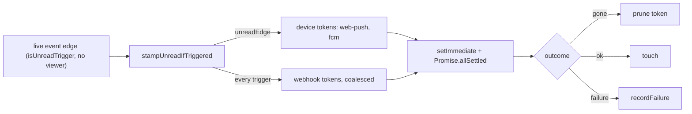

**Trigger — single hook** (`packages/server/src/event-wiring.ts` `stampUnreadIfTriggered`):
- Called after the unread block, only for a known session: `pushDispatcher?.fanout(sessionId, {eventType, after, payload, unreadEdge})`.
- Replay never reaches it (`event_forward` checks `replayingSessions`; the `prompt_request` branch is live-only). Viewed session → suppressed.
- One `ask_user` edge has two callers (`event_forward` / `prompt_request`); only the first reaches fanout — the second sees `currentTool` already `"ask_user"`, so `isUnreadTrigger` is false.
- Fire-and-forget: `fanout` returns `void`, memory-only sync work, never throws/rejects.

**Hybrid cadence** (`packages/server/src/push/push-dispatcher.ts`):
- Device tokens (`web-push`, `fcm`) only when `unreadEdge` — one buzz per unread period, next after a view.
- Webhook tokens every qualifying trigger, coalesced per `(sessionId, tokenId)` within `push.coalesceWindowMs`.
- Coalesce entries expire lazily at 2× window; dropped on token remove.
- One structured log line per delivery: `{tokenId, transport, target (redacted), outcome, ms, status|errorCode}`.

**Payload** (`packages/server/src/push/build-push-payload.ts`): `{type: "session_attention", trigger: turn_end|input|crash|test, sessionId, title, body, url: "/session/<id>"}`.
- `title` = `<name>: turn finished|waiting for input|crashed`; `<name>` falls back to cwd basename.
- Crash `body` = error cut to 200 chars + `…`; otherwise the session model id.

**Token registry** (`packages/server/src/push/push-token-registry.ts`):
- `~/.pi/dashboard/push-tokens.json` + `push-vapid.json`, mode `0600` via `writeJsonFile(path, data, {mode})` — `chmod` on the `.tmp` unconditionally before rename.
- Max 50 tokens; 51st distinct `deviceToken` → `409`. Idempotent by `deviceToken` (same id, new `lastUsedAt`).
- `touch` persisted ≤ 1 per 60 s. `consecutiveFailures` in memory, reset on success.
- Corrupt file → renamed `push-tokens.json.corrupt-<epoch ms>`, registry starts empty, `push.errors` entry.

**Transports** (`packages/server/src/push/push-transports/`):
- web-push: `web-push` lib, VAPID (`push-vapid.json`, generated once); 404/410 → gone.
- fcm: HTTP v1 API, RS256 service-account JWT via `crypto.createSign`, access token cached, refresh at 3500 s, one re-sign + retry on 401; `NOT_FOUND`/`UNREGISTERED` → gone; missing/unreadable service-account file → FCM disabled + `push.errors` entry.
- webhook: `undici.request`, no redirects (3xx = failure), 5 s timeout, `body.dump()`; 2xx → ok, 410 → gone, anything else incl 404 → failure, token kept, no retry.
- gone → token pruned (`registry.remove`).

**Webhook SSRF** (`push-transports/webhook-url.ts`):
- http/https only, absolute, no userinfo.
- Blocked: `169.254.0.0/16`, `fe80::/10`, `fd00:ec2::254`, IPv4-mapped forms; dashboard's own listen port on a loopback/local-interface address. Loopback + LAN allowed.
- Any resolved record blocked → refused. Same check at registration and every delivery.
- Per-delivery undici `Agent` with `connect.lookup` pinned to the vetted addresses — closes DNS rebinding.

**Redaction**: webhook renders `label (origin)`; web-push `<endpoint host> browser`; fcm `fcm device`. Raw errors never logged. `POST /api/push/test` returns only `{tokenId, ok, gone?}`.

**REST** (`packages/server/src/routes/push-routes.ts`): `GET /api/push/vapid-public-key` (`observe`); `GET/POST /api/push/register`, `DELETE /api/push/register/:tokenId`, `POST /api/push/test` (`operate`). Routes always registered; handlers answer 404 while push disabled. Auth chain runs first — unauthenticated remote → 401, not 404. `/api/push/` prefix denylisted from MCP.

**Health**: `/api/health` carries `push.errors` only when `canDiscloseAccessPosture(request)` and push enabled. Missing `push.webPush.contactEmail` → web-push disabled + `push.errors` entry (FCM + webhook keep working).

**Client** (`public/sw.js`, `packages/client/src/hooks/usePushSubscription.ts`, `packages/client/src/components/settings/PushNotificationsSection.tsx`):
- `sw.js` `push` → `showNotification(title, {body, data: {url, sessionId}})`; `notificationclick` focuses + navigates an existing window, else `openWindow(url)`.
- Settings ▸ Sessions ▸ Push notifications: device toggle (secure context only, else https notice), iOS install-to-home-screen hint, token list (display, Send test, Remove), Add webhook URL form (works without Web Push).

**FCM setup**: `push.fcm.serviceAccountPath` → Google service-account JSON with `project_id`, `client_email`, `private_key`; never inline in `config.json`.

**nanoMuse recipe**: create a `hook` trigger, copy its URL (`POST /api/hooks/{id}?key=…`), paste into Settings ▸ Sessions ▸ Push notifications ▸ Add webhook URL. nanoMuse answers 429 within 10 s of a previous call — logged, not retried.

See change: `add-server-push-notifications`.

### Tool-result route: pending vs gone (change: distinguish-tool-result-pending-vs-gone)

Route `GET /api/sessions/:sessionId/tool-result/:toolCallId[?pending=1]` (`packages/server/src/routes/session-routes.ts`). `preHandler: networkGuard`.

Check order:
1. Owner gate `gateHttpSession` — reject → `404`.
2. Stored end (real or synthesized) → `200 {result, isError}`.
3. Recorded eviction → `410 {error:"result no longer available"}`.
4. In-flight hint AND query `pending === "1"` → `202 {pending:true}`.
5. Else → `404 {error:"tool call still in flight or unknown"}`.

**`410` source.** `memory-event-store` `SessionBuffer.evictedToolEnds`: bounded set (512, insertion-ordered) of `toolCallId`s whose REAL `tool_execution_end` was trimmed. Written by both `trimBufferToLimit` passes + `dropNonEssentials`.
- Synthesized ends (`healedBy` set) never recorded.
- IDs >256 chars never recorded.
- Freed with buffer (LRU eviction, `deleteEventsForSession`).
- Live top-level `tool_execution_start` for id → `forgetEvictedToolEnd`.
- Store API: `wasToolEndEvicted(sessionId, toolCallId)`, `forgetEvictedToolEnd`.
- Set overflow degrades to old `404`.

**`202` source.** `packages/server/src/session/in-flight-tool-calls.ts` (`createInFlightToolCalls`: `observeLive`, `isInFlight`, `clear`).
- Live-only: fed from event-wiring live (non-replaying) forward branch.
- Cleared on: live `agent_settled`, every `session_register`, session end, session removal (`sessionManager.onRemoved`).
- Cap 256 ids/session.
- Cosmetic hint only. Never vouches "gone".
- Opt-in (`?pending=1`): old clients treat any 2xx as finished result.

**No "not in flight ⇒ gone" inference.** Not in flight does not mean gone:
- Cold transcript replay (disk / archive / retained) and OLD bridges orphan-close running calls. Live bridge replay (`replaySessionEntries(bc, {liveTailOpen: isLive(...)})`) leaves last assistant message's open calls open.
- Synthetic reconnect `agent_start` carries `synthetic:true`; `findOpenToolCalls` (`packages/server/src/session/open-tool-calls.ts`) walks past it — real death still heals.
- See change: fix-replay-fabricates-orphan-end-for-live-calls.
- Status stays `active` until synthetic `agent_start` after `replay_complete`.
- Heartbeat reconcile can flip streaming → idle mid-turn.
- `agent_end` is not terminal; `agent_settled` is.
- User `!` bash runs outside a turn.

**Client (`useStaleToolReconcile`, `packages/client/src/hooks/useStaleToolReconcile.ts`).**
- Probe sends `?pending=1`.
- `410` → `synthesizeEvictedEnd` (`healedBy:"result_evicted"`, body `result no longer available`, `isError:false`) finalizes at once.
- `ToolCallStep` renders eviction badge (`data-testid="tool-evicted-badge"`).
- Later real end overwrites synthesized end.
- `202` counts like `404` toward superseded heal (needs ≥2 probes + later assistant inference). Stale hint cannot finalize running tool.

**`useToolFullResult`.** Maps `404` and `410` → `t("tool.resultEvicted")`. Does not send `pending=1`.

**Health.** `/api/health` gains `toolResult: { pending, gone }` — cumulative route counters, beside `storeTrim`.

**Compat.**
- Old client + new server: fine. `410` non-2xx; `202` opt-in.
- New client + old server: sees only `200`/`404`.
- No persisted state. Rollback = revert.

See change: distinguish-tool-result-pending-vs-gone.

### Command Flow (browser → pi)
1. User types prompt or command in browser
2. Browser sends `send_prompt` via WebSocket
3. Server routes to correct bridge extension by sessionId
4. Bridge extension's command handler parses input for pi command prefixes:
   - `!!<cmd>` → silent bash execution via `pi.exec()`, result as `bash_output` event
   - `!<cmd>` → bash execution via `pi.exec()`, result as `bash_output` event + send to LLM
   - `/compact [instructions]` → `ctx.compact()`, feedback as `command_feedback` event
   - `/<command>` → `session.prompt()` for extension commands/skills/templates (fallback to `sendUserMessage()`)
   - `/<command>` whose template carries `executable: bash` frontmatter → run body as bash via `pi.exec`, emit `bash_output` event with `data.source: "slash-exec"`, skip LLM. `tryExecSlashTemplate` runs after extension dispatch, before `sendUserMessage` fallback. Env `PI_DASHBOARD_PORT`/`PI_DASHBOARD_BASE` injected. Client renders "ran locally" footer. See change: add-dashboard-slash-commands.
   - Colon-to-hyphen aliasing: `/opsx:continue` resolves to `opsx-continue.md` template (both `:` and `-` forms work)
   - Plain text → `pi.sendUserMessage()` (default)
5. Pi processes the command, events flow back via event flow

### Flow Dashboard Data Flow (pi-flows → browser)
pi-flows runs multi-agent workflows in-process. Subagent sessions use `SessionManager.inMemory()` and don't bootstrap the bridge, so flow data must be explicitly forwarded by the parent session's bridge.

1. pi-flows `EventEmitObserver` emits `flow:*` events on `pi.events` (all 10 `FlowObserver` callbacks)
2. Bridge extension listens to `flow:*` events and forwards as `event_forward` messages with `flow_*` event types
3. Server stores events, extracts flow metadata to `DashboardSession` fields (`activeFlowName`, `flowAgentsDone`, `flowAgentsTotal`, `flowStatus`)
4. Browser event reducer builds client-side `FlowState` (agents map, tool history, detail entries) — reducer code lives in `packages/flows-plugin/src/flow-reducer.ts` (re-exported via `@blackbelt-technology/pi-dashboard-flows-plugin/reducer`); `event-reducer.ts` imports `isFlowEvent` + `reduceFlowEvent` from there.
5. React renders `FlowDashboard` (sticky card grid above ChatView), `FlowAgentDetail` (replaces chat), `FlowSummary` (post-completion). Component code lives in `packages/flows-plugin/src/client/` and is imported by the shell via `@blackbelt-technology/pi-dashboard-flows-plugin/client`. Slot-consumer-based mounting is tracked as the follow-up change `migrate-flows-jsx-to-slots`; the current shell imports the components directly. See change: extract-flows-as-plugin.

**Flow controls (browser → pi-flows):**
- Abort: browser sends `flow_control { action: "abort" }` → server → bridge → `pi.events.emit("flow:abort")` → `flowManager.abort()`
- Autonomous toggle: browser sends `flow_control { action: "toggle_autonomous" }` → same path → `setAutonomousMode()`

### Extension UI System (Phases 1 + 2 shipped)

A generalized mechanism for extensions to declare dashboard UIs as data without authoring React or importing a runtime SDK. Phase 1 (`management-modal` slot) shipped in change `add-extension-ui-modal`. Phase 2 (live in-page decorations) shipped in change `add-extension-ui-decorations`. Phase 4 RJSF is tracked in `add-extension-ui-rjsf-form`.

**Mechanism (pull-based discovery, synchronous probe):**

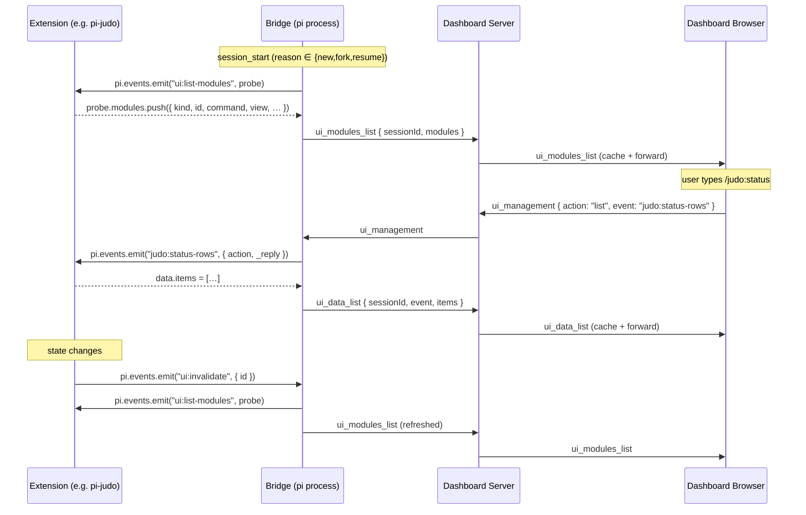

Key properties:
1. The probe is **synchronous** — listeners push into `probe.modules` while `pi.events.emit` is running. The bridge never polls and never caches across probes; idempotent re-registration just produces a fresh probe on the next trigger.
2. **No SDK package** — extensions only need `pi.events` (already provided by the host). Schema types live in `@blackbelt-technology/pi-dashboard-shared`.
3. **Last-write-wins on duplicate `id`** within a single probe; bridge logs one warning per collision.

**Phase-1 surface (shipped):**

- `kind: "management-modal"` — slash-command-triggered modal.
- `view.kind` ∈ `"table" | "grid" | "form"`.
- `UiField.kind` ∈ `"text" | "number" | "boolean" | "select" | "code" | "datetime" | "textarea"`.
- `UiAction.confirm` polish via `Confirm` (client-utils, testId `confirm-dialog`); no `window.confirm()`. See change: unify-dialog-system.
- Icons resolved against `@mdi/js` keys; unknown keys render no icon (no error).
- Slash-command interception in `App.tsx`'s `wrappedHandleSend`; built-in collisions (`/model`, `/compact`, `/flows`, etc.) drop the module with a `console.warn`.
- "Modules" entry point in `SessionHeader` shows when `session.uiModules?.length > 0`.

**Phase-1 wire protocol:**

| Direction | Type | Purpose |
|---|---|---|
| extension → server → browser | `ui_modules_list { sessionId, modules }` | Cached schemas. |
| extension → server → browser | `ui_data_list { sessionId, event, items }` | Row data for `table`/`grid` views. |
| browser → server → extension | `ui_management { sessionId, action, event, params }` | Data fetch (`action: "list"`) or user action. |

**Replay on reconnect:** Server caches `Session.uiModules` and `Session.uiDataMap` (per-event item cap = 1000, last-write-wins on overflow). The replay site is `replayUiState(ws, sessionId, ctx)` in `packages/server/src/browser-handlers/subscription-handler.ts`, called immediately after every `replayNotifyLog` site (4 sites: stale-lastSeq full replay, delta replay, no-events path, lazy load from disk). Replay ordering: events → pending UI requests → notify log → UI module state.

**Phase-2 surface (shipped):**

Five live in-page decoration kinds reuse the same `ui:list-modules` probe primitive. Decorators carry an explicit `namespace: string` (must match `/^[a-z0-9-]+$/`) plus `id`, partitioned at the bridge and forwarded as one `ext_ui_decorator` message per descriptor. Server caches under `Session.uiDecorators[`${kind}:${namespace}:${id}`]` and replays after the Phase-1 batches.

| Kind | Mount site | Filter | Closure? |
|---|---|---|---|
| `footer-segment` | `SessionHeader.tsx`, right of git/model info | `kind === "footer-segment"` | Yes — extension supplies fresh `payload.text` per probe |
| `agent-metric` | Inside `FlowAgentCard.tsx` (one per card) | `kind === "agent-metric" && payload.agentId === card.agentName` | Yes |
| `breadcrumb` | Top of `FlowDashboard.tsx` | `kind === "breadcrumb"` (most recent wins) | No (snapshot) |
| `gate` | Inline in each `FlowLaunchDialog` | `kind === "gate" && payload.flowId === item.flowId` (most-restrictive aggregate) | No |
| `toast` | `App.tsx` (top-right fixed tray) | `kind === "toast"` (stacks; auto-dismiss; FIFO display cap = 5) | No |

Decorator removal is **explicit**: extensions push a descriptor with `removed: true` and the bridge forwards it verbatim; the server deletes the cache entry under the matching key (no-op if absent) and broadcasts the removal so client slots can unmount the matching descriptor without affecting siblings.

**Phase-2 wire protocol:**

| Direction | Type | Purpose |
|---|---|---|
| extension → server → browser | `ext_ui_decorator { sessionId, descriptor, removed? }` | Live decoration upsert (or removal when `removed: true`). |

The message is a discriminated union over `descriptor.kind`. `ExtUiDecoratorMessage` is a member of both `ExtensionToServerMessage` and `ServerToBrowserMessage` (verified by a type-level test in `packages/shared/src/__tests__/browser-protocol-types.test.ts` — esbuild silently strips switch arms whose message types are not in the production union).

**Phase-2 sequence (invalidate → probe → ext_ui_decorator → slot re-render):**

```mermaid
sequenceDiagram
    participant Ext as Extension (e.g. pi-judo)
    participant Bridge as Bridge (pi process)
    participant Server as Dashboard Server
    participant Browser as Dashboard Browser

    Note over Ext: state changes (e.g. judo workspace mutation count incremented)
    Ext->>Bridge: pi.events.emit("ui:invalidate", { id })
    Bridge->>Ext: pi.events.emit("ui:list-modules", probe)
    Ext-->>Bridge: probe.modules.push({ kind: "footer-segment", namespace, id, payload })
    Note over Bridge: partition by kind — modal kinds → ui_modules_list,<br/>decorator kinds → one ext_ui_decorator each
    Bridge->>Server: ext_ui_decorator { sessionId, descriptor }
    Server->>Server: cache under `${kind}:${namespace}:${id}` on Session.uiDecorators
    Server->>Browser: ext_ui_decorator (broadcast verbatim)
    Browser->>Browser: per-kind slot component re-renders

    Note over Ext: state cleared
    Ext->>Bridge: probe.modules.push({ kind, namespace, id, payload, removed: true })
    Bridge->>Server: ext_ui_decorator { ..., removed: true }
    Server->>Server: delete cache entry; broadcast removal
    Server->>Browser: ext_ui_decorator { ..., removed: true }
    Browser->>Browser: slot unmounts the matching descriptor only
```

**Rate cap:** to prevent runaway extensions, the bridge throttles `ui:invalidate` re-probes per session to one probe every 50 ms (= 20/sec). Excess events coalesce into a single trailing-edge probe; a single warning is emitted per offending burst, latched until a quiet window passes.

**Replay ordering** (extended from Phase 1): events → pending UI requests → `ui_modules_list` → `ui_data_list` (per event) → `ext_ui_decorator` (per cache key). Replay decorator messages never carry `removed: true` — only live entries are replayed.

**Phase 4 (optional):** `rjsf-form` JSON-Schema escape hatch for rich forms; see `add-extension-ui-rjsf-form`.

**Relationship to existing capabilities:**
- `interactive-ui-dialogs` / `ui-proxy` / PromptBus — handle one-shot `ctx.ui.*` dialogs (request/response, awaited). The extension-ui-system handles persistent push-based descriptors (no awaiting). Orthogonal mechanisms; both ship.
- `extension-ui-forwarding` (per-channel declared-set forwarding) — bridge forwards via one `pi.events.on` subscription per declared channel (`registerEventBusForwarding`). Channels: core `FLOW_EVENT_MAP` / `SUBAGENT_EVENT_MAP` + plugin-declared via `dashboard:register-event-forward`. RPC probe channels (`flow:list-flows`, `roles:*`, `model:resolve`, `ui:list-modules`…) kept out of core map; plugin declarations naming one not rejected. No `emit` wrapper. The new system is the *declarative* path for UI specifically. No authored spec — file removed (0-byte placeholder since initial commit). See change: repair-corrupted-main-specs. See change: skip-rpc-probes-in-event-forwarder.
- pi-flows: in Phase 3 pi-flows itself adopts the system to surface registered workflows (breadcrumb), gates, and cards (agent-metric) for any flow-using extension automatically.

**No-dashboard fallback:** When no bridge is connected, `ui:list-modules` is never emitted; extension listeners are dormant; slash commands fall back to existing text-output behavior. Extensions remain pi-runnable in pure-pi mode without code changes.

### Plugin Architecture (runtime implemented in `add-dashboard-shell-slots-runtime`)

A planned **two-tier rendering model** that lets first-party features (OpenSpec, pi-flows, pi-subagents tool renderers, git integration) live as standalone plugin packages instead of being baked into the dashboard core. Tracked under OpenSpec change `dashboard-plugin-architecture` (design-only umbrella); the runtime lands in `add-dashboard-shell-slots-runtime`; concrete migrations land in `extract-openspec-as-plugin`, `extract-flows-as-plugin`, `extract-subagents-as-plugin`, and `extract-git-as-plugin`.

**The two tiers, one slot contract:**
- **Tier 1 — first-party plugins** (this proposal): React + server contributions co-located in `packages/<name>-plugin/`. Bundled and tree-shaken into the dashboard's web build. Trusted because they live in the same repo and pass the same review.
- **Tier 2 — third-party extensions** (`extension-ui-system`): descriptor-only protocol over the existing pi event bus. Sandboxed, declarative, no React.

Both tiers fill the **same** named regions — the **slot taxonomy**. The shell knows about slots; only plugins/extensions know about specific features.

**Slot taxonomy (frozen for v0.x):**

First-party slots (React, possibly also descriptor):
- `sidebar-folder-section` — collapsible block above the per-workspace session list (replaces `FolderOpenSpecSection`).
- `session-card-badge` — compact info chips in the session card (replaces `OpenSpecActivityBadge`, `FlowActivityBadge`). Descriptor variant reuses `agent-metric`.
- `session-card-action-bar` — action buttons in the session card (replaces `SessionOpenSpecActions`, `SessionFlowActions`). React-only in v0.x.
- `content-view` — full-screen content area (replaces every conditional branch in `App.tsx` for `ArchiveBrowserView`, `SpecsBrowserView`, `OpenSpecPreview`, `FlowAgentDetail`, `FlowArchitectDetail`, `MarkdownPreviewView`, `FileDiffView`, `FlowYamlPreview`). Descriptor variant reuses `management-modal`.
- `content-header-sticky` — sticky element above content-view (replaces sticky `FlowArchitect`/`FlowDashboard`). Descriptor variant reuses `breadcrumb`.
- `content-inline-footer` — inline element below content-view (replaces `FlowSummary`). React-only.
- `composer-context-group` — labelled read-only context groups inside the composer dock's Context lane (`ContextLane.tsx`), ahead of the Status group. Formerly the session-action strip (`ComposerSessionActions`). Multiplicity `many`, tier `react-only`, claim `{ component }`, context props `{ session, pluginContext }`. Outside the Status group's streaming `<fieldset disabled>` — never working-gated, stays live mid-run. Runtime exports `ComposerContextGroupSlot` + primitive `ComposerContextGroup` (keeps signature, delegates to `ToolbarGroup` variant `info`). First claimant: quota plugin's `QuotaWidget`. See change: move-quota-to-context-strip; redesign-composer-session-strip; add-composer-dock.
- `composer-dock-process-group` — group of running-work rows inside the composer dock's Processes lane, before core Commands + Background groups. Multiplicity `many`, tier `react-only`, claim `{ component }`, session-scoped (predicate input = `DashboardSession`). Props `{ session, pluginContext, mode: "summary"|"rows", reportSummary(summary: ProcessGroupSummary | null) }`. `ProcessGroupSummary = { count: number; noun: string }`. `summary` mode: always mounted while session bound, renders `null`, only reports; adds no DOM/focus/timer. `rows` mode: mounted only while lane body shown, renders `ComposerDockRow`s, never reports. `noun` printed verbatim after `count` — claim agrees noun with count (`subagent` / `subagents`). `null` or `count ≤ 0` = nothing runs. Dock keeps `Map<claimKey, summary>`, drops entry on unmount. Runtime exports `ComposerDockProcessGroupSlot({ session, mode, onReport?, wrapClaim? })` + primitive `ComposerDockRow` (`packages/dashboard-plugin-runtime/src/ComposerDockRow.tsx`: 32 px row, 16 px icon box, truncation, action targets ≥24 px / ≥44 px below `md`, elapsed from `startedAt` in leaf `DockRowElapsed` owning its 1 s tick). First claimant: subagents plugin `SubagentDockGroup` (`packages/subagents-plugin/src/client/SubagentDockGroup.tsx`; Open → `/session/:sid/subagent/:aid`; status `created` → `pending`; dedupes by `state.id`). Additive: `PLUGIN_HOST_API_VERSION` 1.0.0 → 1.1.0. See change: add-composer-dock.

**Composer stack (`ComposerDock`):** one dock above one composer card replaces the old stack (`composer-context-strip`, `StatusBar`, `QueuePanel`, `YoloComposerStrip`). `ComposerSessionActions` strip superseded — its OpenSpec + Git content split into lanes (paragraph below kept for `ToolbarGroup` primitive details).

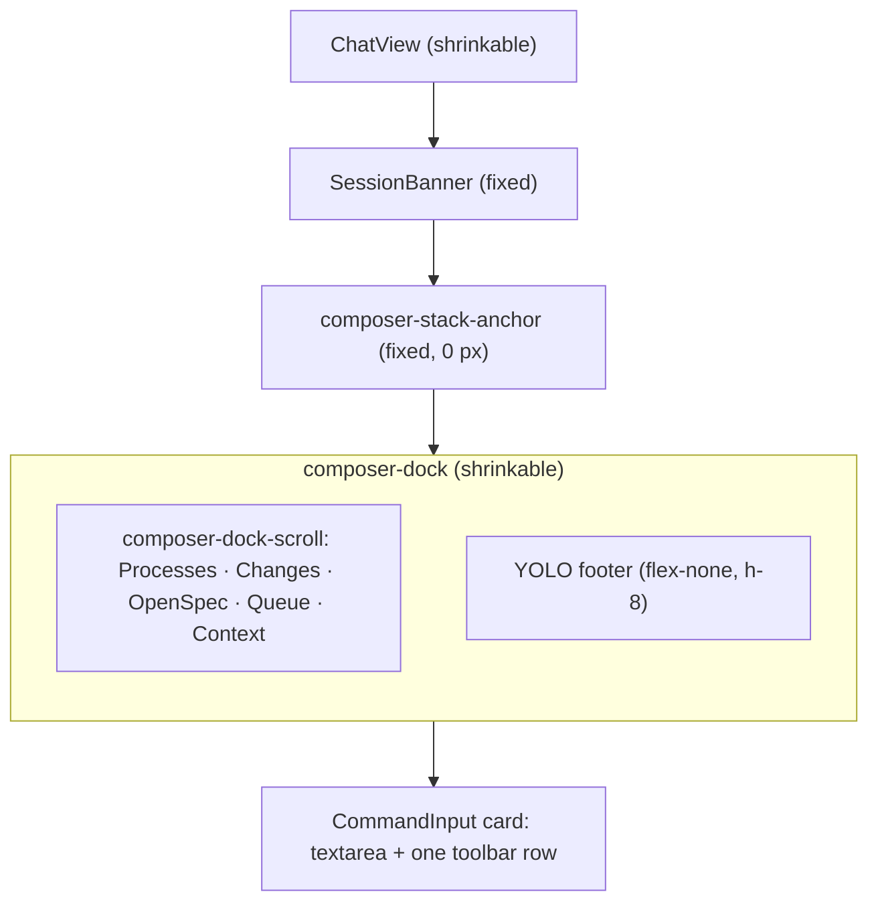

- Sibling of `CommandInput`, never inside it. Mounted by `ComposerDockHost.tsx` (hook boundary for `App.tsx`; also `DirectoryHomeView.tsx`). Visual join CSS only: `mx-5` inset (8px inside card edges, drawer look), `-mb-6 pb-6` tucks bottom edge 12px under card; `composer-root` drops its full-width `border-t` while dock visible (index.css sibling rule). team-app `ChatPane` embeds `CommandInput` bare: no dock.
- Nothing renders for `readOnly` (archived) views or when no lane and no YOLO footer.
- Files (`packages/client/src/components/chat/`): `ComposerDock.tsx` (layout, accordion render, compact mode, YOLO footer, live region), `composer-dock-model.ts` (`DockLane`, `DockLaneKey`, `DOCK_LANE_ORDER`, `useDockAccordion`), `useComposerDockLanes.ts` (builds Changes/OpenSpec/Queue/Context lanes), `ProcessesLane.tsx` + `ProcessesLaneBody.tsx` (built into dock), `ChangesLane.tsx`, `QueueLane.tsx`, `ContextLane.tsx`, `useDockCompactMode.ts`.
- Lane order fixed: Processes, Changes, OpenSpec, Queue, Context. Lane renders only with content. Lane = `DockLane { key, label, icon, title, meta, summary, summaryText, actions, renderBody, expandable, live }`.
- Accordion: one `openLane: DockLaneKey | null`, controlled by `App.tsx` via `useDockAccordion(selectedId)`. Resets to `null` on every session bind. At most one lane open. Nothing auto-expands; nothing persisted.
- Row layout (composer column ≥ 32.5rem): each lane `role="group"`; expandable header = one stretched disclosure button (`aria-expanded`/`aria-controls`); actions siblings of it, never nested.
- Compact mode (< 32.5rem = 520 px at 16 px root, `DOCK_COMPACT_REM`): one sticky chip per lane, every lane incl. Context + unattached OpenSpec; chip opens sheet below chips. Width via `ResizeObserver` on composer column (`bottom` stack), not dock → no feedback loop. Flip evaluated ≤ once per animation frame; exact at threshold, no hysteresis; width 0 never flips. `openLane` survives flip; focus moves to chip/toggle only if it was inside open lane.
- Scroll: lanes in `composer-dock-scroll` (`min-h-0 overflow-y-auto`). YOLO footer `flex-none` outside it: never collapsed, never chip, never scrolled away. Dock shrinks before transcript.
- Live region: one sr-only polite `role="status"`, sibling of lanes, never ancestor of YOLO footer. Announces count strings only. Elapsed clocks tick in leaves outside it.
- Processes lane: subagents via `composer-dock-process-group` slot (summary + rows mounts); Commands from `useInflightBashTools` (Show → scroll to tool card; includes bash nested in `Agent` calls); Background from `DashboardSession.processes` (Kill → `kill_process { pgid }`, SIGTERM to group). Header count = core counts + claim summaries. Turn stops only via composer Stop.
- Changes lane: header = Git worktree identity + worktree actions (`GitIdentity`, `WorktreeActionsMenu`) + `N files +A −D` + Review. Renders when `session.gitWorktree` set or diff lists files. Body lists session-owned in-cwd files from `GET /api/session-diff`; out-of-cwd entries listed apart, no diff link, outside count. Server cap `MAX_FILES = 200` → header shows `200+`.
- `useDockDiff(sessionId, { working, dirtyCount, expanded })` (`packages/client/src/hooks/useDockDiff.ts`) wraps `useSessionDiff`. Triggers: first load; working→idle falling edge (`isComposerWorking`); `gitStatus.dirtyCount` change while idle; lane expand; Retry. Coalescing: ≤ 1 request in flight; trigger during request or inside window sets one pending flag; never dropped. `DOCK_DIFF_WINDOW_MS` 2000 min gap between starts. `DOCK_DIFF_SETTLE_MS` 1000 delay for turn-end/dirty triggers → same-second signals = one request. Back-off: request slower than `DOCK_DIFF_SLOW_MS` 300 ms doubles gap (2 s → 4 → 8, cap 30 s); fast request resets.
- OpenSpec lane: `ComposerSessionActions.tsx` split, not rewritten; keeps readiness gate, attach flow, traceable archived/missing attachments (`showTrace`), single primary action, working-state rules. Title = attached change name + task count. Open proposal / Refresh / Detach in `⋯`. Expand → next open tasks via `fetchTasks(cwd, change)`.
- Queue lane: embeds `QueuePanel` cycler (`embedded` prop hides own subtitle + clear-all; Clear all in lane header). Context lane: `composer-context-group` claims (never gated) + Status group (`<fieldset disabled={working}>`, keeps working gate).
- YOLO footer: former `YoloComposerStrip`, height `YOLO_FOOTER_HEIGHT` = 32 px (`h-8`), `whitespace-nowrap`, sentence ellipsized. Test id `yolo-composer-strip` kept.
- Composer card: one toolbar row (`composer-settings-row`). `＋` = only fold host (absorbs Terminal; no `⋯` overflow). `Steer ▾` dropdown, folds into `＋` below 420 px (`@[26.25rem]`). Working status word via `workingStatusLabel` (`packages/client/src/lib/chat/working-status.ts`; `StatusBar.tsx` deleted). One merged `model · thinking` chip wrapping `ModelSelector`. Round send/stop button at toolbar end, token fills only. Fold thresholds `@[55rem]`/`@[40rem]`/`@[26.25rem]`.
- Pane height budget (`packages/client/src/lib/layout/chat-pane-row-class.ts`, `CHAT_PANE_ROW_TABLE`): `composer-context-strip`, `status-bar`, `queue-panel` entries removed. Added `composer-dock` (shrinkable, weight `DOCK_WEIGHT` 1, floor = `YOLO_FOOTER_HEIGHT` 32 + `DOCK_LANE_HEADER_FLOOR` 41 = 73, bound 32) and `composer-dock:footer-only` (YOLO, no lanes; floor 33, bound 32). App picks key by state. `chat-pane-row-completeness.test.ts` asserts `floor > bound` per entry and every rendered row listed.
- Test ids: surviving ids kept; removed `composer-context-strip`, `status-bar`, `composer-session-actions`, composer `overflow-button`/`overflow-menu`; new dock root `composer-dock`.
- No server, bridge protocol or persisted-data change. Rollback = revert client + shared slot decl + runtime + subagents plugin together; remove plugin claim before slot (validator rejects unknown slot id). See change: add-composer-dock.

**Composer session-action strip (`ComposerSessionActions`, superseded by `ComposerDock`; `ToolbarGroup` primitive still used by lanes):** host groups (OpenSpec, Git, Status) + plugin `composer-context-group` contributions render through one primitive `ToolbarGroup({ label, variant: "actions"|"info", testId?, labelTestId?, contentAs?: "div"|"fieldset", contentProps?, className? })` (`packages/dashboard-plugin-runtime/src/slot-consumers.tsx`). Renders `<div data-group role="group" aria-labelledby>` + label `<span id>` (`useId`) + content element carrying `data-group-content`. `actions` variant: solid outline, `--bg-tertiary` fill, label segment on `--bg-surface`, hairlines between direct children, children ≥24 px targets. `info` variant: dashed outline, no fill (read-only readouts). Label test id = `labelTestId ?? (testId ? `${testId}-label` : undefined)` — never `undefined-label`. a11y contract change: every claimant becomes a named `role="group"` region; contributions drop own chip borders (quota plugin did). Host containers `composer-{openspec,git,status}-container`; legacy ids `composer-{openspec,git,status}-group-label`, `composer-git-group`, `composer-status-group` kept (Status content is `<fieldset disabled={working}>`). `packages/client/src/index.css`: `[data-group]:has(> [data-group-content]:empty) { display:none }` hides empty group (e.g. all badge claims render null). See change: redesign-composer-session-strip.
- `anchored-popover` — popover anchored to a triggering UI element (replaces `TasksPopover`).
- `command-route` — maps a slash command or URL route to a `content-view` (replaces today's hand-wired routing in `App.tsx`).
- `settings-section` — a section in the Settings page (replaces today's hardcoded `Background polling (OpenSpec)` section). React for first-party plugins; descriptor (RJSF/UiField) for third-party extensions.
- `resource-page-section` — section above resource grid on Folder + Global Skills/Agents/Extensions/Prompts/Themes pages. Multiplicity `many`, react-only. Props `ResourcePageSectionProps` (`resourceType`, `scope: "folder"|"global"`, `cwd?`, `pluginContext`). Claim `resourceType` filter. First claimant: `skill-atlas`. See change: add-skill-atlas-screen; [`skill-atlas.md`](skill-atlas.md).
- `shell-headless` — always-mounted zero-UI host for plugin-wide hooks (e.g. message subscriptions). Multiplicity `many`, react-only. Props `Record<string, never>`; predicate input `never`. Claim renders `null`. Consumer `ShellHeadlessSlot()` (`packages/dashboard-plugin-runtime/src/slot-consumers.tsx`): calls `useSlotClaimsVersion()`, renders each claim via `renderClaim` (SlotErrorBoundary + Suspense + CurrentPluginLayer). No wrapper element. No intents rendered. Mounted once in `packages/client/src/App.tsx` inside `apiProvider` body (inside `PluginContextProvider`), every layout branch (desktop, mobile, focus), independent of selection/session count. Runtime enable/disable mounts/unmounts claim. `manifest-validator.ts` REJECTS `predicate`/`shouldRender` on `shell-headless` claim (error names plugin + slot). See change: fix-empty-status-subcard.
- `tool-renderer` — React component for a specific `tool_call` by `toolName` (replaces today's hardcoded `tool-renderers/registry.ts`).

Descriptor-only slots (existing in `extension-ui-system`): `management-modal`, `footer-segment`, `agent-metric`, `breadcrumb`, `gate`, `toast`, `rjsf-form`.

**Plugin loader (runtime):**

`packages/dashboard-plugin-runtime/` is a new workspace package containing all runtime pieces:

- **`src/slot-registry.ts`** — `createSlotRegistry()` returns a typed `Map<SlotId, ClaimEntry[]>` sorted by `(priority, pluginId)`. Filter helpers: `forSession`, `forSessionRendered`, `forFolder`, `forCommand`, `forToolName`, `forActionId`. Registry also exposes read-only `isPluginEnabled(id)`.
- **`src/manifest-validator.ts`** — hand-rolled manifest validator; throws `ManifestValidationError` with `pluginId` and `reason`. Validates `shell-overlay-route` `presentation` is `"page"`|`"dialog"`|`"content"`; unknown value FATAL. `"content"` requires `depth` (fatal). Path wildcard: only literal trailing `/*?` accepted, other `*` FATAL. Unknown value FATAL, not warn-and-default — typo like `"modal"` would silently restore the behaviour the author opted out of. See change: add-route-backed-overlay-dialogs.
- **`src/plugin-context.tsx`** — `PluginContextProvider` wraps the entire app. A nested `CurrentPluginLayer` is pushed per contribution so `usePluginConfig<T>()` and `logger` resolve to the contributing plugin's id. `applyPluginConfigUpdate` updates the in-memory config store and re-renders subscribers.
- **`src/slot-consumers.tsx`** — one component per slot id. Each wraps contributions in a `SlotErrorBoundary` (per-claim scope). Reads registry from the provider. `ShellOverlayRouteSlot` renders matched claim body ONLY, inside `flex-1 min-h-0 relative` height wrapper. No dialog chrome, no container selection. `dialogContainer` prop + `OverlayContainerProps`/`OverlayContainerComponent` types removed. Container choice belongs to HOST (`App.tsx`): reads claim's effective `presentation` via exported `useShellOverlayRoutePresentation` hook (default `"dialog"`; `"page"` opts out → full viewport desktop + mobile; `"content"` → content area beside sidebar), lifts dialog claim out of content region into `RouteBackedOverlay`. Shared matcher `matchWouterPatternWithParams` handles trailing `/*?` (rest → `params["*"]`). `useShellOverlayRouteDepth` returns declared depth for mobile `"content"` claims. `renderClaim` wraps `"content"` in `React.Suspense`. Seam could not work — underlay must cover VIEWPORT; wrapping from inside slot puts underlay inside content region. Hook returns string, avoids `client-utils` → `dashboard-plugin-runtime` dependency cycle. Rationale: design D2a (SUPERSEDED). See change: add-route-backed-overlay-dialogs.
- **`src/embedded-app-shell.tsx`** — shell services for embedded apps (`EmbeddedAppShellProvider`, `useEmbeddedAppShell`). `isSafeDashboardPath` (root-relative, no `\`/whitespace/control, no `.`/`..`). `createReturnTargetStore` (in-memory return target). `EmbeddedAppReturnPill` (`← <title> · <context>` on `dest`, push `href`). Root export; no app-kit import. See change: add-plugin-app-host.
- **`src/embedded-app.tsx`** — `EmbeddedApp` (subpath `./embedded-app` only). Builds embedded `AppHost` (`mode: "embedded"`) from shell services. Top bar: Back · folder › title · `HeaderContext` · ≤2 actions + overflow · Open standalone. States: loading, crashed, folder not found, no shell. See `docs/plugin-apps.md`. See change: add-plugin-app-host.
- **`src/slot-error-boundary.tsx`** — React error boundary scoped to one claim. Logs with plugin id and slot id; renders nothing for the failing claim without suppressing siblings.
- **`src/__tests__/bundled-overlay-claims.test.ts`** — repo gate on BUNDLED `shell-overlay-route` claims: explicit `depth`; `depth: 2` requires `parentPath`; `parentPath` interpolable from claim path's own `:params`; claim nested under `/folder/:x` or `/session/:x` must NOT declare `depth: 1`. Third-party manifests keep runtime degradation to `/` as safety net. See change: add-route-backed-overlay-dialogs.
- **`src/vite-plugin/index.ts`** — `viteDashboardPluginsPlugin` generates `packages/client/src/generated/plugin-registry.tsx` with named imports (tree-shaking). Watches manifests during dev and triggers HMR.
- **`src/server/loader.ts`** — `discoverPlugins(repoRoot?)` (single module-level cache), `loadServerEntries(deps)` (per-plugin dynamic-import, failure isolated), `getPluginStatusStore()`.
- **`src/server/server-context.ts`** — `createServerPluginContext(deps, pluginId)` — namespaced logger, typed config accessors.
- **`src/server/config-validator.ts`** — Ajv JSON-Schema 7 validate + defaults.

**`shell-overlay-route` presentations:**

| `presentation` | Desktop container | Mobile container | Depth source | Dismissal |
|---|---|---|---|---|
| `dialog` (default) | `RouteBackedOverlay` (scrim + frozen underlay) | dialog | fixed 2 | Esc / backdrop / Back |
| `page` | full viewport (before `MobileShell`) | full viewport | n/a | Back |
| `content` | content area beside sidebar (no scrim) | `MobileShell` detail panel | claim `depth` (1 or 2) | Back (`goBack`) |

See change: add-plugin-app-host.


1. **Discovery** — server globs `packages/*/package.json` on startup, parses the `pi-dashboard-plugin` field, validates against schema, sorts by `priority` (lower first; first-party = 100; default 1000).
2. **Server load** — dynamic-imports each plugin's `server` entry, invokes `registerPlugin(ctx)` with a typed `ServerPluginContext` (Fastify, session manager, event store, broadcast helper, scoped logger).
3. **Client bundle** — a Vite plugin (`vite-plugin-dashboard-plugins`) generates `packages/client/src/generated/plugin-registry.tsx` with static imports per plugin manifest; Vite tree-shakes unused exports and code-splits per plugin. Lazy claims (`module`) excepted: see registry split note below.
4. **Runtime registration** — client boot calls `getSlotRegistry()` once; slot consumer components (`<SessionCardBadgeSlot/>`, `<ContentViewSlot/>`, etc.) iterate the registry and render contributions in priority order with per-slot error boundaries.
5. **Bridge auto-register** — plugins declaring a `bridge` entry are auto-registered into `~/.pi/agent/settings.json` under managed `dashboard-<plugin-id>` keys; user-owned entries are never touched.

**Registry split for lazy claims** (`lazy-plugin-claim-modules`):

- Generated `plugin-registry.tsx` statically imports `predicate`, `shouldRender`, `labelComponent`, catalogs from plugin main client entry.
- Claim with `module` → no static `component` import. Emits `Component: lazyClaim(() => import("<spec>"), "<component>")` (`lazy-claim.tsx`).
- Entry chunk gz 690,616 → 584,020 B. Landing graph gz 1,135,756 → 1,028,118 B. Gate `INDEX_GZ_CAP_BYTES` 580 KiB (`mdi-chunk-size.test.ts`).
- Load failure contained to one claim by `SlotErrorBoundary`. Siblings render.

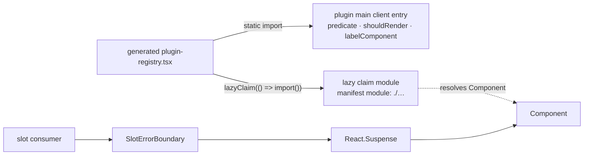

Authoring rules: [`plugin-seams.md`](plugin-seams.md#lazy-claim-modules-module).

**Plugin settings persistence:**
- All plugin settings live under `plugins.<id>.*` in `~/.pi/dashboard/config.json`. The dashboard core never reads or writes another plugin's namespace.
- Each manifest may declare a `configSchema` (JSON Schema 7); the loader validates on read (with defaults applied) and on write (rejects invalid).
- `POST /api/config/plugins/:id` accepts a partial config for a single plugin and broadcasts `plugin_config_update { id, config }` to all subscribed browsers. Omitted keys keep stored values: validation runs on a clone so Ajv `useDefaults` cannot inject defaults into the merge; defaults fill only never-stored keys (`fix-plugin-config-partial-write`).
- The client-side `pluginContext.usePluginConfig<T>()` hook is reactive — consumers re-render within one frame of a write.
- Legacy top-level keys (e.g. `openspec.*`) auto-migrate to `plugins.<id>.*` on the plugin's first server boot.

**Failure isolation:**
- A plugin failing to load (server throw, client import error, missing entry) does NOT crash the shell.
- Failures are logged with full context and surfaced via `/api/health.plugins[]` (`{ id, enabled, loaded, error?, claims }`).
- Slot consumers wrap each contribution in a React error boundary so a runtime crash in one plugin's component doesn't take down the page.

#### Health endpoint observability

`/api/health` exposes additive measurement fields (no behavior change). Existing clients ignore unknown fields. See change: instrument-session-hydration-timing.
- `server.heapSizeLimit` — `v8.getHeapStatistics().heap_size_limit`. Process heap ceiling. Sits with process memory gauges (`rss`, `heapUsed`) for computing memory headroom. See change: `bound-event-store-by-bytes`.
- `storeRetention: { residentBytes, effective: { maxBytesPerSession, maxTotalEventBytes, maxCachedSessions }, globalBudgetExceeded }` — from `eventStore.getRetention()`. `residentBytes` = gauge of resident event bytes. `effective.*` = enforced budgets after store floor clamp. `globalBudgetExceeded` = boolean latch set when all-pinned fallback cannot reach budget. Grouped separately from `storeTrim` counters. See change: `bound-event-store-by-bytes`.
- `eventLoopDelay: { meanMs, p99Ms, maxMs }` — `perf_hooks.monitorEventLoopDelay` histogram, ns→ms. Resets window each read.
- `hydration: HydrationSample[]` — ring buffer, ≤20 newest-first samples. Process-local, no persistence. Sample `{ sessionId, wallMs, fileBytes, entryCount, eventCount, at }` recorded by `loadSessionEvents`.
- `eventLoopSpikes: { at, ms, turn }[]` — ring buffer, ≤50 newest-first, process-local, additive. Retains worst-case event-loop stalls. Two feeds: dedicated `monitorEventLoopDelay` sampler (own instance, never the boot histogram `/api/health` resets → no reset race; records `turn: null` for stalls no poll turn owns) + per-turn self-records from the openspec poll path (`turn: "tickOpen" \| "dirPollPre" \| "dirPollPost"`). Sub-threshold ~700 ms stall retained even when nobody polls `/api/health`. See change: attribute-openspec-poll-eventloop-stalls.
- `notifyLog: { evictedEntries, bySession }` — from `browserGateway.getNotifyLogStats()` (`packages/server/src/pairing/notify-log.ts` `getStats()`). `evictedEntries` = total cap-50 evictions; `bySession` = per-session counts. Cap-50 eviction = silent transcript loss → counted beside `droppedFrames` / `storeTrim`. See change: split-notify-from-prompt-request.
- `storeTrim: { trimmedEvents: { total, toolExecutionEnd, bySession }, evictedSessions, collapsedUpdates, trimmedBytes, evictedBytes }` — from `eventStore.getTrimStats()` (`packages/server/src/persistence/memory-event-store.ts`). `trimmedEvents` + `evictedSessions` pre-existing: per-session cap trims, whole-session LRU evictions. `trimmedBytes`: cumulative bytes released by byte-triggered trims. `evictedBytes`: cumulative bytes released by whole-buffer LRU evictions. See change: `bound-event-store-by-bytes`. NEW `collapsedUpdates`: cumulative count of superseded `tool_execution_update` events dropped at retention. Collapse retains per `toolCallId`: pinned creating tick (first-wins `type`/`description`) + newest tail + any non-subsumed intermediate updates — commonly ≤2, not hard bound. Retention-only — never suppresses live broadcast; browser still receives every tick. Predecessor dropped only when successor subsumes it (superset gate on `partialResult.details`). Counters cumulative for process lifetime, never reset on read. No event store wired → `EMPTY_TRIM_STATS` (all-zero), exported from store. Harness A/B (4 sessions × 4 sustained subagent rounds): retained `tool_execution_update` per buffer 36 → 2; buffer share 18.4% → 1.2%. See change: collapse-superseded-tool-execution-updates. NEW `collapseOnEnd` — `tool_execution_end` drops retained tail `tool_execution_update` for a `toolCallId` when end subsumes it; same superset gate (key survival, entries survival, rendered-result implication) resolved END-side on top-level `data.details` (plain object) + `data.result`, updates still resolve `data.partialResult.details`. Additive fail-closed: presence — truthy tail `partialResult.details` + end without `data.details` ⇒ retain (tail replaces `toolDetails` wholesale; detail-less end merges prior); identity — tail `details.agentId` string ⇒ end `toolName === "Agent"` + equal `agentId` + equal `agentSessionId` when present. Agent-shaped tail drops only with resident pinned creating tick (absent ⇒ retain); non-Agent (no `agentId`) tail drops freely; `activity` cleared on end ⇒ tail retained (spec scenario 2 — subagent's last inner event commonly a tool end). Drops fold into `collapsedUpdates` (no new key); fail-open — retain, no throw — on missing `toolCallId` (incl. `{__truncated}`), absent index entry, trimmed tail; `tool_execution_end` itself never a drop candidate; `collapseOnEnd` runs in `insertEvent` immediately after `collapseSuperseded`, after truncation, before trim/evict. Cross-version verification (`openspec/changes/archive/2026-09-13-drop-final-update-on-tool-execution-end/verification.md`): producer `@blackbelt-technology/pi-dashboard-subagents` 0.2.0–0.2.4 — gate sound; only absent-on-end key = `activity`. See change: drop-final-update-on-tool-execution-end.

**Bundled-by-default plugins:** The plugin loader treats all plugins identically (same manifest, same discovery, same `enabled` flag, same failure isolation). What distinguishes "bundled-by-default" plugins (initial set: `git-plugin`) is purely operational — the build pipeline always includes them in `packages/`. Their absence is a deliberate user opt-out, not a normal state. OpenSpec, Flows, and Subagents plugins are bundled in standard builds but their absence is a normal use case (e.g. a workspace without OpenSpec).

**External plugin discovery (shipped):** `decouple-plugins-from-core` adds the `settings.json#packages[]` discovery source, manifest `hostApi` pinning, operator trust, and runtime-delivered clients. See "Plugin Discovery, Trust and Runtime Delivery" below and `docs/runtime-plugin-clients.md`.

#### JSX slot wrappers and `??` fallback chains — anti-pattern

Slot consumer components (`<ContentViewSlot/>`, `<SessionCardBadgeSlot/>`, etc.) return `null` when no plugin claims the slot. **They MUST NOT be placed directly as the left operand of a `??` operator** in JSX route fallback chains. The `??` operator evaluates the JSX *element* (always truthy), not its rendered output, so a fallback like

```tsx
// BROKEN — sessionDetail and LandingPage are unreachable
<ContentViewSlot session={s} routeParams={p} onClose={c} /> ?? sessionDetail ?? <LandingPage />
```

renders nothing visible whenever zero plugins claim `content-view` (the slot's `null` return is masked by `??`'s value-based semantics). The bug is silent and ships fine in CI when fixture plugins are bundled — but breaks every user the moment fixtures are excluded from production.

The fix gates the JSX element on a registry claim count *before* construction:

```tsx
// CORRECT — ?? falls through to sessionDetail when claimCount === 0
(claimCount > 0 ? <ContentViewSlot …/> : null) ?? sessionDetail ?? <LandingPage />
```

A repository-level lint (`packages/client/src/__tests__/no-jsx-slot-nullish-fallback.test.ts`) scans the dashboard shell entry points for the anti-pattern and fails CI with the offending file:line. The lint is enforced for `packages/client/src/App.tsx` today; downstream changes that wire new slot consumers (`extract-flows-as-plugin`, `extract-openspec-as-plugin`, `extract-subagents-as-plugin`, `extract-git-as-plugin`) MUST add their shell file to the lint's `SCAN_FILES` allowlist. See change `fix-slot-fallback-masks-content` for the rationale, regression test, and the exact production bug shape (encountered during deployment of `add-extension-ui-decorations`).

**Authoring on-ramp:** Skill package `packages/dashboard-plugin-skill/` ships `@blackbelt-technology/pi-dashboard-plugin-skill` (publishable). Skill name `dashboard-plugin-scaffold`. Hybrid contract: `ask_user` batch up front, prescriptive steps after. Two modes. `new` mode: scaffolds `packages/<id>-plugin/` matching `packages/demo-plugin/` layout. Per-slot stubs for 10 React slots. Optional server entry. Optional bridge entry, default off. `augment` mode: runs in pi session at cwd of existing pi-extension. Grep prelude scans `ctx.ui.*`, `pi.registerTool`, banned `ctx.fork`. LLM analysis vs canonical TUI→dashboard mapping table. Per-callsite `ask_user` multiselect. Injects `pi-dashboard-plugin` field into `package.json`. Writes `src/dashboard/`. Purely additive: no existing source modified. SDK = runtime + shared package exports. No separate SDK package. Skill adds both as deps. Forward-compat contract enforced at scaffold time: top-level manifest field, package-relative paths, no `workspace:*`, exports subpaths match, `requiredApi` set. Augmented external extensions resolve under future `node_modules` discovery scan. Canonical on-ramp. `demo-plugin` = runtime fixture. Skill = authoring fixture.

#### Plugin Bridge Registration

Dual-write contract. `registerPluginBridge` writes BOTH locations in `~/.pi/agent/settings.json`:

- `dashboardPluginBridges["dashboard-<id>"]` — legacy key. Kept for forward compat.
- `packages[]` — user-visible package list. pi-coding-agent reads only this.
- `_dashboardManagedPackages` — ownership map. Tracks which `packages[]` entries owned by dashboard vs user. Prevents clobbering user-added entries.

pi-coding-agent ignores `dashboardPluginBridges` entirely. Bridge extensions invisible to pi until written to `packages[]`. Symptom of single-write bug: plugin bridge loaded by dashboard but never invoked by pi runtime; `/api/flows-anthropic-bridge/status` reports "no sessions reporting".

Reconciliation: one-shot `reconcilePluginBridgePackages` runs at server start. Replays current plugin manifests through `ensurePackageEntry` for every claim with a `bridge` entry. Drops dangling managed entries via `removePackageEntry` when manifest gone. Atomic settings write (tmp + rename).

Escape hatch: env `PI_DASHBOARD_DISABLE_PLUGIN_BRIDGE_PACKAGES_WRITE=1` skips `packages[]` write. Legacy key still written. Used for forward-compat testing against pi versions that own `packages[]` differently.

Classification helper `classifyBridgeSource(settings, id)` returns `"packages[]"` / `"dashboardPluginBridges"` / `"both"` / `"none"`. `/api/health.plugins[].bridgeLoadedFrom` surfaces it. `"both"` = healthy post-0.5.4. `"dashboardPluginBridges"` only = stale install pre-reconcile.

#### Plugin Staleness Detection and Served-Build Coherence

Detects when client bundle predates installed plugin set, or served static directory diverges from runtime plugin set.

**Root cause of historical divergence:** build-time and runtime hashes previously computed over structurally different plugin sets. Build dropped client-less plugins (`Boolean(p.clientEntryPath)`); runtime counted every discovered plugin. Client-less plugins (e.g. `mcp-server`) made runtime `bundleHash` and build `PLUGIN_REGISTRY_HASH` permanently disagree, locking `PluginStalenessBanner` in refresh loops. Runtime discovery also inspected runtime-only roots (`~/.pi/dashboard/plugins`), while builds only bundle repository packages (`<repoRoot>/packages`).

**Single plugin-set selector (`selectClientRegistryPlugins`):**
Single selector in `packages/dashboard-plugin-runtime/src/server/client-registry-set.ts::selectClientRegistryPlugins(discovered, { isProd, bundleRoots })` feeds every producer:
- Requires `p.clientEntryPath` (drops client-less plugins from both hashes).
- Drops `p.manifest.fixture === true` when `isProd` is true (`demo-plugin` excluded from production build and production runtime hash).
- Restricts discovery to bundle-eligible roots (`bundleRootsFor(repoRoot)`). Plugins in runtime-only roots (`~/.pi/dashboard/plugins`) excluded from both hashes (cannot enter client bundle; user-installed plugins contribute no client UI).

All producers select through this selector:
- Build time: Vite plugin (`packages/dashboard-plugin-runtime/src/vite-plugin/index.ts`)
- Dev time: Vite `configureServer` HMR regeneration
- Script: `scripts/generate-plugin-registry.mjs`
- Server runtime: `packages/server/src/routes/system-routes.ts` (`/api/health.bundleHash`)

All producers hash deterministic manifest serialization via `pluginRegistryHash(...)`.

**Served-artifact build declaration (`pi-dashboard-build.json`):**
Production Vite build writes `packages/client/dist/pi-dashboard-build.json`:
- Schema: `{ schemaVersion: 1, pluginRegistryHash: "<sha256>", fixturePolicy: "excluded" | "included", bundledPluginIds?: string[] }`. `bundledPluginIds` = sorted ids of plugins the build bundled (additive; decides bundled-vs-runtime on every host — see "Plugin Discovery, Trust and Runtime Delivery").
- Byte-reproducible: no timestamps, no host paths. Dev/HMR emits nothing.
- SDK: `build-declaration-sdk.ts` + `build-metadata.ts` in `dashboard-plugin-runtime`.

**Static client resolution and `/api/health.clientBuild`:**
Server resolves static root once at startup (`packages/server/src/lib/client-dist.ts::resolveStaticClientDir`):
- Package-first: installed `@blackbelt-technology/pi-dashboard-web/dist` wins if resolvable and contains `index.html`.
- Resolvable package missing `dist/index.html` → API-only mode (`null`, NO workspace fallback).
- Workspace fallback: `packages/client/dist` used only when `require.resolve` throws.

Server captures startup coherence snapshot (`clientBuildSnapshotFor`):
- Compares artifact's declared `pluginRegistryHash` against runtime plugin set evaluated under artifact's declared `fixturePolicy` (avoids false mismatch between dev server and production artifact).
- `/api/health` exposes additive field:
  `clientBuild: { pluginRegistryHash: string | null, status: "matched" | "mismatched" | "metadata-missing" | "not-served" }`.
- Path-free startup diagnostic logged (`[dashboard] Served client build: <status>`).
- Existing `bundleHash` field and `PluginStalenessBanner` contract unchanged.

**Rebuild sync gate (`scripts/sync-served-client.mjs`):**
Wired into `scripts/rebuild-restart.sh` and `scripts/rebuild-and-restart.sh` between build and restart:
- Resolves served destination using server's `resolveStaticClientDir`.
- No-op when destination equals `packages/client/dist`.
- Mirrors workspace `dist` to destination if different; prunes superseded hashed assets after copy.
- Verifies matching declarations before exit; adopts declaration-less destinations.
- Refuses (exit 1) on missing source declaration, non-client destination, EACCES, or post-copy mismatch, aborting before server restart or bridge reload.

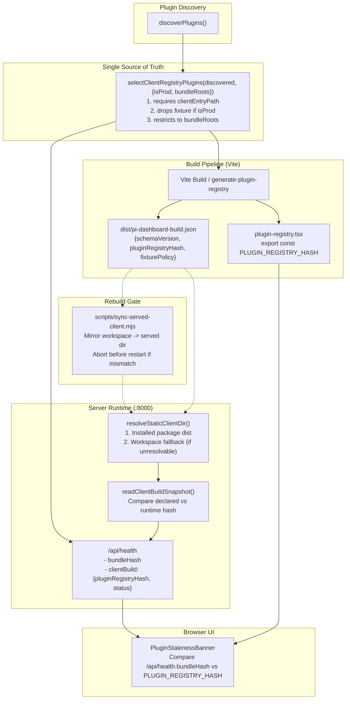

Client banner flow: `PluginStalenessBanner` fetches `/api/health` on mount. Compares `bundleHash` against imported `PLUGIN_REGISTRY_HASH`. Mismatch ⇒ render banner with Refresh + Dismiss buttons. Refresh calls `location.reload()`. Dismiss persists in `sessionStorage` key `pi-plugin-staleness-dismissed` (tab-scoped, clears on browser close). Dismissed banner stays hidden until next session.

See change: `add-served-build-coherence-and-hash-parity`.

#### Plugin Discovery, Trust and Runtime Delivery (`decouple-plugins-from-core`)

Plugins separable from core. Core imports no plugin. Plugin client reaches stock dashboard at runtime. Detail: `docs/runtime-plugin-clients.md`, `docs/plugin-seams.md`, `docs/publishing-plugins.md`, `docs/plugin-ui-primitives.md`.

**Discovery sources.** `discoverPlugins()` (`packages/dashboard-plugin-runtime/src/server/loader.ts`). `source` on `DiscoveredPlugin` + `PluginStatus`.

| Priority | `source` | Location |
|---|---|---|
| 1 | `workspace` | `<repo>/packages` |
| 2 | `installed` | `~/.pi/dashboard/plugins` |
| 3 | `bundled` | `resources/plugins` (Electron) |
| 4 | `pi-package` | `~/.pi/agent/settings.json#packages[]` via `listPiPackages({scope:"user"})` (`packages/shared/src/pi-package-resolver.ts`) |
| report only | `local-detected` | `<cwd>/.pi/settings.json#packages[]` of active sessions |

- `pi-package` entries: package dirs carrying a manifest. Files + manifest-less dirs skipped silently. Missing install paths invisible. `npm root -g` memoized once per process.
- Exception to priority: id ∈ served build's `bundledPluginIds` → build's own copy wins (`workspace` if a copy exists, else `bundled`, else plain priority), both halves.
- Discovery cache keyed by effective root set + digest of `bundledPluginIds` (absent → fixed "undeclared" key). Server reads declaration (`readBuildDeclaration`, `client-dist.ts`) at startup + on every refresh, before any discovery call.
- Vite build-time call (explicit `repoRoot`) scans only workspace. No declaration. Unaffected.

**One row per id (shadowing).** Losing duplicate → winner's `shadowed: {source, packageDir}[]`. Logged at warn. Never loaded. No second `loaded:false` row. `PluginsSection` renders `shadowed` as sub-line.

**Local-scope detection** (`local-scope-detector.ts`).
- Per active-session cwd: `listPiPackages({scope:"project", cwd})` entries with plugin manifest → row `source: "local-detected"`, `loaded: false`, `enabled: false`, error "Local-scope plugins are not loaded in this release. Install globally with --scope global to enable."
- Same id already has a row → local copy goes to that row's `shadowed[]`.
- Server entry, bridge, claims, client never loaded.
- Rerun: each discovery refresh, session registers a new cwd, after each successful local-scope package op, on session end (prunes rows no active session has).
- `plugins_changed` on session end only when the detected set changed.

**Refresh on completion.** Hook: package-operation completion listener (`setCompleteListener`, `packages/server/src/server.ts`), not `package-routes.ts` (routes return 202 before completion). Wiring: `packages/server/src/plugin-discovery-wiring.ts`. Implementation: `plugin-refresh.ts` `refreshPluginDiscovery()`.

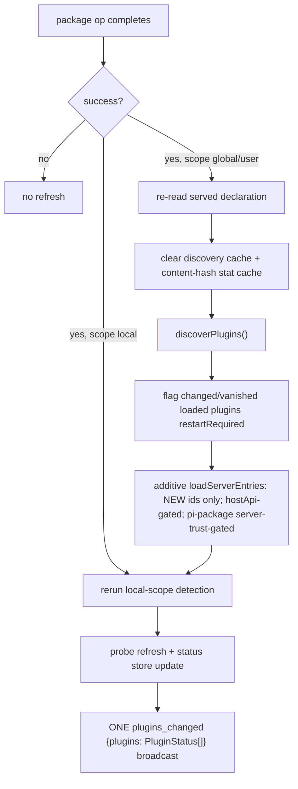

- Calls coalesce: refresh requested while one runs → exactly one follow-up.
- Server entry throwing during refresh → `loaded:false` + error, broadcast, refresh continues.
- Server entries load additively. Loaded plugin changed/vanished → `restartRequired: true`. Routes + handlers stay until restart.
- Hot-added entry registering Fastify routes: refused (`FST_ERR_INSTANCE_ALREADY_LISTENING`). Recorded `loaded:false`, `restartRequired:true`, `HOT_ROUTE_RESTART_ERROR`.
- Re-enable of discovered plugin whose server entry never loaded → restart.
- Terminal `pi install` NOT visible live: only dashboard installs (Packages tab / `POST /api/packages/install`) reach the listener. Appears after dashboard restart. `pi-resources-watcher.ts` not wired to discovery.
- `POST /api/plugins/:id/toggle` keeps contract (dependency graph, 409, cascade). Also broadcasts one `plugins_changed`.

**`plugins_changed`.** WS message `{type: "plugins_changed", plugins: PluginStatus[]}` (`packages/shared/src/browser-protocol.ts`). Emitted after refresh, toggle, trust write, local detection change. Client re-fetches runtime listing, recomputes enabled set, feeds `pluginAvailability`.

**Status shape (additive).** `PluginStatus.{source, shadowed, restartRequired, hostApi, client, serveApp}` (`packages/shared/src/dashboard-plugin/plugin-status.ts`).
- `/api/health.plugins[]`: unauthenticated, tunnel-reachable → path- and hash-free subset only (`source`, `restartRequired`, `hostApi`, `client.delivery`, `client.refusedReason`, `serveApp`).
- Paths, `client.sha256`, `shadowed[].packageDir`, `local-detected` rows → guarded `GET /api/plugins` + `plugins_changed` only.

**Host API version gate.** `PLUGIN_HOST_API_VERSION` (`packages/shared/src/dashboard-plugin/host-api.ts`) vs manifest `hostApi` caret range. Checked at discovery for BOTH halves.
- `workspace`/`bundled`: warn only.
- `installed`/`pi-package`: refuse server entry (error `host-api`) + client (`refused`, `host-api`).
- Required for `pi-package` + `clientBundle` plugins.

**Trust defaults.**

| Thing | Default | Opt-in |
|---|---|---|
| `workspace` / `bundled` / `installed` server entry | loads (as before) | n/a |
| `pi-package` server entry + bridge | DENIED (`server-untrusted`) | local `POST /api/plugins/:id/trust {server:true}` |
| Runtime client (`clientBundle`) | refused (`untrusted`) | local `POST /api/plugins/:id/trust {sha256}`, pinned to content hash |
| `serveApp` mount | trusted if bundled ∨ in `auth.trustedPlugins` ∨ in legacy `auth.capabilityRoutePlugins` | edit list; restart-effective |
| `local-detected` | never loaded | install globally |

- `isServeAppTrusted` (`packages/server/src/auth/serve-app-host.ts`): bundled = source ∈ {`workspace`,`bundled`,`installed`} + realpath containment + basename in `piDashboard.bundledPlugins`. Basename alone no longer trusts. `pi-package` + `local-detected` never bundled.
- `auth.trustedPlugins: {id, clientSha256?, server?}[]` written only by trust endpoints (`plugin-trust-store.ts`). `PUT /api/config` cannot write it.
- Grant needs `operate` + genuinely local. Revoke needs `operate`. Tiers in `packages/shared/src/route-tiers.ts`.

**Runtime delivery pipeline.**

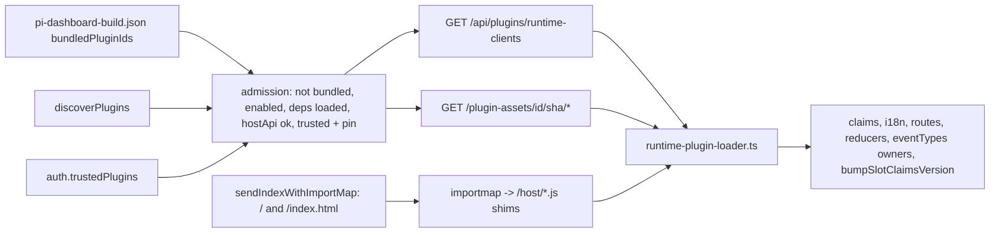

- Server pieces: `packages/dashboard-plugin-runtime/src/server/{runtime-client-registry,runtime-client-listing,plugin-assets-route,confined-static}.ts`, `packages/server/src/{plugin-runtime-clients,lib/index-html}.ts`, `routes/plugin-runtime-client-routes.ts`.
- Client pieces: `packages/client/src/lib/plugins/runtime-plugin-loader.ts`, `packages/client/src/host-shims/*`.
- Remote-server mode (`getApiBase()` non-empty) + Vite `--dev` page: loader does nothing.

**Core/plugin boundary.** `npm run check:plugin-boundary` (`scripts/check-plugin-boundary.mjs`, ratcheting `scripts/plugin-boundary-allowlist.json`, vitest wrapper). Plugin set from manifests. Shared contracts + `packages/mcp-core` in `docs/plugin-seams.md`.

**Absent-owner UX.** Manifest `eventTypes` → one group row per owned event type; availability decided at render time by `pluginAvailability`. Subagent state written by subagents-plugin slice + finalizers; generic heals in core. See `docs/plugin-seams.md`.

See change: decouple-plugins-from-core.

#### Plugin Activation UI

Settings ▸ Plugins tab lists every discovered plugin (enabled or not) with display name, description, enable/disable toggle, missing-requirement chips, inline Install affordances.

**Toggle workflow.** `PluginsSection` calls `POST /api/plugins/:id/toggle` (`packages/server/src/routes/plugin-activation-routes.ts`). Route writes `plugins.<id>.enabled` via config-api partial merge, broadcasts `plugin_config_update { id, config }` to every browser. Effect is **restart-required**: runtime claim filter (`SlotRegistry.setEnabledSet`) only re-reads enabled-set when client mounts or receives `plugin-config-update` event for the bundle's current plugin set; flipping `enabled` for a plugin whose server entry already loaded doesn't unload it. UI surfaces restart-required banner by comparing toggle timestamp to `/api/health.startedAt`.

**Declarative requirements.** Plugins declare `requires: { piExtensions?, binaries?, services?, paths? }` in their manifest (`PluginManifest.requires`, validated by `manifest-validator.ts`). At plugin load, `loader.ts` runs `runRequirementProbes(manifest.requires, requirementDeps)` from `packages/dashboard-plugin-runtime/src/server/requirement-probes.ts`. Probes:

- `probePiExtension(id)` cross-refs installed pi-extension set (deps.listInstalled).
- `probeBinary(name)` resolves via tool registry.
- `probeService(name)` dispatches to closed service registry. Sole entry `model-proxy` → `service-probes/model-proxy.ts::probeModelProxy`. Satisfied by boot-time `isModelProxyEnabled` dep. No HTTP — routes sit behind proxy auth gate.
- `probePath(rawPath, deps)` — existence check on absolute path. Never executes, never shells.

Results populate `PluginStatus.requirements` + flat `missingRequirements: string[]`; surfaced via `GET /api/plugins`. 30s in-process cache keyed by category+name. `server.ts` invokes `refreshRequirementProbesFor(pluginIds)` on every successful `package_operation_complete` + broadcasts `plugin_config_update` for any plugin whose missing-set changed — install/uninstall of a pi-extension lights up dependent plugin without restart.

**Path requirements (`paths`).** Fourth category, after `piExtensions`/`binaries`/`services`. Declared `PluginRequirements.paths?: string[]` in `packages/shared/src/dashboard-plugin/manifest-types.ts` — absolute filesystem paths that must exist (e.g. `.app`-bundled binaries not on PATH). Report field `PluginRequirementReport.paths: {name,satisfied}[]` (`packages/shared/src/dashboard-plugin/plugin-status.ts`) always present, `[]` when none declared.

`probePath(rawPath, deps)` (`packages/dashboard-plugin-runtime/src/server/requirement-probes.ts`) = existence check only (fs.existsSync-class). Never executes path, never shells. A `paths` entry MAY be exactly one `${configKey}` placeholder (regex `^\$\{([A-Za-z_][A-Za-z0-9_]*)\}$`). Resolved from declaring plugin's validated config — schema defaults applied, config read not shell expansion. Key must exist in `configSchema`; resolved value must be absolute. Failure → `satisfied: false`, never throws.

Wiring: `runRequirementProbesFor` probes `paths` after `services` — preserves category ordering. `missingFromReport` appends unsatisfied paths last. Paths share existing 30s TTL cache.

Reconciliation: `shouldReconcilePath` (`packages/apple-tools/src/reconcile.ts`) writes discovered non-default path back to `imcpServerPath` via `updatePluginConfig` — only when config unset/empty or at schema default. Never overwrites explicit operator override. Runs in plugin server (owns store), not CLI.

Client: unsatisfied `paths` requirement renders non-actionable warning pill — no [Install] — in `packages/client/src/components/packages/PluginsSection.tsx` (data-testid `missing-path-<name>`).

**UI cross-references.** `RecommendedExtensions.tsx` reads `EnrichedRecommendedExtension.dashboardPluginInstalled` (computed server-side in `recommended-routes.ts::enrichEntry` from `RecommendedExtension.dashboardPlugin`) + renders `+plugin: <id>` badge linking to Plugins tab.

**Restart-required model.** `usePluginEnabledSet` snapshots `/api/health.startedAt` ISO timestamp on first load. Subsequent `plugin_config_update` events update enabled-set live for claim filtering, but components that consumed plugin server entries (already loaded) require a restart to drop. `PluginsSection` compares toggle time to snapshot and renders "Restart required" banner when divergent.

**Settings consolidation.** Plugin-contributed `settings-section` claims render on owning plugin's dedicated left-nav page `/settings/plugins/<id>` — contract in `#### Plugin settings pages` below. Legacy `claim.tab` manifest field preserved for back-compat manifests but inert; `SettingsPanel` no longer consumes it. See change: add-plugin-activation-ui (settings-consolidation).

**Nav promotion.** `settings-section` `nav: { group, label }` promotes entry into built-in group only if `group` ∈ `PROMOTION_GROUP_ALLOWLIST` (`packages/client/src/lib/settings-promotions.ts`) = `models`, `resources`. `resources` = built-in Skills/Agents/Extensions/Prompts/Themes group (`SettingsPanel.tsx`). Promoted items render after built-ins. Plugins subtree keeps pointer row `<label> ↗ <group>`. Same trust + reserved-label rules for every group. See change: add-skill-atlas-screen.

#### Plugin settings pages (`plugin-settings-pages`)

Plugin-contributed `settings-section` claims render on owning plugin's dedicated page `/settings/plugins/<id>`. One render path only: `SettingsSectionByPluginSlot` inside `PluginSettingsPage.tsx`. See change: plugin-settings-pages.

**Slot contract.**

- `SettingsSectionByPluginSlot` = only consumer. Consumes BOTH refs claims AND intent broadcasts (`useSlotIntents("settings-section", null)`).
- Order: claims first, registry comparator (ascending `priority`, tie-break `pluginId.localeCompare`); then intents in store order. `IntentNode` carries no priority.
- `SettingsSectionSlot` inert — returns `null` for any `tab`. `SettingsPanel.tsx` mounts zero of them; repo-lint enforces in `packages/shared/src/__tests__/plugin-activation-contracts.test.ts`. `forTab` deleted from `slot-registry.ts`.
- `claim.tab` accepted by manifest but INERT. `manifest-validator.ts` no longer throws on unknown `tab`.

**Page chrome — host-owned, no opt-out.** `PluginSettingsPage.tsx` renders identity, status pill, enable toggle, metadata chips, error + missing-requirement banners. Plugin supplies body only. Chrome renders only fields `GET /api/plugins` returns (`PluginRow`): no `version`/`description`/`source`/`icon`.

**Routes.** `/settings/:page?/:sub?` at BOTH `App.tsx` and `SettingsPanel.tsx`. `:sub` interpreted only when `:page === "plugins"` (design D2). `VALID_SETTINGS_TABS` unchanged. Unknown id or settings-less plugin → activation index + not-found notice.

Folder-scoped `/folder/:encodedCwd/settings/:page?` unchanged; `VALID_FOLDER_SETTINGS_PAGES` excludes `plugins`.

**Settings eligibility.** Plugin contributes settings = registers `settings-section` refs claim OR holds `settings-section` intent in intent store. One predicate governs all three: nav-rail child membership, activation-index cog affordance, route eligibility for `/settings/plugins/<id>`. `PluginRow.claims` built from manifest only (`plugin-activation-routes.ts`) — intents invisible. Claims-only test strands intent-only plugin: slot renders contribution, nav child absent, URL bounces to activation index. Implementation: `contributesSettings()` in `packages/client/src/components/settings/SettingsPanel.tsx`; passed to `PluginsSection` — all three sites share it.

**Nav rail children.** Plugins where `enabled !== false` AND contributes settings (claim OR intent), sorted by display name, each with health dot. Keys on `enabled`, NOT `loaded` — failed-load plugin must stay reachable (design D4).

**Disabled plugin page.** Chrome + disabled notice + re-enable affordance. No body; component never mounts. Intent filtering happens in consumer, not registry: `SettingsSectionByPluginSlot` calls `isPluginEnabled(pluginId)` and drops plugin's intent when it returns false. `SlotRegistry.isPluginEnabled(id)` = read-only accessor — `true` before any `setEnabledSet` call, else set membership. Added because registry previously exposed `setEnabledSet` with no getter. Registry's own filter (inside `getClaims`) covers claims only — exactly why consumer must filter intents itself (design D6/D7/D8).

**Enable state = desired state, not runtime.** `POST /api/plugins/:id/toggle` writes `config.plugins.<id>.enabled`, broadcasts `plugin_config_update`, returns `restartRequired: true`. `GET /api/plugins`.status + `GET /api/health`.plugins[] both come from `getPluginStatusStore()` — runtime load state captured at server boot — neither reflects flip until restart. `usePluginList` (`packages/client/src/hooks/usePluginToggle.tsx`) keeps desired-state overlay: seeded from `GET /api/config`.plugins on mount (survives reload), updated from `plugin_config_update` payload + toggle response cascade. `status.loaded` untouched — stays runtime truth, explained by restart-required banner.

**Save stays global, one fan-out.** `SettingsDraftSource.page` now OPTIONAL. `PluginSettingsPageProvider` supplies owning plugin id; `useSettingsDraftSource` rewrites `page` → `plugins/<pluginId>` BEFORE `registry.upsert`. Rewrite lives in hook, not registry — `draftRegistry` memoized in `SettingsPanel` scope, above plugin page; ancestor closure cannot read descendant's context.

**Save Bar.** Names every dirty page, no cap; plugin pages labelled `Plugins › <Display Name>`; each entry navigates. Header carries changed-page count badge.

**Nav guards.** Rail navigation guards ONLY when leaving plugin page whose own sources dirty — plugin draft state dies on unmount. Built-in→built-in unguarded — built-in draft state lives in `SettingsPanel`'s `useState`.

**Disable-on-dirty.** Disabling plugin from its own dirty page resolves unsaved-changes confirm BEFORE rail drops nav child.

#### Plugin bridge↔server channel (generic)

Generic channel. Any plugin routes pi events bridge→server→browser + requests system follow-ups. goal-plugin first consumer. See change: add-goal-continuation-plugin.

- `dashboard:enqueue-followup` event. Plugin bridge emits `{text}`. Main bridge `enqueueSystemFollowup` ships text through single `bridgeFollowUp` drain. Ungated push, survives closed `isAgentStreaming` gate. Generic — any plugin requests system follow-up.
- `dashboard:plugin-message` event. Plugin bridge emits `{pluginId, messageType, payload}`. Main bridge wraps in `plugin_pi_message` over extension WS.
- `plugin_pi_message` (ExtensionToServer). Server `event-wiring` dispatches to `ServerPluginContext.registerPiHandler(messageType, handler)`.
- `plugin_event` (ServerToBrowser). Plugin server `broadcastToSubscribers`. Shell `useMessageHandler` routes `event` → `publishSessionEvent` → plugin `useSessionEvents`.
- New `ServerPluginContext` capabilities. `onEvent(handler)` subscribes all forwarded events. `sendToSession(sessionId, text)` sends prompt/command; `/`-prefixed text routes to extension-command dispatch (Path C keeper headless).
- Optional host read seams: `getPiResources?(cwd?, {fresh?})` (raw `PiResourcesResult`), `onPiResourcesInvalidated?(handler)` (fires on `invalidatePiResources` + `commands_list`). See [`plugin-seams.md`](plugin-seams.md#host-read-seams-getpiresources--onpiresourcesinvalidated).

##### Private request/reply lane

Bridge→server request, separate from the fire-and-forget channel above. Bridge entry `requestPluginServer(pluginId,type,payload)` from `@blackbelt-technology/dashboard-plugin-runtime/bridge`; core bridge installs fn at `Symbol.for("pi-dashboard.pluginRequest")`. Server `ctx.registerPiRequestHandler(type,handler)` — single owner per `(pluginId,type)`, duplicate throws. Wire `plugin_request` → host-internal `plugin_reply` on the SAME socket. Never `pi.events`; never the priority-gated `sendExtensionMessage`. Caps 256 KiB each way; timeout 15 s. Codes `no_handler`/`timeout`/`disconnected`/`request_too_large`/`reply_too_large`/`reply_not_serializable`/`unavailable`. `sessionId` from socket key, never payload. Trust: private = unobservable + unforgeable, NOT authenticated; handlers authorize on payload. Same change adds `ctx.credentials` store + `ctx.oauth.startFlow` + `createLoopbackCallback` — see [`plugin-seams.md`](plugin-seams.md). See change: expose-plugin-credential-and-oauth-seams.

#### Goal Session Supervisor (`add-goal-session-supervisor`)

Goal feature = session supervisor over host's existing session-lifecycle mechanism. Clean split: host owns mechanism (spawn + spawn-token correlation via `linkByToken` + death signal via `dispatchPluginSessionEnded`/`sessionManager.onUnregister` + kill via `abortSpawnedRun` + resume via `spawnPiSession` continue-mode). Goal plugin/server adds pursuit policy only.

**Relocated.** Goal product (store, supervisor, routes, goal_status peers, primer, link handover) now lives in `packages/goal-plugin/src/server/` — `index.ts` is the composition root. Core is goal-agnostic: no `goal/` dir, no goal wiring in `server.ts`/`event-wiring.ts`. Plugin reaches host services via `ServerPluginContext` capabilities (`spawnSession`/`mintSpawnToken`/`renameSession`/`assignSessionRef`/`networkGuard`/`onShutdown`/`onSessionEnded`/`onSessionResolved`/`consume("host.knownFolderCwds")`). REST paths `/api/folders/goals*`, wire types, and data dir `~/.pi/dashboard/goals` unchanged. Manifest id `goal` = owner id for spawn-token refs. Reaches parity with automation-plugin self-containment. See change: relocate-goal-product-to-plugin.

Supervisor lives in goal-plugin: `packages/goal-plugin/src/server/goal-supervisor.ts`. Rides plugin death fanout (`onSessionEnded`).

- Policy: progress-gated auto-respawn. Progress = strict cumulative `totalTurnsUsed` increase past per-driver baseline.
- Died-after-progress → resume conversation (continue-mode).
- K=2 consecutive no-progress resume-deaths → fresh re-primed spawn (poisoned session).
- Crash-loop breaker: 3 no-progress deaths in rolling 5 min → `GoalRecord.status = "failed"` ("crash loop").
- Backoff exponential 5s→15s→45s. Progress resets counters.
- Runaway-spend bounds: opt-in `autoRespawn` (default off, per-goal); cumulative turn budget (respawns cannot reset it); crash-loop breaker; backoff; headless-unavailable disables auto-respawn.
- Correlation: goal-driver spawn stamps `goalId` onto headless-pid registry entry keyed to spawn token (strong `linkByToken` path). Replaces legacy per-cwd FIFO as primary link.
- Abort ordering: clear/pause/delete finalize record (bump `generation` + write terminal status in one store write) BEFORE host kill, so death from that kill is no-op. Generation-guarded timers/spawns.
- Server restarts: no quiesce queue. Boot-time reconcile (deferred ~30s past reconnect grace window) classifies any pursuing/respawning goal whose driver did not re-register.
- `GoalRecordStatus` gains `respawning` (visible, non-terminal, no live driver) and `failed`.
- See change: add-goal-session-supervisor.

### Automation Plugin (`add-automation-plugin`)

Automation plugin = `packages/automation-plugin/`. Schedule-triggered background runs.

- Folder format `<scope>/.pi/automation/<name>/automation.yaml` (+`prompt.md` for prompt action). Dual scope: per-folder + global (`~/.pi/automation/`).
- Central server-owned scheduler arms trigger registry. Phase-1 trigger kind `schedule` (5-field cron).
- Fired run spawns pi session stamped `kind="automation"` via `ServerPluginContext.spawnSession` hook (gated priority<=100).
- Board hides run unless effective visibility `shown`. Run always watchable in Automation view (`/folder/:encodedCwd/automations/run/:sid`).
- Old path `/automation/run/:sid` declared `parentPath` `/folder/:encodedCwd/automations` but never captured `:encodedCwd`. `interpolateParentPath` returned null; back degraded to `/`.
- New path carries board cwd. Cold-load back resolves to owning board.
- See change: add-route-backed-overlay-dialogs.
- Run results `runs/<date>-<name>/result.md`. Auto-archive empty. Keep-100 retention.
- UI via shell slots: sidebar-folder-section, command-route `/automation`, shell-overlay-route, session-card-badge, settings-section general.
- See change: add-automation-plugin.

### Plugin Spawn Capability Scope (`add-plugin-spawn-scope`)

- `ServerPluginContext.spawnSession(opts: PluginSpawnOptions)` gains optional `scope` block.
- `scope` constrains spawned session tool/skill/extension surface.
- First-party trusted plugins only (priority <= 100).
- `scope.tools` (string[]) → `--tools a,b,c` (comma-joined single arg).
- `scope.excludeTools` (string[]) → `--exclude-tools a,b,c` (comma-joined single arg).
- `scope.noBuiltinTools`, `scope.noTools`, `scope.noSkills` (bool) → bare flags.
- `scope.skills` (string[]) → repeatable `--skill <path>`.
- `scope.extensions` (string[]) → repeatable `-e <path>`.
- NO `noExtensions` toggle. Bridge (control channel) must survive. Disabling extension discovery stops dashboard bridge loading → session uncontrollable. (design D2/D6)
- `scope.extensions` ADDITIVE allowlist. Discovery still runs, bridge loads.
- `extensionConfig[name][key]` projects to namespaced env `PI_EXT_<NAME>_<KEY>=value` (NOT argv).
- Name+key uppercased, non-`[A-Z0-9_]` → `_`.
- Headless mechanism only (plugin spawns headless-only).
- `extensionConfig` values now `string | string[]`. Scalar env verbatim. Array → `JSON.stringify`. (D8)
- env NAME normalization splits camelCase first. `allowedRoots` → `ALLOWED_ROOTS`. Then uppercase. Then non-`[A-Z0-9_]` → `_`.
- Mapper `pluginSpawnToSessionOptions(opts): MappedSpawnOptions` in `packages/dashboard-plugin-runtime/src/server/server-context.ts`.
- Total + pure. NEVER throws (plugin input untrusted JS).
- Flattens `scope` → flat `SessionFlags` argv fields + `extensionConfig`.
- Malformed containers treated absent.
- Non-string/empty/NUL argv entries dropped.
- NUL env values dropped.
- Conflicting `noTools` + `tools` both forwarded. Pi arbitrates precedence. (D3)
- Empty array ⇒ no flag emitted.
- `scope` absent ⇒ argv + env byte-identical to pre-change.
- Host hook (`packages/server/src/server.ts`) calls mapper BEFORE `pendingAutomationRunRegistry.enqueue`.
- Rejected input cannot strand stale `cwd`-keyed stamp. (D7)
- Consumers (automation-plugin, flows, REST spawn) do NOT populate `scope` yet. Future opt-in. Plumbing only.
- Part B: host-cwd-policy registry. `CwdPolicyRegistry` + pure `mergeCwdPolicy` in `packages/server/src/spawn-process/cwd-policy.ts`.
- cwd-keyed. Tighten-only. Composed across ancestors. Merged into every `spawnPiSession`.
- `registerCwdPolicy`/`unregisterCwdPolicy` on plugin ctx. Trust-gated.
- Registration requires CANONICAL containment (no lexical fallback — symlink-escape guard).
- `resolve()` matches canonical-OR-lexical (fail-toward-applying).
- See change: add-plugin-spawn-scope.
- Pkg `packages/path-containment-guard` → `@blackbelt-technology/pi-path-containment-guard`. Opt-in pi extension. Loaded only via `-e` / `scope.extensions`; no `pi.extensions` entry. README: `packages/path-containment-guard/README.md`.
- Fail-closed, non-interactive. Rejects `read|write|edit|grep|find|ls` outside `allowedRoots` + any `deniedTools`. Codes: `tool_denied`, `path_outside_roots`, `invalid_path`, `config_invalid`, `error`.
- Config env: `PI_EXT_PATH_CONTAINMENT_GUARD_ALLOWED_ROOTS`, `PI_EXT_PATH_CONTAINMENT_GUARD_DENIED_TOOLS` (JSON arrays), via `extensionConfig["path-containment-guard"]`.
- Plugin helper `withPathContainmentGuard({allowedRoots, deniedTools?}, baseScope?)` merges `-e` entry + `extensionConfig` into spawn scope.
- Shared resolver `packages/shared/src/tool-path-resolve.ts` (moved from `packages/extension/src/path-gate/resolve.ts`, which re-exports). Used by path-gate + guard.
- Security fix: `canonicalizeTarget` follows dangling symlinks. Write through in-root dangling link no longer escapes path-gate unprompted. Loop → hop bound 40 → path-gate blocks `error`.
- Spawn env ownership: `buildSpawnEnv` strips inherited `PI_EXT_<NAME>_*` for every name in `scope.extensionConfig`, after env contributors, then projects own config. `PI_EXT_PATH_CONTAINMENT_GUARD_*` never inherited by any spawn.
- Name const `PATH_CONTAINMENT_GUARD_EXT_NAME` in `packages/shared/src/path-containment-guard-name.ts`.
- Not a sandbox. Shell/MCP tools not path-checked. List them in `deniedTools`.
- See change: add-path-containment-guard-extension.

### Plugin Session Lifecycle Declarations (`hide-chat-gateway-sessions`)

`ServerPluginContext.spawnSession` accepts `PluginSpawnOptions.lifecycle: PluginSessionLifecycle` (`packages/dashboard-plugin-runtime/src/server/server-context.ts`). Owning plugin declares per-session lifecycle decisions; core reads the flags, never the plugin name.

- `recover?: boolean` — `false` opts owned session out of cold-start recovery (default recoverable). Persisted to `.meta.json` only when `false` (additive opt-out byte).
- `finalizeOnSocketClose?: boolean` — `true` finalizes owned session on socket close, no reconnect grace. In-memory only; read at pi-gateway socket-close finalize branch.
- `hidden?: boolean` — `true` hides owned session from board on FIRST register. Same `hidden` flag as headless auto-hide (`packages/server/src/session/memory-session-manager.ts`); revealed by "show hidden" toggle. Persisted to `.meta.json`, broadcast via `broadcastSessionUpdated`. Applied on fresh spawn-token resolution only (`packages/server/src/event-wiring.ts`); reattach never re-applies, so a later operator unhide survives. Persists the INTENT as `pluginHidden: true` on the session + `.meta.json` (`session-to-meta.ts`, restored by `sessionFromMeta` in `session-scanner.ts`) so a post-restart respawn re-register (`registerReason: "spawn"`, no token) keeps hidden. `register` order: reattach → `existing.hidden`; `visibilityIntent`; `existing.pluginHidden === true` → hidden; else headless heuristic. Explicit `visibilityIntent: "visible"` still wins. Pre-fix hidden sessions carry no `pluginHidden` → not migrated. See change: fix-plugin-hidden-across-restart.
- `pending-plugin-ref-registry.ts` (`packages/server/src/pending/`) files a lifecycle record when ANY of `recover`/`finalizeOnSocketClose`/`hidden`/`archiveOnEnd`/`close` set.
- Sibling hook `ServerPluginContext.shutdownSession(sessionId): Promise<boolean>` ends a session like the dashboard **Shutdown**. Trusted plugins only (manifest `priority <= 100`); untrusted or unknown session → `false`. Reuses `browserGateway.shutdownSession` — same body as `POST /api/session/:id/shutdown`, never a parallel `{type:"shutdown"}` path (#449/#452). First consumer: chat-gateway `!close`. See change: chat-gateway-close-command.
- `close?: { idle?: { afterMs: number }; mode?: "sleep" | "archive" }` — opt-in close policy. Trusted plugins only (`spawnSession` already `priority <= 100` gated). Validated at `pendingPluginRefRegistry.file` by `normalizeCloseDeclaration` (`packages/server/src/pending/pending-plugin-ref-registry.ts`): `afterMs` finite integer >= `MIN_CLOSE_IDLE_MS` (1000); mode default `sleep`; invalid block dropped + warning naming plugin id + spawn token. `closePolicy` is a core-reserved ref key; pluginRef body cannot forge it.
- Applied at first register in `packages/server/src/event-wiring.ts` as `DashboardSession.closePolicy = { owner, idleAfterMs?, mode }` (`SessionClosePolicy`, `packages/shared/src/types.ts`). Persisted to `.meta.json` (`session-to-meta.ts` / `session-scanner.ts` / `memory-session-manager.ts` reattach carry-over). `owner` = declaring plugin id; routes its closer + authorizes its close requests; never a pluginRef read.
- Governed = `closePolicy.idleAfterMs` present. Idle reaper (`packages/server/src/embed-lifecycle/idle-reaper.ts`) governs it regardless of `embedLifecycle.enabled` + `lifecyclePolicy`, with its own threshold. All quiescence vetoes + 3 gears apply (`decideReap`, `quiescence.ts`). Feature off + nothing declared ⇒ no-work sweep (unchanged).
- `ctx.registerSessionCloser(fn)` — one per plugin. Reaper asks it before closing a governed session it declared. fn gets `{ sessionId, cwd, reason, idleMs }` only; returns `"close" | "keep"`. Throw / >1 s (`CLOSER_TIMEOUT_MS`) / unknown value ⇒ keep. 5 s per-sweep budget (`CLOSER_SWEEP_BUDGET_MS`), overflow deferred. No closer or owner plugin disabled ⇒ close.
- `ctx.requestSessionClose({ sessionId, reason, when })` — only sessions the caller declared. `when:"now"` ⇒ graceful `abortSpawnedRun` path: shutdown hint + shared confirmed terminator (`createSessionTerminator`, `packages/server/src/spawn-process/session-terminator.ts`); `true` only on confirmed termination. `when:"idle"` ⇒ close at next quiet point (all vetoes except idle age; never mid-run). In-memory, lost on restart; no closer consult. Refusal (foreign/undeclared/unknown/ended session, bad `when`, untrusted) ⇒ `false` + one warning.
- Close mode `archive` ⇒ `archiveOnEnd` set before close (subject to `sessionList.archiveServiceSessionsOnEnd`); `sleep` ⇒ resumable only.
- Mark rolled back (`markArchiveOnEnd(id, false)`) when close not confirmed: reaper unconfirmed terminate, undelivered stop-after-turn latch, `requestSessionClose when:"now"` → `closeNow` false (`idle-reaper.ts`, `plugin-session-close.ts`).
- Closer NOT consulted on: user Shutdown, `abortSpawnedRun`, spawn-register watchdog, socket-close finalize, heartbeat expiry. Caps reclaim never closes a declared session (`CapSessionInfo.declared`).
- Metrics (`lifecycle-metrics.ts`): `declaredReaps`, `closerKeeps`, `closerFailures`, `pluginCloseRequests`. Code: `packages/server/src/embed-lifecycle/plugin-session-close.ts` (`createSessionCloserRegistry`, `createPluginSessionCloseApi`).
- First close-policy consumer: team plugin — declares `close { idle.afterMs = idleMinutes·60000, mode sleep }` (none when idleMinutes 0); closer keeps session while its conversation ensure is in flight.
- Team `sweepIdle` kept as legacy fallback (5-min interval, `conversations.ts`). Skips any session carrying `closePolicy`; ends only sessions without one (live from before upgrade, or host without close-policy support).
- Sessions with `closePolicy` → idle ending by core quiescence reaper only.
- First consumer: chat-gateway spawn/resume (`sessionVisibility: "hidden"` default). See [`chat-gateway.md`](chat-gateway.md).
- See change: hide-chat-gateway-sessions, fix-plugin-hidden-across-restart, add-session-close-plugin-hook.

### Hermes Memory Settings Plugin (`add-hermes-memory-settings-plugin`, `resync-hermes-memory-config-0-9`)

New package `packages/hermes-memory-plugin` (client + server + shared). Settings-section plugin for the external `pi-hermes-memory` pi extension.

- Two Fastify routes on shared instance (`ctx.fastify`): `GET /api/plugins/hermes-memory/config` + `PUT /api/plugins/hermes-memory/config`.
- GET returns per `MemoryConfig` field `{ value (on-disk else default), default, isDefault }` + `filePath` + `exists` + `raw`.
- `raw` = preserved unknown keys + resolved known values. Display-only, not a valid PUT body.
- GET mirrors upstream derivations:
  - valid strategy → `autoConsolidate`.
  - strategy absent + boolean `autoConsolidate` → strategy.
  - array-form `llmModelOverride` → string primary + fallback tail.
  - `llmModelFallbacks` / `fallbackModels` aliases unioned into `llmFallbackModels`.
- PUT validates browser body via `validateHermesConfig` (shared) BEFORE any write — unknown-key allowlist, type/enum/numeric-bound, `correction*Patterns` regex-compile. Invalid → 400, no write.
- Write atomic: tmp file in same dir + `fs.rename`, pretty 2-space JSON, `mkdir -p` parent.
- Written object = preserved unknown on-disk keys + non-default body fields (`composeWritten` in `src/server/config-io.ts`).
  - Default-valued fields omitted → upstream default changes flow through.
  - `memoryOverflowStrategy` always written.
  - Empty `llmFallbackModels` omitted.
- Known keys come only from PUT body. Known key body omits → dropped (clear-to-inherit / reset).
- Unknown keys come only from disk. Body unknown keys → still 400.
- One-time legacy heal: drop `consolidationTimeoutMs` 60000 iff disk holds all 23 `LEGACY_0_8_1_DEFAULTED_KEYS` and body also 60000.
- Strict read (`readDisk`):
  - ENOENT → `{}`.
  - Other read error → HTTP 500 `{ error: "hermes config file unreadable", code }` on GET + PUT, no write.
  - Malformed / non-object JSON (BOM not stripped) → GET all defaults. PUT copies bytes to `hermes-memory-config.json.corrupt-<YYYYMMDDTHHMMSSsssZ>[-N]` (flag `wx`, mode 0600) then writes.
  - Copy failure → 500 `{ error: "hermes config quarantine failed", code }`.
- `__proto__` on disk kept as data. Objects built via `Object.fromEntries` + spread, never `out[k] = v`.
- External-file contract: edits the exact file the extension loads — `PI_CODING_AGENT_DIR` (trimmed, `~`-expanded) else `<home>/.pi/agent`, then fixed `hermes-memory-config.json`. Filename never from request input (no path traversal).
- No hermes API exists; plugin re-declares `MemoryConfig` + defaults in `src/shared/hermes-config.ts` (mirrors goal-plugin vs pi-goal-hermes). Mirror pinned to pi-hermes-memory@0.9.10 (44 keys; `llmThinkingOverride` adds `max`; `consolidationTimeoutMs` default 180000). Drift guard: fixture `src/shared/__tests__/fixtures/hermes-0.9.10-fields.json` (keys + defaults from upstream `loadConfig()`); local-only check vs installed `~/.pi/agent/npm/node_modules/pi-hermes-memory` (skipped in CI).
- `requires.piExtensions: ["pi-hermes-memory"]` — section + routes active only when extension installed.
- Runtime caveat: hermes reads config once at extension load → edits apply to newly started sessions only ("applies to new sessions" notice in the UI), not running ones.
- Structured logging: path + field count on read/write success, failure reason on error, NEVER field values (config may hold model/provider hints).

### MCP Client Plugin (`extract-mcp-client-plugin`, `migrate-mcp-to-pi-builtin`, `mcp-client-project-overrides`)

New plugin `packages/mcp-client-plugin/`, id `mcp-client`. Sole owner of the two Pi MCP config layers on the dashboard side. NO `pi-mcp-adapter` dependency — rebuilt on pi 1.0.0's BUILT-IN MCP. `apple-tools` and `mcp-server-plugin` consume it. See change: migrate-mcp-to-pi-builtin, mcp-client-project-overrides.

**Claims.** `settings-section` → `/settings/plugins/mcp-client`. Folder pill = ONE component on two slots: `sidebar-folder-section` + `worktree-card-section`. `shell-overlay-route` `/folder/:encodedCwd/mcp`, `depth: 2`, `parentPath` `/folder/:encodedCwd`.

**Exports.** `./client`, `./server`, `./core`. `./core` imports NO React and NO host runtime — the hostless `pi-apple-tools-install` CLI builds the same service from it.

**Two layers.** Pi global `$PI_CODING_AGENT_DIR/mcp.json` (else `~/.pi/agent/mcp.json`) + trusted `<cwd>/.pi/mcp.json`. Project entry = override OR whole-entry replace (see Project overrides). Whole-entry replace: `command`, `url` or `type` set → replaces global entry of same name, whole entry, not a field merge. Both layers parse as STRICT `JSON.parse`; a file with comments or trailing commas is an unparseable layer that pi skips WHOLE — shown as such, never written over. `src/core/layers.ts` (`LayerPaths`, `piAgentDir`, `defaultLayerPaths`, `nullProto`, `readLayer`). DELETED: adapter worker/port, adapter version floor, global-settings form, `adapterLoadTimeoutMs`, `configSchema.json`, and every shared/import layer (`.mcp.json`, `~/.config/mcp`, host imports). `pi-mcp-adapter` + `strip-json-comments` deps removed; `ajv` stays.

**Project overrides (pi ≥ 1.0.1).** Override = project entry with `command`, `url` and `type` all `=== undefined` (`null` and `""` count as SET). Changes only `enabled`, `exposure`, `toolExposure` of the Pi-global server with same name. Keeps all other global fields, credentials included. Other keys → `bad-keys`. Effective entry = `{...global, ...override}`, validated by pi rules. Exempt from `-`/`_` `name-collision` and project `auth` checks. Credentials stay global.
- Base = global entry pi KEEPS: valid + first-wins on namespace collision. One shared fn `keptGlobalOf` (`core/pi-rules.ts`) used by effective view AND every writer.
- `classifyProjectEntry(name, value, keptGlobal?)` → `replace | orphan | bad-keys | invalid | override`.
- No kept base → `orphan`: folder row, pi message `needs "command" or "url", or a global server to override`.
- Bad keys → `bad-keys`: `an override can only set enabled, exposure, toolExposure`.
- Invalid merge → `invalid`: pi validation message.
- `orphan` / `bad-keys` / `invalid`: global entry stays in effect unchanged.
- Messages byte-equal pi 1.1.0 text. Golden test E12 reads pi dist `extensions/mcp/config.js`.
- Valid override = ONE row: `provenance: "pi-global"`, `entry` = merged (redacted in project views), `projectOverride: {path, keys, raw, inherited}`.
- `orphan` / `bad-keys` / `invalid` = folder row + `overrideIssue`. Not counted by folder pill.
- Untrusted project: global row unchanged; override → inactive folder row `project-not-trusted`.
- Whole-entry replace unchanged: `provenance: "pi-folder"`, `overridesGlobal`.
- `legacyCopy` flag on folder row that is exact old copy of global.

**pi rules.** `src/core/pi-rules.ts` mirrors pi 1.1.0's unexported `validateMcpServerConfig`. Adds `OVERRIDE_KEYS`, `isProjectOverride`, `classifyProjectEntry`, `keptGlobalOf`. `isValidServerName` (`[A-Za-z0-9_-]+`, ≤128, not `__proto__`/`constructor`/`prototype`); `transportOf` (HTTP when `url`, unless `type: "stdio"`); `MCP_EXPOSURES` + `MCP_EXPOSURE_ALIASES` (`codemode-deferred` → `codemode`); `ADAPTER_ONLY_KEYS` / `adapterLeftovers` / `ignoredKeys` (pi ignores unknown keys — adapter keys survive in the file, pi never acts on them); `authModeOf` (provider | header (case-insensitive `Authorization`) | oauth).

**Service.** `ctx.provide("mcp-client.config", …)` before any route registers. Factory `createMcpClientConfigService({ configIO, knownCwds, isProjectTrusted?, paths?, runner?, scratchCwd?, liveTimeoutMs?, liveCacheTtlMs? })` → `McpClientRuntime` = service + `getLiveState(scope, {fresh})`. Write-only paths never run `pi mcp list`.

**Trust.** `isProjectTrusted(cwd)` INJECTED. Dashboard server supplies `host.isProjectTrusted` (see Bootstrap; decision = shared `decidePiTrust`, see Pi trust mirror). Untrusted folder → its project layer never loads, its rows inactive (`project-not-trusted`). Dashboard-only trust → project rows active, live state `not-checked-by-pi`. Hostless caller (apple-tools CLI) treats every project as untrusted → global writes only.

**Live state.** `src/core/live-state.ts` `createLiveStateReader({runner,timeoutMs,cacheTtlMs,now})` runs `pi mcp list --json` through the shared safe-spawn. `LIVE_STATE_TIMEOUT_MS` 30000, `LIVE_STATE_CACHE_TTL_MS` 30000. stdout parsed whatever the exit code — pi exits `1` whenever a server is disconnected or an entry invalid. Timeout aborts the signal → `{ok:false,reason:"timeout"}`; failures never cached. Global view spawns in an empty `mkdtemp` scratch dir so only the global layer loads.

**Effective view.** `createEffectiveViewReader`. Global view = Pi-global layer only. Project view = global then folder. Rows carry provenance `pi-global`/`pi-folder`, `overridesGlobal`, `transport`, `enabled`, `exposure`, `active`, `inactiveReason` (`disabled` | `project-not-trusted` | `invalid-entry` | `name-collision` | `global-only-auth`), `piError`, `ignoredKeys`, `adapterLeftovers`, `authMode`, `projectOverride`, `overrideIssue`, `legacyCopy`. Server-side redaction (`redactEntry`, `isSecretKey`): GLOBAL entries shown in a project view lose `headers`/`env` → `{redacted,keys}` and `oauth.clientSecret` → `{redacted}`.

**Writer.** `createConfigWriter({configIO,paths,knownCwds,isProjectTrusted?})`: `targetPath`, `readServerEntry`, `ensureServerEntry` (merge fields), `saveServer` (whole entry, `previousName` rename), `removeServer`, `setEnabled`, `setProjectOverride`, `convertLegacyCopy`, `convertAdapterLeftovers`, `previewEnsure`, `readParseStatus`. Validation order: transport-conflict → pi rules (`invalid-entry`, pi's own message) → project `auth` on HTTP refused (global-only) → `-`/`_` `name-collision`. Overrides skip last two checks. Collision scope: project = global + project names; global = global + every known TRUSTED folder's project names; entry being replaced excluded. `setEnabled` at project scope, kept global server, no folder entry → `setProjectOverride` smallest override. Existing override → same. Existing whole-entry folder entry → unchanged, `needs-choice` for whole-entry copies. Table: global on+Off → `enabled:false`; on+On → delete key; off+On → `enabled:true`; off+Off → delete key; compare `enabled ?? true`.
`setProjectOverride(name, patch, scope)`: project scope only. Patch absent = keep, `null` = delete key, empty override deleted, no key change = no file write. Refuses `no-global-server` (unparseable wins). Atomic write.
`saveServer` at project scope refuses override-shaped body/rename (`invalid-entry`). Global `collisionCandidates` ignores folder overrides.
`convertLegacyCopy`: legacy = both full entries (string `command`|`url`), folder has none of `headers`/`env`/`auth`/`oauth.clientSecret`, rest equals global minus those. Keeps only override keys differing from global. Returns `previous` for undo. Old copy path (`folderCopyOf`, `omitted` result) removed.
`ConfigRefusalCode` is CLOSED: `unparseable | entry-not-object | invalid-name | name-collision | transport-conflict | invalid-entry | write-failed | no-global-server`. Exports `NotAllowedCwdError`, `keptGlobalOf`.

**Schema.** Published `schema/mcp-config.schema.json` is the pi 1.1.0 entry shape. `$defs.ProjectOverride` (`additionalProperties: false`) covers overrides: `description`, `oauth.clientName` / `oauth.authServerMetadataUrl`, global-only `auth.provider`, `exposure` (alias included), `toolExposure`, `timeout` > 0, `enabled`. `ajv` validates every write BEFORE IO via `validateServerEntry(entry,{kind})`. Markers `x-secret` (redaction + masking), `x-transport`, `x-global-only` drive the editor.

**REST.** `GET /api/mcp-client/effective?cwd=`, `GET /api/mcp-client/live?cwd=&fresh=1`, `GET /api/mcp-client/schema`, `PUT /api/mcp-client/servers/:name` `{scope,cwd?,entry,previousName?}`, `DELETE /api/mcp-client/servers/:name?scope=&cwd=` → `{ok,removed}`, `PUT /api/mcp-client/servers/:name/enabled` `{scope,cwd?,enabled}`, `POST /api/mcp-client/servers/:name/convert` `{scope,cwd?}`, `PUT /api/mcp-client/servers/:name/project-override` `{enabled?,exposure?,toolExposure?}` (`null` = inherit; types + enums validated BEFORE scope parse; project only; → `{ok,override}` | `{ok,removed:true}`), `POST /api/mcp-client/servers/:name/convert-to-override` (→ `{ok,previous}`). Same networkGuard + known-folder admission. Hold origins reuse `mcp:enable` / `mcp:convert`. Removed: `/adapter`, `/settings`, `/disabled`. EVERY route — GET included — sits behind `networkGuard`: mutating bodies become executable config for pi and the effective view returns own-layer credentials. Path name decoded + validated and project cwd admitted (403 `not-allowed` + `reason`/`hint`) BEFORE any IO.

**Runner.** `src/server/pi-runner.ts` `createPiMcpListRunner()`: `ToolResolver.resolvePi()` + shared `spawn` (no shell) + `buildSpawnEnvForArgv` (`ELECTRON_RUN_AS_NODE`) + SIGKILL on abort + 4 MiB stdout cap. Plugin `index.ts` consumes `host.knownFolderCwds` + `host.isProjectTrusted`; absent `isProjectTrusted` → one warning, every project untrusted.

**Consumers.** `apple-tools` declares `dependsOn: ["mcp-client"]` and drops `requires.piExtensions: ["pi-mcp-adapter"]`. `install.ts` writes only `mcpServers.iMCP` via `ensureServerEntry` (command refreshed; `enabled`/`exposure`/`toolExposure` + unknown keys preserved); `ensureAdapterPackage` and every `settings.json` write removed. `set-disabled` + `set-direct-tools` `plugin_action`s removed (hard break); panel links "Manage MCP servers →" to `/settings/plugins/mcp-client`.

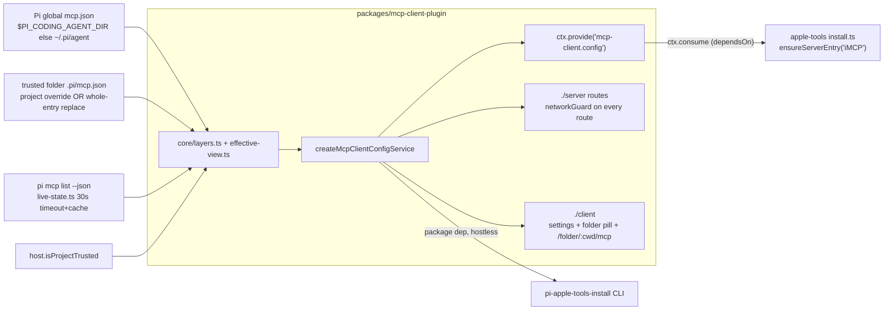

**Folder UI** (`/folder/:cwd/mcp`). Pi-global row switch = effective state. Text badge: `Off in this folder` / `On in this folder` / `Exposure: X in this folder`. `Reset to global` = exact undo via override route. Overflow menu: `Project settings…` (radiogroup Inherit/On/Off + exposure select `Inherit (<global>)` + read-only `toolExposure`; bottom sheet <640px) and `Replace with folder entry…` (old whole-entry editor). Orphan/invalid override row: pi message + Remove only. Legacy-copy strip + `Convert to project override` with undo. Untrusted: `Saved — applies once the project is trusted`. Mobile: badges display-only; Reset/Convert in row menu; 44px targets.

### MCP Endpoint (`add-dashboard-mcp-server`, `mcp-legacy-clients-and-token-issuance`, `paginate-mcp-list-sessions`, `migrate-mcp-to-pi-builtin`)

New plugin `packages/mcp-server-plugin/`. Headless — no client entry, `claims: []`. Mounts `POST /mcp` on `ctx.fastify`, the shared Fastify instance every plugin gets. Seven other plugins register routes the same way.

**Protocol.** Dual-era contract on single route (`POST /mcp`):
- **Legacy era (`2025-03-26`, `2025-06-18`, `2025-11-25`):** Streamable-HTTP compatibility. `initialize` handshake supported; returns static `InitializeResult` with negotiated `protocolVersion` + opaque unrecorded 128-bit hex `Mcp-Session-Id` header (minted once, never recorded, never checked); `notifications/*` returns 202 (body null); `ping` returns `{}`; streaming refused (`subscriptions/listen` returns 404 + `-32601` `MethodRemoved`).
- **Modern era (`2026-07-28`):** handshake-free, stateless. No session ids minted, echoed, or checked. `subscriptions/listen` streaming supported. No `Last-Event-ID` resumption.

**Version resolution.** Resolved once per request in `routes.ts` before listen interceptor (single resolution site). `dispatchRpc` receives resolved `{ era, version }`. Resolution rules:
- Repeated or comma-joined `MCP-Protocol-Version` header → 400 `AmbiguousHeader` (checked first, applies to all methods including `initialize`).
- `initialize` handshake → version read from `params.protocolVersion`. Legacy version echoed; unknown version negotiates down to `2025-11-25`; modern `2026-07-28` on `initialize` refused (404 + `-32601`); non-string version → 400 `UnsupportedProtocolVersion`.
- Present header → validated against supported versions (`2025-03-26`, `2025-06-18`, `2025-11-25`, `2026-07-28`). When `params._meta` declares `io.modelcontextprotocol/protocolVersion`, header and body must agree (disagreement → 400 `HeaderMismatch`). Modern revision requires `_meta` version (absent → 400 `MissingMeta`).
- Absent header + present `_meta` version → 400 `MissingHeader`.
- No marker at all (no header, `_meta` absent or version-less) → legacy default `2025-03-26`.
- Unsupported version string → 400 `UnsupportedProtocolVersion`.

**Method / error mapping.**
- Unknown method → `404` + JSON-RPC `-32601`. Unknown tool → `404` + `-32601`.
- Malformed body → `-32700` (unparseable) or `-32600` (valid JSON, not JSON-RPC).
- Fastify body-parse failure normalised into JSON-RPC parse error.
- Never `500`. Handler rejection → `-32603`, never an unhandled rejection.
- Non-POST methods → `405` + `Allow: POST`.
- Explicitly registered: GET, DELETE, PUT, PATCH, OPTIONS.
- HEAD NOT registered. Fastify derives HEAD from GET. Returns same 405. Asserted in tests, not registered.
- Reason: Fastify falls an unmatched method through to `setNotFoundHandler`. In `--dev`, that proxies Vite and returns 200 + SPA HTML. Conformance failure that looks like success.

**Encapsulated scope.** Routes register inside a Fastify `register` scope, not on the shared instance. Load-bearing: `setErrorHandler` global on the instance called on. Call on `ctx.fastify` → replaces dashboard handler, breaks SPA fallback.

**Auth boundary.** `createNetworkGuard` applied per-route. `/mcp` sits outside it, self-guards. Every request needs a bearer credential, INCLUDING loopback. No `isGenuinelyLocal` parameter exists. Handler reads `Authorization` directly, never `request.isAuthenticated` (global hooks set that for cookies + device tokens). Cookie-authenticated browser cannot reach `/mcp`.

Two credential kinds resolve to one `McpCaller`:
- session-scoped MCP tokens → `{ kind:"session", sessionId }`, has originating session
- paired-device bearers → `{ kind:"device", deviceId }`, no originating session

**Throttle.** Pre-auth brute-force control keyed `(ip, SHA-256 credential fingerprint)` at 10 failures / 60 s (`MAX_AUTH_FAILURES`, `packages/mcp-server-plugin/src/server/rate-limit.ts`) plus coarser per-ip ceiling 100 / 60 s (`MAX_IP_AUTH_FAILURES`, D7). Every local session shares 127.0.0.1 — ip-only key let one stale token deny all others. Fingerprint never logged (X6). Success clears both buckets.

**Session tokens.** Opaque 256-bit. `mcp_` prefix. SHA-256 at rest. Plaintext returned once at mint. Constant-time compare. Flat-array scan, no membership-timing leak. No independent expiry — a token's lifetime IS its session's lifetime. IN-MEMORY only: no `mcp-tokens.json`. Registry dies with the plugin. All die on restart. Sessions re-mint when bridge re-registers. Revocation: `onSessionEnded` / bridge disconnect (primary), mint-replaces (D4; re-mint on reconnect invalidates previous token immediately), explicit `mcp/revoke-token`, process exit / plugin unload.

**Minting.** Bridge calls `mcp/mint-token` over session's own bridge WebSocket on every (re)registration (`bridge.ts`, D3). Server mints via `McpTokenRegistry.mintForSession` — REPLACES session's row (D4; stale token dead on re-mint). Server attributes it to session CONNECTION registered as (`currentSessionId`), never `msg.sessionId`. `mcp/revoke-token` revokes by session. Reply is `{type:"mcp_token_minted", token, url}`; `url = dashboardMcpUrl(port)` = `http://127.0.0.1:<host.httpPort>/mcp` (live getter at mint time, fallback 8000).

`plugin_pi_message.sessionId` a REQUIRED protocol field (`protocol.ts:593`), always present. `pi-gateway.ts` previously preferred it over the connection — a bridge could name any session and receive that session's credential. `plugin_pi_message` now excluded from body-sessionId precedence. Other message types keep prior behaviour.

Guarantee stated exactly: "the session this connection registered as". Not spoofable per-message — what the self-target guard needs. NOT a claim about pi-gateway port authentication. `currentSessionId` itself set from the first `register` message. Pre-existing bridge trust model. Out of scope here.

Reply travels ONLY on session-private extension lane: `mcp_token_minted` (`packages/shared/src/protocol.ts`; `McpTokenMintedExtensionMessage` gains an optional `url`), sent via trust-gated `sendExtensionMessage` context capability (`packages/dashboard-plugin-runtime/src/server/server-context.ts`; wired trust-gated in `packages/server/src/server.ts`, gate = manifest priority ≤ 100). NEVER `pi.events` — `plugin_emit_event` measured to reach unrelated subscribers (spike Q4b).

**Registration (replaces provisioning).** `packages/extension/src/mcp-token-delivery.ts` builds `createMcpDashboardRegistrar({pi, sessionId, reportUnavailable, log})`. On `onMinted(msg)` (requires `token` + `url`) it calls `pi.registerMcpServer("pi-dashboard", { url, headers: { Authorization: "Bearer <token>" }, exposure: "deferred" })`. Re-mint re-registers — a later registration of the same name REPLACES the earlier one. `onSessionShutdown()` calls `pi.unregisterMcpServer("pi-dashboard")`; `onSessionStart()` re-arms (new/fork/resume keep the same extension instance). Wired in `packages/extension/src/bridge.ts` (`mcp_token_minted` → `onMinted`, `session_start` → `onSessionStart`, `session_shutdown` → `onSessionShutdown`). Exports `DASHBOARD_MCP_SERVER_NAME`, `McpRegistrationApi`, `McpTokenMintedPayload`. NO per-session `mcp.json` write, no header script. Exposure `deferred` → pi auto-activates `tool_search`; found tools then called directly. An `mcp.json` entry named `pi-dashboard` TAKES PRECEDENCE over the registration.

**Guard.** Missing or throwing `registerMcpServer`, or delivery without `url` → NO registration, one warn log naming the session id, one `plugin_pi_message` `mcp-server`/`mcp/registration-unavailable` `{reason: "api-missing" | "register-failed" | "no-url"}` for the doctor. An installed `pi-mcp-adapter` does NOT throw (pi reports an extension error) — the doctor's adapter row covers it. The dashboard registers NO `/mcp` pi command (static scan `no-mcp-command.test.ts` asserts no `pi.registerCommand` name across `packages/*/src` is `mcp`).

**Protocol era.** pi sessions reach `/mcp` in the LEGACY era: pi 1.0.0's client offers `2024-11-05`…`2025-11-25` and sends `2025-11-25`. Every request/response tool works. `subscriptions/listen` streaming (modern-era only) is NOT available to pi sessions. Requires pi ≥ 1.0.0.

**Startup migration.** `packages/mcp-server-plugin/src/server/legacy-entry-migration.ts` (D2). On server start `index.ts` runs `migrateProvisionedEntry` + `logMigration` (never throws). Removes the old provisioned Pi-global `mcp.json` key `pi-dashboard` IFF it matches the provisioned signature (`isProvisionedDashboardEntry`: `requestHeadersCommand.command === "node"` + `args[0]` ending `header-command.mjs`). Via `createMcpClientConfigService` — merge-only, atomic, refuses an unparseable file. A non-matching operator entry is KEPT + warned (it would shadow the registration). Idempotent, no marker. Exports `DASHBOARD_MCP_KEY`, `MigrationResult` (`absent | removed | kept-operator-entry | skipped-unparseable | failed`), `migrateProvisionedEntry(configIO,{paths?})`, `logMigration(result, logger)`. New pi handler `mcp/registration-unavailable` logs `mcp.dashboard_registration_unavailable session=<id> reason=<r>`. Removed: provisioning, the adapter diagnostic, and the `onMcpRequest` route hook (`routes.ts` `McpRouteDeps.onMcpRequest` gone).

**Direct device-token mint.** `POST /api/paired-devices` issues durable bearer credentials for external MCP clients (Claude Code, Cursor). Gated by `operatorGuard`: requires dashboard login session (`authVia === "session"`), valid `X-Pi-Local-Token`, or genuine local loopback (`isGenuinelyLocal`, no proxy headers). Enforces unconditional Host admission (closes DNS-rebinding). Accepts `{ label, tier }` (`tier` optional, `"observe" | "control" | "operate"`, default `"observe"`, 1..64 UTF-8 bytes for label). Plaintext token returned ONCE in response, never stored or retrievable. Paired-device registry (`~/.pi/dashboard/paired-devices.json`, 0600) stores SHA-256 hash with `source: "manual"` (`source: "pairing"` for QR pairing), `tier` field. Rows without `tier` read as `"operate"` (back-compat with existing paired devices). Revocation via `DELETE /api/paired-devices/:id`.

**Tier model.** Three ordered tiers: `observe < control < operate`. Registry row holds `tier`. Session-kind MCP tokens hard-wired `control`. Missing `tier` resolves to `operate`.

**REST tier gate.** `packages/shared/src/route-tiers.ts` defines `ROUTE_TIERS` map + `routeTier()`. Route not in map defaults to `operate` (fail closed). Gate `packages/server/src/auth/route-tier-gate.ts` checks off-host paired-device bearer credentials: tier below required route tier → HTTP 403 + `WWW-Authenticate: Bearer error="insufficient_scope", scope="<tier>"`. Genuinely-local or trusted-network bearers exempt (pass unrestricted). Route `/api/ws-ticket` classified `operate` (prevents privilege escalation to full browser WS).

**`/mcp` surface.** Tools list filtered to caller tier (`tools/list`). Calling tool above caller tier (`tools/call`) → HTTP 403 + JSON-RPC error `-32001` + `scope: "<tier>"`. Path caps: `/mcp/observe`, `/mcp/control` cap caller tier to path suffix. `/mcp/operate` and unknown suffixes return 404 JSON (no operate path cap).

**Manifest pipeline.** `packages/mcp-server-plugin/src/server/tools.manifest.ts` is hand-reviewed tool source of truth. Codegen `src/codegen/generate-tools.ts` emits `src/server/generated/tools.ts` + README `<!-- tools:start/end -->` block. Freshness test re-runs generator and fails on drift. Completeness test `packages/server/src/__tests__/mcp-manifest-completeness.test.ts` validates every `/api/*` route and browser-WS verb is either bound in manifest or listed on `tools.denylist.ts`.

**Manifest binding kinds.**
- `rest`: invokes internal route via `fastify.inject`; forwards caller identity per design D4.
- `session`: dispatches to bridge via `sendToSession`.
- `context`: invokes original 4 tools (`list_sessions` in `observe`; `send_prompt`, `spawn_session`, `abort` in `control`).

**Reachable endpoints & issuance.** Endpoint `/api/pair/reachable-urls` returns merged local interfaces + active tunnel/public base URLs. Client issuance UI includes tier picker (`observe`, `control`, `operate`) and base-URL selector. CLI supports tier and base URL flags: `pi-dashboard token create --label <l> [--tier <t>] [--url <base>]`.

**Self-target guard.** Refuses a session-targeting tool call (`send_prompt`, `abort`) whose target equals the caller's own resolved session. Target normalised for equality (trim, one quote pair, lowercase) — bypass-proof. Catches DIRECT self-targeting only. Indirect A→B→A loop permitted, documented out of scope. Device callers have no originating session, structurally outside the guard.

**Tool surface.** Generated from the reviewed manifest, filtered by caller tier. 4 context tools: `list_sessions` (`observe`), `send_prompt` (`control`), `spawn_session` (`control`), `abort` (`control`). REST and session tools route through manifest bindings with tier constraints. `abort` maps to `abortSession` (soft-only, false on a disconnected bridge), NOT `abortSpawnedRun`. `sessionId` an ordinary required argument. `list_sessions` is bounded, filterable, cursor-paged: envelope `{ sessions, total, nextCursor? }`; default limit 25, hard max 200; `hidden` worker sessions excluded; keyset cursor over `endedAt ?? lastActivityAt ?? startedAt` desc, `id` tiebreak; the bound is advertised in `inputSchema` + description, unknown argument rejected (`additionalProperties: false`), wrong type/range/enum → `-32602` before the handler; handler delegates to `listSessions()` in `packages/mcp-server-plugin/src/server/list-sessions.ts`. See change: paginate-mcp-list-sessions.

**Streaming.** `subscriptions/listen`, a long-lived POST-response stream. `params.sessionIds[]` required; absent/empty/non-array → `-32602`. No subscribe-to-all. Filter applied per subscription before write. Authorisation re-checked per delivery. Revoked mid-stream → terminates it. Slow consumer → subscription TERMINATED at `MAX_BUFFERED_EVENTS` (1000) buffered events. Does NOT silently drop events. Subscription dies with its request.

**Config reference.** `MCP_BODY_LIMIT_BYTES` 1 MiB body cap. `MAX_BUFFERED_EVENTS` 1000 buffered events.

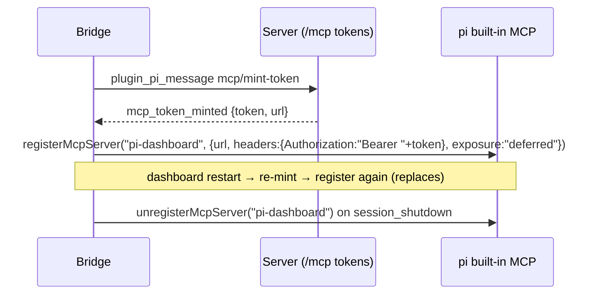

**Seam change.** `RegisterPiHandlerFn` widened to `(msg, sessionId)`. Gateway passes its socket key through `dispatchPluginPiMessage`. Additive — `(msg)`-only handlers still valid. `sessionId` from the socket key, never the message body — a plugin can attribute a bridge message as a trust decision.

**Security notes (accepted exposure).** The bearer lives ONLY in pi's in-memory `pi-dashboard` registration — never `process.env`, never a file, never `pi.events`, never a log line. REMOVED: `PI_DASHBOARD_MCP_TOKEN` and `header-command.mjs`, which put the token in EVERY subprocess's environment. Remaining exposure: an in-process extension can read it via `pi.getMcpServers()`. Accepted — extensions are trusted in-process code that could already read `process.env`; subprocesses, the documented exposure, no longer see it. Plaintext never at rest, never logged (asserted X4/X5).

See change: add-dashboard-mcp-server, wire-mcp-session-token, mcp-legacy-clients-and-token-issuance, expand-mcp-tiered-surface, migrate-mcp-to-pi-builtin.

### Bootstrap & First Run (R3, immutable bundle)

pi/openspec/tsx are regular npm dependencies of `@blackbelt-technology/pi-dashboard-server`. There is no runtime install pyramid. All three arms (Electron, standalone `npm i -g`, bridge) start ready.

- **Electron** — reads server resources from `<resourcesPath>/server/node_modules/` (immutable, read-only). Updates land via electron-updater whole-app replacement. See [electron-immutable-bundle.md](./electron-immutable-bundle.md) and [electron-bootstrap-flow.md](./electron-bootstrap-flow.md) for the 6-state startup machine.
- **Standalone (`npm i -g @blackbelt-technology/pi-agent-dashboard`)** — npm resolves pi/openspec/tsx at install time via regular `dependencies`. Server binds port 8000 immediately; `cli.ts runForeground` logs `[bootstrap] ready (pi resolved via <source>)` after a single `ToolRegistry.resolve("pi")` call. Failure throws hard citing corrupted `node_modules/`.
- **Bridge** — pi loads the bridge extension; bridge auto-starts the server. pi-core update path remains via `pi-core-routes.ts` (writable target).

`launchSource` (returned by `/api/health`) is `"electron" | "standalone" | "bridge"`, derived from `DASHBOARD_STARTER`. Client uses it via `useLaunchSource()` to hide pi-core update UI on Electron (immutable bundle has no writable target).

Compatibility skew helpers in `pi-version-skew.ts` (`readPiCompatibility`, `readCurrentPiVersion`, `computeCompatibility`) survive as pure helpers. The pinned range is `minimum: "1.3.0"`, `recommended: "1.3.0"`, `maximum: null` (lockstep — one supported pi means no conditional code paths on that artifact). `piCompatibility` unchanged: a `@earendil-works/pi-coding-agent` range, a DIFFERENT artifact from the pi-ai pin below.

1.1.0 adds: `tool_execution_end.durationMs` preferred for tool row duration; `samplingParamsByThinkingLevel` passthrough; `GET /api/provider-auth/legacy-provider-ids` (`azure-openai-responses` -> `azure` rename scan). See change: update-pi-core-1-1-adopt-apis.

1.3.0 adds: follow-up drain on `agent_settled` (see `### Retry Lifecycle`). Single-bang `!cmd` output sent via `pi.sendUserMessage(msg, {deliverAs: "followUp"})`. Retry turn `before_agent_start` `messageType: "custom"` (pi ≥ 1.2.0) → gets session-context fragment, kb doctrine, role guidelines, untrusted-content guideline, team skill filter; also runs compaction check + `nextTurn` prelude. Typed setting `sessionShareDestination` (`auto`|`gist`|`radius`, default `auto`). Lockstep floor → 1.3.0. Dropped `@earendil-works/chord`. See change: update-pi-core-1-3-adopt-apis.

**Below-floor session signal.** Replaces per-feature pi version gates. Bridge `sendPiVersionIfChanged` (`packages/extension/src/model-tracker.ts`) reads the running pi argv-anchored via `readRunningPiVersion` and sends `pi_version_update`; server runs `computePiBelowFloor(version, serverPiMinimum())` (`packages/server/src/pi/pi-version-skew.ts`) → sets `DashboardSession.piBelowFloor: { minimum } | null`; client `PiBelowFloorWarning` renders on `SessionCard` + `SessionHeader`. Unknown or unparseable version → no flag. `minimum` sourced from `piCompatibility.minimum`. See change: update-pi-core-1-0-adopt-apis.

**pi-ai generation window.** Legacy generation REMOVED — the dashboard supports ONE **pi-ai** generation (pi >= 1.3.0). Supported range `>=1.3.0` (root `package.json` + `packages/extension/package.json` peerDependencies). Root devDependency pin `^1.3.0`. The server streams through pi-coding-agent's own **`ModelRuntime`** (ONE server runtime — see `### Single model runtime`), which owns module shape (factory API only), transcript normalization (`normalizeContext` before dispatch, else systemPrompt + tools drop silently) and OAuth relocation (`dist/oauth.js` is a TYPE-ONLY stub, never consulted; real loaders at `dist/auth/oauth/*.js`, a path NOT in the package `exports` map). `packages/extension/src/bridge.ts` streams through pi's own `ctx.modelRegistry.streamSimple`. The `packages/shared/src/piai-compat/` seam (`adaptPiAi`), its `api-table.ts` / `NON_TEXT_LAZY_FILES` helpers and `packages/shared/src/test-support/piai-factory-fixture.ts` are DELETED.

See change: collapse-model-proxy-onto-modelruntime.

**Host project-trust service.** `packages/server/src/server.ts` registers `host.isProjectTrusted(cwd)` (awaited at boot) next to `host.knownFolderCwds`, plus `host.projectTrustSource` and `host.piTrustCoverInteractive`. `packages/server/src/pi/host-project-trust.ts` `createHostProjectTrustService` / `loadHostProjectTrustService` run shared `decidePiTrust` (pi's own rule + dashboard mirror; see Pi trust mirror). `coveringDashboardEntry` finds covering entry. Honours `PI_CODING_AGENT_DIR`. Pi core unresolvable → one log line (not silent untrusted). Legacy `createHostProjectTrust({recordedDecision, defaultProjectTrust})` kept for compat only; not the decision path. `mcp-client` injects it as `isProjectTrusted` so folder MCP rows load the project layer only in trusted folders. See change: migrate-mcp-to-pi-builtin, mirror-dashboard-trust-to-pi.

#### Legacy `~/.pi-dashboard/` advisory

Pre-R3 builds installed pi/openspec/tsx into `~/.pi-dashboard/node_modules/` at runtime. R3 leaves that directory untouched. `detectLegacyManagedDir({ homedir })` in `packages/shared/src/legacy-managed-dir.ts` returns `{present, path, pkgCount, sizeMb}`. Doctor surfaces a warning-severity row "Legacy install directory" with a `rm -rf <path>` suggestion. Server `cli.ts` logs the path once at startup after the `[bootstrap] ready` line. Repo-lint `no-managed-dir-reference.test.ts` blocks any new write into the legacy directory from `packages/electron/src/lib/`, `packages/server/src/`, or `packages/shared/src/` outside the explicit allowlist.

See change: eliminate-electron-runtime-install.

### Cold-Start Session Recovery (Exit Intent & Boot State)

Offer sessions for recovery after server restart. Distinguish crashes (sessions lost) from deliberate exits (sessions live, will reattach). See change: fix-recovery-exit-intent.

**Boot record.** File `~/.pi/dashboard/boot-state.json`. One O(1) write per exit, not per session (exit paths have ~100 ms and cannot walk sidecars). Shape: `{ bootId, exitIntent, at, ring: BootRecord[] }`. `bootId` = server `liveEpoch`. `ring` = 8 most recent prior boots (`BOOT_RING_SIZE`). Atomic write via `writeJsonFile` (tmp + rename). Owner: `packages/server/src/persistence/boot-state.ts`. Exports `stampBootStart(bootId)`, `recordExitIntent(intent)`, `resolveExitIntent(liveEpoch)`, `readBootState()`, `_resetBootStateForTests()`.

**Exit intent vocabulary.** `packages/shared/src/boot-state.ts`. `ExitIntent = "restart" | "shutdown" | "user-quit" | "idle" | "signal" | "ephemeral"`. Null = crash (nothing recorded). Function `isRecoveryAllowed(intent)` returns false ONLY for `restart`, `shutdown`, and `ephemeral` — those exits leave sessions RUNNING and announce a bridge quiesce longer than the reattach grace window, so sessions reattach after any window that could retract them. `ephemeral` joins the recovery-suppressing set so a parent-death exit is not treated as a crash to recover from (change: fix-autostart-discovery-precedence). Other exits + null allow recovery via the liveness gate: offer session, retract if it re-registers inside the grace window.

**Recording points.** `POST /api/restart` → `restart`. `POST /api/shutdown` → `shutdown`, or `user-quit` when request body is `{userQuit:true}` (Electron `stopServerIfNeeded` in `packages/electron/src/lib/server-lifecycle.ts` sends it). Idle timer → `server.stop()` → `idle`. New SIGTERM/SIGINT handler in `packages/server/src/cli.ts::runForeground()` → `signal` then `server.flush()` then `process.exit(0)`. Crash/SIGKILL records nothing → stays null. `recordExitIntent` is write-once per boot (first writer wins), so `spawnRestart`'s SIGTERM→SIGKILL ladder cannot overwrite `restart` with `signal`. Write failure logged, never thrown; unwritten intent = dirty boot = over-offer (conservative direction).

**Classification.** `packages/server/src/server.ts` gains one conjunct: `isRecoveryAllowed(resolveExitIntent(session.liveEpoch))`. Resolution matches session's `liveEpoch` against current record then ring; unresolvable → null → allowed (back-compat: absent record behaves exactly like old build).

**Behavior change.** `server.stop()` NO LONGER clears per-session `live` markers. Records `exitIntent:"idle"` instead. Marker consumption on dismiss / liveness-retract / offer-broadcast unchanged.

**Timing constants.** `packages/shared/src/recovery-timing.ts`: `RESTART_QUIESCE_MS = 5000`, `RECONNECT_HEADROOM_MS = 2000`, `RECOVERY_REATTACH_GRACE_MS = RESTART_QUIESCE_MS + RECONNECT_HEADROOM_MS` (7000). Previously grace was 2500, closed BEFORE the quiesce window, made bridge-reattach liveness unreachable on restart path.

**Offer broadcast timing.** `ask` mode NO LONGER broadcasts offer immediately. Deferred until grace window closes, then sent once with only surviving candidates. `graceUntil` still on wire for mid-window client connect.

**Resume gate.** `resume_session` `mode:"continue"` probes keeper sidecar: `KeeperManager.isKeeperAlive(sessionId)` reads `<sid>.rpc.sock.pid`, checks keeper PID + pi PID. Refuses with `code:"resume.already_active"` when alive, so stale offer never double-spawns one sessionId.

**Observability.** Logs: `[recovery] <id>: suppressed-by-intent (boot <epoch> exited via <intent>)`, `[recovery] N candidate(s) after exit-intent gate; awaiting liveness`, `[recovery] grace window closed; offering N candidate(s)`, `[recovery] retracted candidate <id> (<reason>)`, `[recovery] refused reopen of <id>: keeper still alive`, `[boot-state] exit intent recorded: <intent> (boot <id>)`.

**Shutdown-window recovery (signal / user-quit).** Host shutdown signals pi + server together. pi graceful shutdown emits `session_shutdown{reason:"quit"}`; bridge sends `session_unregister`; server ends session `live:false`/`ended` ~23 s BEFORE own SIGTERM records `exitIntent:"signal"`. Old path `isRecoveryCandidate` requires `live:true`, never sees this. New path recovers the shutdown window. See change: fix-recovery-pi-signal-unregister.

**Evidence write.** Explicit `session_unregister` handler in `packages/server/src/pi/pi-gateway.ts` calls `sessionManager.unregister(id, { endSource: "bridge_unregister" })`. `memory-session-manager.ts` keeps manager-private set; read via `wasEndedByBridgeUnregister(id)`; cleared by `register`/`remove`. Never stored on `DashboardSession`.

**Eager marker.** `event-wiring.ts` `onEnded` writes `{ liveEpoch: <current boot>, endedAt }` iff `wasEndedByBridgeUnregister(id)` AND `closedReason === "unknown"` AND no `movedTo`. Every other ending — heartbeat/grace expiry, history cleanup, manual, spawn_failed, relocation — writes no `liveEpoch`. `meta-persistence.ts` `setLiveness` takes optional `endedAt` (writes when present, keeps when absent). `liveEpoch` on a `live:false` sidecar = boot the session ended in.

**Manual ends stay manual.** `shutdownSession`/`forceKillSession` (`browser-handlers/session-action-handler.ts`) stamp in-memory `closedReason:"manual"` BEFORE signalling pi; racing bridge unregister keeps `manual`.

**Cold-start classification.** `packages/server/src/server.ts` loop runs `resolveExitRecord(session.liveEpoch)` (`packages/server/src/persistence/boot-state.ts` — returns `{bootId, exitIntent, at}` from current entry or ring, by id) + `isShutdownWindowCandidate(s, ownerBoot, RECOVERY_SHUTDOWN_WINDOW_MS)` (`packages/shared/src/session-meta.ts`). True iff:
- `live !== true`
- `liveEpoch` + `endedAt` present
- `closedReason === "unknown"`
- `recover !== false`
- owner intent ∈ {`signal`, `user-quit`}
- `|endedAt − at| ≤ 60_000` ms (`RECOVERY_SHUTDOWN_WINDOW_MS`, `packages/shared/src/recovery-timing.ts`)

No `status` check — debounced `ended` write can be lost.

**One-shot.** On match, evidence consumed immediately (`setLiveness({ live:false, closedReason })` drops `liveEpoch`) in every mode, including `off`. Candidate unless mode `off`. Joins existing retract/grace/offer/auto pipeline unchanged. Log: `[recovery] <id>: shutdown-window (ended Δs before boot <id> exit via <intent>)`.

**Unchanged.** Exits `restart`/`shutdown`/`ephemeral`/`idle`/null never qualify via window. Dashboard restart/quit with pi + keeper surviving → no unregister → picked back up silently.

**Platform coverage.** macOS/Linux standalone → `signal` → window path. Electron → `user-quit` → window path. Windows + power loss → pi hard-killed, never unregisters → existing `live:true` path.

**Accepted limits.** `/quit`, `/reload`, `/new`, `/resume`, `/fork` < 60 s before shutdown also qualify (auto mode resumes them). Server SIGKILLed after pi unregistered (intent null) → not offered. Terminal-hosted server SIGHUP → unrecorded → not offered. Measured macOS spacing 2026-10-09: 22.9–23.1 s.

### Ephemeral Server Lifecycle (change: fix-autostart-discovery-precedence)

A server started with `--ephemeral` exists only to serve the pi agent that booted it. When that boot parent dies, the server exits and reclaims its ports + memory instead of leaking them. Target: isolated-verification instances. Standalone + Electron-hosted servers excluded by construction — nothing passes the flag for them.

- **Opt-in: flag ONLY.** `--ephemeral` in `packages/server/src/cli.ts` (`parseArgs` → `buildConfig` → `config.ephemeral`). NO env var; never inferred from temp `HOME`, bind address, or port. An inherited `PI_DASHBOARD_EPHEMERAL=1` in a shell would make a real standalone dashboard exit when that shell dies.
- **Watch** — `packages/server/src/lifecycle/ephemeral-parent-watch.ts`. Independent, unconditional 5 s interval (fixed `DEFAULT_INTERVAL_MS` 5000, overridable only via the `intervalMs` dep seam); armed only when ephemeral. Idle timer CANNOT host the check — its `start()` early-returns when `config.autoShutdown` is false (the default, the exact isolated-verification config) and it terminates via raw `process.exit(0)` (the undrained-exit path this design forbids). Interval cadence IS the exit-latency bound.
- **Kill-decision liveness** — `isBootParentProvablyDead` (`packages/server/src/lifecycle/boot-parent-liveness.ts`). Dead ONLY on ESRCH (Tier-1 signal-0 probe) or Windows Tier-2 signalled-exit (reuse-immune koffi handle, authoritative where it exists). `EPERM` + any other errno = ALIVE (parent alive but owned by another user / hardened). Alive-biased: reads-alive → occasionally fails to exit, never a false exit.
- **Exit path** — proven-dead parent → `server.stop({ exitIntent: "ephemeral" })` (`server.ts` wiring), fired exactly once. Graceful drain (`shutdownHeadlessProcesses` reaps spawned pi, `recordExitIntent`, flush, tunnel teardown). Never `process.exit`.
- **Health field** — `/api/health` exposes `ephemeral` (boolean, `config.ephemeral === true`) via `packages/server/src/routes/system-routes.ts`.

### Force Kill Escalation
The Stop button supports two-click escalation for stuck sessions:
1. **Click 1 (Abort)**: Sends `abort` → bridge → `ctx.abort()`. Button transitions to orange pulsing "Force Stop".
2. **Click 2 (Force Kill)**: Sends `force_kill` → server delegates termination to the **platform layer** (`packages/shared/src/platform/process.ts::killProcess(pid, { timeoutMs: 2000 })`), which:
   - on **Windows** runs `taskkill /F /T /PID <pid>` (genuine tree kill — descendant `node.exe`, pi children, tmux panes, `wt` tabs all die together),
   - on **POSIX** sends `SIGTERM`, polls liveness every 200ms for up to 2s, then escalates to `SIGKILL` if the process is still alive.

   Session marked "ended" (not removed), resumable via fork/continue.

The bridge includes `process.pid` in `session_register` so the server can kill the process. The server also force-closes the bridge WebSocket and uses the headless PID registry as a fallback. If no PID is available, only the WebSocket is closed.

### Platform-routed kill paths
All process termination across the codebase goes through `packages/shared/src/platform/process.ts`. No code outside that module may call `process.kill(...)` directly — enforcement is handled by `packages/shared/src/__tests__/no-direct-process-kill.test.ts`, a repo-level lint that scans every `.ts` file under `packages/*/src/` and fails CI if a direct call slips in. The three canonical helpers are:

| Helper | POSIX | Windows |
|--------|-------|---------|
| `isProcessAlive(pid)` | `kill(pid, 0)` | same |
| `killProcess(pid, {timeoutMs})` | SIGTERM → wait → SIGKILL (tree via pgroup) | `taskkill /F /T /PID <pid>` |
| `killPidWithGroup(pid, sig)` | `kill(-pid, sig)` (process group) | `kill(pid, sig)` (leaf) |

Sites routed through these helpers: `session-action-handler.ts::handleForceKill`, `process-scanner.ts::killProcessByPgid`, `tunnel.ts::cleanupStaleZrok` + `deleteTunnel`, `headless-pid-registry.ts`, `server-pid.ts`. See specs: [`command-executor`](../openspec/specs/command-executor/spec.md), [`force-kill-handler`](../openspec/specs/force-kill-handler/spec.md).

`taskkill` is invoked via the platform's `execSync` wrapper (`platform/exec.ts`) so it inherits `windowsHide: true` — no console flash — and stays consistent with the `no-direct-child_process-import` invariant.

Inline stop buttons also appear on running tool cards in `ToolCallStep`, providing contextual abort access right where the stuck command is visible.

### Repeated Tool Call Collapsing
Consecutive tool calls with the same name and identical args (e.g. health check polling loops) are collapsed into a single expandable group showing a count badge (e.g. "×24"). Implemented via `groupConsecutiveToolCalls()` in the chat rendering pipeline. Groups require 3+ calls; running tools are never grouped.

### Local-image inlining + LaTeX math in chat

Assistant messages containing markdown image references to local files (`` or ``) are inlined by the bridge before the text leaves the agent process; LaTeX math (`$x = \beta$` and block-level `$$\n…\n$$`) is typeset client-side via KaTeX. Both behaviors live entirely in the chat-rendering pipeline — the dashboard server adds zero new HTTP routes.

```mermaid
sequenceDiagram
    participant pi as pi (agent)
    participant bridge as Bridge (extension)
    participant server as Dashboard server
    participant client as Browser (MarkdownContent)

    pi->>bridge: message_update / message_end<br/>{ message.content: " and …" }
    bridge->>bridge: parseImageTokens → isLocalSrc → readFile<br/>(5MB/image, 20MB/message caps; MIME allowlist)<br/>hash = sha256(bytes).slice(0,16)
    bridge->>server: asset_register { sessionId, hash, mimeType, data:base64 }<br/>(only if hash not yet emitted this session)
    bridge->>server: message_update / message_end<br/>{ message.content: " and …" }
    server->>server: asset_register → Session.assets[hash]<br/>= { data, mimeType }
    server->>client: asset_register (broadcast to subscribers)
    server->>client: event_forward (rewritten message text)
    client->>client: useMessageHandler.asset_register →<br/>setSessions → DashboardSession.assets[hash]<br/>SessionAssetsContext re-renders descendants
    client->>client: MarkdownContent.PiAssetImg resolves<br/>pi-asset:abc1234567890123 →<br/>data:image/png;base64,… → 
```

Key invariants:

- **Server adds no new HTTP route.** No `/api/file/raw`. Image bytes ride inside the existing event/asset stream, mirroring how Read-tool images already work.
- **Bandwidth-bounded streaming.** Each unique image's bytes are sent exactly once per session via `asset_register`. Subsequent `message_update` chunks only re-ship the short `pi-asset:<hash>` token (~25 chars) in the streaming text.
- **Asset registry lives on `Session.assets`** (in-memory, not in the rolling event buffer). Subscription replay re-emits one `asset_register` per entry BEFORE the events array, so reconnecting browsers see the registry populated by the time their `message_update` events are reduced. Cold-start full-server-restart loses bytes; older `pi-asset:` tokens render as a placeholder until a fresh assistant message references the same file.
- **Math plugin chain.** `MarkdownContent.tsx` registers `remarkPlugins: [remarkGfm, remarkMath]` and `rehypePlugins: [rehypeRaw, [rehypeKatex, { throwOnError: false }], stripReactRefAttributes]`. `rehypeRaw` runs FIRST (so embedded HTML is parsed before KaTeX emits its own). `throwOnError:false` keeps streaming half-formed expressions like `$x = 10 +` from crashing the markdown render. `urlTransform={(v)=>v}` disables ReactMarkdown's default scheme-stripping so `pi-asset:` and `data:` srcs reach the `img` override intact.

Failure modes (placeholders are visible, not silent):

| Condition | Placeholder text |
|---|---|
| File missing or unreadable (ENOENT/EACCES) | `[image not found: <originalSrc>]` |
| Path resolves to a directory or other non-file | `[image read failed: <originalSrc>]` |
| Extension not in image allowlist | `[unsupported image type: <originalSrc>]` |
| File > 5 MB | `[image too large: <originalSrc> (<sizeInMB> MB)]` |
| Per-message budget (20 MB new bytes) exhausted | `[message asset budget exhausted: <originalSrc>]` |
| `pi-asset:<hash>` arrived before its `asset_register` | dashed-bordered `⦿ <alt> (loading…)` span; auto-swaps when bytes arrive |

See change: `chat-markdown-local-images-and-math`.

### Mermaid AI repair (change: add-mermaid-ai-repair)

Opt-in, on-demand LLM repair for mermaid blocks that rule repair (`add-mermaid-auto-repair`) could not fix. Never automatic.

- Trigger: `Fix with AI` button in mermaid error callout. Shown only when `mermaidRepair.enabled` and rule repair failed.
- Config: `~/.pi/dashboard/config.json` → `mermaidRepair` `{ enabled (false), model ("provider/id"), maxChars (20000, clamp 1000–50000), timeoutMs (30000, clamp 5000–120000) }`.
- `enabled:true` + no model → disabled, `disabledReason:"no_model"`.
- `@role` model → disabled, `disabledReason:"role_refs_unsupported"` (interim).
- Parser: `parseMermaidRepairConfig` (`packages/shared/src/config.ts`). Resolved block served by `GET /api/config`, no credentials.
- Client mirror: `packages/client/src/lib/preview/mermaid-repair-config.ts`, hydrated in `App.tsx`.
- Endpoint: `POST /api/mermaid/repair` `{code, error}` → `{success:true, data:{code, model}}`. Route: `packages/server/src/routes/mermaid-repair-routes.ts`. Behind `networkGuard`.
- Credentials resolved server-side (same path as `model-proxy/streamer.ts`). Never sent to client.
- Provider call: temperature 0; maxTokens = `min(ceil(maxChars/3), 8192)`.
- Caps: `code` ≤ maxChars; `error` ≤ 2000. One in-flight request per server. Client disconnect aborts provider call.
- Errors `{success:false, error, code}`: `disabled` 404, `bad_request` 400, `too_large` 413, `busy` 429, `timeout` 504, `provider_error` 502, `unparseable` 502. Model output never truncated server-side.
- Output extraction: first `mermaid` fenced block, else trimmed text minus leading `mermaid` line.
- Accept-only-if-renders: result goes through normal render + sanitize path (mermaid `securityLevel` strict + DOMPurify). Non-rendering → `AI fix failed`, original error kept, retry offered. Output = untrusted mermaid source, never HTML.
- UI: purple `AI-fixed · <model>` pill (distinct from info `Auto-fixed`); show-original toggle; copy-fixed. Visible disclosure: source + error sent to configured model.
- Client cache: page-lifetime, successes only, keyed by (original code, model). Failures not cached.
- Logging: one line `[mermaid-repair] outcome=<ok|aborted|code> model=<ref> ms=<n> chars=<n>`. Never source, error, or output.
- Rollback: delete `mermaidRepair` block (feature hides) or revert. No persisted state.
- Deploy: restart server (route + config). `npm run build` for client.

### Markdown / AsciiDoc markup repair (change: add-md-adoc-markup-repair)

On-demand display repair for md/adoc FILE previews. Detect, fix for display, show banner, offer persist. Never chat, thinking, or streaming.

- Scope: md/adoc never fail to parse. Broken markup mis-renders: one unterminated fence/delimiter swallows rest of file; bare `[mermaid]` adoc block stays plain listing.
- Md: `repairMarkdown(src)` in `packages/client/src/lib/preview/markup-repair-md.ts`. Runs on renderer's own parse: `unified().use(remarkParse).use(MARKDOWN_REMARK_PLUGINS)`.
- Md candidate: top-level fenced code node no later line closes.
- Md M2: first look-alike closer (other fence char, or same char but shorter) REPLACED by valid closer.
- Md M3: else closer INSERTED before blank line preceding first ATX heading.
- Md skip: frontmatter (yaml node), blockquote, list-item fences never touched.
- Md M1 (gate fix, not repair): `MarkdownContent staticSource` marks every mermaid fence `complete`. Fixes EOF-unclosed and `~~~mermaid` stuck on "Loading diagram…". Not reported, never written. Stays on in "view original".
- `staticSource` passed only by on-disk surfaces: `FilePreviewOverlay`, editor-pane `MarkdownViewer`, `MarkdownPreview`, `MarkdownPreviewView`. Inventory: `packages/client/src/components/__tests__/markdown-static-source-inventory.test.ts`.
- Adoc: `repairAsciiDoc(src)` in `packages/shared/src/markup-repair/asciidoc.ts`. Pure line scanner. No asciidoctor import. Server runs for display; client runs for apply.
- Adoc A1: bare `[mermaid]` / `[mermaid,…]` on `----` / `....` block → `[source,mermaid…]`. Paragraph styles untouched.
- Adoc A2: unterminated top-level `----` / `....` block → first same-char different-length delimiter replaced by exact opener; else closer inserted before blank line preceding next `== Title`.
- Adoc skip: nested, list-attached, and `====`, `****`, `--`, `////`, `++++`, `|===` blocks untouched.
- Both repairs: pure, idempotent. Per-line terminators kept (CRLF safe). Only replaced/inserted lines change.
- Both repairs: reported `line` = original-source line (block opener; A1 = attribute line).
- Result type: `MarkupRepairResult` in `packages/shared/src/markup-repair/types.ts`.
- Server: `GET /api/file/render` in `packages/server/src/routes/file-routes.ts`. Order: stat mtime → read → `repairAsciiDoc` unless `?repair=0` → ONE convert → DOMPurify → `{html, repairs, warnings:[{text,line}], mtime}`.
- Server: asciidoctor `MemoryLogger` swapped into `LoggerManager` for convert, restored in `finally`. Sync, no cross-request interleave.
- Server: `safe:"secure"` unchanged. Repair runs before convert; sanitizer after. Repair never depends on warnings.
- Banner: `packages/client/src/components/preview/MarkupRepairBanner.tsx`. Lists each repair + original line.
- Banner `aria-pressed` toggle "View original rendering": md re-renders unrepaired client-side; adoc lazy one-shot `&repair=0` fetch, cached.
- Banner optional "Apply markup fix to file" action.
- Apply gate: only when `MermaidSourceContext` present (live-session cwd) and not `isDirty`.
- Apply flow: `GET /api/file/md-read` → verify unchanged since display (md: content byte-equal to displayed; adoc: mtime equals render `mtime`) → whole-file diff in `MermaidApplyFix` `ConfirmDialog` (3 context lines) → `POST /api/file/write {content, mtime}` → reload.
- Apply mismatch / 404 / 409 → "File changed — reload". Nothing written.
- Repair displayed + unapplied: per-diagram "Apply fix to file" disabled ("Apply the markup fix first") via `MermaidSourceInfo.markupRepairActive`. On-disk block ordinals differ from repaired rendering. Re-enabled after reload.
- i18n: `markupRepair.*` keys. EN inline default + hu + zh-CN catalogs.
- False positives: inside already-broken block, look-alike line can be taken as intended closer.
  - M2: three-backtick line inside unterminated four-backtick fence.
  - M3: `# comment` after blank line in shell sample.
  - A2: literal `-----` line.
  - Banner names each with line. View-original reverts in view. Apply is diff-confirmed.
- Rollback: revert. Response fields additive. No persisted state.
- Deploy: restart server + `npm run build` for client.

### User image attachments — two-phase display fit

Distinct path from local-image inlining above.
That feature rides existing event/asset stream.
Adds no HTTP route.
This one adds `GET /api/sessions/:sessionId/attachments/:attachmentId`.
Same `{type:"image"}` events.
Different handling.

**Problem.** pi delivers pasted screenshots as full-resolution base64 inside the event. Shape: `{type:"image", data, mimeType}`. `memory-event-store.ts` bounds each event by total serialized size. Over-ceiling event data replaced by `{__truncated}` placeholder. Result: image-bearing user message lost `data.message` entirely. Row never rendered. Silent. Measured size distribution n=1587 over 3137 transcripts: p50 125.7 KB, p90 757.3 KB, p99 2233.3 KB, max 10.5 MB.

**Design.** Fit each image block to a DISPLAY derivative before store.
768 px long edge.
JPEG q75 when re-encoding.
`DEFAULT_MAX_EVENT_DATA_SIZE` raised 20_000 -> 262_144 (256 KiB).
Raise sound only WITH the fit.
Raw payloads at 256 KiB cover just 74.9%.
Fitted output bounded.
`DEFAULT_TRANSCRIPT_CAP_BYTES` derives 0.75 x ceiling.
Moves 15 KB -> 192 KiB (D9, accepted, coupling kept).

**Two-phase flow** (key data-flow fact):

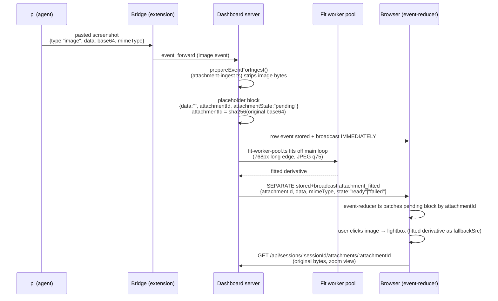

- Phase 1: `prepareEventForIngest()` (`packages/server/src/attachments/attachment-ingest.ts`) strips image bytes, leaves placeholder block `{data:"", attachmentId, attachmentState:"pending"}`. Row event stored + broadcast IMMEDIATELY.
- Phase 2: `fit-worker-pool.ts` fits off the main loop. `attachment-resolver.ts` emits a SEPARATE stored+broadcast event `attachment_fitted` with `{attachmentId, data, mimeType, state:"ready"|"failed"}`.
- In-process fallback (workers disabled/unspawnable) capped at pool `size`. Unbounded fallback ran N concurrent jimp decodes on the MAIN thread. Exact event-loop stall the pool exists to prevent.
- Client reducer (`event-reducer.ts`) patches the pending block by `attachmentId`.
- `attachmentId` = sha256 of the ORIGINAL base64. Content-addressed.
- Addressed by hash NOT by seq: client live fold is append-only and never sees a seq; replay can reorder; hash is also the originals-endpoint key.
- One resolution patches EVERY occurrence of that hash (same screenshot pasted twice shares one id).
- BOTH ingest paths fit: live `event-wiring.ts` AND session hydration in `subscription-handler.ts`. Hydration rebuilds events from the transcript with full-resolution bytes, so skipping it would re-trigger the original bug on reload.

**MIME admission.** `image-mime.ts` (`packages/server/src/attachments/image-mime.ts`) single source of truth for which inline image mimes the pipeline takes OWNERSHIP of. Exports `isFittableImageMime(mime)`. Two gates consume it, MUST agree: `prepareEventForIngest` (what to strip into pending) + `fitImageBlockForDisplay` (what it can fit). They diverged once. Ingest stripped ANY image block. Fit returned non-allow-listed mime UNCHANGED. Resolution event then carried full-resolution bytes it existed to replace. Busted per-event ceiling. Truncated. Block stranded on "pending" forever. Block rejected here never PROMISED a resolution. Stays inline under existing ceiling. `image/svg+xml` absent on purpose. Script-bearing markup, not safely re-encodable bitmap. Deliberately jimp-free. Ingest path runs on the event loop for EVERY event.

**Input-size guard.** Every other budget in module measures OUTPUT. `Jimp.read` allocates `width*height*4`. Driven by the HEADER. 20000x20000 PNG: few KB on the wire, ~1.6 GB decoded. Guard parses declared w/h from PNG/GIF/JPEG/WebP header. No pixel decode. Refuses >40 MP or >25 MB BEFORE decode. Constants `DISPLAY_MAX_DECODE_PIXELS` = 40_000_000, `DISPLAY_MAX_INPUT_BYTES` = 25_000_000. Exports `readImageDimensions(bytes)`. Fails CLOSED. Unparseable header ⇒ `failed`, never unbounded decode. 40 MP clears any real screen capture. 6K display ~20 MP.

**Budget guarantee.** `DISPLAY_MAX_BYTES` = 240_000. Measured in BASE64 bytes (what the store stores). Below 256 KiB ceiling with envelope headroom. Fit enforces the budget. PNG first. Then JPEG quality ladder 75/60/45/30. Then up to 2 halvings. Reports `failed` if it cannot comply. Reason: over-budget derivative makes its OWN `attachment_fitted` event exceed the ceiling -> `{__truncated}` -> `attachmentId` destroyed -> placeholder stuck pending forever.

**Originals endpoint.** `GET /api/sessions/:sessionId/attachments/:attachmentId` (`packages/server/src/routes/attachment-routes.ts`).
Backed by session transcript (`original-store.ts`).
Transcript already holds full-resolution bytes.
No new durable store.
Eviction inherently safe.
Transcript scanned line-by-line.
Peak memory bounded by largest entry, not file size.
NOT load-bearing.
Fitted image already inline.
Failure degrades only the zoom view.
Client passes fitted derivative as lightbox `fallbackSrc`.

Gates, in order: `networkGuard`; session exists + has `sessionFile`, else 404.
Then id shape-checked `^[0-9a-f]{64}$` (400).
Check precedes transcript recovery, not every lookup.
Request input never becomes a path component.
Lookup scoped to that session's transcript.
Valid digest from another session simply not found.
No ownership table needed.
Allow-list png/jpeg/jpg/gif/webp.
`image/jpg` added. Alias of already-served format.
Was fittable but not servable.
Rendered fitted, 404'd on zoom.
Test asserts invariant: fittable ⊆ servable.
Lists cannot drift apart silently again.
Serving stays stricter in general.
`image/svg+xml` refused by both.
Unknown session + unknown hash both return 404.
Route cannot probe which session ids exist.
Responses carry `nosniff` + `default-src 'none'; sandbox`.
Cache-Control: `no-store, private`.
Endpoint authenticated.
Serves private user screenshots.
Year-long `max-age` persisted bytes to browser/proxy disk caches.
Bytes outlived session + credential that unlocked them (CWE-524).
Content-addressing makes bytes immutable.
Does NOT make them safe to persist.
Cost: zoom re-fetches each time.
Thumbnail unaffected.
Fitted derivative already inline.

**Animated GIF.** Exempt from fitting (D11). Resize would flatten animation. Detected by counting Image Descriptor `0x2C` blocks, short-circuit at 2. Stays subject to the existing ceiling.

See change: fit-attachments-for-display.

### Edit Tool Diff Rendering (desktop vs mobile)
`ToolCallStep` gates renderer mounting with `{expanded && <Renderer />}` — Edit cards default to collapsed, so no diff tokenization runs until the user expands. On expand, `EditToolRenderer` branches on `useMobile()` (the project-wide `width < 768px OR height < 600px` predicate):
- **Desktop** (`!isMobile`): renders `<RichDiff oldText newText filePath maxHeight="20rem" />` — syntax-highlighted via `@git-diff-view/react` + lowlight, matching `FileDiffView` quality; height capped for chat scroll UX.
- **Mobile**: renders the homegrown CSS-colored unified patch (`createTwoFilesPatch` from `diff`, no syntax highlighting) — cheap and narrow-viewport-friendly.
The shared `<RichDiff>` component is also consumed by `DiffPanel` (Path A / change-derived diffs), centralising the `EXT_LANG_MAP`, `generateDiffFile` call, and `<DiffView>` prop set. See change: rich-diff-in-chat.

**Fork decisions and subagent ask_user:**
- Work through PromptBus — `TuiFlowIOAdapter` calls `ctx.ui.select/confirm/input` which the bridge routes through the bus to registered adapters (dashboard, TUI, or custom)

**Flow launcher:**
- Available flows detected from session commands list (heuristic: `source: "extension"`, excluding management commands)
- Launch dispatched as `send_prompt` with `/<flow-name> <task>`
- Commands list auto-refreshed on `flow:rediscover` and `flow:complete` events

**pi-flows local patches required** (upstream report prepared):
- `EventEmitObserver`: 5 missing methods added (flow-started, agent-started, agent-complete, assistant-text, thinking-text)
- `index.ts`: `flow:abort` and `flow:toggle-autonomous` event listeners added
- `flow-tui.ts`: `autonomousMode` included in `flow:flow-started` event data

### `/reload` Flow (server-side dispatch ladder)
Reload from the dashboard routes through a single server entry point: `dispatchReload(sessionId)` in `packages/server/src/rpc-keeper/dispatch-reload.ts`. Dispatch is a four-step ladder — busy check, kill-and-respawn, bridge forward, terminal error — selected by how the session was spawned. Falls through until one path succeeds.

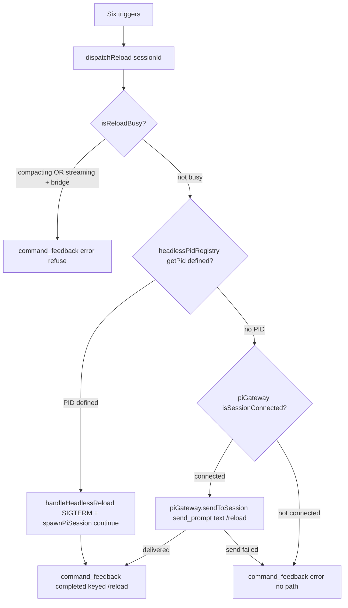

**Triggers** — seven sources route through `dispatchReload`; pi-core update is the one exception:
1. Reload button / `/reload` in composer → browser `send_prompt` → `packages/server/src/browser-handlers/session-action-handler.ts` `handleSendPrompt`.
2. `scripts/reload-all.sh` → same browser path.
3. pi retry-policy settings save → `server.ts` `reloadConnectedSessions`.
4. Package install/remove → `packageManagerWrapper.setReloadSessions`.
5. pi-core update complete → `piCoreUpdater.onAllComplete` → `respawnForRuntimeSwap` (NOT `dispatchReload`).
6. `POST /api/resources/reload` → `routes/resource-activation-routes.ts`.
7. Radius MCP configure write (`POST /api/provider-auth/radius/mcp`) → `countReloads(reloadFanOutTargets(), dispatchReload)` in `server.ts`. See change: add-radius-provider-login (D5, D6).

**Predicate gate** — `isBareReloadCommand` in `browser-handlers/session-action-helpers.ts`. `text === "/reload"` exactly, zero images, says nothing about session shape. Replaced old `shouldInterceptReload`, which also required a headless PID and thereby made kill-and-respawn the default.

**Why no in-process path.** Earlier revision wrote `/__dashboard_reload` to the session's RPC keeper, on the claim that pi RPC mode runs the line through `session.prompt()` WITH command handling. Measured in the docker harness with `keeperLog.capturePiOutput = true` on pi < 0.84.2: it does not — pi's RPC `{type:"prompt"}` performed NO slash-command dispatch. Dispatched `/__dashboard_reload` arrived at the model as an ordinary user prompt and produced a full agent turn (`agent_start` → user message → assistant reply → `agent_end`). Control: pi built-in `/help` written to the same socket behaved identically — so not the `__` prefix, not our registration. (Pi >= 0.84.2 RPC `prompt()` defaults `expandPromptTemplates` ON; the original measurement predates that. Decision unaffected — `/__dashboard_reload` is STILL never written to the keeper.) Consequence: kill-and-respawn is the ONLY mechanism that reloads a headless session. Scope: SERVER/keeper path only — server never writes `/__dashboard_reload` to the keeper. Terminal-hosted sessions DO reload in-process, on the BRIDGE side (`terminal-reload.ts` self-dispatch via `sendUserMessage`; see Bridge side below). See change: fix-terminal-session-dashboard-reload. The extension-slash `dispatch_extension_command` route used the same keeper `writeRpc` + `{type:"prompt"}` mechanism; it was retired by change `retire-slash-dispatch-via-expand-prompt-templates` (bridge dispatches in-process via `sendUserMessage({expandPromptTemplates: true})`).

**Ladder step 1 — busy check.** `isReloadBusy` runs FIRST. Refuse if `session.compacting === true`. Refuse if `status === "streaming"` AND `piGateway.isSessionConnected(sessionId)`. Stale `streaming` on a bridge-dead session does NOT refuse — pinned there forever, and exactly what respawn rescues.

**Ladder step 2 — kill-and-respawn.** `headlessPidRegistry.getPid(sessionId)` defined → `handleHeadlessReload` (SIGTERM + `spawnPiSession` `mode:"continue"`), streaming guard suppressed. Registered PID wins over a live bridge: dashboard-spawned session reloads via respawn; in-process bridge reload (`terminal-reload.ts`) applies to terminal-hosted sessions only. See change: fix-terminal-session-dashboard-reload.

**Ladder step 3 — bridge forward.** No PID, `isSessionConnected` true → `piGateway.sendToSession(sid, {type:"send_prompt", text:"/reload"})`. Gated on the RETURN VALUE, not the probe: the socket can close between the two.

**Ladder step 4 — terminal error.** Neither → terminal `command_feedback {status:"error"}`. A session with NO registered PID is NEVER respawned: would start a second pi against a terminal-hosted session's file.

**Feedback contract** — exactly one terminal `command_feedback` per reload, `command` field always `/reload`.

**Bridge side** — terminal-hosted path only; ladder step 2 wins for dashboard-spawned sessions. `BridgeCommandOptions.reload` = `terminalReload.reload` (`createTerminalReload`, `packages/extension/src/terminal-reload.ts`). `ExtensionContext` has no `reload()`; only a command handler's `ExtensionCommandContext` does. So `reload()` self-dispatches `pi.sendUserMessage("/__dashboard_reload <token>", {expandPromptTemplates: true})` — pi runs `_tryExecuteExtensionCommand`, hands handler FRESH command ctx → `ctx.reload()`. No TUI bootstrap. Nothing callable captured — works every reload (retired captured-fn-on-`globalThis` path was single-use, stale ctx after first reload). No pi version gate (`update-pi-core-1-0-adopt-apis`): `supportsInProcessCommandDispatch` and `NO_RELOAD_PATH_REASON` retired — the check could never fail on a supported pi (1.3.0 floor). `BridgeCommandOptions.reload` returns `ReloadOutcome` (`{ok:true, handedOff:true}` | `{ok:false, reason}`). See change: fix-terminal-session-dashboard-reload.

**Token handshake** — slot `process.__pi_dashboard_pending_reload__ = {token, sessionId, state, armedAt}`. State `armed → started → delivered | expired`. Transitions compare-and-set — requesting instance `error` and reloaded instance `completed` mutually exclusive. `START_TIMEOUT_MS` = 5000, `FINISH_TIMEOUT_MS` = 60000, both measured from `armedAt`.

**Completion from RELOADED instance** — reload tears down the requesting instance's connection, so the NEW bridge instance reports. `consumePendingReloadOnSessionStart` runs at top of `session_start{reason:"reload"}`; `command_feedback {command:"/reload", status:"completed"}` sent after `replay_complete`. Requesting instance returns `{ok:true, handedOff:true}` → `command-handler.ts` emits nothing. Requesting instance reports every failure: did not run (start timeout, `RELOAD_DID_NOT_RUN_REASON`), pi did not reload (refused/threw, `PI_DID_NOT_RELOAD_REASON`), timeout (`RELOAD_TIMEOUT_REASON`), sync throw, reload already in progress (`RELOAD_IN_PROGRESS_REASON`).

**TUI-typed `/__dashboard_reload` (no args)** — reloads, no dashboard feedback. `ctx.ui.notify` warning if dashboard reload in flight.

**Re-entry guard** — `session_shutdown{reason:"reload"}` → `releaseBridgeOwnerOnShutdown` clears `prev.pi`; reloaded instance (fresh `ExtensionAPI`) passes `isBridgeReentry`. Before: every in-process reload (TUI `/reload` too) left dashboard session `ended`.

**Server watch** — `packages/server/src/rpc-keeper/dispatch-reload.ts` keeps per-session forwarded-reload watch. Second reload while one in flight → `"refused"` + error `"A reload is already in progress for this session."` — not forwarded. Deadline `FORWARDED_RELOAD_DEADLINE_MS` = 75000 → server emits `/reload` error `"Reload did not report completion within 75 s — check the pi terminal."`; later bridge feedback dropped (mark cleared by next arm). Watch survives the reload's own unregister/re-register. `event-wiring.ts` calls `routeReloadFeedback` BEFORE the replay-skip early return: settles watch; inside replay-skip window persists + broadcasts feedback itself.

**Compaction signal** — `DashboardSession.compacting` (new, `packages/shared/src/types.ts`). Derived in `packages/server/src/session/event-status-extraction.ts` from bridge-forwarded `session_before_compact` (true) and `session_compact` (false). Cleared in `memory-session-manager.unregister`; never carried onto a re-registration.

**Fan-out target set** — `reloadTargetSessionIds(connectedIds, registry)` = `piGateway.getConnectedSessionIds()` UNION `headlessPidRegistry.listSessions()`. The old connected-only fan-out could never reach a headless session whose bridge WS had died.

**pi-core update is a BINARY swap** — `ctx.reload()` cannot replace pi-core, so `respawnForRuntimeSwap` respawns unconditionally (including connected + streaming), and reports `error` for a session with no `sessionFile` or no registered PID. See change: fix-out-of-band-reload.

### Server Restart (single-orchestrator path)

The dashboard previously had three independent restart paths (CLI in-process `cmdStop`+`cmdStart`, `POST /api/restart` orchestrator, bridge auto-start), and they raced each other on every restart: when the listening server died, every connected pi bridge fired `server-auto-start.ts` to spawn a replacement, racing whatever else was trying to bring the server back up. Symptoms ranged from "`pi-dashboard restart` left the server offline" (cmdStart's `isServerRunning` check returned true after a bridge won the race, so it silently early-returned without starting anything itself) to "Electron's restart respawned the server outside the Job Object" (the orchestrator-spawned new server is `detached: true`, severing Electron's lifecycle supervision).

The `fix-restart-bridge-auto-start-race` change collapses the three paths into a single orchestrator path:

1. **CLI delegation** — `pi-dashboard restart` (`cmdRestart` in `cli.ts`) probes `isDashboardRunning(port)`. If up, POSTs `/api/restart` with `{dev}` and exits. If the dashboard is down or the HTTP call fails, falls back to local `cmdStop` + `cmdStart` (the offline-bootstrap case where there is no orchestrator to delegate to). This eliminates the in-process race, mirroring the existing `cmdUpgradePi` pattern.

2. **`server_restarting` broadcast** — before `process.exit(0)`, both `/api/restart` and `/api/shutdown` broadcast `server_restarting { reason, quiesceMs }` to every connected bridge via `piGateway.broadcast`. `quiesceMs` is 5000 for restart and 60000 for shutdown (longer because deliberate shutdown should not auto-resurrect for a minute). The broadcast is non-blocking and runs before the existing 100–200 ms `setTimeout(process.exit, ...)` deferral so the WS frame has time to flush.

3. **Bridge quiesce window** — on receipt of `server_restarting`, the bridge calls `connection.pauseAutoStart(quiesceMs)` (idempotent extend-only). `autoStartServer` consults `connection.shouldSuppressAutoStart()` and **skips only the `launchServer(...)` spawn step**; mDNS discovery + health-check probes still run, so the bridge picks up the orchestrator-spawned replacement as soon as it advertises. After the window expires, normal auto-start resumes (so a real server crash is still handled by the cold-start path).

4. **Explicit prior-daemon kill in the orchestrator** — `restart-helper.ts::buildOrchestratorScript` now reads `~/.pi/dashboard/dashboard.pid`, sends `SIGTERM` to the recorded PID, polls `kill(pid, 0)` for up to 3 s, then `SIGKILL` if still alive. The subsequent `portFree` poll deadline drops from 10 s to 5 s since step 0 already guarantees the previous server is dead.

Older bridges that don't understand `server_restarting` ignore the message and fall back to today's behaviour — the CLI fix in step 1 already eliminates the worst-case path even for them. There is no flag day; the protocol message is additive on the `ServerToExtensionMessage` discriminated union.

### Async action feedback

Problem: bare call sites fire `fetch()`, HTTP ack returns, real effect lands seconds later via WS broadcast. No spinner/disable between click and effect.

Primitive: `useAsyncAction(fn, opts)` in `packages/client/src/hooks/useAsyncAction.ts`. Exposes `{ pending, error, run, bind }`. `bind` auto-disables bound control. Routes outcomes to injected `opts.showToast` — no global toast/WS context; deps passed via opts.

Two completion modes:

- `confirm:"http"` (default, fast ops): pending ends when `fetch()` settles. Remote access dialog (opened from the connection menu) connect/disconnect, ProviderAuthSection sign-out/remove-key.
- `confirm:"ws"` (slow ops): pending holds after HTTP ack until correlated `ServerToBrowserMessage` matches `opts.confirmEvent(msg, requestId)`. `opts.confirmTimeoutMs` (default 15000ms) fallback clears pending + info toast. Never stuck-spins.

Correlation contract: client generates requestId, sends in REST body, registers WS handler on `run()` BEFORE fn fires (race-free). Server echoes requestId into completion broadcast.

WS case — SettingsPanel restart: `POST /api/restart` body `{requestId}`. Server `announceRestart` broadcasts `server_restarting {reason, quiesceMs, requestId}` to browsers via `browserGateway.broadcastToAll` (additive to existing bridge `piGateway` broadcast). `ServerRestartingMessage` added to `ServerToBrowserMessage` union in `packages/shared/src/browser-protocol.ts` (additive, optional requestId; old clients ignore).

Toast variants: `ToastMessage.variant` `"error"|"success"|"info"`, default `"error"` (back-compat).

Reference FSM: WorktreeInitButton (richer streaming UI, left as-is). PluginsSection restart left as-is — polls `/api/health` startedAt re-up (stronger completion signal than broadcast).

### State & feedback primitives (client-utils)

Four primitives in `packages/client-utils/src/`. Cover empty regions, content loads, focus, status. See change: extend-client-utils-state-feedback-primitives.

EmptyState vs Skeleton vs spinner — decision rule:

- EmptyState: empty content regions (chat empty, board column empty). Value-framed title + ≤1 primary CTA. `EmptyState.tsx`.
- Skeleton: content-layout loads (chat history, lists, board). Content-shaped variants (text/card/bubble/row). No layout shift. `Skeleton.tsx`.
- Spinner: short blocking actions only (button submit). Not for content loads.

Focus ring: `.focus-ring` utility in `packages/client/src/index.css`. Scoped `:focus-visible` (keyboard only, never mouse). Color token var `--focus-ring`. Apply via `focusRing` export or literal `focus-ring` class. Replaces `focus:outline-none` + 1px border.

Status presentation: status never color-only. `statusPresentation(kind)` gives semantic `--status-*` token + mandatory non-hue glyph (✓/▸/○/✕). `statusAriaLabel(name, kind)` names item + state for screen readers. Surfaces consume helper, do not re-roll color maps (no STATE_COLORS / STATE_PILL_CLASS). WCAG 2.2 §1.4.1.

Adoption ratchet: `packages/client/src/__tests__/state-feedback-adoption.test.tsx` scans covered surfaces. Fails on new bare `focus:outline-none` or re-rolled status color map.

Reference: `--status-*` tokens defined once in `index.css` (owned by change improve-dashboard-attention-routing). `statusPresentation` references, does not redefine.

### Composer grammar check

Opt-in grammar + spell + writing-improvement check for composer draft. LLM-only backend. Gate: `~/.pi/dashboard/config.json` `plugins.grammar.enabled` (default `false`). Change: `add-composer-grammar-check`, `grammar-llm-only-with-explore`.

**Configuration.** Owned by grammar plugin. Config namespace `plugins.grammar.*` in `packages/shared/src/config.ts`. `parseGrammarConfig` validates + clamps; drops any legacy persisted keys (`backend`, `languagetool.url`). Values:
- `enabled` (boolean, default `false`)
- `llm.provider` (string) — model provider (Anthropic/Google)
- `llm.model` (string) — model ID. See `docs/grammar-model-guidance.md` for recommendations
- `autoCheck` (boolean, default `true`) — debounced auto-check on keystroke
- `debounceMs` (integer, default 1200, clamp 300–10000)
- `minChars` (integer, default 12, clamp 1–500) — skip check below this length
- `maxChars` (integer, default 4000, clamp 100–20000) — truncate draft if longer
- `language` (`"auto"`, default `"auto"`)

**Legacy config coercion.** Pre-LLM configs persisted `backend="languagetool"` + `languagetool.url`. Server-side `migrateLegacyConfig()` prunes on first request (no-throw, silent). Schema `additionalProperties:false` rejects unknown keys on write.

**Wire contract.** `packages/shared/src/grammar-types.ts`:
- `GrammarSuggestion` — `{ offset, length, original, replacement, kind, message }`. `original` source-of-truth for apply.
- `GrammarCheckResult` — `{ correctedText, suggestions[], summary, language, truncated }`. No `backend` field (LLM-only).
- `GrammarHealth` — config probe response. No `languagetool` block.
- `GrammarErrorCode` — error discriminant. `GrammarBackendKind` = `"llm"` (1-member enum).

**Server.** Grammar plugin: `packages/grammar-plugin/src/server/`:
- `grammar-service.ts` `checkGrammar()` — gate `enabled → grammar_disabled`; empty text → `empty_text`; clip to `maxChars` → `truncated` flag; never throws.
- `getGrammarHealth()` — config + LLM model availability probe.
- `backends/llm.ts` — resolve provider creds via `InternalRegistry.getModelRegistry()` + `getStreamSimpleFn()`. Model dispatch via pi-ai `streamSimple`. Temperature 0. Offsets relocated by `original` token, never trusted. Prompt hardens against injection: `<text>…</text>` wrapper, "proofread only" directive. System prompt asks for corrections + writing improvement. Output cap 8192 tokens, timeout 45 s.
- `abort.ts` `withTimeoutSignal` — abort in-flight requests.
- Routes: `packages/grammar-plugin/src/server/routes/grammar-routes.ts`, registered in dashboard server:
  - `POST /api/grammar/check { text, language? }` — auth-gated (`networkGuard`). Route opt-out of Fastify `connectionTimeout` (relaxes for long-running models).
  - `GET /api/grammar/health` — auth-gated.
- Config re-read per request → model switch needs no restart.
- Error → HTTP: `grammar_disabled` 409, `empty_text` 400, `backend_unconfigured` 400, `backend_unreachable` / `backend_bad_response` 502, `backend_timeout` 504.
- One structured `[grammar]` log line per call. NO draft text logged.

**Client.** `packages/client/src/hooks/useGrammarCheck.ts`:
- Fetch `/api/grammar/health` once for config.
- Manual `checkNow` + debounced auto-check.
- Abort in-flight on new keystroke / session switch.
- Skip auto-check while streaming, below `minChars`, or on `/` · `!` · `!!` prefixed drafts.
- Offset-safe `applyAll()` / `accept()` / `dismiss()`.

**UI.** Grammar panel mounts in two places:
- Composer draft (main chat): `packages/client/src/components/chat/GrammarPanel.tsx` renders above composer (sibling above the composer dock in `App.tsx`).
- Explore/New Change dialogs: `ComposerPanelSlot` in draft editors (explorers, change filer).
- Diff-highlighted corrections + summary. Per-suggestion Accept/Dismiss + Apply-all button.
- `CommandInput.tsx` Check toolbar button + ⌘G shortcut (`onGrammarCheck` prop). Same panel renders both surfaces.

**Privacy.** LLM backend: draft leaves machine to provider. Provider credentials resolved server-side, never reach browser.

**Model recommendations.** See `docs/grammar-model-guidance.md`: latency/quality/cost tradeoffs, recommended defaults (claude-haiku-4-5), weak-model warnings.

**Data flow:**


### Auto-Resume on Prompt
When a user sends a prompt to an ended session, the server automatically resumes it:
1. Server detects `send_prompt` for a session with `status === "ended"` and a valid `sessionFile`
2. Prompt is queued in `PendingResumeRegistry` (keyed by cwd, 30s expiry)
3. Session is set to `resuming: true`, card shows pulsing yellow dot + "Resuming…"
4. Server spawns `pi --session <file>` (continue mode)
5. `pi --session` reconnects with the same session ID — `session_register` sets status back to `"active"`
6. Server flushes queued prompt to the session and clears `resuming` flag
7. No navigation needed — user is already viewing the same session
8. On timeout (30s) or spawn failure, `resuming` flag is cleared and session returns to normal ended state
9. If user sends another prompt while already resuming, the queued prompt is updated without spawning a second process

### Sidebar session ordering: top-of-tier on status change
Server keeps one persisted `sessionOrder` per resolved group path. List holds all-status ids: active + ended + hidden. Group path resolves via shared `resolveSessionGroupPath`. Key priority: pin > `gitWorktree.mainPath` > `cwd`. Server wraps resolver in `resolve-order-key.ts::resolveOrderKey`. Client groups by same resolver. Fixes worktree keying bug: server keyed raw cwd, client grouped by parent. See change: simplify-session-card-ordering.

- **Render** — client partitions the single stored order into ACTIVE → ENDED → HIDDEN tiers (`SessionList` per-tier `sortSessionsByOrder`, stable status-partition). `moveToFront` lands card at top of its OWN tier. `clusterByWorkspaceName` DROPPED from ordering path (MUST NOT re-introduce; grouping-under-parent collapse retained). endedAt-desc ended-tier sort REMOVED — survives only as migration seed via `reconcileSessionOrder` backfill.
- **Status transitions** — alive→ended keeps id (no `remove`). Two global config booleans gate placement (default `false`, no-op when OFF): `completedFirst` gates `agent_end`(alive)→top-of-active and alive→ended→top-of-ended; `questionFirst` gates `ask_user`→top-of-active.
- **Hide/unhide** — hide → `moveToFront` (top of hidden tier); unhide → clear hidden + `moveToFront` (top of ended tier).
- **Reattach** — bridge auto-reattach after dashboard restart governed by `reattachPlacement` config (`"always"` default / `"streaming-only"` / `"preserve"`): `server.ts onChange` routes into `reattach-placement.ts::applyReattachPolicy` (now keyed by resolved order key). `"preserve"` leaves order untouched.
- **Startup reconcile** — `reconcileSessionOrder(orders, sessions, resolveKey)` prunes stale ids absent from manager; backfills absent ended ids by `(endedAt ?? startedAt)` desc; idempotent. Replaces old strip-ended reconcile.

Precedence: drag-keep > registry-front (`pendingResumeIntents.consume()` `"front"`/`"keep"`) > `reattachPlacement` > gated triggers (`completedFirst`/`questionFirst`) > status-partition. No protocol changes. Existing `sessions_reordered` broadcast carries new order. See change: simplify-session-card-ordering. See change: reattach-move-to-front. See change: top-of-tier-on-status-change.

### Shell overlay routing
Shell-owned content overlays URL-driven via wouter routes. Supersedes priority-chain helper from `fix-desktop-back-navigation`.

Routes:
- `/folder/:encodedCwd/openspec/:changeName/:artifactId` — OpenSpec preview.
- `/folder/:encodedCwd/openspec/archive` — archive browser.
- `/folder/:encodedCwd/openspec/specs` — specs browser.
- `/folder/:encodedCwd/readme` — README preview.
- `/folder/:encodedCwd/pi-resources` — legacy; replace-redirect → `/folder/:encodedCwd/settings/add-ons`.
- `/session/:id/diff` — file diff view.
- `/pi-resource?path=&title=` — cross-folder file preview.

`App.tsx` matches via `useRoute`. URL builders in `packages/client/src/lib/route-builders.ts`. Back-arrow (desktop + mobile) calls `goBackOrHome(navigate)` from `packages/client/src/lib/history-back.ts` — `window.history.back()` when `history.length > 1`, else `navigate("/")`. No priority chain, no overlay state.

Plugin content-view claims (e.g. flows-plugin) remain predicate-driven, out of scope for shell routing. See change `overlay-url-routing`.

### Model & Thinking Level Flow
1. Bridge sends current model and thinking level in `session_register` on connect
2. When user changes model (via `/model`), pi emits `model_select` event
3. Bridge enriches the event with current `thinkingLevel` from context before forwarding
4. Bridge also sends a `model_update` protocol message for session-level tracking
5. Server extracts model/thinkingLevel from events and `model_update`, broadcasts to browsers
6. Thinking level changes (via pi keybinding) are detected when `model_select` events fire, on reconnect, and immediately after `set_thinking_level` commands
7. Browser can send `set_thinking_level` to change thinking level remotely

### Model selector pairing rule

Two classes of model selector exist:

- RUN-CONFIGURING: picks the model a session/run EXECUTES with. MUST pair a thinking-level control.
- REFERENCE-LISTING: names a model for an allow-list, ordering, or alias mapping. MUST NOT pair one.

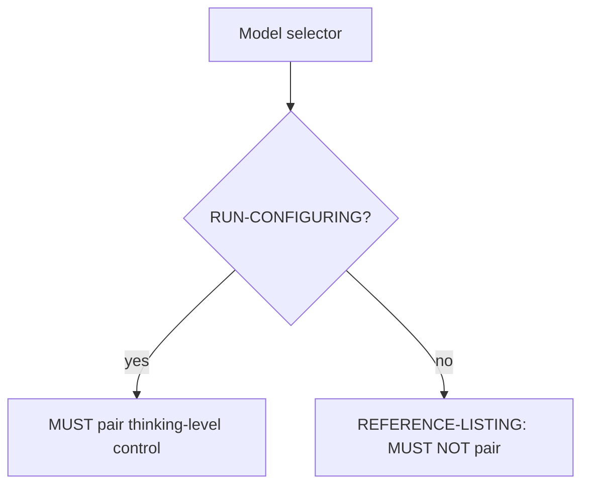

Run-configuring surfaces, all five now paired:

- Chat composer model row — `packages/client/src/components/chat/CommandInput.tsx`
- Settings → Sessions → Default Model — `packages/client/src/components/settings/SettingsPanel.tsx`, persists `config.defaultThinkingLevel`
- OpenSpec run-config row — `packages/client/src/components/openspec/useOpenSpecRunConfigRow.tsx`
- Roles → assign model to `@role` — `packages/roles-plugin/src/RolesSettingsSection.tsx`
- Automation → Create, direct-model branch — `packages/automation-plugin/src/client/CreateAutomationDialog.tsx`

Reference-listing surfaces, deliberately excluded: Model Proxy preferred-models list and Model Proxy alias→model table, both in `packages/client/src/components/settings/ModelProxySection.tsx`.

Encoding. Roles + automation carry level as `:<level>` suffix on the EXISTING model ref string: `"<provider>/<id>:<level>"`. No second field. No parallel level map. pi parses it with `splitThinkingSuffix` (`packages/extension/src/provider-register.ts`). Reason: second field drifts from refs written by pi's own `/roles` command.

Canonical levels: `off`, `minimal`, `low`, `medium`, `high`, `xhigh`, `max`. `off` = no override → writes bare ref. Split takes the LAST `:` only when the tail is a canonical level, so provider ids containing `:` (e.g. `openrouter/vendor:free`) survive.

No server change. `resolveModel()` (automation-plugin `server/model-resolver.ts`) passes suffixed ref through. `sessionFlagsToArgv()` (`packages/shared/src/platform/spawn-mechanism.ts`) emits `["--model", ref]` verbatim. Nothing in that chain inspects or strips the suffix. Both guarded by tests.

`@role` automation branch renders NO level control — role's own ref owns the level. One owner per value.

UI shape named `ModelLevelPair`: model left, level right, one bordered container, persistent `MODEL`/`THINKING` captions, saved ref echoed in mono below. Full contract: `openspec/changes/add-default-thinking-level/mockups/ui-plan.md`.

See change: add-default-thinking-level.

### Auto Session Naming (change: fix-auto-naming-reasoning-model)

Bridge-side. `packages/extension/src/auto-session-namer.ts`. After each terminal turn (`agent_end`), eligible session asks naming model for short topic title. Gate: `autoNameSessions` preference (`preferences_update` message).

**Naming model resolution.**

- `@naming` first, fallback `@fast`. `resolveNamingModel()` in `packages/extension/src/role-manager.ts`.
- `naming` in `DEFAULT_ROLE_NAMES`.
- Unassigned `naming` ⇒ `@fast` ⇒ identical resolution to pre-role behavior.
- Neither configured ⇒ permanent stop + one `auto_name_error` naming both slots.
- Configured in Settings → Roles (Roles panel, `/settings/plugins/roles`), NOT inline on sessions page. Auto-name toggle carries pointer `auto-name-model-pointer`.

**Adaptive output cap.**

- `TITLE_MAX_TOKENS_BASE = 1024` on first attempt.
- `TITLE_MAX_TOKENS_ESCALATED = 2048` once session records a `starved` verdict.
- Cap = ceiling, not charge. Non-reasoning model bills ~2 output tokens.
- Measured on `deepseek/deepseek-v4-flash` + summarizer prompt.
- Caps 16/64/256/512: `finish_reason=length`, empty content.
- Cap 1024: returned `NULL`. 24 reasoning tokens.
- Cap 2048: returned title. 724 reasoning tokens.
- Reasoning spend nondeterministic. No cap guarantees a title.

**Starvation failure mode.**

- Reasoning model spends whole cap on reasoning tokens.
- Stream ends truncated. `done` reason `"length"`. No text.
- Old bug: empty text mapped onto `wait`.
- `wait` = same verdict as legitimate `NULL` sentinel. Non-terminal.
- Result: naming retried forever, applied nothing, emitted nothing.
- Measured: 0 of 3380 sessions `nameSource: "auto"`.
- Measured: 0 `auto_name_error` lines in 6.8 MB `server.log`.
- Fix: parse keys on stream stop reason BEFORE text.
- `length` / `toolUse` ⇒ `starved`. Text NEVER applied.
- `stop` + empty ⇒ `starved`.
- `NULL` / over-40-chars / over-6-words ⇒ `waiting`.

**Attempt budget.**

- 3 attempts per session (`ATTEMPT_BUDGET`), shared by `starved` + `waiting`.
- Exhaustion ⇒ permanent stop + exactly one `auto_name_error`. Remedy matches dominant cause; tie ⇒ `starved`.
- Transient errors + aborts spend no budget.

**Persistence.**

- Stop persists in session `.meta.json` (`autoNamerState`), survives process restart.
- Clears when RESOLVED naming reference changes or blocking cause (credentials/registry) resolves.
- Clearing resets budget AND re-arms error.

**Diagnostics.**

- Every attempt reports exactly one deduplicated outcome.
- Server retains last outcome per session — `packages/server/src/auto-name-outcome-store.ts`.
- Bound 500. ABSOLUTE.
- Eviction prefers non-`stopped` entries.
- `stopped` entries alone at the bound: OLDEST `stopped` evicted.
- Protection is an ORDER, never indefinite retention.
- Readable at `GET /api/auto-name-outcomes`.
- Rendered in Settings → Diagnostics. `starved` shown distinctly from `waiting`.

See change: fix-auto-naming-reasoning-model.

### HTTP Role Read Surface (change: add-roles-read-api)

**Endpoint.**

- `GET /api/roles` — read-only role catalogue. Ungated beyond dashboard auth gate. No `pi-proxy-...` Bearer key. No live pi session required. Mirrors `GET /api/models` envelope + auth posture.

**Route ownership and registration.**

- Owned by roles-plugin, NOT `packages/server/src/routes/`. Manifest entry `"server": "./src/server/index.ts"` in `packages/roles-plugin/package.json`. Entry point `registerPlugin(ctx)` calls `mountRolesRoutes(ctx.fastify)` in `packages/roles-plugin/src/server/index.ts`. Route impl at `packages/roles-plugin/src/server/roles-routes.ts`. Registered WITHOUT `networkGuard` preHandler. Host owns `fastify.listen`; plugin only registers.

**Response structure.**

- Envelope: `{ object: "list", data: RoleGroup[] }`.
- Each group: `{ preset, active, roles }`.
- Live group first (`preset: null`); then preset groups in stored order. Exactly one group `active: true`.
- Row: `{ role, ref, assigned, builtin }` always; `model`, `provider`, `thinkingLevel` added only when derivable.
- `ref: null` for unassigned role (expected state, never an error).
- `builtin` = role name in `DEFAULT_ROLE_NAMES`.

**Role axis construction.**

- Canonical axis = (defaults → user-added → assigned) ∪ preset-only names (first-referencing-preset order) − `removedRoles`.
- Same axis + order in every group.
- `ref` split: last colon → `model`/`thinkingLevel`; first `/` → `provider`.
- Bare legacy id → `provider` omitted, never guessed. Stored value never rewritten.
- Model registry NOT consulted.
- Dangling `activePreset` (names no stored preset) → live group active.
- Duplicate preset names collapse first-wins.

**Resilience and error handling.**

- Never 503. Never empty `data`.
- Missing / unparseable / EACCES / EISDIR / TOCTOU config all degrade to "no assignments" → overlay still yields built-in names with `ref: null`.
- Config file never created or modified by read.
- Credential safety: rows built field-by-field from role/preset maps. Parsed config never serialized or spread into response. Credential-bearing sibling key of `providers.json` cannot reach payload.

**Per-key ownership split of `~/.pi/agent/providers.json`.**

- `role-manager.ts` (`packages/extension/src/`) = SOLE WRITER of role slice: `roles`, `rolePresets`, `activePreset`, `roleNames`, `removedRoles`. Atomic tmp+rename; preserves sibling keys.
- `provider-routes.ts` (`packages/server/src/routes/`) writes `providers` key of same file. Atomic tmp+rename; preserves other fields.
- Role slice reading is NON-exclusive. Every reader normalizes through one shared TOTAL normalizer `parseRoleConfig(raw)` in `packages/shared/src/role-schema.ts`. Pure role-schema helpers (`DEFAULT_ROLE_NAMES`, `effectiveRoleNames`, `overlayRoles`, `splitRef`/`joinRef`, types) live there — no `node:fs`, so client bundles it. `role-manager.ts` `loadRoleConfig` keeps file read but delegates normalization to `parseRoleConfig`.

**Declared read corrections vs old `roles:get-all`.**

- Structurally invalid preset entry now dropped (was relayed uninspected).
- Role with both removal marker AND assignment now omitted (old trailing spread reintroduced it).

See change: add-roles-read-api.

### Context Usage Tracking
1. On each `turn_end`, the bridge calls pi's `ctx.getContextUsage()` API to get real-time context usage (tokens used + actual context window from the provider)
2. Bridge enriches the `turn_end` event with this `contextUsage` data before forwarding to the server
3. Server extracts `contextUsage` from the event data and passes it to `extractTurnStats()`, which includes it in the synthesized `stats_update` event
4. Server updates `session.contextTokens` and `session.contextWindow` and broadcasts to browsers
5. The `onChange` handler persists these values to `.meta.json` (debounced 1s)
6. On server restart, the scanner restores `contextTokens`/`contextWindow` from `.meta.json`
7. Client's event reducer stores `contextUsage` from `stats_update` events; `App.tsx` falls back to `session.contextTokens/contextWindow` for sessions without live reducer state
8. When real data is unavailable (e.g., old sessions without persisted context data), `state-replay.ts` and `session-stats-reader.ts` use `inferContextWindow()` to estimate context window from the model name

### Process Scan Cadence
- One process-table snapshot per scan (`process-scanner.ts`): Unix `ps -A -o pid=,ppid=,pgid=,etime=,args=`; Windows `Get-CimInstance Win32_Process | Select-Object ProcessId,ParentProcessId,CommandLine,CreationDate | ConvertTo-Json -Compress`. Capture + check + dead-PGID reap all read that one snapshot.
- Async `execFile`. Never blocks pi event loop.
- Adaptive cadence (`process-scan-scheduler.ts`, self-rescheduling `setTimeout`): fast 5 s (Win 10 s) while agent/tool runs → +15 s after last activity → +30 s after scanned list change; idle 30 s (Win 60 s). Idle→fast re-arms immediately on `agent_start` / `tool_execution_start`.
- Extra scan 1 s after a `bash` `tool_execution_end`.
- Overlap skipped (`scanInFlight`), never queued.
- Trade-off: process dying while idle leaves list ≤30 s later.

### Poll-cost counters
- Heartbeat `metrics` flat optional scalars on `ProcessMetrics`: `pollProcScan*`, `pollGitProbes*`, `pollGitSpawns`, `pollGitMs`, `pollGitWatchersAttached`. Cumulative per bridge.
- `/api/health` `pollCost` SUMS them across live sessions.
- `pollGitWatchersAttached` = 0/1 per session; summed = sessions with a watch. Counters reset on reload/end; before/after reads each session's own counters over a fixed window.

### VCS Polling (Git)
Two git lanes, one probe in flight, async spawns — pi event loop never blocks on git.

- **Fast lane**: first evaluation, `HEAD` / `packed-refs` / `*_HEAD` watch events, `git_info_refresh`, reconnect. ≥2 s between probe starts.
- **Slow lane**: 30 s tick, mutating tool end, `index` / `null` watch events. ≥10 s between probe starts. Tick always requests one → external edits seen ≤30 s; silently-dead watchers (Docker/WSL mounts) cost nothing extra.
- 750 ms trailing debounce, 2 s max wait. Request inside a lane's window deferred, never dropped. Fast request upgrades pending slow one. One probe in flight + dirty bit → one follow-up max.
- Probe: async `git --no-optional-locks status --porcelain=v2 --branch` via `gitStatusV2Async`. Branch read from `<gitDir>/HEAD`; non-`refs/heads/` value → async CLI fallback (`currentBranchOrAsync` + `headShaOrAsync`), memoised per HEAD content; previous branch kept while pending.
- Files: `packages/extension/src/git-tracker.ts` (facts/status), `git-probe-scheduler.ts` (lanes, debounce, in-flight, `dispose()`), `git-dir-watcher.ts` (`fs.watch(gitDir, {persistent:false})` + `fs.watch(commonDir)` when different), `vcs-info.ts`.
- Static facts cached per cwd (`StaticGitFacts`: `remoteUrl`, `roots`, `gitDir`, `dotGitStamp`). Async re-probe (`checkoutRootsAsync`, `remoteUrlOrAsync`) on `dotGitStamp` change, `git_info_refresh`, reconnect, every 10th tick (≈5 min). `dotGitStamp` = `fs.stat` of `<thisCheckout>/.git` + `gitDir`; non-repo stamp = existence of `<cwd>/.git`.
- Sync first evaluation ONLY at registration, cwd change, session change, reconnect — handshake requires `git_info_update` carrying `gitWorktree` at once. Status omitted; immediate fast-lane probe sends it right after. `handleSessionChange` (`session-sync.ts`) also resets `lastGitStatusJson`.
- Probe reads branch before start + at settle; mismatch or cwd change → discard + one more probe. Failed probe sends branch/facts with `gitStatus` omitted (inconclusive).
- Send only from probe-result path (`sendGitInfoIfChanged`); tick/watcher never send directly. `pr-status.ts` `onChange` sends from cached state, no spawn.
- PR: `prStatus.observe({branch})` on every resolved branch (first eval, tick, every settled probe incl. failed). Branch-change generation start throttled ≤1 per 30 s, latest branch wins; session/cwd change not throttled.
- Read-only tool allow-list (`read`, `grep`, `find`, `ls`, `glob`, case-insensitive); unknown/MCP tools count mutating.
- Rate bound: ≤6 slow + ≤30 fast probes/min worst case; idle 2/min async, 1 spawn.

### PR status
PR detection moved OFF the 30 s git tick. `packages/extension/src/pr-status.ts` `createPrStatusScheduler` probes `gh pr view --json number,url,state,isDraft,statusCheckRollup` via `runAsync` (`GH_PR_STATUS`, 20 s timeout) in `packages/shared/src/platform/git.ts`; `classifyPrStatus` → parsed / absent (`no pull requests found`) / failure.
Cadence: first observe immediate, then ≥120 s, back-off 120→240→480→600 s on failure, one failure log + one recovery log. Generation = sessionId+cwd+branch; branch change → all-null tuple sent at once + probe; session/cwd change → unknown.
`sendGitInfoIfChanged` (`packages/extension/src/model-tracker.ts`) = one change-detector; always sends full cached tuple `gitPrNumber|Url|State|Draft|Checks|CheckedAt` (unknown omitted).
Server `event-wiring.ts`: new fields guarded `!== undefined`; cleared to `null` when `gitPrNumber == null`. Not persisted.
After successful `/api/git/worktree/push` or `/pr` server sends `git_info_refresh { reason }` to active bridges whose realpath'd cwd is inside the worktree (`activeSessionsUnderResolved`); bridge forces probe (≤1 forced start / 30 s, coalesced); `reason:"pr"` retries +5/+15 s while absent. Merge (local) never refreshes.
`collapseCheckRollup` lives in `packages/shared/src/platform/check-rollup.ts` (shared by server `listPullRequests` + bridge). Client `packages/client/src/lib/git/merge-primary.ts` `isMergePrimary` decides Merge emphasis once per surface (composer strip, session card). See change: redesign-composer-session-strip.

### Working-tree status + commit from card
1. Bridge gathers working-tree status via the async git probe scheduler (no `gatherGitStatus`, no sync spawn). `gitStatusV2Async` runs `git --no-optional-locks status --porcelain=v2 --branch`, shared `parseGitStatusV2` parses into `GitStatus { dirtyCount, staged, unstaged, untracked, ahead, behind }`.
2. `sendGitInfoIfChanged` includes `gitStatus` in `git_info_update`; deduped via `lastGitStatusJson`. Inconclusive probe omits `gitStatus`, leaves last value.
3. Server `event-wiring.ts` merges `gitStatus` from `git_info_update` onto session, broadcasts `session_updated`.
4. Hybrid delivery, keyed by cwd (not session): passive broadcast above PLUS on-demand `GET /api/git/status?cwd=` (`getGitStatus`, reuses `parseGitStatusV2`) on card/folder focus + right after commit. Client `git-status-cache.ts` (`useGitStatus(cwd, fallback)`) keys by cwd — folder header + solo card at same path share one entry.
5. Commit: `POST /api/git/commit { cwd, message, files[] }` → `commitFiles` stages selected paths with argv (`git add -- <files>`, NO shell), commits via `git commit -F -` reading message from STDIN (injection-proof; multi-line body verbatim). Every path `assertPathsInside(cwd)`-guarded; errors carry stable codes via `GitCommitError`. On success route broadcasts fresh `gitStatus` to every session sharing cwd.
6. `GET /api/git/changed-files?cwd=` feeds commit dialog picker (porcelain-v2 + `--numstat`).
7. AI-drafted message: `POST /api/git/commit-draft { cwd, files, sessionId }` → `commit-draft-relay.ts` sends `git_commit_draft { requestId }` to owning bridge, awaits `git_commit_draft_result`. Bridge (`commit-draft.ts` ladder + `commit-draft-agent.ts`) seeds ephemeral in-memory `AgentSession` (`SessionManager.inMemory`, `tools:[]`) with live session context + staged diff, prompts once, captures assistant text, disposes it — visible conversation gets NO new turn. Fallback ladder: fork-subagent (full context) → diff-only one-shot → deterministic stub; timeout at each rung so dialog never hangs.
8. UI: shared `GitDirtyPill` (`● N` amber pill + `↑A ↓B` chips; hidden when clean and in sync) mounts on per-card `GitInfo` and folder-header `GroupGitInfo`; never duplicated on suppressed child cards in a group. Pill is button opening placement-agnostic `CommitDialog` (`CommitDialogProvider`/`useCommitDialog`, one instance at app root). Post-commit toast `Committed <shortHash>`.
9. Grouped same-cwd sessions: one working tree = one commit; commit action offered at folder level, not per card.

See change: add-session-uncommitted-indicator-and-commit.

### Git Polling (legacy entry, see VCS Polling above)
Superseded by `### VCS Polling (Git)`. No 30 s sync git poll; no `gatherGitStatus`. Lanes, cadence, async spawns documented there.

### Git worktree convention (`.worktrees/`)
Dashboard derives new worktree path as `<repoRoot>/.worktrees/<slugifyBranch(branch)>` when `POST /api/git/worktree` body omits `path`. `addWorktree` calls `ensureWorktreeExcludeLine(cwd)` first — idempotently appends `.worktrees/` to `<repoRoot>/.git/info/exclude` so parent repo ignores nested checkouts (untouched if line already present). Bridge `detectWorktree` populates `GitInfo.gitWorktree.mainPath`; `resolveSessionGroupPath` collapses worktree sessions under parent repo's pinned-directory group. See change: add-worktree-spawn-dialog.

Worktree parentage immutable once resolved (cwd unchanged). `git_info_update { gitWorktree: null }` after parentage set means worktree removed underneath a live session — server keeps prior value; `gitWorktreeReported` stays true. `null` with no prior parentage clears as before. Same-cwd re-register carries `gitWorktree` over (server restart / bridge reconnect / resume); different cwd resets to unresolved. Wire shape unchanged — narrows documented meaning of wire `null`. See change: fix-worktree-grouping-lost-on-remove.

### Git worktree lifecycle (push / PR / merge / close)
Dashboard exposes 7 endpoints under `/api/git/worktree/*`: `remove`, `remove-batch`, `prune`, `merge`, `push`, `pr`, `diff-stat`. Localhost-gated. Each forwards stable `{code, stderr}` errors (`active_sessions`, `dirty_worktree`, `branch_not_merged`, `dirty_main`, `merge_conflict`, `base_not_found`, `no_remote`, `auth_failed`, `non_fast_forward`, `gh_not_found`, `gh_not_authed`, `pr_exists`, `pushed_but_pr_failed`, `cwd_invalid`, `is_main_worktree`) produced by pure stderr→code mappers in `git-worktree-lifecycle.ts`.
`/remove-batch` body `{ items: Array<{cwd, force?, deleteBranch?}> }`. Cap 50 items enforced before any git runs — `batch_too_large` 400; non-array `items` → `items_invalid` 400. Returns `{ results }` in INPUT ORDER, one per item. Never aborts on first failure. Item result: `{ cwd, ok, code, sessionIds?, branchDeleted?, branchDeleteCode? }`. `code` widens `RemoveCode` with `active_sessions | cwd_invalid | is_main_worktree`. Sits behind `networkGuard` + `validateCwd`.
`/prune` wraps `git worktree prune` in resolved main worktree. Returns `{ pruned }`. REPO-GLOBAL — clears every stale registration, not one row. Sits behind `networkGuard` + `validateCwd`.
`/remove` pre-flight calls `activeSessionsUnder(path, sessions)`: non-empty → returns `active_sessions` + `sessionIds`; client `CloseWorktreeDialog` shuts those sessions down then retries with `--force`. `remove` gains `deleteBranch?: boolean`. Runs `git branch -d <branch>` (NEVER `-D`) in main worktree after successful removal. Branch name captured BEFORE removal (unrecoverable after). Success payload widens to `{ removed: true, branchDeleted: boolean, branchDeleteCode? }`. Refused branch delete still HTTP 200 — removal succeeded. `remove` also rejects main worktree removal with `is_main_worktree` 400; previously mapped to `git_failed` → 500. `mergeWorktree` runs `git merge --no-ff` into `resolveDefaultBase(cwd, head)` (origin/HEAD → `develop` → `main` → `master`). `gh` resolved via shared tool registry. Client probes `gh` via `/api/tools/gh` at `WorktreeActionsMenu` mount (module-level cache); hides Open PR when unavailable; View PR #N link survives without gh because it opens an existing URL.
Cwd-loss detection probes at three sites feed `DashboardSession.cwdMissing`: (1) bridge VCS 30 s tick (`sendCwdMissingIfChanged`, debounced via `BridgeContext.lastCwdMissing`) emits new `cwd_missing` extension message; (2) server `session-scanner.ts` stamps ended sessions at boot; (3) `/api/git/worktree/remove` optimistic broadcast for every session under removed path. New `cwdMissing?: boolean` on `DashboardSession` + `cwd_missing` protocol message both additive — older bridges harmless `undefined`. `spawn-preflight.ts` emits BOTH legacy `DIR_MISSING` reason and new `cwd_missing` code during one-release overlap.
See change: add-worktree-lifecycle-actions.
`BranchDeleteCode = "deleted" | "unmerged" | "no_branch" | "branch_gone" | "delete_failed"` DISJOINT from `RemoveCode` (asserted by a test). Generic failure `delete_failed`, not `git_failed`. Never reuses `branch_not_merged` — that `RemoveCode` makes `CloseWorktreeDialog` auto-tick `--force` and retry.
`GET /api/git/worktrees` entries gain `exists: boolean` (one `statSync` per entry). Consumers MUST treat `undefined` as present — falsy test marks every row missing when new client pairs with older server.
Manage-worktrees surface removes worktrees with NO entry in session map. `active_sessions` guard does not fire. Menu gate on folder being a git repository, never on live sessions.
See change: manage-worktrees-filter-cleanup.

### Git checkout-root resolution

Resolver: `packages/shared/src/platform/git.ts`. Exports `GitCheckoutRoots { thisCheckout, isLinkedWorktree, mainCheckout }`, `resolveCheckoutRootsFrom(probes)`, `checkoutRoots({ cwd, timeout? })`, `hasGitPathSegment(p)`. One shared source for "which checkout does this cwd belong to" — the repo previously copied the arithmetic per consumer.

Superseded derivation: `path.dirname(git rev-parse --git-common-dir)`. Assumed the git dir sits inside its checkout. Wrong for submodule, worktree-of-submodule, `--separate-git-dir`, bare, worktree-of-bare.

Symptom: folder card headed `…/<super>/.git/modules/<name>`. Path does not exist. "Not a pi project yet" banner. "KNOWLEDGE BASE: not indexed".

`--separate-git-dir` and bare are the dangerous rows: derived parent EXISTS and is UNRELATED, so nothing looks wrong.
See change: add-git-checkout-root-resolver.

#### Measured git-state table

Measured on real repos — `git rev-parse` outputs per cwd state (`<r>` = repo root). NEVER re-derived from fixtures; fixtures pin these rows.

| cwd state | `--git-dir` | `--git-common-dir` | `--show-toplevel` | `isLinkedWorktree` | `mainCheckout` |
|---|---|---|---|---|---|
| normal checkout | `<r>/normal/.git` | `<r>/normal/.git` | `<r>/normal` | false | `<r>/normal` |
| subdir of checkout | `<r>/normal/.git` | `<r>/normal/.git` | `<r>/normal` | false | `<r>/normal` |
| linked worktree | `<r>/normal/.git/worktrees/normal-wt` | `<r>/normal/.git` | `<r>/normal-wt` | true | `<r>/normal` |
| submodule | `<r>/super/.git/modules/models/sub` | same as `--git-dir` | `<r>/super/models/sub` | false | `<r>/super/models/sub` |
| worktree of submodule | `<r>/super/.git/modules/models/sub/worktrees/sub-wt` | `<r>/super/.git/modules/models/sub` | `<r>/sub-wt` | true | `<r>/super/models/sub` (via repo-local `core.worktree`) |
| bare repo | `<r>/barehub.git` | `<r>/barehub.git` | (fails) | false | `null` |
| worktree of bare hub | `<r>/barehub.git/worktrees/bare-wt` | `<r>/barehub.git` | `<r>/bare-wt` | true | `null` |
| `--separate-git-dir` | `<r>/elsewhere.git` | `<r>/elsewhere.git` | `<r>/sepco` | false | `<r>/sepco` |
| non-repo | (fails) | (fails) | (fails) | — | no result |
See change: add-git-checkout-root-resolver.

#### Required probes

Required probes: `--git-dir` + `--git-common-dir`, both `--path-format=absolute`. Absolute form is contract, not preference: `isLinkedWorktree` is an equality test; mixed relative/absolute makes EVERY normal checkout report as a linked worktree.

Version floor: `--path-format=absolute` needs git >= 2.31.0 — the release that added the flag. Below floor: BOTH probes fail; `resolveCheckoutRootsFrom` returns `null`; every consumer degrades to its no-result branch — folder card omits `gitWorktree`, kb guard rejects. Fail-closed; worktree admission simply unavailable below 2.31.

`--show-toplevel` NOT required. Fails by design in bare repo. Failure yields `thisCheckout: null` WITH a result. Keeps bare distinguishable from non-repo.

Worktree signal: `--git-dir` != `--git-common-dir`. Compared via `samePath` (`packages/shared/src/platform/paths.ts`), never raw `!==`.

Rejected signals: common-dir-outside-toplevel (calls submodule a worktree); `basename(commonDir) === ".git"` (calls worktree-of-submodule and worktree-of-bare non-worktrees). Both measured.
See change: add-git-checkout-root-resolver.

#### mainCheckout derivation

`mainCheckout` order: not-worktree → `thisCheckout`; else repo-LOCAL `core.worktree` on commonDir; else `dirname(commonDir)` when basename is `.git` AND repo-LOCAL `core.bare` CONFIRMS `not-bare`; else `null`.

`core.worktree` read is `--local` and argv-form. Merged read returns `~/.gitconfig` value for EVERY linked worktree on the machine, and `mainCheckout` feeds an authorization anchor. Argv form because the git-dir path is runtime, cwd-derived input.

Rule-2 bareness guard reads recipe `GIT_CONFIG_LOCAL_CORE_BARE` with `--type=bool`. git accepts `yes`, `on`, `1`, `true` as boolean-true; raw text read vs literal `"true"` classified `bare = yes` as NOT bare. `--type=bool` canonicalizes to exactly `true`/`false`. Same `--local` + argv-form constraints as `core.worktree` read; `tolerate: [1]` = key unset — reads `not-bare`, git's own boolean default, a SUCCESSFUL read. Probe THREE-valued, exported `GitBareness = "not-bare" | "bare" | "unknown"`. Spawn failure or timeout → `"unknown"`, NEVER `"not-bare"` — collapsing would re-open the exact fallback the check closes. `dirname(commonDir)` fallback fires ONLY on positive `"not-bare"`; `"unknown"` falls through to `mainCheckout = null`. Bare hub may itself be named `.git` — `git init --bare <dir>/.git`. Parent holds no working tree. Naming it hands authorization consumer an anchor the repo never owned.

Resolver returns `mainCheckout` VERBATIM. git does not validate `core.worktree`. CONSUMERS validate; each states its own check. Display consumer omits the field; authorization consumer rejects.

`.git`-segment test is EXACT PATH-COMPONENT equality. `/work/app.git` is NOT rejected.

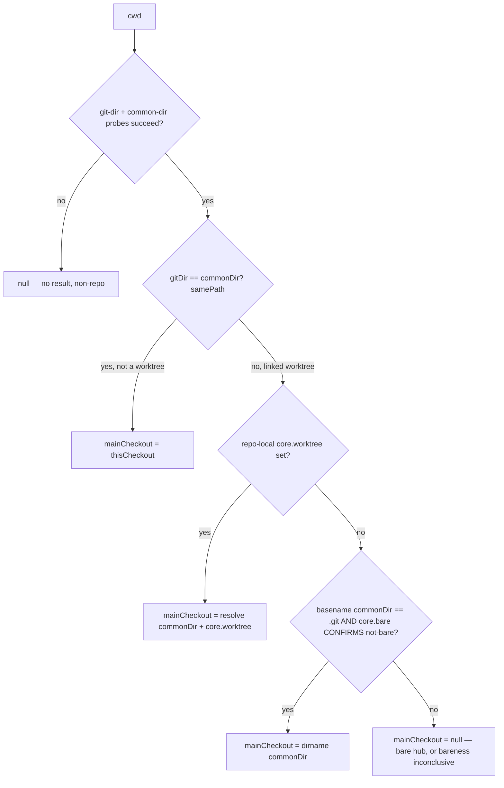
See change: add-git-checkout-root-resolver.

#### Converted consumers

Converted consumers: `packages/extension/src/vcs-info.ts` `detectWorktree` (folder card + grouping); `packages/kb-plugin/src/server/kb-routes.ts` `mainCheckoutPath` → `isAllowedCwd`; `packages/server/src/session/session-scanner.ts` `isPlausibleWorktreeMainPath`.

`detectWorktree` returns `undefined` when: required probe fails; cwd not a linked worktree (now covers submodule, `--separate-git-dir`, bare alike); no main checkout resolves (worktree of bare hub); resolved main checkout implausible (`.git` segment); `roots.thisCheckout` null despite `isLinkedWorktree` true. Resolver's user-controlled `core.worktree` output judged HERE — display consumer, safe response omits the field.

Null-`thisCheckout` + linked worktree = `--show-toplevel` probe FAILED, not a nameless worktree. Linked worktree ALWAYS has working tree. Inconclusive = return `undefined`. `cwd` fallback would silently reintroduce subdirectory mislabel for exactly the unverifiable case.

`name` = `path.basename(roots.thisCheckout)` — the worktree's OWN root, NOT the request `cwd`. No `cwd` fallback. Reason: a session can sit in a SUBDIRECTORY of the worktree; `basename(cwd)` would label the folder card with the subdirectory name. Verdict already carries the worktree root. Null `thisCheckout` never reaches here — `detectWorktree` returns `undefined` first.

`mainCheckoutPath` (kb guard): `.git`-segment rejection is the consumer's OWN obligation. Authorization consumer — derives no main path at all, so value never matches known-folder set. Submodule resolves to own checkout, does NOT inherit superproject trust; worktree-of-bare resolves to null, rejected unless independently known. Probe budget `timeout: 400` per probe — up to FIVE SYNC probes on a Fastify request path. Holds superseded single-2000ms worst-case event-loop block, never multiplies it. Timeout degrades to no result → reject, never admit.

Request cwd containing `.git` path SEGMENT rejected BEFORE both admission paths — direct known-folder match included. Stray pinned dir or session cwd of `<repo>/.git` cannot admit itself. No store opened, no disk read.
See change: add-git-checkout-root-resolver.


Worktree operations conversion (`apply-checkout-root-to-worktree-ops`):
- `resolveMainPath` wraps `checkoutRoots({cwd, timeout: 400})` + `hasGitPathSegment`. Null on non-repo, bare hub, worktree-of-bare, `.git`-segment mainCheckout.
- `resolveConfigRoot` calls `checkoutRoots` directly; `isGitRepo` probe removed; bare returns null; no non-git fall-through.
- `directory-service.ts` `configRootFor` returns `string | null`; callers skip on null; `?? cwd` coercion removed.
- `listWorktrees` determines `isMain` via `samePath` vs resolved main; accepts optional threaded `mainPath` param (D7); `parsePorcelainWorktrees` emits `isMain: false` always.
- `addWorktree`/`addWorktreeFromPr` anchors on `resolveMainPath`; `not_a_repo` preserved; exclude write targets common git dir via `resolveCommonDirAbs`, non-fatal on null.
- `removeWorktree` accepts threaded `mainPath` param; `classifyWorktreeRemoval` tri-state gates `/remove` + `/remove-batch`; error codes `is_main_worktree` and `main_checkout_unresolved`, both HTTP 400.
- `mergeWorktree`/`worktreeDiffStat` maps `MergeCode` + `not_a_worktree` to HTTP 400 (was `git_failed`/500).
- `createPullRequest` drops dead `mainPath`; `pushBranch` untouched (no refusal set).
- `orphanCleanup` anchors on resolved main; guard order pinned: anchor → logical containment → statSync → realpath BOTH sides + re-containment → existing guards in order; realpath ENOENT yields `not_a_directory`; other realpath errors yield `fs_failed`; deletes realpath-validated path.
- `/remove-batch` cap derives from `DashboardConfig.removeBatchCap` via `clampRemoveBatchCap` (default 50, clamp 1-500); git-routes uses `resolveBatchCap` defensive clamp.

| resolver result | verdict | behaviour |
|---|---|---|
| null | unresolved | refuse (code per endpoint) |
| not linked | main | `is_main_worktree` 400 (remove) / anchor=main (others) |
| linked, thisCheckout null | unresolved | `main_checkout_unresolved` 400 |
| linked, mainCheckout null | unresolved | `main_checkout_unresolved` 400 |
| linked, `.git`-segment mainCheckout | unresolved | `main_checkout_unresolved` 400 |
| linked plausible | removable | proceeds |

See change: apply-checkout-root-to-worktree-ops.

#### Persisted phantom repair

Persisted repair: `gitWorktree.mainPath` is written to `.meta.json` and re-seeded at every boot; an ended session never re-probes; phantoms do not expire. Filter runs at LOAD time.

Plausible = no `.git` path segment AND `statSync(<mainPath>/.git)` succeeds. One stat per record. Zero subprocesses. Dropped on ANY stat failure, not only ENOENT. `.meta.json` never rewritten.

`.git`-entry condition is load-bearing: `--separate-git-dir`/bare phantoms are real, existing, unrelated dirs.

KNOWN LIMITATION: phantom landing on a real working tree survives (bare hub `$HOME/bare.git` → phantom `$HOME`, `$HOME` a dotfiles repo). Shape test, not identity test.

Worktree parentage inference runs when persisted parentage absent (key absent or `null`) or implausible. Requires ABSOLUTE cwd shape `<X>/.worktrees/<name>[/<sub>...]`. Split at FIRST `.worktrees` segment. `<X>` non-empty, absolute. `<X>/.git` must stat; reuse `isPlausibleWorktreeMainPath` for that one stat. Decline with NO stat for relative cwd or leading `.worktrees` — would resolve `.git` against server cwd. Read-time only; `.meta.json` never rewritten. One stat per record, zero subprocesses. Heals records the removed-worktree race cleared. See change: fix-worktree-grouping-lost-on-remove.

kb guard is STRICTER, not looser, in every state except a submodule admitted on its own cwd. Submodule does not inherit superproject trust.

Fixtures: `packages/shared/src/test-support/git-fixtures.ts`. Needs `GIT_CONFIG_GLOBAL=/dev/null` + `GIT_CONFIG_SYSTEM=/dev/null` and `-c protocol.file.allow=always`.

Converted by `apply-checkout-root-to-worktree-ops`: `resolveMainPath` + its consumers (see "Worktree operations conversion" above); `listWorktrees()` resolves `isMain` via `samePath` against the resolved main checkout. `path-containment.ts` converted by `widen-containment-to-resolved-checkout` — see File Read API.
See change: add-git-checkout-root-resolver.

### Child Process Scanning
1. Bridge scans child processes every 10s via `process-scanner.ts` (two-phase: capture new PGIDs during active bash calls, then check tracked PGIDs)
2. Only processes running ≥30s are reported (filters out short-lived commands)
3. Bash/sh wrapper processes are excluded (only leaf commands shown)
4. Bridge sends `process_list` to server only when the PID set changes (dedup)
5. Server stores processes on the session object and forwards to subscribed browsers as `process_list_update`
6. New browser connections receive current processes via the initial `session_added` message
7. Session cards display processes with elapsed time and a kill button (sends SIGTERM to process group)

### Folder → workspace add flow (redesign-folder-workspace-add-flow)

**DirectoryHomeView eligibility guard removed.** Any groupable cwd renders home page (pre-session pane: starters + docked prompt, inside Chat|Split|Editor workspace). Gone: props `pinnedDirectories`, `workspaceFolders`, `pinnedDirectoriesLoaded`, `workspacesLoaded`, `onPinDirectory`; testids `directory-home-loading`, `directory-home-not-pinned`; i18n keys `directoryHome.notPinnedTitle`, `notPinnedBody`, `pinCta`. App drops `workspaceFolderSet` memo + `pinnedDirsLoaded`, `workspacesLoaded` state + their `useMessageHandler` setters (handlers `pinned_dirs_updated`, `workspaces_updated` no longer flip loaded flags).

**Folder home split (change: redesign-directory-home-split).**
- `/folder/:encodedCwd` renders `DirectoryHomeView` inside `FolderSplitProvider` (`SplitWorkspaceProvider` keyed `folderPaneId(cwd)`, `defaultMode="split"`; opens Split when nothing stored). Mobile: pane alone, no split.
- Left pane: starters (`starter-cards.ts`, ≤6: folder skills → prompts → global skills; insert `/skill:<n> `, never send) + `CommandInput` docked as LAST child of column → `max-h-[40%]` budget resolves against pane → natural height (fixes #877).
- Right pane: `EditorPane` (folder editor + terminals). Header (name, path, `LayoutModeSwitch`, gear `directory-home-settings`) sits above both panes.
- Removed: session list, Terminals/Editor/Settings quick-action buttons, testids `directory-home-session-*`, `directory-home-open-*`.
- `FolderHomeContainer` owns per-cwd hooks: `useFolderCommands(cwd)` (GET `/api/pi-resources/commands?cwd=`; 404/5xx/network → empty list), `useModelCatalogue()` (GET `/api/models`, module last-good cache).
- Server `GET /api/pi-resources/commands`: tier `observe`, road `packages`, denylisted from MCP. 400 on missing/relative cwd.
- origin `live` = latest ACCEPTED non-empty `commands_list` (`SessionCommandRegistry.getEntry().receivedAt`) among sessions with `piGateway.isSessionConnected` and cwd EXACTLY equal (trailing sep stripped + `canonicalPath`); else `scan` (enabled skills as `skill:<n>`, prompts as `<n>`); else `none`.
- Each command carries `scope` folder|global (path in `local.*` / local-scope packages / under `<cwd>/.pi`, else global). Impl `packages/server/src/pi/folder-commands.ts`.
- Spawn choices: `spawn_session` / `send_prompt` / `resume_session` gain optional `model`, `thinkingLevel`. Validator `packages/server/src/browser-handlers/spawn-choice.ts` (`validateSpawnChoice`, `resolveResumeChoice`): model `provider/id` ≤200 chars, charset-restricted, no empty/dash-led segment; `:<level>` suffix split only when no `thinkingLevel` field; thinkingLevel ∈ `THINKING_LEVELS`; invalid → dropped + `console.warn`.
- Thinking-only spawn → config `defaultModel` so bridge default thinking cannot override. `SessionFlags.thinking` → `--thinking`; `--model`/`--thinking` on fresh + `continue` argv; fork keeps parent model; tmux pane escapes each token (`shellEscape`).
- Ended-session composer (`useEndedSessionComposer`): folder command list + catalogue models replace absent bridge lists. Folder list kept until live `commands_list` arrives (no empty flash).
- Model/thinking pick stored client-side per session; sent on resuming `send_prompt`/`resume_session` (continue only; applied to that resume's `spawnPiSession`, never via cwd-keyed `pendingResumeRegistry`); dropped once session no longer ended.
- Spawn lifecycle: `handleSpawnSession` returns `requestId`; Start disabled until App `pendingSpawnsRef` correlation navigates. Failed `spawn_result` or `spawn_register_timeout` (optional `requestId`, via `SpawnRegisterWatchdog.arm({requestId})`) → `onSpawnFailed` → Start re-enabled, draft restored. Page never navigates.
- Compat: protocol fields optional; old server ignores; 404 on commands route → empty list. Rollback = revert; nothing persisted changes shape.

**Pin now implicit visibility primitive.** Adding folder always pins (`pin_directory`). `AddToWorkspaceMenu` + add dialog offer NO "Pin to dashboard". Safe: `visibleTopPinned`/`visibleTopUnpinned` already filter workspace-owned cwd out of top tier (renders once); redundant pin = fallback so removing from workspace leaves folder visible at root.

**Add-to-workspace affordance.** LABELLED PILL: `mdiViewGridPlus` glyph + visible text label "Workspace", lives inside folder actions menu WORKSPACE group. Session-card copy removed. `aria-haspopup="menu"` + `aria-expanded` + `aria-label`/`title` "Add to workspace…". Popover state keyed by SCOPE (`folder:<cwd>`). Old `+ws` text token removed. `renderAddToWorkspaceButton(cwd,label,scopeKey,testId,wrapperClass)` builds pill, passes as `headerAction?: React.ReactNode` to `renderGroup` (5th param); `renderGroup` routes it into the menu instead of the cluster. See change: add-folder-actions-menu.

**Folder-header cluster never wraps.** `folder-header-cluster-<cwd>` = `flex-none whitespace-nowrap`; name region `folder-header-name-<cwd>` = `min-w-0` absorbs squeeze; parent path `folder-header-parent-<cwd>` = `flex-[0_1_auto] min-w-0` collapses first; leaf `folder-header-leaf-<cwd>` = `min-w-[6ch]` floor.

**PathPicker opt-in multi-select.** `selection?: {selected:Set<string>; onToggle}` (absent = single-select, unchanged for existing callers e.g. PinDirectoryDialog). Multi-select: row body navigates (never `onSelect`), per-row checkbox (`path-picker-check-<path>`, `role=checkbox`, `stopPropagation`) toggles basket, trailing chevron (`path-picker-open-<path>`) descends; Space toggles highlighted row, Enter descends. Emoji → `@mdi/js` (`mdiArrowUp`, `mdiFolder`, `mdiFolderPlusOutline`); git/pi stay text badges. Optional `sessionCounts?: Map<pathKey,number>` → session badge (`path-picker-sessions-<path>`). `userEditedRef` mount-race guard (change compact-warm-replay-stream) preserved.

**AddFoldersDialog** (`packages/client/src/components/workspace/AddFoldersDialog.tsx`): multi-select picker + removable-pill basket (persists across navigation) + single-select workspace destination (radio, default None, empty state "None — no workspaces yet", eager `+ New workspace…` that becomes selected once `workspaces_updated` echo lands) + count-bearing commit (`add-folders-commit`). Commit sends `pin_directory` for every path FIRST, then `add_folder_to_workspace` per path when destination set (pins first → folder never momentarily invisible). Reuses existing per-path messages, no new protocol. Wired to both entry points: App sidebar `+ Add Folder` → dest None; `SessionList` workspace-scoped `+ Add Folder` → that workspace preselected. `PinDirectoryDialog` retained ONLY for packages move-to-local single-select picker (`UnifiedPackagesSection`).

See change: redesign-folder-workspace-add-flow.

### Folder actions menu (add-folder-actions-menu)

**Cluster = one control.** `folder-header-cluster-<cwd>` holds EXACTLY ONE control: `FolderActionsMenu` trigger. Component `packages/client/src/components/folder/FolderActionsMenu.tsx`. Exports `FolderActionsMenu`, `FolderMenuItem`, `FOLDER_MENU_GROUPS`, `FolderMenuGroup`.

**Trigger.** Glyph `mdiFolderCogOutline`. `mdiDotsHorizontal` REJECTED — `WorktreeActionsMenu` renders it on worktree session cards inside the folder body; two identical triggers, different scopes, one card. Testid `folder-actions-menu-<cwd>`. Carries `aria-haspopup="menu"` + `aria-expanded`. `onClick` calls `stopPropagation` — header row navigates to the directory home page, so opening must not navigate nor toggle collapse.

**Panel.** Testid `folder-actions-menu-panel-<cwd>`, `role="menu"`, `data-menu-form="sheet"|"popover"`. Items carry `role="menuitem"`, testid `folder-menu-item-<id>`. Keyboard: ArrowDown/ArrowUp rove focus over `[role=menuitem]`; Escape closes + returns focus to trigger. Outside `mousedown`/`touchstart` closes.

**Groups.** Host-owned fixed taxonomy, stable order: `workspace` then `directory` (`FOLDER_MENU_GROUPS`). Group heading testid `folder-menu-group-<group>`. Group renders only when it holds >=1 item. Item ids: `add-to-workspace`, `remove-from-workspace`, `pin`, `directory-settings`. Directory-group order: pin, directory-settings. Group-by radio set (`radioGroup`, `role=menuitemradio`) renders first, above verb groups (change: session-list-group-by).

**Open state.** `SessionList` owns `folderMenuFor`, keyed by SCOPE `folder:<cwd>` — mirrors `addToWsMenuFor`; a cwd key would co-open a folder row and a same-cwd card.

**Form factor.** Mobile: `useMobile()` (compound `<768w OR <600h`, reused verbatim) → full-width sheet via `DialogPortal`, `data-menu-form="sheet"`. Desktop → `usePopoverFlip` popover, `data-menu-form="popover"`.

**Node escape hatch.** `FolderMenuItem.node`: item that carries its own popover + testid renders its own node. Only user today = add-to-workspace, so `renderAddToWorkspaceButton(cwd,label,scopeKey,testId,wrapperClass,asMenuItem)` keeps `add-to-workspace-btn-<cwd>` + `AddToWorkspaceMenu` popover verbatim; `asMenuItem` adds `role="menuitem"`.

**Placement gating preserved, not widened.** add-to-workspace only on top-level rows gated `onCreateWorkspace || workspaces.length`; remove-from-workspace only on workspace-owned rows; pin only outside a workspace container.

**Pinned indicator.** Inert indicator, testid `folder-pinned-indicator-<cwd>`, `aria-hidden="true"`, `mdiPin`, NOT a button, no tabindex. Lives in name region, not cluster — keeps cluster at exactly one control. Pin/unpin action lives in the menu.

**Open-home button deleted.** `mdiOpenInNew` GONE. Testid `folder-open-home-<cwd>` GONE. Header row `folder-home-row-<cwd>` = only open affordance; leaf `folder-header-leaf-<cwd>` gains `group-hover:underline`, row gains `group`.

**SessionCard prop removed.** `renderAddToWorkspace` REMOVED. Testid `session-card-add-to-workspace-<id>` GONE. Workspace membership is directory-scoped; per-session rendering produced N identical buttons with one effect.

**FolderActionBar Directory Settings.** `mdiCog` REMOVED (moved to menu item `directory-settings`). `FolderActionBar` returns `null` when it holds nothing — predicate composed from exported `shouldShowProjectInit(status,onInitializeProject)` (`ProjectInitButton.tsx`) + `shouldShowWorktreeInitButton(status)` (`WorktreeInitButton.tsx`) + `useInitRun(cwd)` + cleanup gate, so it cannot drift from what the buttons render.

**Prop rename.** `onOpenPiResources` → `onOpenDirectorySettings` on `SessionList`; `useContentViews` `handleOpenPiResources` → `handleOpenDirectorySettings`. Route unchanged: `buildFolderSettingsUrl(cwd)` (page segment omitted → route handler defaults `packages`). Only the name lagged; label + `aria-label` already read "Directory Settings".

**Accepted echoes (recorded, not fixed).** Trigger cog vs item `mdiCog`; `mdiPin` indicator vs `mdiPin` action.

**Known dead path, PRE-EXISTING, NOT fixed.** `AddToWorkspaceMenu` remove entry unreachable on folder rows — renders only when `currentWorkspaceId !== null`, but `visibleTopPinned`/`visibleTopUnpinned` filter workspace-owned folders out of the top tiers, the only rows carrying the affordance.

See change: add-folder-actions-menu.

### OpenSpec Polling (Server-Side)

**Master gate**: `DashboardConfig.openspec.enabled` (boolean, default `true`).
- `false` disables all polling. Hides OPENSPEC subcards across dashboard.
- Tuning fields below (`pollIntervalSeconds`, `maxConcurrentSpawns`, `changeDetection`, `jitterSeconds`) ignored at runtime when `false`. Values preserved.
- Runtime-reconfigurable via `PUT /api/config`. Disable transition clears per-cwd `OpenSpecData` cache + broadcasts cleared payload `{ initialized: false, pending: false, changes: [] }` per cwd so client predicate `openspecInitialized === false && pending === false` collapses subcards uniformly. Same broadcast shape covers "no openspec/ dir" + "openspec.enabled === false".

1. Server's DirectoryService polls `openspec` CLI for each known directory at a **configurable interval** (`DashboardConfig.openspec.pollIntervalSeconds`, default 60 s, range 5–3600 s). Poll work-set = pinned dirs ∪ cwds of non-ended sessions (`computeKnownDirectories()` filters `session.status !== "ended"`). Hiding or ending session drops its cwd from poll set unless pinned. Ended-but-pinned cwds keep polling (pinning independent watch signal). Reopening ended cwd via new session repopulates immediately through `onDirectoryAdded` (eager poll bypasses jitter + mtime gate). See change: scope-openspec-poll-to-active-cwds. See change: optimize-openspec-poll-derive-artifacts-locally.
2. OpenSpec data is keyed by directory (cwd), not by session — one poll per directory regardless of session count.
3. Changes are broadcast to all connected browsers via `openspec_update { cwd, data }`.
4. Browsers can request immediate refresh via `openspec_refresh { cwd }`. User-initiated refresh **bypasses the mtime gate** (force-mode) but still respects the concurrency cap — see *Refresh paths* below.
5. New directories (pinned or from new sessions) trigger immediate discovery + polling (eager; bypasses jitter + mtime gate).
6. Each `OpenSpecChange` carries optional `isComplete?: boolean`. Source = CLI `isComplete` from the single `openspec status --all --json` spawn (gated AND force path). Promote-only design/specs override: `true` iff every artifact done/skipped. Fallback path (CLI without `--all`): gated re-derives via `deriveArtifactStatus`; force takes it from `openspec status --change <name> --json`. Indicates artifact-authoring completeness only — orthogonal to task tally — never feeds `deriveChangeState`. Dashboard uses it solely to gate **Archive anyway** escape hatch (see “OpenSpec session card”). See change: optimize-openspec-poll-derive-artifacts-locally. See change: use-openspec-status-all.
7. Browsers pull cached state on demand: `openspec_get { requestId, cwd }`. `directoryService.getOrPollOpenSpec(cwd)` gate order: `!enabled` → `GLOBAL_OFF`; opted-out → `OPTED_OUT`; untracked (cwd ∉ registry cwds ∪ pinned) → `ABSENT`; no `<cwd>/openspec/` root → `ABSENT` (`hasOpenspecDir: false`). Gated reply = single `final: true` placeholder naming the gate state, no CLI spawn. Cache hit → one `final: true` reply with cached payload, no spawn. Cold miss → immediate `final: false` `PENDING` placeholder + ONE shared per-cwd gated poll (`openspecGetInFlight: Map<cwd, Promise>`, entry deleted on settle — concurrent `openspec_get` for one cold cwd share one poll); poll = `pollAndBroadcastIfChanged(cwd)` — same function the scheduler tick calls (prev-JSON compare → `pollDirectoryGated` → broadcast only on change or emitted pending), mtime-gated, semaphore-serialized, does NOT add cwd to periodic poll set. On resolve, unicast `final: true` outcome; on reject, unicast `final: true` `BROKEN · cli-failed` placeholder — requester always receives its final reply. Reply is `openspec_get_result { requestId, cwd, data, final }` — UNICAST to requesting browser only, never broadcast; final outcome reaches other browsers only when it differs from cache (ordinary tick broadcast discipline). Delivered under `state` frame class. See change: fix-connect-snapshot-frame-loss.
8. Each `OpenSpecChange` carries optional `error?: {code, message}` (per-change CLI error from `--all` envelope). `message` ≤500 chars, one line; `code` ≤64 chars. Error change: `artifacts: []`, derives `PLANNING`. Board card + OPENSPEC subcard show error badge. Continue / FF blocked; blocked reason = literal `message`. See change: use-openspec-status-all.

#### OpenSpec polling cost model

Naive `for each cwd: list + for each change: status` fan-out. 4 pinned dirs with 63 active changes total (aggregate across dirs) → **67 `openspec` CLI spawns per 60 s tick** (4 `list` + 63 `status`). Each spawn ≈0.5 s user CPU (Node + module load). 8-core host → ~10 s plateau at 100 % CPU per cycle.

Current poll: **one spawn per cwd** — `openspec status --all --json`. Recipe `OPENSPEC_STATUS_ALL` (`packages/shared/src/platform/openspec.ts`), 30 s timeout. Envelope carries every change's artifact status. Spawn count independent of change count.
- Spike, 102 changes: ≈1.25 s macOS, ≈2.9 s Win11 VM.
- Force refresh, old `1 + N` fan-out: ≈25 s / ≈38 s.
- `openspec list` + per-change `status --change` not spawned on this path.
- `runOpenSpecStatusAll` (`packages/shared/src/openspec-poller.ts`) returns raw `{stdout, stderr, exitCode, failure?}` for any exit code. No tolerate flag.

The scheduler in `packages/server/src/directory-service.ts` applies four layers of throttling (all configurable under `DashboardConfig.openspec`):

1. **mtime gate** (`changeDetection: "mtime" | "always"`, default `mtime`) — skips the `status --all` spawn when no tracked path changed since last successful poll.
   - Gate uses file-aware probe, not directory mtime alone. POSIX dir mtime misses in-place file edits.
   - Probe = `probeTrackedPaths` (`packages/server/src/openspec/openspec-poll-fs-helpers.ts`).
   - Cwd-level set: `openspec/`, `openspec/changes/`, `openspec/config.yaml`, every dir + file under `openspec/schemas/`.
   - Per change: change dir, `.openspec.yaml`, `tasks.md`, `proposal.md`, `design.md`, `specs/<cap>/spec.md`.
   - Per change: each `existingOutputPaths` entry + parents; non-glob schema output + parent (outputs not yet created); glob prefix + every dir beneath.
   - Enumerates `openspec/changes/*` itself. Skips `archive` and dot-dirs.
   - CLI paths relativized against `root.path`, mapped onto server-canonical `realpath(<cwd>/openspec)`. Escaping paths ignored.
   - Gate hit = cwd stamp equal + same change set + every change stamped at probed mtime. Hit → no spawn; reuse `cache.allData` (re-finalized for readiness + skills).
   - **TOCTOU-safe**: pre-probe before spawn, post-probe after CLI output (worker `build`). Stamp = pre-call mtime.
   - Change moved during call → racy: prior entry + stamp kept; next tick re-polls.
   - Change created between probe and spawn → applied unstamped; re-polled once.
   - Change deleted during call → pruned.
   - cwd-level path moved during call → cwd stamp not advanced → next tick spawns.
   - Tracked extras set changed vs probe → stamp from re-probe over new set. Else first tick after cold poll always respawns.
2. **Concurrency cap** (`maxConcurrentSpawns`, default 3, range 1–16) — in-repo semaphore (`packages/shared/src/semaphore.ts`) serializes CLI spawns across all directories. Burst-work spreads uniformly over the interval instead of pinning every core.
3. **Per-cwd jitter** (`jitterSeconds`, default 5) — each known directory is assigned a deterministic phase offset `fnv1a32(cwd) % (jitterSeconds * 1000)` within the interval so polls don't all align on the same scheduling boundary.
4. **pi-resources stale-while-revalidate** — no timer. `GET /api/pi-resources` scans on demand. Cold miss awaits; entry stale (watch event or `now - scannedAt ≥ 5 min`) served at once + one deduped background rescan; `refresh=true` awaits. Per-cwd in-flight dedupe.
   Watcher `packages/server/src/pi/pi-resources-watcher.ts`: per-cwd `<cwd>/.pi` + `skills|prompts|extensions|agents|themes`, plus one shared global `~/.pi/agent` set. Reconcile rides the OpenSpec poll tick before its gates (runs with OpenSpec disabled). Idle >10 min releases watchers, KEEPS data. Caps: 16 watched, 64 data.

**Envelope handling** (`classifyStatusAll`, `packages/shared/src/openspec-status-all.ts`, run in worker `build`). Checked in order:
- `unsupported`: no JSON + stderr/stdout matches `/unknown option ['"]?--all/` → fallback path (below).
- Whole-call failure → `{initialized: false}` + readiness `BROKEN · cli-failed`. Retried next gated tick (one spawn/tick/cwd). Triggers:
  - no JSON;
  - top-level `status[severity=error]`;
  - `root: null`;
  - `root` missing or no string `root.path` (`root-missing`);
  - `root.source === "implicit"`;
  - `changes` missing or non-array (`changes-missing`).
- Success: full JSON. One broken change (exit 1) → `OpenSpecChange.error {code, message}`, `artifacts: []`. Sanitized: control chars stripped, message one line ≤500 chars, code ≤64 chars.
- Entry with neither `artifacts` nor `status` → `error.code "unknown-entry"`.

**Cache shape** (per cwd, `DirCache` in `directory-service.ts`):
- `changes: Map<name, { mtimeMs, change }>` — shared by both paths. Path switch clears stamps.
- `mode: "all" | "fallback" | undefined`.
- `allCwdMtime`, `allExtras` (per-change `TrackedExtras`; feeds probe + watcher output filter via `getOutputPatterns(cwd)`), `allData`.
- Fallback only: `listMtimeMs`, `listResult`, `data`.
- `serialized`: worker-stringified `data`, reused by broadcast.
- Success: cache updated atomically per directory.
- Whole-call failure (`failedPayload`, `refreshOpenSpec` catch): REPLACES `cache.data` with `{initialized: false, changes: [], hasOpenspecDir}` + `BROKEN · cli-failed`. Prior snapshot NOT kept. Clears `allCwdMtime` (→ undefined), `allExtras` (→ null), `allData` (→ undefined), `changes`, `listMtimeMs`, `listResult`, `serialized`. Next gated tick retries.
- Per-change `error` (`OpenSpecChange.error`): NOT whole-call failure. Lives inside status-all data. Directory stays `initialized: true`.

Refresh paths split into two camps:

- **User-initiated** (`openspec_refresh` WebSocket message → `refreshOpenSpec(cwd)`) **bypasses** the gate via `pollOne(cwd, true)`. The gate is heuristic; the CLI is authoritative. When the user clicks the refresh icon they expect fresh data, never silently-cached data — force-mode is the manual escape hatch for any future gate blind spot. Cost: **one `status --all` spawn per click** (fallback path: `1 + N`). Catch = whole-call failure → `BROKEN · cli-failed`; no respawn, no fan-out.
- **Internal / periodic** (`pollDirectoryGated(cwd)`, `onDirectoryAdded(cwd)`, `handleOpenSpecBulkArchive` post-archive refresh) **honor** the gate via `pollOne(cwd, false)`. Pre-probe → gate compare → spawn only on miss. At most `1` spawn per cwd per tick, independent of change count.

All paths still go through the semaphore, so a refresh-button storm cannot overload the host. See changes: `use-openspec-status-all` (current contract), `fix-openspec-mtime-gate-toctou`, `fix-openspec-mtime-gate-blind-spots` (file-aware gate).

Live reconfiguration: `PUT /api/config` with an `openspec` block calls `directoryService.reconfigurePolling(cfg)` — the timer cadence and semaphore max are updated without a server restart; in-flight polls finish on their old config.

Observability: `DEBUG=pi-dashboard:openspec-poll` (or any `DEBUG=...pi-dashboard...`) emits one line per tick with dir count, queue size, and wall time. Any tick over 5 s logs a WARN hinting at `pollIntervalSeconds` / `maxConcurrentSpawns` as knobs.

#### Fallback path (`list` + local derive)

Taken when `--all` unsupported by installed CLI. Per-CLI-installation verdict.
- Cache key = `version` of resolved `@fission-ai/openspec` package. `resolveOpenSpecPackageVersion`: realpath of resolved script → nearest `package.json`. Shim mtime NOT used.
- Unresolvable version → cached for process; retried on force refresh.
- Version change (upgrade) → `--all` retried next poll.
- Poll that first detects `unsupported` continues on fallback in the SAME poll.

Gated tick: `openspec list` (1 spawn/cwd) + local `deriveArtifactStatus(changeDir, listEntry, probes)` (`packages/shared/src/openspec-poller.ts`).
- Gate signal: list-step unions `<changes>/` with each known `<change>/tasks.md`. Per-change unions `<change>/`, `tasks.md`, `proposal.md`, `design.md`, entire `specs/**` subtree. Missing files/dirs skipped, not zero. `readdirSync` on `specs/` try/catch-wrapped.
- Derive rules: `proposal` done iff `proposal.md` exists; `design` done iff design evidence probe (R1/R2/R3); `specs` done iff ≥1 `specs/**/*.md` per specs probe; `tasks` done iff `totalTasks > 0` else `blocked`; `isComplete` true iff every artifact done.
- Defense in depth: `buildOpenSpecData` accepts `SpecsProbeFactory` (parallel to `DesignProbeFactory`). Promotes `specs: ready → done` when any `specs/**/*.md` found locally. Promote-only; never `blocked → done`.
- Parity test: derived status == `buildOpenSpecData(runOpenSpecStatus(...))` artifact-for-artifact.

Force refresh: `openspec status --change <name> --json` per change (`1 + N`, authoritative). Per-change gate + TOCTOU same as before.

See changes: `optimize-openspec-poll-derive-artifacts-locally`, `fix-openspec-specs-mtime-gate-blind-spot`.

**Per-turn event-loop attribution.** Poll tick sync work spread across many event-loop turns, not one. `scheduleOpenSpecTick` times each instrumented turn with `performance.now()` and self-records `{at, ms, turn}` into `eventLoopSpikes` (`/api/health`) when a turn's synchronous run ≥ floor (100 ms). `EventLoopTurn` type: `packages/server/src/metrics/eventloop-spike-metrics.ts`. Turns:
- `tickOpen` — `setInterval` fire: folder-head reads + `reconcileWatchers` + `computeKnownDirectories`.
- `dirPollPre` — dir `setTimeout` fire prefix → awaits version, canonical dir, probe.
- `dirPollGate` — gate compare + CLI dispatch.
- `dirPollCli` — CLI stdout received → worker `build` dispatched.
- `dirPollPost` — worker `build` resolved → response applied + broadcast.

Flow: `dirPollPre` → await version/canonical dir/probe → `dirPollGate` → await CLI → `dirPollCli` → await build → `dirPollPost`. Never summed across `await`; each segment timed as own turn. Worker-side classify/parse/count/stamp runs off main thread → not a turn. Retained wall `durationMs > 5 s` alarm stays (catches an overdue tick). Per-turn alarm fires at 250 ms, names the turn — covers sub-second single-turn stalls the wall alarm missed (jitter stagger keeps `durationMs` ≈ `jitterSeconds`). Dedicated `monitorEventLoopDelay` sampler (1 s cadence) records `turn: null` for stalls no instrumented turn owns (GC, hydration deserialize, WS on-connect). See change: attribute-openspec-poll-eventloop-stalls.

**Folder-head reads async (non-blocking).** Live attribution pinned the recurring ~700 ms stall to `tickOpen → tickFolderHeads`: 3 `execSync` git-HEAD spawns per folder × ~11 folders ≈ 33 blocking subprocesses on the `setInterval` turn, every tick. Fix: `readHeadDisplayAsync` (`git-operations.ts`) reads HEAD via async `execFile` (never blocks the loop; branch/sha only, skips the `.gitmodules` submodule probe the sync `readHead` keeps for the worktree dialog). `folder-head-poll.ts` `poll`/`refreshOne` now async; fan-out via `mapBounded` concurrency cap (default 4). `tickFolderHeads` kicked off without blocking, `await`ed before the openspec fan-out so per-cwd `git_head_update` still precedes `openspec_update`. Chosen over mtime-gating (which risks suppressing a same-mtime branch switch). Guard test `directory-service-folderhead-async.test.ts`: ordering + branch-switch-reflects. Post-fix live: 0 `tickOpen` spikes over ~3 ticks (was 100 % reliable). See change: attribute-openspec-poll-eventloop-stalls.

**OpenSpec poll worker.** Heavy per-tick CPU runs on `worker_threads` pool (`packages/server/src/openspec/openspec-poll-worker-pool.ts`; worker entry `openspec-poll-worker.ts`). Main thread owns `openspec status --all --json` spawn, FIFO semaphore, `DirCache`, WebSocket broadcast. Pool methods:
- `process(req)` — kind `derive`: fallback path. Local derive + `buildOpenSpecData` from legacy `list` output.
- `probe(req)` — kind `probe`: `probeTrackedPaths` stats. Runs pre-call and post-call.
- `build(req)` — kind `build`: `classifyStatusAll` + parse + task counting + post re-probe + `JSON.stringify`. Returns `StatusAllBuildResponse`: `{kind: "unsupported"}` | `{kind: "failed", reason}` | `{kind: "ok", data, serialized, stampMtimes, racyNames, cwdStamp, …}`.
- Task counting: `TASK_LINE_PATTERN` `/^\s*[-*]\s*\[([\sxX])\]\s*(.*)/`. File = `apply.tracks` from `openspec/schemas/<name>/schema.yaml`; else user dir `$XDG_DATA_HOME/openspec/schemas` (first existing wins; memoized by mtime; `yaml` pkg); else artifact id `tasks`. Sums that artifact's `existingOutputPaths`. Fallback: top-level `tasks.md`. `openspec list` not spawned. `buildOpenSpecDataFromStatusAll` in `packages/shared/src/openspec-poller.ts`.
- Main thread stamps per-change mtimes from `stampMtimes`, skips `racyNames` (cache untouched), sets `cwdStamp`.

Pool sizing: fixed slots = `max(1, min(maxConcurrentSpawns, os.cpus().length))`. Lifecycle: lazy spawn per slot on first request via `new Worker(url, {execArgv: process.execArgv})` so the loader hook propagates; `stopPolling()` calls `dispose()` (drains queue in-process then terminates workers); `reconfigurePolling()` disposes pool so it respawns lazily at the new `maxConcurrentSpawns`. Fallback: spawn fail / worker crash / non-zero exit / per-request timeout (default 10 s) terminates the slot and runs the request in-process. In-process `probe`/`build` are async + bounded (no sync `statSync`). `pool.process()` never rejects, so the tick never drops a broadcast. `OpenSpecPollConfig.useWorker = false` (default `true`) takes the permanent in-process path — no `worker_threads` spawn ever. Serialize-once: worker stringifies `data` once; `onWatcherFired` + the periodic tick diff against `cache.serialized ?? JSON.stringify(...)`; `browserGateway.broadcastOpenSpecUpdate(cwd, serialized)` builds the envelope by string concat (`'{"type":"openspec_update","cwd":' + JSON.stringify(cwd) + ',"data":' + serialized + '}'`) — large `data` never re-stringifies per subscriber. `openspec_update` payload bytes identical to the pre-worker shape; parity test enforces. See change: offload-openspec-poll-to-worker.

Parity tests: `openspec-status-all-parity*.test.ts` (3 shards). `--all` artifacts == `status --change`; `error` ⇔ per-change failure; counts == `list`. Budget: `directory-service-status-all-budget.test.ts` — no-op tick with 107 unchanged changes → no instrumented turn above floor. See change: use-openspec-status-all.

**Session-load worker.** Session-event hydration (JSONL parse + replay) runs on a `worker_threads` pool, off main event loop. `packages/server/src/session-load-worker.ts` exports `loadAndReplay(req)`: runs `loadSessionEntries` (JSONL parse + tree-walk) and `replayEntriesAsEvents(...).map(m => m.event)` projection IN-WORKER; only final `events` array crosses thread boundary. `parentPort` bootstrap wires `loadAndReplay` onto a thread; tests + fallback import function directly. Worker output `{jobId, success, events, error, entryCount?}`. `packages/server/src/session-load-worker-pool.ts` runs fixed slots = `max(1, min(maxConcurrentSpawns, os.cpus().length))`; FIFO queue when slots busy; per-request timeout default `30000ms`; lazy spawn per slot via `new Worker(url, {execArgv: process.execArgv})` so loader hook propagates. Main thread owns per-session `loadingSet` dedup, `eventStore.insertEvent`, and `session_updated` + `event_replay` broadcast (in `directory-service.ts::loadSessionEvents` + `browser-handlers/subscription-handler.ts`); worker never touches store or sockets. `cancel(jobId)`: queued job dropped from queue, resolves `"cancelled"`; in-flight job abandoned, its result discarded on arrival, worker NOT terminated for plain cancel (only timeout/crash terminates slot). `directory-service.ts` exposes `cancelLoad(sessionId)` via `inFlightLoadJobs` map; `subscription-handler.ts` unsubscribe case calls `cancelLoad` when `getSubscribers(sessionId).length === 0`; `subscription-handler.ts` treats `result.error === "cancelled"` as no-op (no `dataUnavailable`, no replay). Fallback: spawn fail / worker crash / non-zero exit / per-request timeout → in-process `loadAndReplay` for that request; `pool.load().result` never rejects. Config: `DashboardConfig.sessions.useLoadWorker` (default `true`) in `packages/shared/src/config.ts`; `false` → permanent in-process path, no `worker_threads` spawn. Plumbed `server.ts` `ServerConfig.sessions` → `cli.ts` → `createDirectoryService` `options.useLoadWorker`. `events` bytes identical to in-process projection; parity test enforces (`packages/server/src/__tests__/session-load-worker.test.ts`). Copies `openspec-poll-worker-pool` scaffold, not extracted (rule-of-three deferred to third consumer). See change: offload-session-events-load-to-worker.

### OpenSpec Readiness (add-openspec-init-affordances)

One server-derived per-cwd readiness state gates every OpenSpec affordance — folder-card section, session-card OPENSPEC subcard. Clients render from `OpenSpecData.readiness`; they never re-derive from raw signals. See change: add-openspec-init-affordances.

**State table.** `deriveOpenSpecReadiness` folds `openspec.enabled`, `openspec.optOutDirectories`, `openspec.offerInitialization`, `hasOpenspecDir`, `initialized`, `pending`, `hasOpenSpecSkills`, recorded-vs-current update signature into `{ state, reason }`. Precedence = table order, first match wins:

| state | condition | folder card | session card OPENSPEC subcard |
|---|---|---|---|
| `GLOBAL_OFF` | `openspec.enabled === false` | nothing | hidden |
| `OPTED_OUT` | cwd in `openspec.optOutDirectories` | nothing (re-enable via folder `⋯` menu) | hidden |
| `PENDING` | poll in flight | grey loading spinner | existing placeholder |
| `ABSENT` | no `<cwd>/openspec/` | one-line pill: Initialize + dismiss | hidden (offer made once on folder card, not per session) |
| `BROKEN` | `hasOpenspecDir && !initialized` — reason `missing-changes-dir` \| `cli-failed` | Repair (`missing-changes-dir` only) \| error text | rendered disabled + reason |
| `STALE` | `missing-skills` \| `profile-stale` | Update | rendered disabled + reason |
| `READY` | otherwise | `OpenSpec (N) →` board nav | live controls |

`BROKEN`·`cli-failed` offers no Repair — re-running init cannot fix a failing CLI, and the invocation carries `--force` that would auto-clean a directory holding real proposals. `missing-skills` wins over `profile-stale` when both hold (it breaks the session-card controls). `ABSENT` renders no section when `offerInitialization === false`; `BROKEN`/`STALE` render no dismiss (user already opted in; silencing a broken state is not a resolution). Disabled subcard renders exactly one focusable control — routes to the folder card's OpenSpec section (`missing-changes-dir`/`cli-failed`/`missing-skills`; scrolls + expands + focuses) or Settings → OpenSpec Workflow Profile (`profile-stale`); reason text is the accessible explanation, not a `title` attribute.

**Derivation lives server-side.** `deriveOpenSpecReadiness` in `packages/server/src/openspec/readiness.ts`. `finalizeOpenSpecData` (directory-service.ts) attaches `hasOpenSpecSkills` + `readiness` at every `pollOne` exit; broadcast on every `openspec_update` and WS on-connect snapshot. Disabled-transition cleared payload carries `readiness: { state: "GLOBAL_OFF" }` explicitly, never omits it — a current client is never forced into the legacy gate mid-transition. Legacy fallback: `readiness` absent (older server) → previous `hasOpenspecDir || pending` gate, no disabled or stale presentation.

**Reconfiguration re-broadcast.** `reconfigurePolling` diffs readiness-affecting keys (`enabled`, `optOutDirectories`, `offerInitialization`) against the previous config; poll-tuning writes (interval, concurrency, jitter, worker flag) never trigger a readiness broadcast. `optOutDirectories` membership change re-broadcasts only the affected cwds; `enabled`/`offerInitialization` change re-broadcasts every cached cwd.

**`hasOpenSpecSkills`.** Stat `<configRoot>/.pi/skills/openspec-explore/`. Config root via `resolveConfigRoot` (git-worktree/git-operations.ts): a worktree answers from its main checkout, because `.pi/skills/openspec-*` is gitignored and never checks out into a worktree. Root resolution memoized per cwd (stat-pass budget, P4); unresolvable → fall back to the cwd.

**Config keys** (`OpenSpecPollConfig`): `openspec.optOutDirectories: string[]` (default `[]`; pathKey-normalized at parse, trailing-slash spellings collapse to one entry), `openspec.offerInitialization: boolean` (default `true`; `false` suppresses only the ABSENT offer — `BROKEN`/`STALE`/`READY` unaffected; distinct from `openspec.enabled`, which disables the feature). Both writable via `PUT /api/config` partial `{ openspec: {...} }` — deep-merged, every other key preserved.

**Update-signature provider.** `currentGlobalSignature` option injected into `createDirectoryService` from the routes layer. Signature is machine-global, identical for every cwd → computed at most once per poll tick, memoized per generation. Invalidated by global profile save and successful init/update via `directoryService.invalidateOpenSpecSignatureCache()`. Provider failure → signature check skipped, no cwd ever falsely STALE. A cwd with no recorded signature is never STALE on that basis — only a recorded signature that differs from the current one triggers `profile-stale`.

**POST /api/openspec/init.** Spawns `openspec init <cwd> --tools pi --force` via the tool-registry resolver (never a bare `openspec` command). Contract:
- Body `{ cwd, confirm? }`. `cwd` validated against union(session cwds, pinned dirs) WITHOUT the `hasOpenSpecRoot` filter — the update-status helper filters to initialized projects and excludes exactly the directories init targets.
- 400 when `<cwd>/openspec/` exists without `confirm: true` — deliberately coarse presence check; the CLI's internal legacy-artifact definition is unreachable through public exports.
- `init --help` support probe cached per process; unsupported CLI refused with diagnostic naming the resolved binary, before any spawn.
- Per-cwd lock: second request while an invocation is in flight → `409 Conflict`, no second spawn.
- 60 s timeout — runner kills the process, partial stderr returned, lock released.
- argv exactly `<resolved-cli> init <cwd> --tools pi --force`, passed as an array, never a shell string. No `--profile` (CLI accepts only `core|custom`; dashboard profile may be alias `expanded`). Pinned CLI 1.14.3 registers `--tools`/`--force`/`--profile`/`--language`/`--no-animation`/`--copilot-cloud`/`--no-copilot-cloud` (older CLIs: first three only; commander strict). Argv passes none of the extras. `--tools pi` writes `.pi/skills/openspec-*` + `.pi/prompts/opsx-*.md` — omitting it reproduces the dead-buttons defect.
- `healExpandedProfileConfig` before the spawn (mirrors the update route).
- Success: records the cwd's update signature, invalidates the signature cache, forces `refreshOpenSpec` so the new readiness broadcasts without waiting for the poll interval. Failure: `{ success: false, error, stderr? }`.

### OpenSpec board

Board route `/folder/:encodedCwd/openspec` (`OpenSpecBoardView`) replaces inline `FolderOpenSpecSection` accordion. `FolderOpenSpecSection` now slim nav entry `OpenSpec (N) →` to board route.

Groups = columns. Always-present Ungrouped column. Proposal cards draggable (@dnd-kit): reassign group + reorder within group.

**Drop-target resolution.** Collision detection = `pointerWithin`, single `DndContext` prop; applies to card AND column drags. No `closestCorners` fallback: `closestCorners` empty only when zero droppables exist; fallback makes `over` non-null in the board gutter, turns intended cancel into commit into a neighbouring column. Null `over` = real cancel.

Drop slot resolved by ONE midpoint rule, direction- and scope-independent: `index` = count of cards in target column (excluding moved card) whose rect midpoint Y is at/above pointer Y; exact midpoint resolves after. Result = index into the without-moved list — `computeReorder`'s existing contract, so no caller `+1`.

Pure resolver `resolveDropSlot` in `packages/client/src/lib/openspec/openspec-board-order.ts`; `computeReorder` unchanged.

Resolution runs on `onDragMove`, not `onDragOver` (`onDragOver` deps are `[overId]` — does not fire on a midpoint crossing inside one droppable).

Resolution lives in `DropSlotProbe`, headless child of `<DndContext>`: `droppableRects` reachable only through `useDndContext()`; the parent of `<DndContext>` measures 0 rects. `pointerY = activatorEvent.clientY + delta.y`. Rects read via scroll-live `rect.top`/`rect.bottom` getters, not the frozen `rect.rect` snapshot.

`handleDragEnd` only commits. Re-resolves slot from end event itself, via `resolveMoveSlot` — no trust in last `onDragMove`. Rect map reaches it through `dropRectsRef`, ref `DropSlotProbe` keeps current; parent still never calls `useDndContext()` (would measure 0 rects). `dropSlot` state drives INDICATOR only, not the commit.

colKey-only guard insufficient: one-frame flick off append rail onto card in SAME column agrees on column, disagrees on index → colKey-only guard commits stale "last" slot. Found by CodeRabbit on PR #438.

Commit bails when `over` null (gutter / page margin) and when re-resolved slot's column ≠ end event's target.

Whole column accepts drops: body keeps its `useDroppable` (dnd-kit auto-scroll walks the OVER NODE's ancestors → scroller must stay on the drop path) plus a second `col-root:<groupKey>` droppable on the column root for header + outer padding.

Drag-only append rail `rail:<groupKey>`: sticky to the body's visible bottom edge, ≥44px, present in empty columns; resolves to last position. `resolveDropTarget` normalises `rail:<k>`/`col-root:<k>` back to the bare group key in ONE place — a namespaced droppable id never persists as a group key.

Indication: insertion marker painted into the existing flex gap via a pseudo-element on the card following the slot (no inserted flex child). Final slot has no following card → the rail's active state indicates it — driven by the resolved slot being last, not pointer-over-rail. Vertical `SortableContext` strategy neutralised with an explicit no-op (`strategy={undefined}` falls back to `rectSortingStrategy` and still displaces → decouples visual position from data order, invalidates the midpoint count).

Production test hooks: `data-drop-target` (column root), `data-drop-slot="<index>"` (column body), `data-rail-active` (rail).

No persistence/protocol change: `changeOrder[]` keeps its shape. See change: fix-openspec-board-drop-targeting.

Per-change order persisted in groups.json `changeOrder` keyed by groupId (`__ungrouped__` sentinel = `OPENSPEC_UNGROUPED_KEY`). Mutated via PUT `/api/openspec/groups/change-order` → `store.setChangeOrder`. Broadcast via `openspec_groups_update`. Ordering applied client-side by `orderChangesForGroup` (`openspec-board-order.ts`): persisted names first, unordered appended by `defaultChangeSort`, stale entries ignored.

Worktree delta derived read-only from per-cwd OpenSpec poll. `deriveWorktreeProgress` (`openspec-board-worktree.ts`) reads worktree own OpenSpecData by `session.cwd`, computes `delta` = worktree-done minus main-done. No extra server poll.

### OpenSpec session card UI

The attached-change row on every session card has four affordances driven by the polled `OpenSpecChange`:

- **State pill** — `StatePill.tsx` renders `deriveChangeState(change)` as a small color-coded pill (`PLANNING`=zinc, `READY`=blue, `IMPLEMENTING`=amber, `COMPLETE`=green) next to the `📋 <name>` badge. Hidden when the attached change isn't present in OpenSpec data (e.g. archived under another name).
- **Tasks popover** — a `Tasks N/M` action button appears whenever the change has at least one parseable task. Clicking opens `TasksPopover.tsx`, a portal-rendered popover that lists every `- [ ] / - [x]` line in `tasks.md`, grouped by `## ` heading, with native checkboxes. Toggling a checkbox issues an optimistic `POST /api/openspec/tasks/toggle`; HTTP 409 (the file changed under us) refetches and surfaces a “File changed — please try again” banner. After every successful toggle the server re-polls openspec for that cwd and broadcasts the standard `openspec_update`, so card counts (`30/33` → `31/33`) refresh without a manual reload.
- **Archive anyway** — when `state === IMPLEMENTING && change.isComplete === true && allArtifactsDone`, an overflow `⋯` button appears on the action row. The single menu item opens a `ConfirmDialog` reading `"<unchecked> of <total> tasks are unchecked. Archive anyway?"`. Confirming dispatches `/opsx:archive <name>` through the normal `onSendPrompt` path. The default Apply button is unaffected; this is purely an escape hatch for changes whose remaining tasks are manual-verification items the user owns.
- **Bulk Archive relocation** — the Bulk Archive button now appears **only on unattached sessions** that have at least one folder change with `status === "complete"`. It is removed from the attached-session action row to free up space; the folder-level Bulk Archive in `FolderOpenSpecSection` is unchanged.

**Server endpoints (localhost-guarded, registered alongside the existing openspec routes in `packages/server/src/routes/openspec-routes.ts`):**

- `GET /api/openspec/tasks?cwd=<abs>&change=<name>` — parses `<cwd>/openspec/changes/<name>/tasks.md` via `parseTasksMarkdown` (top-level `- [ ] <id> <text>` / `- [x] <id> <text>` only; everything else is ignored). Returns `{ success: true, data: { tasks: OpenSpecTask[], groups: string[] } }`. 404 when the file is missing, 403 when the network guard denies.
- `POST /api/openspec/tasks/toggle` — body `{ cwd, change, id, done, line }`. Reads the file, validates that `line` still contains the requested `id` and the *opposite* state (optimistic-concurrency check), rewrites only that one line's `[ ]`/`[x]` marker, and atomic-writes via `tmp + rename` so other lines are preserved byte-for-byte. Maps typed errors to HTTP: `NotFoundError` → 404, `LineMismatchError` → 409, `NotACheckboxError` → 400. On success, fires a fire-and-forget `directoryService.refreshOpenSpec(cwd)` followed by an `openspec_update` broadcast.

### File Read API
The server exposes `GET /api/file?cwd=...&path=...` for reading files or listing directories from session working directories. Guards: localhost-only, cwd must match a known session, path admitted by `isAllowed` (`packages/server/src/lib/path-containment.ts`). Returns `{ type: "file", content }` or `{ type: "directory", entries }`.

Containment anchors at each anchor's resolved, repository-BOUND checkout roots — `thisCheckout` + `mainCheckout` from the shared resolver (`packages/shared/src/platform/git.ts`), never `dirname(--git-common-dir)`. `commonDir` = repository identity, never an anchor. Layer ① logical: resolved under anchor cwd, string compare, no spawn — hot path. Layer ② checkout roots: spawned only on ① miss, via `checkoutRootsAsync` — remote caller forces ② at will, so a synchronous probe would be an event-loop DoS. Each derived root kept only when `isBoundCheckout(candidate, commonDir)`: no `.git` path segment, not under the common dir, re-resolves to the SAME common dir, candidate IS its own `thisCheckout`. Binding stops a repository-local `core.worktree` naming an unrelated KNOWN folder. Unbound root → dropped (containment) / rejected (kb cwd guard). Widened states: submodule, `--separate-git-dir`, worktree-of-bare sessions read their OWN checkout — none reaches its superproject, the directory holding its git dir, or a bare hub's parent.

kb cwd guard (`isAllowedCwd`, `packages/kb-plugin/src/server/kb-routes.ts`) shares `isBoundCheckout`. Admission = authority over the cwd's CONFIGURED paths, not the cwd subtree: an admitted cwd's `knowledge_base.json` may name absolute `sources[].ref` and an absolute `dbPath` outside the cwd (`packages/kb/src/config.ts` `loadConfig` resolves absolute refs verbatim). Reach past admission unbounded → guard rejects an unbound main checkout, never tolerates it.

See change: widen-containment-to-resolved-checkout (was: git-root-file-containment).

### Filesystem Browser (PathPicker)

The dashboard's reusable directory chooser (`PathPicker`) is backed by three endpoints (full picker for local callers; remote callers confined, see Remote confinement below):

- `GET /api/browse?path=<dir>&q=<query>&detect=<0|1>` — lists subdirectories of `<dir>` (or `$HOME` when omitted). By default this is a single-`readdir` enumeration with no per-entry filesystem probes; `isGit` / `isPi` are absent from each `BrowseEntry`. Pass `detect=1` (only the literal string `"1"` is truthy) to opt into eager `.git` / `.pi` classification on every entry — useful for skill recipes that consumed the legacy shape. When `q` is non-empty, entries are case-insensitive substring-filtered and ranked:
  - **Tier 0** exact match → **Tier 1** prefix → **Tier 2** word-boundary substring (after `-`, `_`, `.`, space, `/`) → **Tier 3** plain substring.
  - Alphabetical within each tier. The 200-entry cap is applied **after** filter+rank so best matches always survive truncation. See change: split-browse-flags.
- `GET /api/browse/flags?paths=<json-array>` — bulk classifier for paths produced by `/api/browse`. `paths` query: URL-encoded JSON array of absolute path strings (length ≤ 100). Returns `{ flags: { [path]: { isGit, isPi } } }`. Per-path probe failures (ENOENT, EACCES, ELOOP, race-on-deletion, anything) map to `{ isGit: false, isPi: false }` for that key — only malformed input or over-cap arrays produce top-level error (`invalid paths` / `too many paths`, both HTTP 400). Internal `fs.access` fan-out bounded at 32 in-flight. `PathPicker` calls this lazily after each `/api/browse` enumeration + merges flag map into rendered rows so badges fade in without blocking initial paint. See change: split-browse-flags.
- `POST /api/browse/mkdir` body `{ parent, name }` — creates a new directory non-recursively (`fs.mkdir` without `recursive: true`). Name validation rejects `/`, `\`, `\0`, `.`, `..`, empty, and leading/trailing whitespace. Errors map to 400 (`invalid name`, `parent is not a directory`), 404 (`parent not found`), 409 (`already exists`).

Client-side, `PathPicker` debounces the `q` request at 150ms and cancels in-flight requests via `AbortController`. Enter/Select follow a strict state machine instead of confirming arbitrary input:

1. Exact case-insensitive match against a visible entry → `onSelect(<entry.path>)` + close.
2. Input ends with `/` and its parsed parent equals the fetched directory → `onSelect(inputValue)` + close.
3. Exactly one filtered candidate → complete to `<path>/` (do not close).
4. Otherwise → no-op with a 300ms red-border flash.

If a debounced query is still pending when Enter fires, the client flushes it synchronously before evaluating the rules so the freshest server result is considered.

New folders can be created from two entry points — a footer **＋ New folder** button (inline name entry), or an inline **＋ Create "<name>" here** row shown when the typed partial has no exact match. The create-here row is suppressed if the parsed parent differs from the last-successfully-fetched directory (prevents creating inside a stale parent after a mid-path typo). On success the picker refetches and descends into the new directory.

#### Remote confinement (change: harden-server-capability-bounds)

`/api/browse`, `/api/browse/flags`, `/api/browse/mkdir` confine non-local callers. Local callers (`isLocallyTrusted` true) unchanged: full picker.

- Not genuinely local = tunnel, LAN, relayed loopback with forwarding header. Confined to shared roots.
- Shared roots = `$HOME` + pinned dirs + session cwds + workspace folders + worktree-init trust roots + project-scope access-grant subjects.
- Compare by realpath. Symlink escape refused.
- Forbidden: `/`, `$HOME` itself as pinned root, system roots, ancestors of those, `~/.ssh`, `~/.pi`. `~/.pi` subtree refused even under `$HOME`.
- Outside roots → 403 `path outside allowed roots`.
- Listing: `confined: true`; `parent: null` at root top.
- Flags: any outside path → 403 whole request.
- mkdir: parent outside → 403 before any write.
- Remote sockets cannot widen roots. `pin_directory`, `add_folder_to_workspace`, `move_folder_to_workspace` outside roots dropped. Server sends `folder_refused {path, reason: outside_allowed_roots}`. Client toast: "Ask the host to pin it".
- Locality bit stamped per socket once at `/ws` upgrade. Unstamped = remote.
- Docker: host browser hits container via port mapping = non-loopback peer. Confined to container `$HOME` + auto-pinned `PI_WORKSPACES`. Recovery actions refused there; use `docker compose restart` / `docker exec`. Set `browse.confineRemote: false` to lift it.
- Residual: marker-less relay (`ssh -R`, no forwarding headers) looks loopback = local unless `requireLocalProof` on.
- Operator opt-out: `config.json` `browse.confineRemote` (default `true`). Only explicit `false` disables. Read at server start (restart to apply). Off → remote callers browse / mkdir / pin like local callers. Used by the Docker e2e harness (browser = remote peer via port mapping; specs pin per-test dirs outside `$HOME`); harness env `PI_E2E_BROWSE_CONFINEMENT=1` keeps it on. Shipping installs stay confined.
- Threat model: guards observe-tier remote viewer. Caller that may spawn session/terminal already has FS reach.

#### Recovery server lockdown (change: harden-server-capability-bounds)

`recovery-server.ts` serves recovery page when main server fails. Imports node built-ins only.

- Binds `config.host` (default `127.0.0.1`). Never all interfaces unless operator sets `bindHost`.
- `GET /` and `GET /api/health` stay open.
- `POST /api/recovery/retry|reinstall` admitted iff either:
  - local token: `x-pi-local-token`, timing-safe compare; or
  - loopback peer AND none of 8 forwarding headers (`x-forwarded-for`, `x-forwarded-host`, `x-forwarded-proto`, `x-real-ip`, `forwarded`, `via`, `x-forwarded-server`, `x-forwarded-port`) AND loopback `Host` AND `Origin` absent or same host:port as `Host` (default port stripped; `Origin: null` refused).
- Else 403 `text/plain` with remedy. Page shows it in `role=alert` callout. Buttons stay enabled.
- One log line per refusal: route only, no token.
- Residual: `ssh -R` rewriting `Host` to localhost and sending no `Origin` passes.

### Pi Resources Browser

The dashboard can display pi extensions, skills, and prompts installed for each workspace. The server-side scanner (`pi-resource-scanner.ts`) discovers resources from three sources:

1. **Local**: `<cwd>/.pi/extensions/`, `.pi/skills/`, `.pi/prompts/`
2. **Global**: `~/.pi/agent/extensions/`, `skills/`, `prompts/`
3. **Packages**: Resolved from `packages[]` in both `<cwd>/.pi/settings.json` and `~/.pi/agent/settings.json` — supports npm, git, and local path packages with pi manifest or conventional directory fallback

Metadata is parsed from SKILL.md YAML frontmatter (`name`, `description`), prompt frontmatter, and `package.json`. Results are cached in DirectoryService and polled every 30s alongside OpenSpec.

**API endpoints:**
- `GET /api/pi-resources?cwd=...` — returns grouped resources (local, global, packages) from cache
- `GET /api/pi-resource-file?path=...` — reads resource files from allowed locations (`.pi/`, `~/.pi/agent/`, `node_modules/`, `.pi/git/`)

**Package Management:**
- `GET /api/packages/search?q=&type=` — proxied npm search for `keywords:pi-package`, cached 5min
- `GET /api/packages/readme?pkg=` — fetch package README from npm registry
- `GET /api/packages/installed?scope=global|local&cwd=` — list installed packages via pi's `PackageManager`
- `POST /api/packages/install` — install package (returns 202 + operationId, streams progress via WS)
- `POST /api/packages/remove` — remove package (same async pattern)
- `POST /api/packages/update` — update packages (same async pattern)
- `POST /api/packages/check-updates` — check for available updates (on-demand)

Package operations use pi's `DefaultPackageManager` API on the server, serialized (one at a time, 409 on concurrent). Progress events are forwarded to browsers via `package_progress` WebSocket messages. After any successful operation, the server sends `/reload` to all connected pi sessions.

**Pi Core Version Check (separate from extension management):**
- `GET /api/pi-core/versions[?refresh=true]` — returns `PiCoreStatus` with discovered pi ecosystem CLI packages (set = strict `CORE_PACKAGE_NAMES` whitelist = `@earendil-works/pi-coding-agent` + `@blackbelt-technology/pi-agent-dashboard`; legacy `@mariozechner/pi-coding-agent` never listed; no `pi-*` prefix / scoped-name discovery), their installed version, latest npm-registry version, `updateAvailable` flag, and `installSource` (`"global"` via `npm list -g --depth=0 --json` vs `"managed"` in `~/.pi-dashboard/node_modules/`). Cached 5 min. See change: drop-mariozechner-pi-fork.
- `POST` to the pi-core update endpoint with `{ packages?: string[] }` — updates the listed packages, or all packages with `updateAvailable` when omitted. Runs `npm update -g <pkg>` (global) or `npm update <pkg>` against a managed install when present. Shares the `PackageManagerWrapper.runExclusive()` busy-lock with extension operations — returns 409 on contention. **Standalone + bridge arms only**; Electron hides this UI under R3 because the bundle is read-only (immutable; updates land via electron-updater whole-app replacement).

Why a separate system? Pi's `DefaultPackageManager` only manages packages listed in `settings.json packages[]` (extensions/skills/prompts/themes). The pi CLI binary itself and the dashboard server package are installed directly via `npm -g` (or into `~/.pi-dashboard/` in the Electron case) and are invisible to pi's manager. `PiCoreChecker` + `PiCoreUpdater` (`pi-core-checker.ts` + `pi-core-updater.ts`) fill that gap.

Core update progress delivered via typed `pi_core_update_progress` / `pi_core_update_complete` browser-protocol messages (not `package_progress` channel). Fanned out to `UnifiedPackagesSection` + `PiUpdateBadge` via `pi-core-event` DOM event. Successful core update triggers `/reload` to connected pi sessions, same as extension updates.

### Project-scope disable of global resources

Disabling a resource for one project writes the pi-standard settings form for the resource's *origin*. Writer: `packages/server/src/pi/resource-activation-toggle.ts`. pi itself enforces the result — no dashboard-side enforcement, no spawn flags. Endpoint: `POST /api/resources/toggle`.

**Origin classification — by path, never by metadata.**

- Longest-prefix match of the resolved absolute path against candidate base dirs.
- Candidates: every package root, every `.agents` base dir pi reported, `<cwd>/.pi`, `~/.pi/agent`, `~/.agents`. Module: `resource-origin.ts::collectOriginCandidates`.
- NOT by `metadata.scope` / `metadata.source` / `metadata.baseDir`.
- A project-scope disable of a global resource mutates exactly those fields: `scope` → `project`, `source` → `local`, `baseDir` undefined.
- Metadata-keyed classifier cannot recognise, on re-enable, the resource it re-declared. Path stable across the operation; metadata not.
- Longest-prefix order-independent. `cwd === $HOME` makes `<cwd>/.pi` a strict ancestor of `~/.pi/agent`; an ordered scan would misclassify.

**Four origins, four project-scope forms:**

| origin | written form |
|---|---|
| loose under `<cwd>/.pi` | `-<rel to .pi>` in `skills`/`extensions`/`prompts`/`themes` |
| loose under an `.agents` base dir | `-<rel to that base dir>` |
| package-contributed | `{ source, autoload: false, <type>: ["-<rel to package root>"] }` in `packages` |
| loose under a global base dir | resource's own FILE as `~`-prefixed plain entry + anchored glob exclusion `!**/<agent dir rel to home>/<rel>` |

**Package delta rules.**

- `autoload: false` mandatory on a project delta; destructive to omit. Without it pi resolves the entry at project scope, misses the user install path, drops the package's entire contribution.
- Delta form project-scope only. At global scope `dedupePackages` discards a second same-scope entry; the toggle mutates the existing entry in place.
- Entries matched by normalised identity, never raw source string. npm → name without version. git → host/path unified across SSH + HTTPS. local → resolved path. (`packageIdentity` mirrors pi's `getPackageIdentity`.)
- A genuinely project-owned non-delta entry keeps ordinary filter semantics; never gains `autoload: false`.

**Global-loose rules.**

- Re-declares the resource's own FILE, never a directory. Prompts, themes and flat `.md` skills have the shared root as their directory; re-declaring a root pulls every sibling into project-scope pattern evaluation.
- Exclusion is an anchored glob. Absolute path machine-local; `~` pattern inert everywhere (`normalizeExactPattern` never expands `~`).
- Re-enable removes the exclusion and writes nothing in its place. No `+` force-include.
- Re-declared resource reports `scope: project` / `source: local`.

**Ownership, trust, tracking.**

- Plain-entry ownership recorded in `~/.pi/dashboard/resource-entry-ownership.json`, NOT in `.pi/settings.json`. Keeps the settings file pi-standard, one settings write per toggle, ownership machine-local.
- Re-enable removes the plain entry only when this dashboard wrote it (`resource-entry-ownership.ts`). Un-owned entry left behind; residue inert.
- `<cwd>/.pi/settings.json` git-tracked → a project-scope disable shared with collaborators + inherited by every worktree.
- `POST /api/resources/trust` — persists a project-trust decision through pi's `ProjectTrustStore`. Client names an option id only (`trust` / `trust-parent` / `decline`); server re-derives that option's updates via `trustOptionsFor`. Requires an outstanding trust challenge raised by a real toggle — none → 409.
- Toggle returns `trust_required` (403) when the folder needs a decision; client presents the dialog, then retries. Gate: `resource-toggle-trust.ts::resolveToggleTrust`.

**`defaultProjectTrust` consequence.**

- Toggle guarantees an explicit recorded trust decision exists after the write.
- EXCEPT `defaultProjectTrust: always` — proceeds WITHOUT recording. Deliberate: folders the user merely toggled are not enrolled into a durable trust record.
- CONSEQUENCE: tightening `always` → `ask`/`never` later stops previously written disables applying until the folder is trusted explicitly.
- Writing `.pi/settings.json` itself makes a folder trust-requiring (`TRUST_REQUIRING_PROJECT_CONFIG_RESOURCES` begins with `settings.json`). First toggle in a fresh folder prompts once where pi would not have.

**Settings-write caveat.**

- pi's write is NOT JSONC-preserving. `persistScopedSettings` does a whole-file `JSON.parse` → `JSON.stringify(mergedSettings, null, 2)` round trip: comments discarded, file reformatted.
- A settings file containing comments fails to parse; pi retains `projectSettingsLoadError` and `saveProjectSettings` returns WITHOUT writing.
- The toggle fails loudly (409) on a settings load error instead of reporting success.

Only newly-started sessions see a change: `PackageManager.resolve()` runs at session start. `/api/resources/reload` reloads affected sessions. See change: project-scope-disable-global-resources.

### Settings → Add-ons page

- Add-ons page renders single `<UnifiedPackagesSection>`.
- Three sub-groups in priority order: Core → Recommended → Other.
- **Core**: strict whitelist from `pi-core-checker.ts#CORE_PACKAGE_NAMES`. Update via the pi-core update endpoint. No Uninstall. Hidden when `launchSource === "electron"` (immutable bundle).
- **Recommended Extensions**: rows where `isRecommended` true on `/api/packages/installed` response (server-side cross-reference against `RECOMMENDED_EXTENSIONS` manifest).
- **Other Packages**: every remaining installed row.
- Each package classified into exactly one group. Core wins over Recommended wins over Other (dedupe).
- All three groups render with shared `<PackageRow>` — same visual language, same affordances modulo sub-group rules.
- See change: consolidate-packages-settings-ui.

**Add-ons page** (`/settings/add-ons`). Page id `add-ons`, label `Add-ons`, rail group `ADD-ONS`, section heading `Add-ons`. Legacy `/settings/packages` and `?tab=packages` replace-redirect via `SETTINGS_PAGE_ALIASES` (`SettingsPanel.tsx`). See change: addons-hub-declutter.

**Plugin-bridge rows hidden** (`dashboardManaged`):
- `InstalledPackage.dashboardManaged?: boolean` (`packages/shared/src/rest-api.ts`).
- Set on user-scope row whose path = value of settings `dashboardPluginBridges` or key of `_dashboardManagedPackages`.
- `enrichInstalledRows(rows, resourcesPath, { managedPaths })` canonical-path match (`installed-package-enricher.ts`). Project-scope rows never flagged.
- Served by `GET /api/packages/installed?scope=global`.
- Client: `visibleInstalledRows` (`lib/package/installed-list-helpers.ts`) drops flagged rows. Plugin bridges surface under Plugins, not Add-ons.

**Recommended dedupe** (global page only): `RecommendedExtensions` `hideGlobalInstalled`.
- Entry installed global + `activeInPi` → no card; renders once as installed row.
- On-disk but inactive global entry → keeps card (no installed row).

**Installed filter** (`UnifiedPackagesSection.tsx`):
- Text query + chips `Local source` (`addons-chip-local`), `Update available` (`addons-chip-updates`). Chips AND with text (`filterInstalledRows`).
- `Update available` disabled until update check completes (`updateCheckDone`); hint `Check for updates first`.
- Local-source banner when `localSourceCount > 0` (`isLocalSourceRow`): `N add-ons run from local source instead of a published version.`
- Explainer dismissal key: `dashboard:addons-explainer-dismissed` (`usePersistedBoolean`).

**Plugins rail subtree** (`SettingsPanel.tsx`):
- Collapsed by default. Expanded pref key `dashboard:settings-plugins-expanded` (`usePersistedBoolean`).
- Forced open while plugin child page (`/settings/plugins/<id>`) active: `pluginsForcedOpen`. Toggle disabled. Forced state never written to pref key.

**Header badge**: `PiUpdateBadge` polls `/api/pi-core/versions` on mount + every 30 min. When `updatesAvailable > 0` it renders a small pill-shaped button next to the `ServerSelector` that navigates to `/settings/add-ons`.

**Client navigation stack:**
- Puzzle icon button in folder header → PiResourcesView (content area, "Installed" / "Packages" tabs)
- "View" button on resource → MarkdownPreviewView (`.md` as markdown, `.ts` as code block)
- Settings → Add-ons page → inline PackageBrowser for global package management
- Back buttons pop the stack: Preview → Resources → Chat

### Git Branch Selector

The dashboard provides a git branch selector at the folder group level. Clicking the branch icon in `GroupGitInfo` opens a typeahead `BranchPicker` dialog. The flow supports three states:

1. **No git repo**: Dimmed icon labeled "Init git" — clicking triggers `POST /api/git/init`
2. **Detached HEAD**: Shows short commit SHA — clicking opens the branch picker
3. **Normal branch**: Shows branch name — clicking opens the branch picker

**Server API endpoints** (all localhost-only in `git-operations.ts`):
- `GET /api/git/branches?cwd=...` — lists local + remote branches sorted by committer date
- `POST /api/git/checkout` — switches branch; returns 409 with dirty file list if working tree is dirty
- `POST /api/git/init` — initializes a git repository
- `POST /api/git/stash-pop` — pops the most recent stash, reports conflicts

**Checkout flow**: Clean checkout closes immediately. Dirty working tree → client shows file list + "Stash & Switch" button → stash + checkout → asks "Pop stash on new branch?" with explicit Yes/No. Remote branches auto-create local tracking branches.

### Session File Diff View

The dashboard provides a GitHub-style file diff viewer for sessions. It shows what files a session has changed, with per-change drill-down.

**Data flow**: `GET /api/session-diff?sessionId=xxx` (localhost-only) derives tool-call events from session transcript (`session.sessionFile`) for local sessions. In-memory event store = fallback only when transcript missing or yields zero parsed entries (missing file, header-only, bad header, unreadable); never zero projected events. Remote (gateway) sessions keep store path; origin gate `mayReadLocalSessionFile` blocks local filesystem stat/read. Extraction, ownership gating, git enrichment, and response shape unchanged. Returns `SessionDiffResponse` with files, per-file change events (timestamps + context messages), optional git diffs. See change: fix-session-diff-durable-source.

**Durable event source (`session-diff-source.ts`)**: `packages/server/src/session/session-diff-source.ts` sources tool-call events without event-store ring-buffer eviction loss. `resolveDiffSource(session, eventStore, { pool, maxStringSize })` checks `mayReadLocalSessionFile(session)`; returns `{ sourceKey, load }`. Worker pool dispatches `load()` off-thread in `mode:"diff-events"` (`packages/server/src/session/session-load-worker.ts`); runs in-process when pool absent or disposed. `loadSessionEntries` leaf→root ancestry walk covers forked sessions. `projectDiffEvents(sessionId, entries, { maxStringSize })` yields diff-only projection: assistant `message_end` (text parts only, before tool starts), `tool_execution_start`, `tool_execution_end`. Open tool calls stay open (preserves running Bash `[start, now]` window). `lastEntryTs` = max timestamp over all transcript entries. Tool `args` pass through store's exported `truncateStrings` under `maxStringFieldSize` cap; `truncated` flags and payload sizes match store path. See change: fix-session-diff-durable-source.

**UI**: Split-pane content-area view (replaces ChatView when active). Left panel shows a two-level file tree — files with status indicators, expandable to show individual change events with timestamps and assistant message context. Right panel renders diffs via `@git-diff-view/react` with `@git-diff-view/lowlight` syntax highlighting. Supports split/unified diff modes and a file content view toggle.

**Numstat counts**: session-diff payload carries optional per-file `additions`/`deletions` + top-level `totalAdditions`/`totalDeletions` from `git diff --numstat --relative HEAD`. Absent for non-git or binary files. `DiffFileTree` shows per-file `+adds −dels` + aggregate `summed` header. See change: add-change-summary-table.

**Event-loop-safe git enrichment**: `/api/session-diff` computes git enrichment without blocking Node event loop — all git spawns async via `runAsync` (no `spawnSync`). Per-file content diffs sourced from ONE batched `git diff --relative HEAD` (`git.diffAllOr`), split per file by `splitBatchedDiff` on `diff --git` boundaries; replaces old O(files) per-file spawn loop. Diff chunk exceeding `TRACKED_DIFF_MAX_BYTES` (5 MB) or binary file → listed with numstat `additions`/`deletions` but no text `gitDiff`. `buildSessionDiff(events, cwd, opts)` async; gained `opts.windowEnd` threaded to `extractBashWindows(events, windowEnd)`. `buildSessionDiffCached(sessionId, load, cwd, cache, { sourceKey, ended })` wraps with per-session short-TTL result cache + single-flight (`SessionDiffCache`, `packages/server/src/session/session-diff-cache.ts`), key `sessionId:HEAD-sha:djb2(porcelain):sourceKey:e|l`. `load()` executes inside cache compute; cache hit skips transcript parse. `sourceKey` = transcript `mtime:size` (`t:<mtime>:<size>`, stat error → `t:0:0`) for local session with `sessionFile`; else store count of write/edit/bash `tool_execution_start` events (`s:<n>`). `ended` flag passes transcript `lastEntryTs` as `windowEnd`, clamping unclosed Bash windows. Live→ended transition changes `windowEnd`; `e|l` component forces recompute. Repeated UI polls coalesce onto one computation; HEAD/dirty/source change busts key. See change: fix-session-diff-eventloop-block, fix-session-diff-durable-source.

**Per-turn change-summary block**: deterministic (no LLM). `ChangeSummaryBlock` renders in chat stream per turn, client-derived from Edit/Write events via `buildTurnSummaries` (`lib/lineDelta.ts`, jsdiff `structuredPatch`). Default expanded; collapses to `N files · +X −Y`. Gated on `displayPrefs.changeSummaryTable` (simple off; standard/everything on). See change: add-change-summary-table.

**Changes rail + diff tab**: Changed Files integrate as a Changes section atop the editor-pane rail (`ChangesRailSection`). Per-file diff opens as a `diff` viewer tab (`DiffViewer`, virtual `diff:<relPath>` path). `SessionDiffProvider` shares one fetch across rail, diff-tab, and takeover. See change: add-change-summary-table.

**Client/server path agreement**: client and server MUST agree on `data.files` key format. Server `session-diff.ts::normalizePath` keys `data.files` by relative-posix: absolute-under-cwd → relative; absolute-outside-cwd → dropped; already-relative → kept. Pre-fix bug: tool calls could record absolute `args.path`; change-summary row + `openDiffTab` then carried absolute path; absolute path never string-equaled relative key → diff blanked ("No changes for this file"). Now: `lib/normalize-path.ts::normalizeUnderCwd(rawPath, cwd)` mirrors server rule — absolute-under-cwd → relative-posix; else unchanged. `ChatView` applies it to both displayed row path + `openDiffTab` argument at source. `DiffViewer` retries with cwd-normalized path on exact-match miss. Non-git contract: git repo → render `gitDiff`; non-git or no `gitDiff` → `DiffPanel` derives all-additions/edit diff from file's own session change payload (last Write/Edit), never blanks. See change: fix-session-diff-open-nongit-and-preview.

**Entry point**: SessionHeader `ChangedFilesChip` calls `openChanges()` (Changes rail); only visible when Write/Edit tool events exist. `/session/:id/diff` takeover retained as fallback. Works for both active and ended sessions.

**Tool-created-file detection** (change: detect-tool-created-files):

`/api/session-diff` built by `buildSessionDiff(events, cwd)` in `packages/server/src/session-diff.ts` (replaces `extractFileChanges` + `enrichWithVcsDiff`).

git-status DETECTOR: git repo → `git status --porcelain` (cwd = session.cwd). C-unquotes paths. Rename `R old -> new` resolves to new path. Skips deletions. Routes each via same `normalizePath(abs, cwd)` as Write/Edit (one shared key space; out-of-cwd dropped). Unions detected files into changed-file list.

Bash ATTRIBUTOR: scans `tool_execution_start` bash events for output tokens (`>`, `>>`, `-o`, `--output`, `tee`) → labels detected file with redacted, 120-char-capped producing command (`producedBy`). Inside cwd it only LABELS, never adds a file (kills `grep -o` false positives). Secret shapes stripped.

Non-git detector: Bash-token scan + in-cwd `existsSync` only (anchored to cwd, no arbitrary-path probe).

File-level origin: `FileDiffEntry.origin` = write | edit | tool | mixed. `detectedVia` = git-status | bash-artifact. Reserved `previewable`. mixed = Write/Edit event AND on-disk detection; no synthetic ghost change event injected.

Binary/size safety: before synthetic new-file diff, sniff binary (NUL byte / known ext) + 256 KB size cap → binary/oversized rows listed with no text `gitDiff`.

Session-ownership gate (git state cwd-scoped, not session-scoped): each git-detected file classified by evidence from THIS session — Write/Edit event, Bash output-token, or mtime inside Bash execution window `[start,end]` (fallback `[start,now]`, ±1s slack). Owned → `data.files` (`sessionOwned:true`); rest → `data.otherChanges[]`. Worktree-isolated sessions → empty `otherChanges`.

200-entry file-count cap. Write/Edit take precedence when truncating.

Client: Files panel badges tool/mixed rows (`created by <command>`). `otherChanges` render under muted, collapsed "N other working-tree changes" group with "this session only" toggle.

Scope (v1): out-of-cwd files + deleted files excluded. No change to `/api/session-file` cwd 403 gate.

### Internal Monaco editor pane (v1 read-only)

Route `/session/:id/editor?file=&line=` renders `EditorPane` in content area. Replaces ChatView. Mirrors FileDiffView takeover. Back button → `goBack`.

Per-session tabs + tree state persist in localStorage key `pi-dashboard:editor-pane:<sessionId>`. No server persistence.

Shared `fileKind` classifier (`packages/shared/src/file-kind.ts`) = single viewer-discrimination source. Used by server (`/api/file`) + client (`OpenFileButton`, `EditorFileTree`).

Viewer registry: monaco (lazy), image, pdf, markdown, binary-warn.

Monaco lazy chunk loads on first text-file open. ts.worker omitted (no LSP). Theme derives from active dashboard theme via `buildMonacoTheme`. Recolors live on theme/mode change.

`OpenFileButton` plain button. Click → internal Monaco pane.

File-open surfaces: internal Monaco pane and preview overlay only.

v2–v4 follow-on (pin-to-split, create-file, edit-with-conflicts) deferred to separate proposals.

### Split editor workspace

`SplitWorkspaceProvider` lifts split state + editor-pane state per session.

`openInSplit` = single file-open helper. Auto-opens split. Callers: chat file-link, tool-result path, tree click, search result, `/session/:id/editor` deep-link.

Content search: `GET /api/grep` → `rg` preferred, bounded JS fallback. Filename search: bridge `list_files` walk (`.gitignore`-aware, softened budget).

Changed-on-disk: browser `watch_files` (open files only) → `file-watch-manager` `fs.watch` → `file_changed` broadcast (candidate only).
- Baseline: `EditorPane` awaits `captureBaseline(path)` → GET `/api/file/digest?cwd&path&purpose=baseline` before mount. Stored in `use-change-verification.ts` (per session+cwd; session pane only, `changeDetection` prop).
- Candidate: `useMessageHandler` stamps monotonic gen per `file_changed` → `changedOnDisk: Map<sessionId, Map<path, gen>>` → 150 ms settle → GET `/api/file/digest?purpose=verify`.
- sha1 == baseline → silent clear. Differs / 404 / refused / error / no sha1 → banner (Refresh, no auto-reload). Failure never silent.
- `GET /api/file/digest` → `{ size, mtime, sha1 }`, no content. Same read gate as `GET /api/file` (`gateReadPath`, `routes/file-routes.ts`; containment `[cwd, ~/.pi]`; grant-only verified open). `quiet` containment (no denial record, never held). `Cache-Control: no-store`. Route tier `observe`, MCP denylisted.
- `DIGEST_CEILING_BYTES` = 256 MiB fixed; above → no `sha1` → banner. Hashing behind 2-wide two-lane gate (`lib/digest-gate.ts`; baseline lane before verify; client abort releases slot).
- Own Save: `POST /api/file/write` → `{ mtime, size, sha1 }`. In-pane writers use `useTrackedFileWrite` (`split/tracked-file-write.ts`) → tab rebaselined, own Save never banners. `bodyLimit` 600 MiB; 413 above 256 MiB.
- Watch survives atomic replace: `file-watch-manager.ts` re-attaches sync on `rename` (regular files only); retries 100/300/600/1000 ms for delete+re-create, then drops key.
- Refresh + WS reconnect re-send `watch_files` (`watchNonce`, `connectionGeneration`) + 1 s mount catch-up verification.
- `editor.largeFileLimitMb` (default 10, clamp 1–256; Settings ▸ General; live via `config_updated {section:"editor"}`) gates rich viewers (`CappedViewer`). Office caps and digest ceiling fixed.
- Torn down on disconnect.

Rail = vertical stack: `ChangesRailSection` (Changes) above the project tree. `openChanges()` reveals it (`changesRevealSignal`); `openDiffTab()` opens a `diff:` viewer tab. See change: add-change-summary-table.

### Directory Settings + scoped markdown editing

Dashboard's first user-facing WRITE surface. Prior dashboard read-only.

Entry: FolderActionBar cog → `/folder/:cwd/settings/:page?` (pages instructions/add-ons/resources). Legacy `/folder/:cwd/settings/packages` and `/folder/:cwd/pi-resources` redirect → `…/settings/add-ons`.

Instructions page edits markdown. Two scopes: directory (cwd) = markdown under cwd + `.pi/` tree; global (no cwd) = `~/.pi/agent/**/*.{md,mdx}` only.

Single security boundary: `isWritableMdTarget` (realpath-normalized, markdown-only, scope-bounded allowlist). cwd-containment alone insufficient for global dir → explicit allowlist root. Symlink/`..` escape rejected. Fail-closed.

Three endpoints share the guard: md-read (read), md-candidates (picker list), file/write (write). Picker ⊆ guard. Write uses mtime optimistic-concurrency → 409 on disk change; atomic tmp+rename.

Editor = Monaco (reuses add-internal-monaco-editor-pane primitives; MarkdownEditor editable buffer, lazy-loaded). Save contract mirrors unify-settings-save-contract (dirty-gated Save Bar + unsaved-changes guard).

### Markdown Preview View
The web client includes a generic `MarkdownPreviewView` component that replaces the chat area. It supports a back button, title, optional tab bar, and loading/error states. For OpenSpec artifacts, the `useOpenSpecReader` hook maps artifact IDs (P/S/D/T) to file paths, fetches content via the file API, and concatenates specs from subdirectories.

### Archive Browser
The `ArchiveBrowserView` provides a searchable, date-grouped listing of archived OpenSpec changes. It uses a dedicated `GET /api/openspec-archive?cwd=<path>` endpoint that scans `openspec/changes/archive/` and returns entry metadata (name, date, artifacts). The view uses two-level navigation: the list is the first level, and clicking an artifact letter (P/D/S/T) opens the reader as the second level. Back from the reader returns to the list (preserving search and scroll), and back from the list returns to the session view. Entry point is the `[Archive]` button in `FolderOpenSpecSection`.

### Content View Management

Content area (right panel) shows one view at a time: ChatView, ArchiveBrowserView, SpecsBrowserView, PiResourcesView, MarkdownPreviewView (readme, pi resource file, flow YAML, OpenSpec artifact), FileDiffView, FlowArchitectDetail, FlowAgentDetail.

Shell overlays dispatch by route match (see Shell overlay routing). Mutual exclusivity intrinsic — only one route active at a time. No `clearAllContentViews` helper, no `onBeforeOpen`. Session switch navigates; route change unmounts previous view.

Plugin content-view claims (flows-plugin) still predicate-driven via SlotRegistry. See change `overlay-url-routing`.

### Live Preview: Static Targets, Exposure, Egress (change: improve-canvas-html-and-url-ux)

Source: `packages/server/src/live-server/` (`live-static.ts`, `live-csp.ts`, `live-exposure.ts`, `live-browser-gate.ts`, `live-egress.ts`, `live-csp-report.ts`, `live-origin-scan.ts`, `live-capability.ts`), `packages/server/src/access/planes.ts`, `packages/shared/src/live-server.ts`, `packages/shared/src/preview-egress.ts`. Design: `openspec/changes/improve-canvas-html-and-url-ux/design.md` (D1-D10).

#### Target kinds
- `port`: proxied loopback `host:port`. Persisted only when `addedBy:"user"`. Preset (agent declare, confirm-chip tap) in memory, ≤16/session LRU. Rejects dashboard listen ports.
- `static`: `{cwd, root}` via `POST /api/live-server/start-static`. In memory, keyed `(cwd, root)`, ≤32/session LRU.
- Eviction: LRU. Evicted target tokens revoked. "Use" = register or accepted request.

#### Static roots and servable files (D2)
- In cwd: nearest ancestor (inclusive, ≤ cwd) with `index.html` or `package.json`. None → file dir. No whole-cwd fallback.
- Granted file outside cwd: root = file dir. Per-request gate limits to grant.
- Extension allowlist (`STATIC_WEB_EXTENSIONS`): html htm css js mjs json svg png jpg jpeg gif webp avif ico woff woff2 ttf otf mp4 webm ogg mp3 wav m4a. No `.map`, `.txt`.
- 404: dot / `.git` / `node_modules` segments, forbidden subjects, `isCredentialName` names.
- Realpath containment. `%2e`/`%2f` decoded once, re-checked. Symlink escape → 404.
- Single `Range` → 206. Headers: `Cache-Control: no-store`, `nosniff`, `Referrer-Policy: no-referrer`.
- Every request re-runs `gateFilePath(cwd, <real path>)`. Revoked grant or pin applies next request.

#### Capability URL and policy (D1, D4)
- Mint: `POST /api/live-server/:id/capability` → `/live/<id>/~c/<token>/`. Body `{egress:"open"|"restricted", scripts:boolean, runScripts?:true}`.
- Fail-closed: absent/invalid `egress` → `restricted`. Absent `scripts` → `false`.
- Policy stored on token. Never read from request path, query or header.
- Idle / max: port 30 min / 12 h; static 10 min / 2 h (`CAPABILITY_*_MS`).
- `POST /api/live-server/:id/touch {tokenId}` every 5 min while viewer mounted + visible.
- Token reused only when (target, policy, exposure epoch, viewer) unchanged.
- Logs: `redactCapability` → `/~c/<redacted>`.

#### Response isolation (D3)
| Mode | Frame `sandbox` | Response CSP |
|---|---|---|
| open, scripts | `allow-scripts allow-forms allow-popups allow-downloads` | `sandbox …; object-src 'none'; frame-ancestors 'self'` |
| restricted, scripts | `allow-scripts allow-forms` | `sandbox …` + egress directives |
| scripts off | empty | `sandbox` (+ egress directives if restricted) |
- Applies to port AND static targets on every capability response (`buildLiveCsp`).
- Our CSP appended to upstream CSP. Upstream never stripped. Browser enforces intersection.
- Restricted: `default-src 'none'`; `script-src` / `style-src` = `<P> 'unsafe-inline'` (+ `'unsafe-eval'` with scripts) + `<G>`; `connect-src <P> <G>`; `form-action 'none'`; `base-uri 'none'`; `frame-src 'none'`; `object-src 'none'`; `worker-src <P> blob:`; `manifest-src 'none'`; `frame-ancestors 'self'`; `report-uri` / `report-to`.
- `<P>` = prefix from validated `Host`. Never `'self'`. Never dashboard origin.
- `<G>` = project grants ∪ viewer allow-once set.

#### Exposure policy (D5)
- `exposed` if ANY: bind host not loopback (unparseable → exposed); `collectEndpoints()` non-empty (tunnel, `publicBaseUrls`, TLS); forwarding-header request seen since start (sticky); `liveServer.previewExposure: "exposed"` in `config.json`. Else `local-only`.
- Same-host relay adding no header (`ssh -L`, socat) is undetectable. Operators set `previewExposure`. Residual.
- `GET /api/live-server/policy` (observe) → `{exposure, epoch, promptingEnabled}`.
- Epoch bumps on every change. Change to `exposed`: revoke restricted scripts-on `local-only` tokens; broadcast `preview_exposure_changed {epoch}`; viewers re-mint without scripts within 2 s.
- Scripts on restricted mint: `local-only` → allowed. `exposed` → refused unless `runScripts:true` (viewer "Run scripts" only).
- Frames cannot mint: opaque origin, CORS rejects `null`, no token on `/api`. Client-asserted marker is safe.
- Local-minted token accepted only from genuinely-local requests.
- Residual: remote operator open with scripts → token valid to expiry. Documented in viewer tooltip.
- Provenance: operator open → `open`. Agent / undeclared → `restricted`. Confirm-chip tap → restricted preset (consents to connect, not egress).
- Agent-declared loopback URL never auto-opened. Routed to confirm chip.

#### Browser-capability rule (D10)
- `isBrowserOriginated(headers)`: `Origin: null` or any `Sec-Fetch-*` header.
- Browser-originated `/live/` HTTP or WS upgrade without valid capability → 404 (`live-server-proxy.ts`).
- Non-browser local callers (curl, `fastify.inject`) keep admission for port targets.
- Static targets: never reachable without capability, by any caller.

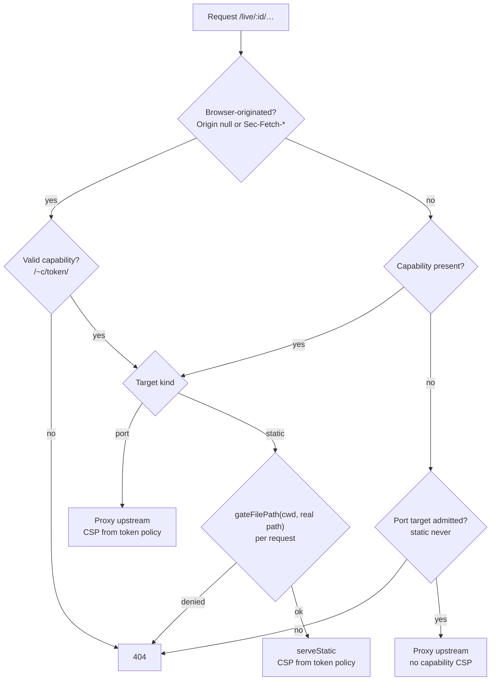

#### Preview egress plane (D6, D7)
- Origin scan (`live-origin-scan.ts`): HTML ≤ 2 MiB (`SCAN_MAX_HTML_BYTES`) + same-root CSS. Reads `src`, `srcset`, `poster`, `data`, `<link href>`, `@import`. Plain `<a href>` ignored.
- Output `{source:"markup"}`. Truncation → `scanIncomplete`. Root-absolute refs → `rootAbsolute`.
- Runtime reports: `POST /live/<id>/~c/<token>/__pi/csp-report` (`CSP_REPORT_SUBPATH`). Types `application/csp-report`, `application/reports+json`.
- Limits: body ≤ 64 KiB (413), 20/s and 600/h per token (429). Reads `blocked-uri` only.
- Runtime reports best-effort. Page may forge → labelled "reported by this page", allow-once only.
- Blocked set per token ≤ 64 (`MAX_BLOCKED_ORIGINS`). Eviction drops runtime entries first.
- `GET /api/live-server/:id/egress?token=` and `POST /api/live-server/:id/allow-once {tokenId, origin}`: control tier. Minting principal only.
- Allow-once keyed by client `viewerId` (per tab), ≤ 32.
- Grant = deferred plane `preview-egress` (`planes.ts`). `allow-always` / `deny`. Never YOLO-eligible.
- "Allow for this project" (operator click) → deferred registry entry → standard dialog. Prompting off (default) → Allow once only.
- Subject: `canonicalHttpsOrigin` (https only, no userinfo, punycode, default port elided).
- Ungrantable (`isUngrantableEgressOrigin`): non-https, `localhost`, loopback / private / link-local / CGNAT / ULA IP literals, single-label, `.local` `.internal` `.lan` `.home.arpa`, IPv4-embedding labels, dashboard origins.
- Grant-time DNS: 3 s (`EGRESS_DNS_TIMEOUT_MS`). Private / loopback / fail → "Could not verify this origin; try again". Later rebinding = residual.
- Store: `~/.pi/dashboard/preview-egress.json` `{[projectKey]: string[]}` via `auth/locked-json-file.ts`. Override `PI_PREVIEW_EGRESS_STORE`.
- `projectKey` = canonical subject of git common root, else cwd.

### Network Access Control

One universal network guard plus the auth plugin. Universal guard runs whether or not auth is configured.

**Layer 1: Network Guard (`createNetworkGuardHook`)** — `packages/server/src/auth/localhost-guard.ts`. Registered ONCE at root in `packages/server/src/server.ts` as the LAST `onRequest` hook, unconditionally. Not anchored on the model-proxy gate above it: that gate does not exist when `modelProxy` is disabled. Fastify binds root hooks to routes at `preReady`, including encapsulated plugin child scopes, so registering after the routes still covers them. Does NOT cover a route registered after `ready()` (plugin activation is restart-effective today; a future hot-load reopens this).

Replaces the old per-route-only model. `createNetworkGuard` was a `preHandler` on ~20 core route registrars. Three surfaces never got it and were unguarded when auth was off: plugin routes (`/api/plugins/automation/*`, kb, flows) and `/api/provider-auth/*`. Existing per-route `preHandler: networkGuard` calls stay as redundant defense-in-depth.

**Jurisdiction** — 4 namespaces, trailing-slash anchored: `/api/`, `/v1/`, `/editor/`, `/live/`. `/apiv2` is a near-miss, not `/api`.
- INSIDE jurisdiction: deny by default.
- OUTSIDE jurisdiction: no-op.

Outside is deliberate and load-bearing. Static assets, SPA shell (`/`), SPA deep-link fallback (`setNotFoundHandler`), `/manifest.json`, `/auth/*`, favicon, PWA icons, `/sw.js` keep loading. Auth-off tunnel deployment still reaches its own app shell.

**In-namespace public exceptions** (reachable unauthenticated inside `/api`): `GET`/`HEAD /api/health` (exact pathname; `HEAD` admitted because Fastify auto-exposes HEAD for a GET route); device-pairing bootstrap (`/api/pair/challenge`, `/api/pair/redeem`, `/api/pair/poll`); configured `auth.bypassUrls` prefixes.

An exception must hold on **both** views of the target (see **Matching**). Note the scope of `auth.bypassUrls`: it is an exception from the **universal hook only**. A route that also carries a retained per-route `preHandler: networkGuard` is still refused by that `preHandler`, so a `bypassUrls` match is public only for routes WITHOUT a per-route guard. This is unchanged from before this guard existed — `auth.bypassUrls` has only ever skipped the auth plugin, never a per-route guard.

**Pass conditions** (unchanged from the old per-route guard):
1. **Genuine-local** — loopback AND no proxy-forwarding header (`x-forwarded-for`, `x-forwarded-host`, `x-forwarded-proto`, `x-real-ip`, `forwarded`). Tunnel presenting as `127.0.0.1` injects a forwarding header and fails here.
2. **Local-IPC token** — `X-Pi-Local-Token` allowlist.
3. **Trusted network** — source IP matches `resolvedTrustedNetworks` (CIDR, wildcard, exact). Read live via thunk, so a CIDR added at runtime admits without restart.
4. **Authenticated** — `request.isAuthenticated === true`.

Otherwise → 403.

**Matching** runs on TWO views of the target, and jurisdiction is the UNION of them:
- the **raw** view — percent-decoded, query string and fragment stripped, dot-segments UNRESOLVED;
- the **resolved** view — the same pathname with `.` / `..` resolved per RFC 3986.

A request is in jurisdiction when **either** view is in jurisdiction. Unparseable target → fail closed (denied, treated as in-jurisdiction). `::ffff:` IPv4-mapped prefixes stripped before IP match. In-namespace exceptions must hold on **both** views.

Both views are load-bearing because the router and the guard disagree about dot-segments: Fastify passes `onRequest` the RAW target, and find-my-way does not resolve dot-segments — it matches them into a `:param` / `*` slot as a literal value. Deciding on the resolved view alone would let `/api/provider-auth/..` reach `/api/provider-auth/:provider` with `provider = ".."`; deciding on the raw view alone would miss `/foo/../api/x`; judging an exception on one view would let `/live/<id>/../../api/pair/challenge` through as the pairing exception while `/live/:id/*` runs. A dotted target that is outside jurisdiction under BOTH views (e.g. `/foo/../settings`) stays a no-op.

**`/v1/*` model proxy.** `createModelProxyAuthGate` (`packages/server/src/model-proxy/auth-gate.ts`) sets `request.isAuthenticated = true` on a valid `pi-proxy-*` key. Universal guard admits it via pass condition 4. Deliberately NO public `/v1` allowlist entry — such an entry would be a hole when the proxy is disabled.

**`/mcp` deliberately OUT of jurisdiction.** `/mcp` authenticates in-handler from the paired-device bearer token and does not trust `isAuthenticated`; guarding it would 403 every legitimate remote MCP client. Classified as an ENUMERATED independently-authenticated namespace, not silently skipped.

**Denial contract.** `403` with body `{ success: false, error: "network_not_allowed", reason, hint }` — clients branch on `error`. Recorded in the buffer behind `GET /api/tunnel/block-events`, which powers the "Trust this network?" prompt. Logged as `[network-guard] denied reason=… path=… ip=…` — path + socket-peer IP + reason only; no body, no token.

**Second port.** Optional model-proxy second-port Fastify instance runs ONLY the proxy gate, no universal guard. Safe solely because it binds `127.0.0.1` (asserted by `packages/server/src/__tests__/model-proxy-second-port.test.ts`). If that bind ever becomes configurable, install the universal guard there too.

**Namespace-coverage test.** `packages/server/src/__tests__/network-guard-namespace-coverage.test.ts` enumerates the real route table with plugin routes loaded. Fails if any non-static/non-`/auth`/non-public route sits outside the guarded namespaces or the enumerated independently-authenticated set (`/mcp`).

**Trusted-network config sources.** `resolvedTrustedNetworks` merges two sources:
- `auth.bypassHosts` — canonical. Settings UI writes here (Security tab "Trusted Networks" section; also surfaced on Settings ▸ Servers).
- legacy top-level `trustedNetworks` — readable for back-compat with hand-edited `config.json`. UI does not modify it.

Both honor same matching logic. Both work independently of whether `auth.providers` is configured: `auth: { providers: {}, bypassHosts: [...] }` honored as-is; auth plugin no-ops when provider registry empty and the universal guard serves the bypass path directly. See `openspec/changes/archive/` for `fix-trusted-networks-no-oauth` (restored this after a `consolidate-trusted-networks` regression).

**Layer 2: Auth Plugin (`onRequest` hook)** — Only registered when `auth` is configured. Skips loopback, trusted networks, `/auth/*`, `/api/health`, and `bypassUrls`. Validates JWT cookie for all other requests. Tags valid requests with `request.isAuthenticated = true`.

**Execution order** (root `onRequest` hooks run in registration order): auth plugin (when configured) → model-proxy auth gate (when proxy enabled) → universal network guard LAST → route `preHandler` (per-route guards, defense-in-depth) → handler. Auth and proxy gates tag the request before the universal guard reads the pass conditions.

**WebSocket upgrades** follow the same admission logic: loopback/genuine-local → trusted network → local-IPC token → JWT cookie validation.

**Zrok tunnel** connections appear as `127.0.0.1` (zrok proxies to localhost) but carry proxy-forwarding headers, so they are NOT genuine-local. A zrok peer passes only when in `trustedNetworks` or authenticated.

**`GET /api/network-interfaces`** returns detected non-internal IPv4 interfaces with computed CIDRs. Used by the Settings UI "Add Local Network" button. This endpoint uses the legacy `localhostGuard` (localhost-only, not network-guard-aware) since it exposes machine network topology.

### Trust and Credential Boundaries (change: harden-trust-and-credential-boundaries)

Hardens five residual trust / credential-boundary weaknesses from audit. Each mitigates a confirmed finding; none is a standalone RCE.

**Strict local proof (`requireLocalProof`).** Top-level config key, default `false`, read live per request — toggling needs no restart. Off = bare loopback (loopback peer, no forwarding header) stays trusted exactly as today. On = the network guard admits a bare-loopback request only on `observe`-tier `/api/*` REST reads (the `isObserveApiRequest` exception in `localhost-guard.ts`). Everything else needs PROOF, one of:
- `pi_dash_local` httpOnly `SameSite=Strict` cookie, 30 d, value `HMAC(localToken, "pi-dashboard/local-proof/v1")` — rotating the local token invalidates every proof cookie;
- `X-Pi-Local-Token` header;
- authenticated principal (`request.isAuthenticated`).

Gated surfaces: `control` / `operate` REST routes, browser WS (`/ws`, `/ws/terminal/*`, `/live/*`), plugin-registered WS scopes (`isPluginScopePeerLocal`), bridge-ticket mint (`decideBridgeTicketMint`), and the route-tier exemption (`tierRefusalFor`). A `127.0.0.1` entry in `trustedNetworks` / `auth.bypassHosts` no longer re-admits a relay under strict — `isTrustedSource` refuses a loopback-range peer without proof.

**Why it exists.** A header-injecting tunnel (zrok) presents as loopback but carries `X-Forwarded-*`, so it already fails `isGenuinelyLocal`. A marker-less relay (`ssh -R`, `socat`) terminates on `127.0.0.1` and injects NO forwarding header — indistinguishable from a same-host browser, so it inherits full unauthenticated access to code-exec routes. Enable `requireLocalProof` when such a relay is used; only zrok-class tunnels are safe without it.

**Denial.** Under strict, a proof-less bare-loopback denial is `403 { success: false, error: "network_not_allowed", reason: "local_proof_required", hint: … }` — same `error` literal as every other network denial, so clients keep branching on `error`; `reason` carries the strict-mode signal and `hint` names `pi-dashboard open`.

**Bootstrap.** `pi-dashboard open [--print]` mints a one-time code (`POST /api/local-proof`, `X-Pi-Local-Token` only, 60 s TTL, single use via `LocalProofCodeStore`) and opens `/auth/local-proof?code=…`, which redeems it, sets the `pi_dash_local` cookie, and redirects `/`. Electron always loads that URL. Server not running → `open` exits `1` ("server not running"). Bootstrap routes register regardless of the flag, so `open` works before strict is toggled.

**Trade-offs (stated, not implied).**
- `/v1/*` model proxy keeps bare-loopback admission even under strict: local pi processes call it, and a marker-less relay can spend model credentials but cannot execute code.
- `/api/health` posture disclosure unchanged.
- A raw `curl -X POST` to `control` / `operate` routes from this host needs `X-Pi-Local-Token` (token at `~/.pi/dashboard/local/token`). `npm run reload` and the CLI `restart` already send it.

**Pairing approval never honors bare loopback (any mode).** `createApprovalGuard` on `POST /api/pair/approve` and `/api/pair/approve-pending` admits only a login session, a valid proof cookie, or `X-Pi-Local-Token`; a device bearer is refused first, and Host admission still applies. Default-off strict does not exempt it. A hand-typed `http://localhost:8000` on an auth-off install must use `pi-dashboard open` or Electron to approve; the dialog shows the hint.

**Credential + trust hardening in the same change.**
- Login OAuth state carried in a signed `pi_dash_oauth_state` cookie, verified before code exchange; `returnUrl` restricted to same-origin relative paths (closes CSRF + open redirect).
- Plugin event emission: automation actions declare `emits: string[]`, undeclared types dropped; `emitEventToSession` refuses reserved namespaces `roles:` `role:` `model:` `prompt:` `dashboard:` `ui:` (`RESERVED_EVENT_PREFIXES`); raw `sendExtensionMessage` refuses `plugin_emit_event`.
- `config.json` written atomically `0600` by one secure-write helper (all eight writers); existing group/world-readable files chmod'ed `0600` at load (parity with `auth.json`, `paired-devices.json`, `local/token`).
- Same-origin browser exchanges the device bearer once for an httpOnly `pi_dash_device` cookie (`POST /api/device-session`, `Path=/api/`, `SameSite=Strict`); `localStorage` keeps only the non-secret `pi-dashboard:device-paired` marker. Legacy stored bearers are exchanged and removed on startup; WS single-use tickets and the Electron keyring bearer unchanged.

See change: harden-trust-and-credential-boundaries.

### Pi trust mirror (change: mirror-dashboard-trust-to-pi)

Durable dashboard trust counts as trusted project for pi sessions on SAME machine. Decided at pi `project_trust` time. Never writes `~/.pi/agent/trust.json`. Pi's file stays pi-owned.

**Files.**

| File | Role |
|---|---|
| `~/.pi/dashboard/config.json` `piTrustMirror` | `enabled` (default `true`), `coverInteractive` (default `false`), `sources.<id>` |
| `~/.pi/dashboard/pi-trust-mirror.json` | Snapshot. Mode `0600`. Server home-lock holder writes. Rebuilt at server boot. Entries: `key`, `sourceKind`, `dev`, `ino`, `birthtimeMs?`, `configRoot?`, `hookHash?`. `generation` counter. Warn log >5,000 entries. |
| `~/.pi/dashboard/pi-trust-overrides.json` | Per-entry choice. Key `<sourceId>\0<canonical path>`. |
| `~/.pi/agent/trust.json` | pi-owned. Read by bridge, never written by mirror. |

**Durable sources** (`piTrustMirror.sources.<id>`). Defaults ON except `accessGrants`.

| id | Covers |
|---|---|
| `worktreeInit` | Persisted hook trust. CURRENT hook hash re-checked each decision. |
| `workflow` | Workflow slot. Reports `source-not-installed` until `add-project-workflows`. |
| `pinned` | Pinned dirs. Docker `PI_WORKSPACES` → `PI_DASHBOARD_PIN_DIRS` seeds pins. |
| `folderWorkspaces` | Folder workspaces. |
| `accessGrants` | Project-root subjects only. Default OFF. |

NOT counted in snapshot: server-lifetime trust (session worktree trust, session access grants, YOLO), KB source trust. Server-lifetime trust + remote bridges now served by live query (see Live trust query).

**Matching.**
- Key form `piTrustKey` = `realpathSync(path.resolve)`. No Unicode-space normalisation. Source: `packages/shared/src/pi-trust-mirror.ts`.
- Subtree: counted entry covers folder + everything below. `findCoveringEntry` = nearest ancestor-or-self key.
- Identity: canonical path + `dev` + `ino` (+ `birthtimeMs` when recorded). Entry applies only on identity match.
- Identity mismatch → fail closed. Other machine, re-created folder, moved folder.

**Deny rules** `mirrorDenyRules`. Separate from grant-subject `forbidden-subjects` (unchanged).
- Exact: `/`, `$HOME`, ancestors of `$HOME`, system dirs, broad parents (`/Users /home /Volumes /private /var/tmp /mnt /media`; win: drive root, `C:\Users`).
- Subtree: `~/.ssh ~/.pi ~/.aws ~/.gnupg ~/.kube ~/.docker`, OS temp (`os.tmpdir`, `/tmp`, `/private/tmp`), `~/.cache`, `~/Downloads`.

**Decision order** `decidePiTrust` (shared by bridge, `host.isProjectTrusted`, toggle gate). First match wins.

```mermaid
flowchart TD
  A["project_trust / host.isProjectTrusted(cwd)"] --> B{"trust-requiring resources?"}
  B -- no --> R0["trusted: implicit"]
  B -- yes --> C{"pi recorded entry?"}
  C -- "true / false" --> R1["pi decision wins"]
  C -- none --> D{"mirror on AND covering entry?"}
  D -- yes --> R2["trusted: dashboard source"]
  D -- no --> R3["defaultProjectTrust"]
```

- `--approve` / `--no-approve` applied by pi first.
- `--no-extensions`: bridge never decides.
- `pi mcp list` reads only `trust.json`.
- Dashboard trust overrides `defaultProjectTrust`, INCLUDING `never`.
- Recorded pi entry (true or false, nearest ancestor) beats dashboard trust.

**Bridge** `decideBridgeProjectTrust` (`packages/extension/src/project-trust.ts`).
- No server round trip on snapshot step. Live query only on snapshot miss (see Live trust query).
- Per event: reads `config.json`, `trust.json` (lockless; BOM stripped; null = absent; bad shape/parse = undecided `store-unreadable`), snapshot.
- Returns `{trusted:"yes", remember:false}` or undecided.
- Dashboard-spawned headless sessions consult mirror always. Other sessions only if `coverInteractive`.
- Reason codes logged when withheld: `forbidden-folder`, `recorded-entry`, `identity-mismatch`, `hook-changed`, `not-project-root`, `source-off`, `source-not-installed`, `choice-unreadable`, `store-unreadable`, `not-covered-session`, `identity-weak` + 7 `live-*` (see Live trust query).
- p95 < 20 ms (1,000 entries, 20-deep cwd).
- Spawn token: `PI_DASHBOARD_SPAWN_TOKEN` read + removed from env at bridge activation (`packages/extension/src/spawn-token.ts`). Process-global until first `session_register`. Agent-started nested pi never counts as dashboard-spawned.

**Writes.**
- Grant: choice file → source store → snapshot.
- Revoke: snapshot rewritten WITHOUT entry FIRST → then source store. Failure of either = failed revoke. Browser gets `pi_trust_mirror_error {op,path,error}`.

**Server modules.**
- `packages/server/src/access/pi-trust-mirror-service.ts`: registry + snapshot + choices. Handle `getPiTrustMirror()`.
- `packages/server/src/pi/host-project-trust.ts`: `createHostProjectTrustService`, `loadHostProjectTrustService`, `coveringDashboardEntry`. Registry keys `host.isProjectTrusted`, `host.projectTrustSource`, `host.piTrustCoverInteractive`.
- `packages/server/src/pi/resource-toggle-trust.ts`: dashboard-trusted folder + nothing recorded → existing prompt, `Trust` pre-selected, source named, lasting effect stated. Payload `preselected:"trust"`, `dashboardSource`. Nothing recorded until operator chooses. Works under default `never`.

**Routes / WS.**
- `GET /api/access/pi-trust`: `config`, `agentDir`, `piEntries`, `effective`, `entries`, `ignored` (reason + label), `sourcesNotInstalled`.
- `PUT /api/access/pi-trust/choice` `{sourceKind, folder, choice: boolean|null}`.
- WS `pin_directory`, `add_folder_to_workspace`, `grant_response` accept `piTrust?`. `POST /api/git/worktree/init` accepts `piTrust?`.

**MCP.** Effective view adds `trustSource`, `trustCoverInteractive`. Dashboard-only trust → project servers active, live state `not-checked-by-pi` + note. Config-writer global-write name collisions keep pi-only predicate (dashboard trust never changes them).

**UI.**
- Settings → Access → "Pi trust from the dashboard" (`packages/client/src/components/settings/PiTrustMirrorSection.tsx`): switches, effective list, per-entry choice, ignored rows (reason + label), pi `trust.json` entries + agent dir, disclosures.
- Disclosures: precedence over `defaultProjectTrust` (incl `never`); scope; `--no-approve` / `--no-extensions` / pi CLI not covered; activation-cwd rule.
- Folder page banner: pi / dashboard (source + folder; "dashboard sessions, not terminal pi" unless `coverInteractive`) / neither (links Settings → Access).

**Breaking bridge behaviour.** NOT reverted by `enabled:false`.
- (a) Recorded pi entry beats activation-cwd auto-trust.
- (b) Activation-cwd auto-trust no longer applies in forbidden/temporary folders (logged).
- (c) Spawn token removed from env at activation (see Bridge).

**Rollback.** `piTrustMirror.enabled: false`. Bridge reads config live. Works with server down. Does not revert (a)-(c).

**Security residuals.**
- Hook trust widened to full project trust for the subtree. Checkbox text states it.
- Covered subtree also trusts repos cloned/created later inside it.
- Bridge `yes` pre-empts later user extensions' `project_trust`.
- Same-user forging of snapshot ≈ writing `trust.json`. Accepted.

See change: mirror-dashboard-trust-to-pi.

#### Live trust query (change: mirror-dashboard-trust-live-remote)

Extends mirror to server-lifetime trust + remote bridges. Live entries never written to disk. Snapshot carries count only. Bridge asks server on snapshot miss.

```mermaid
sequenceDiagram
  participant P as pi project_trust
  participant B as bridge decideBridgeProjectTrust
  participant S as server POST /api/pi-trust/query
  P->>B: project_trust(cwd)
  B->>B: store, recorded entry, activation rule, snapshot cover
  Note over B: snapshot miss, ask conditions hold
  B->>S: { cwd } + local proof OR Bearer PI_DASHBOARD_TOKEN
  S->>S: auth, rate limit, cap 8 KiB, deny rules, cover lookup
  alt local requester
    S-->>B: { covered, key, sourceKind, dev, ino, birthtimeMs? }
    B->>B: identityMatches vs own stat
  else paired device
    S-->>B: { covered, salt, digest }
    B->>B: trustResourceManifest + HMAC, compare digests
  end
  B-->>P: trusted yes (remember false) OR undecided + reason code
```

**Route.** `POST /api/pi-trust/query` body `{cwd}`. Source: `packages/server/src/routes/pi-trust-query-routes.ts`. Path const `PI_TRUST_QUERY_PATH` (`packages/shared/src/pi-trust-live-query.ts`).
- `ROUTE_TIERS` tier `operate` (same as `POST /api/ws-ticket`). Registered in `http-road-classification.ts`. Not PRE_AUTH.
- Body cap 8 KiB → 413. Bad `cwd` (relative, NUL, length) → 400, never 500.
- Server re-canonicalises: `piTrustKey(cwd) !== cwd` → not covered.
- Handler order: auth → rate limit → body → switches + deny rules → cover lookup → proof → YOLO liveness re-check.

**Admission.**
- Local = loopback + no forwarding headers + VERIFIED endpoint-bound `X-Pi-Local-Proof` (`kind === "proof"`). Shared `isLoopbackHost`.
- Remote = paired device bearer at `operate`.
- Refused: raw legacy local token, browser login cookie, trusted-network admission.
- Proof binds method + path, not body. `cwd` = unauthenticated input.

**When bridge asks** (all must hold):
- `enabled` ∧ `liveQuery` in `config.json`.
- session allowed by `coverInteractive` rule.
- no recorded pi entry.
- `!isMirrorDenied(cwd)`.
- snapshot gives no cover (any reason, incl `identity-mismatch`).
- `liveCount > 0` ∨ remote bridge (non-loopback endpoint + `PI_DASHBOARD_TOKEN`).

Bridge `decideBridgeProjectTrust` now async. Snapshot step stays sync (p95 < 20 ms). Handler never throws: every path resolves `{trusted:"undecided"}` on failure.

**Live sources** (`piTrustMirror.sources.*`, in-memory, listed by provider in mirror service):

| Source | Covers | Lifetime |
|---|---|---|
| worktree-init session trust | `listSessionTrust()`, hook hash re-checked | until server restart |
| session access grants | project-root subjects, `scope==="session"` | until server restart |
| `yolo` (default ON) | roots of `yolo.status()` | scoped: until expiry. env activation: while server runs. unscoped: never |

- Identity `{dev, ino, birthtimeMs?}` recorded at entry creation, in-memory map keyed `<source>\0<key>`. Unstatable folder never counts.
- Fixed listener gaps: session branches of `recordTrust`/`revokeTrust`/`recordGrant`/`revokeGrant` notify. `YoloController.setChangeListener` + unref'd expiry timer.
- Snapshot field `liveCount` only. Never paths or identities. Boot writes `0`. Rewritten only when count changes, synchronously in the changing action. Failed rewrite logged, action succeeds. Reader treats missing/invalid as 0. Snapshot `version` stays 1.
- Stale count = extra or missed query, never wrong yes.
- Server consumers (`host.isProjectTrusted`, `projectTrustSource`, MCP view) run `decidePiTrust` over durable + live entries, no folder proof.

**Proofs.**
- Local: recorded `dev`+`ino`[+`birthtimeMs`]. Bridge compares via `identityMatches`. Re-created folder → `identity-mismatch`.
- Remote: `{covered:true, salt, digest}`. No source kind, no identity. Salt 16 random bytes.
- `digest = HMAC-SHA256(salt, "pi-trust-live/v1\n" + cwdKey + "\n" + manifest)`. cwd key binds answer to path.
- `manifest` = sorted entries of pi's trust-requiring resources: cwd `.pi/{settings.json,mcp.json,extensions,skills,prompts,themes,SYSTEM.md,APPEND_SYSTEM.md}` (recursive, label `c/<rel>`) + `<d>/.agents/skills` for cwd and each ancestor except `~/.agents/skills` (label `a<k>/<rel>`, `k`=levels above cwd).
- Entry: file → `label\0f\0sha256(content)`. Dir → `label\0d`. Other type → null.
- Shared fn `trustResourceManifest(cwd, {home, signal})` in `packages/shared/src/pi-trust-resource-digest.ts`. Async `fs/promises`, `AbortSignal`, one read per file.
- Fail-closed → null → `identity-weak`: empty set, any symlink, `.pi/settings.json` unparseable/unknown ref shape/refs outside set (`packages` entry, ext/skill path outside), >1,000 files, >16 MiB, read failure.
- Bridge compares two non-null digests only. Unequal → `identity-mismatch`.
- Resource-name list = literal (pi does not export it). Golden test `packages/shared/src/__tests__/pi-trust-resource-golden.test.ts` asserts equality with installed pi `trust-manager.js` + `hasTrustRequiringProjectResources` parity.

**One deadline** `piTrustMirror.liveQueryTimeoutMs`.
- Default 300 ms local / 1000 ms remote. Clamp 50–1000. Non-finite → default. Resolver `effectiveLiveQueryTimeoutMs` (`packages/shared/src/config.ts`).
- Bounds request + proof. `Promise.race([work, deadline→live-timeout])`. `AbortController` per call aborts `fetch` (`redirect:"error"`) + every `fs/promises` read.
- After race: `inst.isActive()` re-check. Stale instance → undecided.

**Reason codes** (`MirrorWithheldReason`, `packages/shared/src/pi-trust-mirror-types.ts`; 18, labels in `MIRROR_WITHHELD_LABELS`):
- Parent (7): `forbidden-folder`, `not-project-root`, `hook-changed`, `source-off`, `source-not-installed`, `identity-mismatch`, `choice-unreadable`.
- Bridge (4): `recorded-entry`, `store-unreadable`, `not-covered-session`, `identity-weak`.
- Live (7): `live-timeout`, `live-unreachable`, `live-refused`, `live-unsupported`, `live-rate-limited`, `live-not-covered`, `live-error`.

| Outcome | Code |
|---|---|
| connection refused | `live-unreachable` |
| 401 / 403 | `live-refused` |
| 404 (old server) | `live-unsupported` |
| 429 | `live-rate-limited` |
| abort / deadline | `live-timeout` |
| answer `covered:false` | `live-not-covered` |
| 5xx, redirect, malformed body, covered answer missing proof fields | `live-error` |

**Rate limits.**
- Fixed window 10 s. 20 queries per paired device. 200 for `local` requester.
- Proof permits: 4 global, 1 per device. Excess → 429. One log line per window. Control chars stripped from logged `cwd`/device.
- Local identity answers take no permit.
- No manifest cache (staleness in security decision).

**Health.** `/api/health` `piTrustMirror.live` = `{covered, notCovered, refused, rateLimited, budgetMissed}`. Same disclosure gate as access-grant health block (`access-health.ts`). Server-side only. `budgetMissed` = handling time > server `liveQueryTimeoutMs` for requester class. Bridge logs own reason codes. Remote bridge with shorter timeout can log `live-timeout` while server counts `covered`.

**Settings + rollback.**
- `piTrustMirror.liveQuery` (default `true`), `liveQueryTimeoutMs`, `sources.yolo` (default `true`).
- `liveQuery=false`: no queries. Bridge reads `config.json`, works with server down.
- `sources.yolo=false`: YOLO roots stop counting. Other live sources stay.
- `enabled=false`: everything off.
- Old bridge never queries. New bridge + old server → 404 → `live-unsupported` → undecided.
- Nothing live persisted.

**Residuals.**
- YOLO default ON widens YOLO from file access to project-code execution in its roots. Disclosed at activation + Access page. Unscoped YOLO never counts. Deny rules apply.
- npm packages named in `.pi/settings.json` bound by reference, not fetched bytes.
- Marker-less relay (`ssh -R`, `socat`) + shared home can look local. Needs same-user access + dev+ino(+birth) match. Accepted.
- `ssh -L` tunnel + shared home: loopback → classed local → `identity-mismatch`, fail-closed. Dial non-loopback endpoint with device token.
- Symlinked (pnpm-style) trees, >1,000 files, >16 MiB → no remote trust (`identity-weak`).
- Benign `.pi/settings.json` edit on one side drops remote trust.
- Local-rate-limit key shared by all local pi. 200/10 s sized for fleet spawns.
- Snapshot step sync: hung mount blocks before live deadline starts (parent residual).
- Non-goal: no path mapping between machines. Canonical paths must be equal.
- Non-goal: no defence against malicious bridge. Bridge decides only for own pi process.

See change: mirror-dashboard-trust-live-remote.

### Access Grants and Denial Remedies (change: add-access-grants-and-review)

Companion to **Network Access Control** above. That section's universal `onRequest` guard is the network plane; this one is the filesystem plane. Both turn a terminal refusal into a remedy an operator can accept. Network plane: `403 network_not_allowed` → `BlockEventBuffer` → "Trust this network". Filesystem plane: a containment refusal → `denialId` → **grant** → next read admitted, no restart. The guard above is not re-explained here; see it for the network plane.

**The single gate.** `packages/server/src/access/containment-gate.ts` `evaluateContainment(resolved, anchors, { site, session })` is the one containment decision every file-read site routes through. Before it, ten sites inlined `isAllowed(...)` and hand-rolled their own 403 body — five distinct denial shapes, two sites with no body at all. The gate keeps the decision exactly as it was and adds the remedy additively. `grep-routes.ts` and `resolve-file-mention.ts` are body-less: they call the grant predicate and discard the denial, so they **consume** grants but can never originate one (a grant must trace to a denial the operator saw).

**Evaluation order** — the pre-existing containment layers run first and stay authoritative; the grant layer is reached only on their miss.

```mermaid
flowchart TD
    R["resolved path (lexical)"] --> L1{"Layer ① — within any anchor?"}
    L1 -->|yes| ALLOW["allow (viaGrant false)"]
    L1 -->|no| L2{"Layer ② — within anchor's bound checkout roots, realpath'd?"}
    L2 -->|yes| ALLOW
    L2 -->|no| G{"Grant layer — within a granted subtree?"}
    G -->|yes| ALLOWG["allow (viaGrant true) → handle-verified read"]
    G -->|no| DENY["refuse + remedy: reason, hint, subject, denialId, ancestors"]
    DENY --> REC[("path-denial registry")]
    REC --> GRANT["POST /api/access/grants — bind to denialId"]
    GRANT --> STORE[("access-grants.json")]
    STORE -. next request .-> G
```

The grant layer is third in evaluation order but is deliberately **not numbered "③"**: `file-routes.ts` already comments an image-only artifact-root admission as "Layer ③", and this change avoids colliding with that numbering. It is always the **grant layer**.

**Why grants are a subtree check, not an extra `isAllowed` anchor** (design D1). `isAllowed` (`packages/server/src/lib/path-containment.ts`) runs `checkoutAnchors(anchor)` over **every** anchor it receives and admits anything under that anchor's **bound checkout roots** (`thisCheckout` + `mainCheckout`). Appending a grant for `…/repo/sub` as an anchor would therefore silently admit all of `…/repo` — the UI would name one directory and the system would admit its whole repository. Grants are therefore evaluated by a dedicated subtree predicate, `isGrantAdmitted(resolved, grantedSubjects())`, applied **after** `isAllowed` returns false. `isAllowed`'s semantics and its existing per-site anchor sets (`homePiAnchor()`, the pinned-directory anchor) are untouched, so the existing `file-read-containment` suite passes unchanged. What the UI names is exactly what is granted.

**The stored subject is a realpath; the request side is realpath'd, the stored side is not** (design D2). `resolved` at every call site is **lexical** (`path.resolve`, symlink-unresolved). Two rules follow, asymmetric on purpose:

- The subject is `realpath`'d **at grant time** and that value is persisted and displayed (`normalizeGrantSubject`). A grant binds to the directory the operator actually saw. Storing the lexical path would bind the grant to a symlink (`/wt/current`) and follow it wherever the link was later repointed — a silent widening with no new approval.
- At check time the predicate is `within(realpath(resolved), storedSubject)`: `realpath` on the **request side only**. A lexical compare would reintroduce the symlink escape layer ② exists to close, inside granted directories. The stored subject is **not** re-resolved, because a symlink swapped in over the subject (or any ancestor of it) would then silently migrate the grant and reopen the hole D2 closes.

The rejected alternative, `within(realpath(resolved), realpath(grant))`, was a **double-realpath** that contradicted D2 and was corrected in planning. Strict `fs.realpath` is used, not `safeRealpath`: a granted directory later deleted (or recreated as a symlink) refuses rather than matching its nearest existing ancestor. An empty grant list short-circuits before any syscall.

**The store.** `packages/server/src/access/access-grants.ts`. Persisted at `~/.pi/dashboard/access-grants.json` (`PI_ACCESS_GRANTS_STORE` overrides; schema `{ version: 1, grants }`). One grant carries `subject` (realpath), `scope` (`"session"` — in-memory until server restart — or `"project"` — persisted), `grantedAt`, `origin` (the session whose denial produced it), and optional `widenedFrom` (the denied subject when the grant came from an offered ancestor). Invariants: absent/malformed store → empty, never throws; **cap 200 per scope**, oldest-`grantedAt` evicted within that scope only (a union cap would let an ephemeral session grant delete a persisted project grant); writes atomic (temp + rename) so a crash mid-write cannot truncate the store into its own malformed→empty rule; a failed write is non-fatal — the subject stays ungranted, the failure is logged **and returned to the caller** so the UI cannot claim a grant that does not exist. Recorded grants are audited (`[access-grant] granted subject=… scope=… site=… denialId=…`).

`"session"` scope means the **server process**, not the pi session whose denial produced it (design D17): one grant widens the grant layer for every session and every connected client; `origin` is what the Access tab shows.

**Read-once, cost-bounded on the hot path** (design D16). The store is loaded into memory once and invalidated on write; the containment path never reads the store synchronously. `isAllowed` is async by explicit design (one caller stalling would block every request), so a sync read on that path would regress it. With an empty store the predicate short-circuits with zero syscalls — that is what makes "empty store is byte-identical to today" true of **cost** as well as outcome. When grants exist, evaluation is a linear scan of distinct subjects with one `realpath` on the request side; `grep-routes.ts` awaits the predicate per match, so N matches x 200 grants x a `realpath` is the worst case the cap alone does not bound. `GET /api/access/store-stats` exposes the load count so a test can prove the hot path never re-reads the store. Rollback consequence: deleting the store file changes nothing until the process restarts — the supported rollback is **revoke through the Access tab** (which invalidates the in-memory set), or delete-then-restart.

**Denial registry.** `packages/server/src/access/access-denials.ts` is what makes "a grant may only name a subject a recorded denial named" testable — the network ledger `BlockEventBuffer` is keyed by IP and carries no path, so it cannot supply the binding. Keyed by grantable **subject** (the refused path's containing directory), each entry carries an opaque `denialId` (UUID), the subject, the refusing `site` (`file-routes:661`), the originating session, a timestamp, and the offered-ancestor ladder. Entries expire at `DENIAL_TTL_MS = 10 * 60 * 1000` and the registry is capped at 200, oldest-evicted. It is written **only by the containment denial path**, never by an inbound request — the same invariant the network ledger holds. An unknown, expired, or evicted `denialId` makes the grant request fail.

The denial body is additive on an unchanged `error` string: `{ success, error, reason, hint, subject, denialId, ancestors }`. `ancestors` is always present (possibly empty) so the body has a deterministic key set. No containment outcome changes — every allow stays an allow, every refusal stays a refusal with the same status code and the same `error` string. The two body-less sites emit nothing.

**Offered-ancestor ladder.** `packages/server/src/access/ancestor-ladder.ts` computes the directories above a denied subject that the remedy may also offer (a refused file is usually a level below a boundary the operator cares about). Rules: computed from the subject's **real** path, truncated at a **git checkout root** (inclusive) or, with no repository, stopping **below** `$HOME` (exclusive); the filesystem root is never a rung; every rung passes the forbidden filter, so a ladder can never climb into a secret store. Parent is `$HOME` → empty ladder.

**Forbidden subjects are compared as real paths** (design D15). `packages/server/src/access/forbidden-subjects.ts`. `realpath("/etc")` is `/private/etc` on macOS and a home directory may itself be a symlink, so a lexical compare is trivially bypassed. Two lists: `whole` — refused **exactly** — `/`, `$HOME`, and the POSIX/Windows system roots (`/etc`, `/usr`, `/var`, `/Library`, `/System`, `/bin`, `/sbin`, `/opt`, `C:\Windows`, …); `sensitive` — refused **exactly and for every descendant** — `~/.ssh`, `~/.pi`. The descendant rule is what stops an offered-ancestor ladder from climbing into a secret store, and `subsumesForbiddenGrantSubject` also rejects a rung that is an **ancestor** of a forbidden subject (`/private` on macOS would admit `/private/etc`; `/Users` would admit a home directory). `isUngrantableSubject` names the exact pair the route and the store both enforce — the route filters the **normalized** subject it will persist, and `recordGrant` re-applies it as a store-level backstop. Filtering the raw input once left a one-click escalation: a denial subject is the lexical `dirname` of the refused path, so `$HOME/.CFUserTextEncoding/x` named the **file** `$HOME/.CFUserTextEncoding`, which passed the filter and then normalized into a grant for the whole of `$HOME`.

**Grant endpoint — the one place a grant is created.** `packages/server/src/routes/access-routes.ts` `POST /api/access/grants`. The request must carry a `denialId` that names a **live** recorded denial; the subject must be the denial's subject or one of its offered ancestors, compared in **canonical** form (what the store persists); the forbidden filter runs on the normalized subject. A write failure returns `500` with the reason, while the refused read still `403`s exactly as it would have — failure narrows, never widens.

Two design boundaries are stated rather than overclaimed (design D15):

- The endpoint requires authentication and is refused **cross-origin** by the dashboard's global `createMutationOriginGate` (the `onRequest` guard over every `/api/*` non-GET), so the refusal cannot drift from the rest of the API.
- This is enforced against **remote and cross-origin** callers only. It does **not** establish operator presence: `auth-plugin.ts` returns early for a genuinely local request, so any local process — including an agent's own `bash` tool — can read a `403`, learn the subject it names, and satisfy the binding. Distinguishing the operator from a local process is the eligibility problem carved into `add-access-grant-dialog`; this change does not solve it and must not claim to. Until that lands, the grant endpoint has no human-facing caller other than the remedy surface.

**Handle-verified reads close the check→open window** (design D14). `packages/server/src/access/verified-read.ts`. Containment is a check on a **path**; the byte read is a later syscall on the same path, so a symlink swapped in between passes the check and serves the substituted file. The fix is not to re-check the path (a second check races identically) but to verify the **open handle**: `lstat` first and require a regular file (load-bearing beyond correctness — `open(2)` on a FIFO **blocks**, so a granted directory holding a FIFO would otherwise hold a request open), then `open` with `O_NOFOLLOW`/`O_NONBLOCK`, then `fstat` and compare `dev`+`ino` against the pre-open `lstat`, then serve from the verified handle. `readFileVerified`/`readFileVerifiedUtf8` read in-process; `assertRegularFile` covers the office/EML gates that hand a **path** to an out-of-process renderer (closes the FIFO hazard, not the inode bind). Scope: **grant-admitted byte-serving reads only** (`viaGrant`) — read, raw, render, session-file, office sheet. `tree`, `exists`, mention and grep never open a file and keep path-based checking; the regular-file rule would break their directory admission. Layers ①/② carry an identical pre-existing window this change deliberately does not touch, so the asymmetry is intentional: the grant layer is the one admitting paths outside every derived anchor, so it earns the stronger check.

The module states its residual limits rather than overclaiming: `O_NOFOLLOW` covers the final path component only, and a hardlink inside a granted tree pointing at a file outside it is admitted (`realpath` does not resolve hardlinks — inherent to a realpath-based predicate).

The audit that produced D14 also found a **descriptor leak**: the grant-verified handle was opened before HTTP range parsing, and the four `416` early returns never closed it, so `Range: bytes=abc` repeated against any grant-admitted file leaked one descriptor per request until EMFILE. Fixed by construction — range parsing now completes **before** the handle is opened, so no `416` path can leak one.

**Settings → Access tab** (design D6/D12). Server `GET /api/access/grants` aggregates every in-scope store; client `packages/client/src/components/settings/AccessSection.tsx` renders it under the Settings nav, reached via `SettingsPanel.tsx`'s `access` page. It **reviews and revokes only — it never creates a grant**: a filesystem grant originates only from the remedy surface attached to an actual denial, so the tab has no add control by construction. Rendering performs zero store writes; the only request on mount is the aggregate GET.

The tab reads **eight** stores in place and revokes each against its **own** write path — never migrating them: `access-grants.json` (path grants), `worktree-init-trust.json`, `kb-source-trust.json`, pi's `ProjectTrustStore`, `config.trustedNetworks`, `auth.bypassHosts`, `cors.allowedOrigins`, and `preferencesStore` pinned directories. Revokes: `DELETE /api/access/grants` (`revokeGrant`), `/worktree-trust` (also clears in-memory session trust), `/bypass-hosts` (writes `auth.bypassHosts`; **never** `trustedNetworks`), `/project-trust` (routed through pi's own store — `decision: null` deletes the entry — not written directly), and `/pinned-directory`. KB source trust is revoked at `DELETE /api/kb/source-trust` by the kb-plugin, which owns kb's trust module; the dashboard reads that store for display only. Legacy `kb-source-trust.json` entries are `sha256 → true` with no displayable subject, so the tab renders their opaque hash rather than breaking. Two grant-bearing stores are deliberately excluded: `paired-devices.json` (its own surface) and `auth.bypassUrls` (grants route access, not resource access).

Since revocation invalidates the in-memory set, a revoke takes effect on the **next request with no restart**; the tab refetches after each revoke. This is also why revoke-through-the-tab, not deleting the file, is the supported rollback.

### Agent Path Gate (change: ask-agent-file-access-in-chat)

Bridge-side companion to **Access-Grant Prompts and YOLO** and **Access Grants and Denial Remedies** below/above: those guard the dashboard's own filesystem plane (`/api/file*`, preview loads). This one guards the **agent's** `read` / `write` / `edit` tool calls — a pi session opens files in-process, so without a gate a call outside the session workspace is never denied and the operator is never asked.

**Approve, not sandbox.** Gate asks operator when a covered tool leaves its roots. Does **not** confine: `bash`, `grep`, `find`, `ls`, custom and MCP tools are not covered (shell strings are not reliably parseable). UI copy must not call it a sandbox or confinement. Agent runs as the operator's user and can write `access-grants.json` itself; nothing here defends against a hostile local process.

**Where it lives** (design D1). Pure decision module `packages/extension/src/path-gate/` (`decidePathAccess`, plus `resolve.ts`, `roots.ts`, `grant-cache.ts`, `suppression.ts`, `grant-link.ts`, `handler.ts`, `index.ts`). Registered in `bridge.ts` as its own `tool_call` handler **after** the fan-out admission handler (`fanoutAdmission.onToolCall`), **not** wrapped in the fail-open `safe(...)`. Own `try/catch` maps any internal error — including a throwing `ctx.cwd` getter after session teardown — to `{ block: true, reason }`. In-root calls take no round-trip.

**Gated tools.** `read`, `write`, `edit` only, matched by name.

**Canonicalisation matches the tool** (design D2). `resolveToolPath` reproduces pi's rules: `~` expansion, `@`-prefix strip, Unicode-space normalisation, `file://` URL, win32 shell-path mapping, `..`, resolve against `cwd`. pi's helper is not exported, so the gate carries its own implementation plus a **parity test** importing pi's `dist/core/tools/path-utils.js` by file path; a pi upgrade that changes resolution fails the test. `canonicalizeTarget` then real-paths the **nearest existing ancestor** and re-appends the missing tail. `read` decides on the path pi will open — pi `resolveReadPath` filename-variant fallback (AM/PM narrow-space, NFD, curly-quote, NFD+curly; final name only, same directory) replicated in `path-gate/resolve.ts` `resolveReadTarget`, parity-tested vs pi. `write` / `edit` use plain `resolveToCwd` (no fallback). A variant that is an in-root symlink to an outside file → decided on the outside target; the fallback only changes the final segment within the same directory, so it cannot move a target across a root boundary.

**Roots** (each real-pathed once when computed):

1. session `cwd` + bound **checkout root**, resolved by the same rules as `file-read-containment` (nearest root, worktree / submodule / separate-git-dir binding checks, bounded async probe `PROBE_BOUND_MS` 3 s, fail closed to `cwd`). Probe starts at `session_start`; a decision needing it awaits up to the bound, else uses `cwd` only.
2. read-only built-ins: pi agent dir, each loaded skill's directory, pi package docs dir, pi-loaded context files.
3. read+write built-ins: `os.tmpdir()` (+ `/tmp` on POSIX), session dir under `~/.pi/agent/sessions`.
4. persisted **project-scope** grants from `access-grants.json` — read directly by the bridge, mtime-gated cache, malformed → empty. Works with no dashboard.

Built-in roots are evaluated first, so pi's own `~/.pi/agent` reads never prompt.

**Containment is component-wise** (`isWithin`, `isSubjectWithin`). Never string prefix; case sensitivity probed from the volume. Exact (case-sensitive) match checked first; volume case probe (`volumeCaseInsensitive`, shared) consulted only when exact check fails → case-sensitive macOS volume never folds; hot path probe-free. Grant cache signature = mtime+size+ino+ctime (atomic rename rewrite seen). `canonical-subject.ts` + `forbidden-subjects.ts` moved to `packages/shared/src/` with server re-exports; browser client MUST NOT import them (the Access page's agent-prompt label reads `via` from the API) — a client-side import guard test enforces it.

**Verdicts** (design D4). First prompt `ctx.ui.select`, metadata `{ kind: "agent-path-gate", path, access, sensitive }`, always chat-placed (never widget-bar):

- title `Agent wants to <tool> outside its workspace: <canonical path>` plus `  ⚠ sensitive location` when flagged. Title carries path + sensitive flag — TUI shows title + options only; metadata = dashboard-card detail. Body (dashboard card, `metadata.message`): canonical path, tool name, session cwd; byte count / edit count for `write` / `edit`; sensitive line when flagged; note when Always allow withheld.
- options `Allow once`, `Deny`, and — when permitted — `Always allow <dir>…`. Nothing preselected.

Second prompt (Always-allow only) `ctx.ui.confirm`, metadata `{ kind: "agent-path-gate-confirm", path, subject }`, names the **subject** — the target itself when it is a directory, else its containing directory; never an ancestor — states it persists and is revocable in Settings ▸ Access.

| Answer | Result |
|---|---|
| `Allow once` | this call runs; next call to same path asks again (single-call, never remembered) |
| `Deny` | block |
| first prompt dismissed (`undefined`) | block (treated as Deny) |
| `Always allow` → confirm `true` | grant request; this call runs |
| `Always allow` → confirm `false` / dismissed | block (treated as Deny) |

**One time budget.** Both prompts draw from one `agentPathGate.timeoutSeconds` (default 120); the confirm gets only the remaining time; the gate cancels any open prompt via PromptBus on expiry. Per-session **mutex** — at most one gate prompt per session open.

**Always-allow is a bound, single-use grant** (design D3). On confirm the bridge sends `path_grant_request { requestId, sessionId, promptId, path, subject }` — it never writes the store. Server keeps a bounded confirm registry (`access/agent-confirm-registry.ts`): records `{ promptId, sessionId, path, subject, expiresAt }` when it forwards a `prompt_request` whose metadata `kind` is `agent-path-gate-confirm` — **first sight only** (a replayed `prompt_request` neither re-registers nor extends `expiresAt`). `prompt_cancel` / session end removes the entry; `prompt_dismiss` marks it settled, redeemable 5 s only. A request is accepted only if the WS connection is bound to `sessionId`, an unexpired unused entry exists for `promptId`, and both `path` and `subject` match by `isSameSubject` (canonical, not string equality); the entry is consumed single-use. The server then **re-derives** the subject from the confirmed PATH at grant time by the same rule (the target itself when it is a directory, else its containing directory; never an ancestor), refuses unless it equals the confirmed subject (a directory created, renamed or symlink-swapped between prompt and grant is never persisted under an unseen name), applies `isUngrantableSubject`, calls `recordGrant({ subject, scope: "project", origin: sessionId, via: "agent-prompt" })`, and replies `path_grant_result { requestId, ok, subject | error }`.

**Same-store gate** (`access/grant-store-id.ts`). Server ensures `~/.pi/dashboard/grant-store-id` exists — exclusive-create `O_EXCL`, `0600`, random 128-bit token; an existing file is never overwritten. On every bridge (re)registration it **re-reads** the file and sends `dashboard_identity { grantStoreId }` (never a cached value). The bridge reads its own file and offers Always allow only when the two are equal. Missing frame / missing local file / mismatch → not offered, card note "can't be remembered here". The offer is re-evaluated on every `dashboard_identity`. This proves the connected server writes the very store the gate reads — **not** operator presence.

**Fail closed** (design D5):

| Condition | Result |
|---|---|
| ungrantable containing dir / target in `sensitive` | ask; Allow once / Deny only; sensitive flag |
| recently denied directory (same session, < 120 s) | block, no prompt, reason `recently-denied` |
| Deny / dismissal / confirm refused | block, reason `denied` |
| budget expired | block, prompts cancelled, reason `timeout` |
| `ctx.hasUI === false` | block, no prompt, reason `no-ui` |
| gate internal error (incl. `ctx.cwd` throws) | block, reason `error` |
| grant write fails (`ok === false`) | this call runs once (operator did approve); card note "not saved: <error>" |

`forbidden-subjects.ts` lists `whole` (refused exactly: `/`, `$HOME`, system roots) and `sensitive` (refused with descendants: `~/.ssh`, `~/.pi`). They govern what may be **granted**; the gate never hard-blocks on them (hard-block would make `write ~/.pi/agent/AGENTS.md` impossible, pushing operators to disable the gate wholesale).

**Repeat suppression** (`suppression.ts`, `SUPPRESSION_MS` 120 s). Takes precedence over asking, including sensitive targets. Key `D` = **lexical** parent of the canonical target (nearest-existing ancestor + remaining segments, minus the last), so `/w/newproj1/a.txt` keys `/w/newproj1`, never the shared ancestor `/w`. After a Deny, dismissal or timeout for a target whose containing directory is `D`, further gated calls in the **same session** under `D` block **without a prompt** for 120 s. Expiry or an explicit Allow elsewhere does not lift it early. Sessions are independent; exhaustion never degrades to allow.

**Attention + visibility** (design D7). The gate prompt fires while `currentTool` is already `read` / `write` / `edit`, so the `ask_user` fold never marks needs-you; `currentTool` is left untouched (no race with sibling `tool_execution_start` writes). New session field `awaitingFileAccess: boolean`, **derived** from the server's pending-prompt registry: true while any tracked pending prompt of the session has `kind` `agent-path-gate` / `agent-path-gate-confirm`. Tracked on the live fan-out branch, the reconnect **replay** burst, and unicast resync; dropped on answer / dismiss / cancel / session end / **bridge disconnect**, and re-derived at replay exit. The needs-you rollup and urgency predicate become chat-routed `ask_user` state **or** `awaitingFileAccess`. A non-modal toast ("Session ‹name› is waiting for file access → Open") fires when such a prompt is first shown and the operator is not viewing that session; it clears on settlement.

**Observability** (design D8). One log line per non-in-root outcome: `[path-gate] <outcome> tool=<t> access=<r|w> path=<canonical> session=<id> sensitive=<bool>`; outcomes `asked | allowed-once | allowed-always | denied | recently-denied | timeout | no-ui | error`. In-root outcomes are counted, not logged. Counters ride the existing bridge status payload on heartbeat metrics: `pathGateInRoot`, `pathGateAsked`, `pathGateBlocked`. The server logs accepted and refused `path_grant_request`s with the refusal cause.

**Config** (design D6). `DashboardConfig.agentPathGate = { enabled: true, timeoutSeconds: 120 }` (`packages/shared/src/config.ts`, `AgentPathGateConfig`, `DEFAULT_AGENT_PATH_GATE`). Bridge stats the config file each call (signature mtime+size+ino+ctime) and re-parses only on change → toggle applies from next tool call; env override applied every call. `PI_DASHBOARD_AGENT_PATH_GATE=off|on` overrides per process. Settings ▸ Security toggle (`components/settings/AgentPathGateSection.tsx`) — inert under an env override. Disabled → handler returns immediately.

**Residuals / non-goals.** `bash` / `grep` / `find` / `ls` / custom+MCP tools not covered (not a sandbox); TOCTOU symlink swap between gate and open accepted; a same-user process can write `access-grants.json` itself; session-scope grants (server memory) are not shared with the gate (the Access page labels them "dashboard only"); the grant binding proves a **raised** confirm, not operator presence (the server cannot observe answers — browser answers are forwarded unrecorded, TUI answers arrive value-less). Rollback: `agentPathGate.enabled=false` or env `off` — applies from the next tool call; grants already written stay valid for the dashboard's file plane.

```mermaid
sequenceDiagram
    participant A as agent tool_call
    participant G as path-gate (bridge)
    participant U as operator (chat/TUI)
    participant S as server
    A->>G: read, write or edit(path)
    G->>G: resolve pi-parity, canonicalizeTarget
    G->>G: decidePathAccess vs roots
    alt in-root
        G-->>A: allow, no round-trip
    else out-of-root
        G->>U: select Allow once / Deny / Always allow
        alt Allow once
            G-->>A: allow, single call
        else Deny, dismiss or timeout
            G-->>A: block
        else Always allow
            G->>U: confirm exact dir, persists
            U-->>G: true or false
            G->>S: path_grant_request promptId, path, subject
            S->>S: redeem confirm single-use 5 s, re-derive subject
            S->>S: recordGrant project, via agent-prompt
            S-->>G: path_grant_result ok
            G-->>A: allow this call
        end
    end
```

### Access-Grant Prompts and YOLO (change: add-access-grant-dialog)

Companion to **Access Grants and Denial Remedies** above. That section makes a denial *name* its remedy (`denialId`, subject, ancestors); this one makes it **ask** — an active dialog on the operator's screen at the moment of denial, with `Allow once` / `Allow always` / `Deny`. The hard part is not the dialog but the eligibility question: **which requests may raise a dialog on the operator's screen?** A dialog is an action performed *on* the operator, so an unanswerable eligibility rule is a confused-deputy weapon. Four prior rules (caller-is-human; auth credential; CORS-gated header; `Sec-Fetch` shape) were each defeated against source; `design.md` D1/D1a/D1b records the defeats and the surviving rule.

**Eligibility — a per-connection capability** (D1/D1a). On connect, `BrowserGateway` issues each browser socket a socket-bound **prompt capability** — a `grant_channel` frame carrying a 256-bit nonce (`packages/server/src/access/prompt-channel.ts`, `issuePromptChannel` / `resolvePromptChannel` / `releasePromptChannel`). Memory only, never persisted, rotated per connection, released on socket close. A request becomes **prompt-eligible** by echoing the nonce in the `X-Pi-Grant-Channel` header (`GRANT_CHANNEL_HEADER`); the server resolves it back to the issuing socket. Absent, empty, wrong and non-string all resolve to the same `null`; comparison is `timingSafeEqual` with no early break, so lookup cost does not depend on where a match sits. Eligibility consults the capability and nothing else — not auth, not CORS, not `Sec-Fetch-*`, not an `Origin`/`Host` compare (the four recorded defeats).

Issuance itself is gated on browser-shaped provenance (`packages/server/src/access/capability-issuance.ts`, `shouldIssuePromptCapability(headers, corsOpts)`): a non-absent admitted `Origin`, plus a site relation **derived** from `Origin` vs `Host` (`siteRelation`), because Chrome sends no `Sec-Fetch-Site` on a WebSocket upgrade (verified Chrome 153, headed and headless). Derived `same-origin` (`isSameOriginByHost`) qualifies; the same hostname on another port/scheme, or loopback to loopback, is `same-site` and refuses (a hostile dev server on `localhost:3000` is CORS-admitted); anything else is `cross-site` and qualifies only through the admission rule (`isOriginAdmitted`), which serves the neutral `pi-dashboard.dev` shell; an unparseable `Host` refuses. A `Sec-Fetch-Site` that IS present must still be `same-origin` or `cross-site` (defence in depth). These are **provenance signals, not an authentication boundary** — a same-machine process can forge them. Accepted residuals **R-A**/**R-C**: on a no-auth loopback install only real credentials, not the host-gate mode, bound who may *answer*.

Client half: `packages/client/src/lib/access-grants/grant-channel.ts`. `setGrantChannel` on each `grant_channel` frame, `clearGrantChannel` on socket close. One idempotent `window.fetch` wrapper (`installGrantChannelFetch`) echoes the capability on same-origin `/api/*` only, never cross-origin.

**Prompting requires `hostGate.mode === "enforce"`** (D2). D1 alone does not beat DNS rebinding: a rebound `attacker.com` is same-origin-by-Host and gets a capability anyway. Only Host validation stops it, so prompting — not merely suspension — is gated on the live resolved mode. Shipped default is now `enforce` (`shared/src/config.ts`); on an opt-out `report` install every plane degrades to **record-only** and the Access surface is the whole product. See change: harden-server-request-surfaces (D2b).

**Two settlement modes, four planes** (D2a). The proof differs because the question differs: a HELD plane asks “may this request be suspended and resumed?”, which only the request can answer, so the request must carry the capability; a DEFERRED plane asks “may the operator be told?”, whose requester is untrusted by definition, so authority comes from the operator's own live channel.

| Mode | Denied request | Verdict applies | Planes (`access/planes.ts`) |
|---|---|---|---|
| **HELD** | suspended pending the verdict; on `Allow` the original request proceeds | to this request, plus persisted on `Allow always` | filesystem containment (YOLO-eligible), unknown-`cwd` |
| **DEFERRED** | denied immediately with today's 403 | requester's next retry, and only via `Allow always` | network / trusted-networks, CORS origin — and any plane whose requester is untrusted or unreachable |

**Degrade ladder** (`access/access-plane.ts` `promptPrecondition`), one-way: **HELD → DEFERRED → record-only**. Evaluated in order: kill switch or `promptEnabled` off → `disabled`; `hostGateMode !== "enforce"` → `report-mode` (every plane, D2); then the per-mode proof — HELD requires `requestHoldsCapability` (else `ineligible`), DEFERRED requires `operatorChannels > 0` (else `no-audience`). `holdsRequest(plane, precondition)` is true only for a held plane whose precondition passed, so a deferred denial never suspends. Every rung returns today's denial; no rung produces an allow. `persistVerdict` writes only on `allow-always`, and only this plane's store.

**Registry + flood controls** (`packages/server/src/access/pending-grant-registry.ts`, D4/D8/D9). `record` / `settle` / `forget` / `expire` / `list`, keyed `(plane, subject)`, take-once, first-response-wins. A HELD entry holds a continuation; a DEFERRED entry holds none. Constants: entry TTL `GRANT_ENTRY_TTL_MS` 120 s (the hold ceiling is the same 120 s, not a second knob), capacity `GRANT_REGISTRY_CAPACITY` 64, settled-subject backoff `GRANT_BACKOFF_MS` 120 s, `GRANT_PLANE_PROMPTS_PER_MINUTE` 5, `GRANT_MAX_CONCURRENT_DIALOGS` 2, per-channel share `GRANT_CHANNEL_MAX_ENTRIES` 12 of 64, one prompt/plane/min per deferred channel, and deferred planes together `GRANT_DEFERRED_MAX_ENTRIES` 16 (refusal `deferred-share`). Overflow **refuses** the new denial and never evicts a live entry; exhausting any layer degrades to record-only, never to auto-allow.

A remote requester is keyed by its **allocation**, not its address (`access/source-channel.ts`: IPv4 `/24`, IPv6 `/64`, `::ffff:` mapped as IPv4), so rotation inside one allocation hits the 12-entry share. The *subject* stays the exact address.

Coordinator and transport `packages/server/src/access/grant-coordinator.ts` joins a denial to the registry, the planes and the operator's browsers — broadcasts `grant_request`, settles the first well-formed `grant_response`, sends `grant_dismiss` to the losers, and consults `yolo.decide` at the prompt point before the registry. `access/denial-hold.ts` is the one call a denial site makes (`holdDenial`); no coordinator installed = today's denial. CORS origin denials reach the `cors` plane through an `onRequest` observer (`packages/server/src/access/cors-denial.ts` `deniedCorsOrigin` + `createCorsDenialObserver`), registered in `server.ts` after the host gate and before `@fastify/cors`: never the opaque `null` origin, never a same-origin-by-Host page, response unchanged, never held; channel `sourceChannel(ip)`. `access/hold-request.ts` `awaitHold` captures `socket.timeout`, calls `setTimeout(0)` for the hold, and restores it on `reply.raw` `finish` behind `!socket.destroyed` (D7); client abort is detected on the **response** (`reply.raw` `close` while `!writableFinished`), not `request.raw` `close`. On release, `containment-gate` **re-evaluates** the layers against the filesystem as it is now — an allow authorises re-evaluation, never a skip (`reEvaluate`).

```mermaid
flowchart TD
    D["guard denial (filesystem / cwd / network / cors onRequest observer)"] --> C["denial site builds facts; reads capability from LIVE request (D6)"]
    C --> P{"promptPrecondition"}
    P -->|disabled / report-mode / ineligible / no-audience| RO["record-only: today's denial; still lands in pending list"]
    P -->|held + capability| HOLD["suspend request (awaitHold, 120 s ceiling)"]
    P -->|deferred + live operator| DEF["deny now with today's 403"]
    HOLD --> REG[("pending-grant-registry keyed (plane, subject)")]
    DEF --> REG
    REG --> B["broadcast grant_request to operator browsers"]
    B --> V{"first grant_response wins"}
    V -->|allow-once| AO["release THIS request"]
    V -->|allow-always| AA["persistVerdict -> plane's own store"]
    V -->|deny / expire / abort| NO["denial stands"]
    AO --> RE["reEvaluate: layers run again against the filesystem NOW"]
    AA --> RE
```

**Ancestor ladder** (`access/ancestor-ladder.ts`). The rungs a remedy may also offer. Computed from the subject's **real** path, truncated at a git checkout root (inclusive) or, with no repository, stopping **below** `$HOME` (exclusive); the filesystem root is never a rung; every rung passes the forbidden filter, so a ladder can never climb into a secret store. An unresolvable subject yields an empty ladder, never a lexical tail. Checkout-root lookup is cached per real directory (`CHECKOUT_ROOT_CACHE_TTL_MS` 5000, `CHECKOUT_ROOT_CACHE_MAX` 256); forbidden sets derive once per ladder. Measured p95 ~1.3 ms at 12 levels (was ~26 ms — `git` spawned per denial).

**YOLO — time-boxed auto-answer** (`packages/server/src/access/yolo-session.ts`, D13). The realistic failure of an ask-at-denial design is not a wrong click but *clicking `Allow always` until the prompt stops meaning anything*. YOLO is the pressure valve: at the exact point a dialog would be raised, a prompt-eligible containment or unknown-`cwd` denial is auto-allowed **once** — nothing persisted, under a fixed countdown that activity cannot extend. It is bounded on two axes:

- **Plane** — `yoloEligible` is a field on the plane registration; a deferred plane cannot declare it (typed `?: false`, a cast `true` rejected at `register`). Network, CORS and pairing are unreachable *by type*, not by a check someone can invert.
- **Place** — a session holds a set of roots (from `offerRoots`: real-path + ladder, forbidden-filtered, no free text). Default scope is the session `cwd`. Roots may be added, but an add never extends expiry and never promotes to unscoped.

YOLO requires `hostGate.mode === "enforce"` and a HELD-eligible denial; there is **no degraded-plane YOLO** (D13a). On a `report`-mode install nothing activates and an env session does not start. `YOLO_DURATIONS_MS` is **15 / 30 / 60 minutes** only, fixed at activation. Environment activation (`yolo-env.ts`) lasts the process lifetime. Its limit is explicit: YOLO bounds who may *ask*, not who may *answer* — per **R-A**, any browser-gateway socket can settle a prompt on a no-auth loopback install.

**YOLO answers the agent path gate too** (change: `yolo-covers-agent-path-gate`). The server-owned controller (`packages/server/src/access/yolo-session.ts`) now also answers the bridge's gate (`packages/extension/src/path-gate/handler.ts`) — a surface that is **not** a registered plane. Surface id `agent-path`; `YoloSurfaceId = AccessPlaneId | "agent-path"`, `AccessPlaneId` stays closed. Pull model, never push: at the would-prompt point the bridge sends `path_yolo_request {requestId, sessionId, path, access, tool}`; the server replies `path_yolo_result {verdict: auto-allow | refused | decline}` (handler `access/agent-yolo.ts`; verdict from `YoloController.decideAgentPath`, never from the body). Bridge budget **1500 ms** (`YOLO_ASK_TIMEOUT_MS`); no support flag, timeout, unsent, throw and socket close all resolve `decline` → ordinary prompt. In-root calls are decided in the bridge and never reach YOLO.

**Same-host gate.** The bridge asks (and reports refusals) only when the server advertised `features: ["path-yolo"]` on `dashboard_identity` AND `grantStoreId` matches the local token — the same equality `Always allow` already requires. The server resolves paths, forbidden sets and `os.tmpdir()` on its own host, so a remote dashboard gets no agent-path YOLO.

**Carve-outs never auto-allowed** (`decideAgentPath`; D9): sensitive (`~/.ssh`, `~/.pi`), ungrantable subject, platform system dirs (temp dir exempt), relative path (server requires absolute), `hostGate.mode !== "enforce"`, expired/ended session, out-of-scope path. Containment uses `isResolvedSubjectWithin` — nearest-existing-ancestor resolution, so a not-yet-existing file under a root qualifies.

**Gate refusals.** Operator Deny/dismiss on the gate's select prompt → `path_gate_refusal {sessionId, promptId, path, subject}` → `recordRefusal("agent-path", subject)`. Bound to a select prompt the server actually saw (registry kind `select`; select and confirm never cross-redeem); subject re-derived from the path; exact-subject, so a deny on `/a` does not stop `/a/b`. Clearable via `DELETE /api/access/refusals?plane=agent-path&subject=`.

An operator's explicit `deny` on a YOLO-eligible plane or the `agent-path` surface is remembered in the **refusal ledger** (`access/refusal-ledger.ts`, `access-refusals.json`, `PI_ACCESS_REFUSALS_STORE` overrides the path) — durable, cleared only by the operator — so a later YOLO session refuses that subject (`refused-by-prior-refusal`) instead of auto-allowing it. Auto-answers are logged `(no human answered)` and kept in a bounded in-memory history. Store conventions mirror `access-grants.json`: atomic temp+rename, missing/malformed = empty, a failed write leaves the cache unchanged.

**Opt-in and env vars** (D10). Prompting is gated by `accessGrants.promptEnabled` (**default `true`** since D16 of `add-access-provisioning`; was `false`. Absent key = on; explicit `false` is kept). `PI_DASHBOARD_DISABLE_GRANT_PROMPT=1` is the kill switch — it engages only on the exact value `1` (`isGrantPromptKilled`). Both suppress *prompting only*: existing grants stay in force and denials still land in the pending list. The no-audience rule is necessary but not sufficient for automation — Playwright E2E runs with a browser connected, so CI relies on the env var. `PI_DASHBOARD_GRANT_YOLO` (`parseYoloEnv`) takes one plain absolute path, a JSON array of absolute paths for several, or the literal `unscoped`; anything else (`1`, `true`, relative, `[]`, malformed JSON, `UNSCOPED`) is `invalid` and leaves YOLO inactive.

**REST** (`packages/server/src/routes/access-prompt-routes.ts`):

- `GET /api/access/prompts` — `prompting{enabled, killSwitch, hostGateMode, blockers}` (blockers: `report-mode` / `kill-switch` / `disabled`), pending entries, verdicts, YOLO availability, refusals.
- `POST /api/access/prompts/:promptId` — `coordinator.settle` (also answers unprompted entries).
- `GET /api/access/yolo/roots?base=`, `POST /api/access/yolo` (activate or add a root), `DELETE /api/access/yolo`.
- `DELETE /api/access/refusals?plane=&subject=`.

Access-page mutations (`POST /api/access/prompts/:promptId`, `POST`/`DELETE /api/access/yolo`, `DELETE /api/access/refusals`) run the global mutation-origin gate plus `networkGuard` only — genuinely local (tunnel-aware), local token, trusted network, or authenticated. Deliberately wider than `POST /api/access/grants` (auth or loopback, D15), because a trusted-network browser can already answer through the dialog WS (user decision C); a loopback caller behind a forwarding header (a tunnel) is not local. `GET /api/health.accessGrants` is additive and failure-isolated, served **only** to an authenticated or genuinely-local caller, because `/api/health` is unguarded and the field names the host-gate mode, YOLO state and whether an operator is online.

**Coverage.** Browser E2E `tests/e2e/access-grant-dialog.spec.ts`; clean-install VM smoke `qa/tests/36-access-grant-dialog.sh`.

### Access provisioning (change: add-access-provisioning)

Companion to **Access-Grant Prompts and YOLO** above. Denial dialogs ask one subject at a time, after a denial. Provisioning asks once, up front: agent submits a project's declared folder needs, operator approves per line, approved lines become persisted grants.

Design: `openspec/changes/add-access-provisioning/design.md` (D1–D16).

**Flow.**
- Agent runs skill `project-access` (`packages/extension/.pi/skills/project-access/SKILL.md`, beside `project-init`). Modes: `map` (read-only), `suggest` (drafts profile, writes after `ask_user` confirm), `provision` (submit + poll).
- Profile `.pi/access.json`: `{ version: 1, folders: [{path, why}], remote: ("lan"|"internet"|"device")[] }`. Optional. Only the skill reads it. Server never reads it. Unknown `version` → skill refuses.
- Skill calls `POST /api/access/provision`. Route validates, classifies, records pending request, delivers `provision_request`. Route writes no grant, no config.
- Operator answers per line in `ProvisionPromptDialog` (`packages/client/src/components/access-grant/`). Answer settles request. Settle writes grants.
- Skill polls `GET /api/access/provision/:id` until terminal. 404 (server restart) → reported "unknown".

```mermaid
flowchart TD
    S["skill project-access: POST /api/access/provision"] --> L{"eligibility ladder (D7)"}
    L -->|fail| X["refused: 503 / 409; nothing recorded"]
    L -->|pass| V["validate root (D8) + classify lines (D4) + bounds (D6)"]
    V -->|fail| X
    V --> R[("provisioning registry (in memory)")]
    R --> O["provision_request to operator sockets only"]
    O --> A{"provision_response / POST :id/settle"}
    A -->|no live capability| DR["dropped + counted; request stays pending"]
    A -->|capability held| RS["re-check ladder + root; re-verify lines; one sync write section"]
    RS --> G["recordGrant(via: provision, evict: false)"]
    O -.->|terminal transition| DM["provision_dismiss to all tabs"]
```

**Registry.** `packages/server/src/access/provisioning.ts` (`ProvisioningRegistry`; `create` / `get` / `settle` / `dismiss` / `dismissAll` / `expire` / `list` / `stats`; `now` injected). Wiring `access/provisioning-wiring.ts`: operator-socket delivery, expiry timer, `provision_dismiss`, capability-gated `onResponse`. Own registry, not an access plane (D1): one record, N lines, one dialog. Never touches `PendingGrantRegistry`. Never consults YOLO. Memory only; restart loses pending requests, grants already written stay.

**Routes** (`packages/server/src/routes/access-routes.ts`; all `networkGuard`).
- `POST /api/access/provision` — create. Operate tier.
- `GET /api/access/provision` — list pending. Observe tier.
- `GET /api/access/provision/:id` — status + per-line outcome. Pending or last 50 ended.
- `POST /api/access/provision/:id/settle` — answer. Needs `isPromptEligible(request)`, else 403 `no-capability`.
- `POST /api/access/provision/dismiss-all` — dismiss every pending. Needs `isPromptEligible(request)`. Counts as dismissal per request; starts each root's cooldown.

**WS messages** (`packages/shared/src/browser-protocol.ts`).
- `provision_request` — server → browser. Carries lines + classification. Sent only to operator sockets.
- `provision_response` — browser → server. `{requestId, lines: [{lineId, verdict: "approve"|"reject", piTrust?}]}`. Omitted line = reject. Tier `operate` (`ws-message-tiers.ts`).
- `provision_dismiss` — server → browser. Sent on every terminal transition. Closes dialog in other tabs.

**Capability-targeted delivery + settle** (D2/D3).
- Operator socket = holds live prompt capability AND operate tier. New gateway send helper; not `broadcastToAll`. `no-operator` counts the same set.
- `provision_response` settles only if `holdsLiveCapability(ws)` (`pairing/browser-gateway.ts`). Backed by `WeakMap<WebSocket, grantSocketId>` filled at capability issue, cleared at release, checked against live channel table in `prompt-channel.ts`. Capability A never authorises socket B. Failing message dropped + counted (`droppedResponses`).
- HTTP settle needs `isPromptEligible(request)`. Client already attaches `X-Pi-Grant-Channel` to same-origin `/api/*` (`grant-channel.ts`). Access page needs no allowlist change.
- Dialog close sends `provision_response` with every line rejected. Same gate.
- Plain operate-tier request from agent (no capability) cannot settle.
- Settle re-checks ladder. Now failing → answer refused; request stays pending until TTL.
- Terminal transitions first-wins. Later answer → 409 `already-settled`.

**Eligibility ladder** (D7; coupled to `accessGrants.promptEnabled`). Creation refused in order:
1. `PI_DASHBOARD_DISABLE_GRANT_PROMPT=1` → 503 `disabled`.
2. `accessGrants.promptEnabled === false` → 409 `prompting-disabled`.
3. host gate `report` mode → 409 `report-mode`.
4. `promptChannelCount() === 0` → 409 `no-operator`.

Same ladder gates settle. One switch covers every dialog.

**Project root** (D8). `projectRoot` absolute, exists, directory, holds `.git` or `.pi`, not ungrantable. Real path = pending key + grant `origin`. Agent can create `.git` anywhere it can write → origin is a *claimed* label. UI says "requested for `<path>`", never "belongs to".

**Line classification** (D4; first match wins). Expand (absolute, `~/`, project-relative) → `invalid` | real path + must be directory → `missing` (file line is `missing`, never grants parent) → `forbidden` (`isUngrantableSubject`) → `sensitive` (D5a) → `in-root` → `covered` (persisted grant admits) → `grantable`. Same real path collapses; first `why` kept. Only `grantable` approvable. `why` capped 200 chars, control chars stripped, rendered as React text only, JSON-quoted in logs.

**Bounds** (D6; `PROVISION_*` constants).

| Bound | Value | On breach |
|---|---|---|
| Lines per request | 32 | 400 `too-many-lines` |
| Pending per project root | 1 | 409 `pending-exists` + existing id |
| Pending total | 4 | 429 `capacity` |
| Creations per project root | 1 / 60 s | 429 `rate-limited` + retry-after |
| Cooldown after request ended with no approved line | 5 min per root | 429 `cooldown` |
| Creations total | 3 / 10 min | 429 `rate-limited` |
| Request TTL | 10 min | `expired`; nothing granted |

Residual: per-root limits do not bind an agent that creates `.git` in fresh directories. Global limit still allows 18 dialogs/hour; rotating agent can hold all 4 slots → legitimate requests get `429 capacity`. Mitigation: Access page lists every pending request with claimed root; "Dismiss all pending". Block-by-requester = follow-up.

**Approval** (D5). Settle runs two phases.
- Async: re-check ladder, re-validate root (fail → every approved line `refused`, `root-changed`), re-classify approved lines.
- Sync, no `await`: `realpathSync` each approved line vs shown real path. Mismatch or no longer `grantable` → `changed` / `refused` before any write. Count net-new subjects; `persisted + net-new > 200` → every approved line `refused` (`capacity`). Else `recordGrant({subject, scope: "project", via: "provision", origin, evict: false})` per line. Write failure → `failed`; later lines still run.
- Node runs sync section uninterleaved: no other grant write in this server process lands between compare, capacity check, writes. Home lock is advisory; other-process writers not serialised (they can write the file directly anyway).
- Outcomes: `granted`, `rejected`, `changed`, `refused`, `failed`, `handed-off`.

**Provisioned grants are never evicted.** `enforceCap` skips `via: "provision"`. Denial-path write at the 200 cap evicts oldest *non-provisioned* grant. All 200 provisioned → denial-path write refused like any failed write. Eviction logs `[access-grants] evicted subject= via=`. "Permanent" = until operator revokes on the Access page. Grants are machine-wide by folder (`scope: "project"` = persisted, not per-project); dialog copy says so.

**Credential-folder refusal** (D5a). `forbiddenGrantSubjects().sensitive` covers only `~/.ssh`, `~/.pi`. Provisioning also classifies `sensitive` any line at, below, **or an ancestor of** `~/.aws`, `~/.gnupg`, `~/.kube`, `~/.docker`, macOS `~/Library/Keychains` (grant admits whole subtree; `~/Library` would admit `Keychains`). Known gap, not closed here: denial path can still grant these folders and ancestors, no warning. Follow-up.

**pi trust per line** (D9). `grantable` line whose real path holds `.git` or `.pi` shows `PiTrustCheckbox`, unchecked by default, with consequence statement. Approved project-root line with omitted `piTrust` → `false` (explicit choice always stored). Applied only to lines ending `granted`, via `mirror.setChoice("accessGrants", subject, piTrust)`.

**Remote goals** (D10). `remote` entries render as "Open Remote access" actions naming the wizard task (lan → "Allow devices on my network"; internet → "Share over the internet"; device → "Let a phone or laptop in"). Action opens `RemoteAccessDialog` on its landing. Outcome `handed-off`. Provisioning writes nothing remote.

**Observability** (D14). Logs `[access-provision] created|settled|dismissed|expired|refused id= project=<json> lines= approved= reason=`; dropped response `[access-provision] response-dropped reason=no-capability`; per-grant `[access-grant] persisted … via=provision`. `/api/health` `accessGrants.provisioning = {pending, created, approved, rejected, dismissed, expired, refused, droppedResponses}` (cumulative except `pending`; additive, optional) via `snapshotAccessGrantHealth` (`access/access-health.ts`).

**Stated trust limit** (D11, operator decision A). Consent + audit on the honest path. **Not containment.** Approval proves a capability-holding connection answered, nothing more. Local process running as operator (incl. agent `bash`) can: write `access-grants.json` directly; create `.git` to claim a root; forge a browser-shaped WS to obtain a capability and settle its own request; already settle denial prompts via `POST /api/access/prompts/:promptId` (no capability check). What it does stop: *casual* self-approval via plain operate-tier request. Dialog, skill and docs state this. Operator-presence proof (passkey user verification) = follow-up.

**Reversal of archived D12/D15** (`add-access-grants-and-review`; design D15 here).
- D12 "Access tab reviews and revokes, never creates": *kept* — no free-form add control anywhere. *Revised* — Access page may answer a pending provisioning request it lists; same per-line verdict as dialog.
- D15 "grant names only a subject a recorded denial named": *kept* — forbidden subjects on stored value, real-path subjects, authentication, no cross-origin. *Replaced for this path only* — binding becomes "line operator approved on a capability-holding connection, re-verified at approval".
- Rationale: D15 protects callers that cannot see the denial. Provisioning protects the same property (operator saw this exact real path) through the dialog. Stricter than denial path in two ways: credential folders refused (D5a); settle requires capability (D3).

**Default flip** (D16). `accessGrants.promptEnabled` default `true`; explicit value kept; no config migration. Denial dialogs now appear on default installs with host gate `enforce` and an operator browser open. Automation sets `PI_DASHBOARD_DISABLE_GRANT_PROMPT=1`. Agent path gate does not read `promptEnabled` (own `agentPathGate` switch). Rollback: revert change; provisioned grants stay ordinary revocable grants.

### Plugin cwd admission (change: harden-plugin-cwd-admission)

Plugin route `cwd` gate. Async tri-state (`admitCwd`, `packages/shared/src/cwd-guard.ts`): `admit{token}` | `refuse` | `indeterminate{failedProbes, elapsedMs}`.

- `indeterminate` never admits. Route → `503 {error:"cwd-admission-unavailable",retryAfterMs:1000}` + `Retry-After: 1`. `refuse` keeps plugin 403 body.
- `indeterminate` causes: git probe timeout/spawn/not-found/oversize; config probe exit≠1; realpath error≠ENOENT.
- Limits: global git cap 4; per-probe 1000 ms; decision deadline 3000 ms (abort git; slot freed on child exit); in-flight dedupe per canonical cwd; no cross-request cache.
- Classified derivation (`checkoutRootsClassifiedAsync`, `bindCheckoutClassifiedAsync`, `packages/shared/src/platform/git.ts`): failed probe never falls to weaker rule. Unclassified resolvers unchanged.
- Request token (mcp-client only): minted by `admitCwd`, bound to raw cwd, released in route `finally`, never on wire. Config writer / live reader use `tokenAllows`. Routes branch on `admissionAllows(adm, cwd)` (CodeQL barrier: `.github/codeql/extensions/cwd-guard.model.yml`).
- Held denial: `ServerPluginContext.holdCwdDenial(request, reply, {cwd, origin})` (`packages/dashboard-plugin-runtime/src/server/server-context.ts`), built by `createCwdHold` (`packages/server/src/access/cwd-verdict.ts`), bound per plugin in `server.ts` beside `registerCwdPolicy`. Trust gate `manifest.priority <= 100`. Closed origins: `mcp:save|delete|enable|convert`, `kb:reindex|config|trust`. Never prompts for missing / `.git` / ungrantable cwd.
- Held denial returns DECISION `admit{canonCwd}` | `indeterminate` | `refuse`, never token. Plugin mints own via `issueHeldAdmission`. Callers: user-initiated WRITE routes only, never GET or WS `plugin_action`.
- Verdict re-run (`resolveCwdVerdict`): real path, exists, `.git`/ungrantable, canonical sessions∪pins. allow-always → full guard re-run (`indeterminate` → 503). allow-once → admits single held request only if real path still equals verdict subject. Same rule for `file-routes:exists`.
- Clients: 503 transient. mcp-client + kb retry jittered `retryAfterMs×2^n`, 3 retries, one chain per cwd. Never render "not tracked" / "denied". Retry action after exhaustion.
- Log: `[cwd-admission] indeterminate cwd= failedProbes= elapsedMs=`. ≤1 line / cwd / 60 s. LRU 512 (`server.ts` `onIndeterminate`).

```mermaid
flowchart TD
  A[admitCwd] --> B{realpath error ≠ ENOENT?}
  B -->|yes| I[indeterminate]
  B -->|no| C{missing AND unknown?}
  C -->|yes| F[refuse]
  C -->|no| D{.git present?}
  D -->|yes| F
  D -->|no| E{canonical known?}
  E -->|yes| AD[admit]
  E -->|no| G{classified derivation}
  G -->|probe failed| I
  G -->|admit| AD
  G -->|refuse| F
```

### Core cwd admission (git / openspec routes)

Git routes + caller-`cwd` openspec routes admit via `admitRouteCwd` (`packages/server/src/lib/route-admission.ts`) → shared `admitCwd` (`packages/shared/src/cwd-guard.ts`). Same tri-state as plugin cwd admission (above).

- Route branches `admissionAllows(admission, cwd)` on RAW request value (same var passed to `admitRouteCwd`).
- Git ops run on `token.canonCwd`.
- Openspec ops + keys keep raw `cwd`. Guard sanitizes the variable itself.
- Known set = `listKnownFolderCwds` (session cwds ∪ pinned dirs, unfiltered). Same fn behind `host.knownFolderCwds`.
- Openspec fallbacks (`knownCwds()[0]`, `update {all}`) unchanged, not admitted.

Admitted: known cwd; subdirs + linked worktrees of known main checkout.
Refused: sibling worktree of known worktree; main checkout of known worktree; child repo of pinned non-repo folder; symlink to unknown; regular file (`checkoutRootsClassifiedAsync` reads `spawn ENOTDIR` as `none` → refuse; Windows errno may differ → 503).

Gated openspec writes (`init`, `workflow-schema`, dependencies GET/PUT): admit first, then exact `knownInitTargets` membership + opt-out (raw + canonical) + global-dir exclusion. Refusal bodies unchanged.

Codes:

| Condition | Status | Body |
|---|---|---|
| git refuse | 400 | `code: cwd_unknown` |
| ungated openspec refuse | 403 | `code: cwd_unknown`, `reason`, `hint` |
| indeterminate | 503 + `Retry-After: 1` | `success:false`, `code` = `error` = `cwd-admission-unavailable`, `message`, `retryAfterMs:1000` |
| non-portable `change` segment | 400 | `code: invalid_name` |
| git cwd missing / not dir (admitted only) | 400 | `code: cwd_invalid` |
| folder-project | 503 | own body `{error, message, retryAfterMs}`, no `code` |

`remove-batch`: items admitted sequentially, memo per raw cwd. Whole-batch budget 10 s; per-admission deadline `min(3000, remaining)`. Budget spent → only direct matches decided, rest `cwd-admission-unavailable`. Per-item codes (`cwd_unknown` / `cwd_invalid` / `cwd-admission-unavailable`). Envelope 200, no `Retry-After`. Classification memo keyed by `token.canonCwd`.

Token: released on `reply.raw` close (git + openspec helpers); `finally` in `remove-batch` and folder-project.

Client: text via `err.cwd_unknown`, `err.cwd_admission_unavailable`, `err.invalid_name`. `fetchWorktreeInitStatus` reports `cwdUnknown`. Post-spawn auto-init (`autoInitWorktreeOnSpawn` ON) re-probes every 500 ms, up to 10 s, on `cwd_unknown`. MCP server plugin tools surface refusals as tool errors.

```mermaid
flowchart TD
  R["request cwd (raw)"] --> A["admitRouteCwd"]
  A --> D{"admitCwd decision"}
  D -->|"admit"| B{"admissionAllows(adm, cwd)"}
  B -->|"true"| OK["200 path: git on token.canonCwd, openspec on raw cwd"]
  B -->|"false"| RF["refuse"]
  D -->|"refuse"| RF
  D -->|"indeterminate"| IND["503 cwd-admission-unavailable, Retry-After 1"]
  RF -->|"git"| E400["400 cwd_unknown"]
  RF -->|"ungated openspec"| E403["403 cwd_unknown"]
  RF -->|"gated openspec"| EG["today's refusal body"]
```

Latency (`evidence/latency.md`, 84 known folders, direct match):

- `git status`: +0.66 ms p50 / +1.48 ms p99 (gate ≤2 / ≤15). `openspec tasks`: +0.30 ms p50 / +0.36 ms p99.
- Derivation path: 0 indeterminate / 200; p99 < 0.5 s.

See change: core-cwd-admission.

### OAuth Authentication Flow

Optional OAuth2 authentication protects the dashboard when accessed remotely.

1. Server loads `auth` config from `~/.pi/dashboard/config.json` at startup
2. If `auth.providers` has entries, the auth plugin registers routes, the `isAuthenticated` request decorator, and an `onRequest` hook
3. The `onRequest` hook skips localhost requests (`isLoopback`), trusted network IPs (`resolvedTrustedNetworks`), `/auth/*` paths, `/api/health`, and configured `bypassUrls` path prefixes
4. External requests without a valid `pi_dash_token` JWT cookie are redirected to `/auth/login`
5. `/auth/login` shows a provider picker (or auto-redirects if single provider)
6. OAuth callback exchanges code for token, fetches user info, validates against `allowedEmails`
7. On success, a signed JWT cookie is set (7-day expiry) and user is redirected back
8. WebSocket upgrade requests are also validated — external connections without valid cookie or trusted network get 401
9. Supported providers: GitHub (hardcoded endpoints), Google/Keycloak/OIDC (via OIDC discovery)

#### `auth.redirectBaseUrl` — reverse-proxy OAuth base

Optional string field in `~/.pi/dashboard/config.json`.
No default.
Absent = previous behaviour unchanged.
Change: `config-override-oauth-redirect-base`.

**Purpose.** Dashboard behind reverse proxy on stable custom domain: `https://pi.example.com` → nginx → `:8000`.
No dashboard-managed tunnel.
Without field `buildRedirectUri()` emits `http://localhost:8000/auth/callback/github`.
Provider rejects with `redirect_uri_mismatch`.

**Base precedence** (`buildRedirectUri(provider, port, baseOverride?)`, `packages/server/src/auth/auth.ts`):
1. `auth.redirectBaseUrl` — highest
2. `getTunnelUrl()` — active tunnel
3. `http://localhost:<port>` — fallback

Trailing slashes stripped from winning base.
Empty string treated as absent — falls through.

**Path prefix supported.** `https://pi.example.com/pi` → `https://pi.example.com/pi/auth/callback/github`.

**Call sites** (`packages/server/src/auth/auth-plugin.ts`):
- `/auth/login` — single-provider auto-redirect
- `/auth/start/:provider` — authorize redirect
- `/auth/callback/:provider` — token exchange

OAuth2 requires token-endpoint `redirect_uri` byte-identical to authorize-endpoint one.

**Operator MUST register same callback URL with provider too** (GitHub/Google/Keycloak app settings).
Config field alone not enough.

**Hot reload.** `PUT /api/config` → `writeConfigPartial` → `loadConfig()` → `fastify._reloadAuth(newConfig)` → `authState.redirectBaseUrl` reassigned.
No restart needed.

**Trap — boot-time empty provider registry.** `registerAuthPlugin` returns early on zero resolvable providers ("Auth configured but no providers resolved — auth disabled") BEFORE registering `/auth/*` routes and BEFORE installing `_reloadAuth`.
Server booted with zero resolvable OAuth providers → any `auth.*` change via `PUT /api/config` inert until restart.

**Validation** (`warnOnInvalidRedirectBase()`, `packages/server/src/auth/auth.ts`).
Warns at plugin registration + every auth reload when value not absolute `http`/`https` origin, or carries query string / fragment.
Value still USED, never discarded.
Typo = visible provider rejection + log line, not silent no-op.

**Scope — OAuth redirect URIs only.** Pairing QR codes, `GET /api/tunnel/endpoints`, "Accessible at" surfaces still derive from `getTunnelUrl()`.
Dashboard with `redirectBaseUrl` set advertises tunnel host in those places.
Known + accepted.
Top-level `publicBaseUrls` stays separate — not an OAuth tier (D7).

**Settings UI field.** Settings ▸ Security carries the input — `packages/client/src/components/settings/SettingsPanel.tsx`, testid `redirect-base-url-input`.
Writes `auth.redirectBaseUrl` through existing `PUT /api/config` path.
Empty input sends `""` — clears override. Omitting key PRESERVES old value instead.
Help text states provider-side registration requirement.
Gateway action writes same key when oauth mode selected (see Gateway URL Management).

### Server-Keypair Device Pairing

Second auth path beside OAuth. Pairs a device to a server via QR/copy-string. Mints long-lived bearer token. Change: `add-server-keypair-pairing`.

#### Topology 3 — neutral static PWA shell

Shell published to `pi-dashboard.dev/app/`. GitHub Pages subpath — `site/` owns apex; shell shares same web origin, so CORS default covers it. Shell holds keyring in IndexedDB. Not bound to any server origin. Built from `packages/shell` (Vite, `base:"./"`, hash routing, `404.html` fallback, CSP via meta). Deployed by `.github/workflows/deploy-site.yml` (builds shell into `site/dist/app/`).

#### Server identity — Model 1, TOFU pinning

Server ensures persistent Ed25519 keypair at `~/.pi/dashboard/identity.key` (0600). Reused across restarts. Fingerprint `sha256:<base64url>` over SPKI DER. Stable identity independent of URL. Module `packages/server/src/identity.ts`. Client pins fingerprint at first pairing. On connect client sends nonce; server signs with private key via `POST /api/pair/challenge`; client verifies vs pinned pubkey (WebCrypto Ed25519). Detects impostor on reused URL.

#### QR / copy-string pairing

Two QR kinds (D1). **Pairing QR** = secure payload `{v,id,code,urls[]}` = protocol version, fingerprint, one-time ~300s code, TLS-only reachable URLs. `urls[]` holds https/wss only (D14) — never self-signed LAN; includes MagicDNS with provisioned `tailscale cert`; Gateway provider endpoints plus operator-configured `publicBaseUrls` (legacy `pairing.publicBaseUrls` fallback). Rendered as QR plus copyable deep link (same `https://<endpoint>/pair#pi:pair:v1.<b64>` as the QR). **Link QR** = per no-TLS http mesh/LAN endpoint. Encodes bare URL string only — no pairing payload, no crypto.subtle, no bearer. Link-QR arrival governed by `config.trustedNetworks`. Module `packages/server/src/pairing.ts`.

#### Compare-code approval — D12

```mermaid
sequenceDiagram
    participant Dev as Device (shell)
    participant Srv as Server
    participant Op as Operator (dashboard)
    Dev->>Srv: redeem one-time code
    Srv->>Srv: create ONE pending device + 8-digit confirmation code
    Srv-->>Dev: show 8-digit code
    Srv-->>Op: show 8-digit code
    Op->>Srv: type device confirmation code (authenticated session)
    Srv->>Srv: match → consume code → mint bearer token
    Srv-->>Dev: bearer token
```

Code consumed on approval, not redemption. Premature redemption cannot lock out legit device. Operator types device confirmation code into dashboard — active compare-and-match, not one-click. Approval requires authenticated browser session. Rate-limit plus lockout. At most one pending device per code — bounds memory and prompt flood.

#### App-wide approval dialog, deny, pending feed

Change: `add-pairing-approval-dialog`.

- `PairingManager.redeem(code, meta)` stores bounded untrusted metadata: `userAgent` ≤256 chars, `viaHost` (Host) ≤253, `remoteAddress` (`request.ip`) ≤64, `forwardedFor` (first `X-Forwarded-For` hop) ≤64, `createdAt`.
- Metadata serves display only; never drives decisions; never enters logs.
- `wirePendingHint` (`packages/server/src/pairing/pairing.ts`) emits content-free `{type:"pair_pending_changed"}` on pending add / approve / deny / lockout / expire.
- `packages/server/src/server.ts` wires hint through `browserGateway.broadcastToAll` → ALL browser sockets.
- `frameClassOf` assigns `state`, key `pair_pending`; coalesces, never sheds.

```mermaid
sequenceDiagram
    participant Dev as Device
    participant Srv as Server
    participant Op as Operator
    Dev->>Srv: redeem(code, meta)
    Srv-->>Op: WS pair_pending_changed
    Op->>Srv: GET /api/pair/pending
    Op->>Srv: POST /api/pair/approve-pending or /api/pair/deny
    Dev->>Srv: poll
    Srv-->>Dev: approved / rejected
```

- `packages/server/src/routes/pairing-routes.ts` registers operator-only routes; each uses `preHandler: operatorGuard`, NOT `networkGuard`.
- `operatorGuard` refuses paired-device bearer + trusted-network-only callers.
- `DELETE /api/paired-devices/:id` + `POST /api/pair/approve` operator-only (`createOperatorGuard`); paired-device bearer (`authVia === "device"`) refused 401 even over loopback; approve `label` bounded 1..64 UTF-8 bytes.
- `GET /api/pair/pending` returns `pendingId`, metadata, `expiresAt`, `attemptsLeft`; never pairing code or confirm code.
- `POST /api/pair/approve-pending {pendingId, confirmCode, label?, tier?}` validates label 1..64 UTF-8 bytes before delegation → 400. Optional `tier` (`observe|control|operate`); invalid → 400, pending stays; absent → `operate`. See change: add-lan-knock-pairing.
- Approve-pending errors: `locked_out` → 429; `no_pending` → 404; other errors → 400; mismatch body includes `attemptsLeft`.
- `POST /api/pair/deny {pendingId}` returns 200 or 404 `no_pending`.
- `approvePending` delegates to `approve()`; both share ONE `MAX_APPROVE_ATTEMPTS = 5` budget per pending device.
- Fifth wrong code → `locked_out`; first mismatch → post-increment `attemptsLeft: 4`.
- `/api/pair/approve` keeps status codes; mismatch body gains additive `attemptsLeft`.
- Re-redeem creates new pending device + confirm code + fresh budget (D8).
- Deny marks pending `rejected`; kills pairing code (`redeem` → `invalid_code`); `poll` returns `{status:"rejected"}` for 30s.
- `packages/client/src/components/connectivity/PairLanding.tsx` shows `pair-landing-rejected` — "The dashboard declined this device"; no retry.
- Electron shell `PairView` maps rejection via `pollOutcome` (`packages/shell/src/lib/protocol.ts`).
- Both device clients treat any unknown poll status as terminal.
- Pushed expiry (D4b): per-entry `setTimeout(...).unref()` at `expiresAt + 50ms` → `sweep()` emits hint + logs `expired`.
- Approve / deny / lockout / overwrite clear expiry timer; server stop calls `PairingManager.dispose()` to clear all.
- Logs (D7): `[pairing] pending|approved|denied|mismatch|locked_out|expired id=<first 8 of pendingId>` only.
- Logs exclude codes, token, metadata; header CR/LF could forge log lines.
- `PairingApprovalHost` (`packages/client/src/components/pairing-approval/`) mounts beside `GrantPromptHost` in both App returns.
- Host refetches `GET /api/pair/pending` on every hint + every (re)connect; skips entirely when `getDeviceBearer()` set.
- Host shows one dialog, oldest first, plus "+N more waiting"; waits while grant dialog open, never dismisses for grant.
- Close = decide later; `pairingApprovalStore` (`packages/client/src/lib/pairing/pairing-approval-store.ts`) keeps per-tab dismissed set.
- Settings ▸ Gateway `WaitingDevices` list (`pairing-waiting-list`) exposes Review → reopens request.
- Request vanishes without local answer → close + toast "Pairing request handled in another window."
- `PairingApprovalDialog` never shows confirm code; operator types 8 digits.
- Submit-only validation shows "Enter all 8 digits"; optional device name prefilled from UA via `describeUserAgent` / `deviceNameFromUserAgent` (`packages/client/src/lib/pairing/describe-user-agent.ts`).
- Dialog states: form / locked / expired / success; success auto-closes after 4s.
- React renders untrusted metadata as text only; XFF shows "(reported by proxy)".

#### LAN knock pairing (add-lan-knock-pairing)

Device-initiated pairing over plain `http` on same LAN. No QR, no TLS. Opt-in: `pairing.acceptLanRequests`, default `false`. Reuses approval path above: one pending device, app-wide dialog, typed 8-digit code, lockout, deny, expiry, poll. Provenance `knock` (vs `qr`).

Entry points:
- Browser: `http://<host>:<port>/pair?request`. Or Settings ▸ Network Discovery ▸ Connect (opens that server's `/pair?request`). Network-denied banner shows Request access.
- Native: `knockServer(baseUrl, expectedFingerprint, name, hooks)` (`packages/client/src/lib/pairing/knock.ts`). Challenge → fingerprint compare → knock → poll → verify fingerprint. Electron wiring: `add-electron-server-windows`.

Flow:
1. Device B: `/pair?request` → optional name → Request access.
2. B → `POST /api/pair/request {name}`. Same-origin. No credential.
3. A: admission gates (below). Pass → pending device, `provenance: "knock"`, `unencrypted` = socket has no TLS.
4. A → B: `{pendingId, confirmCode, expiresAt, fingerprint}`. B shows code grouped `4821 7730`.
5. A: approval dialog. Shows source address. Operator types B's code, picks tier, Approve.
6. B → `POST /api/pair/poll` → `approved` + bearer. Bearer dropped after cookie proof.
7. B → `POST /api/device-session` → httpOnly `pi_dash_device` cookie.

```mermaid
sequenceDiagram
    participant B as Device B
    participant S as Server A
    participant Op as Operator on A
    B->>S: POST /api/pair/request {name}
    S->>S: admission gates
    S-->>B: pendingId, confirmCode, expiresAt, fingerprint
    S-->>Op: pair_pending_changed
    B->>B: show code 4821 7730
    Op->>S: POST /api/pair/approve-pending {pendingId, confirmCode, tier}
    B->>S: POST /api/pair/poll
    S-->>B: approved + bearer
    B->>S: POST /api/device-session
    S-->>B: Set-Cookie pi_dash_device
```

**Operator switch.**
- Key `pairing.acceptLanRequests: boolean`. Absent = `false`.
- UI: Gateway ▸ Connect a device ▸ "Devices on this network" ▸ switch "Accept requests from devices on this network". Shows On/Off as word. Helper: unencrypted unless TLS.
- Write: `PUT /api/config`. Live. Next knock reads it. No restart.
- On: panel lists `<lan-endpoint>/pair?request` per plain-http IPv4 LAN endpoint. Copy action. Tunnel, `localhost`, public base URLs excluded.
- Off: new knocks → `knock_disabled`. Live pending stays approvable until expiry.

**Admission gates.** Evaluated in order. First failure wins. Refused → no pending device, no operator prompt.

| Gate | `error` | Status | Meaning |
|---|---|---|---|
| pre | `untrusted origin` | 403 | Foreign `Origin` on browser POST. Global mutation-origin gate. |
| pre | (body parser) | 415 | Non-JSON body. |
| 1 | `host_not_admitted` | 403 | `Host` fails enforce-mode Host admission. DNS rebinding. |
| 2 | `knock_not_lan` | 403 | Peer missing, not private, not on-link, loopback, or any forwarding header. |
| 3 | `knock_disabled` | 403 | `pairing.acceptLanRequests` not `true`. |
| 4 | `knock_rate_limited` | 429 | `retryAfter`. Per-source window or cooldown. |
| 5 | `knock_pending` | 409 | Live knock from same source. |
| 6 | `knock_busy` | 503 | `retryAfter`. Global live cap or global window. |

**Peer rules.**
- Source = `request.socket.remoteAddress` only. Requester `name` and User-Agent never affect admission.
- Private: IPv4 `10/8`, `172.16/12`, `192.168/16`, `100.64/10`, `169.254/16`; IPv6 `fc00::/7`, `fe80::/10`; IPv4-mapped forms.
- On-link: inside subnet of non-internal interface that bind address covers (`os.networkInterfaces()`, `resolveBindHost`).
- On-link excludes point-to-point `/32` VPN peers (`100.64/10`). Includes docker/VM bridges and real-prefix VPN subnets.
- Loopback peer → refused.
- Any proxy-forwarding header → refused, even from LAN peer. Same list as `isGenuinelyLocal`. Stricter than `isTrustedSource`.
- Missing peer address → `knock_not_lan`. IPv6 zone (`%en0`) ignored when matching.
- Source key = full address. `/64` not grouped (router-mates do not collide).

**Limits.**
- Live = admitted and not yet approved / denied / locked out / expired. 30 s post-resolution poll window is not live.
- 1 live per source. 3 live global.
- 5 admitted per 10 min per source. 10 admitted per 10 min global.
- Deny or lockout → 10 min cooldown for that source.
- Refusals never counted.
- Rate gate runs before pending gate. Re-knock after deny → `knock_rate_limited`, not `knock_pending`.

**Approval.**
- Dialog identity = source address. Requester name shown only as "says it is …". Name prefills device-name field.
- Name normalise: strip Cc/Cf (bidi overrides, zero-width), trim, truncate ≤64 UTF-8 bytes, empty → absent. Display only. Never authz input. Never logged.
- Tier radio: `observe` | `control` | `operate`. Default `operate`. Fixed at pairing.
- `POST /api/pair/approve-pending {pendingId, confirmCode, label?, tier?}`: `tier` absent → `operate`; invalid → 400, pending stays pending.
- Waiting list: "Network request", source address, "says …", "Unencrypted" label when `unencrypted`.
- Logs: `[pairing] knock admitted id=<8>`. Refusal → one line per reason per 60 s; suppressed count logged at window end. No code, bearer, name, UA or address in logs.

**Transport and cookie.**
- Knock accepts plain http. QR / deep-link payload still https/wss only (`urls[]`, `add-server-keypair-pairing` D14).
- Device cookie `Secure` (D15): dropped only for direct plain-http exchange from non-loopback peer (`isLoopbackRange`, `auth/loopback.ts`). All other cases keep global `isSecure()`. Tunnel / TLS reverse proxy unchanged.
- Browser keeps bearer until cookie-only authenticated `/api/` request succeeds. QR and knock share `finishDevicePairing` (`lib/pairing/device-auth.ts`).
- Non-secure origin: client falls back for `crypto.randomUUID` (UUIDv4 via `crypto.getRandomValues`) and `navigator.clipboard` (manual copy). DPoP reports unavailable. Plugin bundles out of scope.

**Threat model (design D8). Accepted.**
- Plain http: passive LAN observer captures bearer (poll response or later request).
- Active MITM relays knock, races poll. Compare code does not stop faithful relay.
- Bearer long-lived (cookie ~400 d). Accepted from any network, incl. tunnel.
- Accepted because: opt-in, default off; labelled in dialog + landing; operator picks tier; revocable per device (Settings ▸ Security ▸ Paired Devices); replaces `trustedNetworks` bypass, which grants same LAN position with no credential.
- LAN-scoped bearers offered in doubt review, declined.
- TLS or tunnel recommended. QR payload stays TLS-only.
- Browser landing = TOFU. `/pair?request` same-origin, no fingerprint pin. Browser reaching impostor address pairs with impostor. Native `knockServer()` verifies advertised fingerprint; does not stop on-path relay over http.
- Header-less forwarder (`socat`, `ssh -L`, NAT hairpin, nginx without `proxy_set_header`) indistinguishable from LAN device. Dialog shows forwarder address. Operator must type code.
- Tunnel-relayed knock → `knock_not_lan`. Use QR over TLS.

**Bridge-networked container caveat (design Risks).**
- Shipped `docker/compose.yml` bridge network (Docker Desktop / userland proxy): every request arrives from bridge gateway address.
- Effects: on-link gate admits anyone reaching published port. Dialog shows one address for all requesters. Per-source limits act as one global lock.
- Fix: host networking restores real peer addresses. TLS path: use QR pairing.

`request-access` remedy on `operate_required`: present iff no credential + knock pre-switch gates pass (`knockPeerGate`). Discloses only `host_not_admitted` | `knock_not_lan`. Never reads `acceptLanRequests`. See `docs/credential-vault.md` §10. See change: add-request-access-remedy.

#### Bearer device auth — D5/D7

Approval mints long-lived opaque bearer token. Registry `~/.pi/dashboard/paired-devices.json` (0600). Stores only SHA-256 hash. Revoke = row delete (Settings → Security → Paired Devices). Auth branch: `Authorization: Bearer` (REST) feeds existing `request.isAuthenticated` — one OR branch, registered before OAuth plugin. Modules `paired-devices.ts`, `bearer-auth.ts`.

#### WS single-use ticket — D11/F4/F6

Durable bearer never rides WS. Client mints short-lived ~15s single-use ticket via `POST /api/ws-ticket {scope}` (authenticated). Opens `wss://host/ws?ticket=`. Ticket deleted on first upgrade attempt. Bound to route scope (browser/terminal/live). Mismatched-scope refused. Module `ws-ticket.ts`.

#### Genuine-local trust — D10, narrowed

Loopback auth-exemption replaced by `isGenuinelyLocal(ip, headers)` = loopback AND no proxy-forwarding header (`x-forwarded-*`, `x-real-ip`, `forwarded`). Closes zrok-tunnel-as-127.0.0.1 bypass at all 3 sites: auth-plugin `onRequest`, `createNetworkGuard`, WS upgrade. Marker-less `ssh -R` not caught by header heuristic — accepted narrowing. Affirmative local-IPC token `~/.pi/dashboard/local/token` (dir 0700, file 0600), header `X-Pi-Local-Token`, for same-host process callers. Module `local-token.ts`. Same-desktop browser keeps loopback trust (genuine-local, no forwarding header).

Windows credential ACLs now OBSERVED, not assumed. `chmod` no-op on Windows — owner-only property of `~/.pi/dashboard/local/token`, `~/.pi/dashboard/identity.key`, `~/.pi/dashboard/paired-devices.json` rests on inherited NTFS profile ACLs, not mode bits. Observed 2026-09-14. Method `qa/tests/28-gateway-windows.ps1` §4: second local user via `New-LocalUser`, asserted NOT in `Administrators` (else test vacuous), real read attempt via `Start-Process -Credential`; all three files minted first through product writers `ensureLocalToken` / `ensureServerIdentity` / `PairedDeviceRegistry`. Result `READ-DENIED` (`UnauthorizedAccessException`) all three. DACL per file: no `Everyone`, no `BUILTIN\Users`, no `Authenticated Users`; owner `BUILTIN\Administrators`. Host GitHub `windows-latest`, `.github/workflows/ci-gateway-platform.yml`, run 34823022229, job 103908680316, PASS 4m45s. Denial from second user, not owner — files owned by `BUILTIN\Administrators`, so owner-principal read would SUCCEED. Earlier `infeasible` verdict was HARNESS bug, not runner limit: probe wrote verdict into session owner `%TEMP%` with second user granted only `(RX)`, standard user cannot traverse another user's profile; fixed by moving probe dir to `C:\ProgramData\qa-acl-<pid>` granted `(M)` to second user, removed in `Cleanup`. Arm has NO pass-without-verdict path — missing read verdict = hard FAIL, worded evidence failure, never leak. `qa/` VM matrix (`make test-windows`) NOT used, NOT required.

#### CORS default

`https://pi-dashboard.dev` built-in allowed origin, beside `*.share.zrok.io`. CORS (origin-keyed) distinct from auth (bearer). Config `cors.allowedOrigins` extends.

#### Versioned protocol — D9

Payload plus handshake carry `v`. Server keeps backward-compatible pairing routes. `PAIRING_PROTOCOL_VERSION`, `SUPPORTED_PAIRING_VERSIONS`.

#### Operator pairing view — client

Operator-side pairing view = `packages/client/src/components/Gateway/GatewayPairQR.tsx`. Gateway settings page + toolbar Remote access dialog (`components/remote-access/RemoteAccessDialog.tsx`; step engine `lib/remote-access/steps.ts`). ONE surface; Settings → Security renders a link (`security-pair-link` testid → `/settings/gateway`, scrolls `#connect-a-device`). `PairingView.tsx` deleted (duplicate; drifted non-compliant). `QrCodeDialog.tsx` deleted (orphan; no importer). `noSecureRoad` flag keys the no-secure-road block on the `no_reachable_endpoint` response; endpoint-count empty rendering remains separate. No server route changed. `/api/pair/payload` + `/api/pair/approve` already shipped by `add-server-keypair-pairing`. Change: `wire-nonzrok-pairing-view`, `collapse-pairing-into-gateway`.

On open calls `GET /api/pair/payload` → `{v,id,code,urls[]}`. Renders QR (`qrcode` dep, `QRCode.toCanvas` idiom) plus copy box holding the SAME deep link as the QR (`qrText`) — remote browser opens it directly; Electron shell `decodePayloadString` accepts the https form. Device accepts raw JSON or base64url via `decodePayloadString`. Shows fingerprint `id`, one-time code TTL countdown (~300s; server `CODE_TTL_MS`, client mirror `PAIRING_CODE_TTL_MS` in `GatewayPairQR.tsx`), advertised `urls[]`.

Approval: operator types numeric confirm code shown on device → `POST /api/pair/approve` (D12 typed compare-and-match). Client lib `packages/client/src/lib/pairing-api.ts` `approvePairing(code, confirmCode, label?)`. Success → device joins paired list.

`no_reachable_endpoint` → empty state. Pairing needs secure context. Empty state offers Start tunnel (`/tunnel-setup`) plus `http://localhost` same-machine note. Never implies plain-http LAN pairs in a browser.

Gate: `reachableUrls()` (`packages/server/src/pairing.ts`) read-time filter (D4/D14) advertises only secure `wss`/`https` endpoints. Keeps `urls[]` secure. `createPayload()` returns null when no reachable url → route returns `{success:false,error:"no_reachable_endpoint"}` (HTTP 200).

### Built-in TLS listener (change: add-tailscale-cert-tls)

Optional second `https.Server`. Off by default (`tls.enabled: false`). Serves the SAME Fastify app as the main listener.
Config: `tls: { enabled, port: 8443, host: "127.0.0.1", sources: [] }`. Defaults: `DEFAULT_TLS`, `DEFAULT_TLS_PORT`, `DEFAULT_TLS_HOST` in `packages/shared/src/config.ts`.
Code: `packages/server/src/tls/`. Wiring: `packages/server/src/server.ts` (`tlsListener`). Routes: `packages/server/src/routes/tls-routes.ts`. Status type: `packages/shared/src/tls-status.ts`.

```mermaid
flowchart LR
    Client["Client (SNI = cert name)"] -->|"https :8443"| TLS["TlsListener https.Server"]
    Plain["Client (http)"] -->|"http :8000"| Main["Main listener"]
    TLS -->|"request / upgrade / clientError"| F["Fastify (one route table)"]
    Main --> F
    F --> G["host admission → network guard → auth"]
    Store["TlsCertStore (SNI map)"] -.->|"SNICallback"| TLS
    Mgr["CertManager"] -->|"hot swap"| Store
    Src["sources: tailscale"] --> Mgr
```

#### Dispatch

- `request` → `fastify.server.emit("request")`. `upgrade` → shared `onUpgrade` switch. `clientError` → forwarded.
- One route table, one gate chain, two transports.
- Timeouts match main: `keepAliveTimeout`, `setTimeout(connectionTimeout)`, `requestTimeout = 0`.
- Plaintext on TLS port → `tlsClientError` swallowed.

#### SNI map and session resumption

- `TlsCertStore`: exact name → single-label wildcard → fail. No default cert.
- No SNI or no match → handshake error.
- Resumption off: `SSL_OP_NO_TICKET`, `resumeSession` → no-op. Every full handshake with SNI runs `SNICallback`, so pruned or replaced names stop at next connect.

#### CertManager

- Key: `(sourceId, name)`. Single-flight. `trigger()` joins running attempt.
- Gate-before-obtain: unmet source or name gate → no `obtain()`, no failure. Re-check every 15 min.
- Attempt deadline: `attemptTimeoutMs` (default 10 min). Tailscale: 180 s (CLI bound 120 s + margin). Late result discarded.
- Backoff: 5 min doubling, cap 6 h. Floor = `RetryAfterError`. `failures`, `nextAttemptAt` persisted in `meta.json`.
- Renew when remaining validity < 1/3. Evaluated by `tick()` every 12 h.
- Prune only when source `names()` returns a list. `null` keeps held certs.
- Hot swap into `TlsCertStore`. Entry swap atomic; open connections keep old context.

#### Certificate sources

- Pluggable: `registerCertSourceType`. Id `^[a-z0-9][a-z0-9-]{0,31}$`, unique. `tailscale` reserved as default id.
- `tailscale` source: runs `tailscale cert` into private `0700` temp dir. Own 120 s runner.
- Gates: `tailscale-running`, `https-certs`. Name = MagicDNS name from `tailscale status --json`.
- `details.ipv4` → UI one-click `tls.host`.
- Disk: `~/.pi/dashboard/tls/<sourceId>/<name>/{cert.pem,key.pem,meta.json}`.
- Key `0600`. Write order: tmp → chmod key → rename key → rename cert → `meta.json` last.
- Keys never in any API response.

#### Bind and failure isolation

- Binds `tls.host:tls.port`. Loopback host: binds, advertises nothing.
- Bind error `EADDRNOTAVAIL` / `EADDRINUSE` → retry 1 min doubling, cap 15 min. Immediate retry on reconcile / trigger.
- Failure never touches main listener. Reported as `bindError`.
- `stop()` closes all connections. Certs stay on disk.

#### Local-credential proof floor

- `beforeBind` records `tlsBoundAt` / `httpBoundAt`.
- Per request: `socket.encrypted` → `tlsBoundAt`, else `httpBoundAt` (`server.ts`).

#### Host admission and advertising

- Cert names admitted by host admission: exact only, source `tls-listener` (`packages/server/src/auth/host-admission.ts`).
- Advertisable names (bound + non-loopback) → `tlsListenerUrls()` → `https://<name>[:<port>]`, `tls: true`.
- Feeds `GET /api/tunnel/endpoints` (`tlsEndpoints`) and pairing reachable URLs.

#### Status and issue API

- `GET /api/health.tls`: all callers get `{enabled, bound}`. Detail (`port`, `host`, `bindError`, `gates`, `sources`, `certs`) only for authed or genuinely-local callers.
- `POST /api/tls/issue { sourceId, name? }` → `202`. Tier `operate` (`packages/shared/src/route-tiers.ts`), same auth as `PUT /api/config`.
- `409` listener disabled. `404` unknown source, or name absent from source list.
- `PUT /api/config` `tls` block → `validateTlsConfigWrite` (port unique vs `port`, `piPort`, `modelProxy.secondPort`) → `reconcile`.

#### UI

- Gateway page → "Built-in HTTPS" section (`packages/client/src/components/Gateway/GatewayTlsSection.tsx`).
- Enable switch writes `tls.enabled`. Live reconcile, no restart.
- Polls `/api/health.tls` every 5 s.
- "Use <ip>" sets `tls.host` to Tailscale IPv4. Clients still connect by cert name (IP URL = no SNI = fail).

#### Domain certificates: `acme` source (change: add-acme-dns01-certs)

Guide: [ACME DNS-01 domain certificates](acme-dns01-certs.md). Setup, limits, troubleshooting.

- Source type `acme` via `registerCertSourceType`. Code: `packages/server/src/tls/sources/acme/`.
- Solvers: `cloudflare` (`solvers/cloudflare.ts`), `acme-dns` (`solvers/acme-dns.ts`). Authoritative propagation check (`dns.ts`); DoH only as fallback.
- Protocol: `acme-client` (`acme-source.ts`). Stages: `order` → `dns-publish` → `propagation` → `validation` → `finalize`.
- Gates: `credentials`, `dns-cname`, `dns-zone`. Gate-blocked names make no CA or DNS call.
- Secrets: vault namespace `tls:<sourceId>`, kind `tls-solver`. Never in `config.json`. GC: `gc.ts`.
- Routes: `PUT`/`DELETE /api/tls/acme/:sourceId`, `PUT /api/tls/acme/:sourceId/credentials` (`packages/server/src/routes/acme-routes.ts`). Tier `operate`.
- Production certs advertised as `domain` endpoint. Staging and wildcard names served, never listed.

### Gateway URL Management

Change: `config-override-oauth-redirect-base`.
Operator declares reachable gateway URLs + auth posture in one statement.
Server reads at runtime via mtime-gated config snapshot.

#### `publicBaseUrls` — promoted to top level

`pairing.publicBaseUrls` promoted to top-level `publicBaseUrls?: string[]`.
Source: `packages/shared/src/config.ts`.
Read through `resolvePublicBaseUrls(config)`.
Top-level first.
Legacy `pairing.publicBaseUrls` fallback.
Else `[]`.
NOT in `DEFAULTS`.
Never seeded by `ensureConfig()`.
Absence selects the legacy fallback.
`[]` default would orphan existing entries.

Consumers:
- `server.ts` `getReachableUrls`
- `system-routes.ts` `GET /api/tunnel/endpoints`
- client `gateway-config-ops.ts`

OAuth-isolation rule (D7): `publicBaseUrls` NOT an OAuth redirect-base tier, at any arity.
Reason: list vs scalar arity.
OAuth `redirect_uri` = one pre-registered origin.
Operator states it in `auth.redirectBaseUrl`.

TLS gate unmoved (D8).
Stays read-time in `PairingManager.reachableUrls()`.
Non-loopback `http://` entry in promoted list never reaches a pairing QR.

Client writer `appendPublicBaseUrl(config, url, {allowInsecure})` = single writer.
Seeds top-level from legacy on first write.

#### Gateway action — one statement, one write

One operator statement → ONE `PUT /api/config`.
Writes:
- `publicBaseUrls`
- `cors.allowedOrigins`
- `auth.redirectBaseUrl` (iff oauth mode)
- `trustedNetworks` (iff trusted-network mode)
- `gateways[]` provenance record

Code: pure algebra `packages/client/src/lib/gateway/gateway-action.ts`.
Exports:
- `validateGatewayDraft`
- `buildGatewayAddPatch`
- `buildGatewayRemovePatch`
- `computeGatewayStatus`
- `buildGatewayFixPatch`

UI: `packages/client/src/components/Gateway/GatewayUrlManager.tsx`.
Rendered by BOTH `GatewayPage.tsx` and `GatewaySetupGuide.tsx`.
One shared component — cannot drift.

Scheme rules:
- `http://` → trusted network REQUIRED
- `http://` → QR pairing ineligible
- `http://` → OAuth ineligible
- `https://` → trusted network optional
- `https://` → both eligible
- At least one auth mode mandatory either way

CIDR prefill reuses `suggestTrustEntries`.
Exact `/32`.
Never a subnet.

Provenance `wrote{}` = exact values.
Remove deletes only recorded values STILL EQUAL in live config.
Limit: identical-value authorship indistinguishable.
Removing clears an operator's hand-set `auth.redirectBaseUrl`.
Both dialogs say so.

Status computed on read, never persisted.
States: OK / Incomplete / Conflicting / Ineligible.
Fix = reconcile-to-record delta write.
Never re-run add.

Status checks trusted networks against the EFFECTIVE merge.
Merge = top-level `trustedNetworks` ∪ `auth.bypassHosts`.
Settings writes the second key.

**D15 — persisting is not applying.** CORS `origin` callback + `networkGuard` read mtime-gated snapshot (`packages/server/src/config-snapshot.ts`).
Exports: `getConfigSnapshot`, `liveCorsAllowedOrigins`, `liveTrustedNetworks`.
Boot closure replaced.
`statSync` ~1.9 µs steady state.
Full read+parse ~24.5 µs.
Cache MUST stay mtime-gated.
Boot snapshot silently reinstates the bug.
Hand-edited `config.json` never passes through the writer.

`_reloadAuth(newAuth, fullConfig)` now merges top-level `trustedNetworks` exactly as boot does.
Fixes PRE-EXISTING bug.
Any auth-carrying `PUT /api/config` dropped them until restart.

New route `DELETE /api/config/auth/providers/:id`.
`deleteAuthProvider` in `config-api.ts`.
Idempotent.
Refuses last provider without `?force=true`.
Lockout, not disable.

New route `GET /api/auth/diagnostics`.
Returns `{redirectBase, source, authActive, providerCount}`.
Guarded.
Loopback-reachable.
Same line mirrored to `server.log` at register/reload.

#### `trustProxy` stays off — D14

Fastify constructed WITHOUT `trustProxy`.
Deliberate.
`trustProxy` rewrites `request.ip` from `X-Forwarded-For`.
`request.ip` = what BOTH authorization bypasses read:
- `auth-plugin.ts` auth-gate bypass
- `localhost-guard.ts` `networkGuard` bypass

Enabling makes both gates header-forgeable.
Includes the gate on `PUT /api/config`.
Also splits REST from the WS upgrade path.
WS upgrade authorizes on `socket.remoteAddress`.

Instead: session cookie `Secure` derives from RESOLVED redirect base scheme.
`resolveRedirectBase` in `auth/auth.ts`.
Operator-stated config.
No request header can influence.

Prerequisite if anyone ever wants `trustProxy`:
Move BOTH bypass points to `request.socket.remoteAddress` FIRST.
Only safe together.
Only the first change looks harmless.

Regression test: `packages/server/src/__tests__/forwarded-ip-trust.test.ts`.

### Settings Panel
The web client includes a Settings panel (gear icon in sidebar header → `/settings` route) that lets users view and edit all dashboard configuration. The panel:
1. Loads config via `GET /api/config` (secrets redacted as `***`)
2. Renders grouped form fields per tab — General: Server, Sessions, Tunnel, Developer; Security: Authentication (OAuth providers, Allowed Users, Bypass URL Prefixes) and Trusted Networks (writes `auth.bypassHosts`, with "+ Add Local Network" auto-detect + manual IP/wildcard/CIDR entry)
3. Sends only changed fields via `PUT /api/config` (partial merge)
4. Server preserves `***` secrets (doesn't overwrite real values), writes to disk, and applies runtime-safe changes
5. Port/piPort changes flag `restartRequired` in the response

### Sidebar header grouping
- Header = Tailwind `@container`. Row 1 `flex-wrap` (wraps, never clips).
- Icon buttons (Discord, Appearance, Focus, Settings, row-2 filter funnel) share one recipe: HEADER_ICON_BTN + HEADER_ICON_SIZE in packages/client/src/components/primitives/header-icon-button.ts. 28 px box (size-7 rounded-md), 18 px glyph, --text-secondary, --bg-hover fill on hover/aria-expanded, selected-chip look on aria-pressed. Core-only. Named exceptions in ui-contract.md row "icon button (header)".
- Row 1 left: logo · Discord (`discord-btn`) · divider · Appearance (`ThemePicker`, `theme-picker-trigger`) · Focus (`focus-toggle-btn`).
- Appearance dropdown: trigger glyph mdiBrightness6. 300 px @container panel (usePopoverFlip clamps to viewport). "Mode" heading + segmented ThemeToggle (icon + label Light/System/Dark). "Palette" heading + scrolling grid-cols-2 palette grid (theme-palette-grid; 1 column when panel < 254 px). Active palette = aria-pressed + selected-chip fill, no check glyph. Only the grid scrolls on short viewport.
- Row 1 right: open-questions pill (`QuestionStack`) · update badge · connection chip (`connection-chip`, `ServerSelector`) · Settings (`settings-btn`).
- Electron RuntimeUpdateBadge glyph-only in header; version in title/aria-label.
- Connection chip: server-kind glyph (connection-chip-glyph; mdiLaptop local, mdiServerNetwork remote; offline = mdiLaptopOff / mdiServerNetworkOff form in --accent-red-text, carries connection-chip-offline-glyph) with aria-hidden top-right status dot badge · server name (max-w-24, max-w-40 from header container 480 px; hidden < 400 px) · offline word (>= 480 px) · remote-access tone glyph (internet/partial/failed) · waiting-device badge (tunnel-btn-badge) · chevron (hidden < 400 px). Collapsed chip 32 px. Kind from currentServerKind(entry, host) in ServerSelector.tsx. title = "{server}: switch server".
- Chip menu: servers · "Manage servers…" · Access group.
- Access group: Remote access (`tunnel-btn`, opens `RemoteAccessDialog`) · Install as app (`install-btn`, only when installable).
- `useRemoteAccessIndicator` (hooks): tunnel-status poll, reachability, pending-pairing count, saved-run resume. Called once in `App.tsx`.
- `App` hosts lazy `RemoteAccessDialog`.
- `TunnelButton` and `InstallButton` deleted.
- Row 2: one scoped search box. Scope toggle Sessions|Folders. Inactive query = chip with switch + clear buttons.
- Filter funnel (`filter-funnel-btn`) opens popover. Badge counts Include archive + Show hidden.
- Layout floors: common state (quiet remote access, update count < 10) one line at >= 280 px sidebar. With tunnel on or 2-digit count, right group wraps at ~280-300 px, never clips. Worst state, short server name, one line at >= 400 px.

### Reconnection Flow
1. Browser reconnects with `subscribe` message including `lastSeq`
2. Server compacts the in-memory window via `compactEventsForReplay`, then replays missed events in async batches of 200 (`REPLAY_BATCH_SIZE`) with backpressure handling
3. Browser's event reducer processes replay, rebuilding state

**Replay compaction** (change: `compact-warm-replay-stream`, issue #399): warm (in-memory) replay ships the raw live stream. Every assistant `message_update` carries a full content snapshot, not a delta. Reopening a large session replayed ~20k events; cold (on-disk) path `packages/shared/src/state-replay.ts` synthesizes ~1k. `sendEventBatches` (`packages/server/src/browser-handlers/subscription-handler.ts`) composes pure `compactEventsForReplay` (`packages/server/src/session/replay-compaction.ts`) with existing `truncateToolResultForReplay` map. REPLAY ONLY — store keeps full stream for live path, "Show full output", status extraction. Sibling precedent: `packages/server/src/session/replay-truncate.ts`.

Drop rule:
- Drop every `message_update` before LAST `message_end` in window.
- Two exemptions.

Exemption — thinking updates:
- `data.assistantMessageEvent.type` starts with `thinking` (`thinking_start|thinking_delta|thinking_end`).
- Client builds `role:"thinking"` rows from them, carrying `startedAt` + `duration`.
- `message_end` reconstruction path (`reconstruct-reasoning-on-replay`) rebuilds without them.
- Dropping NOT state-equivalent.

Exemption — last text update before tool start:
- Last text `message_update` before each `tool_execution_start`.
- At `tool_execution_start` reducer flushes `streamingText` into permanent row keyed `flush-<toolCallId>`.
- No preceding update → `streamingText` empty → no flush → row lands at `message_end` with different id and position.
- Snapshots cumulative; keeping only last reproduces `streamingText` exactly.

Invariants:
- Everything after last `message_end` = still-streaming tail, kept verbatim.
- Non-`message_update` events always pass through.
- Seq values NEVER rewritten.
- Client `getEvents` tolerates gaps; monotonicity preserved.
- `sendEventBatches` returns PRE-compaction highest seq.
- `clearReplaying` cannot re-send already-delivered events as catch-up.

Correctness = CLIENT reducer:
- Acceptance gate `packages/server/src/__tests__/replay-compaction-equivalence.test.ts` imports `packages/client/src/lib/chat/event-reducer.ts`.
- Asserts `deepEqual(reduceAll(raw), reduceAll(compacted))` across fixtures.
- COUPLING: any change to how reducer consumes `streamingText` or thinking events invalidates rule.

Measured (synthetic #399-shaped window, 140 messages × ~150 snapshot updates):
- Events 21420 → 420 (98.0%).
- Wire bytes 6.26 MB → 0.10 MB (98.4%).
- Batches 429 → 3 (99.3%).
- Compaction wall time 2.2 ms, single O(n) pass.
- Real persisted session: cold path emits 1428 events; compaction verified NO-OP (1428 → 1428).
- Pass safe to apply uniformly to both replay paths.

See change: `compact-warm-replay-stream`.

**Replay windowing + gap backfill** (changes: `lazy-load-session-history`, `fix-lazy-history-backfill-ux`, `add-tail-only-replay-window`): full-stream replay can exceed the browser budget. `memoryLimits.maxReplayEvents` (default `2000`; explicit `0` = unlimited) caps it. Above `0`, `sendEventBatches` ships head + tail windows, then browser backfills the middle on demand. Second shape via `memoryLimits.replayWindowMode` (see Memory Limits): `"tail-only"` ships NO head — replay opens at the tail, browser walks down to the store floor.

#### Windowing (`packages/server/src/browser-handlers/subscription-handler.ts`)
- `sendEventBatches(ws, sessionId, stored, sendTo, windowLimit?, mode = "head-tail")`.
- Window applied AFTER `compactEventsForReplay`, never before. Compaction ~20:1.
- Returned high-water seq stays the PRE-compaction max of the full input array. Windowing never lowers it. `clearReplaying` catch-up depends on this.
- Keyed on CONTENT not call site: `lastSeq === 0 || lastSeq > maxSeq` = full stream → window. Genuine delta (`lastSeq > 0`) never windowed, never emits `history_window`.
- `computeReplayWindow(compacted, windowLimit, mode)` returns `{headEnd, tailStart}` or `null`.
- Tail-only → `headEnd: 0`. `HEAD_RATIO` / `HEAD_MIN` / `HEAD_CAP` never consulted.
- `headMaxSeq` special-cased to `0` when `headEnd === 0`: `full[headEnd - 1]` would index `full[-1]` and throw. `0` = "nothing above the gap", NOT "no window".
- `MIN_REPLAY_WINDOW` clamp mode-independent: tail-only limit below 100 still clamps up to 100.
- Short-circuit: `compacted.length <= windowLimit` → no window, `gapCount` 0.
- `HEAD_RATIO` 0.1, `HEAD_MIN` 20, `HEAD_CAP` 200. `head = clamp(floor(limit*0.1), 20, 200)`, `tail = limit - head`.
- Default geometry at 2000: head 200 (at `HEAD_CAP`, protected chat head maximal), tail 1800. `compacted.length <= windowLimit` short-circuit → sessions compacting under the limit take the pre-change path exactly.
- Tail leading edge snaps FORWARD to next `message_start`/`turn_start`. Head trailing edge snaps BACKWARD to a `message_end`. Both bounded by `SNAP_LOOKUP` 200. Both SHRINK the window, so budget stays a hard cap.
- `session_state_reset` emitted INSIDE `sendEventBatches`, keyed on `replayWindow !== null`, immediately before `history_window`. Ordering: reset → `history_window` → `event_replay`. Call-site guards removed (change: `add-tail-only-replay-window`).
- Fixes latent cold-hydration bug: the fan-out had no guard and relied on the reducer's `firstSeq === 1` rule. Tail-only breaks it — tail replay opens at `tailMinSeq > 1`, so prior client state would get the tail APPENDED onto stale rows.
- Old call-site guard keyed on UNCOMPACTED `events.length` while the window is computed on the COMPACTED array — could reset a stream that then fit. Gone.
- Stale-`lastSeq` reset (`lastSeq > maxSeq`) KEPT, NOT window-gated. Windowed → frame from `sendEventBatches`, exactly once. Unwindowed stale case → NO frame; batch starts at seq 1, `firstSeq === 1` rule wipes transcript on arrival.

#### Window protocol (`packages/shared/src/browser-protocol.ts`)
- Server→browser `history_window { sessionId, headMaxSeq, tailMinSeq, gapCount, oldestGapSeq, windowShape? }`. Sent once per subscriber, before first `event_replay`, full-stream paths only.
- `windowShape` OPTIONAL additive field: `"head-tail"` | `"tail-only"`. Absent → `head-tail` (backward compatible).
- `headMaxSeq` invariant widened `>= 1` → `>= 0`. Exactly `0` in tail-only = nothing above the gap. Clients READ `windowShape`, NEVER infer from `headMaxSeq === 0`.
- `gapCount` = gap events the store HOLDS. Never the seq distance. Middle-trimmed store reports fewer.
- Browser→server `history_backfill { sessionId, fromSeq, toSeq }` (both inclusive).
- Server→browser `history_backfill_result { sessionId, events, servedFrom, servedTo, remainingGapCount, error? }`. `error` ∈ `not_subscribed | in_flight | out_of_range | stale_generation`.
- Exactly ONE result per request on every path, refusals included.

#### Backfill server (`handleHistoryBackfill`)
- Serves in-memory store only. Never reads the session file.
- `EventStore.getEventsRange(sessionId, minSeq, maxSeq)` — binary search both bounds + one slice, O(log n + k). `getRangeProbe()` is test-only instrumentation.
- Span clamped to `BACKFILL_MAX_SPAN` 500 events. Range clamped into the disclosed gap.
- Span clamp moves the NON-abutting bound: raises `from` on a tail-adjacent request, lowers `to` on a head-adjacent one. Oversized tail-adjacent slice keeps its tail adjacency (lowering `to` would break crediting and invert the next request → failure loop).
- Single-flight per (socket, session) → second concurrent request refused `in_flight`.
- Subscription generation bumped on every subscribe; completion at a stale generation replies `stale_generation`, never dropped.
- Response compacted with `compactEventsForReplay(slice, slice.length)` — explicit supersession boundary, because the boundary is array-relative and a gap slice's `message_end` lives outside it.
- Gap is SYMMETRIC: `tailMinSeq` mutable like `headMaxSeq`. Served range credited to whichever edge it abuts — tail-adjacent → `tailMinSeq = servedFrom`; head-adjacent → `headMaxSeq = servedTo`; a both-adjacent final request credits the TAIL (exclusive). `remainingGapCount` store read over both edges terminates the loop.
- `GapState.hasHead` gates the head credit (change: `add-tail-only-replay-window`). Derived from the MODE that produced the window, never from the bound. Without it, `from === 1` against `headMaxSeq === 0` satisfies `from === headMaxSeq + 1` → credits a head that does not exist → sets `headMaxSeq = to` → poisons every later `remainingGapCount`.
- Termination driven by whichever bound the served range abuts. Backfill tail-anchored → normally `tailMinSeq` RETREATING. `headMaxSeq` advances only in `head-tail`; in `tail-only` it never moves.
- Slice snaps its GAP-FACING edge: lower for a tail-anchored request, upper for a head-anchored one, chosen by request ORIENTATION so a legacy head-first client stays correct. Snap only shrinks, never empties (empty `events` array = client termination signal). Credit edge from POST-SNAP served bounds.

#### Client gap UI
- `packages/client/src/lib/chat/history-gap.ts` — `HistoryGapState`, `HISTORY_GAP_ROW_ID`, `nextBackfillRange`. `nextBackfillRange` walks DOWN from `tailMinSeq` (tail-anchored), so "Load earlier" delivers the events immediately preceding what the user reads. `HistoryGapState.tailMinSeq` mutable, updated from `servedFrom`; `headMaxSeq = servedTo` update dropped (two-edge move double-shrinks a gap credited once).
- Head-free floor: `nextBackfillRange` floors at `oldestGapSeq` instead of `headMaxSeq + 1` (`isHeadFree(gap) ? gap.oldestGapSeq : gap.headMaxSeq + 1`).
- `HistoryGapState.atFloor` = walk reached `oldestGapSeq`, nothing further to request. SUCCESS terminus, distinct from `unservable` (store cannot serve; walk continues).
- `historyGapTerminus(gap)`: `null` for a two-sided gap (divider spliced out), `"session-start"` when `oldestGapSeq <= 1`, else `"not-retained"`. Wording names neither retention nor compaction — the floor answers "is anything below", never "why is it gone".
- Synthetic `ChatMessage` role `historyGap`, spliced at the head→tail boundary during the `event_replay` fold. Never produced by `reduceEvent`.
- `packages/client/src/components/chat/HistoryGapDivider.tsx` — click-to-load interstitial. States: idle / loading / refused / unavailable / removed-when-filled.
- Backfill splice touches `messages[]` only: no `maxSeqMapRef` move, no `publishSessionEvents`, no `replayPersister` write.
- Backfill segment stamped before merge: every still-running tool row → `elided` (`ChatMessage.toolStatus`, `ToolCall.status`). Terminal status, "result not loadable"; renders neutral "result not loaded", never spinner, never error styling. Also finalizes assistant rows the segment left `isStreaming`. Backfill segments ONLY, never the initial windowed replay (a live mid-tool run must stay on the supersede-heal path).
- A windowed replay is NOT written to the client replay cache. Prevents caching a sparse array as contiguous, which would make the next reload a cache hit that delta-subscribes and hides the gap permanently.
- Backfill armed only after the initial replay terminates (`isLast: true`).
- Gap state cleared on `session_state_reset` and on re-subscribe.

#### Tail-only auto-load (change: `add-tail-only-replay-window`)
- Pure `shouldAutoLoadHistory(t)` in `packages/client/src/lib/chat/history-gap.ts`; `SETTLE_MS = 120`. Tail-only only.
- Keyed on INTENT, not position: `scrollTop` clamps at 0 so a delta rule stalls; a splice smaller than the proximity band yields no new rising edge.
- ONE `programmaticScrollUntil` stamp (`Date.now() + SETTLE_MS`) shared by all nine `ChatView` scroll writers.
- `handleScroll` only RECORDS; evaluation happens at settle-timer expiry — a momentum stream evaluates once.
- Suppressed evaluation DEFERRED, not consumed: re-evaluated at expiry.
- No `touchend` latch: WebKit fires `touchend` BEFORE inertia begins; a latch would evaluate mid-momentum.
- A11y announcement lives in `ChatView`, OUTSIDE the virtualized list (`aria-live="polite"`, `data-testid="history-gap-live-region"`). `HistoryGapDivider` is a virtualized row the virtualizer unmounts after a splice — a live region there is not in the DOM when its text changes. Scoped to AUTOMATIC loads in tail-only.

Measured (docker harness, 4825-event session, median of 5): full-replay completion 715ms → 341ms (2.10x), wire bytes 1958KB → 834KB (-57%), delivered events 4825 → 1996. Time-to-first-rendered-row unchanged (340ms → 349ms): replay ships in `REPLAY_BATCH_SIZE` 200-event batches, so the first batch lands identically regardless of what follows.

#### Tail-only known limitations (measured)
- Scroll-to-turn navigation UNAVAILABLE. `turnIndex` assigned in reducer `turnUsage` arm to the last USER message; tail-only reduces only the tail, so anchoring user messages sit in the gap unreduced. All turn bars get `turnIndex: -1`. Measured: 21 bars, 0 clickable.
- `unservable` is a RACE, not a config. Retention BELOW the window → retained stream smaller than the window → `computeReplayWindow` short-circuits → NO gap announced. Retention ABOVE the window → `gapCount` is store-read → servable by construction.

See change: `lazy-load-session-history`, `add-tail-only-replay-window`.

### Bridge Reconnection (State Reset)
When a bridge extension reconnects (e.g., after `pnpm run reload` or network recovery):
1. Bridge sends `session_register` with `eventCount` to re-register the session
2. Server checks skip-wipe fingerprint (see Event Broadcast During Replay): `eventCount` + `leafEntryId` match, store intact → wipe skipped (fast reconnect path). Old bridge (no leaf) always wipes.
3. **Full replay path** (wipe): Server clears the in-memory event store, broadcasts `session_state_reset` to browsers, stores replayed events, and sends them as `event_replay` batch after `replay_complete`
4. **Skip replay path** (no wipe): Server keeps existing events in the store. Replayed marked events are NOT inserted (preventing exponential duplication). Status updates are still processed for session state accuracy. After `replay_complete`, the `event_replay` batch is skipped since browsers already have the events.
5. Bridge replays full session history as individual `event_forward` messages, each marked `replay: true`
6. Bridge sends `replay_complete` to signal replay is done
7. If the agent is currently mid-turn (bridge tracks `isAgentStreaming` flag in persistent `BridgeState`), a synthetic `agent_start` event is sent after `replay_complete` so the session card shows "Thinking…" instead of "Waiting for input"
8. Server clears the replaying flag, broadcasts the final accumulated session status
9. Browser rebuilds state cleanly from the replayed events (full replay) or continues with existing state (skip replay)

Without the `session_state_reset` message (full replay path), replayed events would duplicate existing messages in the browser's accumulated state.

**Replay status suppression**: During step 5, replayed events like `agent_start`/`agent_end` would normally trigger rapid `session_updated` broadcasts (e.g., `status: "streaming"` → `status: "idle"` for each turn), causing visible flicker on session cards. The server suppresses these status broadcasts while replaying, accumulating them in the session manager. Only the final status is broadcast after `replay_complete`. Fallback for unmarked (older) bridges: idle exit after 5s with no bridge message, or cap exit after 60s (see Event Broadcast During Replay). `replay_complete` never arriving no longer leaves the flag set.

**Agent streaming state recovery**: The bridge tracks `isAgentStreaming` in process-level `BridgeState` (survives reload). Set `true` on `agent_start`, `false` on `agent_end`/`session_shutdown`. Since the replay doesn't include `agent_start`/`agent_end` events, the session status would otherwise stay "active" (displayed as "Waiting for input") when the agent is mid-turn during reconnect.

### ask_user Tool-State Restoration (bridge reconnect)

Change: `restore-ask-user-tool-state-on-reconnect`. `ask_user` `tool_execution_start` is NOT a transcript entry, so never replayed. Bridge reconnect ends with synthetic `agent_start` that cleared `currentTool`. Prompt-blocked session rendered "Thinking…" forever. Two registries + derived-field fold fix it.

#### Two prompt registries (NOT the same map)
- `pendingUiRequests` — extension UI RPC prompts. Written by `trackUiRequest`; read by `hasPendingUiRequest()`.
- `pendingPromptRequests` — PromptBus prompts. Written by `trackPromptRequest`; read by `hasPendingPromptRequests()`.
- Both live in `packages/server/src/pairing/browser-gateway.ts`. Accessors return ids / booleans, never prompt payloads.
- `onUnregister` clears BOTH via `clearPendingRequestsForSession(sessionId)`.
- Leak ⇒ permanent `hasPendingAsk: true` ⇒ session never reapable.
- Notify log separate (change: `split-notify-from-prompt-request`): `ctx.ui.notify` moved off PromptBus onto dedicated `notify` message. Never writes `pendingPromptRequests`, never feeds `hasPendingAsk` union or `currentTool` fold. NOT cleared by `clearPendingRequestsForSession` — ended session keeps rows; reapability by exclusion, not deletion. See Notify Flow.

#### `currentTool` derived-field contract
- `DashboardSession.currentTool` derived from live pi events by `extractSessionUpdates()` in `packages/server/src/session/event-status-extraction.ts`.
- `tool_execution_start` → toolName. `tool_execution_end` → null. `agent_start` → null + streaming. `agent_end` → null + idle.
- Two code paths → two mechanisms:
  - M1 fold — `extractSessionUpdates(event, hasPendingPrompt)`. Event-derived update would leave `currentTool` empty + prompt pending ⇒ writes `"ask_user"`. LIVE events only, never replay. Function stays pure.
  - M2 direct writes — `prompt_request` / `prompt_dismiss` / `prompt_cancel` branches in `packages/server/src/event-wiring.ts` sit OUTSIDE the `event_forward` block; never reach extractor. Write for themselves.
- Precedence: live tool always wins. `tool_execution_start{bash}` → `bash`; registry not consulted.
- `hasPendingPrompt: false` output byte-identical to pre-change.
- `prompt_request` branch trigger-complete: evaluates unread trigger + `questionFirst` reorder itself. Correctness independent of race vs `tool_execution_start`.
- New legal field pair: `status: "idle"` + `currentTool: "ask_user"` (agent_end while prompt pending).

#### Replay exit reconcile
- Both exits — `replay_complete` and 5s safety timeout — run reconcile → recompute → drain, fixed order.
- `reconcilePromptRequests(sessionId, promptIds)` treats bridge re-sent `prompt_request` burst as authoritative snapshot; drops tracked entries absent. Recovers `prompt_dismiss` lost across socket drop.
- Recompute one-directional: registry non-empty ⇒ `"ask_user"`; registry empty ⇒ leave event-derived value untouched.
- Drain applies to ephemeral per-replay set (`replayPromptIds`), NEVER durable registry. Durable one backs browser-refresh dialog replay.
- `replay_complete` guarded by `if (replayingSessions.delete(sessionId))` — only FIRST exit acts. OpenSpec-state cleanup OUTSIDE guard (idempotent); replay slower than 5s does not lose it.

#### Reaper pending-ask union
- `embed-lifecycle-controller.ts` wires `hasPendingAsk: (id) => hasPendingUiRequest(id) || hasPendingPromptRequests(id)`.
- Explicit, not `currentTool` accident: `currentTool` vetoes only idle gear; `streamingGearVerdict` reads `hasPendingAsk`, never `currentTool`.

#### Restart preserves gateway port
- `packages/server/src/spawn-process/restart-helper.ts` propagates `--pi-port` alongside `--port`.
- Without it: restarted server re-resolves `piPort` from file config (usually absent) ⇒ fallback 9999. Live pi bridges still dial old port; fail to re-register. Sessions vanish after restart.

See change: `restore-ask-user-tool-state-on-reconnect`.

### Session File Deduplication
When pi continues a session via `--session <file>`, it reuses the same JSONL file but may create a new session ID. The server detects this: when a new session registers with a `sessionFile` already associated with another session, the old session's `sessionFile` is cleared. This prevents the Resume button from loading the wrong conversation.

### Ghost Session Cleanup
When the bridge extension is loaded multiple times (e.g., local project + global npm package), duplicate connections can create "ghost" sessions — active sessions with no sessionFile and no events. The server detects and removes these:
- **Pi gateway**: When a `session_register` changes the connection's session ID, the old session is cleaned up if it has `source: "unknown"` or no `sessionFile`
- **Event wiring**: When `session_register` arrives, any active sessions in the same cwd that have no sessionFile, no events, aren't connected, and were created within 30s are removed as ghosts

### Bridge Connection Contention (one live bridge per session id)

Change: `fix-duplicate-bridge-registration`. Two live bridges once claimed one
`sessionId`; gateway map resolved last-writer-wins. Newcomer silently displaced
incumbent. Every server→extension message — prompts included — delivered to the
displaced socket. Session looked healthy everywhere; prompts vanished. Fix:
gateway now enforces **one live bridge per session id** as an invariant.

Decision logic in `packages/server/src/pi/bridge-contention.ts`. Kept out of
`pi-gateway.ts` so the two-factor rule tests against synthetic sockets — the
decisive "OPEN but not writable" state is not constructible from a real client
socket. See change: `fix-duplicate-bridge-registration` (D1, D2, D4, D6).

#### Claim point (D0)

Real claim is the first-message identity block in `pi-gateway.ts` — NOT the
`session_register` dispatch. `session_register` is itself that first message.
`session_register` branch keeps `connections.set` as a no-op re-assert for the
socket that already owns the id, and as the id-change path claim.

Contention decision runs BEFORE every register side effect: watchdog clear,
placeholder cleanup, `resetHeartbeat`, callbacks, `onEvent`. Refused newcomer
reaching any would strip the incumbent's `sessionFile`, consume its spawn token,
or reset its reconnect-grace timer. Refusal path short-circuits before all.

Ownership gate after register. `session_heartbeat` and `model_update` name
`msg.sessionId`. Without a gate, in-flight frames from a refused socket reset
the incumbent's heartbeat or overwrite its `processMetrics`. Gate drops every
message whose named id is not held by that socket (`connections.get(id) !==
ws`).

Id-change contention decision hoisted above the watchdog clear. `clearByCwd`
would disarm a pending spawn watchdog before the register is refused.

#### Two-factor contention rule (D1)

On `session_register` for an id whose entry holds a different `OPEN` socket, the
gateway probes the incumbent (WebSocket ping) and waits a bounded window
(`CONTENTION_PROBE_WINDOW` = 5 s). Same two-factor rule the ping reaper already
encodes:

- **pong** → alive and serving → incumbent keeps; newcomer refused.
- **no pong but TCP socket writable** → busy, not dead → incumbent keeps;
  newcomer refused.
- **neither** → dead → gateway terminates incumbent, clears entry, accepts
  newcomer.

Pong-only rule would be wrong. Pongs processed on same event loop the bridge
blocks while running a tool; a busy bridge does not answer. Pong-only rule
terminates the live working incumbent. Both factors demanded, not observed —
rule deterministic, testable.

**Same-pid reconnect exemption**: registering socket reporting same pid gateway
recorded for incumbent = same pi reconnecting (previous close frame lost or in
flight), not a duplicate. Gateway replaces the entry, never refuses. Self-reported
pid used ONLY to AVOID a permanent refusal, never to justify one.

**Placeholder incumbent** (`source: "unknown"`) never carries a recorded pid, so
never satisfies same-pid exemption. Never a protected incumbent: a real register
always displaces one. Closes the window.

**Accepted residual — half-open incumbent undetectable.** Peer dead without a FIN
leaves socket `OPEN` and writable, reads identical to busy, keeps the id.
Neither reaper clears it (ping reaper keeps on `socketAlive`; heartbeat
reschedules while `OPEN`). Id stranded until OS TCP timeout. Recovery: kill the
losing keeper by verified pid, let survivor re-register. TCP keepalive on bridge
sockets is the named follow-up. Known cost of never sacrificing a
busy-but-live session, chosen deliberately.

#### Terminal refusal (D2)

Closing a refused socket is not enough. Bridge treats any close as transient and
reconnects with backoff. No rejection message existed. Refused duplicate would
loop forever, pi process alive writing into the same `.jsonl` as incumbent.

New server→extension message `register_rejected` in
`packages/shared/src/protocol.ts`. Sent BEFORE the close. Bridge stops retrying
for that session id on receipt; surfaces the reason instead of dying silently.

Refused register leaves the spawn-register watchdog armed. Watchdog reclaims the
refused duplicate's pi by server-minted spawn token (`findPidsBySpawnToken`) —
only processes this server spawned. Stops refused duplicate's pi writing into
incumbent's `.jsonl`. `armSpawnWatchdog` arms EVERY spawn entry point (REST
resume, WebSocket drag-to-resume, zombie reopen, headless reload), not just the
WebSocket one. Browser transport optional — absent browser must not block the
reclaim.

Killing the refused newcomer by the pid it reports on the register message is
rejected: server executing a kill on the word of an untrusted socket message.

#### Identity-scoped teardown (D3)

Every id-keyed cleanup fired by a closing socket — map delete, `onDisconnect`,
`sessionManager.unregister`, automation finalize, `heartbeatTimers`/
`heartbeatMeta` deletes — first confirms `connections.get(id) === ws`. Displaced
or refused socket closing cannot raise a spurious disconnect on a live session,
clear the incumbent's reconnect-grace timer, or finalize an automation run
another socket serves.

`stop()` terminates `wss.clients`, NOT `connections.values()`. `wss.close()` does
not terminate clients; a socket outside the map would survive teardown and
re-register against the fresh server. This is the half that made the incident
survive two restarts.

#### Prompt reporting (D4)

With D0/D1 the map cannot hold a usurper; at prompt time exactly one owner, send
is honest. "Contended" is a recorded event, not a live routing state. Record
has explicit lifecycle, cleared by whichever comes first: refused spawn
reclaimed, TTL expiry, incumbent disconnect, or session end. Incumbent alone
insufficient trigger — healthy, may never disconnect, and D3 makes the refused
socket's close a no-op for that id.

`POST /api/session/:id/prompt` SHALL NOT return plain success while a contention
record is live. Annotates the reason, distinguishable from the existing "no
bridge" failure. Reports `delivered: true` — contended-but-delivered is the
normal case. Annotates, does not fail.

`sendToSession` returns `true` only for the socket the map holds for that id.

#### Resume session-file guard (D5)

Existing 409 (`session-api.ts`) keyed on session id only; did not prevent the
incident — second keeper resumed the same session *file* under a different id.

Both guard sites refuse a `continue` whose target `sessionFile` a live bridge
already serves under ANY session id:
- `packages/server/src/session/session-api.ts` (REST)
- `packages/server/src/browser-handlers/session-action-handler.ts` (WebSocket
drag-to-resume)

Third site: `handleSendPrompt`'s zombie-reopen branch in
`session-action-handler.ts` also spawns `mode:"continue"`, so it carries the
same guard.

All three call `piGateway.findLiveSessionBySessionFile`. Liveness is D1's
two-factor definition (`isSocketAlive`), NOT raw `readyState`: a socket the
gateway has not yet reaped, but whose transport is gone, does not block a
resume. A TRUE half-open incumbent (`readyState OPEN`, transport still
writable) reads as alive and DOES block the resume — the same accepted residual
as D1, recovered by killing the losing keeper by pid.

Fork exempt. Sessions with no `sessionFile` never match (placeholders store
`undefined`). Lookup runs before the register-time `sessionFile` mutation
(`event-wiring.ts`), which would already have nulled the key.

#### Observability (D6)

`/api/health` exposes:
- `bridgeContentionCount` — cumulative, process lifetime; never reset by expiry.
- `contendedSessionIds` — record lifecycle: reclaim / 60 s expiry / incumbent
disconnect / session end.
- `piGatewayPort`.

Refusal log line `[gateway] contention refused: <id> incumbentPid=…
newcomerPid=…`. Distinct from `[gateway] session registered:` so it is greppable
as its own signal. Unknown pid renders `unknown`, never omitted.

Refusal log line + health entry rate-limited to 1 per session id per 5 s
(`CONTENTION_RATE_LIMIT`). Older bridge that ignores `register_rejected` keeps
reconnecting; rate limit stops either surface flooding.

Constants: probe window 5 s (`CONTENTION_PROBE_WINDOW`), contention record
expiry 60 s (`CONTENTION_RECORD_TTL`), refusal rate limit 1/id/5 s
(`CONTENTION_RATE_LIMIT`).

### On-Demand Session Loading (Server-Side)
When a browser subscribes to a session whose events have been evicted from memory:
1. Server sends empty `event_replay` with `isLast: false` to indicate loading
2. Server's DirectoryService loads the session file directly via `SessionManager.open(sessionFile).getBranch()`
3. Entries are converted via `replayEntriesAsEvents()` and stored in the event buffer (truncated, capped at 5000/session)
4. Server sends `event_replay` via `sendEventBatches` in async batches with backpressure to all waiting browsers (compaction applied; verified no-op on this path — see Reconnection Flow)
5. If the session file is missing or corrupt, server sends `dataUnavailable: true`
6. Concurrent loads for the same session are deduplicated

### Flows Refresh Deduplication
When a session sends `flows_list`, the server notifies other sessions in the same cwd to rediscover flows. To prevent infinite loops (A→refresh B→B sends flows→refresh A→...), a per-session 5-second cooldown (`recentFlowsRefresh` set) suppresses duplicate refresh requests.

### Event Broadcast During Replay (change: fix-large-session-resume-replay, #928/#929)

**Replay marking (bridge).**
- Bridge sets `replay: true` on every replayed `event_forward`. Sites: `replaySessionEntries` (`packages/extension/src/session-sync.ts`); ACP event-log replay (`packages/server/src/acp-bridge/acp-session-adapter.ts`).
- Live forwards never marked.
- Field optional: `EventForwardMessage.replay?: true` (`packages/shared/src/protocol.ts`). Old server ignores it.

**Classification (server).** `isReplayedForward(sessionId, msg)` in `packages/server/src/event-wiring.ts`:
`msg.replay === true || replayingSessions.has(sessionId)`.
- Marked event never live: no broadcast, unread, push, `lastActivityAt`, card order, OpenSpec detection.
- Marked event after exit → controller `reopen` → next exit flushes it.
- Skipped replay: marked events never inserted until next register.

**Replay mode owner.** `packages/server/src/session/replay-exit-controller.ts`, one per session.
- API: `begin`, `touch`, `reopen`, `complete`, `release`.
- State: flush epoch, `flushPending`, waiter registry.

```mermaid
stateDiagram-v2
    [*] --> Replaying: session_register (begin)
    Replaying --> Exit: replay_complete (complete)
    Replaying --> Exit: 5s idle, unmarked bridge (idle)
    Replaying --> Exit: 60s cap, unmarked bridge (cap)
    Replaying --> Exit: unregister
    Exit --> Flush: flushPending
    Flush --> [*]: isLast true
    Exit --> [*]: no pending flush
```

**Fallback exits (unmarked old bridges only).**
- `idle`: no processed bridge message of any type for `REPLAY_IDLE_MS` (5000).
- `idle` re-check runs via one `setImmediate`, so queued input handled first. Busy server does not force idle exit.
- `cap`: `REPLAY_CAP_MS` (60000) after register.
- One timer set per session. Each new register cancels old set.
- Test seam: `createServer({ replayTimings: { idleMs, capMs, keepaliveMs } })`.

**Exit (`exitReplay(sessionId, cause)`).** Single implementation.
- Causes: `complete | idle | cap | unregister`.
- Log: `[replay] exit <id> cause=<cause>`. `warn` level for `idle` / `cap`.
- Work, fixed order:
  1. clear OpenSpec phase/change.
  2. reconcile + recompute prompts (not on `unregister`).
  3. one `session_updated` broadcast.
  4. windowed flush when `flushPending`.
- Late `replay_complete` after `idle` / `cap` exit = no-op.

**Pending proposal.**
- Bridge replay neither raises nor clears `pendingReplaceProposal`.
- `register()` carries `pendingReplaceProposal` + `rejectedReplaceProposals` across re-register (`packages/server/src/session/memory-session-manager.ts`).

**Windowed abortable flush.** `BrowserGateway.replayStoreToSubscribers(sessionId, isStale)` (`packages/server/src/pairing/browser-gateway.ts`). Per WebSocket subscriber:
- Exactly one `session_state_reset`.
- Store windowed like subscribe-time full replay: `sendEventBatches` with `maxReplayEvents`, `history_window` when window applies.
- Ends `isLast: true`. Empty store → terminal empty batch.
- In-process subscribers: one full `event_replay`.
- `isStale` polled before each batch. Re-register / unregister → flush stops, socket unmuted, no catch-up.
- `flushPending` stays set until flush completes → next exit sends full flush even after skipped register.

**Skip-wipe fingerprint.**
- `session_register` (`SessionRegisterMessage`) carries `eventCount`, optional `leafEntryId`, `liveTailOpen`.
- Skip wipe only when `leafEntryId` valid (string, 1–128 chars) AND one of:
  - bridge-learned: `eventCount` + leaf match previous register.
  - hydration-learned: cold hydration recorded `{entryCount, leafEntryId, storeMaxSeq}` (`packages/server/src/session/hydration-state.ts`); needs `liveTailOpen === false` and unchanged store.
- Old bridge (no leaf) always wipes.
- Log: `[replay] register <id> skipWipe=<bool> reason=<...>`.
- `LoadResult` carries `entryCount` + `leafEntryId` (`session-load-worker.ts`, `directory-service.ts`).

**Register supersedes cold hydration.**
- `session_register` bumps per-session generation (`hydration-state.ts`) → calls `directoryService.cancelLoad`.
- Subscription handler drops hydration result whose generation changed before insert; stops its fan-out.
- Subscribe during bridge replay, store empty: no cold load (works without `sessionFile`).
  - Immediate `event_replay{events:[],isLast:false}`.
  - Keepalive every `keepaliveMs` (10000 default) until exit flush.
  - Keepalive stops before terminal batch.

**Mixed versions.**
- New server + old bridge: timer fallback + full wipe.
- Old server + new bridge: extra fields ignored.

### Per-message entry id stamping (live vs replay)

The per-message ⤘ Fork button needs each chat bubble to carry the entry id of the entry it represents in the persisted JSONL. Two paths populate this:

- **Replay path** (`packages/shared/src/state-replay.ts`): reads from the persisted JSONL directly, so each `message_start` / `message_end` event carries the stable `entryId` from the source entry. No back-fill needed.
- **Live path** (`packages/extension/src/bridge.ts`): pi 0.69+ awaits extension handlers BEFORE calling `sessionManager.appendMessage`, which means an entry id does NOT exist at the bridge's emit time. The bridge instead:
  1. Stamps a per-event `nonce` on `message_start` / `message_end` events so the client can correlate later.
  2. Defers the `message_end` SEND via `setTimeout(0)` (a macrotask) so pi's awaited dispatcher unwinds and `appendMessage` runs in between — by the time the timeout fires, pi has mutated `event.message.id` in place.
  3. Wraps `ctx.sessionManager.appendMessage` once per session at `session_start`. After a successful append, the wrapper emits an `entry_persisted { entryId, nonce }` event so the client reducer back-fills the matching ChatMessage's `entryId` (covers user messages, whose `message_start` fires before persistence).

`queueMicrotask` was used previously but no longer works: on pi 0.69+ the microtask resolves *inside* the awaited `_emitExtensionEvent`, before persistence. See change `fix-per-message-fork`.

### Session Archiving (change: archive-sessions-lazy-load)

Archive evicts an ended session from the live set. Replaces manual hide. `hidden` stays — separate axis, auto-hide worker visibility only.

- Sidecar flags `archived`, `archivedAt`, `restoredAt` in `.meta.json`. Optional. Absent reads not-archived.
- Boot scan (`session-scanner.ts`) builds in-memory archive index `Map<groupKey, ArchivedSessionSummary[]>`. `groupKey = pathKey(resolveSessionGroupPath(row, pinned, platform))` — same normalised key client folders use. Migrates: legacy hidden-ended sidecar → archived; age past `sessionList.archiveAfterDays` (default 30; `0` disables age-based archive only) → archived. Logs `archive: N indexed, M migrated, K aged-out (ms)`.
- `session-archive.ts` owns archive/unarchive/delete/list. Archive: flush pending sidecar write → merge `{archived:true, archivedAt}` → `remove()` from manager → index insert → broadcast `session_archived { sessionId, cwd: groupKey, count }`. Restore is mirror: `archived:false, restoredAt:now, hidden:false` → `restore()` → `session_added` + `archived_count_updated`.
- `archive-sweeper.ts` ticks every `sessionList.archiveSweepIntervalMinutes` (default 60, min 1). Predicate: ended + `live !== true` + not viewed + `max(endedAt, restoredAt)` past threshold. Cap 200 oldest per tick. Re-arms on config change. `archiveAfterDays: 0` no-op (age-based only; service-end archive unaffected).
- Service-end archive (change: archive-service-sessions-on-end). Plugin spawn lifecycle `PluginSessionLifecycle` (`packages/dashboard-plugin-runtime/src/server/server-context.ts`) gains `archiveOnEnd?: boolean`. Automation engine sets `archiveOnEnd: true` on every run spawn. Core reads generic flag only. `archiveOnEnd` in `CORE_RESERVED_REF_KEYS` (declaration only, never ref body). Distinct from `lifecyclePolicy: "ephemeral"`.
- On-end: single `sessionManager.onEnded` owner → `archiveSweeper.scheduleServiceArchive(id)`. Timer `SERVICE_ARCHIVE_GRACE_MS` = 30000, one per id. Not scheduled when undeclared / not ended / restored after end / setting off (not retroactive).
- Fire-time checks: resident → ended → declared → `live !== true` → not restored since scheduling → setting on → viewed ⇒ re-arm 30 s. Archives via `sessionArchive.archiveSession(id, "service-end")`. Log `[archive] service-end archived <id>`. Grace protects end handlers (automation `result.md` capture, `engine.onSessionDeath`).
- `archiveSweeper.stop()` clears timers, latches instance. `server.ts` calls after `piGateway.stop()` in `stop()` and `start()` failure teardown.
- Boot backfill (`session-scanner.ts` `bootScanAllSessions`): gate `live !== true && archived === undefined`. Declared leg every boot: `archiveOnEnd === true`. Legacy leg once: `lifecyclePolicy === "ephemeral"` + undeclared, only while `~/.pi/dashboard/boot-state.json` lacks `serviceArchiveBackfillAt`; stamped after scan only while setting on. Logs `[archive] service-end-backfill archived <id>` + `[archive] service-end-backfill archived N session(s)`.
- Config `sessionList.archiveServiceSessionsOnEnd` (boolean, default `true`), read live. Orthogonal to `archiveAfterDays`. `PUT /api/config` rejects non-boolean 400 (`validateSessionListConfig`). `false` disables both backfill legs.
- `AutomationRunMonitor` (`/folder/:encodedCwd/automations/run/:sid`): not resident → `GET /api/plugins/automation/result?sessionId=<sid>` (`findRunBySessionId`) → status + `result.md`. Link `/session/<sid>?archived=1`.
- Rollback: `sessionList.archiveServiceSessionsOnEnd: false`, unarchive affected. Nothing deleted.
- WS verbs `archive_session`/`unarchive_session` replace `hide_session`/`unhide_session`. Idle-alive archive ends the pi process first, then archives on the `ended` transition (one-shot intent registry, 60 s expiry). Frames `session_archived`, `archived_count_updated`. Snapshot carries `archivedCountByCwd`.
- REST: `GET /api/sessions/archived` (`cwd` absolute-only, `limit` 1–200 default 50, opaque base64 `cursor`, `q` ≥ 3 chars), `GET /api/sessions/archived/:id`, `DELETE /api/sessions/archived/:id`. `GET /api/sessions` excludes archived.
- Client: per-folder `Archive (N)` fold below the ended fold. First expand issues exactly one lazy `GET`. Rows via `ArchivedSessionRow.tsx`. Click → read-only open `/session/<id>?archived=1` — composer hidden, server resolves `sessionFile` from the index, session stays out of the live `sessions` map.

```mermaid
flowchart LR
  Boot["boot scan"] -->|archived\nsidecar| Index["archive index\nMap<groupKey, rows>"]
  Sweeper["archive-sweeper\ntick"] --> Arch["archiveSession"]
  EndTimer["service-end grace\n(30 s, archiveOnEnd)"] --> Arch
  Card["card archive btn\nidle-alive: confirm"] --> WS["archive_session"] --> Arch
  Arch --> Sidecar[".meta.json\narchived:true"] --> Index
  Index --> List["GET /api/sessions/archived"]
  Index --> Open["read-only open\n?archived=1"]
  List --> Fold["Archive (N) fold"]
```

## Persistence

| Data | Storage | Details |
|------|---------|---------|
| Events | In-memory Map | LRU eviction, max resident sessions (`memoryLimits.maxCachedSessions`, default 32). Pinned if active bridge or browser subscribers. Bounded by count and byte budgets. |
| Sessions | In-memory Map + `.meta.json` | In-memory registry. Each session's state cached in per-session `.meta.json` sidecar next to `.jsonl`. On startup, `session-scanner.ts` scans `~/.pi/agent/sessions/*/` to restore all sessions from cached meta. Archived sessions evicted to the in-memory archive index (`session-archive.ts`). See Session Archiving. |
| Session meta | `~/.pi/agent/sessions/…/<id>.meta.json` | Per-session sidecar: dashboard-owned state (name, attachedProposal, hidden, source) + cached stats (tokens, cost, model, status) + archive flags (`archived`, `archivedAt`, `restoredAt`). Debounced per-session writes (max 1/sec). Stale cache detected via `cachedAt` vs `.jsonl` mtime. |
| Namer stop state | `~/.pi/agent/sessions/…/<id>.meta.json` (`autoNamerState`) | Auto-naming permanent stop + counters (attemptsUsed, starvedCount, waitingCount, stoppedModelRef, stopCause). Survives process restart; restored via `auto_name_state_restore` at register. Cleared on naming re-resolution or blocking-cause resolution. See change: fix-auto-naming-reasoning-model. |
| Notify log | `~/.pi/agent/sessions/…/<id>.meta.json` (`SessionMeta.notifyLog`) | Bounded per-session notify history (cap 50, oldest-first). Not a `DashboardEvent` — `event_replay` cannot restore. Mirrored by `sessionToMeta` (full-overwrite save), restored by `sessionFromMeta` cold start, carried across bridge reattach by `memory-session-manager.register()`. See Notify Flow. |
| Pinned directories | `~/.pi/dashboard/preferences.json` | Ordered array of cwd paths. Pinned dirs always visible in sidebar. |
| Session order | `~/.pi/dashboard/preferences.json` | Per-cwd ordering managed by `session-order-manager.ts`. |
| Session-card sections | `~/.pi/dashboard/preferences.json` (`cardSections`) | Sparse `{global?, folders?}` section id → boolean. Resolution: folder override → global → visible. Folder key `cardSectionFolderKey` (`pathKey` fold, never realpath). Worktree sessions key on `gitWorktree.mainPath`. Ids `/^[a-z0-9-]{1,64}$/`. Absolute paths only. Caps 1000 folders / 64 keys per map. Over-cap write rejected. WS `set_card_section_visibility {path?, section, visible: boolean\|null}` (path absent = global, null = inherit) + `reset_folder_card_sections {path}` → `card_sections_updated` full snapshot. Broadcast only on mutation. Sent on connect before `sessions_snapshot` always (incl. `{}`; reconnect drops stale client state). Resolver `packages/shared/src/card-sections.ts`. See change: configurable-session-card-sections. |
| Server PID | `~/.pi/dashboard/server.pid` | Tracks running server process for daemon management. |
| Headless PIDs | `~/.pi/dashboard/headless-pids.json` | Maps spawned headless processes to sessions. Unix: `tail -f /dev/null \| pi --mode rpc` (uses tail instead of sleep to avoid stdin pipeline bug). Windows: `pi.cmd --mode rpc` with `shell: true` and quoted paths for spaces in usernames. |
| Custom event groups | `~/.pi/dashboard/custom-event-groups.json` | Group definitions: `customType` regex → named toggleable chat groups. Shipped defaults written on first boot. User-editable; restart-to-apply. See change: add-custom-event-group-filters. |
| Bridge extension | `~/.pi/agent/settings.json` | On bundled installs (Electron DEB/DMG), the server auto-registers the bridge extension path in pi's global settings so all spawned pi sessions discover and load it. No-op in dev mode. |
| Session files | `~/.pi/agent/sessions/` (pi's own) | Source of truth. Bridge loads on demand. |

## Configuration

Precedence: CLI flags → environment variables → config file (`~/.pi/dashboard/config.json`)

| Setting | Default | Description |
|---------|---------|-------------|
| `port` | 8000 | HTTP + Browser WebSocket port |
| `piPort` | 9999 | Pi extension WebSocket port |
| `autoStart` | true | Bridge extension auto-starts server if not running |
| `autoShutdown` | false | Server shuts down after idle period (disabled by default; enable for TUI auto-start scenarios) |
| `shutdownIdleSeconds` | 300 | Idle timeout before auto-shutdown |
| `readinessTimeoutMs` | 10000 | Bridge auto-spawn cold-start readiness budget (ms). Expiry surfaces "readiness timeout" warning only; spawned server keeps booting. Raise on slow hosts (large session scan). Positive number clamped to [1000, 600000]; anything else falls back to default. Auto-start lock staleness bound derived from it: `spawnReadinessBudgetMs` = max(3x value, 30000); raising it cannot break the single-flight lock |
| `spawnStrategy` | `"headless"` | How to spawn new sessions: `"headless"` or `"tmux"` |
| `tunnel.enabled` | true | Enable Gateway (internal id `tunnel`) for remote access |
| `tunnel.provider` | — | `"zrok"`\|`"ngrok"`\|`"tailscale"`\|`"zerotier"`. Required when enabled |
| `tunnel.mode` | — | `"public"`\|`"private"`. Required when enabled |
| `tunnel.zrok` | — | `{reservedToken}`. zrok sub-config |
| `tunnel.ngrok` | — | `{authtoken, domain}`. ngrok sub-config |
| `tunnel.tailscale` | — | `{authKey}`. tailscale sub-config |
| `tunnel.zerotier` | — | `{networkId}`. zerotier sub-config |
| `tunnel.reservedToken` | _(auto)_ | Legacy bare zrok token. Read-time shim resolves to `{provider:"zrok", mode:"public", zrok:{reservedToken}}` in loadConfig. No disk rewrite until next save. Explicit `provider` wins on conflict |
| `auth.redirectBaseUrl` | — | Optional OAuth redirect base for reverse-proxy deployments (`https://host[/prefix]`). Overrides tunnel/localhost base in `buildRedirectUri`. No default; absent = previous behaviour |
| `publicBaseUrls` | — | Top-level reachable base URLs. Pairing QR + `GET /api/tunnel/endpoints` surfaces. `resolvePublicBaseUrls` reads top-level first, legacy `pairing.publicBaseUrls` fallback, else `[]`. No default; absent = legacy. Not an OAuth tier (D7) |
| `memoryLimits.maxReplayEvents` | 2000 | Max events in full-stream replay window. Default `2000`; explicit `0` = unlimited (rollback lever). Absent/negative/non-numeric → `2000`; explicit `0` → `0`. Requires server restart. UI: Settings → Server → Memory Limits |
| `memoryLimits.replayWindowMode` | `head-tail` | Replay window shape: `"head-tail"` default or `"tail-only"`. Unknown value coerced to default, never throws. Requires server restart. UI: Settings → Server → Memory Limits |
| `memoryLimits.maxBytesPerSession` | 33554432 (32 MiB) | Max serialized `data` bytes per session (`0` = unlimited). Drops oldest non-essential first. Requires server restart. UI: Settings → Server → Memory Limits |
| `memoryLimits.maxTotalEventBytes` | 805306368 (768 MiB) | Global aggregate across all resident sessions (`0` = unlimited). Binding constraint. LRU buffer eviction. Requires server restart. UI: Settings → Server → Memory Limits |
| `memoryLimits.maxCachedSessions` | 32 | Max resident session buffers (was hardcoded 100). LRU eviction of unpinned buffers. Requires server restart. UI: Settings → Server → Memory Limits |

### Memory Limits

`memoryLimits.maxReplayEvents` bounds full-stream replay. Default `2000`. Explicit `0` = unlimited, the documented rollback lever.

Parsing (`parseMaxReplayEvents`, `packages/shared/src/config.ts`):
- Absent / non-numeric / negative / NaN / Infinity → default `2000`.
- Explicit `0` → `0` (presence detected; never clamped).
- Positive below `MIN_REPLAY_WINDOW` (100) clamps up to 100.
- Fractional floored.

`memoryLimits.replayWindowMode` picks the window shape. `"head-tail"` (default) ships head + tail, gap backfilled between. `"tail-only"` ships tail only, browser walks to the store floor. Server-scoped: one mode reshapes the transcript for EVERY client of that server. Inert when `maxReplayEvents: 0` — no window forms, mode irrelevant.

Parsing (`parseReplayWindowMode`, `packages/shared/src/config.ts`):
- Accepts exactly `"tail-only"` and `"head-tail"`.
- Anything else → default `"head-tail"`. COERCES, never throws.

Defaults + types live in `packages/shared/src/memory-limits.ts`, a BROWSER-SAFE module re-exported by `config.ts`. Reason: `config.ts` imports `node:fs`/`node:os`/`node:path` at module scope, so a VALUE import from `packages/client` ships node built-ins to the browser and the SPA dies at boot with `uv.homedir is not a function` (blank page; tsc/vitest/build all stay green). `import type` is safe. Guarded by `packages/client/src/__tests__/no-node-only-shared-imports.test.ts`.

Requires server restart. Surfaced in Settings → Server → Memory Limits.

Threading:
- `cli.ts` → `server.ts` (`ServerConfig.maxReplayEvents`)
- → `createBrowserGateway(..., maxReplayEvents)` → `BrowserHandlerContext.maxReplayEvents`.
- `cli.ts` → `server.ts` (`ServerConfig.replayWindowMode`) → `createBrowserGateway(..., replayWindowMode)` → `BrowserHandlerContext.replayWindowMode`.
- Programmatic server falls back to shared DEFAULT, not `0`; stays unlimited only when threaded explicitly.

See change: `lazy-load-session-history`, `fix-lazy-history-backfill-ux`, `add-tail-only-replay-window`.

#### Event store byte budgets (`bound-event-store-by-bytes`)

Resident envelope is product of per-session budget and resident count (`maxBytesPerSession × maxCachedSessions`); global `maxTotalEventBytes` bounds envelope.
Budget counts SERIALIZED `data` bytes, NOT RSS/heap bytes; `rss` ran ~1867 MB against `heapUsed` ~818 MB, so 768 MiB budget is roughly 1 GiB heap / ~2 GiB RSS.

**Keys and defaults:**
- `memoryLimits.maxBytesPerSession`: default `33554432` (32 MiB). Bounds per-session aggregate serialized `data` bytes. `0` = unlimited.
- `memoryLimits.maxTotalEventBytes`: default `805306368` (768 MiB). Bounds global aggregate across all resident sessions. `0` = unlimited. Binding constraint.
- `memoryLimits.maxCachedSessions`: default `32` (was hardcoded 100 in `server.ts`). Bounds resident session-buffer count.

**`0` semantics:**
- `0` means unlimited for both byte budgets (`maxBytesPerSession`, `maxTotalEventBytes`).
- `0` never clamped up by floor clamp.

**In-store floor clamp:**
- Store clamps positive `maxBytesPerSession` up to `4 × effective per-event ceiling`.
- Effective ceiling = `maxEventDataSize`, or finite 16 MiB `MEASURE_CEILING_FALLBACK` when `maxEventDataSize` is `0`.
- Clamp lives in `createMemoryEventStore`, NOT shared loader; `maxEventDataSize` is top-level `DashboardConfig` field invisible to browser-safe `memory-limits.ts`.
- Effective budgets published on `/api/health` `storeRetention.effective.*`.

**Shed order and reclaim policy:**
- Per-session byte trim drops oldest non-essential events first (tool/subagent/flow/reasoning/stats/streaming noise).
- Drops oldest essential chat events (`message_start`/`message_end`/inline-terminal open/close) ONLY when essentials alone exceed budget. Matches count trim policy.
- Per-session reclaim hysteretic: fires above `budget + byteTrimSlack` (5% of budget, max 4 MiB); reclaims down to budget.
- Global reclaim evicts whole UNPINNED session buffers LRU-first.
- All-pinned fallback: when every resident session pinned, reclaims non-essential events only from LRU pinned buffers.
- Latches `globalBudgetExceeded` true when fallback cannot reach budget; clears on buffer removal/unpin/drop below budget.

### Tunnel Lifecycle

**Gateway** = user-facing label. Internal identifiers stay `tunnel`: `config.tunnel`, `/api/tunnel-status`, `tunnel.ts`, `createTunnel()`, `TunnelStatus`. UI-only relabel. No config migration, no API alias.

#### Provider abstraction

`TunnelProvider` interface (`packages/shared/src/tunnel-provider.ts`). Seam over four providers:

| Provider | Scope | Lifecycle | Mode | URL source | TLS |
|----------|-------|-----------|------|-----------|-----|
| zrok | public | child | public | stdout | https |
| ngrok | public | child | public | stdout | https |
| tailscale | public + private | daemon | funnel (public) / serve+MagicDNS (private) | `tailscale serve status --json` | https |
| zerotier | private-only | daemon | private | none — mesh IP only | — |

`tunnel.provider` + `tunnel.mode` select provider + scope. Per-provider sub-config: `tunnel.zrok`, `tunnel.ngrok`, `tunnel.tailscale`, `tunnel.zerotier`.

#### Child lifecycle (zrok, ngrok)

Server owns child process. PID file + watchdog. URL parsed from stdout. zrok steps below — zrok now one provider behind the seam.

#### Daemon lifecycle (tailscale, zerotier)

Idempotent control commands against long-lived daemon (`tailscaled` / `zerotier-one`). PID file + watchdog SKIPPED — daemon owns process. tailscale URL from `tailscale serve status --json` (NOT `status --json`). zerotier `disconnect` = `zerotier-cli leave` (destructive).

#### Server-side enroll

`POST /api/tunnel/enroll` runs fixed whitelisted recipe keyed by `(provider, step)`. token/networkId validated param (strict regex), never free-form command. Secret never logged. Install stays copy-paste. Uses `packages/shared/platform/runner.ts` Recipe engine.

#### Endpoints

`GET /api/tunnel/endpoints` returns tagged `{kind, url, tls}`, kind ∈ `public`|`mesh`|`magicdns`|`lan`|`local`. Multi-sourced: active provider endpoints + top-level `publicBaseUrls` (legacy `pairing.publicBaseUrls` fallback) + LAN/local. "Accessible at" UI surface.

Manual HTTPS entry: UI "Add HTTPS URL" appends to top-level `publicBaseUrls` via `appendPublicBaseUrl` (auth-gated `PUT /api/config`; no new route). Legacy `pairing.publicBaseUrls` seeded into top-level on first write. https/wss gate authoritative server-side at read time in `reachableUrls()`; plain-http dropped before advertisement.

#### Trusted-network block events

`GET /api/tunnel/block-events` — bounded ring buffer of guard denials (socket-peer IP only, never X-Forwarded-For; loopback/proxied marked non-trustable; deduped/capped). UI "Trust this network?" banner → add to trusted networks (exact /32 default, wider subnet optional). One trust entry bypasses auth for whole IP/CIDR.

#### Docker

Host-first this change. tailscaled/zerotier-one in-container = follow-up. zrok stays in image.

#### Client modules

`packages/client/src/lib/gateway-{api,config-ops,endpoints,providers,setup}.ts`, `packages/client/src/components/Gateway/*`. Gateway settings page (Network nav) + Remote access dialog (`components/remote-access/RemoteAccessDialog.tsx`; step engine `lib/remote-access/steps.ts`).

#### zrok child steps

When the server starts (zrok provider):

1. **Binary detection** — `detectZrokBinary()` checks if `zrok` is on PATH via `which`/`where`
2. **Environment check** — `loadZrokEnv()` reads zrok's own config (`~/.zrok2/environment.json` or `~/.zrok/environment.json`) to verify enrollment. The dashboard never stores zrok API keys — they live entirely in zrok's config directory, created by `zrok enable <token>`.
3. **Stale cleanup** — Runs **unconditionally on startup** whenever the zrok binary is present (even in `--no-tunnel` mode) so leftovers from a previous run are always swept:
   - `cleanupStaleZrok()` reads `~/.pi/dashboard/zrok.pid` and SIGTERMs the tracked process
   - `scavengeOrphanZrokProcesses(port)` scans `ps -ax` for any `zrok share … --override-endpoint http://localhost:<port>` processes that escaped pid-file tracking (previous crashes, failed retries) and SIGTERMs them. Never kills the current process.
4. **Reserved share** — If `tunnel.reservedToken` is not set, `zrok reserve public` is called to create a persistent share token. The token is saved to config so the URL stays the same across restarts. If a saved token fails (e.g., expired or orphaned on the zrok edge), `releaseShare(token)` explicitly releases it and a new reservation is created automatically (capped at 1 retry to prevent cascades).
5. **Subprocess spawn** — `createTunnel(port, reservedToken?)` spawns `zrok share reserved <token> --headless` (or `zrok share public --headless` as fallback) as a child process. Concurrent calls are serialized via an in-flight promise (`pendingCreate`) so a UI double-click or a race between startup auto-connect and `/api/tunnel-connect` can’t create two parallel reservations.
6. **URL parsing** — The public URL is parsed from stdout/stderr (30s timeout). On timeout: SIGTERM → SIGKILL after 2s grace, plus `releaseShare(token)` if the token was reserved just-in-time within the call (prevents leaking a dead reservation that would leave a "live but broken" URL on the zrok edge).
7. **PID tracking** — The subprocess PID is written to `~/.pi/dashboard/zrok.pid`
8. **Shutdown** — `deleteTunnel(port?)` SIGTERMs the active subprocess, removes the PID file, and (when `port` is supplied) re-runs `scavengeOrphanZrokProcesses(port)` as belt-and-braces cleanup. The reserved token is preserved for next restart. Called from graceful shutdown, `/api/shutdown`, `/api/restart`, and `/api/tunnel-disconnect`.

To disable: set `tunnel.enabled` to `false` in `~/.pi/dashboard/config.json` or pass `--no-tunnel` on the CLI. When disabled, step 3 still runs so orphan processes are cleaned up even if the tunnel is turned off.

The client can query `GET /api/tunnel-status` which returns `{ status: "active"|"inactive"|"unavailable", url?, serverOs }`.
The client can connect/disconnect the tunnel via `POST /api/tunnel-connect` and `POST /api/tunnel-disconnect`.

**Zrok v2 support.** Runtime resolves `zrok2` binary first, then falls back to `zrok` (Homebrew ships `zrok`; tarball/Windows/Linux ship `zrok2`). Env config dir `~/.zrok2` (v1 `~/.zrok` still read at load time). API host `api-v2.zrok.io` (v1 deprecated to HTTP 500). Headless enrollment: `zrok2 enable <token> --headless` (bare `enable` fails without TTY in server context). Token validator min length 8 (v2 tokens 12 chars).

**Reserved/persistent URLs (v2 namespaces+names).** Config keys `tunnel.zrok.reservedName` + `tunnel.zrok.persistent` (default false). Mint name: `zrok2 create name -n public <name>` (reuse-on-exists for same account; taken-by-other → warn + ephemeral). Share: `zrok2 share public --headless -n public:<name> localhost:<port>` → stable `<name>.shares.zrok.io`. Release: `zrok2 delete name <name>` invoked only by explicit forget (see below). Reserved name SURVIVES disconnect/restart; released ONLY by `POST /api/tunnel-disconnect {forget:true}`. Ephemeral (no name, default persistent=false) yields rotating `*.shares.zrok.io` URL. Legacy v1 `tunnel.reservedToken` preserved on read (downgrade) but IGNORED by v2 provider — never promoted to reservedName.

**URL format + CORS.** v2 emits bare `<t>.shares.zrok.io` (plural, no scheme); provider prepends `https://`. urlRegex anchored so `*.shares.zrok.io.attacker.com` NOT matched as zrok host. CORS allows `*.shares.zrok.io`.

**Doctor + version check.** "zrok API reachable" probes `api-v2.zrok.io` (or enrolled env `api_endpoint`). NEW check "zrok version compatible" warns when major < 2 (v1 = 0.4.x) — real root-cause detector for field 500s.

### Tunnel watchdog

Long-lived `zrok share` goes stale on edge. Watchdog detects + recycles.

- Probe target: `GET ${publicUrl}/api/health` through public zrok URL (real edge round-trip, not localhost).
- Cadence: every `intervalMs` (default 60000).
- Failure classes: HTTP 5xx, network error, timeout (`probeTimeoutMs`, default 10000). 4xx + 2xx count as healthy reachability.
- Threshold: `failureThreshold` consecutive failures (default 2) triggers recycle.
- Recycle action: `deleteTunnel()` then `createTunnel(port, reservedToken)`. Reserved token preserved — URL stable.
- Counter resets to 0 on success or after successful recycle.
- Recycle-failure backoff: next retry delay ×2 each consecutive recycle failure, capped ×8 `intervalMs`. Resets to base on first successful probe.
- Config: `tunnel.watchdog.{enabled, intervalMs, failureThreshold, probeTimeoutMs}` in `~/.pi/dashboard/config.json`. Defaults: enabled true, 60s, 2 failures, 10s timeout.
- Status: `GET /api/tunnel-status` active variant carries `watchdog: {lastProbeAt, lastSuccessAt, lastFailureAt, lastFailureReason, consecutiveFailures, lastRecycleAt, recycleCount}`.
- Lifecycle: `startTunnelWatchdog` called in `server.ts` after `createTunnel` succeeds at startup + in `/api/tunnel-connect` after on-demand connect. `stopTunnelWatchdog` called before `deleteTunnel` in graceful shutdown + `/api/tunnel-disconnect`.
- Module: `packages/server/src/tunnel-watchdog.ts`. Tests: `packages/server/src/__tests__/tunnel-watchdog.test.ts`.
- Settings UI: Settings → Tunnel exposes watchdog enable + intervalMs + failureThreshold + probeTimeoutMs.
- Live reload: `PUT /api/config` with `partial.tunnel` stops + restarts watchdog against new config when tunnel active. No server restart required for watchdog tweaks.
- `writeConfigPartial` deep-merges `tunnel.watchdog` so partial UI saves preserve unspecified fields.


### CORS

The Fastify CORS callback in `server.ts` allows:

- Same-origin navigations (no `Origin` header).
- `localhost`, `127.0.0.1`, `[::1]` on any port.
- The currently-active zrok tunnel URL (looked up dynamically via `getTunnelUrl()` so URL rotation picks up without a restart).
- Any `*.share.zrok.io` host (covers stale tabs, new reservations, and the brief window before `activeTunnelUrl` is populated on startup).
- Explicitly-configured `corsAllowedOrigins` from config.

On a mismatch the callback returns `cb(null, false)` — **not** `cb(new Error(…), false)`. The `Error` form causes `@fastify/cors` to surface the error as HTTP 500 on every asset response, which is exactly what caused the long-running “zrok returns 500 on assets” debugging saga: Vite emits `<script type="module" crossorigin>` entry tags, which per HTML spec browsers always fetch in CORS mode (even same-origin), so the tunnel URL appearing in `Origin` is unavoidable. Returning `cb(null, false)` simply omits CORS headers; the browser enforces same-origin policy on its own. CORS answers READ-authority only (may this origin see the response); ADMISSION — may this origin open a socket or mutate state — is decided by the next subsection.

### Cross-Site Request Gate

Issue #625. CORS hides a response, never blocks the request. Gate blocks the act, not the read.

**Shared decision** — `packages/server/src/auth/cors-origin.ts`, `isOriginAdmitted(origin, hostHeader, opts)` = `isCorsOriginAllowed` plus 2 deltas.

- Delta 1, Host match: Origin `host[:port]` equals request `Host` → admit. Both normalized with `new URL()`; origin scheme applied to Host so default ports elide. Covers mDNS `http://mac.local:8000` + plain-LAN pages. `isBypassedHost` matches IP literals only; without this rule hostname-addressed clients 403.
- Delta 2, no zrok wildcard: `isCorsOriginAllowed` gains `allowZrokWildcard` — default `true` for CORS, `false` for admission. `*.share.zrok.io` / `*.shares.zrok.io` skipped for admission. Zrok shares are free + self-service, so a stranger share is likely same-site to the victim tunnel. Dashboard-run tunnels are live tunnel origins, still admitted.
- Absent `Origin` → admit. Bridge, `pi-dashboard` CLI, `curl`, skill send none. Browsers cannot omit it. Empty `""`, whitespace-padded, malformed → deny.

**WebSocket gate** — `server.ts`, `fastify.server.on("upgrade")`, `isWsOriginTrusted(origin, host, scope, corsOpts())`.

- FIRST statement after `scope`, ahead of the `bridge` 400 early-return and the `authConfig.secret` branch.
- Untrusted → `HTTP/1.1 403 Forbidden` + `socket.destroy()`. Refused dial never consumes a ws-ticket.
- Cannot distinguish routed from unrouted path.
- `live` scope admits `Origin: null` — sandboxed live-preview iframe is the only intended client; refusal breaks HMR. `browser`, `terminal`, `bridge`, unrouted scopes stay strict.

**REST gate** — `packages/server/src/auth/mutation-origin-gate.ts`, `createMutationOriginGate(getOpts)` returns a Fastify `onRequest` hook, registered in `server.ts` after the CORS plugin.

- Gates `req.routeOptions.url` starting `/api/` or equal `/auth/logout`.
- Skips GET/HEAD/OPTIONS; OPTIONS is safe, so preflights still get CORS headers.
- Refuses `403 {"error":"untrusted origin"}`.
- Matches the post-routing route PATTERN, never raw `req.url`; `//api/x` either fails to route or resolves to the gated pattern.

**pi-gateway** — `packages/server/src/pi/bridge-upgrade-auth.ts`. TCP upgrade carrying any `headers.origin` refused, cause `browser-origin`. Sits after the `transport === "unix"` allow, before local-token / ticket / grace. No allow-list; bridges never send Origin.

**One config source** — a single `corsOpts()` closure in `server.ts` feeds the CORS plugin + WS gate + REST gate. Live thunks, built per decision. Tunnel rotation + runtime `cors.allowedOrigins` edits are seen by all three, no restart.

**Logs** — `[ws-gate] rejected upgrade origin=… scope=… peer=…`; `[csrf-gate] rejected <method> <path> origin=…`; `[pi-gateway] … browser-origin`. Fields are attacker-controlled; `sanitizeHeaderForLog` strips control chars, caps 256.

**Escape hatch** — a hand-run `zrok share public` (not the dashboard tunnel feature) needs its origin in `cors.allowedOrigins` (`~/.pi/dashboard/config.json`).

### Host Admission Gate

Issue #637. Origin gates cannot see a rebinding page. It is same-origin with the dashboard: plain GETs carry no `Origin`, peer is loopback. `Host` is the only signal left.

**Hook** — `packages/server/src/auth/host-gate.ts` + `host-admission.ts`. `onRequest` hook on the dashboard listener, registered BEFORE `@fastify/cors`; same check first in the `upgrade` handler. Runs on every path, Origin or none.

**Admissible hostname** (first match wins, all read live):

- loopback literal — `localhost`, `127.0.0.1`, `::1`.
- any IPv4/IPv6 literal (`net.isIP`). Rebinding needs a NAME; `127.1` / `2130706433` fail closed.
- the bind address (a name; an IP bind is covered above).
- `<label>.local`, label non-empty. Bare `.local` refused. mDNS not public DNS — not rebindable remotely.
- `publicBaseUrls` hosts, `cors.allowedOrigins` hosts, live tunnel hosts — derived at read time, never copied into `allowedHosts`.
- top-level `allowedHosts` (new, bare hostnames).

Match hostname only: port stripped, IPv6 brackets stripped, trailing dot stripped, case-folded. Missing/malformed `Host` fails closed.

**Mode** — `hostGate.mode` (default `enforce`) or `PI_DASHBOARD_HOST_GATE` (env wins when recognised; unrecognised ignored + logged once at boot). Absent config → `enforce`; unrecognised config value → `report` (a typo cannot lock out). `enforce` refuses unlisted hosts; `report` logs `[host-gate] would-refuse` and proceeds. Boot line `[host-gate] mode=<m> source=env|config|default` names resolved mode.

**Refusal** — `403 {error:"host_not_allowed", reason, hint}`, no CORS headers. `Accept` first media type `text/html` → static HTML page (escaped Host, `localhost:<port>`, the two config keys; no JS, no assets, no admitted-host enumeration). WS upgrade → `HTTP/1.1 403` + destroy, ticket unconsumed.

**Operator UI** — `GET /api/host-gate` (`mode`, `envOverridden`, derived `admitted`, `recent` ring). Settings ▸ Security ▸ Allowed hostnames: mode control, read-only admitted list (source pills), `allowedHosts` editor, recent refusals + Allow. Auth same as `GET /api/config`.

**Logs** — `[host-gate] <refused|would-refuse> host=… origin=… <method> <url>` (REST) / `scope=…` (WS). Values via `sanitizeHeaderForLog`. Rate-limited: 1/host/min, 60/min global, one `suppressed <n>` summary; 256-host map.

See change: add-host-allowlist-admission.

### HTTP Compression

The Fastify server registers `@fastify/compress` globally with `gzip` + `deflate` encodings (threshold 1 KB). Brotli is intentionally **not** enabled — zrok’s free public proxy has been observed to truncate/stream-reset `content-encoding: br` responses under parallel browser load (curl succeeds, Chrome reports `ERR_ABORTED 500`). gzip round-trips cleanly through zrok and is universally supported.

Additionally, the client build generates `.gz` sibling files (via `packages/client/scripts/precompress.mjs`, run from the `build` / `prepare` scripts) and `@fastify/static` is registered with `preCompressed: true`. This serves pre-compressed assets directly with a stable `Content-Length` header, avoiding any streaming-compression edge cases in intermediate HTTP/2 proxies. Dynamic compression via `@fastify/compress` still handles API responses and other non-file routes.

Combined with client bundle splitting (see `packages/client/vite.config.ts` → `rollupOptions.output.manualChunks`), the main initial chunk ships at ~150 KB gzipped (down from 3.1 MB uncompressed), well under tunnel abort thresholds.

### PWA Support

The dashboard is installable as a Progressive Web App on mobile devices:

- **Manifest** (`public/manifest.json`) — app name, icons, standalone display mode
- **Service Worker** (`public/sw.js`) — minimal fetch pass-through for installability
- **Tunnel/QR Button** — unified sidebar button: shows tunnel icon when zrok is not installed (click → setup guide), QR code icon when set up but disconnected (click → setup guide), green QR code icon when connected (click → QR dialog with disconnect and setup buttons)

### Tool-Output File Linkification

`linkify-tool-output.ts::tokenize` detects file refs in tool output.
Click routes via `useFileOpenRouting`.
Localhost + editor detected → `openEditor`.
Else mount `FilePreviewOverlay`.
`FileLink` + `OpenFileButton` share hook.
`MarkdownContent` linkifies prose + inline `code` when `context` prop set.
Fenced code blocks excluded.

Tokenizer detects absolute POSIX paths, `file://`/`file:///` URIs (percent-decoded), Windows drive paths.
Server decodes leading `file://` via `decodeFileUri` on `/api/file` (`path`) + `/api/open-editor` (`file`).
Absolute paths accepted, gated by known-session-cwd + traversal check.

**Known limitation: wrong-base relative paths.** Relative path emitted under non-session cwd resolves against wrong base. Protocol carries no per-invocation cwd. Bash tool args = `{command, timeout}`. `browser-protocol.ts` has no `tool_call`/`tool_result` cwd field. Session cwd only available base. Correct fix needs per-tool cwd threaded bridge → server → client. Deferred follow-up. Absolute paths (change: unify-file-link-openability) = recommended mitigation.

### External Link Routing (#13)

The dashboard runs in three shells (regular browser tab, installed PWA with `"display": "standalone"`, Electron), and all three previously stranded the user when a link in chat content was clicked — the PWA and Electron shells have no URL bar / back button to recover with. Two layers of hardening route external URLs safely:

1. **Client markdown renderer** (`packages/client/src/components/MarkdownContent.tsx`) overrides ReactMarkdown's `a` component. `isExternalHref(href)` classifies URLs using the `URL` constructor against `window.location.origin`; external URLs render as `<a target="_blank" rel="noopener noreferrer">`, while fragment-only and same-origin hrefs stay bare so in-document scrolling and internal navigation (e.g. the `/auth/login?return=...` redirect) keep working. Applies uniformly to chat bodies, thinking blocks, flow agent detail, package READMEs, and markdown previews — every consumer of `MarkdownContent`.

2. **Electron shell** (`packages/electron/src/main.ts` `createMainWindow`) registers two `webContents` handlers BEFORE `loadURL(serverUrl)`:
   - `setWindowOpenHandler((details) => { shell.openExternal(details.url); return { action: "deny" }; })` — every `target="_blank"` / `window.open` call is routed to the user's real system browser; no secondary Electron `BrowserWindow` is spawned.
   - `on("will-navigate", (event, url) => { if (!isSameOriginUrl(url, serverUrl)) { event.preventDefault(); shell.openExternal(url); } })` — defense-in-depth for any bare `<a href>` that slipped past layer 1. Same-origin navigation (including the client-side auth-login redirect) passes through untouched.

The same-origin decision lives in a pure, electron-free helper (`packages/electron/src/lib/link-handling.ts::isSameOriginUrl(href, serverOrigin)`) with 15 unit tests covering relative paths, fragments, different-origin URLs, `javascript:`/`mailto:` schemes, and malformed inputs (which safely fall through to "external").

A repo-level lint (`packages/client/src/__tests__/no-bare-external-anchor.test.ts`) scans every client `.tsx` for literal `<a href="http(s)://...">` opening tags without `target="_blank"` and fails the build if any slip in. Per-line opt-out via `// ban:bare-anchor-ok`.

See change: `harden-external-link-handling`.

| `devBuildOnReload` | false | Rebuild Vite client + restart server on `/reload` |

### Custom Event Groups

Custom (non-pi) extension chat rows grouped by `customType`. Definitions live in `~/.pi/dashboard/custom-event-groups.json` — maps `customType` regex patterns to named, toggleable chat groups. Created with shipped defaults on first boot. User-editable. Restart-to-apply like `config.json`; no file watcher, edits ignored until next server start.

```json
{
  "version": 1,
  "groups": [
    { "id": "memory", "label": "Memory telemetry", "pattern": "^om\\.", "default": false },
    { "id": "search", "label": "Web search results", "pattern": "^web-search-results$", "default": true },
    { "id": "subagents", "label": "Subagents", "pattern": "^subagents:|^subagent-notification$", "default": true },
    { "id": "flows", "label": "Flows help", "pattern": "^pi-flows-help$", "default": true },
    { "id": "goals", "label": "Goals", "pattern": "^pi-goal-hermes:", "default": true }
  ],
  "seenShippedIds": ["memory", "search", "subagents", "flows", "goals"]
}
```

- Shipped groups default visible except `memory` (`^om\.`, default hidden).
- Reserved catch-all group `other` always exists — label "Other extension entries". Unmatched `customType` lands there. Not removable via file.
- `id` = identity, pref key, merge key. `pattern` + `label` freely editable; `id` not.
- `seenShippedIds` gates upgrade-merge. Deleted shipped group never resurrected by later default-group upgrades.
- Malformed file → shipped defaults used; file left untouched; failure logged. Invalid individual entry (missing `id`, duplicate `id`, uncompilable pattern) → that entry skipped, others retained.
- Matching runs server-side in a long-lived `worker_threads` worker, one pattern per message, per-match timeout. Pathological pattern → group quarantined for process lifetime; logged.
- Read-only `GET /api/custom-event-groups` → `{ groups: [{ id, label, default }] }`. Patterns never transmitted — server-side concern.

See change: `add-custom-event-group-filters`.

## Shared Config

Both the server CLI and bridge extension read from `~/.pi/dashboard/config.json` via a shared module (`src/shared/config.ts`). On first access, the config file is auto-created with defaults.

### Dev Mode with Production Fallback

When started with `--dev`, the server proxies client requests to the Vite dev server for HMR. If Vite is not running, it falls back to serving the production build from `dist/client/`. This means:
- `pi-dashboard start --dev` **always works** — no 502 errors
- If Vite is running → hot module replacement, fast iteration
- If Vite is not running → serves last production build silently
- Vite can be started/stopped independently without restarting the dashboard

### Graceful Restart

The `POST /api/restart` endpoint and `pi-dashboard restart` command perform fault-tolerant restarts:
1. Flush all pending state (meta persistence, preferences)
2. Spawn new server process
3. Wait for old server's port to become free (up to 10s)
4. Start new server with the same (or overridden) flags
5. Verify health via `/api/health` (up to 10s)
6. `pi-dashboard stop` sweeps the ports `start` would bind, but kills only listeners this `HOME` proves it owns (`server.lock.meta.json` pid + `httpPort` match, or `/api/health` `instanceId` + pid match); `server.pid` is not a proof. Unattributable holders are reported + left running (exit 0). `--force` kills every listener (dangerous; orphan recovery only). `restart` ignores `--force`.

The restart endpoint accepts `{ dev: boolean }` to switch between dev/production mode.

### Cross-Platform Server Launch

Dashboard server spawned via `node --import <loader> <cli.ts>` from 4 call sites (`packages/server/src/cli.ts` `cmdStart`, `packages/extension/src/server-launcher.ts` `launchServer`, `packages/electron/src/lib/server-lifecycle.ts` `launchServer`, `packages/server/src/restart-helper.ts` `buildOrchestratorScript`). On Node ≥ 20, Windows's ESM loader parses **both** `--import` loader position AND entry-script position as URLs. Raw Windows path like `B:\Dev\cli.ts` parses with scheme `b:` (not in ESM loader's `file`/`data`/`node` allowlist) + crashes with `ERR_UNSUPPORTED_ESM_URL_SCHEME`. Node has drive-letter heuristic that auto-wraps common Windows paths with `file://` before URL parse in entry-script position, but heuristic has known gaps for less-common drives (`A:`, `B:`, …), so reliance unsafe.

Loader position wrapped as `file://` universally; entry position wrapped per `shouldUrlWrapEntry(loader, platform)` — raw for tsx and the native loader on every OS, `file://` only for other / unknown loaders on win32:

- `packages/shared/src/platform/node-spawn.ts` — `toFileUrl(pathOrUrl)` (idempotent path → file:// URL, handles Windows drive letters on POSIX hosts) and `spawnNodeScript(opts)` (wraps loader; applies `shouldUrlWrapEntry` to entry before delegating to `platform/exec.ts::spawn`). Canonical chokepoint.
- `packages/shared/src/platform/ts-loader-select.mjs` — `resolveNativeTsLoader({ anchor })` returns `file://` URL of `native-ts-register.mjs` for the loader position.
- `packages/server/src/cli.ts` — routes through `spawnNodeScript`.
- `packages/extension/src/server-launcher.ts`, `packages/electron/src/lib/server-lifecycle.ts`, `packages/server/src/spawn-process/restart-helper.ts` — build argv via `buildNodeImportArgvParts`, which wraps loader + applies `shouldUrlWrapEntry` to entry.

The URL form is cross-platform safe (Linux/macOS accept `file://` URLs identically to raw paths). Entry wrapping is platform-gated via `shouldUrlWrapEntry`. A repo-level lint test (`packages/shared/src/__tests__/no-raw-node-import.test.ts`) refuses any new call site that passes a raw identifier as argv after `--import` / `--loader`, preventing regression. Mirrors the `platform/exec.ts` + `no-direct-child-process.test.ts` pattern. See changes: `fix-windows-server-parity` (loader position), `fix-windows-entry-script-url` (entry-script position).

#### TypeScript loader (single native strip-only loader)

The dashboard server has one TypeScript loader: Node-native, strip-only. Entry: `@blackbelt-technology/pi-dashboard-shared/platform/native-ts-register.mjs` (+ `native-ts-hooks.mjs`, `native-ts-tier.mjs`). Types erased to whitespace; line/column preserved. No transform mode, no transpile fallback, no transpile cache.

**Tiers** (`selectLoaderTier`, `native-ts-tier.mjs`):

| Tier | Node | Registration | Stripper |
|---|---|---|---|
| 1 | 22.15+, 23.5+, 24, 25, 26 | `module.registerHooks` (sync, in-thread) | `module.stripTypeScriptTypes` |
| 2 | 23.2–23.4 (EOL) | `module.register` (off-thread) | `module.stripTypeScriptTypes` |
| 3 | 23.0–23.1 (EOL) | `module.register` | bundled `amaro` (exact pin `1.2.1`, dep of `pi-dashboard-shared`, lazy-loaded) |

**Why strip mode on `registerHooks`:** Node 26 removes transform mode and deprecates `module.register` (DEP0205). Strip mode on `registerHooks` is the only path valid on 26 and runs sync in-thread. `ExperimentalWarning` from `stripTypeScriptTypes` suppressed (that warning only).

**Why native (not jiti):** jiti cache dir `resources/server/node_modules/.cache/jiti` read-only on FUSE-mounted AppImage → every launch cold-transpiles → >240 s boot on Ubuntu 22.04. Native boots in 3–5 s (spike CI runs 37285545559, 37286703495). See changes: `fix-appimage-cold-boot-latency`, `strip-only-native-ts-loader`.

**Removed:** jiti server loader. `selectTsLoader`, `nativeTransformSupported`, `ToolResolver.resolveJiti`, `JitiNotFoundError` deleted. No rollback switch.

**`PI_DASHBOARD_TS_LOADER`:** ignored. Any value except empty / `native` → server process logs one line at boot to `server.log` (`PI_DASHBOARD_TS_LOADER is no longer supported (the jiti server loader was removed); using the native loader.`). Wrappers and launchers neither warn nor rewrite env.

**Foreign loader:** server booted under a jiti or tsx `--import` logs `server booted under the <name> TypeScript loader (<url>), which is no longer supported; run pi-dashboard stop && pi-dashboard start`. Only jiti / tsx recognised; other `--import` left alone.

**Doctor:** row `TypeScript loader` ok when native register resolves; else error `doctor.ts_loader_not_found`.

**Launch sites:** `launchDashboardServer` (`packages/shared/src/server-launcher.ts`; log header `…, loader <url>)`), `packages/server/bin/pi-dashboard.mjs`, Electron `spawnFromSource`, bridge auto-start, `start-server.{sh,cmd,ps1}` (fixed bundle path `node_modules/@blackbelt-technology/pi-dashboard-shared/src/platform/native-ts-register.mjs`), `assert-bundled-server-plugin-load.mjs`, Electron Doctor launch test.

**Workers** inherit loader from `execArgv`; `fit-worker-pool.workerExecArgv` adds native loader when none.

**`/api/restart`** always passes native register module to `restart-helper.ts`, whatever loader ran before. First restart after upgrade runs old process code (copies old jiti `--import`); new process boots under jiti, logs foreign-loader warning; next restart normalizes to native. `jiti` stays in `pi-dashboard-server` deps as transitional aid only (nothing imports it). Removal: later change.

**Entry wrap:** entry raw for native on every OS (`shouldUrlWrapEntry` false); loader position always `file://`. Why: under any `--import` loader Node `path.resolve()`s the main entry before building its URL → `file:///D:/…` entry becomes `D:\<cwd>\file:\D:\…` → `ERR_MODULE_NOT_FOUND` (win32 CI run 37347903583).

**Loader-neutral source:** server-loaded TS must not use bare `require`/`__dirname`/`__filename`/`module.exports`/`exports.` nor value-import `.tsx`; use `createRequire(import.meta.url)`. Gate: `scripts/check-loader-neutral-source.mjs` (AST, wired into `npm test`).

pi extensions + plugin bridges still load under pi's jiti (separate process).

#### stdout + stderr capture parity

Both server-launch call sites (`packages/server/src/cli.ts` and `packages/extension/src/server-launcher.ts`) capture **both** stdout and stderr into `~/.pi/dashboard/server.log`. The CLI uses `stdio: ["ignore", logFd, logFd]` on its direct `spawn()` call; the bridge uses `spawnDetached({ stdoutFd: logFd, logFd })`. Without this parity, crash diagnostics from jiti / Fastify / ajv-compiler that reach stdout would be invisible via the bridge path while remaining visible via the CLI path. See change: `fix-bridge-autostart-diagnostics`.

#### CJS preload for Fastify (nodejs/node#58515 mitigation)

Every server-spawn call site injects `--require <preload-fastify.cjs>` BEFORE `--import <native-loader>` in the child's argv, as long as the resolver `resolvePreloadFastifyPath()` in `packages/shared/src/platform/preload-fastify.ts` finds the preload file. The order matters: Node processes `--require` before `--import`, so the preload runs through Node's **legacy synchronous CJS loader** (which predates and bypasses the ESM→CJS translator). The preload synchronously `require()`s `@fastify/ajv-compiler/standalone`, `@fastify/ajv-compiler`, and `fastify` — populating `require.cache` with those modules in `kEvaluated` state.

When the native loader's ESM hook later resolves an `import "fastify"`, Node's translator finds the modules already cached and short-circuits — it never enters the recursive require chain that triggers the `Unexpected module status 3` assertion on Node 22.0.0–22.18.x / 24.1.0–24.2.x.

This is a **race-independent fix**: it doesn't try to close the timing window, it removes the racy code path from the execution trace. All four spawn sites (CLI daemon, bridge auto-start, Electron, restart orchestrator) share the resolver and the same injection pattern. See change: `preload-fastify-cjs`.

#### Node-version preflight

Single source of truth: `packages/shared/src/node-version.ts`. Exports `MIN_SUPPORTED_NODE` (`"22.19.0"`), `meetsFloor(version, floor)`, `isAffectedNode(version)`, `isOutOfEnginesRange(version)`, `isUsableNodeVersion(version)`, `isAtOrAboveEnginesCap(version)`. Version predicates live solely here — single module, no platform-split checker.

Floor `22.19.0`. Affected ranges: `22.0.0–22.18.x` + `24.1.0–24.2.x` ([nodejs/node#58515](https://github.com/nodejs/node/issues/58515) — ESM loader assertion when Fastify's `@fastify/ajv-compiler` requires CJS modules). Engines cap `<27` bounds the dashboard's tested range; cap excess accepted, flagged.

Startup guard refuses bad Node: `packages/server/src/auth/node-guard.ts` `assertNodeVersionSupported()` runs pre-boot; exits(1) when `isAffectedNode` or `isOutOfEnginesRange` — server never starts (since change `bump-pi-compat-to-0-75`).

Consumers: startup guard; Electron `lib/dependency-detector.ts` `isUsableNodeVersion` filter on detected system Node; spawn-runtime gate `evaluateVersionGate` (pi floor + affected-range check per candidate, cap excess passes with `capExceeded`).

Root `package.json` declares `"engines": { "node": ">=22.19.0 <27" }`; `packages/server/package.json` `"node": ">=22.19.0"` as npm-level advisories.

#### Spawn runtime resolution

Resolves ONE pi spawn runtime — the Node binary every spawned pi session runs on. See change: `unify-pi-runtime-identity`. Ladder in `packages/shared/src/platform/spawn-runtime.ts::resolveSpawnRuntime`.

Four rungs, first hit wins:

1. `runtime.override` in `~/.pi/dashboard/config.json`.
2. `node` entry in tool-overrides.json — shadowed by override, named skip in trail.
3. User Node — login-shell first on Electron arm, PATH first on terminal arms (`npm`/`docker`); then version-manager fs probe (`~/.nvm/alias/default`), no shell.
4. Managed `<managedDir>/node`; else bundled; else `process.execPath` — terminal rung, never fails.

Gate (`evaluateVersionGate`): pass pi engines floor + not nodejs/node#58515-affected; cap excess (`isAtOrAboveEnginesCap`, `<27`) accepted, flagged `capExceeded`. Floor read from spawned pi copy engines; fallback `MIN_SUPPORTED_NODE`.

Publication: `runtime.resolved` written to `~/.pi/dashboard/config.json` every server start (`packages/server/src/runtime-publication.ts::publishResolvedRuntime`). Diagnostic-only; override never written. `pi-dashboard runtime` CLI subcommand prints resolved runtime.

Spawn-time re-validation (`packages/server/src/runtime-resolution.ts`): boot-time resolution cached process-lifetime; re-validated per spawn — stat signature (size/mtime/realpath) + probe for shim-shaped paths.

Doctor rows: resolved runtime (+ rung/via), ABI mismatch, legacy `~/.pi-dashboard/` dir orphan test. Home split: `~/.pi/dashboard/` = user config + published runtime state; `~/.pi-dashboard/` = machine-managed runtime, managed node_modules, logs.

#### AppImage CLI self-recursion guard (Linux power-user mode)

Electron's power-user launch path (`ensureServer()` → `detectPiDashboardCli()` → `launchViaCli()`) prefers already-installed `pi-dashboard` CLI on PATH. On Linux **AppImage** builds, AppImage runtime prepends its squashfs mount dir (e.g. `/tmp/.mount_PI-Das.../`) to `PATH` of Electron child. Mount contains binary literally named `pi-dashboard` because `forge.config.ts` declares `packagerConfig.executableName: "pi-dashboard"` for branding consistency. Without guard, `which pi-dashboard` returns AppImage's own launcher first; `launchViaCli()` spawns Electron app recursively as if it were dashboard CLI; recursive child silently ignores `start --port 8000`, never opens dashboard port, `waitForReady` polls until 15s deadline expires — user sees indefinite loading screen.

The fix lives at two layers:

- **Layer 2 — shared registry strategy** (`packages/shared/src/tool-registry/strategies.ts`). After `whichSync(name)` returns a path, `whereStrategy` runs it through `isAppImageSelfHit(path)`; on hit, the strategy returns `{ ok: false, reason: "appimage-self-hit: <path>" }` so the registry's `Resolution.tried` records the rejection. **Every tool registered via `whereStrategy`** (currently `node`, `pi`, `openspec`, `npm`, `git`, `zrok`, `wt`, build-time `electron`/`node-pty`) inherits this guard transparently. Future tool registrations benefit by default.
- **Layer 1 — Electron-only detector** (`packages/electron/src/lib/dependency-detector.ts`). `detectPiDashboardCli()` is intentionally NOT a registered tool (it's the dashboard package this code is part of), so it applies the same `isAppImageSelfHit` filter inline alongside the existing `_npx` cache-shim filter. Both rejections silently return `{ found: false }` so `ensureServer()` falls through to the standalone `launchServer()` path (tsx + `cli.ts`). `detectPi()` and `detectSystemNode()` apply the same guard symmetrically on the registry-resolved path — belt-and-braces beyond the Layer-2 filter.

`isAppImageSelfHit(candidatePath, opts?)` lives in `packages/shared/src/platform/binary-lookup.ts` and treats a path as a self-hit when ANY of:

- `realpath(candidatePath) === realpath(process.execPath)`, OR
- `candidatePath` lives under the directory named by `process.env.APPDIR` (the AppImage squashfs mount), OR
- `realpath(candidatePath) === realpath(process.env.APPIMAGE)`.

All `realpath` calls are wrapped in try/catch so broken symlinks / ENOENT fall back to literal string compares; the helper never throws. Tests inject explicit `{ execPath?, appDir?, appImage? }` overrides via `opts`; production callers omit `opts` and the helper reads `process.execPath` / `process.env.APPDIR` / `process.env.APPIMAGE`.

The `executableName: "pi-dashboard"` collision is **left in place** — renaming would break user-facing branding and existing `.desktop` files. The fix sits at the resolution layer where it belongs. If the guard ever fails to fire (future regression / edge case), the `launchViaCli` timeout error decoration includes a `readlink -f $(which pi-dashboard)` hint so the failure is recognizable from the error dialog alone.

See change: `fix-electron-appimage-cli-self-detection`.

### Cross-OS Platform Primitives

Cross-OS behavior (`process.platform === "win32"` branches) is centralized in `packages/shared/src/platform/` (pure Node, consumed by server + extension + Electron). The module has an `index.ts` barrel plus per-concern files:

| File | Concerns |
|---|---|
| `binary-lookup.ts` | `where`/`which` dispatch, `.cmd` extension on Windows, managed-bin search, login-shell fallback. Exports `ToolResolver` class + pi/tsx/node resolve helpers. |
| `process.ts` | `findPortHolders` (netstat vs lsof), `killProcess` (taskkill tree on Windows, SIGTERM→SIGKILL on Unix), `isProcessAlive`, `killPidWithGroup` (negative-pid on Unix, positive on Windows). |
| `process-scan.ts` | `isProcessRunning` (tasklist vs pgrep), pure `parseEtime`. |
| `shell.ts` | `detectShell` (COMSPEC on Windows, SHELL on Unix, with fallbacks), `getTerminalEnvHints` (TERM=cygwin hint for node-pty on Windows). |
| `commands.ts` | `openBrowser` (`open`/`start`/`xdg-open`), `isVirtualMachine` (`sysctl`/`systemd-detect-virt`/`wmic`). |
| `detached-spawn.ts` | `spawnDetached` (libuv-correct detached defaults on every OS — on Windows, `detached: true` excludes the child from the parent's kill-on-close job for PGID-equivalent lifecycle), `waitForNoCrash` (short window: did the child survive?), `waitForReady` (positive probe: is it serving HTTP yet?). |
| `spawn-mechanism.ts` | `SpawnMechanism` enum (`tmux`/`wt`/`wsl-tmux`/`headless`) and pure `selectMechanism` selector. `buildWtArgs` builds argv for Windows Terminal `new-tab`. `sessionFlagsToArgv` is the uniform `--session`/`--fork` builder every mechanism MUST use so no branch drops options. |
| `process-identify.ts` | `findPidByMarker` + `isProcessLikePi` + `isPiCommandLine`. Unix implementations run `ps`/`/proc`; Windows stubs return empty/true because command-line lookup is delegated to `headlessPidRegistry`. |

Every exported helper that depends on OS takes an optional `platform: NodeJS.Platform` parameter (and usually `exec`/`kill`/`env` for full injection). Tests exercise both branches via these parameters rather than mutating `process.platform`. This is the pattern to follow for any new cross-OS primitives.

**Invariant guard:** `packages/shared/src/__tests__/no-direct-platform-branch.test.ts` scans all `packages/**/src/` for `process.platform === "<os>"` branches. Every violation must either move into a platform primitive or be listed in the documented allowlist (seeded with extension's process-scanner, Electron's dependency-detector/main/doctor/forge.config, server's process-manager/editor-registry/tunnel/browse, and the inference-comment in client's session-grouping).

Electron-bound presentation concerns (tray icons, menu template, dock behavior, bundled Node path) remain in `packages/electron/src/lib/` because they import from the `electron` package and cannot live in shared.

### Windows runtime dependencies (git + bash)

On Windows agent needs `git.exe` + bash. git backs repo ops. bash backs agent `bash` tool, `!`/`!!` bang commands, `!cmd` config values. Pi resolves bash itself (`getShellConfig()`, pi-coding-agent 1.3.0). Dashboard never calls `pi.exec("sh")`. macOS/Linux ship both system-wide; Windows-only problem.

Installers embed dugite-native (git 2.53.0.windows.4). Bundle ships GNU bash only as `usr/bin/sh.exe`. Config key `windowsGitSource`: `"auto"`\|`"host"`\|`"bundled"`, default `"auto"`.

Bundled bash copy: `ensureBundledBashExe` (`packages/electron/scripts/lib/ensure-bundled-bash-exe.mjs`) byte-copies `usr/bin/sh.exe` → `usr/bin/bash.exe`. `sh.exe` kept. Throws if `sh.exe` missing. MSYS bash picks `posix off` from argv[0] `bash` (`posix on` for `sh`). Cost: +~2.5 MB per Windows artifact. See change: fix-windows-bundled-bash-exe.

- `auto` → host when git+bash both on PATH, else bundled (atomic).
- `host` → host, bundled fallback + Doctor error.
- `bundled` → always bundled.

`selectGitSource()` decides. Cached process-lifetime (`git-source.ts`); invalidated on `/api/restart` (fresh process) + config-write.

`ensureBundledGitOnPath()` prepends to PATH (after `ensureWindowsSystemPath`, lands before System32). Sets `GIT_EXEC_PATH` + `SSL_CERT_FILE`. `<libdir>` = `mingw64` (x64) / `clangarm64` (arm64).

- `windowsBashSource: "bundled"` (default) → prepends `resources/git/{cmd,usr/bin,<libdir>/bin}`. pi picks bundled `bash.exe` only if no Git for Windows under `%ProgramFiles%` / `%ProgramFiles(x86)%`.
- `windowsBashSource: "host"` → prepends `resources/git/{cmd,<libdir>/bin}`. Appends `usr/bin` LAST. pi picks host's first `bash.exe` on PATH only if no Git for Windows under `%ProgramFiles%` / `%ProgramFiles(x86)%`.
- Both modes: installed Git for Windows `bash.exe` in `%ProgramFiles%\Git\bin` wins over PATH (pi step 2 precedes `where bash.exe`). `windowsBashSource` only orders PATH; it does not override that check.
- Mode applies only while active git source is bundled. Windows-only.

Hooked into `ToolResolver.buildSpawnEnv` (covers server-launcher + process-manager) and `terminal-manager` PTY env separately (PTY bypasses `buildSpawnEnv`).

Build-time: `download-git-windows.mjs` runs in `bundle-server.mjs`, SHA-256 fail-closed, calls `ensureBundledBashExe`. GO/NO-GO in `bundle-server.mjs` + `assert-runnable-bundle.mjs` requires `usr/bin/bash.exe`.

PATH semantics: bundled entries lead (except `usr/bin` under `windowsBashSource: "host"`). Takes effect for newly spawned sessions only (existing children keep old PATH). No-op on macOS/Linux.

**Pi bash resolution** (`getShellConfig()`, never `sh.exe`, never `pi.exec("sh")`). Order:

1. pi `shellPath` setting (bash tool + `!` only; not `!cmd`).
2. `%ProgramFiles%\Git\bin\bash.exe`, then `%ProgramFiles(x86)%\Git\bin\bash.exe`.
3. First `where bash.exe` hit.
4. Else throw `No bash shell found`.

First `where` hit `C:\Windows\System32\bash.exe` (WSL launcher):

- No WSL distro → `no installed distributions` failure.
- Distro present → commands run inside Linux.

Dashboard never writes pi `shellPath`. Git for Windows in `%ProgramFiles%` wins regardless of `windowsBashSource`.

**`windowsBashSource`** (`"bundled"` default \| `"host"`). Setter `setWindowsBashSourceSetting` (`packages/shared/src/platform/git-source.ts`). Seeded at startup by `seedWindowsSourceSettings()` (`packages/server/src/config-api.ts`). UI: Settings → Sessions → Worktrees → "Bash for agent commands" (beside "Git & Bash source"). PATCH `/api/config` applies live to new sessions/terminals, no restart. Persists.

Side effects:

- `bundled`: every child resolving `bash` by name (pi, dashboard terminal `bash`, `#!/usr/bin/env bash` git hooks) gets bundled bash. WSL-distro users who got WSL bash before now get bundled Windows bash unless `host`.
- `host`: MSYS tools in `usr/bin` (`find`, `sort`) shadowed by System32 tools for children. No host `bash.exe` on PATH → falls back to bundled bash. Bundled git still works incl. `#!/bin/sh` hooks.

**Diagnostics.** `resolvePiShell({env, exists})` (`packages/shared/src/platform/resolve-pi-shell.ts`) replicates pi order over augmented spawn env. `/api/health` `gitSource` = `{ setting, source, gitPath, gitVersion, shellPath, bashSetting, shellIsWslLauncher }` (null on macOS/Linux). `shellPath` = bash pi would resolve, never `sh.exe`.

Doctor "bash source" row:

- No shell → warning `doctor.no_posix_shell`.
- WSL launcher, `bashSetting` ≠ `host` → warning `doctor.bash_is_wsl_launcher`.
- WSL launcher, `host` → ok "requires an installed WSL distro".

Residuals: process cwd searched first by `where.exe`. User pi `shellPath` wins for bash tool/`!`.

**Build gate.** `packages/electron/scripts/assert-bundled-bash-resolvable.mjs`, step "Assert pi resolves bundled bash" in `.github/workflows/_electron-build.yml` (win32 full-bundle legs):

- Loads SHIPPED pi `getShellConfig` + shipped shared helpers.
- `ProgramFiles*` → empty dir. Stub host `bash.exe` on PATH.
- Bundled mode → expects `usr\bin\bash.exe`. Host mode → expects stub.
- Exec checks (`posix off`, git commit through `#!/bin/sh` hook) only when target arch == runner arch. win32-arm64 = resolution-only.
- Re-verify on pi version bump.

See change: fix-windows-bundled-bash-exe.

### Session spawn dispatch

Session spawning uses a two-tier type system:

- **`SpawnStrategy`** (user-visible, in `shared/config.ts`): `"tmux" | "headless"`. What the user wrote in their config.
- **`SpawnMechanism`** (internal, in `platform/spawn-mechanism.ts`): `"tmux" | "wt" | "wsl-tmux" | "headless"`. What the system actually runs on this platform given availability.

`selectMechanism({ platform, userStrategy, electronMode, available })` is the single pure function that maps (config, platform, availability) → mechanism. Rules:

1. `electronMode` → `headless`.
2. `userStrategy === "headless"` → `headless`.
3. Unix with tmux → `tmux`; Unix without → `headless`.
4. Windows: `wt` if available, else `wsl-tmux` if available, else `headless`.

Every mechanism branch forwards `sessionFile` + `mode` via the shared `sessionFlagsToArgv` helper; no branch may silently drop them. This was the root cause of the Windows fork/continue bugs fixed in `consolidate-windows-spawn-and-platform-handlers` — the WSL/cmd fallback paths in the old code invoked pi without `--fork`/`--session`, silently downgrading to a fresh session.

On Windows, `spawnDetached` uses `detached: true` which (via libuv's `src/win/process.c`) emits `DETACHED_PROCESS | CREATE_NEW_PROCESS_GROUP` and critically does NOT call `AssignProcessToJobObject` on the parent's global Job Object. This excludes the child from the parent's `JOB_OBJECT_LIMIT_KILL_ON_JOB_CLOSE` job, so pi sessions survive when the dashboard server exits — matching Unix PGID behavior. The `headlessPidRegistry` reconciles these survivors on server restart.

### RPC keeper sidecar

Introduced by change `add-rpc-stdin-dispatch-with-keeper-sidecar`. Default and only headless spawn path as of change `enable-rpc-keeper-by-default`. Durable owner of pi's stdin across dashboard restarts. Extension slash-command dispatch was retired by change `retire-slash-dispatch-via-expand-prompt-templates` — the bridge dispatches in-process now; the keeper's JSON-line forward protocol is intact.

Per-session keeper process owns pi's stdin pipe. Keeper forwards verbatim to pi's stdin. Server no longer writes extension-slash RPC lines to the keeper (`keeperManager.writeRpc`, `keeperManager.writeRpcToSockPath`, `headlessPidRegistry.writeRpc` removed; `dispatch-router.ts` deleted).

Keeper outlives dashboard server restarts. Replaced Unix `tail -f /dev/null | pi` wrapper and Windows direct-stdin pipe. Uniform durability across Unix and Windows.

Three-process topology + dual-channel boundary:

```mermaid
flowchart LR
  S["dashboard server"]
  K["keeper.cjs<br/>(1 per session)"]
  P["pi --mode rpc"]
  B["bridge.ts<br/>(loaded inside pi)"]

  S -.->|"UDS /<sessionId>.rpc.sock<br/>(no writer — slash dispatch retired)"| K
  K -->|"pi.stdin pipe<br/>(forward JSON lines)"| P
  P --- B
  B -->|"bridge WS<br/>(events, send_prompt non-slash, abort, model, etc.)"| S
```

UDS path: `~/.pi/dashboard/sessions/<sessionId>.rpc.sock`. Windows pipe: `\\.\pipe\pi-rpc-<sessionId>`. Keeper PID sidecar: `<sockPath>.pid`. Server scans on startup for orphan-cleanup + reattach.

Protocol: line-framed JSON, fire-and-forget. Keeper forwards the raw line to pi's stdin; no parsing, no response. The server-side writer (`{"type":"prompt","message":"/cmd","id":"<requestId>"}\n` via UDS write) had no remaining caller and was removed by change `retire-slash-dispatch-via-expand-prompt-templates`.

Dual-channel boundary explicit:
- **Bridge WS** owns: send_prompt non-slash, abort, model switch, thinking-level, compaction, rename, events, flow control.
- **Server → keeper UDS** owned: extension slash dispatch only — RETIRED. No writer remains; keeper still owns pi's stdin.
- **headlessPidRegistry kill** owns: kill-by-pid for shutdown / force-kill / reload. `killBySessionId` = registry attempt only inside shared `SessionTerminator.terminate` (see Quiescence + Reaper). Escalation: `killProcess(pid, { timeoutMs: 2000 })` (SIGTERM → 2 s → SIGKILL) — uniform with `handleForceKill`. See change: `fix-keeper-kill-escalation`.

Former constraint: bridge cannot reach `session.prompt` from inside pi. Pi >= 0.84.2 exposes the dispatch through `sendUserMessage({expandPromptTemplates: true})`; the handler runs inside pi, so the RPC route is no longer needed.

Lifecycle: pi exits → keeper exits 0, unlinks socket + pid sidecar. Keeper crashes → pi reads EOF on stdin → exits. Force-kill → server kills pi PID first, schedules 200 ms keeper-fallback SIGTERM. Keeper `shutdown()` SIGKILLs `piChild` before `process.exit` (defence in depth) — closes orphan-pi gap when pi event loop hung (CPU loop / non-cancellable native call) and stdin EOF never observed. See change: `fix-keeper-kill-escalation`. Tmux / Windows-Terminal sessions dispatch extension slash commands in-process now (change `retire-slash-dispatch-via-expand-prompt-templates`); the old `command_feedback {error}` stopgap is gone.

### Server Log Hygiene

The daemon log at `~/.pi/dashboard/server.log` is opened in **append mode** (`"a"`) so crash output from prior start attempts survives subsequent retries — essential for diagnosing silent failures. Each attempt writes a timestamped header to distinguish runs:

```
[2026-04-18T14:30:00.000Z] pi-dashboard start (parent pid 12345, port 8000)
[2026-04-18T14:30:02.000Z] bridge auto-start (parent pid 23456, port 8000)
```

Both `pi-dashboard start` (CLI) and the bridge extension's `launchServer` write to this file. Previously the extension used `stdio: "ignore"` (losing all error output) and the CLI opened the log with `"w"` (truncating prior runs); both were fixed in `fix-windows-server-parity`. On auto-start failure, the bridge now surfaces the log path in its `ui.notify` message so users can open the file directly.

### Auto-Start Flow

When `autoStart` is `true` (default), the bridge extension automatically starts the dashboard server:

```mermaid
flowchart TD
    Start["pi session_start"] --> Config["ensureConfig() → create ~/.pi/dashboard/config.json if missing"]
    Config --> Load["loadConfig() → read piPort, port, autoStart"]
    Load --> Probe['TCP probe localhost:{piPort}']
    Probe --> Open{port open?}
    Open -->|"open"| Connect["connect (silently)"]
    Open -->|"closed & autoStart=true"| Spawn["spawn server (detached), pass --port & --pi-port"]
    Spawn --> Notify['notify user: "🌐 Dashboard started at http://localhost:{port}"']
    Notify --> Connect2["connect"]
```

The server is spawned detached (`child_process.spawn` with `detached: true`, stdout/stderr redirected to `~/.pi/dashboard/server.log`), so it outlives the pi session. If multiple pi sessions start simultaneously, duplicate spawn attempts fail harmlessly with EADDRINUSE. After a failed launch, the bridge re-probes the port — if another agent started the server concurrently, the warning is suppressed. The auto-start logic is extracted into `server-auto-start.ts` for testability.

#### Auto-start precedence: resolved port first (change: fix-autostart-discovery-precedence)

`autoStartServer` (`packages/extension/src/server-auto-start.ts`) probes the resolved port BEFORE discovery, in BOTH branches (pre-launch and post-launch `spawnAndAttach`). Probe opts `RESOLVED_PORT_PROBE_OPTS`: 8000 ms timeout, 2 retries, 500 ms delay. Bootstrap-aware — retries ONLY on `AbortError` (previous instance mid-jiti-bootstrap, event loop blocked 5–15 s). `ECONNREFUSED` = definitive "nothing listens" → launch immediately, no retry delay (F7).

- **Pre-launch gate (D1).** Resolved port serves → return it. Discovery NOT consulted. No mismatch record, no banner (D4). Discovery runs ONLY when resolved port silent or foreign.
- **Warning only on silent path (D4).** `warning` toast + durable log (both ports named) fires ONLY after: resolved port probed + found silent + verified candidate discovered. Serving resolved port emits nothing.
- **Post-launch branch (D-post).** `spawnAndAttach` re-probes resolved port after `launchServer`, same bootstrap-aware opts. Serves → return it; discovery not consulted — a stray advertiser never displaces the just-launched server. Still silent → discovery resolves ONLY our server's non-localhost address; candidates on other ports never considered; adoption health-verified, shared D3 order. Never raises "resolved port silent" warning on this path.

## mDNS Server Discovery

The dashboard uses mDNS (via `bonjour-service`) for zero-config server discovery:

### Discovery Chain
1. **mDNS browse** (2s timeout) — discover `_pi-dashboard._tcp` services on the local network
2. **Health check fallback** — `GET /api/health` on configured port, verifies `{ ok: true, pid }` response
3. **Auto-start** — if no server found and `autoStart` is enabled, spawn detached server

### Server Advertisement
- **Advertisement honesty** — `advertiseDashboard(port, piPort, {bindHost})` (`packages/shared/src/mdns-discovery.ts`). Gate: `shouldAdvertise(bindHost)`. Bind loopback (`127.x`/`::1`/`localhost`) → publish NOTHING. Unset/`0.0.0.0`/`::`/LAN → advertise. Server passes `{bindHost: config.host}` at advertise time (`packages/server/src/server.ts`). Reason: loopback-bound server advertising LAN hostname = unreachable poison record.
- On startup, the server publishes a `_pi-dashboard._tcp` mDNS service. Addresses resolved before publish (see Advertised addresses).
- TXT: `fp` (identity fingerprint, `packages/server/src/auth/identity.ts`), `name` (display only: `dashboardName` else `os.hostname()` minus `.local`), `version` (server `pkgVersion`, not `0.0.0`), `pid`, `piPort`. See change: stabilize-mdns-server-identity.
- On shutdown, the service is unpublished (TTL-0 teardown packet)
- A continuous mDNS browser discovers peer servers and broadcasts updates to connected browsers via `servers_discovered`/`servers_updated` WebSocket messages

### Dashboard-owned names (change: stabilize-mdns-server-identity)
- Instance: `pi-dashboard-<id12>-<port>`. SRV target / A / AAAA owner: `pi-dashboard-<id12>-<port>.local`.
- `<id12>` = first 12 lowercase hex of SHA-256 over UTF-8 of full fingerprint string (`"sha256:…"`). Fn: `deriveAdvertisedNames` (`packages/shared/src/mdns-discovery.ts`).
- Never `os.hostname()`. `bonjour-service` default publishes A/AAAA under `os.hostname()` → macOS `mDNSResponder` owns that name → `will deregister … multicast conflict` → host renamed (`-75112` → `-75340`).
- Port in name: dev + prod sharing one `identity.key` do not collide.
- Name stable across OS renames → no up/down churn.
- Probe conflict (name in use): `service.published` still false 3 s after publish (`PROBE_CHECK_MS`) → retry, `PROBE_MAX_ATTEMPTS` = 3, `PROBE_ATTEMPT_GAP_MS` = 5 s apart. Then fail closed; warn names instance + remediation (regenerate `identity.key` on cloned machines).

### Advertised addresses (change: stabilize-mdns-server-identity)
- Resolved in server before `advertiseDashboard`; `advertiseDashboard` stays sync.
- Specific IP `bindHost` → that address.
- Hostname `bindHost` → `dns.lookup(all)` results that are local interface addresses. None / lookup fail → no advertise (logged).
- All interfaces → non-internal, non-zero MAC addresses. Drop IPv6 link-local (`fe80::/10`). Drop ifaces matching `/^(docker|br-|veth|virbr|cni|flannel)/i` (addresses like `172.17.0.1` reused across machines).
- Loopback `bindHost` → no advertise (`shouldAdvertise`, unchanged).
- Refresh sweep re-resolves list; changed → unpublish + republish. Local peers never keep stale literal.

### Peer discovery and refresh (change: stabilize-mdns-server-identity)
- Peer key = service fqdn. Same key for `up`, `down`, `srv-update`, `txt-update`, and `server.ts` `peerServers`.
- `bonjour-service` never expires peers and reports no address-only change → refresh sweep every `SWEEP_INTERVAL_MS` (60 s). Each sweep: fresh browse, `SWEEP_WINDOW_MS` (3 s).
- Peer absent from `SWEEP_MISS_LIMIT` (3) consecutive sweeps → `server-down`.
- Local peer `host` = IP literal of a local interface address (IPv4 preferred). Remote peer `host` = advertised name.
- Self-exclusion: `isLocal && fingerprint === own && port === config.port`. Peer without `fp` → legacy rule. Copy of `identity.key` on another machine stays listed.
- `packages/shared/src/host-port.ts`: `formatHostPort` (brackets IPv6), `normalizeHostKey` (lowercase, strip trailing dot + brackets). Used by every URL builder that receives a discovered host.

### Bridge Discovery
- Bridge extensions use the mDNS discovery chain instead of bare TCP port probes
- `isDashboardRunning(port)` replaces `isPortOpen(port)` for identity-verified detection
- After auto-starting, the bridge waits up to 10s for the server's mDNS advertisement
- **Resolved port outranks discovery** (change: fix-autostart-discovery-precedence) — resolved-port probe runs first, bootstrap-aware (see Auto-Start Flow above). Serves → returned, discovery not consulted. Discovery consulted only when resolved port silent or foreign.
- **Candidates health-gated (D2)** — `firstVerifiedLocal` adopts a candidate only after `GET /api/health` succeeds at its ADVERTISED host + port (`isDashboardRunning(port, host)` — the `AutoStartDeps` seam widened from `(port: number)` to carry host). Rejection durably logged with endpoint + reason (`candidate rejected: <host>:<port> — not a dashboard (port conflict) | health probe did not answer`). Unverifiable candidate never suppresses launch.
- **Deterministic selection (D3)** — `selectLocalCandidate`, shared by both branches: resolved-port match → lowest port → host-string tiebreak (plain codepoint compare). Total order; never advertisement arrival order. Scope: over the candidate set `discoverDashboard` returns; multicast collection window unchanged.
- **`portConflict` falls through to discovery (D2b)** — foreign service on resolved port does NOT short-circuit; discovery still runs (a real dashboard may have relocated because a foreign service took the default port). "Port occupied" refusal (`notify` warning + log, no launch) applies only after discovery yields no verified candidate.
- **Migration guard** (change: fix-bridge-mdns-migration-hijack) — `ConnectionManager.retargetTo(url, {trigger, verify?})` (`packages/extension/src/connection.ts`) replaces `updateUrl`. Gates, in order: cooldown (60s, `MIGRATION_COOLDOWN_MS`) → established+registered protection → candidate health probe `GET /api/health` `{ok:true}` BEFORE dropping incumbent (`verify`, wired to `probeEndpointReachability`, `packages/extension/src/instance-verification.ts`) → localhost preference (remote candidate never displaces established loopback connection; pure/lexical classification: `isLoopbackEndpoint`, `packages/extension/src/endpoint-resolution.ts`). Reversibility: 4 failed opens (`MIGRATION_MAX_FAILED_OPENS`) against migrated endpoint → return to `lastRegisteredUrl`, reset backoff, cooldown rejected endpoint. `noteRegistered()` marks last registered endpoint (bridge calls at initial `session_register` + `sendStateSync`). Every accepted/refused decision emits `onMigrationEvent` → `bridge_diagnostic` events `retarget_accepted` / `retarget_refused` (protocol `BridgeDiagnosticEvent`) — server-visible under default `keeperLog.capturePiOutput=false`.

### Known Servers
- Users can persist remote servers in `config.json` via `knownServers: KnownServer[]`
- Each entry has `host`, `port`, optional `label`, `addedAt` timestamp, optional `fingerprint` (`sha256:` prefix, pinned, see Identity pinning)
- REST API: `GET /api/known-servers` (list + `canManage`, `networkGuard`), `POST`/`DELETE /api/known-servers` (operator-only), `POST /api/known-servers/accept-move` (operator), `POST /api/known-servers/probe` (operator), `POST /api/discover-servers` for on-demand mDNS scan
- Mutations and probe are operator-only: `preHandler: [networkGuard, operatorGuard]`. Network-trusted browsers can list entries but not change them. Breaking, see release note.
- Localhost is always implicitly available (not stored)
- The data model is extensible for future key exchange / auth tokens

### Known-server identity pinning (change: stabilize-mdns-server-identity)
- Uniqueness key: `(fingerprint, port)`. `parseKnownServers` (`packages/shared/src/config.ts`) passes `sha256:` fingerprints through; duplicates merged on load, first entry wins, later hosts dropped (logged).
- Proof: `proveServerIdentity(baseUrl, {timeoutMs})` (`packages/shared/src/server-pinning.ts`). Fresh nonce → `POST /api/pair/challenge`. `redirect: "manual"`. Response read with 4 KiB cap. Fingerprint recomputed from presented key. Signature verified.
- `challengePinnedServer` unchanged (remote-registration gate relies on it).
- Pin written only after proof. Two paths: operator add; backfill (operator probe reports `reachable` for unpinned entry).
- Add: proof runs outside write queue. Queued write re-reads config and re-validates.
  - Proven `F`, no conflict → pinned.
  - `F` held by other entry at same port, holder's stored address still proves `F` → `409 already_known {host, port}`. Nothing written.
  - `F` held, holder's stored address no longer proves `F` → holder host updated → `{updated: true}`. Label replaced only when non-empty label supplied. `addedAt` kept.
  - Target pinned to `G ≠ F` → `409 identity_changed {expected, proven}`.
- Add never clears or replaces a pin. Failed challenge keeps existing pin.
- Backfill: proven `F` pinned at stored address. Existing `(F, port)` holder → merged into verified entry (label kept when verified entry has none), other entry removed, dropped host logged.
- All known-server writes (add, delete, backfill, accept-move) → one module-level serialized queue (`known-servers-routes.ts`). Challenges run before enqueue. Each write aborts if target entry gone.

### Move suggestions (change: stabilize-mdns-server-identity)
- Trigger: `up` / `srv-update` / refresh sweep for peer whose `(fp, port)` matches pinned entry at different host.
- Rate: one challenge per `(fp, port)` per `MOVE_CHALLENGE_INTERVAL_MS` (60 s).
- Stored address still proves `F` → no action.
- Else challenge peer address only if on-link (inside a subnet of a local interface, or IPv6 prefix match) and not loopback / link-local / unspecified / multicast. Else skip, logged `move-skipped`.
- Proof → in-memory suggestion `{entry, host, port, verifiedAt}`. Not persisted. Fn: `known-server-moves.ts`.
- `GET /api/known-servers` returns `movedTo` per entry.
- Dropped when: stored address proves `F` again; peer disappears; not re-verified within `MOVE_SUGGESTION_TTL_MS` (10 min).
- Advert alone never writes config.
- Accept: `POST /api/known-servers/accept-move {host, port}` (operator). Re-verifies: stored address fails + suggested address proves `F`. Rewrites host/port; label, `fingerprint`, `addedAt` kept.
- Logs: `[known-servers] move-suggested|move-withdrawn|move-skipped fp=<short> <old> -> <new>`; accept logs `[known-servers] moved fp=<short> <old> -> <new>`. `<short>` = fingerprint without `sha256:`, 16 chars.

### Operator probe (change: stabilize-mdns-server-identity)
- `POST /api/known-servers/probe {host, port}` (operator). Refuses unless `normalizeHostKey(host):port` matches persisted entry.
- Order: DNS lookup first (own budget `PROBE_DNS_TIMEOUT_MS`), then `GET http://<formatHostPort>/api/health` (`redirect: "manual"`, `PROBE_HTTP_TIMEOUT_MS`). Separate budgets: slow negative `.local` lookup ≠ HTTP timeout.
- One in-flight probe per entry.
- States:
  - `name-not-resolved`: `ENOTFOUND` / `EAI_NONAME`.
  - `timeout`: DNS timeout, `EAI_AGAIN`, HTTP `AbortError` / `TimeoutError`.
  - `refused`: `ECONNREFUSED` (`err.cause.code`).
  - `reachable`: HTTP 200 + JSON `ok: true`.
  - `error`: any other response or failure.

### Server Selector UI
- The header dropdown shows persisted known servers (from config) plus localhost, not raw mDNS results
- Each entry shows label (or hostname), host:port, Local/Remote badge, and availability status
- **Probe lifecycle**: availability is probed via `/api/health` **only when the dropdown opens** — once per open. No mount probe, no timer, no probing while the dropdown is closed. Current-server status is derived from the live WebSocket state, not a separate probe.
- **Unreachable entries** are rendered with `opacity-50`, `cursor-not-allowed`, and the `disabled` attribute set; clicks are no-ops. To re-probe, close and reopen the dropdown. The transactional switch (below) still protects against races between the last probe and a click on a reachable entry.
- Last-used server persisted in `localStorage` (`pi-dashboard-last-server`) — **only after** a successful switch (see transactional switching below).

### Selector reachability labels (change: stabilize-mdns-server-identity)
- Browser probe (`/api/health`, 2 s) decides first. Transport failure (no readable response) → server operator probe decides label. Browser cannot tell CORS block from dead name.
- Labels (`ServerSelector.tsx`):
  - `available`: `/api/health` `ok: true`.
  - `denied`: 403 `network_not_allowed`.
  - `cors-blocked` ("CORS-blocked"): server `reachable`, browser not.
  - `name-not-resolved` ("Name not found"): server `name-not-resolved`, no move suggestion.
  - `movedTo` ("Moved to host:port" + Update): server `name-not-resolved` + verified suggestion. Update = accept-move.
  - `unreachable` ("Unreachable"): everything else, incl. server refusal for non-operator.
- Non-`available` states disable switching. Update action is the only control on a moved entry.

```mermaid
flowchart TD
  A["browser fetch /api/health"] -->|"2xx, ok: true"| AV["available"]
  A -->|"403 network_not_allowed"| DN["denied"]
  A -->|"non-ok or bad body"| UN["unreachable"]
  A -->|"transport error"| S["POST /api/known-servers/probe (operator)"]
  S -->|"reachable"| CB["cors-blocked"]
  S -->|"name-not-resolved"| NR{"verified move suggestion?"}
  NR -->|"yes"| MV["Moved to host:port + Update"]
  NR -->|"no"| NF["Name not found"]
  S -->|"refused / timeout / error / guard refusal"| UN
```

### Transactional Server Switching
Switching servers is a two-phase transaction that never destructs state before verifying the target is reachable. Implemented by `performServerSwitch` (`packages/client/src/lib/server-switch.ts`) + `openStagingSocket` (`packages/client/src/lib/staging-socket.ts`):

1. **Stage**: open a second ("staging") WebSocket to the target URL with a 5-second timeout. The live WebSocket stays connected.
2. **Commit (on staging `OPEN`)**: close the staging socket, clear in-memory session/command/flow/openspec/terminal state, call `setWsUrl(newUrl)` so `useWebSocket` reconnects, and **only then** write `localStorage["pi-dashboard-last-server"]`.
3. **Abort (on staging error/timeout)**: close the staging socket, show a toast "Couldn't reach &lt;host&gt;", leave the live connection and state untouched. localStorage is not written — so a subsequent refresh still recovers the last-known-good server.

An `inFlightSwitchKey` ref guards against duplicate clicks; the clicked dropdown entry renders a spinner while staging is in progress. The `POST /api/config { lastServer }` fire-and-forget call was removed as dead weight (no consumer read the field).

### Connection Status Banner
`ConnectionStatusBanner` (`packages/client/src/components/ConnectionStatusBanner.tsx`) mounts above `<MobileShell>`. It shows "Disconnected from &lt;host&gt;. Retrying…" when the active WebSocket has been non-`OPEN` for more than 3 seconds continuously. The threshold is implemented via `setTimeout` cleared on any return-to-`OPEN` or unmount, so brief reconnects (laptop sleep, wifi hiccup) never flash the banner. During an in-flight staging switch the banner is suppressed — the live socket is still open, so no disconnection has actually occurred.

### Server Management (Settings Panel)
- **Known Servers section**: lists persisted servers with remove buttons and an inline add form (host, port, label)
- **Network Discovery section**: "Scan network" triggers `POST /api/discover-servers`, shows results with "Add" button that prompts for a label
- Already-known servers show "Already added" badge in discovery results
- Electron loading page shows known servers as fallback when primary server is unreachable

## Bridge↔Server Connection — transport & identity (designed)

> **Status:** designed, not implemented — openspec change `add-pi-gateway-transport-identity`. Source of truth: `openspec/changes/add-pi-gateway-transport-identity/design.md`. Prior research: `docs/research/bridge-transport-and-identity.md`.

> Forward-looking. Sections above describe today's TCP + mDNS path (`pi-gateway.ts`, `mdns-discovery.ts`) and stay authoritative. This section documents the planned model only; today's content untouched.

### A. Endpoint resolution ladder (planned)

Explicit beats discovered. Always. Precedence, highest first:

1. `PI_DASHBOARD_SOCKET` — explicit local socket path — **PINNED**
2. `PI_DASHBOARD_URL` — explicit remote endpoint — **PINNED**
3. config: pinned instance identity — **PINNED**
4. HOME-derived rendezvous record (default local)
5. paired remote dashboards (remote-join)
6. mDNS — MAY SUGGEST, MAY NEVER OVERRIDE 1–5

PINNED = explicit human choice. Nothing automatic replaces it. Pinned + unreachable = visible retrying failure, not silent migration. This inverts the hijack: today explicit `PI_DASHBOARD_URL` can be silently overridden; only defence is remembering `PI_DASHBOARD_NO_MDNS`.

Absent rendezvous record ⇒ report no local dashboard. Does NOT fall through to discovery. Deletes the stale-advertisement failure class: today a stale mDNS answer resolves to a real, live, wrong server.

**Rendezvous record** = `home-lock.ts` metadata sidecar, HOME-derived path. `LockMetadata { httpPort, piPort, identity, pid, ppid, startedAt, version, url, hostname }`. `piPort` = where to dial. `identity` = who it must be.

No selection algorithm. Selector exists: `home-lock.ts` asserts one dashboard instance per `<canonicalHomedir>/.pi/`; a pi process inherits HOME. Coexisting instances use distinct HOMEs (isolated-verification precedent: temp HOME, non-8000 ports, `PI_DASHBOARD_NO_MDNS=1`).

```mermaid
flowchart TD
    A["1 · PI_DASHBOARD_SOCKET"] -->|"PINNED"| D["dial"]
    B["2 · PI_DASHBOARD_URL"] -->|"PINNED"| D
    C["3 · config pinned instance identity"] -->|"PINNED"| D
    R["4 · HOME-derived rendezvous record<br/>(default local)"] --> D
    P["5 · paired remote dashboard<br/>(remote-join)"] --> D
    M["6 · mDNS / discovery"] -.->|"MAY SUGGEST<br/>MAY NEVER OVERRIDE 1–5"| H["suggests to a human"]
    D --> V{"identity verifies?"}
    V -->|"✓"| REG["register"]
    V -->|"✗"| REF["refuse"]
```

### B. Per-platform dial table (planned)

| | POSIX | Windows | Remote |
|---|---|---|---|
| address | `ws+unix:///<HOME>/.pi/dashboard/gateway.sock:/` | `ws://127.0.0.1:<piPort>` | `wss://host/…` |
| address source | HOME path | HOME sidecar → `piPort` | pairing record |
| who may connect | socket mode `0600` (kernel) | `X-Pi-Local-Token` (`auth/local-token.ts`) | ws-ticket from device bearer |
| server proves self | own socket | `identity` from sidecar | Ed25519 fingerprint challenge |
| network-reachable | impossible, nothing listens | no, loopback-pinned | yes, by design |
| protocol above | identical WebSocket | identical | identical |

Protocol identical on all three. `session_register`, `ping`/`pong`, contention, send ring, every `ExtensionToServerMessage` — unchanged. Only dial destination differs. The change is an address, not a protocol.

Verified experimentally before adopting: `ws+unix://` preserves `ping`/`pong`, `terminate()`, `wss.clients`, `readyState`. `bridge-contention.ts` uses WebSocket ping/pong frames as its liveness oracle for the duplicate-registration probe — survives unmodified. A ping-less transport (QUIC, raw stream) would force re-founding that subsystem.

- **POSIX auth** = socket ownership. Mode `0600` in `0700` directory. Kernel enforces. No token to mint, leak, rotate, replay. Matches `0600` convention of `paired-devices.json` + `identity.key`. `--host 0.0.0.0` exposure becomes unrepresentable — nothing listens.
- **Windows auth** = `local-token.ts`. 32-byte secret at `~/.pi/dashboard/local/token`, header `X-Pi-Local-Token`, verify `crypto.timingSafeEqual`. Loopback bind pinned to `127.0.0.1` regardless of `--host`. Known pre-existing gap: `chmod` is a no-op on Windows; owner-only property rests on inherited NTFS ACLs. Must be verified on a real Windows host, not reasoned about.
- **Remote auth** = paired device. Reuses `pairing/pairing.ts` (one-time code, 8-digit confirm), `paired-devices.ts` (hash-only bearer registry, revocable, `0600`), `bearer-auth.ts`, `ws-ticket.ts` (single-use, ~15s, scoped upgrade ticket — durable bearer never rides the WebSocket). New `bridge` value in `WsRouteScope` (today `"browser" | "terminal" | "live"`, `packages/server/src/auth/ws-ticket.ts:22`). Remote bridge pins server Ed25519 fingerprint at pairing; refuses any endpoint that cannot answer the nonce challenge. Makes the hijack class unrepresentable, not merely guarded.

Stale sockets fail closed. Bind unlinks pre-existing socket file. Client dialing a leftover path gets `ENOENT`/`ECONNREFUSED` immediately, definitively.

Server may listen on both transports. `WebSocketServer({ noServer: true })`, one upgrade handler shared by a UDS listener + optional TCP listener. Transport = per-bridge property, not per-server mode. TCP listener does not bind by default.

### C. Stickiness (planned)

Three separate pieces of state. Separateness matters:

- `pinned` — endpoint was explicit human choice; nothing automatic may replace it
- `boundTo` — `identity` actually registered with; reconnect always targets this
- `verify` — candidate must prove that identity before becoming `boundTo`

Today none exist. `connection.ts:334` `updateUrl(newUrl)` mutates `this.url` ambiently. That ambient mutation IS the hijack — see `openspec/changes/fix-bridge-mdns-migration-hijack`.

Re-target requires ALL of: current endpoint unpinned, current endpoint failed, candidate identity verifies. Otherwise bridge keeps retrying `X` and surfaces the failure.

```mermaid
stateDiagram-v2
    [*] --> Resolving
    Resolving --> Connecting
    Connecting --> Registered
    Registered --> Dropped
    Dropped --> Connecting: same instance always
    Registered --> Registered: discovered candidate, REFUSED + logged
    Dropped --> Evaluating: unpinned AND repeated failure
    Evaluating --> Connecting: verify ✓ → rebind
    Evaluating --> Registered: verify ✗ → keep current
    Registered --> Moving: explicit move command
    Moving --> Registered: pinned = true
```

### D. Explicit session move (planned)

Commands:
- `/dashboard connect <instance>` — instance = socket path | port | identity | `default`
- `/dashboard connect --list` — rendezvous records visible under this HOME
- `/dashboard where` — current endpoint, identity, pinned?

Stickiness (C) makes automatic re-targeting hard. Move command is the escape valve — the only manual recovery for a bridge attached to the wrong instance (the 23-hour hijack has none today).

Order matters: register with target BEFORE closing origin. Session never orphaned mid-move. Then `session_moved` to origin — the ONLY new protocol message — origin card reads *moved*, not *crashed*. Move sets `pinned = true`; explicit choice must survive the next reconnect.

Primitives exist, no parallel path:
- `ConnectionManager.updateUrl()` (`connection.ts:334`) — re-target
- `pi.registerCommand("__dashboard_reload", …)` — reload command handler; fresh command ctx per dispatch → `ctx.reload()` (`terminal-reload.ts`)

```mermaid
sequenceDiagram
    participant U as user
    participant B as bridge
    participant T as target instance
    participant O as origin instance
    U->>B: /dashboard connect <target>
    B->>T: session_register
    T-->>B: registered
    B->>O: session_moved
    O-->>B: ack
    B->>B: pinned = true
```

### E. Two session sources — scope limit (planned)

Dashboard learns about a session from two places:

| Source | Mechanism | Travels with a move? |
|---|---|---|
| LIVE | bridge WebSocket events | yes |
| HISTORY / card metadata / resume | `session/session-scanner.ts` reads `~/.pi/agent/sessions/**/*.jsonl` via `resolvePiSessionsDir()` — LOCAL filesystem | only within one HOME |

Consequence table:

| Move | live | history | outcome |
|---|---|---|---|
| same-HOME (worktree ↔ main, isolated ↔ live) | follows | follows — both scan same files | complete |
| cross-host / remote-join | follows | does NOT — remote cannot read local `.jsonl`; `/api/session/:id/resume` cannot respawn a pi on another machine | live-only |

Bounds the remote-join feature. OPEN QUESTION, not solved by this change. Directions — stream history over the bridge at register, proxy from origin dashboard, accept live-only remote sessions — differ enough in cost to need their own change.

## Provider Authentication

The dashboard supports browser-based authentication with pi's LLM providers, enabling login from phones, tablets, or remote tunnel access without needing terminal access.

### Flow

1. **Settings UI** shows every sign-in-able provider the runtime registry exposes (see the delegated subsection below) plus API key providers
2. **OAuth sign-in is delegated to pi-ai**: one adapter drives each provider's own `login()`; the pane renders whichever step the flow emits — an authorization URL, a device code, or an answerable prompt — and posts the answer back. No per-provider flow code
3. **API key flow**: user pastes key in Settings → saved directly
4. All credentials written to `~/.pi/agent/auth.json` with lockfile + atomic write (`0600` permissions)
5. Server broadcasts `credentials_updated` to all connected bridges → bridges call `reloadProviders(pi)` (to hot-register any newly-added custom providers from `~/.pi/agent/providers.json`) then `authStorage.reload()` and `modelRegistry.refresh()` so running pi sessions pick up new tokens and new providers immediately without a session restart

#### Provider OAuth sign-in (delegated to pi-ai)

The dashboard supplies an `AuthInteraction` — not a flow. pi-ai's `login()` owns PKCE, the loopback callback listener, device-code polling, and the code-for-token exchange; the dashboard persists the returned credential through its existing locked, backed-up `writeCredential()`. No per-provider flow code remains. See change: delegate-provider-oauth-to-pi-ai.

**Registry.** Built once, lazily, off the request path (`oauthRegistryReady()`), from the shared injected server runtime (`setOAuthRegistryRuntimeSource(getServerModelRuntime)`, wired by `server.ts`) — ONE `ModelRuntime` (D6), so a failed create degrades this listing AND the model proxy together. `mapProviders()` filters `auth?.oauth` (no id exclusion), yielding one `OAuthRegistryEntry { id, name, flowType, auth }` per sign-in-able provider. On pi-coding-agent `1.0.0` that set is the nine ids `anthropic`, `openai`, `openai-codex`, `github-copilot`, `openrouter`, `kimi-coding`, `meta`, `xai`, `radius`. Built-in `radius` — name `Radius`, `flowType` hint `auth_code`, `subscription:false` → Account badge. `getOAuthRegistry()` applies the `models.json` override on read (below). `FLOW_TYPE_HINT` (`anthropic` / `openai` / `openai-codex` / `openrouter` / `radius` → `auth_code`, else `device_code`) is a UI hint only: it picks the Add-provider dialog's opening pane. The pane follows whatever the flow emits, so a wrong hint is cosmetic — `flowType` is never a gate. Registry entries and OAuth status rows carry `subscription` from pi's `isSubscription` (absent → `false`; `openrouter` is `false`). `login()` receives `{ getDeviceId }` from pi `SettingsManager.getOrCreateDeviceId()`, pre-loaded in `beginFlow` via `loadPiDeviceId` — pi 1.0.0 Sign in with ChatGPT (`openai`) rejects without it. Environment api-key rows carry `authLabel` (pi `getProviderAuthStatus().label`) and count as authenticated only when the row has no `envVar` and is not `ambient`. See change: update-pi-core-1-0-adopt-apis.

**Registry override** (`packages/server/src/auth/radius-override.ts`).

`isRadiusOverridden()` true iff Pi-global `models.json` declares a custom-gateway `radius`. Path `join(getAgentDir(), "models.json")` — honours `PI_CODING_AGENT_DIR`. Shape required: `providers.radius` with `oauth:"radius"` and a non-default `baseUrl`. Default gateway `https://radius.pi.dev`; `/v1` suffix, trailing slash, missing scheme normalized before compare. File parsed as pi parses it — BOM + `//` comments + trailing commas stripped, NO schema validation — so a schema-invalid file carrying the override shape still hides Radius (fails toward hiding). Read error / missing file → no override. Result memoized ≤1 s → an edit applies without restart.

`getOAuthRegistry()` wraps the snapshot in `applyRadiusOverride()`: overridden → drop entry `radius`, leaving eight ids. One reader feeds `/providers`, `/handlers`, `/start`, and `/status`. Out of scope: other custom `oauth:"radius"` ids (registry builds `modelsPath:null`); an extension-registered `radius` id is not detected. See change: add-radius-provider-login (D2).

**Radius sign-in.** Built-in Radius has no bespoke flow — renders the generic select pane (browser | device-code), same as Codex. Browser method listens on server `127.0.0.1:1456`; remote browser cannot reach that loopback → use device code. `PI_RADIUS_GATEWAY` does not affect login.

**Radius MCP follow-up.** Logic `packages/server/src/auth/radius-mcp.ts`; routes `packages/server/src/routes/provider-auth-routes.ts`; tier `operate`.

- `GET /api/provider-auth/radius/mcp` → `{ configured, name, path }`.
- `POST /api/provider-auth/radius/mcp` — refusals first, then no-op, then write. Order: runtime unavailable → `503`; no stored `radius` OAuth credential → `409`; `models.json` override → `409`; global `mcp.json` unparseable → `409`; already configured → no-op `200 { configured:true, written:false, name }`; else write.
- Codes: `provider_auth.radius_mcp_runtime_unavailable`, `provider_auth.radius_mcp_no_credential`, `provider_auth.radius_mcp_overridden`, `provider_auth.radius_mcp_write_refused`. `_write_refused` carries `vars.reason` = writer refusal code.
- Write = ONE global entry via mcp-client-plugin `./core` `saveServer` — server imports plugin core here first. Entry `{ url: "https://radius.pi.dev/mcp", auth: { provider: "radius" } }`; any `oauth` key dropped. Name = URL-matched entry, else `radius`, else `radius-mcp` on collision.
- After write: `/reload` fans out via `dispatchReload` over `reloadFanOutTargets()` (reload trigger source 7). Response `{ configured, written, name, reloaded }` — `reloaded` counts only `respawn` | `forwarded` outcomes.

See change: add-radius-provider-login (D5, D6).

**Client.** After a completed `radius` flow, `ProviderAuthSection` shows inline `RadiusMcpOffer` (`packages/client/src/components/settings/RadiusMcpOffer.tsx`). Accept → one `POST`; decline → none. See change: add-radius-provider-login (D5).

**API-key twin.** `RADIUS_API_KEY` environment row pairs with the OAuth row; on collision the api-key row becomes `radius-api` ("Radius (API Key)"), OAuth row keeps `radius` (`provider-auth-storage.ts` `${entry.id}-api`).

**Non-goal.** Model proxy has no Radius OAuth refresh loader.

**Dependency pin.** The server imports only `@earendil-works/pi-coding-agent` (`await import(...)`, public index `ModelRuntime`), never `@earendil-works/pi-ai` and never either package's `dist/` (both unreachable — export maps / hoisted `1.3.0`). Binding to the pi-ai copy pi-coding-agent was built against gives version parity by construction. Six governed pins move together: `packages/server/package.json` dep `^1.3.0`, `piCompatibility.minimum`, `piCompatibility.recommended`, the `pnpm-workspace.yaml` override, `docker/Dockerfile`, and `scripts/verify-release-deps.mjs` `minVersion` (`checkPiPinCoherence`). Every `@earendil-works` peer is `>=1.3.0` (optional, no upper bound); every `@earendil-works` devDependency is `^1.3.0`; `pnpm-workspace.yaml` overrides pin `pi-coding-agent`, `pi-ai`, `pi-tui`. See changes: update-pi-core-1-0-adopt-apis, update-pi-core-1-1-adopt-apis, update-pi-core-1-3-adopt-apis; floor moved to 1.1.0 in update-pi-core-1-1-adopt-apis, to 1.3.0 in update-pi-core-1-3-adopt-apis.

**Routes** (`packages/server/src/routes/provider-auth-routes.ts`):

| Route | Behaviour |
|---|---|
| `POST /api/provider-auth/start { provider, enterpriseDomain? }` | Supersedes any pending flow for the same provider (fixed callback port), starts `login()`, answers 200 `OAuthFlowStatus` on the first user-facing step; 400 unknown provider; 500 on a pre-event rejection; 504 `Provider did not respond` |
| `GET /api/provider-auth/flow/:flowId` | `OAuthFlowStatus`; 404 `Invalid or expired flow` |
| `POST /api/provider-auth/flow/:flowId/input { value }` | Resolves the pending prompt → 202 `{ ok: true }`; 409 `No input pending for this flow`; 404 as above |
| `DELETE /api/provider-auth/flow/:flowId` | `cancelled = true; abort.abort()` → 204; 404 as above |

`POST /api/provider-auth/authorize`, `POST /api/provider-auth/device-code`, and `GET /api/provider-auth/device-status/:flowId` are removed.

**Flow record** (`packages/server/src/auth/provider-auth-adapter.ts`). Holds a STICKY `authUrl` plus a tagged `pending` union, never a single slot — an `auth_url` notify and a `manual_code` prompt arrive back-to-back, so the pane renders the link and the paste field together. `pending` kinds: `device_code` (render-only), `manual_code`, `text`, `select`; `secret` is rejected (`unsupported prompt: secret`) — no bundled provider issues it.

- **Abort rule.** The flow controller REJECTS the pending prompt (`Cancelled`), not merely stops waiting. pi-ai's auth-code flows `await` a `manualPromise` whose `finally` closes the callback server; rejecting settles it, so the listener closes and the port frees. Waiting on the prompt-level signal alone would deadlock and leak the port.
- **`preAnswers`.** `enterpriseDomain` pre-answers the flow's FIRST free-text prompt (blank = `github.com`) so it never becomes pending; discarded after the first prompt of any kind.
- **Start handshake.** `POST /start` races the first renderable step, `login()` settling, and a 15 s `FLOW_START_TIMEOUT_MS` timer. `progress` / `info` are deliberately not first steps.
- **Lifetime.** 10 min default; a numeric device-code `expiresInSeconds` raises `expiresAt` to `max(expiresAt, deadline + 60 s)`. Pruned on every provider-auth request and by a 60 s timer; a pruned pending flow is cancelled first. `expired` is derived from the device-code deadline, never from pi-ai's message text.

**Input is a secret.** The `value` posted to `/flow/:flowId/input` may be an authorization code or a redirect URL carrying one. It is handed to the flow unchanged and never logged, persisted, or echoed. Flow ids are `crypto.randomUUID()` (UUID v4), so the capability is unguessable.

**Degradation.** Any registry failure (`import()` throws, empty provider list, unknown shape) absorbs into an EMPTY registry, never a dead route: `/api/provider-auth/handlers` answers `{ ids: [] }`, `/api/health` carries `providerAuth.error` naming the resolved pi-coding-agent version (a skew, not a bare symptom), every other route keeps serving, and a stored OAuth credential stays visible and removable — `oauthIdSet()` unions the registry with any id holding a stored `{ type: "oauth" }` credential.

### Model metadata enrichment for custom providers

Custom-provider `/v1/models` endpoints only advertise `{id, owned_by}` — do not expose `context_window`, `max_tokens`, `cost`, `reasoning`. Rather than hardcode flat 200k / 16k / $0 / no-reasoning on every discovered model (silently wrong for proxied frontier models like `proxy/cc/claude-opus-4-7` → Opus 4.7's 1M window), bridge's `registerEntry()` runs each discovered id through pure `enrichModelMetadata(id, api, probe)` helper. Helper: (a) strips common proxy prefixes (`cc/`, `anthropic/`, `openrouter/openai/…`) so bare id tried; (b) probes pi's `modelRegistry.find(provider, id)` via ordered api-appropriate candidate list (`anthropic-messages` → `["anthropic", "opencode"]`, `google-generative-ai` → `["google", "google-vertex"]`, `openai-completions` → `["openai", "openrouter", "groq", "xai", "mistral"]`); (c) returns registry's full metadata when matched. Registry reference captured from `ctx.modelRegistry` first time pi fires `session_start` on extension (`model_select` as fallback capture point) — no direct `@earendil-works/pi-ai` import. Since `activate()` registers providers before any event handler fires, first pass uses fallback defaults; `session_start` handler re-registers all providers with enriched metadata via `pi.registerProvider`'s idempotent "replace" semantics. When registry never available or no match, fallback keeps `input: ["text","image"]` so image-capable-by-default contract preserved. Built-in + OAuth providers bypass entirely — metadata comes from pi's bundled `models.generated.js`. See `packages/extension/src/provider-register.ts` + change `enrich-custom-provider-model-metadata`.

Native `~/.pi/agent/models.json` (nested `providers.<name>.models[]`) read by BOTH registry paths (bridge extension + dashboard server) via ONE shared reader `flattenModelsJson` in `@blackbelt-technology/pi-dashboard-shared/models-json-reader.js`. File read-only. Shared reader: flattens `providers.<p>.models[]` → entries stamped parent `provider` (parent key wins over in-entry `provider`); accepts legacy top-level array + `{models:[]}`; nested wins on `provider/id` collision; per-provider defensive (bad block → skip, no throw).

Extension `registerEntry`: registers UNION of `/v1/models` discovered ids + native `providers.<name>.models[]` ids (authored-only/`/v1/models`-down model still reaches session + web UI). Per-id metadata precedence: native `models.json` → registry `probe(name,id)` → `enrichModelMetadata` fallback. Native `contextWindow`/`maxTokens`/`reasoning`/`thinkingLevelMap`/`compat`/`input`/`cost` win. `thinkingLevelMap`+`compat` spread through `pi.registerProvider` + carried on `ModelInfo` via `toModelInfo`.

Server `getAllModels`: field-level outer join per `provider/id`. Routing (`baseUrl`/`api`/`oauthCompatible`) from discovery; capabilities from native `models.json`, native wins. Native-only surfaces (routing from `providers.json`). Discovered-only keeps fallback floors. Built-in wins over custom under built-in name. `oauthCompatible` NEVER from native.

`compat` carried on registry model for `streamSimple` proxy request-formatting. `toRow` (`GET /api/models`) NEVER emits `compat` or credentials; `toRow` passes RAW `thinkingLevelMap`, derives NO `supportedThinkingLevels` (sole derivation = extension `deriveSupportedThinkingLevels`, param `maxSupported`).

Web thinking-level selector gains opt-in `max`: shown only when session pi runtime advertises `max` (probed from runtime `getSupportedThinkingLevels`; 0.75.5 has no `max`, 0.80.10 has) AND `thinkingLevelMap.max` declared non-null. Fail-closed.

LIMITATION: no `models.json` hot-reload — edit needs refresh trigger (server) or session restart (extension, pi loads at startup).

See `packages/extension/src/provider-register.ts` + `packages/server/src/model-proxy/internal-registry.ts` + change `honor-native-models-json-metadata`.

### Testing a custom provider (Test button)

The Settings → Providers → LLM Providers card exposes a **Test** button that posts the unsaved `{ baseUrl, apiKey, api }` combination to `POST /api/providers/test`. The server performs a per-API-type probe:

| API type | Probe |
|----------|-------|
| `openai-completions` / `openai-responses` | `GET {baseUrl}/models` with `Authorization: Bearer <apiKey>` |
| `anthropic-messages` | `GET {baseUrl}/v1/models` with `x-api-key` + `anthropic-version: 2023-06-01` |
| `google-generative-ai` | `GET {baseUrl}/models?key=<apiKey>` |

The endpoint resolves `$ENV_VAR` references and the `***` REDACTED sentinel (for already-saved entries, by `name`) server-side — the response never echoes the resolved api key. An 8 s timeout protects against hanging upstreams. The UI renders a green `✓ Connected · N models` pill on success or a red `✗ <status> — <error>` pill on failure; any edit to the card's fields clears the pill.

### Key Files

| File | Purpose |
|------|--------|
| `src/server/auth/pi-oauth-types.ts` | Local structural types for pi-ai's OAuth surface (server never imports pi-ai) |
| `src/server/auth/provider-auth-registry.ts` | Builds the OAuth registry once from `ModelRuntime` providers; empty registry + health error on failure |
| `src/server/auth/provider-auth-adapter.ts` | `AuthInteraction` adapter + flow store (`startFlow`, `pruneFlows`, `abortAllFlows`) |
| `src/server/auth/provider-auth-storage.ts` | auth.json read/write with file locking |
| `src/server/routes/provider-auth-routes.ts` | REST: start / flow status / flow input / cancel, plus API keys |
| `src/server/auth/radius-override.ts` | Detects custom-gateway `radius` in Pi-global `models.json`; drops built-in `radius` from the registry |
| `src/server/auth/radius-mcp.ts` | Radius MCP `GET`/`POST` logic — global `mcp.json` write + reload fan-out |
| `src/client/components/settings/ProviderAuthSection.tsx` | Settings UI component |
| `src/client/components/settings/RadiusMcpOffer.tsx` | Inline Radius MCP offer shown after a completed `radius` sign-in |

## Terminal Emulator

The dashboard includes a browser-based terminal emulator for direct shell access.

### Architecture

```mermaid
flowchart LR
    subgraph Browser["Browser"]
        X["xterm.js (per terminal)"]
        Fit["FitAddon"]
        Att["AttachAddon"]
    end
    subgraph ServerSide["Server"]
        TM["TerminalManager"]
        PTY["node-pty"]
        RB["RingBuffer"]
        CS["clients Set"]
    end
    X --- Fit
    X --- Att
    TM --- PTY
    TM --- RB
    TM --- CS
    X <-->|"binary WS"| TM
```

### WebSocket Protocol

Each terminal has a dedicated binary WebSocket at `/ws/terminal/:id`:
- **Binary frames**: Raw terminal I/O (keystrokes client→server, PTY output server→client)
- **Text frames**: JSON control messages (`{ "type": "resize", "cols": N, "rows": N }`)

This is separate from the main JSON dashboard WebSocket (`/ws`).

### Terminal Lifecycle

1. Browser sends `create_terminal` on main WS → server spawns PTY via `node-pty`
2. Server broadcasts `terminal_added` to all browsers
3. Browser opens binary WS to `/ws/terminal/:id`, attaches `xterm.js`
4. Shell exit → PTY `onExit` → server broadcasts `terminal_removed` → `term:<id>` tab reconciled away (dropped from the pane).

**Native binary permissions.** `node-pty`'s prebuilt `spawn-helper` (and `pty.node`) must be executable for `pty.spawn` to succeed on macOS/Linux. Three layers of defense ensure this:

1. **Postinstall** — `packages/server/scripts/fix-pty-permissions.cjs` (wired at workspace-root `postinstall`) uses `require.resolve("node-pty/package.json")` to locate the dependency wherever npm placed it and sets mode `0o755` on every `prebuilds/*/spawn-helper` and `prebuilds/*/pty.node`.
2. **Electron bundle** — `packages/electron/scripts/bundle-server.mjs` runs `fs.chmodSync` on every `spawn-helper` after `npm install` and removes macOS quarantine flags (`xattr -d com.apple.quarantine`) from native binaries.

### Package management (install / remove / update / move)

Package operations all flow through `package-manager-wrapper.ts`'s single-flight `busy` lock. The route layer (`/api/packages/install` / `/remove` / `/update` / `/move`) returns `202 { operationId | moveId }` synchronously and progress streams over the existing `package_progress` + `package_operation_complete` WebSocket channels.

**Client-side single-flight queue** (added in change `unify-pi-core-into-package-queue`):

Client mirrors server busy lock with FIFO singleton `packageQueue` (`packages/client/src/lib/package/package-queue.ts`). Single-flight across ALL op kinds — second enqueue returns `queued` status, not 409. `kind: "extension" | "pi-core"` discriminates dispatch path; `EnqueueRequest.kind` optional, defaults `"extension"`.

- `kind: "extension"` → POST `/api/packages/{install,remove,update}` → 202 + `operationId`. Completion arrives via `package_operation_complete` WS frame.
- `kind: "pi-core"` → POST `/api/pi-core/update` with single-name batch `{packages:[name]}`. Blocks server-side until npm finishes. Completion read from response body `body.data.results[0]`.

Pi-core source key convention: `pi-core:<scoped-npm-name>` via exported `piCoreSource(name)` — convention only, `kind` is dispatch key, not prefix. Queue subscribes both window channels: `pi-package-event` + `pi-core-event`. `pi_core_update_progress` updates `running.message`. `pi_core_update_complete` deliberate NO-OP for queue — `packages/server/src/routes/pi-core-routes.ts` calls `onUpdateComplete(out)` BEFORE returning HTTP response, so WS frame reaches client FIRST; acting on it would complete early.

409 retry-once (500 ms backoff) applies to both arms via shared `scheduleRetry`. Queue browser-module singleton — survives component unmount, does NOT survive page reload, not shared across clients (two tabs still 409 each other). `moveTracker` (`move` + `reset-to-npm`) stays OUTSIDE queue — `moveId`-keyed identity, partial-success semantics. `packageQueue.isAnyRunning()` exists for future cross-domain UI lock; no consumer yet.

See change: `unify-pi-core-into-package-queue`.

**Move semantics** (added in change `unify-package-management-ui`):

Moving a package between scopes (global ↔ local) is a hybrid operation, keyed on the source kind:

```
npm: / git: / https://       → install at destination + remove from origin
  (real fetch — npm cache or git clone, both cached after first run)
  busy lock held across both phases; reload coalesced to one at the end
  filter objects in packages[] entries are post-patched onto the dest
  entry after pi's installer writes a bare-string entry

abs-path / rel-path           → settings-only edit; no file copy
  (matches pi's "paths are not copied" contract from docs/packages.md)
  reads both packages[] arrays via SettingsManager.getGlobalSettings/
  getProjectSettings; rewrites source string for destination scope:
    to global → path.resolve against fromSettingsDir (absolute)
    to local  → path.relative against toSettingsDir; falls back to
                absolute when the relative form would escape the cwd
                tree by more than 2 `..` segments
  splices destination + removes from origin via setPackages /
  setProjectPackages (atomic write per pi's settings APIs)
```

**Identity preflight** (per pi's dedup rules from `docs/packages.md`): before any side-effect, the wrapper computes the package identity and rejects with `AlreadyAtDestinationError` (→ 409) if the destination scope already contains a matching entry. Identity rules:

```
npm:<spec>                 → bare package name (without @version)
git:<url> / https://<url>  → url with trailing @<ref> stripped
path source                → resolved absolute path
```

**Composite progress events**: the wrapper threads an internal `moveId?: string` parameter through `executeOperation` so progress and completion events from both sub-phases share the same `moveId`. The server gateway forwards the field on every WS broadcast; the client's `move-tracker` (singleton store) groups events by `moveId` and exposes per-source state through `usePackageOperations.moveStateFor()`. Consumers that ignore `moveId` continue to render install + remove as two unrelated operations — graceful back-compat.

**Partial-success recovery**: if install at destination succeeds but remove from origin fails, the move's `package_operation_complete` event includes `partialSuccess: { installed: true, removed: false, removeError: <message> }`. The client's `<InstalledPackagesList>` renders an inline banner with a Cleanup button that POSTs `/api/packages/remove` against `fromScope` (idempotent on retry). No HTTP-level 207 — the move endpoint is async (202 + moveId pattern), so partial-success surfaces post-202 via the WS channel.

#### Package health cleanup (settings.json rot)

- Scanner: `scanPackageHealth` (`packages/server/src/package/package-health-scanner.ts`). Scans global `packages[]` only. Statuses `ok` | `stale-npm` | `missing-path` | `duplicate`.
- Routes: `GET /api/packages/health` → `{entries, summary}`; `POST /api/packages/cleanup {drop}` (`packages/server/src/routes/package-health-routes.ts`). Backup `settings.json.<ISO-ts>.bak` before write. Server never auto-removes.
- Boot: one log line `[package-health] …` to `server.log` when issues exist. Log-only.

See FAQ: How do I clean up stale entries from settings.json?

### Bundled first-party extensions (Electron installer)

The Electron installer can optionally ship a curated subset of recommended pi extensions inside `resources/bundled-extensions/<id>/` so first-run works with zero network access. The set is declared by `BUNDLED_EXTENSION_IDS` in `packages/shared/src/recommended-extensions.ts` (currently `pi-anthropic-messages`, `pi-flows`) — a strict subset of `RECOMMENDED_EXTENSIONS`, enforced by a unit test.

**Build time** (`packages/electron/scripts/bundle-recommended-extensions.sh`): gated on `BUNDLE_RECOMMENDED_EXTENSIONS=1` (set in `.github/workflows/publish.yml`, unset everywhere else). Clones each id shallow, records the commit SHA to `.bundled-sha`, validates the SPDX identifier against a fixed allowlist (MIT, Apache-2.0, BSD-2-Clause, BSD-3-Clause, ISC), and fails the build if the combined bundle exceeds 15 MB. `forge.config.ts` conditionally appends `./resources/bundled-extensions` to `extraResource` when the directory exists.

**First launch** (`installBundledExtensions()` in `dependency-installer.ts`): enumerates bundled subdirectories; for each id whose `manager.getInstalledPath(source, "user")` is **not** already populated, copies bundled tree into pi's git cache location (`~/.pi/agent/git/<host>/<path>/`), runs `npm install --omit=dev` if package declares runtime deps, then calls `manager.addSourceToSettings(gitUrl)` + `settingsManager.flush()` so original git URL persisted in `~/.pi/agent/settings.json`. Runs before `installRecommendedExtensions`; return value seeds that call's `skipPackages` set so already-bundled ids reported with `output: "Already installed (bundled)"`. Wizard renders distinct "Bundled ✓" badge for those rows + "Installed" badge for entries already present from prior CLI install (logic in pure helper `wizard-badge.ts`).

**Why not simply `installAndPersist("local:")`?** Investigated in `packages/electron/scripts/spike-local-install.mjs`: pi has no `local:` scheme, and `installAndPersist(source)` always persists the exact source string it receives. Installing from a local path therefore persists the local path (breaking `manager.update()`) rather than the git URL. The copy-into-cache + `addSourceToSettings(gitUrl)` approach produces the same on-disk shape as a normal `installGit` run, so pi's later `update()` naturally replaces the bundled copy with upstream via `git fetch && reset --hard`. See design.md of change `bundle-first-party-extensions` for details.
3. **Runtime** — `packages/server/src/fix-pty-permissions.ts` runs once when `createTerminalManager()` is called. Uses `createRequire().resolve("node-pty")` to find the actual install location and fixes any non-executable `spawn-helper`.

A regression test (`packages/server/src/__tests__/fix-pty-permissions.test.ts`) asserts the current platform's helper is executable after install.

**Browser-gateway error visibility.** `browser-gateway.ts` distinguishes two failure modes when receiving a WebSocket frame: a `JSON.parse` error (silently dropped — garbage frames are normal on the open internet) and an exception thrown by an individual message handler (logged to stderr as `[browser-gw] handler error type=<msg.type>: <err>`). The connection stays open after handler errors so subsequent messages still flow. This stops failures like a broken `node-pty` `spawn` from manifesting as a silently dead UI button.

**Broadcast fan-out cost.** `browser-gateway.ts::broadcast()` serializes payload once via `JSON.stringify(msg)`, then `ws.send(serialized)` per open socket. Cost O(payload), not O(payload × subscribers). Identical frame to every subscriber. `readyState === OPEN` liveness + `MAX_WS_BUFFER` back-pressure guards preserved per socket. `sendTo()` (single-socket) unchanged. Benefits all ~20 `broadcastToAll` call sites; motivated by large recurring `openspec_update` payloads. See change: scope-openspec-poll-to-active-cwds.

### Output Buffering

Each terminal maintains a 256KB ring buffer of raw PTY output. When a new WebSocket connects (reconnect, new tab), the buffer is replayed before live streaming. Combined with client-side 10,000-line scrollback.

### Keep-Alive

Terminal xterm.js instances stay mounted in the DOM (CSS hidden/shown) for instant switching without replay flicker. The binary WebSocket stays open while mounted.

### Terminals as Editor-Pane Tabs

Terminals host as virtual `term:<id>` tabs (`ViewerKind` `terminal`) inside the editor pane, not a standalone view. Open via `dispatch(openFile, path:"term:<id>", viewer:"terminal")`, mirrors `live:`/`diff:` idiom.

Two hosts. Session split (`/session/:id/editor`): terminal cwd = session cwd, terminals open opt-in on user action. Folder-scoped pane (`/folder/:cwd/editor`): terminal cwd = folder cwd, auto-surfaces every non-ephemeral cwd terminal via `autoSurfaceTerminals`.

Real xterm mount = keep-alive `TerminalPaneLayer` (single `TerminalView` per id, visibility-toggled) inside `EditorPane`. `viewer-registry` `terminal` entry = no-op placeholder.

Terminal-tab slice = `SplitWorkspaceContext` hook `useTerminalPaneTabs` (open/create/kill/rename/onTitle, D5 reconcile stale `term:` tabs, D3 auto-surface, D4 close-tab-kills-PTY). `closeByPath` reducer drops a `term:` tab by path.

Persisted `term:` tabs survive reload (`VALID_VIEWERS` includes `terminal`); reconciled against live terminals at that cwd on load, stale dropped.

Sidebar `[Terminals(N)]` retargets to `/folder/:cwd/editor`; badge count unchanged (non-ephemeral terminals at cwd). Standalone `TerminalsView` + route `/folder/:cwd/terminals` REMOVED.

Inline `!!` ephemeral cards (`InlineTerminalCard`) unchanged, excluded from tabs. Server PTY / WS protocol / `terminal-manager` unchanged.

See change: terminals-in-tabbed-panes.

### Terminal Caps and Orphan Reaping (change: harden-server-capability-bounds)

`TerminalManager` bounds live PTYs. Config block `terminals` in `config.json`:

| Key | Default | Meaning |
|-----|---------|---------|
| `maxConcurrent` | 32 | Global live PTY cap. Tab + inline both count. |
| `maxPerOwner` | 16 | Per `{iss,sub}` owner. Only while identity plane stamps owners. Ownerless PTYs count global only. |
| `inlineOrphanTtlMs` | 600000 | Inline PTY TTL with no client attached. |

- Each value integer >= 1, else default + one warn line.
- Restart server to apply.
- Refused spawn starts nothing. Requesting socket gets `terminal_limit_reached {scope: global|owner, limit, cwd, inline}`. UI shows dismissible notice.
- Tab terminals never reaped on idleness.
- Inline (ephemeral) PTY: clock starts at spawn, restarts at last detach. Expiry kills PTY. Transcript tombstone kept.

### Known Servers Configuration

```json
{
  "knownServers": [
    { "host": "office-mac.local", "port": 8000, "label": "Office Mac", "addedAt": "2024-01-15T10:30:00Z" },
    { "host": "build-server", "port": 8000, "addedAt": "2024-01-20T14:00:00Z" }
  ]
}
```

Managed via REST API (`/api/known-servers`) or Settings panel. Localhost is always implicit.

## Bundled Skill: pi-dashboard

The `.pi/skills/pi-dashboard/` directory is both a local project skill (discovered by pi from `.pi/skills/`) and shipped with the npm package (discovered via `pi.skills` in `package.json`). This means any pi session in the dashboard project or any project that installs the dashboard package gets access to the skill.

### Session Control REST API

`src/server/session-api.ts` registers REST wrappers for operations that were previously WebSocket-only:

| Endpoint | Description |
|----------|-------------|
| `POST /api/session/:id/prompt` | Send a text prompt to a session |
| `POST /api/session/:id/abort` | Abort current operation |
| `POST /api/session/:id/shutdown` | Shutdown a pi session |
| `POST /api/session/:id/rename` | Rename a session |
| `POST /api/session/:id/hide` | Hide session |
| `POST /api/session/:id/unhide` | Unhide session |
| `POST /api/session/spawn` | Spawn new session in a directory |
| `POST /api/session/:id/resume` | Resume or fork ended session |
| `POST /api/session/:id/flow-control` | Abort flow or toggle autonomous |
| `POST /api/session/:id/model` | Set provider + model |
| `POST /api/session/:id/thinking-level` | Set thinking level |
| `POST /api/session/:id/attach-proposal` | Attach OpenSpec change |
| `POST /api/session/:id/detach-proposal` | Detach OpenSpec change |

These call the same internal methods as the browser-gateway WebSocket handlers — no duplicated logic.

### Skill Contents

- `SKILL.md` — Auto-discovers dashboard port from `~/.pi/dashboard/config.json`, organized by capability, auth-aware
- `references/api-reference.md` — Complete REST API documentation
- `references/recipes.md` — Multi-step orchestration patterns (spawn→prompt→monitor, batch operations, health checks)
- `scripts/dashboard-api.sh` — curl wrapper with port detection, optional auth token, graceful jq fallback

## Tool Resolution (`ToolRegistry`)

Every external binary, module, and directory the dashboard depends on is resolved through a single `ToolRegistry` service in `packages/shared/src/tool-registry/`. Previously, resolution logic was scattered across `ToolResolver` (low-level PATH search), `runner.ts`'s private `resolverCache`, `npm.ts`'s `cachedGlobalRoot`, and two copies of `loadPiPackageManager()` (server + electron). The registry consolidates all of that behind one API, adds user-facing overrides, and records a diagnostic trail so "tool not found" is never a silent failure.

### Registered tools

| Tool | Kind | Strategy chain |
|---|---|---|
| `pi` | binary | override → managed (`MANAGED_BIN/pi[.cmd]`) → where |
| `pi-coding-agent` | module | override → bare-import → managed (`MANAGED_DIR/node_modules/.../dist/index.js`) → npm-global; probes `@earendil-works/*` (primary) and `@mariozechner/*` (legacy) aliases |
| `openspec`, `npm`, `node`, `tsx`, `git`, `zrok` | binary | override → managed → where |
| `pi-dashboard` | module | override → managed → npm-global (presence of `package.json` is enough) |
| `electron` | module | override → bare-import (`paths: ["packages/electron"]`) → managed; resolves the package directory containing `install.js`, hoist-aware. See change: register-build-time-tools |
| `node-pty` | module | override → bare-import; resolves the package directory containing `prebuilds/`. See change: register-build-time-tools |

### Build-time consumers (shell-callable wrapper)

CI workflows, Dockerfiles, and root-level postinstall scripts cannot import the shared package's TypeScript directly — those run before any TS build has fired (or, for postinstall, before the shared package is even unpacked). For these consumers, `packages/shared/bin/pi-dashboard-resolve-tool.cjs` provides a CommonJS, dependency-free shell wrapper that mirrors the registry's `override` + `bare-import` strategies for the build-time tool subset (`electron`, `node-pty`):

```bash
# Resolve a build-time tool from any shell context
ELECTRON_DIR=$(node packages/shared/bin/pi-dashboard-resolve-tool.cjs electron)
cd "$ELECTRON_DIR" && node install.js
```

The wrapper is used by `.github/workflows/publish.yml` (linux/arm64 native rebuild) and `packages/electron/scripts/Dockerfile.build` (Docker cross-platform native rebuild). The root postinstall `scripts/fix-pty-permissions.cjs` reimplements the same `bare-import` semantics inline (it cannot shell out because it runs DURING `npm install`).

Reintroduction of hardcoded `node_modules/<dep>` paths in any of these sites is blocked by the lint test at `packages/shared/src/__tests__/no-hardcoded-node-modules-paths.test.ts`.

### Resolution record

`registry.resolve(name)` returns a `Resolution` with:

- `ok` — whether any strategy succeeded
- `path` / `source` — winning path and its classification (`override`, `managed`, `system`, `npm-global`, `bare-import`)
- `tried[]` — ordered trail: `[{ strategy, result }]` where `result` is `"ok"` on success or the strategy's failure reason
- `resolvedAt` — epoch ms

### Overrides

User-set overrides live at `~/.pi/dashboard/tool-overrides.json`:

```json
{
  "version": 1,
  "overrides": {
    "pi":              { "path": "C:\custom\pi.cmd" },
    "pi-coding-agent": { "path": "D:\dev\pi-coding-agent\dist\index.js" }
  }
}
```

The file is machine-local (deliberately separate from `config.json` so dotfile syncs don't follow paths across machines). Invalid overrides (path doesn't exist) are recorded as `invalid: <reason>` in `tried[]` and the registry falls through to the next strategy.

### Caching

- One `Resolution` per tool, cached in the registry instance.
- Loaded ES modules (for `kind: "module"`) cached alongside.
- `registry.rescan(name?)` invalidates one or all entries + re-reads the overrides file.
- The runner's old `resolverCache` and `npm.ts`'s old `cachedGlobalRoot` are gone — the registry owns caching now.

### REST API (`/api/tools`)

Guarded by the same network guard as `/api/config`.

| Endpoint | Purpose |
|---|---|
| `GET /api/tools` | Snapshot of every registered tool's Resolution |
| `GET /api/tools/:name` | Single Resolution (404 for unregistered) |
| `POST /api/tools/rescan` | Invalidate all caches (body empty) or one (`{ name }`) + return refreshed list |
| `PUT /api/tools/:name` | Set an override (`{ path }`) + return refreshed Resolution |
| `DELETE /api/tools/:name` | Clear the override + return refreshed Resolution |
| `POST /api/tools/diagnostics` | Plain-text export — one block per tool with the full `tried[]` trail, for bug reports |

### Settings UI

Settings → Developer → **Tools** renders one row per registered tool: status badge, source, truncated path, expand-to-trail, override input, per-row rescan. The header has **Rescan all**, **Reset overrides**, **Export diagnostics**.

### Migration path

`ToolResolver` remains the low-level PATH search primitive. The registry calls `ToolResolver.which()` from its `where` strategy. Unregistered binary names (e.g., ad-hoc `ripgrep` detection) still flow through `ToolResolver` directly. This keeps `ToolResolver` useful for one-off lookups and lets the registry focus on tools the dashboard formally depends on.

See change: `consolidate-tool-resolution`.

### Node runtime family selection

`node`, `npm`, `npx` treated as ONE Node distribution — a single selected installation drives all three override keys. See change: `add-node-runtime-family-selection`.

#### Enumeration

`enumerateNodeCandidates()` in `packages/shared/src/node-installs/candidates.ts` lists every pickable installation. Roots mirror the strategy chains — bundled `<resourcesPath>/node`, managed `<managedDir>/node`, PATH — plus additive version-manager roots (nvm, fnm, volta, asdf) from `vm-roots.ts` (single root definition; consumers import-only, set cannot drift).

Entries are per-member FILES: `nodeEntry` / `npmEntry` / `npxEntry`. Partial families legal (distro nodejs without npm) — absent entry, never fabricated path.

Enumeration filesystem-only. Version from dir name (vm roots) or absent. Never spawns `node --version`.

#### Selection

`select.ts`: `planSelection` (pure) + `applySelection`. `applySelection` validates every entry (existing file inside the root), then ONE `registry.setOverrides()` write — all-or-nothing. Absent member key CLEARED unless hand-set. Hand-set member reported pre-write, preserved unless explicitly discarded.

#### Coherence

`coherence.ts` `assessFamilyCoherence` — ownership by containment. Mismatch names each deviating member + its root. Absent member alone ≠ mismatch.

#### REST + UI

`GET /api/node/installs` + `POST /api/node/installs/select` in `packages/server/src/routes/node-runtime-routes.ts`. UI: `packages/client/src/components/settings/NodeRuntimeSection.tsx` — Settings → Developer, next to the pi runtime picker.

#### Child PATH

`node-installs/child-path.ts` `prependSelectedNodeToPath` — dashboard-tooling spawns follow the selection. No selection → byte-identical legacy managed prepend. pi-session spawns governed by the spawn-runtime ladder (selection = gated step-1 candidate via `readToolOverrideNode`). Managed-tree mutations (pi-core-updater) keep managed-first.

#### Win32 npm anchoring

`npmCliBesideNodeStrategy` anchors on peer-resolved `node` via `StrategyDeps.resolvePeer` — bound at `getDefaultRegistry` via `bindPeerResolution`, in-flight re-entrancy guard at the binding; falls back to `deps.execPath`. Behaviour change: win32 npm now follows node's override.

#### Cache

`invalidateNodeCandidatesCache()` wired into `ToolRegistry.rescan()`.

## Skill tool provisioning

Skill packages can declare the external tools they need through a `pi.tools` manifest in their package.json. The registry ingests these at server bootstrap, so a skill tool IS a registry tool — same `list()` / `/api/tools` / Settings → Developer → Tools surface, same override + diagnostic trail. Two faces: library `ensureTools` and CLI `pi-dashboard-ensure`. Distinct from the build-time `pi-dashboard-resolve-tool.cjs` wrapper (path-only, untouched).

See change: `add-skill-tool-provisioning`.

### `pi.tools` manifest

- Array in the skill package's package.json under `pi`, sibling to `pi.skills`.
- Entry = `{ id, probe, optional? }` only. No shell strings — install recipes stay first-party in the registry's `installHints` for that id.
- Id charset `^[A-Za-z0-9_][A-Za-z0-9._-]*$` — the set of legal env-var names.
- Parser `parseSkillTools` validates strictly (exact key set, charset, known probe kinds) and names every rejected entry.
- Ingestor `ingestSkillTools` (both in `packages/shared/src/tool-registry/pi-tools.ts`) is idempotent: unknown id → synthesized probe-kind def; known id → referenced, never clobbered.
- Default `probe` = `resolve`.

### Probe kinds → strategies (`strategies.ts`)

| probe | strategy | semantics |
|---|---|---|
| `env` | `envProbeStrategy` | boolean presence; value never read — logs stay free of secrets |
| `docker-image` | `dockerImageProbeStrategy` | `docker image inspect`; never assumes docker exists |
| `pw-browser` | `pwBrowserProbeStrategy` | `PLAYWRIGHT_BROWSERS_PATH` or per-OS cache dir under homedir |
| `resolve` | `whereStrategy` | existing PATH chain |
| `static-npm` (new) | `staticNpmStrategy` | binary path read from package export — bare string (`ffmpeg-static`) or `{ path }` (`@ffprobe-installer/ffprobe`) |

New `Source` values: `static-npm`, `probe`. `Resolution.path` nullable when `ok` for non-path kinds (`env`).

### Media tool definitions (`definitions.ts`)

| Tool | Kind | Chain | Hint |
|---|---|---|---|
| `ffmpeg` | binary | override → static-npm(`ffmpeg-static`) → where | per-OS package manager |
| `ffprobe` | binary | override → static-npm(`@ffprobe-installer/ffprobe`) → where | per-OS package manager |
| `imagemagick` | binary | override → where (`convert`) | per-OS package manager |
| `chromium` | probe | override → pw-browser | `npx playwright install chromium` (requiresConfirm) |
| `agent-browser` | binary | override → where | `pi install npm:pi-agent-browser` |
| `pi-doc-engine` | probe | override → docker-image | `npm run build:image` (requiresConfirm) |

All registered on every platform — the strategies themselves are cross-platform.

### Consent

- Default stance: recommend-only. A missing tool never installs anything.
- Opt-in auto-run — `ensureTools(..., { autoInstall: true })` or CLI `--install` — executes ONLY resolved first-party `installHints.commands[pkgmgr]` values. A skill manifest can never contribute an executable string.
- `PlatformInstallHint.requiresConfirm` gates network+exec hints (playwright download, image build). Confirmation per invocation; no TTY → auto-deny.
- Report matrix: `present` / `recommended` / `installed` / `degraded` / `blocked`. `ok: false` ⇔ a required tool not present/installed. Optional tools degrade, never block.

### Two faces

- Library: `ensureTools` (`ensure.ts`) — returns an `EnsureReport`; never throws for missing tools.
- CLI: `pi-dashboard-ensure` (`packages/shared/bin/pi-dashboard-ensure.mjs` → `ensure-cli.ts`). Reads a package's `pi.tools`, ingests, ensures, prints the report. tsx launcher — the probe strategies are TypeScript registry code. Flags `--install`, `--json`; exit 0 when every required tool present/installed.
- Distinct from build-time `pi-dashboard-resolve-tool.cjs` (path-only, no-transpiler, untouched).

### Surfacing

`ingestInstalledSkillTools` runs at server bootstrap (`packages/server/src/cli.ts`). Scans `<root>/node_modules/@blackbelt-technology/<pkg>/package.json` + `<root>/packages/<pkg>/package.json` manifests, ingests into the registry, surfaces through the existing `list()` / `GET /api/tools` / Settings → Developer → Tools rows. No new reporting path. Invalid manifests skipped — a doc bug never breaks startup.

## Path Handling (`platform/paths.ts`)

Filesystem paths are OS-aware, and the dashboard touches them in three user-visible places: pin-directory storage (server), session-grouping (client), and the path picker UI (client). All three go through a single module — `packages/shared/src/platform/paths.ts` — rather than inventing their own logic.

### Primitives

| Function | Purpose |
|---|---|
| `normalizePath(p, platform?)` | Canonical form for storage/comparison: OS-native separator, trailing sep stripped (except roots), `..`/`.` resolved, case preserved. |
| `samePath(a, b, platform?)` | Filesystem equality — case-insensitive on Win/macOS, case-sensitive on Linux, tolerant of trailing/separator drift. Different Windows drives (`A:\` vs `B:\`) NEVER match. |
| `parsePathInput(value, platform?)` | Split user-typed input into `{ parent, partial }` — handles Windows drive-letter roots, UNC roots, Unix roots, mixed separators. |
| `withTrailingSep(p, platform?)` | Append OS-native separator if not already terminated. |
| `isFilesystemRoot(p, platform?)` | True for `/`, `C:\`, `\server\share\` uniformly — replaces `resolved === "/"` checks that only recognized Unix roots. |

### Platform injection pattern

Every OS-dependent function takes an optional trailing `platform: NodeJS.Platform` parameter defaulting to `process.platform`. Tests exercise both branches on any host (Windows tests run on Linux CI and vice versa) without mutating `process.platform`. Client code uses `inferPlatform(samples)` (in `client/src/lib/session-grouping.ts`) to sniff the server's platform from observed path shapes — backslash or drive-letter prefix → Windows, leading `/` → POSIX.

### Windows multi-drive invariants

| Drive letter | Contract |
|---|---|
| A:, B:, C:, …, Z: | each a distinct filesystem root |
| `B:\` vs `b:\` | case-insensitive (match) |
| `A:\Foo` vs `B:\Foo` | never match (different drives) |
| `\server\share` vs `B:` | never match |
| Bare `B:` input | treated as `B:\`, not cwd-relative |
| `B:Dev` input | drive root + partial (defensive) |
| `B:/Dev/BB` (fwd slash) | canonicalizes to `B:\Dev\BB` |
| Browse at `B:\` | `parent: null` (root is its own dead-end) |

### Protocol extension

`BrowseResult` includes an optional `platform` field (`"win32" | "darwin" | "linux"`) populated from `process.platform` on the server. Path picker prefers this server-issued value and falls back to client-side inference when absent (for backward compatibility with older servers).

### Common gotcha: `Array.prototype.map(normalizePath)`

`Array.prototype.map` passes `(element, index, array)`. When a function takes `platform` as an optional second argument, the index (a number) gets passed as `platform`, silently failing the `=== "win32"` check and taking the POSIX branch. Always wrap: `.map((p) => normalizePath(p))` instead of `.map(normalizePath)`.

See change: `platform-path-normalization`.

## Cross-OS Build Orchestration

### Principle

Cross-OS build logic SHALL live in `.mjs` scripts invoked by `node`. POSIX-only steps MAY use `shell: bash` provided they are gated by an `if:` filter that excludes Windows. Windows-only steps MAY use `shell: pwsh`. **No GitHub Actions step combines `shell: bash` with a runtime configuration that can run on a Windows runner.**

### Why

Git for Windows' MSYS2 layer translates Win32 paths (`D:\a\...`) to POSIX form (`/d/a/...`) for any bash variable produced by `pwd`, `dirname`, etc. That translated string is invisible to native binaries when embedded in arguments — most notably `node.exe`, which receives the POSIX-form path as a literal `require()` target and rejects it with `MODULE_NOT_FOUND`. The translation only exists on Windows runners; the same script tested on a Linux dev machine cannot reproduce the failure. Result: a class of latent path-in-string bugs that surface only at release time and only on Windows.

MSYS exists for legitimate reasons (porting GCC, Autotools, git itself — software that is already POSIX-shaped and cannot be rewritten). None of those reasons apply to a Node project. Node has cross-OS primitives (`node:path`, `node:fs`, `node:child_process`) that work natively on every host, with zero translation layer and zero per-OS surprise.

### The four-cell failure-mode matrix

Host OS across, path form down.

| Path form | POSIX | Windows |
|---|---|---|
| argv-position path | works | works (MSYS converts) |
| EMBEDDED in JS source, passed via `node -e "..."` | works | ❌ broken — MSYS can't see inside string |
| `--import` URL as raw path (no `file://`) | works | ❌ broken — Node parses `B:` as URL scheme |
| inside `.mjs`, `path.resolve` | works | works |

The two broken cells map to existing repo invariants:

- **Embedded path in `node -e "..."`**: avoided by porting build scripts to `.mjs` (see `packages/electron/scripts/bundle-{server,offline-packages,recommended-extensions}.mjs`).
- **Raw path in `--import` / `--loader`**: locked by `packages/shared/src/__tests__/no-raw-node-import.test.ts`. All real call sites go through `toFileUrl` from `platform/node-spawn.ts` or `resolveNativeTsLoader` from `platform/ts-loader-select.mjs`.

### Shell allowlist

| Shell | When to use | Notes |
|---|---|---|
| (default — no `shell:` declared) | A single command that runs identically on every OS (`node X.mjs`, `npm install`, `npm version`) | Cmd on Windows, sh on POSIX. Both invoke the binary natively. |
| `node` | Any cross-OS logic. Always preferred over a shell. | `node X.mjs` for orchestration, `node -e "..."` for one-line existence checks. |
| `bash` | POSIX-only logic (`apt-get`, `xattr -d`). MUST be gated by `if: matrix.platform != 'win32'`. | Locked by the lint test. |
| `pwsh` | Windows-only logic (`Compress-Archive`, `Invoke-WebRequest`, `Tee-Object`). Gated by `if: matrix.platform == 'win32'`. | Available on every CI runner image. |
| `cmd` | Avoid. Use `pwsh` instead unless calling a `.cmd` shim. | |

### Lock

`packages/shared/src/__tests__/no-bash-on-windows.test.ts` parses every workflow YAML, computes per-step Windows reachability from each step's `if:` filter (small grammar: `matrix.platform == 'X'`, `matrix.platform != 'X'`, `&&`, `||`, `!(...)`, parens), and fails when any `shell: bash` step is reachable on a Windows runner. Failure messages cite this change name + the offending file:line + step name. Unrecognised `if:` expressions fail closed.

See change: `eliminate-bash-on-windows-runners`.

## OpenSpec main-spec integrity

Main specs live at `openspec/specs/<capability>/spec.md`.

Parse contract: needs h2 `## Purpose` + h2 `## Requirements`. `MarkdownParser.parseSpec` throws otherwise.

`findSection` matches title exactly, case-insensitive. `## ADDED Requirements` != `## Requirements`.

Delta headers (`## ADDED|MODIFIED|REMOVED|RENAMED Requirements`) valid ONLY in `openspec/changes/<name>/specs/<cap>/spec.md`. Never in main specs.

Archive path once copied delta specs to main verbatim. Result: 80 of 546 specs unparseable, 384 requirement blocks invisible to validate/list/show/archive.

Fix tool: `node scripts/repair-main-specs.mjs` (`--dry-run`, `--specs-dir <path>`). Idempotent. Refuses `## REMOVED Requirements` — retired requirements never promote; handle manually (delete, tombstone, or restore).

Gate: `npm run spec:validate` = `openspec validate --specs --no-interactive`. Runs as step "Validate OpenSpec main specs" in `ci` job in `.github/workflows/ci.yml`. Exit non-zero on any invalid spec.

Before pushing an archive: run `npm run spec:validate` locally. Corrupt archive blocks `develop` otherwise.

Retired capability with zero current requirements: tombstone (keep spec, one requirement naming successor) when it carries an authored `**DEPRECATED**` pointer, else delete. Zero-requirement spec does NOT validate.

See change: repair-corrupted-main-specs.

## OpenSpec workflow schema (`pi-spec-driven`)

Dashboard-managed project schema. Base: OpenSpec built-in `spec-driven` + patch set (`CURRENT_PATCH = 2`). Opt-in per project. Never enabled on existing projects by default.

Code:
- `packages/server/src/openspec/workflow-schema.ts` — generation, stamp, state table, write guard, actions.
- `packages/server/src/routes/openspec-routes.ts` — `POST /api/openspec/workflow-schema`, init chain.
- `packages/server/src/openspec/workflow-schema-status.ts` — worker-safe fs-only status (`computeSchemaStatus`, `inspectSchema`, stamp parse/compare, `fingerprintDir`, config + change enumeration). No CLI/semaphore imports.
- `packages/server/src/openspec/openspec-poll-worker.ts` + `openspec-poll-worker-pool.ts` — `schemaStatus` request kind: `{cwd, localVersion, packageSchemasDir, userSchemasDir}` → `{status, validateFingerprint?}`.
- `packages/server/src/directory-service.ts` — `requestSchemaStatus` enqueues it.
- `packages/shared/src/types.ts` — `WorkflowSchemaGenerated`, `OpenSpecWorkflowSchemaStatus`.
- `packages/shared/src/openspec-poller.ts`, `.pi/skills/openspec-shared/scripts/effective-status.sh` — R-rule skip.

Spec: `openspec/changes/add-pi-spec-driven-schema/`. See change: add-pi-spec-driven-schema.

### Generation

Output: `<root>/openspec/schemas/pi-spec-driven/` (`schema.yaml` + forked templates).

Stamp (top-level key `x-pi-dashboard` in `schema.yaml`):

```yaml
x-pi-dashboard:
  derivedFrom: spec-driven@<cli-version>
  patch: 1
  previousDefault: spec-driven
```

```mermaid
flowchart TD
  A["scratch root + empty XDG_DATA_HOME"] --> B{"schema which spec-driven: source package, no shadows"}
  B -- no --> X[abort, repo untouched]
  B -- yes --> C["schema fork --force (scratch)"]
  C --> D["YAML patch + x-pi-dashboard stamp (scratch)"]
  D --> E{"schema validate (scratch)"}
  E -- invalid --> X
  E -- valid --> F["copy to openspec/schemas/.fork-staging-RAND"]
  F --> G["rename pi-spec-driven to .fork-backup-PID-TS"]
  G --> H["rename staging to pi-spec-driven"]
  H --> I["delete backup; delete scratch; forced refresh"]
  G -. fail .-> R["restore backup, remove staging"]
  H -. fail .-> R
```

Steps (`generateWorkflowSchema`):
1. Scratch root = fresh `os.tmpdir()` dir. Every CLI call (`--version`, `schema which/fork/validate`) runs with cwd = scratch and `XDG_DATA_HOME` = empty scratch dir. Blocks project and user shadows.
2. `openspec schema which spec-driven --json`. Abort unless `source: "package"` and `shadows` empty.
3. `openspec schema fork spec-driven pi-spec-driven --force` in scratch.
4. YAML Document patch of scratch `schema.yaml` (comments kept). Patch v1 replaces anchor `When to include design.md (create only if any apply):` with `When a full design.md is warranted (otherwise still create design.md containing one line "Not needed: <reason>"):`. Anchor missing → abort. Author guidance only; CLI checks file existence.
5. Write stamp. `base` = `openspec --version` of the CLI that ran.
6. `openspec schema validate pi-spec-driven` in scratch.
7. Copy (not rename: avoids `EXDEV` on bind mounts / cross-volume) into `openspec/schemas/.fork-staging-<rand>/`. Copy failure → remove staging, abort.
8. Swap, under fingerprint re-check (paths + content hashes of existing `pi-spec-driven/`, same as OpenSpec fork):
   - existing dir → rename to `pi-spec-driven.fork-backup-<pid>-<ts>`
   - rename staging → `pi-spec-driven/`
   - delete backup

Failure matrix:
- Fail before backup rename → remove staging. Previous schema untouched.
- Fail on staging rename → rename backup back, remove staging. Previous schema byte-identical.
- Restore fails after retries → backup left in place (discovery ignores `*.fork-backup-*`); error names it.
- Fail on backup delete → no rollback; warning returned.
- Scratch dir removed in every case.
- Windows only: `EPERM` / `EBUSY` / `EACCES` on any rename (incl. restore) retried. 5 retries, delays 50/100/200/400/800 ms (1.55 s, within 2 s).

### Stamp states

`compareStamp(stamp, local)` on `(base, patch)`. `base` via `semver.compare`; `patch` numeric. Component-wise. Lexicographic comparison rejected: newer base would drop newer patch.

| `generated` | Condition | Action |
|---|---|---|
| `none` | no `pi-spec-driven/` dir | Enable generates |
| `current` | base and patch equal | none |
| `outdated` | none newer, ≥1 older | Update offered |
| `newer` | ≥1 newer, none older | none, never downgrade |
| `conflict` | one newer, one older | report only; no action regenerates (align dashboard/CLI) |
| `incompatible` | `newer` but local `schema validate` fails | notice: update OpenSpec CLI |
| `unmanaged` | no parseable stamp, or `pi-spec-driven` is a symlink | Adopt, with confirm |

`newer`/`conflict` validate locally before Enable keeps them.

### Enable

Order (`doEnable`): guard → record → generate → pin → switch.

1. Write guard (below).
2. `openspec/config.yaml` or `config.yml` must exist. Both present → `config.yaml` read and edited (CLI behavior).
3. Config already `schema: pi-spec-driven` → return status, write nothing.
4. Record `previousDefault` = config `schema:`, else `spec-driven` (CLI implicit default). Must be kebab-case, not `pi-spec-driven`, resolve via project/package dirs (empty `XDG_DATA_HOME`).
5. Stamp state:
   - `none` → generate with `previousDefault`.
   - `current` / `outdated` / `newer` / `conflict` → keep, never regenerate. Refuse if stamp `previousDefault` ≠ recorded value (user runs Update with `previousDefault: <recorded>`).
   - `unmanaged` / `incompatible` → refuse.
6. Pin: each active change dir without `.openspec.yaml` → exclusive create, body `{ schema: <previousDefault> }` via YAML serializer. Active = excludes `archive/`, dot-dirs, symlinks.
7. `config.yaml` `schema:` → `pi-spec-driven` (YAML Document edit).
8. Forced refresh.

Pins before switch: no poll sees unpinned change under new default. Existing `.openspec.yaml` never modified. File present without `schema:` left alone (per-change CLI error, surfaced by `use-openspec-status-all`).

Partial failure: schema dir and pins stay. Default unchanged, so harmless. Re-run Enable completes.

### Write guard

Every writing action (`enable`, `disable`, `update`, `adopt`, `pin`, `remove`) runs under the per-cwd lock. Before any write:
- Fresh `openspec status --all --json` in cwd (not cached poll). No `root` → refuse (CLI without `--all` cannot write).
- `root.source === "nearest"`. Committed store pointer or declared root would redirect writes outside repo (`dist/core/root-selection.js:189-210`).
- `realpath(root.path) === realpath(cwd)`.
- `openspec/` exists, not a symlink. `changes/`, `schemas/`, `config.yaml`, `config.yml` not symlinks.

Writes: temp file + rename (pins: exclusive create). All paths contained by `realpath(<root>)/openspec/`.

Schema names: kebab-case only (`KEBAB` regex), written through YAML serializer. Blocks newline injection into `config.yaml` (e.g. `retire_capabilities: true`). User-level-only schemas refused as default or pin target: teammates cannot resolve them.

### Actions

| Action | Effect | Refused when |
|---|---|---|
| `enable` | see Enable | `unmanaged`, `incompatible`, stamp `previousDefault` mismatch |
| `disable` | restore `previousDefault` (fallback `spec-driven`) in config; schema dir stays | config not `pi-spec-driven` → no-op |
| `update` | regenerate with `previousDefault` (request value, else stamp's); re-stamps | allowed only for `outdated`, `current`, or `none` while enabled; refuses `newer`, `conflict`, `incompatible`, `unmanaged` |
| `adopt` | regenerate over `unmanaged`; needs `confirm` + `previousDefault` | not `unmanaged` |
| `pin` | create-only `.openspec.yaml` for `changes` | default not `pi-spec-driven`; `pinTo` not `pi-spec-driven` or stamp `previousDefault` |
| `remove` | rename to `.fork-backup-*`, then delete | `none`, `unmanaged`; config names schema; active change pins it. Archived-only refs → warning + confirm |

Remove sees only local working tree. Unmerged branches pinning `pi-spec-driven` break after Remove; response always warns.

### Multi-user rules

- Committed: `openspec/schemas/pi-spec-driven/`, `config.yaml` `schema:`, pins. Teammates receive via git.
- Stamp never downgrades. Teammate on newer dashboard keeps newer schema. Mixed versions → `conflict`, reported only.
- Teammate without schema dir (partial checkout): per-change `schema not found`; `workflowSchema.missing`; Update restores.
- Change arriving by merge with no `.openspec.yaml` follows new default. Listed in `unpinnedChanges`. Known limitation of file-less changes.
- Server never creates git commits. Response carries `worktree: { isWorktree, branch }`; UI shows branch when `isWorktree`.

### Status (separate from readiness)

`OpenSpecData.workflowSchema?: OpenSpecWorkflowSchemaStatus` = `{ configured, generated, missing, unpinnedChanges, affectedChanges }`.
- Attached only to successful-poll payloads. Failure payload carries no schema status (`hasWorkflowSchemaStatus(readiness)` gate in `directory-service.ts`).
- Computed by poll worker `schemaStatus` request. See Poll status below.
- Only `newer` / `conflict` spawn `schema validate`. Main thread, shared spawn semaphore, memoized.
- Readiness untouched. Missing schema dir → per-change `Unknown schema` errors, not `STALE`. `STALE` would disable every OpenSpec control on session cards.
- Settings section: `/settings/openspec#workflow-schema` (`OpenSpecWorkflowSchemaSection.tsx`). Folder-section chip only links there.

### Poll status

```mermaid
sequenceDiagram
  participant M as main
  participant W as poll worker
  M->>W: schemaStatus {cwd, localVersion, packageSchemasDir, userSchemasDir}
  W-->>M: {status, validateFingerprint?}
  opt newer / conflict
    M->>M: openspec schema validate pi-spec-driven (semaphore, memoized)
  end
```

- Computed by worker `schemaStatus` request on EVERY tick, gate hit included.
- Gate does not track: CLI version, `config.yml`, user/package schema dirs, fallback `list` path.
- Enqueued once per tick:
  - status-all path: right after `pool.probe`.
  - fallback `list` path: before `list` spawn.
- `build` never waits on it. Only finalize awaits.
- Stamp compare decided from stamp alone.
- Whole-dir fingerprint only for `newer` / `conflict`. `.openspec.yaml` reads bounded (16).
- `newer` / `conflict`: worker returns `validateFingerprint`. Main runs `openspec schema validate pi-spec-driven` via shared semaphore. Memoized by (cwd, fingerprint, CLI version). Failure → `incompatible`.
- Worker error / timeout / disabled → in-process fallback `schemaStatusImpl`.
- Both fail → `workflowSchema` key omitted for tick. Logged once per failure run per cwd.
- `finalizeOpenSpecData` never carries previous tick's `workflowSchema`.
- One spawn semaphore: `DirectoryService.semaphore` shared with REST route (`server.ts` passes as `spawnSemaphore`). `reconfigurePolling` resize applies to both.

See change: move-workflow-schema-status-to-poll-worker.

### REST endpoint

`POST /api/openspec/workflow-schema`. Body: `{ cwd, action, confirm?, pinTo?, changes?, previousDefault? }`. `action` ∈ `enable | disable | update | adopt | pin | remove`.

- `preHandler: networkGuard`. `control` tier in `packages/shared/src/route-tiers.ts`. MCP manifest completeness test applies.
- Gate order: shape → tracked-or-pinned (membership, no fs) → OpenSpec enabled → not opted out → fs (`realpathSync.native(cwd)`, `<cwd>/openspec/` exists) → per-cwd lock.
- Lock: `inFlightInits` set, key `realpathSync.native(cwd)`. Shared with `POST /api/openspec/init`. Concurrent call → `409`.
- Validation: `pinTo` ∈ {`pi-spec-driven`, stamp `previousDefault`}. `changes` ⊆ active change names from fs enumeration. `previousDefault` kebab-case and resolvable.
- Log per call: event `openspec.workflow-schema`, cwd, action, ok, written, `stampBefore`, `stampAfter`.

### New-project default

- Config: `openspec.workflowSchema.defaultForNewProjects` (boolean, default `false`, `packages/shared/src/config.ts`).
- REST init chains Enable when flag on AND `<cwd>/openspec/` absent before init. Runs inside init's held lock.
- Never triggers on repair or overwrite. Switching default of existing shared project is team decision.
- project-init skill runs `openspec init` itself, discloses step in Step 3c preview, calls endpoint separately (own lock).

### R1 / R2 / R3 skip

Design-evidence promotion (R1 split files, R2 `design/` dir, R3 no design + tasks checkboxes) skipped when change `schemaName === "pi-spec-driven"`. Explicit `Not needed: <reason>` design file counts as done.

- Dashboard: `packages/shared/src/openspec-poller.ts` — `evaluateLocalDesignSatisfaction(..., schemaName)`. `schemaName` from status entry; fallback `probe.localSchemaName`.
- Skills: `.pi/skills/openspec-shared/scripts/effective-status.sh` — `jq -r '.schemaName'` gate on `openspec status --change <name> --json`.
- Other schemas: rules unchanged. Fallback `list` path (no `schemaName`): keeps promoting.

## OpenSpec change dependencies (`add-openspec-change-dependencies`)

Per-change execution order. Declared + inferred edges → graph → cycle/unknown validation → waves. Pure parser in shared; server builds inputs; client renders chips, dialog, "Execution order" board mode.

Code:
- `packages/shared/src/openspec-dependencies.ts` — pure: `parse`, `scanProposal`, `scanDelta`, `computeDependencyGraph`, `serializeDependencies`.
- `packages/shared/src/types.ts` — `ChangeDependencies`, `DependencyEdge`, `DependencyIssue`; `OpenSpecChange.dependencies`.
- `packages/server/src/openspec/openspec-dependency-inputs.ts` — per-file + per-change parse cache; `computeDependencies`.
- `packages/server/src/openspec/openspec-poll-worker.ts` — `buildFromStatusAll` calls `computeDependencies` (worker and in-process identical).
- `packages/server/src/openspec/dependencies-file.ts` — read/write helper for `dependencies.yaml`.
- `packages/server/src/routes/openspec-routes.ts` — `GET`/`PUT /api/openspec/dependencies`.
- `packages/client/src/components/openspec/DependencyChips.tsx`, `DependenciesDialog.tsx`.
- `packages/client/src/lib/openspec/openspec-dependencies-view.ts` (pure helpers), `openspec-dependencies-api.ts` (fetch).
- `.pi/skills/ship-it/scripts/openspec-deps-gate.ts` — ship-it step 1.5 gate.

Spec: `openspec/specs/openspec-change-dependencies/spec.md`. Archived change: `openspec/changes/archive/2026-10-21-add-openspec-change-dependencies/`. See change: add-openspec-change-dependencies.

### Pipeline

```mermaid
flowchart LR
  DECL["declared: dependencies.yaml"] --> MERGE
  L1["L1: proposal labelled lines + prose refs"] --> MERGE
  L23["L2 capability birth / L3 shared capability"] --> MERGE
  MERGE["merge per ordered pair (blocked, blocker)"] --> RES["resolve: open / satisfied / unknown"]
  RES --> VAL["validate: cycle check x2"]
  VAL --> WAVE["waves: Kahn over open edges"]
  WAVE --> OUT["OpenSpecChange.dependencies"]
```

### File: `openspec/changes/<name>/dependencies.yaml`

Keys:
- `blocked_by: [name | {change, reason?}]`.
- `not_blocked_by: [name]`.
- `related: [name]`.

Rules:
- Unknown top-level key → `invalid-file`.
- Bad name → `invalid-file`. Name grammar `/^[a-z0-9]+(?:-[a-z0-9]+)*$/` (OpenSpec change-id).
- `reason` > 500 chars → `invalid-file`. Alias → `invalid-file`.
- File > 64 KiB → `invalid-file`. Symlink / non-regular file → `invalid-file`.
- Empty file or empty key → no deps (not an error).
- Parse: `yaml` `failsafe` schema + `maxAliasCount: 0`.
- Reader `readDependenciesFile`: `lstat` regular-file check, read ≤ 64 KiB + 1, `O_NOFOLLOW`.
- Only `blocked_by` stored. `blocks` always computed (inverse).

### Inference layers

- Declared edges: from `dependencies.yaml`. Highest precedence.
- L1 proposal text: labelled lines `Blocked by` / `Depends on` / `Builds on` / `Blocks`.
  - List item or paragraph. Optional bold + parenthetical. Value after `:` or as backticked token. Continuation lines allowed.
  - `Blocks on` is NOT a label.
  - Fenced code blocks skipped.
  - Self, unknown, and archived-under-`Blocks` ignored.
  - Other backticked active change names in prose → `related`. Never blocking.
- L2 capability birth: capability with no `openspec/specs/<cap>/spec.md` is unborn.
  - Sole ADDED-only birther blocks every other change that has a delta header.
  - ≥ 2 birthers → `duplicate-capability` warning. No edge.
- L3 shared capability: `overlaps` edge. Undirected. Never blocking.

### Merge

- Key: `(blocked, blocker)`.
- Precedence: declared > inferred-text > inferred-capability.
- `not_blocked_by` suppresses any edge for that pair.
- Name in both `blocked_by` and `not_blocked_by` → `conflicting-entry` warning. `not_blocked_by` wins.

### Resolution

| Blocker state | Result |
|---|---|
| active change dir `openspec/changes/<name>/` | open |
| archive dir exactly `<YYYY-MM-DD>-<name>` | satisfied |
| `<date>-SHELVED-<name>` | NOT satisfied |
| unknown, in declared `blocked_by` | `unknown-change` warning |
| unknown, inferred | silent |
| self | `self-reference` error |

### Validation

- Errors: `invalid-file`, `self-reference`, `cycle` (declared-only).
- Warnings: `cycle` (inferred edge involved), `blocked-by-cycle`, `unknown-change`, `conflicting-entry`, `duplicate-capability`.
- Cycle path: shortest cycle through smallest-named SCC member. Lexicographic tie-break. Format `a → b → a`.

### Waves

- Kahn over open edges among active changes.
- Wave 1 = no open blockers.
- Cycle members + their dependents → `wave: null`.

### Tracked paths (poll gate + watcher)

- Per-change `dependencies.yaml` in gate probe + watcher filter.
- cwd-level: `changes/archive/`, `openspec/specs/`, `openspec/specs/<cap>/spec.md` for capability ids of previous build (`DirCache.allCapIds`).
- `allCapIds === null` → gate never skips.
- Capability set change → re-stamp cwd mtime.

### Schema patch v2

- `CURRENT_PATCH = 2` in `packages/server/src/openspec/workflow-schema-status.ts` (`workflow-schema.ts` re-exports it).
- Inserts artifact `dependencies` before `tasks`. Generates `dependencies.yaml` from `templates/dependencies.yaml`. Requires `[proposal, specs]`.
- `tasks.requires = [specs, design, dependencies]`.
- Anchor must be exactly `[specs, design]`. Otherwise generation aborts.
- Patch-1 stamp → `generated: outdated`. Only explicit Update regenerates.
- Undeclared change stays `PLANNING`. Board shows "Declare dependencies" hint, artifact letter `L`.
- `OpenSpecData.workflowSchema.undeclaredChanges`: `affectedChanges` members without regular `dependencies.yaml`. Lstat only; symlink or dir counts as undeclared. Sorted.
- Computed each poll tick by `listUndeclared` in `packages/server/src/openspec/workflow-schema-status.ts`. Worker-safe. Reads bounded by `mapLimit` 16.
- Consumed by Settings → OpenSpec Update confirmation (patch 2): count of affected changes returning to `PLANNING`. Update applies patch v2 only on explicit action; enable never regenerates.

### REST

`GET /api/openspec/dependencies?cwd=&change=` (tier `observe`) → `{dependencies, declared, declaredError, file}`.

`PUT /api/openspec/dependencies` (tier `control`). Body: `{cwd, change, blockedBy, notBlockedBy, related, expected}`.

Both `networkGuard`.

Gate order and codes:
1. `400` `invalid-request`.
2. `403` `cwd-not-tracked`.
3. `403` `openspec-disabled`.
4. `403` `opted-out`.
5. `404` `no-openspec-dir`.
6. `409` `status-all-unsupported`.
7. `503` `pending`.
8. `404` `unknown-change`.

PUT after gate:
1. `writeGuard` → `403` `write-refused`.
2. Shared per-cwd lock `inFlightInits` → `409` `locked`.
3. `expected` precondition (mtime + size) → `409` `modified`.
4. YAML serializer → temp file → `rename` (replace) or `link` (create, no replace).

Log event: `openspec.dependencies`.

MCP tools: `get_openspec_dependencies`, `openspec_dependencies`.

### Client

- `DependencyChips` + `DependenciesDialog` (edit `blocked_by` / `not_blocked_by` / `related`).
- Chips visible when default schema is `pi-spec-driven` or any change `hasFile`.
- Board toggle "Execution order": sorts columns by wave. Within-column reorder off. Cross-column drop appends.

### ship-it gate

`.pi/skills/ship-it/scripts/openspec-deps-gate.ts --change <name>` (step 1.5).

- Online: `GET` per request, 5 s timeout. 503 retried ≤ 3× at 2 s.
- Offline fallback: shared parser. Cycles and inferred edges NOT checked.
- Open blockers archived on `origin/develop` count satisfied.
- Output JSON: `{status: ok|warn|blocked, mode, blockers[{change,state,source}], issues, notes}`.
- Errors → block via `SHIP_IT_BLOCKED.md`. Open blockers → warn.

### Cost

- Debug line: `[openspec-deps] changes=N edges declared=.. inferred-text=.. inferred-capability=.. issues error=.. warning=.. ms=..`. Shown when `DEBUG` matches `openspec-poll`.
- Budget: < 20 ms median for 100 changes after one input edit.
- Caches: per-file (path + mtime + size); per-change keyed by gate probe mtime.
- Measured (#P2, macOS 26.4, Apple M5 Pro, this repo, 85 active changes):
  - cold first run: 73 ms (cold fs cache) / 24 ms (warm fs cache).
  - warm, nothing changed: 2.0 ms.
  - one input touched: 2.3 ms.
- Windows 11 QA VM: pending (manual-only row P2).

### Compat / rollback

- Additive. No migration.
- Rollback: revert commit. Leftover `dependencies.yaml` files inert.

## Electron Server Lifecycle

Paired remote dashboards open in per-server Electron windows (own origin, device cookie): see [electron-server-windows.md](./electron-server-windows.md).

### Power-user-mode managed install (Defect 1 fix)

### LaunchSource V2 Resolution (Phase C default)

`selectLaunchSource()` in `packages/electron/src/lib/launch-source.ts` replaces the legacy `mode.json` + `isFirstRun` branching. Resolver walks five probe-based sources in priority order:

1. `attach` — health probe returns 200 within 3s on the configured port.
2. `devMonorepo` — `!app.isPackaged AND existsSync(cwd/packages/server/src/cli.ts)`.
3. `piExtension` — `~/.pi/agent/settings.json#packages[]` has a bridge entry with resolvable server package >= `bundledMinVersion`. Walks `settings.packages[]` via `listPiPackages` from `pi-package-resolver.ts` (legacy `settings.extensions[]` never existed in pi schema; pre-fix probe read non-existent field and always returned null).
4. `npmGlobal` — `which pi-dashboard` returns a real-path not under `process.resourcesPath`, version >= `bundledMinVersion`.
5. `extracted` — always succeeds (fallback). May trigger bundle extraction from `process.resourcesPath` when version marker mismatches.

All probes are injectable (tests inject fakes). Override via `DASHBOARD_PREFER_SOURCE=<kind>` env var.

The spawned server receives `DASHBOARD_STARTER=Electron`. Lifecycle ownership rule: Electron calls `/api/shutdown` on quit ONLY when `health.starter === "Electron" AND health.pid === storedSpawnedPid`.

The `LAUNCH_SOURCE_V2=false` escape hatch reverts to the legacy `mode.json` path (documented below). The flag and its legacy path will be removed in a follow-up change.

**Diagnostics dual-write.** Launch-source probe diagnostics route through `logLaunchSource(level, msg)` + `appendDashboardLog(line)`. Every probe outcome writes both to stderr AND to `~/.pi/dashboard/server.log` with `[<ts>] [launch-source] <msg>` prefix. Packaged-Electron `.desktop` launches discard stderr, so the log file is the sole post-mortem trail for cold-launch probe-cascade bugs. See change: `fix-electron-cold-launch-probe-cascade`.

**Extract self-heal.** `buildExtractedSource` passes `extractFs: Partial<ExtractFs>` (no no-op overrides) so `extractBundle`'s `buildFs` fills real-fs defaults for `mkdirSync`/`readdirSync`/`rmSync`/`statSync`. Selective-wipe step now clears stale absolute symlinks under `~/.pi-dashboard/node_modules/.../node_modules/.bin/X` before `cpSync`, self-healing `ERR_FS_CP_EINVAL` on any user's corrupt managed dir. See change: `fix-electron-cold-launch-probe-cascade`.

### Legacy first-launch flow (LAUNCH_SOURCE_V2=false)

The Electron app's first-launch flow has three branches (escape-hatch only):

```
  firstRun?
     yes
      |
      v
  pi.found && bridge.found?
   /                    \
  yes                    no
   |                      |
   v                      v
  auto-skip-wizard-      pi.found?
  with-install            /     \
  (D3, see below)        yes     no
   |                      |       |
   v                      v       v
  Write mode.json    Wizard   Wizard
  Run install        bridge-  full
                     install
```

**Historical note** (pre-R3 only; superseded by `eliminate-electron-runtime-install`): the pre-R3 auto-skip-wizard branch wrote `mode.json` as power-user but skipped the managed install step, leaving `~/.pi-dashboard/node_modules/` empty. The bundled server's runtime then fell back to the user's system pi for the TS loader, which on machines with `pi-coding-agent@0.71.x` ships jiti 2.6.5 — misnormalizes triple-slash file:// URLs on Windows, crashes server child with `MODULE_NOT_FOUND`. Under R3, the runtime install pyramid is eliminated entirely: pi/openspec/tsx ship inside the immutable bundle, no system-pi fallback path exists.

The fix:

```typescript
// packages/electron/src/lib/power-user-install.ts (pure helpers)
export function decideStartupAction(state: StartupState): StartupAction {
  if (!state.firstRun) return { kind: "skip-everything", reason: "not-first-run" };
  if (state.piFound && state.bridgeFound) {
    return { kind: "auto-skip-wizard-with-install", reason: "power-user" };
    //         ^^^^^^^^^^^^^^^^^^^^^^^^^^^^^^^^^^^
    //         skip the WIZARD UI — still RUN install
  }
  if (state.piFound) return { kind: "wizard", step: "bridge-install" };
  return { kind: "wizard", step: "full" };
}
```

The install is idempotent: `runPowerUserManagedInstall()` short-circuits when every required package's `package.json` is present and parses (`isManagedDirPopulated()`). On subsequent launches the install is a no-op.

The install runs async with status forwarded to the splash window's `updateSplashStatus("Setting up dependencies…")`. After the install resolves, the server-launch step takes over and the splash transitions to `"Launching dashboard server…"`.

### Server-startup deadline + cause-aware error wording (Defect 4 fix)

Both `launchViaCli` and `launchServer` in `server-lifecycle.ts` use `SERVER_READY_DEADLINE_MS = 60_000` (was inline `15_000` pre-fix). The longer deadline gives the install + cold-start headroom on first launch.

When `waitForReady` returns unsuccessful, the error message is built by the pure helper `buildServerStartupError(...)` which renders one of two cause-aware messages:

| Condition | Header text | Hint |
|---|---|---|
| `readyError` contains "exit" | `Server child process exited prematurely (...)` | `This usually means a missing dependency or wrong TypeScript loader.` |
| Otherwise (deadline elapsed) | `Server did not respond within 60 seconds (...)` | `The server is likely still starting; try the Retry button.` |

Pre-fix, both cases shared the misleading wording "Server failed to start within 15 seconds (child exited with code 1)" — implying a timeout when the child died in <1s.

### The runtime jiti version contract (Defect 2 defense) — historical

Superseded by `strip-only-native-ts-loader`: no server path resolves jiti. Entry-wrap rule below still current. Kept for history.

`shouldUrlWrapEntry()` in `packages/shared/src/platform/node-spawn.ts` decides whether the entry-script position in `node --import <loader> <entry>` argv needs `file://` URL wrapping. Entry raw for tsx and the native loader (`platform/native-ts-register.mjs`) on every OS. Only other / unknown loaders on win32 wrap with `file://` — sidesteps Node's drive-letter URL-scheme parse (`B:`, `A:` otherwise read as URL schemes). Loader position always `file://`. See change: `fix-appimage-cold-boot-latency`.

The contract holds because Defect 1's fix populates `~/.pi-dashboard/` with `pi-coding-agent` at the offline-cacache-pinned version. The runtime `resolveJitiFromPi()` chain is `managed → system`; once managed is populated with the pinned version, system pi (which may be a newer 0.71.x) is never reached.

The contract is documented in the function's header comment (`!! JITI VERSION CONTRACT !!` block) and regression-pinned by `packages/shared/src/__tests__/node-spawn-jiti-contract.test.ts`, which asserts `offline-packages.json` keeps `pi-coding-agent` in the `0.70.x` range. Bumping the pin past 0.70.x fires the test and forces a re-validation.

See change: `fix-electron-windows-installer-and-server-bootstrap`.

## Chat Input State (drafts & history recall)

### Per-session draft persistence

The chat input (`CommandInput.tsx`) is a **controlled** component — its text value is driven by the `draft` prop passed from `App.tsx`. App owns a `drafts: Map<sessionId, string>` state that is:

1. **Hydrated** once at mount from `localStorage` via `readAllDrafts()` (scans for the `chat-draft:` key prefix).
2. **Persisted** (debounced ~300 ms) on change: new / changed keys go through `writeDraft(sid, text)`, removed keys and empty values go through `deleteDraft(sid)`.
3. **Cleared eagerly on send** (`wrappedHandleSend` → `clearDraftForSession(selectedId)`) so a reload immediately after sending does not resurrect the sent prompt.

```
localStorage
├── chat-draft:<sessionId-A>  "half-typed foo"
├── chat-draft:<sessionId-B>  "another draft"
└── ...
```

This solves two bugs at once:
- **Lost drafts on navigation**: `CommandInput` unmounts when the user opens Settings, file diff view, OpenSpec preview, etc. The lifted state in `App.tsx` survives the unmount, and the draft reappears when the user returns to the chat branch.
- **Draft leakage between sessions**: keying by `sessionId` means each session has its own draft cell; switching flips the `draft` prop, never bleeding text across.

Pasted images (`useImagePaste` → `pendingImages`) are **intentionally not persisted** — base64 blobs blow through `localStorage` quotas and the transient in-memory behavior is unchanged from pre-change.

### History recall (ArrowUp / ArrowDown)

History source is **derived**, not stored: `extractUserPromptHistory(state.messages)` filters the session's in-memory `ChatMessage[]` to `role === "user"`, drops empty/whitespace content, collapses consecutive duplicates, and returns newest-first. Since messages are replayed from the server on subscribe, history is available as soon as the session is subscribed — no new protocol, no new persistence.

Inside `CommandInput`, history navigation uses a small state machine:

`historyIndex: number | null` — `null` = not in history mode.
`savedDraftRef: useRef<string>` — in-progress draft captured when history mode first entered.

| Event (guard) | From | To | Note |
|---|---|---|---|
| ArrowUp (caret on first line, no dropdown, no pending, `history.length > 0`) | `null` | `0` | save current text first |
| ArrowUp (same guard) | `k` | `min(k+1, len-1)` | |
| ArrowDown (caret on last line, no dropdown, `historyIndex != null`) | `k > 0` | `k - 1` | |
| ArrowDown (same guard) | `0` | `null` | restore `savedDraftRef` |
| Escape (`historyIndex != null`) | `k` | `null` | restore `savedDraftRef` |
| any text edit while `historyIndex != null` | `k` | `null` | user now editing; no restore |
| sessionId change | any | `null` | `savedDraftRef = ""` |

**Bash-style caret gating** is critical: `ArrowUp` only triggers history when `selectionStart` is at or before the first `\n` (the textarea's native "ArrowUp" would have nowhere to go); `ArrowDown` only when `selectionStart` is at or after the last `\n`. Non-empty selections are excluded. This guarantees multiline editing (moving between rows with arrow keys) is never broken.

See change: `chat-input-draft-and-history`.

## Git is required

The Electron app treats git as a hard runtime dependency. Several core code
paths assume git is reachable (recommended-extension installs via pi's
`DefaultPackageManager`, Settings → Add-ons git/HTTPS sources, BranchPicker /
git status in session cards, attach-proposal workflow). Before the
`require-git-on-boot` change, missing git silently degraded these features
with cryptic errors. The change makes git a first-class detected, prompted,
and installable dependency on every platform.

### Boot-time gate

```mermaid
flowchart TD
    A[app.whenReady] --> B{First run?}
    B -- yes --> C[Wizard window]
    C --> D{Wizard tools step\nelse fall-through}
    D -- git missing --> C
    D -- git ok --> E[mode.json written]
    B -- no --> F{detectGit found?}
    F -- yes --> H[createMainWindow]
    F -- no --> G{escape-hatch set?\n--skip-git-gate or PI_DASHBOARD_SKIP_GIT_GATE=1}
    G -- yes --> H
    G -- no --> I[Open git-required.html window]
    I -- user installs/locates --> F
    I -- user closes window --> J[app.quit]
    E --> H
```

The pure decision lives in `packages/electron/src/lib/git-gate.ts`
(`evaluateGitGate(detection, { argv, env, wizardWillRun })`), which honors
both escape hatches and defers to the wizard on the first-run path
(D11 — wizard↔gate handoff). Side effects live in
`git-gate-window.ts::openGitRequiredWindow()` and the gate orchestration
block in `main.ts`.

### Platform install dispatch

`installTool(toolName, action, options)` in
`packages/electron/src/lib/system-toolchain-installer.ts` dispatches to the
OS-native package manager:

| Platform | git: install | node: install / upgrade |
|---|---|---|
| `win32` | `winget install --id Git.Git -e --source winget --accept-…` | `winget install/upgrade --id OpenJS.NodeJS …` |
| `darwin` (brew present) | `brew install git` | `brew install/upgrade node` |
| `darwin` (no brew) | `xcode-select --install` (Apple's Command Line Tools GUI) | manual link to nodejs.org |
| `linux` (pkexec + pm) | `pkexec apt-get/dnf/zypper install -y git` (or `pacman -S --noconfirm git`, `apk add git`) | `pkexec <pm> install nodejs npm` |
| `linux` (no pkexec) | manual `sudo …` snippet | manual snippet |

Pure command builders are exported and unit-tested without spawning anything
(`buildWingetArgs`, `buildBrewArgs`, `buildXcodeSelectArgs`,
`buildLinuxInstallArgs`, `buildSudoSnippet`); the Linux PM probe order is
`apt-get → dnf → pacman → zypper → apk` (D10).

### Single-flight + cancellation

A module-level `inFlight: Map<"git" | "node", …>` enforces at most one
in-flight install per tool. A second invocation kills the first spawn
(`platform/process.ts::killProcess`, idempotent across OS) and settles the
prior promise to `{ kind: "cancelled", reason: "replaced-by-new-attempt" }`.
The renderer exposes `[Cancel] (running…)` while a spawn is alive
(`cancelInstall(tool)` settles to `{ kind: "cancelled", reason: "user-requested" }`).

### Error formatting and fault tolerance (D8a)

Every installer surface returns a tagged `InstallResult` instead of throwing.
The renderer never sees a raw stack trace — every non-`ok` result is rendered
through `formatInstallError(result, platform)` which produces:
- a plain-English headline (no error codes; e.g. "winget could not reach its
  package source" rather than "exit code 1978335212")
- the failing command verbatim in a copy-button code block
- the last 20 lines of stdout/stderr with `… (N earlier lines)` prefix
- 1–3 actionable next-step bullets

The same formatter is used by:
- the Electron wizard's "Last attempt" panel under the Git/Node rows
- the boot-time `git-required.html` gate window
- the dashboard CLI (`runInstallErrorPlainText` for non-markdown surfaces in
  `pi-dashboard upgrade-pi` and `runDegradedModeBootstrap`)
- bootstrap-install.ts failures (the rich `installResult` field is attached
  to `BootstrapInstallFailure` so the CLI can render it)

### Persistent log

Every gate-related I/O event is appended as a single-line JSON record to
`~/.pi-dashboard/git-gate.log` (1 MB rotation cap, one historical
`.log.1`). Top-level `uncaughtException` and `unhandledRejection` handlers
in `main.ts` append a `{ event: "uncaught", level: "fatal", error, stack }`
record BEFORE Electron's default crash dialog fires, ensuring all fatal
boot-time crashes leave a forensic trail. The dashboard server's
`pi-core-checker` failures also append (`level: "warn"`) via the shared
`packages/shared/src/git-gate-log.ts` mirror.

See `docs/troubleshooting-windows-installer.md` §9 for the log format
reference and grep recipes.

### Escape hatches

Headless / SSH-only Linux server scenarios bypass the gate via
`--skip-git-gate` (CLI flag) or `PI_DASHBOARD_SKIP_GIT_GATE=1` (env var),
both checked unconditionally by `evaluateGitGate(...)`. The wizard's git
row also honors the flag — when set, the row shows an amber "skipped" pill
instead of a red blocker and Continue is enabled.

See change: require-git-on-boot.

## Package manager (pnpm)

Package manager: **pnpm**, pinned to `pnpm@11.15.1` via root `package.json` `packageManager` field + `corepack enable`.

Scope: pnpm drives ALL dev, CI, Docker, and build work. `npm` survives ONLY in locations listed below.

Lockfile: Single committed lockfile = `pnpm-lock.yaml`. Old `package-lock.json` removed.

Configuration lives in `pnpm-workspace.yaml` (NOT `package.json` `pnpm.*` — yaml file takes precedence when present). Config keys:

- `packages: ['packages/*']` — workspace scope.
- `nodeLinker: hoisted` — **MANDATORY**. electron-forge preflight hard-fails with `"When using pnpm, node-linker must be set to 'hoisted'"`. Flattens `node_modules` npm-like. Third-party phantom deps auto-resolve.
- `blockExoticSubdeps: false` — Allows transitive git subdep `@electron/node-gyp` (HTTPS codeload). Replaces old fragile `npm@11.12.1` EALLOWGIT pin.
- `verifyDepsBeforeRun: false` — Avoids `runDepsStatusCheck`/`execaCoreSync` crash on `pnpm run`.
- `linkWorkspacePackages: true` + `preferWorkspacePackages: true` — Local `@blackbelt-technology/*` linked from workspace even when local version > registry.
- `confirmModulesPurge: false` — Non-interactive.
- `strictDepBuilds: false` — Demotes `ERR_PNPM_IGNORED_BUILDS` from FATAL (pnpm 11 exit 1) to warning. Without it, every CI `pnpm install --frozen-lockfile` reds. (Note: `onlyBuiltDependencies` proved unreliable — allow-listed scripts stay ignored; permit all instead.)
- `ignoredBuiltDependencies` — Names known build-script deps to quiet warning.
- `overrides: { bonjour-service: 1.4.2 }` — Pins away bad 1.4.3 patch (re-exports `Service`/`Browser` as values, breaks `import { type Service }` in `packages/shared/src/mdns-discovery.ts`).

**Workspace phantom deps.** `nodeLinker: hoisted` auto-resolves THIRD-PARTY phantom deps. Eight WORKSPACE (`@blackbelt-technology/*`) phantom-dep edges declared explicitly in consuming `package.json` files (plain semver `^` ranges — `sync-versions.js` forbids `workspace:*`).

**Native builds.** NOT run at `pnpm install`. Rebuilt explicitly where needed:
- `_electron-build.yml` runs `pnpm rebuild node-pty` + electron `node install.js`.
- `bundle-server.mjs` runs its own `npm install` for electron bundle's `node_modules`.

**CI install.** Command: `pnpm install --frozen-lockfile`. Cache via `pnpm/action-setup` + `actions/setup-node` `cache: pnpm`.

**npm survivors (SHALL remain npm).**

1. `npm publish --provenance` in `publish.yml` — OIDC Trusted Publishing. Needs no npm-installed tree. `publish` job upgrades to `npm@latest` only for OIDC ≥11.5.1 floor.
2. Column C runtime `npm install` on END-USER machines: `pi-core-updater.ts`, `pi-core-checker.ts`, `recovery-server.ts`, electron `update-checker.ts`.
3. `bundle-server.mjs` internal npm for electron bundle runtime tree:
   - `npm install --omit=dev` (floating mode, default).
   - `npm pack @blackbelt-technology/pi-dashboard-server@X` (`fetchPublishedLock`, release-lock mode).
   - `npm ci --omit=dev --allow-remote=all` on rebased `package-lock.json` (release-lock mode).
4. Runtime-lock generation: `scripts/generate-runtime-lock.mjs` (publish + nightly). Rebase check: `scripts/lint-runtime-lock.mjs --version X`.
5. `deploy-site.yml` `site/` job (separate `site/package-lock.json`; `site/` NOT a pnpm workspace member).

See change: adopt-pnpm-for-dev-ci.
See change: pin-electron-bundle-dependency-tree.

## Doctor Diagnostics

Single rich-output diagnostic surface. Three consumers wrap one shared core.

```
Electron lib (packages/electron/src/lib/doctor.ts)
        ↕
Shared core (packages/shared/src/doctor-core.ts)  ← runSharedChecks(deps)
        ↕
Server route (packages/server/src/routes/doctor-routes.ts)  GET /api/doctor
        ↕
Web client (packages/client/src/components/DiagnosticsSection.tsx)
```

`doctor-core.ts` exports types (`DoctorCheck`, `DoctorReport`, `DoctorSection`, `ExecFailureKind`), the `SECTION_OF` + `SUGGESTIONS` lookup maps, helper primitives, and `runSharedChecks(deps)` (portable rows: pi binary + version, openspec binary + version, tsx binary, Node runtime compatibility, managed-dir layout, server health). Each consumer post-stamps section + suggestion via the shared maps so labels stay consistent across surfaces.

- **Electron**: `lib/doctor.ts` runs `runSharedChecks` plus Electron-only rows (Electron version, bundled Node, bundled npm, server-code path, offline-packages bundle, server-launch sanity test). `lib/doctor-window.ts` opens a `BrowserWindow` (1000×720, single-instance focus-reuse) that loads `renderer/doctor.html` through `preload/doctor-preload.ts`. IPC channels (`doctor:run`, `doctor:open-log`, `doctor:open-doctor-log`, `doctor:run-setup`, `doctor:copy`, `doctor:open-managed-dir`) defined as a frozen `DOCTOR_IPC_CHANNELS` map in `lib/doctor-bridge-contract.ts` so preload + renderer share one symbol — channel-name drift fails type-check.
- **Server**: `routes/doctor-routes.ts` exposes `GET /api/doctor` returning `{checks, summary, generatedAt}`. Auth-gated identically to `/api/config`. Top-level `try/catch` returns 200 with a fallback row on internal throw — never 500. Omits Electron-only rows.
- **Web client**: `lib/doctor-api.ts` exports `fetchDoctorReport()` returning a typed envelope (`DoctorFetchError` on non-200 / shape mismatch). `components/DiagnosticsSection.tsx` renders sections in fixed order, omits empty sections, shows status pill + message + truncated path + `<MarkdownContent>` suggestion. Toolbar Re-run + Copy as Markdown / Plain (textarea-modal fallback when `navigator.clipboard.writeText` rejects, e.g. non-secure-context).

### Fault-tolerance contract

Diagnostics MUST never crash the app. `doctor-core.ts` enforces this with three primitives:

- **`safeCheck(name, section, fn)`** — per-check fault isolation. Wraps each individual check; swallows synchronous + async throws and returns an `error`-status row pinned to the named section. One broken check never blanks the report.
- **`safeExec(cmd, opts)`** — bounded `execSync` wrapper. Classifies failure into `ExecFailureKind` (`not-found` | `permission-denied` | `timeout` | `non-zero-exit` | `unknown`) so callers render targeted suggestions instead of leaking raw stderr. `timeoutMs` defaults to a sane value; cold-start probes (e.g. server launch sanity) override to 15000.
- **`assumedMandatory(label, fn, deps)`** — wraps "should-never-fail" ops (e.g. reading bundled-Node version, listing `~/.pi-dashboard/`). On throw it appends a structured entry to `<managedDir>/doctor.log` (1MB ring rotation) AND surfaces a row in the `Diagnostics` section so the user sees something went wrong instead of a silent gap. The log is opened from the toolbar (`Open doctor log`); the IPC handler returns `{exists:false}` when the file is absent so the renderer can show "no entries yet" instead of erroring.

See change: `doctor-rich-output`.

## Model Proxy

Dashboard-resident LLM proxy: `GET /v1/models`, `POST /v1/chat/completions`, `POST /v1/messages`.

```mermaid
sequenceDiagram
    participant C as External client<br/>(LangChain, curl)
    participant D as Dashboard :8000/v1/*
    participant R as InternalRegistry /<br/>InternalAuthStorage (facades)
    participant RT as Server ModelRuntime<br/>(pi-coding-agent)
    participant S as DashboardCredentialStore
    participant P as Upstream provider<br/>(Anthropic, OpenAI, Google…)

    C->>D: Authorization: Bearer pi-proxy-*
    D->>D: Auth gate: verify key, scope, backoff
    D->>R: getAvailable() / find(provider, model)
    R->>R: auth.json + providers.json + models.json
    D->>R: getApiKeyAndHeaders(model)
    R->>RT: getAuth(model) — single-flight, named errors
    RT->>S: read / modify (refresh)
    S->>S: auth.json — locked, CAS persist
    R->>D: { apiKey, headers }
    D->>RT: streamSimple(model, context, opts) — apiKey DROPPED
    RT->>P: provider's own auth path (OAuth or api-key)
    P-->>D: SSE stream
    D-->>C: SSE stream (OpenAI or Anthropic shape)
```

### Single model runtime

ONE server pi `ModelRuntime` (`packages/server/src/model-proxy/server-model-runtime.ts`). `getServerModelRuntime()` memoizes `ModelRuntime.create({ credentials: new DashboardCredentialStore(), modelsPath: null, refreshOnCreate: false, allowModelNetwork: false })` → `{ runtime, version }`. A failed `create()` is memoized as `ModelRuntimeUnavailableError` — one failure domain (D6): provider-auth listing returns `{ ids: [] }` and the proxy / `/api/models` report the same registry error together. `modelsPath: null` = built-in catalogue only; the dashboard keeps composing `models.json` + `providers.json` itself (D3).

```mermaid
flowchart LR
    RT["Server ModelRuntime<br/>(pi-coding-agent)"]
    P["Model proxy /v1/* · /api/models"] --> IR["InternalRegistry (facade)"]
    P --> IAS["InternalAuthStorage (facade)"]
    IR --> RT
    IAS --> RT
    IR -->|registerProvider / unregisterProvider| RT
    PA["Provider auth flow listing"] --> RT
    PGM["Plugin model runtime"] -->|streamSimple| RT
    RT --> S["DashboardCredentialStore"]
    S --> A["~/.pi/agent/auth.json"]
```

- `InternalRegistry` stays a facade. Built-ins come from the runtime; custom composition unchanged (`providers.json` discovery ⨝ `models.json`). Non-built-in providers with a resolvable key are projected onto the runtime with `registerProvider` (changed → `unregisterProvider` first; removed → unregister; unresolved key → skipped, secret-free log), re-checked on every `getAvailable()`. Key/header values escaped with `literalConfigValue` (pi config-template syntax: leading `!` = shell, `$VAR` = env). Listing stays auth.json-based + `oauth-compat.ts`.
- `InternalAuthStorage` stays a facade. Presence/kind from auth.json (+ custom-provider keys; ambient env never routes). `MissingOAuthCapabilityError` when a stored OAuth credential's runtime provider has no `auth.oauth`, then `runtime.getAuth` single-flighted per provider, bounded 40 s. `unwrapRuntimeAuthError` unwraps `ModelsError("auth").cause` so named store errors surface. Own refresh/coordination code deleted.
- `getStreamSimpleFn()` wraps `runtime.streamSimple` and DROPS `options.apiKey`: the facade already resolved (and refreshed) the credential, the runtime re-reads it through the store and applies the provider's own auth path (an OAuth token sent as an api-key override would hit the wrong header). Proxy streams with headers, no api-key override.
- `getModelProxyStatus()` → `{ status, reason? }` (fields `piAiGeneration`, `oauthProviders` removed).

See change: collapse-model-proxy-onto-modelruntime.

### Completion request pipeline

Both POST routes (`/v1/chat/completions`, `/v1/messages`) run ONE pipeline `handleCompletion(format, deps, request, reply)` (`packages/server/src/routes/model-proxy-routes.ts`). Format differences live only in a `CompletionFormat` adapter: `OPENAI_FORMAT`, `ANTHROPIC_FORMAT`. Adapter fields: `invalid` (400 message or null), `newMessageId`, `toUpstream` (message/tool conversion → `{system, messages, tools, maxTokens}`), `sseEncoder` (fresh per response; owns its `ToolCallIndexTracker` / `AnthropicBlockTracker`), `toResponse`.

```mermaid
flowchart TD
    A["POST /v1/chat/completions or /v1/messages"] --> B["validate body → 400 invalid"]
    B --> C["registry ready? → 503 MODEL_PROXY_RUNTIME_MISSING"]
    C --> D["resolveRequestedModel → 400 / 404"]
    D --> E["acquireSlot → 503 SERVER_FULL, 429 KEY_FULL / PROVIDER_FULL + Retry-After"]
    E --> F["runCompletion → toUpstream → upstream stream"]
    F --> G{"stream?"}
    G -->|streamEvents| H["SSE via format sseEncoder"]
    G -->|collectEvents| I["JSON via format toResponse"]
    F -.throw.-> J[failCompletion]
    H -.throw mid-stream.-> J
    I -.throw.-> J
    J -->|AbortError| X["return — client gone"]
    J -->|headers sent| K["format SSE error event + reply.raw.end()"]
    J -->|headers not sent| M["500 JSON api_error"]
    H --> L["logOutcome → optional ~/.pi/dashboard/model-proxy.jsonl"]
    I --> L
    K --> L
    M --> L
```

- Stages in order: validate body (400) → registry (`503 MODEL_PROXY_RUNTIME_MISSING`) → `resolveRequestedModel` (400/404) → `acquireSlot` (`503 SERVER_FULL`, `429 KEY_FULL` / `PROVIDER_FULL` + `Retry-After`) → `runCompletion` → `streamEvents` (SSE) or `collectEvents` (JSON) → `failCompletion` on throw. `logOutcome` writes optional request log (`~/.pi/dashboard/model-proxy.jsonl` when `modelProxy.logRequests`).
- Types exported: `ProxyModel`, `ProxyStreamEvent`, `ProxyStreamOpts`, `StreamSimpleFn`. Zero `any`.
- Stateless per request — no conversation state kept between requests. Concurrent-conversation isolation covered by `packages/server/src/__tests__/model-proxy-parallel-isolation.test.ts` (real listener, start barrier proves overlap, OpenAI + Anthropic, multi-turn, abort, mid-stream failure, per-key caps).
- Disconnect detection: `reply.raw` `"close"` while `!reply.raw.writableFinished` → `AbortController.abort()` → upstream `AbortSignal`. NOT `request.raw` `"close"` — on Node 24 it fires once the request body is consumed, before the listener attaches, so abort never fired (bug fixed).
- Mid-stream failure: throw after headers sent → format's SSE `error` event (OpenAI: stop chunk + `data: [DONE]`; Anthropic: `event: error`) + `reply.raw.end()`. Never `reply.code(500)` (was `ERR_HTTP_HEADERS_SENT` + hung client).
- System prompt: route passes `system`; `callPiAiStreamSimple(fn, opts)` (`packages/server/src/model-proxy/streamer.ts`) maps it to pi-ai `Context.systemPrompt` via private `toPiAiContext`. Both `/v1` wirings in `server.ts` (main listener + optional second port) use it. Former `{ system }` context key was silently dropped by pi-ai (bug fixed).
- Concurrency caps: `ConcurrencyTracker`. Server-wide default 16 (`modelProxy.maxConcurrentStreams`), per key default 4 (`perKeyConcurrentStreams`), per provider default 4 (`perProviderCaps[provider]`). Released exactly once on success/error/abort.

See change: fix-model-proxy-stream-lifecycle.

### API-key auth data flow

1. Client sends `Authorization: Bearer pi-proxy-<48-char-base64url>`.
2. Auth gate (`model-proxy/auth-gate.ts`) prefix-checks `pi-proxy-`, looks up `sha256(token)` in `config.json#modelProxy.apiKeys[]`.
3. On hit: checks `revokedAt`, `expiresAt`, scope vs. route path.
4. On success: attaches `request.proxyApiKeyId`, resets per-IP backoff, debounced `lastUsedAt` write.

### Credential-kind routing filter

`getAvailable()` / `find()` filter by credential kind × model id, not provider presence alone. Private `canRouteModel(model, cred)`:

- `api_key` cred with `key` → routes every model of provider.
- `oauth` cred with `access`/`refresh` token → routes model only when `model.oauthCompatible !== false`.
- No cred → excludes all provider models.

`auth.json` holds one credential per provider key (`api_key` OR `oauth`, never both). No mixed-cred branch.

Override table: `packages/server/src/model-proxy/oauth-compat.ts` → `OAUTH_INCOMPATIBLE: Record<provider, ReadonlySet<modelId>>` + `isOauthIncompatible(provider, id)`. Flags legacy Anthropic snapshots (`claude-3-5-haiku-20241022`, `claude-3-5-sonnet-*`, `claude-3-7-sonnet-*`, `claude-3-opus-*`, `claude-3-haiku-*`, `claude-3-sonnet-*`) unreachable over OAuth. `getAllModels()` sets `oauthCompatible = !isOauthIncompatible(provider, id)` on built-in models; custom models propagate `models.json#oauthCompatible` (default `true`). Hand-maintained. Review when provider ships new model. Stale entry falls back to listed-but-unreachable — not a regression. Unchanged by the 0.85.1 bump: `claude-fable-5-1` NOT added. Its HTTP 400 `claude_code_version_too_old` on Claude Pro/Max OAuth = client-version (user-agent) header gate, not catalog gate. 0.85.1 raises pi's Anthropic UA to `claude-cli/2.1.251`, clearing it. Adding the id would wrongly hide a reachable model.

Codex OAuth stored under `auth.json` key `openai-codex`. pi 0.85.1 catalog publishes `gpt-6-astra` as FOUR first-class entries, one per channel, each carrying its own `provider`: `openai` (api `openai-responses`), `openai-codex` (api `openai-codex-responses`), `github-copilot`, `azure-openai-responses`. Registry matches credential key to `model.provider` by EQUALITY. An `openai-codex` credential lists the `openai-codex` entry and NOT the `openai` / `github-copilot` / `azure-openai-responses` entries of the same model id. NO provider-key remap needed. Do NOT add one: remap makes a Codex subscription credential appear to route every `openai`-provider model, widening credential scope. See change: `update-pi-core-0-85-adopt-apis`.

`GET /api/model-proxy/diagnostics` (JWT-gated, main instance only, `routes/model-proxy-diagnostics-routes.ts`): `getAllAnnotated()` → `{id, provider, excludedReason}` per model. `excludedReason` ∈ `null` (included) | `"no-credential"` | `"oauth-incompatible"`. Response also carries `missingOAuth: string[]` — providers holding an OAuth credential whose runtime provider has no `auth.oauth`. Feeds future Settings UI. 503 (`MODEL_PROXY_RUNTIME_MISSING`) when the runtime is unresolved.

See change: `filter-oauth-incompatible-models`, `collapse-model-proxy-onto-modelruntime`.

### Refresh trigger map

| Trigger | Site |
|---|---|
| `PUT /api/providers` | `routes/provider-routes.ts` → `refreshModelRegistry()` |
| OAuth callback completes | `routes/provider-auth-routes.ts` → `refreshModelRegistry()` |
| Config save | `config-api.ts#writeConfigPartial` → `refreshModelRegistry()` |
| Bridge `credentials_updated` | `event-wiring.ts` → `refreshModelRegistry()` |
| `POST /api/model-proxy/refresh` | manual trigger (JWT-gated) |

### auth.json write contract

Two writer processes for `~/.pi/agent/auth.json`:

- **Dashboard**: `provider-auth-storage.ts#writeCredential` (mkdir-based lock). Used by OAuth-flow completion routes. OAuth-refresh-on-expiry now writes through `DashboardCredentialStore.modify` → `writeRefreshedOAuth` CAS — pi's refresh callback runs with the file lock RELEASED, persist is compare-and-swap; NOT `InternalAuthStorage`.
- **Pi sessions**: `pi-coding-agent`'s `AuthStorage` (proper-lockfile). Runs in each connected pi session.

Last-writer-wins on overlapping provider keys; non-overlapping providers preserved by merge. Acceptable — both writers re-read before writing; churn only occurs during concurrent OAuth refreshes (rare in practice).

Refresh window: pi refreshes at 5 min remaining (`OAUTH_REFRESH_WINDOW_MS`) with a 15 s abort — was dashboard 30 s / 30 s.
pi-ai >= 1.1.0 (`dist/auth/resolve.js` `refreshStoredOAuthCredential`): caller signal cancels only credential-lock wait.
Started refresh ignores caller signal; bounded by `AbortSignal.timeout(15s)`; persists rotated credential.
Reason: cancelled caller must not discard only valid refresh token.
`InternalAuthStorage` (`packages/server/src/model-proxy/internal-auth-storage.ts`): shared per-provider flight carries no caller signal; each caller races own signal (`raceSignal`); already-aborted request starts nothing.
Client disconnect (`model-proxy-routes.ts`) ends credential wait promptly; refresh still completes + persists.
Old contract (abort stops refresh, nothing persisted) retired. See change: `update-pi-core-1-1-adopt-apis` (design D7).

See change: `add-dashboard-model-proxy`, `collapse-model-proxy-onto-modelruntime`.

## Test execution & isolation

Vitest 4. Root `vitest.config.ts` lists projects under `test.projects`. Parallel projects carry `pool: "forks"` + `maxWorkers: PARALLEL_MAX_WORKERS` imported from repo-root `vitest.workers.ts` (`= "50%"` of logical cores; parallel; was `1`). Deliberately serial projects retain `maxWorkers: 1`. See change: `make-test-suite-deterministic`.

Per-file HOME isolation via `setupFiles` → `packages/shared/src/test-support/setup-home-perfile.ts`. Fresh `mkdtemp` HOME per test file. `globalSetup` `setup-home.ts` tripwire kept.

Server-boot tests bind `port: 0` (OS-assigned) via `createTestServer()` / `httpPort()`/`piPort()` getters. No hardcoded ports. Guard test `packages/server/src/__tests__/test-server-canary.test.ts` scans every `createServer({...})` block. Fails on non-zero `port`/`piPort` literal.

`startRecoveryServer(info)` accepts `port: 0`. Returns bound port. Race-free test binding.

jsdom `localStorage` per-fork in-memory. Node `--localstorage-file` unused by node-env tests.

Full `npm test` wall time ~8m27s → ~1m31s after parallelization.

## Electron Auto-Update

Runtime `packages/electron/src/lib/app-updater.ts`. Wraps `electron-updater`.

Check schedule: `initAutoUpdater()` runs 60s initial check + 24h interval. Skipped in dev (`ELECTRON_DEV` set or no `resourcesPath`).

Dialog flow: `autoDownload=false`. update-available dialog → on consent → `downloadUpdate()`. update-downloaded dialog → `quitAndInstall()` on Restart Now. `autoInstallOnAppQuit=true`.

Error logging: `logUpdate()` writes `[updater]` lines to `app.getPath('logs')/electron-main.log`. `classifyUpdateError(err)` → severity tiers `debug` (update-not-available) / `warn` (network/other) / `error` (sha512/signature/parse). Error listener logs then forwards. Never swallowed.

Manual trigger: app menu "Check for Updates…" → `checkForUpdatesNow()` → `ManualCheckResult`. "View Update Log" → `shell.showItemInFolder` on `getUpdateLogPath()`. Both hidden in dev (`isDevMode()`).

Signing requirement: Squirrel.Mac needs Developer-ID signature + notarisation. Unsigned mac update rejected at apply. macOS signing stays in Forge (`CSC_IDENTITY_AUTO_DISCOVERY=false`).

Publish-channel contract: electron-builder writes `app-update.yml` into package from `publish: github`. `latest.yml`/`latest-mac.yml`/`latest-linux.yml` metadata attached to release. Runtime feed + build feed agree by construction. `build-config-parity.test.ts` asserts publish stream parity across forge.config.ts + electron-builder.yml + electron-builder-nsis.json.

Draft-vs-published gate: production tags `vX.Y.Z` publish so electron-updater `/releases/latest` resolves them. Pre-release tags `-rc.N` stay drafts → invisible to stable channel. publish.yml metadata-presence assertion fails release when installer ships without its `latest*.yml`.

See change: fix-electron-auto-update-pipeline.


## Embed session lifecycle

`SessionSource` gains `"embed"`. New type `LifecyclePolicy = "ephemeral" | "durable"`. `DashboardSession.lifecyclePolicy?` absent means `"durable"`. Read via `isEphemeral()`/`effectiveLifecyclePolicy()` (`packages/server/src/embed-lifecycle/session-lifecycle-policy.ts`), never compared raw.

Only `ephemeral` sessions governed by reaper + caps. `durable` (human tui/dashboard) sessions keep forever-alive semantics. Persisted to `.meta.json` (`sessionToMeta`) + restored on cold start (`sessionFromMeta` in session-scanner.ts`) — restart never reclassifies ephemeral→durable.

Producers set `ephemeral`: automation/flow-triggered spawns (event-wiring.ts automation-run arm). Interactive human spawns stay durable. Embed acquire path (future embed front) also sets ephemeral.

### Configuration

Config key `embedLifecycle` under `~/.pi/dashboard/config.json`. All default-inert, dormant when feature disabled. Defined in `packages/shared/src/config.ts` (`EmbedLifecycleConfig`, `DEFAULT_EMBED_LIFECYCLE`):

| Field | Default | Description |
|-------|---------|-------------|
| `enabled` | `false` | Reaper/caps/acquire dormant |
| `idleTimeoutSeconds` | 1800 | Quiescent idle threshold |
| `hardCeilingSeconds` | 3600 | Max ephemeral session lifetime |
| `graceWindowSeconds` | 30 | SIGTERM→SIGKILL grace |
| `sweepIntervalSeconds` | 60 | Reaper sweep period |
| `registerTimeoutSeconds` | 30 | Acquire register await timeout |
| `maxActiveEmbedSessionsPerVisitor` | 5 | Per-visitor ephemeral cap |
| `maxActiveEmbedSessionsGlobal` | 50 | Global ephemeral cap |

### Quiescence + Reaper

Source: `packages/server/src/embed-lifecycle/`. Quiescence at-rest derived from captured `agent_settled` timestamp (`lastSettledAt`) vs `agent_start` (`lastRunStartedAt`). NOT inferred from `status` — version-agnostic, no `piVersion` branch. Captured in event-wiring.ts via `captureLifecycleTimestamp`; cold-start seeded from session-file mtime.

Core: pure `decideReap(signals, thresholds, now)` in quiescence.ts. Three gears:

```mermaid
flowchart LR
    subgraph Gear1[Gear 1: Idle]
        A1[Fully quiescent
+ past idle timeout] --> K1[SessionTerminator.terminate]
    end
    subgraph Gear2[Gear 2: Stop-after-turn]
        A2[Streaming
+ no watcher
+ empty queues
+ past idle] --> K2[stop_after_turn latch
ends at turn_end]
    end
    subgraph Gear3[Gear 3: Phantom]
        A3[Streaming past hard ceiling
+ ~0 CPU
+ no child
+ no watcher
+ no pending ask
+ empty queues] --> K3[Force-reap reason "phantom"
via graceful ladder]
    end

    K1 -->|SIGTERM→grace→SIGKILL| D1[Lossless
resumable]
    K2 -->|skipped when queues non-empty| D2[Session
resumable]
    K3 -->|same graceful ladder| D3[Force
reap]
```

Quiescence vetoes (any one blocks idle reap): active generation, currentTool, pending ask_user, followUp/steering queue, live pid-child, live terminal in cwd, active browser subscriber, within grace window.

Liveness probe (liveness-probe.ts): bounded `ps` pid-tree + CPU sum. Unknown result (ps fail) → safe direction — never idle-reap on unknown child, never phantom on unknown CPU.

Kill path (shared): `createSessionTerminator({sessionManager, headlessPidRegistry})` in `packages/server/src/spawn-process/session-terminator.ts`. `terminate(id, {graceMs?, spawnToken?, verifyIdentity?, stampManualClose?})` → `{outcome, terminated, pid?}`. outcome: `confirmed-dead | unconfirmed | refused-identity | no-identity`.

- Ladder: registry kill (attempt only, never verdict) → `pid = session.pid ?? registryPid` → `signalZero` already-gone → grace poll (shutdown only) → identity guard (unattended only; `processStartedAt(pid) <= pidRecordedAt+2000`; null/win32 → `refused-identity`) → `killProcess(pid,{timeoutMs:2000})` → confirm via `signalZero === "esrch"` only.
- Callers: reaper gear 1 `idle`, gear 3 `phantom` (`graceMs:0`); caps `reclaim`; automation `abortSpawnedRun` (+ spawn-token rung for pre-register window); `shutdownSession` (`verifyIdentity:false`, `graceMs:SHUTDOWN_GRACE_MS`). `handleForceKill` not rewired (pid-first order kept).
- Why: tmux/wsl-tmux spawns never enter `headlessPidRegistry` (execFileSync, no handle) → registry-only kill leaked pi (#459). tmux = default spawn strategy.
- `onReap` counts confirmed termination only (gear 2 `stop-after-turn` counts on latch delivery). Failed reclaim → warn + `failedReclaims` in `/api/health` `embedLifecycle`.
- Give-up tracker `embed-lifecycle/reclaim-give-up.ts`: 3 consecutive failed attempts (immediate for `no-identity` / `refused-identity`); one `error` log line. Given-up sessions skipped by reaper, excluded from caps victim pick (still counted toward caps). Unconfirmed caps reclaim → `CapacityError` (no admit).
- Unattended reclaim stamps in-memory `closedReason:"manual"` before signalling; withdrawn if not confirmed → reaped session never becomes shutdown-window recovery candidate.
- Windows non-headless unattended reclaim → refused + diagnosed (no verifiable identity).

### Acquire + Caps

Shared layer, consumed by future embed front. `visitor-session-registry.ts`: idempotent `acquire(req)` keyed by `identityKey = visitorId + canonical cwd (realpath + case-normalized) + agent identity` (identity-key.ts). Ladder: reuse-live → resume-ended → spawn. Concurrent acquires coalesce onto one in-flight promise resolved on `session_register`. Bounded register timeout rejects + clears. Server owns key→sessionId, re-points across resume renumber. cwd validated vs allowlist (cwd-allowlist.ts, D11).

Caps (caps.ts): `maxActiveEmbedSessionsPerVisitor` + `maxActiveEmbedSessionsGlobal`, count only ephemeral. At cap reclaim oldest quiescent, else `CapacityError` (nothing terminated). Global cap = hard security bound vs spoofed visitorIds.

### Observability

`/api/health` gains `embedLifecycle` field: active/idle ephemeral counts, reaped-by-reason (idle/stop-after-turn/phantom), capacityRejections, reuseHits/reuseMisses. Metrics via lifecycle-metrics.ts.

### Wiring

`createEmbedLifecycleController` (embed-lifecycle-controller.ts) constructed in server.ts. Reaper `start()`/`stop()` tied to server lifecycle. Dormant when `enabled: false`.

See change: add-embed-session-lifecycle.

## Question stack (open prompts → one global list)

One list of every open PromptBus prompt the caller may see. Client: header pill, panel, dialog. Server: `question-store` keyed by `(sessionId, promptId)`. Change: add-pending-question-stack.

```mermaid
flowchart LR
    Bridge["Bridge ext · prompt_request"] -->|"WS 9999"| GW["browser-gateway.ts<br/>trackPromptRequest"]
    GW -->|"notify guard passed"| Reg["pendingPromptRequests<br/>(registry, private)"]
    GW -->|"onTracked(sid, msg)"| QS["question-store.ts"]
    QS --> Snap["question-snapshot.ts<br/>redactSecrets"]
    QS --> Pol["brief-policy.ts"]
    Pol -->|"generate"| Gen["brief-generator.ts<br/>@fast · cap 2 · 20 s"]
    Pol -->|"provided"| QS
    Gen --> QS
    QS <--> Files[("~/.pi/dashboard/questions/ID.json")]
    QS -->|"added · brief · hidden · removed"| BC["question-broadcast.ts<br/>250 ms trailing"]
    BC -->|"questions_update · per recipient"| UI["QuestionStack pill · panel · dialog"]
    UI -->|"GET /api/questions/:id"| REST["REST /api/questions*"]
    UI -->|"POST …/answer · …/summarize"| REST
    REST --> Claim{"claim latch"}
    BPR["browser prompt_response"] --> Claim
    Claim -->|"claimed"| Send["sendToSession<br/>prompt_response · dashboard-default"]
    Send --> Bridge
    Bridge -->|"prompt_dismiss echo"| GW
    GW -->|"removeQuestion"| QS
```

### Records

- Key: `(sessionId, promptId)`. Id: random 128-bit base64url (22 chars).
- Re-send of same key → same record, nothing recomputed.
- Re-track after removal → new id.
- Hook: `trackPromptRequest` → `onTracked` after notify guard.
- Notify → no record, no snapshot, no model call.
- Removal funnel (immediate, idempotent): `removeQuestion`, `reconcileSession`, `removeQuestionsForSession`.
- Callers: `clearPromptRequest`, `reconcilePromptRequests`, `clearPendingRequestsForSession` (session death).
- Registry map stays private. `hasPendingPromptRequests` unchanged.

### Snapshot (`question-snapshot.ts`)

- Taken once, at first observation. Best-effort. Never completed retroactively.
- Last assistant text: ≤ 8192 chars (read window 32 KB).
- Tool calls: ≤ 5 newest, one-line summary ≤ 120 chars, `ask_user` skipped.
- `metadata.workflowRun` copied when present.
- Absent part → `reason`: `none` (never produced) or `evicted` (event seq gap).
- Redact before persist and before generation. Stored with `redactionVersion`.

### Redaction (`REDACTION_PATTERNS_V1`, `packages/shared/src/redaction.ts`)

- Versioned set. Bump `REDACTION_VERSION` + add `_V<N>` on change.
- Covers: PEM private keys, `Authorization` Bearer/Basic, `sk-…`, `api|access|secret key` / `password` assignments, env-style `*_TOKEN=`/`*_SECRET=`, AWS `AKIA…`, JWT, GitHub tokens.
- Applied at: snapshot, `brief-policy` (provided brief), `brief-prompt` (last point before provider), `brief-generator` (model output).

### Brief

- `briefStatus`: `provided` · `pending` · `ready` · `failed` · `unavailable`.
- Label: `provided` · `generated` · `generated-limited` (no assistant text).
- `decideBriefPolicy` (`brief-policy.ts`):
  - `message.length ≥ questions.minBriefChars` → `provided` (message redacted, ≤ 32768).
  - else `autoBrief=false` → `unavailable`.
  - else → `pending`, generate.
- `origin: file` → `unavailable`. Never sent to a model.
- One automatic attempt per question. Failure → `failed` tombstone. No retry, incl. after restart.
- Restart with file still `pending` → `failed`. Zero model calls.
- `@fast` resolve (`brief-model.ts`, pure): `~/.pi/agent/providers.json` → `parseRoleConfig` → `resolveModelRef('@fast')` → registry `find`.
- Unbound / unknown / no registry / no stream fn → `unavailable`. Never throws.
- Production wiring: `brief-runtime.ts` (`getModelRegistry()`, `getStreamSimpleFn()`).
- `brief-generator.ts`: `BRIEF_MAX_CONCURRENT=2`, FIFO queue, `BRIEF_TIMEOUT_MS=20_000`, never throws.
- Prompt (`brief-prompt.ts`): ≤ 120 words. task / why asking / per-option outcome (option types only).
- Summarize (`POST …/summarize`): on-demand, any non-generated brief. Failure keeps current brief.

### Durable files (`question-files.ts`)

- Path: `~/.pi/dashboard/questions/<id>.json`. Dir 0700, file 0600, tmp + rename.
- Holds: `(sessionId, promptId)`, snapshot, brief, `briefStatus`.
- Deleted by: `removeQuestion`, session end, boot sweep.
- Boot sweep: session absent from persisted store, or recorded ended (`persistedPresence`).
- No timer sweep. Bridge reconnect pending → files kept.
- Boot: `loadPersisted()` sync. Re-send rebinds file by key → reuses snapshot + brief.

### Broadcast (`question-broadcast.ts`)

- `questions_update` carries rows only. Detail lazy via `GET /api/questions/:id`.
- Adds + brief changes: trailing `QUESTIONS_DEBOUNCE_MS=250`.
- Removed + hidden: immediate flush.
- Per socket: full replacement, deduped vs last frame. Filtered by `canAccessSession`.
- Client: `useMessageHandler` → `setQuestions(msg.questions)` (`lib/questions/question-store.ts`). Full replacement, never merge.

### Visibility

- Predicate: session-list predicate `canAccessSession` (`packages/server/src/identity/session-access.ts`).
- No resolver active → all sessions visible.
- Resolver active → owner equality per item. Ownerless sessions (automation runs without owner) hidden from human principals.
- Applies to: broadcast, list, detail, answer. Detail/answer → `404` when invisible.
- Identity road family `questions` (`identity/http-road-classification.ts`).

### Claim latch + answer path

- `claim(id)` / `claimPrompt(sid, pid)` → `claimed` · `answered` · `unknown`. Synchronous.
- Shared by REST and browser `prompt_response` (`relayBrowserPromptResponse`, `question-answer.ts`).
- `claimed` → `sendToSession` `prompt_response`, `source: "dashboard-default"`.
  - `true` → `markTransmitted`: row hidden from stack.
  - `false` / throw → `releaseClaim`: `{ transmitted: false }`, question stays open.
- Registry entry stays until bridge `prompt_dismiss` echo. Pending-ask reaping veto unchanged.
- Transmitted claim held `TRANSMITTED_WINDOW_MS = 10 min`, in memory only.
  - In window → `409` (`answered`).
  - After window → `404`. Restart → `404`.
- Bridge-side cancel / timeout → remove, not a claim.
- File-access (`metadata.kind` ∈ `agent-path-gate`, `agent-path-gate-confirm`): `origin: file`. Never claimed. Answer → `403`.
- Answer validation: `validateQuestionAnswer` (`packages/shared/src/prompt-answer.ts`). Same wire format as chat. Invalid → `400`, nothing sent.
- REST answers text-only. Images rejected.
- Chat-gateway sessions: same authz as dashboard chat answer.

### REST (`question-routes.ts`)

| Route | Tier (`route-tiers.ts`) | Behaviour |
|---|---|---|
| `GET /api/questions` | `observe` | rows; visibility-filtered |
| `GET /api/questions/:id` | `observe` | detail; `404` unknown / not open / invisible |
| `POST /api/questions/:id/answer` | `control` | body `{answer}` XOR `{cancelled:true}`; `400` both/neither; `200 {success,data:{transmitted}}`; `403` file; `404`; `409` window |
| `POST /api/questions/:id/summarize` | `control` | `404` / `409` / `502` failed / `503` unavailable |

- MCP: all three denylisted (`packages/mcp-server-plugin/src/server/tools.denylist.ts`). Reason: human-in-the-loop; follow-up.
- Wiring: `server.ts` → `createQuestionStack` (`question-stack.ts`) → `registerQuestionRoutes`.

### Ask timeout override

- Env: `PI_EXT_PI_DASHBOARD_ASK_USER_PROMPT_TIMEOUT_SECONDS`.
- Read by bridge before PromptBus build: `bridge-handlers/lifecycle.ts` (`ASK_USER_TIMEOUT_ENV`, `resolveAskUserTimeoutMs`).
- Precedence: env (integer) > `config.askUserPromptTimeoutSeconds` (default `300`).
- Non-integer env → warning, ignored.
- Effective `<= 0` → no cancel timer. Wait until answer, session end, or dismiss.
- Spawn sets it via `scope.extensionConfig: { "pi-dashboard": { askUserPromptTimeoutSeconds: "0" } }`:
  - automation run spawn: `packages/automation-plugin/src/server/engine.ts`.
  - goal driver spawn + respawn: `packages/goal-plugin/src/server/index.ts`.
- Stale-run reaper finalizes run → session terminated → its questions leave stack.

### Config (`questions` block, `packages/shared/src/config.ts`)

- `autoBrief`: bool, default `true`.
- `minBriefChars`: int, default `240`, clamp `0–4000`.
- Invalid type / missing → default. `ensureConfig` does not write defaults.

### Client

- `components/questions/QuestionStack.tsx`: header pill `question-pill` (absent at 0). Panel: newest 5 + `question-more` → list max 60vh. Mobile tier: bottom sheet.
- `components/questions/QuestionDialog.tsx`: brief (label) + collapsible context (≤ 5 tools, plain text) + inputs via interactive renderers. File-access → read-only + link to `/settings/access`.
- `lib/questions/route-question.ts` `decideQuestionRoute`: visible (board session, not hidden) → `chat` or `slot` (widget bar); else `dialog`.
- `lib/questions/dialog-answer.ts` `encodeDialogAnswer`: strips images, `encodePromptAnswer`.
- `lib/questions/questions-api.ts`: `fetchQuestionDetail`, `answerQuestion`, `summarizeQuestion`. Never throws.

### Rollback

- Remove stack component + routes.
- Delete `~/.pi/dashboard/questions/`.
- Env override inert without spawners setting it.

See change: add-pending-question-stack.

## Knowledge Base (KB)

Markdown knowledge base backed by a single FTS5 table (`chunks`) over `node:sqlite`. Zero network, zero LLM — all ranking is mechanical. Backend `SqliteFtsStore` (`packages/kb/src/sqlite-store.ts`). Config layered project → global → defaults (`packages/kb/src/config.ts`).

### KB retrieval pipeline

`store.search()` post-processes one FTS5 BM25 pass with a staged pipeline. Stage order:

1. **Body-hash collapse** (exact-content dedup) — byte-identical chunks collapse to one `KbHit`; alternate locations become `akaPaths`. Runs FIRST so `akaPaths` computes against the full candidate set.
2. **Source dedup** — one hit per `(root, path)`; representative = best (lowest) BM25 score; suppressed remainder counted in `KbHit.suppressedSections`.
3. **MMR** (`diversity`, lexical over bodies, config-gated, default on).
4. **Coverage rerank** — opt-in, default off.
5. **Lane interleave** — `agents` lane blended into the page.
6. **Limit slice**.
7. **Parent expand** (`expandParent`, default on) — attaches parent `headingPath` to each hit.

Source dedup differs from body-hash dedup: body-hash answers "same content, two places"; source dedup answers "already showed this file". A file vendored under two roots collapses across roots first, then dedups by source.

#### `limit` = distinct sources (BREAKING)

`limit` bounds **distinct sources**, not chunks. Contract change for `kb_search`, `kb search`, `store.search()`. `store.search()` still returns `KbHit[]`; only cardinality semantics change.

Source dedup shrinks one source to one slot, so a pool sized at `limit` starves the page. Fetch depth = `limit × 6` when source dedup on (`limit × 4` body-hash only), capped at 4000.

#### Lane quota (`ranking.laneQuota`)

`agents` chunks are 3.2% of the index and ~3× longer than `doc`, so BM25 length normalisation buries the per-file record layer ~30:1. Fix is engine-side: second FTS pass restricted to `doc_type='agents'` with a shallow pool, interleaved at `ranking.laneQuota` (default 0.5). Explicit `docType` bypasses the quota. Starved lane yields its slots to the other; a source taken by one lane is never repeated (when source dedup on).

Swept over bundled fixtures; 0.5 = largest reserved share with no markdown-intent regression. See `measurements.md` sweep table.

#### Coverage rerank + PRF — off by default

Coverage rerank (`ranking.coverageRerank`) + RM3-style PRF (`queryExpansion.mode: "prf"`) implemented, tested, config-gated, **default off**. Measured a net regression on bundled fixtures (markdown-intent R@10 0.630 → 0.491; combined 0.566 → 0.524; latency ~4×). PRF applies only with coverage rerank on; expanding an OR-query deepens the dilution the rerank exists to cure. Do not present as active. See `measurements.md` D4.

#### Condensed render

Result render emits leaf heading, not breadcrumb, plus `(+N more sections)`. Full `headingPath` retained in `KbHit` and the JSON format, so `kb_get(path, section)` still addresses a section.

#### `kb_get` path-only fetch

Path-only fetch (`getChunk` without `headingPath`) returns first chunk plus `suppressedSections` count. Never a silent 1-of-N slice.

#### DOX doctrine injection (`doctrine` config)

Config group `doctrine: { "inject": "kb" | "off", "write": boolean }`. Layered project `.pi/dashboard/knowledge_base.json` → global `~/.pi/dashboard/knowledge_base.json` → defaults. Deep-merged one level, same as `readDiscipline` / `ranking`. Defaults `{ inject: "kb", write: false }`. Validation: `inject` ∈ {`kb`,`off`}; `write` boolean.

`ResolvedConfig.doctrineSource` = `"project"` | `"global"` | `"none"` — highest layer that supplied a `doctrine` KEY. Empty object `{}` counts as a recorded choice; a file that exists without the key does NOT. Distinct from `origin` (file-presence).

Carrier: kb extension (`packages/kb-extension/src/extension.ts`) registers a `before_agent_start` handler. Config resolved PER TURN from session cwd (`systemPromptOptions.cwd`), so a mid-session config write takes effect next turn.

READ injection: when `inject === "kb"`, canonical READ doctrine (`packages/kb-extension/dox-doctrine.md`, section `dox:read:kb`) inserted into system prompt under delimiter line `── dox doctrine ──`. WRITE section (`dox:write`) appended only when `write === true`. `inject: "off"` injects nothing and makes `write` inert.

Insertion point: immediately BEFORE pi's `Current working directory: ` anchor (anchor preserved). Why: dashboard bridge `dashboard-context-injector.ts` splice-replaces everything AFTER that anchor, so a plain append is order-dependent. Idempotent by the delimiter — a reload/repeat never stacks a second fragment.

First-contact flow: when `doctrineSource === "none"`, a ONE-TIME (per session) nudge tells the agent to ask the user (`ask_user`) which mode to enable — `kb read`, `kb read + write`, `off`, `ask later` — and to record the choice in the PROJECT config by read-merge-write (preserve every other key). Non-interactive run → proceed with defaults and write nothing. `ask later` writes nothing and the nudge re-fires next session. Defaults (`kb read`) apply meanwhile.

Legacy seed guard: if a loaded context file (root `AGENTS.md`) carries a `dox:write` / `dox:read:kb` / `dox:read:manual` section delimiter, injection is skipped for that cwd (no double-load) and a once-per-session MIGRATION nudge offers to replace the legacy block with the pointer block. Detection is on the delimiter alone (half-migrated files still detected). The new marker-only pointer block (`<!-- dox-doctrine -->`, no delimiter) never trips the guard. `inject: "off"` suppresses both nudges.

Fault behavior: malformed project config → built-in defaults for that turn (READ injected, WRITE off), NO first-contact nudge, one `[kb]`-prefixed `console.warn` per session. Unreadable doctrine file → system prompt unchanged, one `[kb]` warn per session.

Packaging: `dox-doctrine.md` ships in the npm `files` of `packages/kb-extension`; the `dox-describe` skill ships at `packages/kb-extension/.pi/skills/dox-describe/`.

See change: inject-dox-doctrine-and-describe.

#### Measured outcome (31,121-chunk index, K=10)

| metric | baseline | shipped |
|---|---|---|
| combined R@10 | 0.363 | 0.566 (+56%) |
| duplicate-slot share | 0.48 | 0.00 |
| distinct sources/page | 5.2 | 10.0 |
| render tokens/page | — | −32.8% |

Reproduce + full variant table: `packages/kb/eval/` (`run-fixtures.ts`, `measure-render.ts`).

#### Latency — budget met at median, not p95

| config | median | p95 |
|---|---|---|
| baseline | 20.6 ms | 34.8 ms |
| + source dedup | 25.5 ms | 38.2 ms |
| + lane quota 0.5 | 53.2 ms | 84.8 ms |

Lane quota is the cost: its `agents` lane is a second FTS query, and `doc_type` is an UNINDEXED FTS5 column — cannot be answered by an index, scans the full match set. Scaled 31,121 → ~22,000 chunks: ≈38 ms median (passes 50 ms budget), ≈60 ms p95 (fails).

See change: fix-kb-search-retrieval-quality.

### Sources, trust & dashboard reindex

Settings page `packages/kb-plugin/src/client/KbSettingsPanel.tsx`. Add via `KbSourceAdd`. Kind toggle `Folder | Git repo | URL`. `Browse…` uses host primitive `ui:path-picker` (soft hook — hidden on older hosts). Folder inside cwd stored relative (`docs`); outside stored absolute + `outside folder` badge. GitHub/GitLab/`git@`/`git:` refs auto-select Git. Folder mode refuses `scheme://`, `git@`, `git:`, `npm:` refs. One source per `ref`; ref = index root; duplicate refs erase each other's chunks.

`reindexAll` (`packages/kb-plugin/src/server/kb-routes.ts`) walks `cfg.allSourceSpecs` — all kinds (filesystem/git/https/npm) via engine resolvers. Each source isolated: failure → `error` outcome, job `jobStatus:"error"`, `lastError` `"N source(s) failed: …"` (≤500 chars); untrusted → skipped, job stays idle; failed/skipped source keeps prior chunks. `git`/`https` resolution async (`execFile`, 120 s timeout) — never blocks server event loop. Reindex gate = saved `allSourceSpecs.length > 0`.

Trust = TOFU, global. Store `~/.pi/dashboard/kb-source-trust.json`, keyed sha256 of `{kind,ref,subdir,pin}`. One grant covers identical spec in every folder. Revoke under Access → `DELETE /api/kb/source-trust`. Grant path: UI trust dialog (`Trust & add` / `Add without trusting` / `Cancel`) → `PUT /api/kb/config` `trustRefs`, or `POST /api/kb/source-trust {ref}`. Server records SAVED spec matched by exact `ref` (404 none, 409 duplicate refs, 400 filesystem, 500 persist failure). `untrustedRefs` in PUT response lists grants that failed. Trust-store write atomic (`tmp`+rename); `recordTrust` returns boolean. Fetch-side SSRF/zip-slip guards from change `harden-untrusted-content-ingestion` (`net-guard.ts`, `archive-guard.ts`).

### KB source & search routes

- `GET /api/kb/sources?cwd=` — per-source kind, files, trusted, outside, last outcome.
- `GET /api/kb/search?cwd=&q=&limit=&docType=` — read-only test search over SAVED index. Opens existing store only — no init, no migrate, no create. `q` 1–512, `limit` 1–50 (default 10), `docType` `doc|agents|source-md`. No reindex, no verdicts. Stale schema → `needsReindex:true`.

All cwd-guarded (`isAllowedCwd`).

See change: improve-kb-settings-sources-and-search.

## Pi Gateway Transport & Identity

Bridge↔server gateway transport + identity. Ground truth: `openspec/changes/add-pi-gateway-transport-identity/design.md` (decisions D0–D16), `packages/extension/src/endpoint-resolution.ts`, `packages/server/src/pi/gateway-transport-policy.ts`, `gateway-socket-bind.ts`, `bridge-upgrade-auth.ts`, `provisional-registration.ts`.

See change: add-pi-gateway-transport-identity.

### Transport: unix socket default, TCP by opt-in

- Default listener = unix socket `<dashboardConfigDir>/gateway-<piPort>.sock` (`~/.pi/dashboard/gateway-<piPort>.sock`).
- Socket mode `0600`, directory `0700`. Kernel enforces ownership; no token to mint, leak, rotate, replay (D5).
- Socket path per instance, keyed by `piPort`. Same-HOME instances collide structurally never (D2).
- Bridge dials `ws+unix://<path>:/`. Same WS protocol over the socket (D1) — `ws.ping()`/`pong` liveness oracle intact.
- `ConnectionManager` constructed with `ws` package as `WebSocketImpl`. Global WebSocket rejects `ws+unix://` and cannot set upgrade headers.
- TCP = opt-in only. `PI_GATEWAY_TCP` truthy (`1`/`true`/`yes`/`on`) binds listener; absent → no TCP listener (`decideGatewayListeners`, `packages/server/src/pi/gateway-transport-policy.ts`).
- Opt-in TCP widens to configured bind host. No-socket fallback listener pins `127.0.0.1` regardless of `--host`.
- Docker container sets `PI_GATEWAY_TCP: "${PI_GATEWAY_TCP:-1}"` (`docker/compose.yml`) — external pi sessions cannot reach the in-container socket; TCP kept with bridge auth mandatory (D10b).
- Windows = always loopback. No unix socket. `ws://127.0.0.1:<piPort>`, authorised by `X-Pi-Local-Token` (D6).
- sun_path fallback: path length checked at construction, never at `bind`. `SUN_PATH_MAX` = 104 macOS/BSD, 108 Linux. Over limit → loopback + local token, reason in log (D15).
- Stale-socket fail-closed (D9, defect B3): probe/unlink/bind serialized under exclusive companion lock `gateway-<piPort>.sock.lock` (`proper-lockfile`). Probe `live` → `GatewaySocketConflictError`, never unlink. Reclaim only on `ENOENT`, or `refused` + `<socketPath>.pid` records a provably dead owner (`isProcessAlive`). Timeout fails closed — saturated live backlog looks exactly like it.
- On unbind: socket path + `.pid` + `.lock` sentinels removed. Idempotent (task 2.5).

### Endpoint resolution: precedence ladder (D3)

`resolveEndpoint` (`packages/extension/src/endpoint-resolution.ts`) — pure decision table. Every input passed in; the ladder is enumerable, not emergent from I/O order. Highest first:

| # | source | input | class |
|---|---|---|---|
| 1 | `PI_DASHBOARD_SOCKET` | explicit local socket path | **PINNED** |
| 2 | `PI_DASHBOARD_URL` | explicit endpoint | **PINNED** |
| 3 | pinned instance | operator config | **PINNED** |
| 4 | rendezvous record | `~/.pi/dashboard/server.lock.meta.json` (HOME-derived) | default |
| 5 | paired remote | remote-join feature | — |
| 6 | mDNS / discovery | suggestion only | **never overrides** |

- mDNS never wins. Discovered candidate surfaces as `suggestion` only, informational, for deliberate operator action.
- Absence = unavailable, never discovery (D0). Resolution `available:false` + reason. No silent substitute.
- Rendezvous record written by the lock holder only (D2). Truncated / partially-written record = absent, never partially trusted (D15).
- Stickiness (D4): once registered with instance X, bridge reconnects only to X. Re-target requires all of: current endpoint unpinned, current endpoint failed, candidate identity verified (`decideRetarget`).
- Pinned endpoint unreachable → visible, retrying failure — never silent migration to something else.

```mermaid
flowchart TD
  A["bridge starts"] --> B["resolveEndpoint"]
  B --> C1{"PI_DASHBOARD_SOCKET set?"}
  C1 -- "yes" --> P1["dial socket — pinned"]
  C1 -- "no" --> C2{"PI_DASHBOARD_URL set?"}
  C2 -- "yes" --> P2["dial endpoint — pinned"]
  C2 -- "no" --> C3{"pinned instance configured?"}
  C3 -- "yes" --> P3["dial pinned instance — pinned"]
  C3 -- "no" --> C4{"rendezvous record?"}
  C4 -- "yes" --> P4["dial record endpoint — not pinned"]
  C4 -- "no" --> C5{"paired remote?"}
  C5 -- "yes" --> P5["dial paired remote — not pinned"]
  C5 -- "no" --> U["unavailable + reason; mDNS = suggestion only"]
  P1 --> D["dial, verify instance id, register"]
  P2 --> D
  P3 --> D
  P4 --> D
  P5 --> D
  D --> R{"current endpoint failed?"}
  R -- "no" --> SERVE["serve"]
  R -- "yes" --> G["decideRetarget"]
  G -- "pinned / not failed / identity unverified" --> STAY["keep retrying current endpoint"]
  G -- "unpinned + failed + identity verified" --> B
```

### Auth model

`decideBridgeUpgrade` (`packages/server/src/pi/bridge-upgrade-auth.ts`) — pure per-transport gate. Asymmetry is the point:

| transport | credential | mechanism |
|---|---|---|
| unix socket | none | kernel via `0600` socket in `0700` dir (D5) |
| loopback TCP | `X-Pi-Local-Proof` (legacy raw `X-Pi-Local-Token` until 1.0.0) | per-request HMAC proof keyed from 32-byte secret `~/.pi/dashboard/local/token`; see [Local credential proof](#local-credential-proof) |
| remote TCP | single-use bridge-scoped ws ticket | minted from paired-device bearer or genuinely-local caller; rides upgrade only |

- Loopback = `127.0.0.1`/`::1` AND absence of proxy-forwarding headers (`hasProxyForwardingHeaders`). `ssh -L`, zrok, host nginx present as loopback → not genuinely local.
- Ticket scope `bridge` added to `WsRouteScope` (`packages/server/src/auth/ws-ticket.ts`). Single-use, ~15 s TTL, path `/ws/bridge`. Carried in `?ticket=` query or `sec-websocket-protocol` `pi-ticket.` entry. Durable bearer never rides the WebSocket.
- Remote TCP requires a valid ticket always. No grace, ever.
- Tokenless loopback accepted during deprecation window, logged `deprecated: true`; refused after horizon (1.0.0).
- Refusal causes distinct — no-credential ≠ bad-credential: `local-token-missing`, `local-token-invalid`, `no-ticket`.
- Server identity = Ed25519 fingerprint (`auth/identity.ts` → `~/.pi/dashboard/identity.key`), per-HOME, stable across restarts. Stored at pairing; verified by nonce challenge before registering (D8). Stale or hostile server cannot impersonate a pinned identity.
- Rendezvous instance id = separate concept (D14, defect B1): `<dashboardConfigDir>/instances/<piPort>.id`, `0600`, per-instance, stable across restarts. Identifier, never a capability — `/api/health` publishes it unauthenticated. Answers "which instance answered"; never proof of entitlement.
- Local token (or socket ownership) proves entitlement; instance id only names the instance (D14).

#### Local credential proof

Change: `loopback-credential-proof`. Design: `openspec/changes/archive/2026-10-11-loopback-credential-proof/design.md` (D1–D10).

Wire:
- Raw `X-Pi-Local-Token` never sent by current clients: bridge, CLI, Electron main, `scripts/reload-all.sh`.
- Client sends `X-Pi-Local-Proof: v1.<13-digit ts>.<22 b64url nonce>.<43 b64url mac>`.
- Proof minted per request. One proof = one request.
- Key: `k = HMAC-SHA256(key = trimmed token, msg = "pi-dashboard/local-credential-proof/v1")`.
- Client MAC: `HMAC(k, "pi-lcp/v1/client\n" + binding + "\n" + ts + "\n" + nonce + "\n" + purpose)`.
- `binding` = `<addr literal>:<port>`. IPv6 bracketed, IPv4-mapped → IPv4. Never a host name.
- `purpose`: `bridge` on pi gateway. `http <METHOD> <pathname+search>` on main server (HTTP + WS upgrade).
- Server counter-proof: `X-Pi-Local-Proof-Server: v1.<43 b64url>`, `HMAC(k, "pi-lcp/v1/server\n" + binding + "\n" + nonce + "\n" + mac)`.
- Shared module: `packages/shared/src/local-credential-proof.ts` (`canonicalBinding`, `localDialHost`, `isLoopbackLiteral`).

Verify (server, once per request, at listener edge — `packages/server/src/auth/local-credential.ts` `stamp`):
1. Parse + bounds. Malformed → `malformed`, no HMAC.
2. `|now − ts| ≤ 30 s` → else `stale`.
3. `ts ≥ boundAt` of receiving listener, zero tolerance → else `before-start`.
4. Binding == connection's OWN `localAddress:localPort` → else `binding-mismatch` (relayed proof).
5. Constant-time MAC → else `bad-mac`.
6. Replay cache: TTL 61 s, cap 10 000, insert only after MAC. Duplicate → `replayed`. Full → `replay-cache-full` (fail closed).
- `boundAt` = timestamp taken before successful bind. Per listener.
- Verdict `proof | legacy | absent | invalid` stamped under module-private Symbol on `req.headers`.
- Exemption sites read `hasLocalCredential(headers)`. Unstamped = `absent`.
- Only first value of multi-valued header evaluated.

Invalid proof:
- Treated as `absent`: grace where listener grants it (deprecated), else refuse `local-proof-invalid`.
- Sub-cause in server log only (`[local-credential]`). Response body identical (401).

Counter-proof (gateway, `packages/server/src/pi/pi-gateway.ts`):
- `verifyClient` records verdict in `WeakMap` only for verified proof.
- `wss.on('headers')` appends `X-Pi-Local-Proof-Server` for that `req`.
- Never on: unix socket, ticket, legacy, grace, refusal.

Marked bridges (enforcement):
- Dashboard sets `PI_DASHBOARD_REQUIRE_SERVER_PROOF=<url>` when bind is loopback.
  - Set for headless, tmux (`-e`, empty value cancels inherited), wt.
  - Never `wsl-tmux` (other kernel + HOME, other token).
- `PI_DASHBOARD_URL` = address literal from `localDialHost(bindHost)`.
- Bridge enforces only when parsed dial endpoint == parsed marker (case-insensitive literal, default port applied). Path/trailing slash ignored.
- Unparsable non-empty marker → enforce on every loopback TCP dial (fail closed).
- Bridge pre-connects TCP (`net.connect`), binds proof to reached `remoteAddress:remotePort`, passes socket to `ws` via `createConnection`.
- Verifies counter-proof in ws `'upgrade'` before `'open'`. Missing/invalid → `terminate()`, nothing flushed.
- Failure cause: `server-proof-missing` | `server-proof-invalid`.
- Quarantine: 5 s, then 30 s doubling, cap 300 s. First verified open clears.
- Report 1 — `~/.pi/dashboard/local/bridge-identity.log`: one JSON line `{ts, pid, endpoint, cause}`, `0600`, rotated to `.1` past 256 KiB.
- Report 2 — `bridge_diagnostic` frame `server_proof_failed`: queued in `pendingIdentityReports` (≤20, oldest dropped). Sent ONLY on later verified open to the same endpoint.

Legacy window:
- `acceptLegacyToken: true` in `packages/server/src/server.ts`.
- Raw header still accepted. Logged `DEPRECATED`, ≤1 line / 60 s per caller kind, with `suppressed=N`.
- Close window + rotate token: follow-up change `close-loopback-legacy-window` (1.0.0).
- Harvested token stays valid proof key until rotation.

Residuals:
- Unmarked bridges (manual `pi`, rendezvous, `wsl-tmux`, null-port spawns): no token leak. Squatter can still receive or MITM frames silently.
- NAT / published-port callers (docker): `binding-mismatch`. BREAKING for `pi-dashboard login --local|open|token create` through a published port. Run inside container or log in.

Deploy + rollback:
- Order: restart server FIRST (`curl -X POST http://localhost:8000/api/restart`), THEN `npm run reload`.
- Reverse order: proof-only bridges hit pre-proof server → refused / quarantined.
- Rollback: revert server. Marked sessions quarantine (`server-proof-missing`) → restart those sessions.

### Move command (D11)

- `/dashboard-connect <target>` — move the live session to another dashboard. Target: exact `instanceId` | port | unambiguous id prefix (git-short-sha style) | explicit socket path / `ws://` URL | `default` (D11b).
- Ambiguous id prefix refused, never resolved — silently choosing moves the session wrong and still looks like it worked.
- `/dashboard-list` — every gateway instance under this HOME, default first (display-only scan, `packages/shared/src/instance-directory.ts`). Never auto-picks an endpoint.
- `/dashboard-where` — current endpoint, identity, pinned? for this session.
- Sequence: connect target → provisional registration → verify instance id → commit. Origin keeps serving until commit succeeds (D11).
- Provisional registration (`provisional-registration.ts`) claims NO routing entry, no contention slot, no heartbeat. Returns target `instanceId` + token. TTL 30 s (`PROVISIONAL_TTL`). Refusal = `provisional_rejected`, cause never on the wire — no session-enumeration oracle.
- Routing transfers only on `session_move_commit`. Send-ring ownership: exactly one owner at every instant; origin owns until target acknowledges, then single swap instant.
- `session_moved` → server sets `movedTo` + `status: "ended"` + `endedAt` (`packages/server/src/event-wiring.ts`). Card reads *moved*, never *crashed*.
- Every failure — refusal, identity mismatch, timeout (30 s), transport error — drops the target and keeps the origin. Move that cannot complete = no-op, never an outage.
- Move pin in-memory, process-lifetime only (D11a). Nothing on disk. Restarted pi re-resolves through the D3 ladder. Feeds existing `decideRetarget({ pinned })` stickiness gate.
- Cross-host target: transcript stays on origin host — history and resume do not follow (`assessTranscriptFollow`, locality decided from endpoint, never path sent on wire). Warning surfaced before move.

### Remote transcripts + read-only boundary (D12, D13)

- Sessions addressed by id ONLY. `decideTranscriptRequest` (`packages/shared/src/transcript-request-guard.ts`) refuses any path-bearing field: `path`, `file`, `filePath`, `filepath`, `sessionFile`, `sessionDir`, `dir`, `cwd`. Refusal on field presence, never value validation — validating values is a traversal-parsing contest.
- Shape checked before subject: two refusals cannot be differenced into an existence check. Foreign `sessionId` refused — bridge serves only its own session.
- Backfill: lazy, interruptible, background after registration. Live events forward eagerly. Cursor = offset + length + hash of last consumed line; mismatch → re-read from start, never resume (append-only is measured, not provable over time).
- Retention: `<dashboardConfigDir>/remote-transcripts/<sessionId>.jsonl` (`~/.pi/dashboard/remote-transcripts/`). File `0600`, dir `0700`. `sessionId` validated `^[A-Za-z0-9_-]{1,64}$` — rejected, never sanitised (write-anywhere guard).
- Restarted read REPLACES, never appends — duplicated second pass corrupts the retained copy. `.complete` sidecar marker; transcript byte-identical to origin.
- Origin derived from the authenticated bridge credential, never bridge-claimed (`attributeOrigin`, `packages/server/src/session/session-origin.ts`). unix / loopback → local. Remote + `deviceId` → remote. Unattributable remote → remote, fail closed. Claimed fields (`claimedDeviceId`, `claimedLocal`, …) ignored.
- Remote-origin sessions refuse local file reads (`mayReadLocalSessionFile`: `remote-origin` | `no-session-file`) — same-username path collision would serve an unrelated host's transcript.
- Remote-origin sessions refuse resume (`decideResume`: `remote-origin-ended` | `remote-origin-live`) — local resume would attach a writer to another host's transcript. Read-only after bridge ends (D13).

**Read half** (change: `serve-retained-remote-transcripts`). Acquisition shipped first; `read()` had no caller and no route, so retained bytes rendered as an empty session.

- `RemoteTranscriptStore.read()` → `{entries, complete, retained}`. `retained` = transcript FILE exists. `complete:false` alone conflates "transfer truncated" with "never transferred".
- Three states: `complete` | `incomplete` | `absent`. Surfaced as `DashboardSession.retainedTranscript` (`packages/shared/src/types.ts`). Absent on local sessions.
- `packages/server/src/session/retained-transcript.ts` exports `decideRetainedRead({sessionId, query, origin})`, `readRetainedState(store, sessionId)` and `readRetainedTranscript(store, sessionId, knownContextWindow?)`.
- Read is SPLIT by need. Both HTTP callers want entries/completeness and discard events, so they use `readRetainedState` and skip parse + event synthesis entirely; only cold hydration calls the replaying read. Replaying for a route would parse up to the 44.1 MB observed maximum to produce output nobody reads.
- Refusal order: path-bearing field FIRST (`path-on-the-wire`), local-origin SECOND (`local-origin`). Shape before subject — reverse order differences two refusals into an origin oracle.
- Path refusal delegates to `decideTranscriptRequest`. Guard MOVED `packages/extension/src/` → `packages/shared/src/`. Bridge wire check and dashboard route check are ONE function.
- Route `GET /api/sessions/:sessionId/retained-transcript` → `{entries, state}`. `networkGuard`ed like every content-bearing session read (`session-file`, `session-change`, `session-diff`, `tool-result`) — loopback, `x-pi-local-token`, or a trusted network. Browser never calls it; consumers are local + the L3 gate.
- Guard wiring pinned at L1 (spy preHandler), NOT at L3: docker publishes through a proxy, so the server sees a host request as loopback and exempts it — identically for `/api/session-file`. An L3 "guard refuses" arm would assert what that harness cannot produce.
- Refusal order: 400 path-bearing query field (shape, checked BEFORE the session lookup so an unknown/known id cannot be differenced), 404 unknown session, 403 local-origin session, 503 no store wired.
- Route resolves the subject from `sessionManager.get(id) ?? sessionArchive.getById(id)` — an archived remote session is the case where the retained copy is the ONLY copy.
- Browser gets retained history via SUBSCRIBE-TIME HYDRATION, not a client fetch. No `packages/client/src` caller of the route; the route is the addressable surface for non-browser clients and the L3 gate.
- Cold hydration (`subscription-handler.ts`) picks a source via `chooseHydrationSource({origin, sessionFile, hasRetentionStore})`. Remote origin → retention store, NEVER `sessionFile`; the remote arm has no branch returning `local-file`, so the property holds by construction. Remote + no store → `none` (fail closed), never a `sessionFile` fallback.
- Closes the #E15 hydration hole — same username on two hosts yields the same path, so the local file could be an unrelated transcript.
- Origin falls back to the ARCHIVE row. `ArchivedSessionSummary.originDeviceId` captured at archive time; archived sessions are non-resident, so origin read only off `sessionManager.get` would treat every archived remote session as local. Absent = local (back-compat).
- Origin is DURABLE. `SessionMeta.originDeviceId` persisted; enumerated in `sessionToMeta` (full-overwrite projection — an unenumerated field is wiped on the next save), restored by `sessionFromMeta` + `archivedRowFromMeta` on boot, and carried through `unarchiveSession`. Origin gates filesystem reads, so it must outlive the process that derived it; forgetting it resurrects a remote session as local and reopens #E15 — and re-enables `decideResume`, which D13 forbids.
- `parseSessionEntries` bounds the leaf→root walk with a `seen` set. A `parentId` cycle is two well-formed lines, and retained bytes are bridge-controlled: unbounded, the walk hangs the event loop — HTTP, WS, and the hydration heartbeat alike. A detected cycle falls through to the LINEAR fallback; returning the partial branch would serve an arbitrary prefix of a walk that never terminated.
- `state-replay` orphan-close indexes `tool_execution_start` by `toolCallId` instead of `messages.find` per orphan. The former O(orphans × messages) measured 175 ms / 785 ms / 2.8 s at 5k / 10k / 20k orphans — the same stall class over the same untrusted input.
- `readRetainedTranscript` never throws, PARSE included: a crafted `message.content: [null]` line crashes the replay, and the read degrades to zero events while KEEPING the state (the bytes really were transferred).
- Retained lines parse via `parseSessionEntries(lines)` (`session-file-reader.ts`) — same branch-order resolution as the local path, so a remote session renders what the origin machine renders.
- `server.ts` hoists ONE `createRemoteTranscriptStore()`. Shared by `wireEvents` (write), the read route, and hydration.
- `ChatView` renders the `retained-transcript-incomplete` notice for `incomplete` ONLY. `absent` keeps the ordinary "No messages yet" empty state.
- ARCHIVED read-only open gets the state from `GET /api/sessions/archived/:id` (stamped there, not on the listing), carried through `archivedSummaryToSession`. The `session_updated` broadcast cannot serve it: the client drops that message for any session absent from its live map, which an archived one is by construction.
- L3 gate `tests/e2e/remote-transcript-read.spec.ts` — task 12.52 of `add-pi-gateway-transport-identity`, deferred there for want of a read path to drive.
## Browser relay (plugin-owned WS scopes + screencast tap)

Drive the user's real logged-in Chrome from a pi session. Plugin-owned (`packages/browser-plugin/`), opt-in (`defaultEnabled:false`). Ground truth: `openspec/changes/add-browser-relay/design.md` (D1–D9), `packages/browser-plugin/src/server/{ws-routes,status,routes,index}.ts`, `relay/{relay-manager,relay-instance,screencast-tap,viewer-input}.ts`, `packages/dashboard-plugin-runtime/src/server/ws-route-registry.ts`.

See change: add-browser-relay. Research record: [`research/browser-relay-playwright-extension.md`](research/browser-relay-playwright-extension.md).

### Connect → relay → viewer flow

```mermaid
sequenceDiagram
  participant Agent as pi session (agent)
  participant Dash as Dashboard server (core)
  participant Mgr as RelayManager (plugin)
  participant Ext as Playwright Chrome Extension
  participant Chrome as User Chrome
  participant Viewer as Dashboard /ws viewer
  Agent->>Dash: POST /api/browser/connect {profileDirectory}
  Dash->>Mgr: connect(profileDirectory)
  Mgr->>Mgr: mint 128-bit guid + public instanceId
  Mgr->>Chrome: open connect.html?mcpRelayUrl=ws://127.0.0.1:<port>/ws/browser-ext/<guid> --profile-directory=<dir>
  Ext->>Dash: WS upgrade /ws/browser-ext/<guid>
  Note over Dash: core gates: host -> pinned origin -> genuinely-local; then plugin handleUpgrade
  Dash->>Mgr: attachExtension(guid, ws)
  Mgr-->>Agent: {cdpUrl, instanceId}
  Agent->>Dash: agent-browser connect ws://127.0.0.1:<port>/ws/browser-cdp/<guid>
  Note over Dash: core gates; handler refuses ANY Origin header
  Dash->>Mgr: attachCdp(guid, ws)
  Agent->>Ext: CDP commands (deny-list verbs answered -32000)
  Viewer->>Dash: /ws browser_relay_subscribe {instanceId, tabId}
  Dash->>Ext: Page.startScreencast (tap)
  Ext-->>Viewer: browser_relay_frame PER socket (jpeg)
  Dash-->>Viewer: browser_relay_status broadcast
```

### Plugin WS-scope admission (all in core, before `handleUpgrade`)

- Two scopes: `browser-ext` = `/ws/browser-ext/<guid>`; `browser-cdp` = `/ws/browser-cdp/<guid>`. Registered via `ctx.registerWsRoute` during plugin activation.
- Gate order: host admission → origin admission → genuinely-local peer. Then the plugin's `handleUpgrade` owns the guid.
- `admitOrigins` non-empty = exact-match, REPLACES the dashboard origin policy. `browser-ext` pins `chrome-extension://mmlmfjhmonkocbjadbfplnigmagldckm`; a loopback page origin (`http://localhost:5173`) is refused there.
- `admitOrigins` empty = core policy applies. `browser-cdp` uses empty AND its handler refuses any request carrying an `Origin` header — web content always sends one, a CDP client never does.
- Genuinely-local = loopback remote address AND loopback `Host` (`127.0.0.1` / `[::1]` / `localhost`, any port) AND none of 8 forwarding headers (`x-forwarded-*`, `x-real-ip`, `forwarded`, `via`). Tunnel reachability never depends on whether the proxy injects markers.
- Cookies, local IPC token, single-use tickets, trusted-CIDR bypass NEVER run for a plugin scope. The guid is the only credential. `POST /api/ws-ticket` refuses to mint for a plugin scope.
- Registrations are per activation: toggle off tears down (sockets close 1001, prefixes 404); toggle on registers afresh.

### Address model

- **guid** = 128 bits of randomness, minted per connect. Socket credential. In the path of both relay endpoints. Never logged, never persisted, never returned to a browser client.
- **`instanceId`** = short public handle (`inst-…`) for the UI and audit. Cannot open a socket.
- Deliberately NO cdpUrl-lookup endpoint: REST calls carry no pi-session identity, so a profile-keyed lookup could hand one local process another session's tab group. The caller keeps the `cdpUrl` from `connect`.
- No secret reaches a client: the pairing token is `writeOnly` in `configSchema.json`, stripped by `redactPluginConfigForClient` (fails CLOSED — unloadable schema → `{}`), and written through `PUT /api/browser/profile` which merges server-side against the unredacted config.

### Lifecycle (each end is a real leak otherwise)

- A minted guid never claimed within 60 s expires (the user never allowed, or token mismatch — indistinguishable, one 504).
- An instance closes when its extension socket closes, when its CDP client socket closes (the agent's task is over), and 30 s after the handshake with no CDP client (agent crashed, or the pi session is not on the dashboard host and cannot dial `127.0.0.1`).
- Kill switch (`PUT /api/browser/enabled {false}`) persists config first, bumps a `disableEpoch` (a connect in flight re-checks it after each await), then closes every instance; the response returns only after all are gone.
- Plugin disable rides the WS-socket tracking: the loader's `teardownPlugin` closes tracked sockets 1001 → `RelayInstance` finalizes → the Chrome tab group releases.

### Screencast tap + viewer plane

- One `ScreencastTap` per `(instance, tabId)` with ≥1 viewer. It is an in-process listener on the relay's CDP stream — the extension allows one `chrome.debugger` session per tab, so a second session is impossible.
- Frames for a tapped session are FILTERED OUT of the CDP-client stream; a client `Page.startScreencast` on a tapped tab is denied. A client screencast already running on a tab wins: the viewer subscribe is refused `client-screencast-active`.
- Frames are sent PER viewer socket (the only way `bufferedAmount` backpressure can skip ONE viewer); `browser_relay_status` (instance list, per-tab state, monotonic `auditSeq`) IS broadcast, coalesced ≤1 per 500 ms on audit append.
- Viewer input is allowlisted to `Input.dispatchMouseEvent` / `Input.dispatchKeyEvent` / `Input.synthesizeScrollGesture` / `Page.bringToFront`; coordinates are normalized `[0,1]` of the rendered frame, scaled server-side by the last frame's device geometry. No `Runtime.*` path.
- Deny-list: cookie reads (`Storage.getCookies`, `Network.getCookies`, `Network.getAllCookies`) + `Browser.setDownloadBehavior` always refused; `Page.navigate` / `Target.createTarget` fenced off `file:` / `javascript:` / `data:` / `blob:` and (when `allowedDomains` is non-empty) off host-less/outside-list URLs. A refusal is a CDP error `-32000` — loud, never a silent skip.
- No-frames detector: no frame for 2 s → tab state `no-frames` (a hidden tab AND a visible idle tab both produce zero frames, so the tile wording stays neutral). DevTools take-over → `detached` + `reason:"devtools"`, input stops.

### Client surfaces (plugin)

- `settings-section` → `BrowserSettings`: profile rows keyed by `profileDirectory` (label, email, `installed`, `hasToken`, instances/tab count), write-only token input, `Zero-dialog` toggle, `allowedDomains` editor, Connect/Disconnect per `instanceId`, kill switch, Web Store link, capability notice; `AuditList` per profile.
- `session-card-badge` → `BrowserRelayBadge`: reads relay module-store. Gate `shouldRender: "hasRelayTabsForBadge"` (true iff relay snapshot ≥1 tab); required by badge-gate rule, see [`plugin-claim-gates.md`](plugin-claim-gates.md). The relay is GLOBAL (no pi-session linkage), so this module-store feed is what lets the hook-less `content-view` predicate `isLiveViewActive` see it.
- `shell-headless` → `BrowserRelayFeed`: sole caller of `useRelayStatusFeed()`. Always-mounted `browser_relay_status` subscriber. Re-seeds from `GET /api/browser/profiles` on mount + each shell `connected`. Failed seed clears store; unmount clears store. `setRelayStatus` calls `bumpSlotClaimsVersion()` only when tab-count presence flips. See change: fix-empty-status-subcard.
- `content-view` → `LiveViewTile`: one tile per `{instanceId, tabId}`; subscribe/unsubscribe lifecycle, JPEG frames, pointer/key/wheel → normalized `browser_relay_input`, no-frames + DevTools overlays.

### Operator browser hosts

Agent on S drives Chrome on operator machine O. Change: add-operator-browser-relay (D1–D11).
Source: `packages/browser-plugin/src/server/{operator-hosts,relay/link-socket,relay/relay-manager}.ts`, `packages/electron/src/lib/browser-host/*`, `packages/browser-plugin/src/client/OperatorHostCarrier.tsx`, `packages/shared/src/{browser-protocol,browser-host-identity,browser-host-ipc,chrome-profiles}.ts`.

See change: add-operator-browser-relay.

#### Topology

```mermaid
flowchart LR
  Agent["pi session (agent)"]
  subgraph S["Dashboard server S"]
    Inst["RelayInstance CDP /ws/browser-cdp/guid"]
    Mgr["RelayManager + OperatorHostRegistry + LinkSocket"]
    Gate["/ws gateway"]
  end
  subgraph O["Operator machine O"]
    Renderer["main-window renderer OperatorHostCarrier"]
    Main["Electron main shim 127.0.0.1:0 + identity + consent"]
    Chrome["Chrome + Playwright extension"]
  end
  Agent -->|"cdpUrl ws://127.0.0.1:port/ws/browser-cdp/guid"| Inst
  Inst --- Mgr
  Mgr <-->|"browser_host_* over carrier /ws"| Gate
  Gate <-->|"browserHost IPC"| Renderer
  Renderer <-->|"IPC trusted senders"| Main
  Chrome -->|"ws /ws/browser-ext/linkId"| Main
```

- Carrier = main-window renderer's existing `/ws`. No main-process WS: in-page switch holds no S credential in main.
- `OperatorHostCarrier` (always mounted) bridges `window.piDashboard.browserHost` IPC ↔ `browser_host_*` WS.
- Main-window-only trust: `browserHost` exposed only on local origin (`preload-main.ts:121`). `ipc-trust.ts` refuses other senders. Remote-origin window = no `browserHost` = never a carrier.
- Every IPC channel: `trustedHandler` / `trustedListener`.
- Shim: `127.0.0.1:0`. Starts with first registered link, stops when idle.
- Chrome argv: `connect.html?mcpRelayUrl=ws://127.0.0.1:<shimPort>/ws/browser-ext/<linkId>` + `--profile-directory=<dir>`.

#### Registration handshake

```mermaid
sequenceDiagram
  participant C as OperatorHostCarrier
  participant M as Electron main
  participant S as Server S
  C->>S: GET /api/browser/status
  S-->>C: operatorHosts true
  C->>S: browser_host_hello hostId publicKey
  S-->>C: browser_host_challenge nonce serverId
  C->>M: identity.sign nonce serverId
  Note over M: refuses unless serverId = target /api/health instanceId
  M-->>C: Ed25519 signature
  C->>S: browser_host_register hostId signature label platform canOpenChrome profiles
  Note over S: verify vs pinned key TOFU, host-active guard
  S-->>C: browser_host_registered hostId
```

- Gate: carrier sends nothing unless `GET /api/browser/status` → `operatorHosts: true`. Old server would fall through `browser-gateway.ts:2417-2424`.
- `hostId` = `host-` + first 32 hex of SHA-256(SPKI DER public key). Helper: `browser-host-identity.ts`.
- Key: Ed25519, generated on first use. Private key in `browser-host-key.json` via `safeStorage` (0600).
- No encryption → key in memory only. Next launch mints new identity.
- Private key never leaves main.
- Signed bytes: `"pi-browser-host-v1\n" + nonce + "\n" + serverId`.
- `serverId` = S's `/api/health` `instanceId`. Binds to identity, not origin: stable behind tunnels, proxies, IP-vs-name.
- `sign` refuses unless `serverId` = `instanceId` of switched-to target (Node fetch, `target.ts`).
- TOFU pin: first verified key per `hostId` → `operator-hosts.json` (plugin data dir).
- Other key for same `hostId` → refused, audited.
- Pin prune: unseen > 90 d dropped. Max 256 pins, least recently seen dropped.
- Pin reset: `DELETE /api/browser/operator-hosts/:hostId` (tier `operate`, `route-tiers.ts:32`).
- One host per socket.
- Register for `hostId` bound to other live socket with live links or pending connects → `host-active`.
- Otherwise re-bind; old binding dropped. No live instance closed by newcomer.
- Half-open carrier: gateway keepalive (2 missed pongs) closes socket → frees host.
- Bounds: `label` ≤ 128; `platform` ≤ 64; ≤ 64 profiles; `profileDirectory` ≤ 128, no `/` or `\`; `email` ≤ 254. Violation → drop + audit.
- `hostId` public (listed in `GET /api/browser/profiles`). Register needs private key.
- Log: `[browser-host] register host=<hostId> profiles=<n> pin=<new|ok|mismatch>`.

#### Connect flow

1. `POST /api/browser/connect {profileDirectory, host}`. `host` omitted or `"dashboard"` → dashboard path, unchanged.
2. Preflight, before any mint:
   - kill switch off → 403;
   - `host` not bound → 404 `unknown-host`;
   - row missing or `installed: false` → 409 `not-installed`;
   - live instance or pending on (host, `profileDirectory`) → 409 `busy` + `instanceId`;
   - ≥ 8 links or ≥ 2 pending on host → 409 `host-busy`.
3. S mints `guid` (URL credential, never leaves S), `linkId` (128-bit, wire id), `requestId`, `instanceId`. Keeps `linkId → {guid, requestId, socket}`.
4. S → bound carrier only: `browser_host_connect {requestId, linkId, instanceId, profileDirectory, serverLabel}`. `serverLabel` display only.
5. Main consent dialog, parented to main window. Buttons: Allow once / Always allow / Deny. Default and Escape = Deny. Auto-deny 55 s.
6. Always → `browser-host-consent.json`. Keyed by real target server (origin + `instanceId`). New `instanceId` asks again.
7. Allow → main registers `linkId` in shim, launches Chrome, sends `browser_host_connect_result {ok: true}`. Deny → `{ok: false, reason: "denied"}`, no Chrome.
8. Handshake window starts at `ok: true`, not at request. Extension claims link → `browser_host_ext_open` → `LinkSocket` → instance.
9. `ext_open` before `ok: true` → dropped + audited.
10. Success → 200 `{cdpUrl, instanceId}`. `cdpUrl` = `ws://127.0.0.1:<port>/ws/browser-cdp/<guid>`.
11. Any non-200 after step 4 → `browser_host_connect_cancel {requestId}`: main closes dialog, unregisters `linkId`, closes ext socket on link.

Timers:

| window | bound | constant |
|---|---|---|
| consent, main | 55 s auto-deny | `CONSENT_DIALOG_TIMEOUT_MS` (`consent.ts`) |
| consent, S | 60 s → 504 `consent-timeout` | `CONSENT_TIMEOUT_MS` |
| handshake | 60 s from `ok: true` → 504 | `CONNECT_TIMEOUT_MS` |
| guid unclaimed | 60 s → expire | `GUID_EXPIRY_MS` |

Outcomes:

| status | `reason` | cause |
|---|---|---|
| 200 | — | handshake complete |
| 403 | `disabled` | kill switch, or disabled during connect |
| 403 | `operator-denied` | Deny, or auto-deny |
| 404 | `unknown-host` | `host` not bound to live socket |
| 409 | `not-installed` | profile missing or `installed: false` |
| 409 | `busy` | live instance or pending on (host, profile) |
| 409 | `host-busy` | ≥ 8 links or ≥ 2 pending on host |
| 503 | `no-chrome` | `connect_result {reason: "no-chrome"}` |
| 503 | `host-gone` | carrier closed before handshake |
| 503 | `launch-failed` | other `connect_result` failure, or link closed |
| 504 | `consent-timeout` | no `connect_result` within 60 s |
| 504 | (message) | no handshake within 60 s of `ok: true` |

Busy keyed (host, `profileDirectory`): dashboard and operator `Default` never collide.

**Version skew.** Old server ignores `host`, drives its own Chrome. Agent recipe passes `host` only when `status.operatorHosts === true`.

#### linkId vs guid

| id | size | carried in | visible to |
|---|---|---|---|
| `guid` | 128 bit | `cdpUrl` path (agent → S) | S only. Never on carrier, logs, REST |
| `linkId` | 128 bit | `browser_host_*`, shim path, Chrome argv | S, main, Chrome; local argv on O |
| `requestId` | — | connect, result, cancel | S, main |
| `instanceId` | `inst-…` | UI, audit, REST | public handle, cannot open socket |

- `linkId` single-use. Shim registers it only after Allow. First extension socket wins. Lives ≤ 60 s.
- Shim Origin check (`chrome-extension://mmlmfjhmonkocbjadbfplnigmagldckm`) is not auth. `linkId` is the credential. Same-user local processes already inside trust boundary.
- Connect and link bound to one socket. S accepts `connect_result`, `ext_open`, `ext_data`, `ext_close` for that `linkId`/`requestId` only from that socket.

#### Unicast

- Every S → browser `browser_host_*` sent to bound carrier socket only. Never broadcast.
- `operatorHosts[]` served only by `GET /api/browser/profiles`. Never on `/ws`.

#### Limits

| limit | value | enforced in | on breach |
|---|---|---|---|
| one `data` frame | ≤ 16 MiB (`LINK_MAX_DATA`) | `link-socket.ts` | close 1009 `message-too-big` |
| links per host | ≤ 8 (`MAX_LINKS_PER_HOST`) | `relay-manager.ts` | 409 `host-busy` |
| pending connects per host | ≤ 2 (`MAX_PENDING_PER_HOST`) | `relay-manager.ts` | 409 `host-busy` |
| carrier `bufferedAmount` | > 32 MiB for 10 s (`CARRIER_CONGESTED_BYTES`, `CARRIER_CONGESTED_MS`) | `link-socket.ts` | every link on carrier close 1013 `carrier-congested` |

- Extension traffic cannot skip like viewer frames. Congestion fails loud. Memory does not grow unbounded.

#### Local tee

- Pane on own host subscribes with `local: true` (after `browser_host_registered` names this host).
- S sends no `browser_relay_frame` to carrier for that viewer. Counts it as viewer for tap start/keep/stop.
- S sends `browser_host_tee {linkId, instanceId, tabId, on}`. `on: true` when mode becomes local; `on: false` when mode stops or subscription ends.
- Main copies `Page.screencastFrame` where `source.tabId === tabId` and no `source.sessionId` → `onFrame`. Main still forwards event to S unchanged; S keeps acking.
- `local: true` from any other socket → normal subscribe, audited `denied` / `browser_host:local-ignored`.

#### Lifecycle

- Carrier close → every instance on that carrier closes `host-gone`. Pending connects → 503 `host-gone`. Link sockets close 1006 `host-gone`.
- Renderer navigate, reload or destroy → main cancels pending connects, closes links (same effect as `connect_cancel`). Carrier close follows.
- Kill switch (`PUT /api/browser/enabled {false}`) closes all instances, operator ones included.
- Consent revoke affects future connects only. Live instances stay open.

#### Consent and token stay on O

- Consent: `browser-host-consent.json` in userData. Unreadable → renamed `browser-host-consent.corrupt-<ts>.json`, treated empty.
- Token: per profile, `safeStorage` only (memory-only fallback). Appended to connect URL locally. Never sent to S.
- Two token stores, disjoint by host: server `plugins.browser.browsers.*` token → dashboard-host profiles; Electron token → operator profiles.
- Operator instances: relay deny-list only. Server `browsers.*` (`token`, `zeroDialog`, `allowedDomains`) applies to dashboard-host profiles only.
- Operator profile rows carry `{profileDirectory, label, email?, installed}` + S-added `instances`. No `hasToken` / `zeroDialog` (S cannot see Electron state).

#### REST additions

- `GET /api/browser/status` → `operatorHosts: true` (version gate).
- `GET /api/browser/profiles` → `operatorHosts[]` (one row per live bound host; pins not listed).
- `POST /api/browser/connect` → optional `host`.
- `DELETE /api/browser/operator-hosts/:hostId` → forget pin.
- `GET /api/browser/audit?profile=host:<hostId>` → host-level audit.

#### Logs, audit, secrets

- Log: `[browser-host] connect host=<hostId> profile=<dir> outcome=<status|reason> ms=<n>` (once per connect).
- Log: `[browser-host] link close host=<hostId> reason=<reason>`.
- Audit ring key `host:<hostId>`: pin mismatch, refused register, dropped `browser_host_*`, early `ext_open`, downgraded `local`.
- Never in logs, audit, status or REST: guid, `linkId`, nonce, signature, pairing token, frame data.

## Bundled Package: deck3d

`packages/deck3d` (`@blackbelt-technology/pi-dashboard-deck3d`) — deterministic Markdown → one self-contained offline 3D `deck.html`. Independent CLI + pi skill; not part of dashboard runtime.

- Pipeline: markdown → schema-validated Deck IR (`deck.json`) → `deck.html` (three.js runtime + IR + subset Poppins inlined).
- Harvest: `flowchart`/`sequenceDiagram` parsed in headless chromium at parse time (`mermaid@11.17.2` exact pin); output carries no diagram engine.
- Tune region: `deck.json` `overrides` only; `slides[]` regenerated every parse; `validate` warns on edits outside `overrides`.
- Check: `check <deck.html>` measures fit/legibility/overlap/occlusion/contrast headless at dpr 1; each finding carries an `overrides` suggestion.
- Effects: `src/fx/` card-per-effect corpus + deterministic per-slide defaults (`fx list`).
- Props: `src/props/` vendored CC0 search + Poly Pizza + sha256-pinned fetch into `.deck3d/props/`.
- CLI `deck3d`: `parse | validate | render | build | check | snapshot | fx | props`. Skill: `.pi/skills/deck3d/SKILL.md`.
- See `packages/deck3d/README.md`; change: add-deck3d-presentation-package.

## Role-aware model refs & projection

Any model setting holds `provider/id[:level]` (direct) or `@role[:level]` (follows role). See change: add-role-aware-model-refs.

### Value grammar + resolver
- `parseModelRef`, `resolveModelRef(ref, cfg)` in `packages/shared/src/role-schema.ts`. Pure, browser-safe.
- Level split only when canonical: `THINKING_LEVELS` = off, minimal, low, medium, high, xhigh, max.
- `openrouter/vendor:free` stays direct (`free` not a level).
- Reads `cfg.roles` only. Preset load already materializes preset into `roles`.
- Ref level beats role-assignment level.
- Unassigned role → `unresolved` + reason. Never empty model.
- Node-only disk reader: `packages/shared/src/role-config-disk.ts` (`readRoleConfigFromDisk`). Missing/garbled → empty config.

### Three consumer kinds

```mermaid
flowchart LR
  P[(providers.json)] --> R[shared resolver]
  R --> A["Kind A: resolve at use<br/>automation, grammar"]
  P -->|fs.watch dir| E[roles.bindings engine]
  E -->|projector.write| B["Kind B: projection<br/>blackhole config file"]
  R -->|pick-time, one shot| C["Kind C: session pickers<br/>composer chip, openspec run dialog"]
```

- Kind A: value stored verbatim. Resolved per use. Works without roles plugin.
  - automation: `packages/automation-plugin/src/server/model-resolver.ts`.
  - grammar: `llm: {role:"@fast"}`. Resolved per check. Unassigned → code `model_role_unassigned`, HTTP 409.
- Kind B: third-party file owns the value. Engine writes concrete model via owner's projector.
- Kind C: resolve once at pick. Session never follows later preset changes.

### `roles.bindings` service (roles-plugin server)
- Files: `packages/roles-plugin/src/server/{role-bindings.ts,binding-store.ts,role-watcher.ts}`.
- Provided sync at `registerPlugin`: `ctx.provide("roles.bindings", svc)`. Consumers `ctx.consume` inside Fastify `onReady`. Absent → feature off.
- v1 API: `resolve`, `listRoles`, `registerProjector({owner, acceptsField, read, write})`, `replaceBindings(owner, [{field, ref, projected}])`, `getBindings`, `reattach`, `registerUsage(owner, fn)`, `getUsedBy`, `withOwnerLock`.
- `replaceBindings` = record-only. Caller already wrote file. Replaces owner set. Forces `ok`. Rejects field failing `acceptsField`.
- Engine never writes target files. Only `projector.write`.
- Status per binding:
  - `ok`: target = last projected.
  - `dangling`: role unresolved. Target keeps last value. Never blanked.
  - `detached`: target differs from last projected (provider+id+level). No overwrite until `reattach`.
- `write` throwing `{code:"PROJECTION_CONFLICT"}` → `detached` (no retry loop).
- Store: `~/.pi/dashboard/role-bindings.json` = `{version:1, owners:{owner:{field:{ref,projected,status,updatedAt}}}}`. tmp+rename. Corrupt/missing → no bindings + one log line.

### Watcher + passes
- `fs.watch` on `~/.pi/agent/` DIR. Atomic rename swaps inode; filename unreliable on macOS.
- Any dir event arms 250 ms debounce. SHA-256 of effective role map skips no-op writes.
- Boot pass scheduled via `setImmediate` (not awaited; Fastify awaits `onReady` hooks in sequence).
- Every `registerProjector` triggers targeted pass for that owner. Load order irrelevant.
- Per-owner `withOwnerLock` serializes save and pass. Save never self-detaches.
- Per-binding failure isolated. Retried next pass.
- Absent owner → `skipped`. Bindings kept.
- Log: `[roles.bindings] pass trigger=… evaluated= written= unchanged= dangling= detached= failed= skipped=`.
- Deadline: targets converge ≤ 5 s after `providers.json` write, 1000 bindings.

### Blackhole projector
- Files: `packages/blackhole-plugin/src/server/{role-projector.ts,role-save.ts,config-io.ts}`.
- Fields: `model`, `observerModel`, `reflectorModel`, `dropperModel`, `<observer|reflector|dropper>FallbackModels[n]`.
- PUT slot = `"@fast"` or `{role, cooldownHours?, contextWindow?}`.
- Route flow inside `withOwnerLock("blackhole")`: validate shape → resolve → re-validate concrete body → single `writeAtomic` → `replaceBindings`.
- Unassigned role or service absent → 400 naming role. File + bindings untouched.
- File never contains `@`.
- Reorder/remove: bindings recomputed per save; follow entries by final position.
- Projector write merges into existing entry. Keeps `cooldownHours`, `contextWindow`, unmanaged keys.
- Fingerprint change between read and write → `PROJECTION_CONFLICT`.
- GET config adds `rolesAvailable`, `roleBindings`. `POST /api/plugins/blackhole/bindings/reattach {field}`.
- Level `max` unsupported by blackhole → pass fails for that binding (logged).

### Pickers (Kind C)
- `ui:model-selector` prop `allowRoles` → Model | Role tabs. `packages/client/src/components/settings/ModelSelector.tsx`.
- Tab renders only when `GET /api/roles` is 2xx. Else picker unchanged.
- Hook `packages/client/src/lib/roles/useRolePick.ts`. Used by composer chip (`CommandInput`) + OpenSpec run dialog.
- Pick → fresh `GET /api/roles` → `set_model`, then `set_thinking_level`.
- Level unsupported by model's `supportedThinkingLevels` → skipped + notice.
- Unassigned → no change + notice.
- Trigger shows `via @role`. Cleared when session model leaves resolved value or user picks directly.

### Used-by
- `GET /api/roles/used-by` → `{usedBy:{role:[{kind:"binding"|"usage",owner,label,status?}]}}`.
- Shown in Model roles settings page. Bindings from store; usages from `registerUsage` reporters (automation global+folder, grammar).

### Without roles plugin
- No Role tab, no service, no projection, no used-by.
- Saved Kind A `@role` values still resolve. Extension owns role assignments.

### Rollback
- Revert change. Delete `~/.pi/dashboard/role-bindings.json` (optional).
- Targets keep last concrete value.
- Grammar `llm.role` configs fall back to "pick a model".

## Client sink hardening (Trusted Types, URL policy, navigation intents)

### Trusted Types mode
- Env `PI_DASHBOARD_TRUSTED_TYPES=off|report|enforce`.
- Unset → `off` iff `PI_DASHBOARD_CSP=off`, else `report`. Independent of `PI_DASHBOARD_CSP`.
- Resolver: `packages/server/src/auth/csp.ts` `resolveTrustedTypesMode`.
- `registerCsp` appends `require-trusted-types-for 'script'` to baseline header when modes match. Else sets other header kind with directive alone.
- Add-if-absent per header kind. `/live/` skipped. `serveApp` mounts keep own enforcing policy.
- Server injects `<meta name="pi-trusted-types" content="<mode>">` into index.html (`lib/index-html.ts`).
- Dev: `trustedTypesDevPlugin` in `packages/client/vite.config.ts` injects same meta.
- Missing meta → client treats as `report`.

### Client policies
- File: `packages/client/src/lib/security/trusted-types.ts`. Registered before first render (`lib/boot/client-boot.ts` `bootClient`).
- `pi-sanitized-html`: profiles from `packages/shared/src/sanitize-profiles.ts` (same configs as server sanitizers).
- No mermaid parse policy. MermaidBlock colorize runs on sanitized DOM: DOMPurify `RETURN_DOM` (mermaid profile) → tint → XML serialize. No string parse of unsanitized output. Final `sanitizeMermaidSvg` + `pi-sanitized-html` still run before injection.
- `pi-worker-url`: `/sw.js`, `/assets/<file>.m?js`.
- `default`: mode-aware.
  - report: pass-through + count.
  - enforce: sanitize, `createScript` → null, script-URL allowlist.
- Team app: `pi-static-svg` in `packages/team-app/src/ui/trusted-static-svg.ts`.

### Violation channel
- Client batches `securitypolicyviolation` events + default hits every 30 s and on `pagehide`.
- Dedupe key: directive/sink/source. Cap ≤ 50 keys + `overflow`. No samples. Source without query/fragment.
- `POST /api/csp-violations`: network guard, 8 KiB cap, per-principal burst 3 / 12 per min → 429, counters only, LRU 500.
- `GET /api/csp-violations` (operate tier): returns counters.
- Unrelated to live-preview `/__pi/csp-report`.

### URL policy
- `packages/shared/src/url-policy.ts` `classifyUrl(raw, origin|null)` → `internal|loopback|external|mailto|blocked`.
- Chokepoints in `packages/dashboard-plugin-runtime/src/safe-navigation.tsx` (plugin SDK, host API 1.2.0): `SafeLink`, `openExternalUrl`, `assignLocation`, `useSafeNavigation`.
- Re-used by `packages/client/src/lib/nav/safe-navigation.tsx`.
- Electron `isAllowedExternalUrl` delegates to `classifyUrl`.
- CI guard: `scripts/check-client-sinks.mjs` (ci.yml step + ship-it 4.4). Rejects raw nav / html / script sinks.
- Exemption: `// client-sinks: allow — <reason>`.

### Navigation intents
- `POST /api/nav-intent` mints `ni = b64url(e).b64url(HMAC-SHA256(key, principal\0kind\0target\0e))`. TTL 600 s. Per-process key (restart invalidates).
- `POST /api/nav-intent/verify` → `{ok}`. Constant-time compare.
- Route-backed overlays (`/folder/:cwd/view?path=`, `/pi-view?url=`):
  - verified `ni` → operator provenance (≤ 2 s pending, then agent on failure).
  - no `ni` → agent provenance (restricted egress).
- Minted only from operator Expand on operator-provenance `PreviewCard`. Modifier / middle clicks and agent cards never mint.
- `returnTo` / `returnUrl` not intent-gated.

### OIDC discovery
- `packages/client-utils/src/identity/login-flow.ts` rejects non-`https:` discovery endpoints (loopback `http:` allowed).
- Throws `LoginFlowError("discovery-failed")` before any navigation or token request.

### Electron bundled pages
- `src/renderer/{doctor,remote-connect,connecting}.html`, `resources/loading.html`.
- Meta CSP `require-trusted-types-for 'script'` from day one. Not governed by env knob.

See change: harden-client-sinks.
