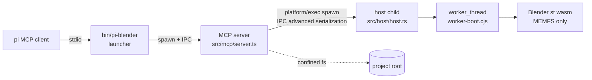

# blender-wasm — headless Blender for pi agents (WASM, no native install)

Package: `@blackbelt-technology/pi-dashboard-blender` (`packages/blender`). Change: `add-blender-wasm-mcp`.
Bin: `pi-blender`. Skill: `blender` (`packages/blender/.pi/skills/blender/SKILL.md`). MCP server name: `blender-wasm`.
Source of truth: `packages/blender/README.md`, `packages/blender/src/**/AGENTS.md`, `openspec/changes/add-blender-wasm-mcp/design.md`.

## 1. What / why

- Blender for agents. No native install. No desktop app.
- Runs upstream WASM build `@knervous/blender-web` 0.0.5, `st` (single-thread) flavour, inside Node 24.
- Needs WebAssembly JSPI. Node 24: flag `--experimental-wasm-jspi`. Node 22: JSPI absent.
- Runtime downloaded on first use. Integrity-pinned. Cached per version.
- Exposed as stdio MCP server `blender-wasm`. Files read/written only inside project root.
- Ships `pi-blender` CLI + `blender` skill (bpy modelling, GLB-first export).
- Standalone pi package. No dashboard client/server/protocol code.

Install: `pi install npm:@blackbelt-technology/pi-dashboard-blender`. Nothing downloads at install.

## 2. Process tree

- Launcher: spawns server entry with IPC. Checkout: `src/` + tsx. Install: `dist/`.
- Server: MCP framing, arg validation, confinement, input reads at dequeue, output commit, queue, timeouts, idle.
- Host: disposable. One process = one session. Never sees a workspace path.
- Worker: poses as browser `WorkerGlobalScope`. Host main thread stays responsive while agent code loops.
- Server + host exit on IPC `disconnect`. Killing any ancestor (even SIGKILL) tears down descendants.
- Why process, not in-process `close()`: `close()` keeps ~1 GB RSS. Only kill frees memory, ends wedged JSPI call, contains OOM/abort.
- Host entry: `src/host/entry.ts` (`resolveHostEntry`, `hostArgv`). V8 flags precede `--import`.
- Host main thread before session import: `self = globalThis`; `location` = `file://` URL in runtime dir; `fetch` = runtime-dir-confined resolver; `Worker` = worker_thread wrapper (heap cap 4096 MB); network ctors deleted.

## 3. IPC contract (`src/host/protocol.ts`)

Server → host `HostRequest`:

| Field | Meaning |
|-------|---------|
| `type` | `"op"` |
| `id` | number |
| `op` | `python` \| `scene` \| `import` \| `export` \| `reset` |
| `args` | per-op (`PythonArgs`, `SceneArgs`, `ImportArgs`, `ExportArgs`, `ResetArgs`) |
| `files` | staged inputs, key `/in/<root-relative path>`, `Uint8Array` |
| `blend` | `.blend` bytes for import of `.blend` (replaces scene) |
| `nonce` | random per-request secret |
| `outputLimit` | max total bytes of `/out/u/**` |

Host → server:
- `HostReady` `{type:"ready", runtimeVersion}` after boot.
- `HostResultOk` `{ok:true, result, files, output, outputTruncated}`. `files` keyed relative to `/out/u/`.
- `HostResultErr` `{ok:false, code, message, output, outputTruncated}`. Host codes: `python-error`, `import-failed`, `export-failed`, `limit-exceeded`. Others raised by server.
- `output` = last 16 KiB (`OUTPUT_TAIL_BYTES`) of printed text. Stdout + stderr one stream.

Job wrapper (`jobs.ts` `buildJobScript`), every request sends `reportGeometry:false` + fresh nonce:
1. Inputs staged at `/in/...`.
2. Prologue: remove leftover `/x`.
3. Op runs. Python code writes `/out/`. Export writes `/x/`.
4. Epilogue on success: export moves `/x/*` → `/out/u/` (name collision → `export-failed`); python moves `/out/*` → `/out/u/`. Sum sizes. Over limit → delete `/out/u`. Write `/out/.status-<nonce>.json` = `{ok | limit}`.
5. `finally`: remove `/in`, `/x`.

Host response validation (`interpretResponse`):
- Missing `report.json` or nonce status file → corrupt. Agent output mimicked `<<<BW_DONE id>>>` marker (cannot know nonce). Host kills session, exits. Call fails `session-crashed`. Never false success.
- `report.json` `error` → `python-error` / `import-failed` / `export-failed` with traceback.
- Status `limit` → `limit-exceeded`.
- Host re-sums `/out/u/**` before IPC. In-session check runs beside agent code, tamperable.
- Only `/out/u/**` returned. `report.json`, `geo/`, `session.blend`, status file never.

## 4. Sandbox facts

- Filesystem: MEMFS only. Host files unreachable from Python.
- Worker bootstrap (`worker-boot.cjs`, copied verbatim to `dist/`): deletes `process`; deletes `WebSocket`, `EventSource`, `XMLHttpRequest`, `WebSocketStream` before glue loads; `fetch` rejects; `importScripts` reads only runtime dir.
- Python `socket.connect` → `OSError` (Errno 23). With `WebSocket` present it reported success (measured) → deletion is load-bearing.
- `subprocess` → `OSError`. No `ctypes`, no `js`/`emscripten` modules.
- `os.abort()` → session fails ("Blender aborted"). Server survives → `session-crashed`.
- Marker spoof (print fake `<<<BW_DONE id>>>`) → missing nonce status → `session-crashed`.
- Agent crash/OOM kills only its host. Server survives.
- Host spawned only via `pi-dashboard-shared/platform/exec.js` `spawn`. Kill = `ChildProcess#kill("SIGKILL")`.

## 5. Provisioning (`pin.ts`, `provision.ts`, `tar.ts`)

Pin (`PIN`): name `@knervous/blender-web`, version `0.0.5`, 66057129 bytes, sha512 integrity in `src/pin.ts`, tarball `https://registry.npmjs.org/@knervous/blender-web/-/blender-web-0.0.5.tgz`.
- No registry metadata read at run time. Newer upstream never picked up silently.

Cache root:
- `BLENDER_WASM_HOME`, else `<PI_CODING_AGENT_DIR | ~/.pi/agent>/tools/blender-wasm`.
- Runtime at `<root>/<version>/`. ~175 MB each. No auto eviction.
- `BLENDER_WASM_DIR` = use already-extracted dir. Checked for required files. Never hashed, never deleted. Else `override-invalid` names first missing file. `licence` from its `package.json` `license`, else `unknown`.

Pipeline:
1. Stale `.staging-*` (> 1 h) swept. Staging `<root>/.staging-<pid>-<rand>/`.
2. Stream download. Budget 600 s total, 60 s without bytes, body ≤ pinned bytes → `download-failed`.
3. sha512 vs pin → `integrity-mismatch` (file deleted).
4. List gunzipped tar first. Allow regular files, dirs, PAX/GNU headers (`x`,`g`,`L`). Absolute path, `..`, symlink, hardlink, device/FIFO, > 500 entries → `unsafe-archive`.
5. Extract allowlist only: `dist/browser/{index.js,brotli.js}`, `dist/project/*.js` + `protocol.py`, `runtime/session-worker.js`, `runtime/st/{blender.js,blender.wasm.br,blender.data.br,manifest.json}`, `LICENSE`, `THIRD-PARTY-LICENSES.md`, `package.json`.
6. Expand both `.br` with `node:zlib`. Check against `st/manifest.json` `raw` bytes + sha256 → `runtime-manifest-mismatch`. Delete `.br`.
7. Write `runtime/manifest.json` = `{forkRevision, flavors:{st}}`, no `encoding`.
8. Write stamp `.blender-wasm.json` = `{version, integrity, files:{relpath:{bytes,sha256}}}` last. Atomic rename to `<root>/<version>/`.
- Race: in-process `singleFlight`; cross-process `commitTree` reuses valid winner; loser drops its staging.
- Cache valid = stamp matches pin + every stamped file exists with stamped size.
- Repair: after `boot-failed` on downloaded copy, re-hash every stamped file. Any mismatch → delete `<root>/<version>/`. Next call re-provisions. Override never repaired.
- Provision codes (`ProvisionErrorCode`): `integrity-mismatch`, `download-failed`, `unsafe-archive`, `runtime-manifest-mismatch`, `override-invalid`, `provision-failed`. Tool surface shows `provision-failed` + detail.

## 6. MCP tools (`src/mcp/tools.ts`)

All tools accept `timeoutSec` (1–600, default 120). Unknown tool, schema violation, non-regular import path → `invalid-arguments`.

| Tool | Args | Result |
|------|------|--------|
| `blender_python` | `code` (≤ 1 MiB), `inputs[]` (≤ 64), `outputDir` (default `blender-out`) | `outputs[]`. `/out/*` saved below `outputDir`, layout kept. Inputs at `/in/<rel path>` |
| `blender_scene` | `limit` (1–1000, default 200) | Blender + runtime version, `total`, `truncated`, objects: name, type, parent, location, rotation, scale, dimensions, material names, vertex/face counts |
| `blender_import` | `path` (`.glb .gltf .fbx .obj .stl .ply .svg .blend`, case-insens.) | imported object names. `.blend` replaces scene |
| `blender_export` | `path` (`.glb .gltf .fbx .obj .stl .ply .blend`), `selectedOnly` (not for `.blend`) | `files[]` (target + sidecars `.mtl`/`.bin`) + sizes |
| `blender_reset` | `mode` (`factory` default \| `empty`) | scene replaced |

Result encoding:
- `content[0]` = JSON text `{sessionReset, durationMs, ...result}`. Error: `{code, message, sessionReset, durationMs}` + `isError:true`.
- `content[1]` (last) = printed output, last 16 KiB. `outputTruncated` in `content[0]`. Keeps under pi ~20 KB text truncation.
- `durationMs` = leaves queue → result. Includes probe/provision/boot it triggered.

Format rules:
- `.gltf` import with non-`data:` buffer/image URI → `unsupported-format`. Use `blender_python` + `inputs`.
- `.gltf` export = `.gltf` + `.bin` (`GLTF_SEPARATE`). Prefer `.glb`.
- Multi-file assets (OBJ+MTL, glTF + buffers) → `blender_python` + `inputs`.

Error codes (`TOOL_ERROR_CODES`): `invalid-arguments`, `jspi-unavailable`, `provision-failed`, `boot-failed`, `path-outside-root`, `input-not-found`, `unsupported-format`, `limit-exceeded`, `python-error`, `import-failed`, `export-failed`, `timeout`, `session-crashed`.

MCP protocol (`server.ts`): hand-rolled newline-delimited JSON-RPC 2.0. Only protocol on stdout. Methods: `initialize` (`2024-11-05`, `2025-03-26`, `2025-06-18`; unknown → latest), `notifications/initialized`, `ping`, `tools/list`, `tools/call`, `notifications/cancelled`. Unknown method `-32601`. Bad JSON `-32700`. No `@modelcontextprotocol/sdk`.

## 7. Confinement, commit, limits (`src/mcp/workspace.ts`)

Root: server cwd or `--root`. Must exist + be directory, else stderr + exit 1. Realpath-resolved.

Path checks, in order:
1. Relative only.
2. Realpath containment, or nearest existing ancestor with no symlink in components to create → `path-outside-root`.
3. Exists → `input-not-found`.
4. Regular file for inputs/imports → `invalid-arguments`.

Limits:

| Limit | Value |
|-------|-------|
| Input files | 64 |
| Input bytes | 256 MiB (read at dequeue) |
| Code | 1 MiB |
| Output bytes | 512 MiB (checked in session, host before IPC, server before commit) |
| Queue depth | 32 → `limit-exceeded` |
| `BLENDER_WASM_MAX_INPUT_MB`, `BLENDER_WASM_MAX_OUTPUT_MB` | may only lower |

All-or-nothing commit (`commitOutputs`):
1. Normalise + confine every key first.
2. Write temp siblings.
3. Move existing targets to backups. Rename temps in.
4. Failure: remove renamed-in files, restore backups, remove created dirs.
5. Delete backups on success.

## 8. Session lifecycle (`src/host/supervisor.ts`)

- Lazy. No probe/provision/boot before first Blender tool call.
- First call: probe JSPI → provision (`provision-failed`) → spawn + boot (120 s → `boot-failed` + repair). `timeoutSec` covers op only.
- Queue: FIFO, one in flight, depth ≤ 32. Serial.
- Timeout: kill host (SIGKILL) → `timeout`. Scene lost.
- Crash mid-call: `session-crashed` + last 20 stderr lines.
- Idle: `BLENDER_WASM_IDLE_SEC` (default 600). Armed only when queue empty + nothing in flight. Host killed.
- Cancel queued call: dropped, no response. Cancel in-flight: host killed, no response.
- Server stdin end / SIGINT / SIGTERM: kill host, exit.
- IPC `disconnect`: host exits; server exits. Ancestor death cleans descendants.
- Cold first call can take minutes. Run `pi-blender ensure` first.

`sessionReset` rule:
- `true` on first result after a live session was lost (timeout, crash, cancel, idle, repair). Success or failure.
- `false` otherwise, incl. first boot ever.
- Agent reads `true` → scene gone → rebuild.

## 9. JSPI gate (`src/host/probe.ts`)

- `probeJspi` runs `host --probe` → `{jspi, node}`. No runtime, no network.
- Order: without flag → `native`; with `--experimental-wasm-jspi` → `flag`; exit 9 / `bad option` / still absent → `unavailable`.
- Probed once per process.
- `unavailable`: tool calls fail `jspi-unavailable` (names `process.version`, "Node 24 or newer"). `ensure` exits 69. Nothing downloaded.

| Node | V8 | JSPI |
|------|----|------|
| 22.x | 12.4 | absent even with flag |
| 24.15 | 13.6 | only with flag |
| 25, 26 | — | not measured; gate by feature |

## 10. CLI + registration (`src/bin/blender.ts`, `src/mcp-register.ts`)

| Command | Does | Exit |
|---------|------|------|
| `pi-blender ensure [--json]` | probe JSPI → provision → report (`version`, `source`, `dir`, `bytes`, `licence`, `jspi`) | 0; 69 JSPI unavailable / provisioning fail |
| `pi-blender status [--json]` | pin, cached?, cached versions + sizes, licence, JSPI. Never downloads | 0 |
| `pi-blender mcp [--root <dir>]` | run stdio server | 1 bad root |
| `pi-blender mcp --register [--root <dir>]` | write `<cwd>/.pi/mcp.json` entry | 0; 1 unsafe target |
| `pi-blender --help` | usage on stderr | 0 |

No args / unknown command: usage, exit 1.

Registration:
- Entry `mcpServers["blender-wasm"]` = `{command: execPath, args: [<abs launcher>, "mcp", ("--root", <abs realpath>)?]}`.
- Merge: replaces `command` + `args`. Keeps `enabled`, `env`, every other key. Other servers untouched. (Differs from craft-apps.)
- Refuses symlinked `.pi` / `mcp.json`, invalid JSON, non-object root, non-object `mcpServers`. File byte-identical, exit 1.
- Atomic temp + rename.
- Prints 4 notes. Warns without `.git`/`.pi/`. Suggests `pi-blender ensure`.
- Paths absolute → machine-specific. Do not commit.
- pi loads project MCP only after project trusted, started in project root.
- Nothing registers implicitly. `ensure`, `status`, `mcp` never touch `.pi/mcp.json`.
- pi may normalise `blender_wasm` vs `blender-wasm`. Registration touches only `blender-wasm`.

## 11. Env vars

| Var | Effect |
|-----|--------|
| `BLENDER_WASM_HOME` | cache root. Default `<PI_CODING_AGENT_DIR or ~/.pi/agent>/tools/blender-wasm` |
| `BLENDER_WASM_DIR` | use extracted runtime dir. No download |
| `BLENDER_WASM_IDLE_SEC` | idle shutdown, default 600 |
| `BLENDER_WASM_MAX_INPUT_MB` | lowers input cap (max 256 MiB) |
| `BLENDER_WASM_MAX_OUTPUT_MB` | lowers output cap (max 512 MiB) |
| `BLENDER_WASM_E2E` | `1` enables real-runtime tests |
| `PI_CODING_AGENT_DIR` | agent dir for default cache root |
| `BLENDER_WASM_GUARD_LOG` | test only. Log file for socket guard |

## 12. Tests (`packages/blender/src/__tests__/`)

- L1 (fakes): scripted fake host (`helpers/fake-host.mjs`, `fake-host-kit.ts`), `fake-supervisor.ts`, tar fixtures (`tar-fixtures.ts`). Run anywhere, any Node.
- L1-real: `real-binary.test.ts`, `real-lifecycle.test.ts`. Boot real runtime. Gate `describeReal` (`helpers/runtime.ts`): runs only with `BLENDER_WASM_E2E=1` AND JSPI not `unavailable`; else skip with reason.
- Real cache: `<os tmp>/pi-blender-wasm-test-cache` (`TEST_CACHE`). Test timeout 300 s.
- Socket guard: `helpers/socket-guard.cjs` via `NODE_OPTIONS=--require`. Wraps `net` listen/connect, `dgram.createSocket`, `WebSocket`. Logs to `BLENDER_WASM_GUARD_LOG`. Proves no listener, no outbound.
- `jspi-gate.test.ts`: Node 22 legs. Empty cache → `jspi-unavailable`, nothing downloaded.
- `packaging.test.ts`: `npm pack` list + install tarball + `pi-blender status` without tsx.
- Perf budget (real suites): warm boot ≤ 15 s, `blender_scene` ≤ 2 s, host RSS ≤ 2.5 GB.
- CI (`.github/workflows/ci.yml` job `blender-real`): Node 24 matrix ubuntu/macos/windows. `BLENDER_WASM_E2E=1`. Cache keyed by OS + pin integrity. Runs only when diff touches `packages/blender`, `packages/shared`, ci.yml, lockfile.
- Main CI Node 22: fakes + `jspi-gate` only.
- Crash trigger: `os.abort()`.

## 13. Known limits

- No render (EEVEE only, no GPU/UI). No OpenSubdiv (Subsurf silently off). No Draco, meshopt.
- No USD, Alembic, X3D. SVG import OK. Round trip OK: GLB, FBX, OBJ(+MTL), STL, PLY, `.blend`.
- No network, no subprocess from Python.
- ~1.2–1.6 GB RSS per live session. Use one server per project.
- ~175 MB cache per version (~66 MB download). Old versions manual delete: `<root>/<old version>/`.
- Boot ~1.4–1.6 s (warm cache); requests ~70 ms.
- Single-thread Blender 5.3 alpha. One session per server. No scene sharing across pi sessions.
- Upstream v0.0.x, single maintainer, `-dirty` fork revision. Mitigation: exact pin + sha512.
- Licence: runtime `GPL-3.0-or-later`. Fetched on demand into user cache. Never bundled. Package MIT.
- Concurrent bash symlink race on root: accepted (same as craft-apps).
- Electron-hosted pi records Electron binary as `process.execPath`: manual check.

See change: add-blender-wasm-mcp.
