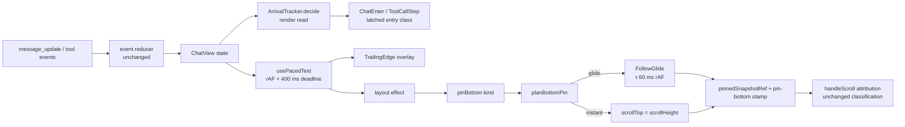

# Chat motion (fluid transcript)

See change: add-fluid-chat-motion. Design: `openspec/changes/add-fluid-chat-motion/design.md` (D1–D10).

Scope: `ChatView` live transcript only. Not `MinimalChatView`, not plugin cards, not bridge/server/reducer.

## Data flow

## 1. Preference + effective motion

- Pref: `DisplayPrefs.chatMotion: boolean`, default `true`. Shared: `packages/shared/src/display-prefs.ts` (type, 3 presets, `mergeDisplayPrefs`).
- Server: `packages/server/src/persistence/preferences-store.ts`
  - load backfill → `true` when non-boolean.
  - `setDisplayPrefs` base literal `chatMotion: true` (documented exception to all-`false` booleans).
  - partial merge `partial.chatMotion ?? base.chatMotion`.
- UI:
  - global: Settings chat-display toggle (deferred until Save). i18n `settings.chatMotion`.
  - per-session: `ChatViewMenu` View popover row, instant apply, override marker. i18n `common.chatMotion`.
- Rollback (runtime, no deploy): `PATCH /api/preferences/display {"chatMotion":false}`.
  - Per-session override `true` survives global rollback. Reset overrides to clear.
- Effective motion: `useChatMotion(prefs)` = `prefs.chatMotion && !prefers-reduced-motion && document visible`.
  - `useSyncExternalStore`; subscribes `change` on media query + `visibilitychange`.
- `ChatView` gates: `motionLive = effectiveMotion && !replayInFlight && !loadingHistory`.
- Motion off → transcript identical to pre-change. No tracker work, no rAF, no busy attr.

## 2. Entry transition (what animates)

- Mechanism: CSS transition + `@starting-style`. Class `chat-motion-enter` (200 ms, opacity 0→1, `translateY(6px)→0`).
- Latched per instance: `ChatEnter` / `useToolEntering` read decision once in `useState`. Class never re-triggers.
- Replay-aware only: entry runs only if host passes `replayInFlight`. Dashboard passes it. team-app `ChatPane` does not → no entry, no cue there.
- Eligible (new this instance, same session, live-follow):
  - pending prompt card (`data-testid="pending-prompt-card"`).
  - steering card(s) (multiset of text; removal then re-add animates again).
  - streaming answer bubble, live reasoning bubble (first appearance).
  - tool rows (`ToolCallStep`) by `toolCallId`.
  - tool group (`ToolBurstGroup`): enters only if ALL visible members new. Late member animates its own line.
- Never animates: committed user/assistant/reasoning rows, history, replay, session switch, remount, virtualizer re-mount, re-parented group, off-screen arrival (recorded, not played later), commit swap (pending → confirmed card).
- Bulk guard: commit with > `BULK_ARRIVAL_LIMIT = 4` new elements + status flips → no entry.
- Live-follow required: `following` ∧ ¬`selecting` ∧ ¬`replayInFlight` ∧ ¬`loadingHistory`.

### 2a. Seen-set + arrival clocks (`live-arrival.ts`)

- `ArrivalTracker` per `ChatView` instance (ref, not module-level).
- `decide(input)`: pure read in render. Same input → same result (StrictMode safe).
- `commit(input)`: layout effect, after commit, whether or not row mounted.
- Keyed set `seen: Set<toolCallId>`:
  - built from UNFILTERED `toolResult` messages (display filters never make ids "new").
  - re-seeded on session switch (`sessionId` change) and on motion activation.
  - motion off → set cleared; no bookkeeping cost.
- Edge state for singletons (pending prompt, tail, thinking) and steering: compared with previous commit of SAME `sessionId`.
- Completion cue `allowed` = same live-follow + non-bulk + replay-aware + motion active.

## 3. Paced reveal (`usePacedText`, `use-paced-text.ts`)

- Targets: answer tail (`state.streamingText`) always when following; live reasoning only when `reasoningInlineFlow` ∧ expanded. Capped reasoning scroller stays unpaced.
- Active: `paceFollowing = motionLive && stickToBottomRef.current`.
- Step per frame: `n = max(PACE_BASE_CPS·dt, backlog·(1−e^(−dt/PACE_TAU_MS)))` + carry.
  - `PACE_BASE_CPS = 90`, `PACE_TAU_MS = 120`, `dt` capped at 100 ms.
  - extends to next whitespace, ≤ `PACE_MAX_WORD_EXTEND = 48` chars.
- Deadline: queue of `(end, at)`. Entries ≥ `PACE_DEADLINE_MS = 400` ms old → `mustShow`; every step raises shown ≥ `mustShow`.
  - `setTimeout` at oldest deadline forces a step (throttled rAF backstop).
  - Result: every received char visible ≤ 500 ms.
- Snap to target: backlog > `PACE_SNAP_BACKLOG = 4000`, or shown not prefix of target.
- Inactive → pass-through: shown = target, queue cleared. Re-activation never hides seen text.
- Target shrink / reset (new turn) → clear + sync.
- rAF only while backlog > 0.
- Selection freeze:
  - `frozen` = `effectiveMotion ∧ isSelectingRef ∧ selection inside container`. Read synchronously inside each step.
  - Tail freeze is pre-existing; snapshot now holds revealed text (`frozenTailText`).
  - Reasoning freeze is new, motion-on only.
  - Unfreeze → deadline rule shows everything >400 ms old at once.
- In-flight backlog (≤ 400 ms) not yet rendered → not selectable. Accepted.
- Lifecycle: `message_end` / `thinking_end` unmount live element; committed row renders full text; residual ≤ 400 ms snaps.

### 3a. Render-cost gate (D4)

- Pacing raises tail renders from ~20/s to ≤ 60/s.
- Gate: ≥ 4000-char code+list answer, motion on vs off. Budget: p95 frame < 16 ms; tail script ≤ 1.5× off.
- Escalation order: (1) reveal step ≥ 33 ms; (2) parser block split (`remark-parse`, memoized top-level blocks). Still over → disable pacing + trailing edge; escalate, not decided alone.

## 4. Soft trailing edge (`TrailingEdge.tsx`)

- Overlay: absolute, `pointer-events: none`, `aria-hidden`, ≈ 2.5 em × 1 line.
- Gradient: `linear-gradient(to right, transparent, var(--bg-tertiary))`. Moved by `transform`.
- Position: last non-blank text node (`lastTextNode`), `Range` rect after each reveal commit.
- Hidden (`data-edge="hidden"`) when reveal point in:
  - `pre`, `svg`, `.katex`, `.mermaid`, `[data-mermaid-ordinal]` → `block`.
  - inline `code` → `inline-code`.
  - `direction: rtl` → `rtl`.
- Mounted only when `trailingEdgeOn = paceFollowing ∧ ¬frozen ∧ streamingText ≠ ""`.
- Fade out: opacity transition 200 ms when backlog empties.
- Markdown tree untouched: links, selection, copy, linkification unaffected.
- Existing streaming caret unchanged.

## 5. Glide follow-scroll (`follow-glide.ts`, `ChatView.pinBottom`)

- Writers:
  - `pinBottom("live")` → content/reveal layout effect. Glide only if `glideOk` (motion, same session, non-bulk, ¬replay, ¬loading, ¬splice, ¬ascend, ¬descend).
  - `pinBottom("measure")` → virtualizer `onChange` grow-pin. Re-targets in-flight glide only if guards pass ∧ remaining ≤ `clientHeight`; else cancel + instant.
- `planBottomPin(input)` pure decision:
  - live: `glideAllowed ∧ remaining ≤ clientHeight ∧ (remaining ≥ 2 px ∨ glideActive)` → glide; else instant.
  - measure: `glideActive ∧ guardsPass ∧ remaining ≤ clientHeight` → glide; else cancel + instant.
- Step math: `scrollTop += Δ·(1 − e^(−dt/GLIDE_TAU_MS))`, `GLIDE_TAU_MS = 60`, `GLIDE_SNAP_PX = 2`.
  - Δ re-read each frame from `scrollHeight − clientHeight − scrollTop`.
  - Settle ≈ τ·ln(Δ/2): ~140 ms @ 20 px, ~360 ms @ 800 px.
- Attribution: each step = ordinary bottom-pin write.
  - `beforeWrite` → `stampProgrammaticScroll(true, "pin-bottom")`.
  - `afterWrite` → `pinnedSnapshotRef = {top: achieved, height}`.
- `handleScroll` classification unchanged. Matching achieved position → clamp branch (follow held). Foreign position → falls through to position rule; fall-through also `glide.cancel()`.
- Cancel list (glide ends, no extra input binding):
  - fall-through in `handleScroll` (scrollbar drag, keyboard, find-in-page, middle-click autoscroll).
  - `cancelDescent` (`onWheel`, `onTouchMove`).
  - relocating writes: `stampProgrammaticScroll(…, "jump")`, session switch restore.
  - selection start (`isSelectingRef`).
  - `isBlocked()`: selection ∨ ¬effectiveMotion ∨ ¬`stickToBottomRef`.
  - motion → inactive: cancel + one instant pin.
  - unmount.
- Button: glide matches take clamp branch → `showScrollButton` untouched (stays hidden while following).
- Large growth / relocations stay instant.

## 6. Tool completion cue

- `useCompletionCue(status)` in `ToolCallStep`; `ToolBurstGroup` uses `isRunning ? "running" : "complete"`.
- Fires only on in-instance running→`complete` | `error` flip, with `cueAllowed`.
- `elided` never cued. Remount in done state never cued.
- Class `chat-motion-cue`: icon `opacity 0→1`, `scale(0.6)→1`, 180/220 ms transition, `@starting-style`.
- Lasts `COMPLETION_CUE_MS = 400` ms, then cleared.
- Group: replaces `tool-group-flash` for that flip.
- No height transition, no layout-property animation.

## 7. Idle / hidden guarantees + energy bound

- Transitions + `@starting-style` + rAF JS only. Never `@keyframes`.
  - `:root.fx-idle` / `.app-hidden` pause `animation-play-state` only → cannot freeze motion mid-state.
  - Static style = settled visible state.
- Zero work at rest: no rAF, no timers, no tracker writes when quiet or motion off.
- Busy marker: `data-chat-motion-busy` on `[data-testid="chat-scroll-container"]`. Present iff glide busy ∨ trailing edge revealing ∨ reasoning paced revealing.
- `ui-animation-energy` bounded exemption (MODIFIED):
  - Idle (5 s) does not stop motion while content arrives.
  - No frame later than 1 s after last arrival. Reveal done ≤ 400 ms; glide ≤ ~360 ms; transitions ≤ 300 ms.
  - Never while hidden or scroll-locked.
- Reduced motion: `@media (prefers-reduced-motion: reduce)` → `.chat-motion-enter, .chat-motion-cue { transition: none }`, plus `useChatMotion` gate.

## Pitfalls

- Do not add `arrivedAt` to reducer rows: breaks render batching + replay equivalence.
- Do not key arrival on mount time: remounts/re-parent would animate history.
- Do not move glide writes outside `pinBottom`: attribution breaks.
- Do not use `@keyframes` for chat motion: idle/hidden pauses freeze it.
- `fx-idle` mark is NOT a motion gate (it fires within 5 s of watching a stream).

## Verification

- Unit: `live-arrival`, `use-paced-text` (fake timers: deadline ≤ 500 ms, snap, freeze), `follow-glide` (`planBottomPin` matrix, step math), `TrailingEdge` hidden cases.
- E2E: scroll-lock suites green (wheel-up, scrollbar drag, keyboard, session switch, jump, scroll-to-top mid-glide).
- Perf: D4 trace gate before trailing edge + glide land.
- `data-chat-motion-busy` asserted in idle-exemption scenario.
- `scripts/i18n-parity.mjs` green for `common.chatMotion` / `settings.chatMotion`.
