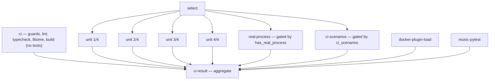
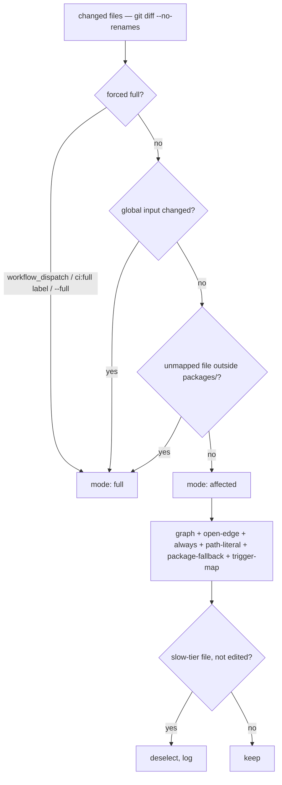

# ci.md — CI test selection

Affected-test selection in CI. Change: speed-up-ci-affected-tests.

## Overview

`.github/workflows/ci.yml`. Triggers: `push` develop, `pull_request` develop, `workflow_dispatch`. Jobs run parallel. Wall time = slowest job, not sum. Superseded PR runs cancelled (`concurrency` group per PR number).



Jobs:

- `select` — runs `scripts/select-affected-tests.mjs`. Writes `selection.json`. Outputs `mode`, `has_real_process`, `ci_scenarios`. Uploads artifact `test-selection`.
- `ci` — guards, lint, typecheck, Biome, build. No tests.
- `unit` — vitest, 4 shards. Matrix `[1, 2, 3, 4]`. `SHARD_COUNT = 4` exported from `scripts/test-selection/decide.mjs`. Matrix length must equal `SHARD_COUNT`.
- `real-process` — phase `packages/server/vitest.real-process.config.ts`. Own runner — never concurrent with unit shards. `maxWorkers` 2 + one CI retry from config.
- `ci-scenarios` — packaging scenarios, `RUN_CI_SCENARIOS=1`. Gated files only, never whole `scripts` project. `npm pack` / `npm publish --dry-run` CPU spike starves 5s-timeout tests → held out. Runs `pnpm run test:ci-scenarios <files>`. Gated files in this job: `scripts/__tests__/coverage-report.test.mjs`, `shared-heavy-files.test.mjs`, `client-isolate-gate.test.mjs` (`RUN_CI_SCENARIOS=1`).
- `docker-plugin-load` — boots image, asserts browser plugin loads (`scripts/verify-docker-plugin-load.mjs`). Required check, every PR + develop push.
- `music-pytest` — quick-tier pytest: `packages/music-production/tests` + `packages/video-production/tests/redaction`. Deep tier (essentia, beat_this, demucs, torch) self-skips.
- `ci-result` — aggregate. `needs` all above. Runs `scripts/test-selection/check-result.mjs`.

Baseline before change (runs 36753089286, 36474511507): 44–50 min wall. Serial `pnpm test` 28–33 min. `test:ci-scenarios` 11–12 min. Full suite 32.3 file-min.

## Selection layers

Decision function: `scripts/test-selection/decide.mjs`, `decide()`. Pure, no I/O. Layer order = precedence. First layer selecting a file gets recorded (`selected[file] = layer`).



### full

Full mode selects every test. Triggers:

- Forced: `workflow_dispatch` (always full). PR label `ci:full` — takes effect next push. `--full` flag.
- Global input changed:
  - `pnpm-lock.yaml`, root `package.json`
  - any `vitest.*` config — incl. `vitest.workers.ts`, `packages/server/vitest.real-process-files.ts`
  - any `tsconfig*.json`
  - every project `setupFiles` / `globalSetup` entry (collected from resolved vitest projects)
  - `scripts/select-affected-tests.mjs`
  - `scripts/test-selection/**` except `timings.json`
- Unmapped file outside `packages/` — no trigger match, not covered-elsewhere.

### affected

`affected = graph ∪ open-edge ∪ always ∪ path-literal ∪ package-fallback ∪ trigger-map − slow-tier`

- `graph` — test file changed, or reached local module changed. Graph = vitest SSR transform graph. Built over root config AND `packages/server/vitest.real-process.config.ts`. Aliases, workspace `exports → src/`, per-project plugins resolve exactly as at run time. Per-module transform tolerance: module fails transform → recorded leaf (`leafErrors`), importer keeps other edges. Example leaf: `monaco-setup.ts` (`monaco-editor` entry unresolvable). Stock `vitest --changed` aborts whole walk on first error.
- `open-edge` — test or reached module holds computed (non-literal) `import()` → any change in that module's location selects the test.
- `always` — zero local deps → runs on every diff. ~183 files.
- `path-literal` — test source holds string literal naming a top-level entry or `packages/<p>`. Leading `./` / `../` stripped. Template literal counts up to first `${`. Heuristic only ever adds.
- `package-fallback` — unreached changed file under `packages/<p>/` → selects tests under `packages/<p>/` + tests whose graph enters it. `packages/<p>/package.json` change scoped same — package fallback, not full.
- `trigger-map` — `scripts/test-selection/triggers.json`. Glob → test globs. Matches EVERY changed file — reached or not, inside or outside `packages/`. Only adds. Covers readers graph + literal layers miss: repo-wide scanners (`packages/**`, `scripts/**` → all `scripts/__tests__`), `**/*.md` → dox-byte-gate, repo-hygiene (AGENTS.md byte cap), skill-frontmatter; `biome.json`, `knip*.json`. Unreached outside-`packages/` file with a trigger hit → not unmapped.
- `slow-tier` — `scripts/test-selection/slow-tier.json`. Currently only `scripts/__tests__/async-semantics-mutation.test.mjs`. Applied LAST, over every layer. Re-included when edited. Deselection logged.

### covered-elsewhere

`scripts/test-selection/covered-elsewhere.json`. Top-level locations only (`docs`, `openspec`, `tests`, …). Changed file there → adds nothing beyond always-run + literal readers.

### Phase routing

- Packaging scenarios: test source reads `process.env.RUN_CI_SCENARIOS` → runs only in `ci-scenarios`. Flag false only for OpenSpec-only diff (`changed.every(f => f.startsWith("openspec/"))`).
- Real-process phase files → `real-process` only.
- Rest → unit shards. Greedy longest-processing-time assignment over `scripts/test-selection/timings.json`. Unknown file weighs median of known timings.

## Fail-safe rules

Selector must never let CI run fewer tests. Every failure path → `mode: full`, exit 0.

- Selector error → full.
- Push base all-zero SHA (new branch) → full.
- Base not ancestor of head (force-push) → full.
- Missing base → full.
- Enumeration failure → `enumerated: false`. Unit shards fall back to `vitest --shard=n/4`. `ci-scenarios` keeps gated-file scan (no vitest needed).
- Diff = `git diff --no-renames`. Rename reports both sides. Deletions listed — test reading old path still selected.
- Each job runs `scripts/test-selection/verify-executed.mjs`. Assigned file absent from vitest JSON report → red. Filter matching nothing never reads green.
- Empty shard skips steps. Job succeeds.
- `ci-result` red when: `select` failed, any job failed/cancelled, expected job skipped. `skipped` counts success only for conditional job the selection did not expect (empty unit matrix, no real-process files, scenarios flag off).
- No `labeled` PR trigger. Label could otherwise publish fake-green `ci-result` — no new selection computed.

## Audit

Evidence of what a run skipped:

- `select` job summary (`GITHUB_STEP_SUMMARY`): mode, reason, per-layer counts, unmapped list, leaf errors, open edges, slow-tier deselections, no-timing share.
- Artifact `test-selection`: `selection.json` — file→layer map, shard assignment, `realProcess`, `ciScenariosFiles`. 14-day retention.
- Per-job vitest JSON reports: `vitest-report-unit-<n>`, `vitest-report-real-process`, `vitest-report-ci-scenarios`. Uploaded `if: always()` — red run keeps its report.

## Nightly safety net

`.github/workflows/nightly-tests.yml`. Cron `0 3 * * *` + `workflow_dispatch`. Full sharded suite incl. slow tier + `budget` job (see Budget lane).

`report` job — `scripts/test-selection/nightly-report.mjs`:

- failing files per job
- expected jobs with no report (cancelled/infra — never counted passing)
- bisect range since last green SCHEDULED develop run. Dispatch run never anchors.

Scheduled red → open/update single `nightly-tests` issue. Green → comment + close. First attempt red → deferred to one rerun (see Nightly rerun-once).

Emits `test-timings` artifact. Refresh `scripts/test-selection/timings.json` by hand from it — not committed automatically.

Trade-off: regression missed by selection surfaces in next nightly, not on the merge.

## Budget lane (`*.budget.test.*`)

Timing / size / memory budget tests. Blocking runs must never collect them.

### Contract

- File name: `*.budget.test.*` (code ext). `isBudgetFile()` in `scripts/test-selection/decide.mjs`: `/\.budget\.test\.[cm]?[jt]sx?$/`.
- `vitest.workers.ts` exports `BUDGET_TEST_EXCLUDE` = `["**/*.budget.test.*"]`, or `[]` when `RUN_BUDGET_TESTS === "1"`.
- Six vitest configs spread it into `test.exclude`: `scripts/`, `packages/server` (×2), `packages/skill-atlas-plugin`, `packages/blender`, `packages/kb-plugin`.
- Only `npm run test:budget` sets `RUN_BUDGET_TESTS=1`. Runs `vitest run --no-file-parallelism --passWithNoTests .budget.test.` (root config).
- Lane-judging scripts never set it.

### Selector

- `decide()` drops budget files from unit shards, `real-process` and `ci-scenarios` lists.
- Budget list = filename scan of `git ls-files` (`scanBudgetFiles()`), not the vitest index. Output: `selection.json` `budgetFiles`.
- Assigned via `assigned.mjs <selection> budget`.

### Blocking check (`ci` job)

- Step: `node scripts/check-budget-lane.mjs`. Never sets `RUN_BUDGET_TESTS`.
- Fails (exit 1) when:
  - `vitest list --filesOnly` (root, and `packages/server/vitest.real-process.config.ts`) lists a budget file.
  - tracked budget file sits in no root-config project that excludes it with the budget entry.
  - static include/exclude judgement disagrees with vitest collection (matcher drift).
- `GITHUB_ACTIONS` set → each finding also `::error file=<path>::`.
- `--root <dir>` → fixture tree (tests only).

### Nightly `budget` job (`nightly-tests.yml`)

- `runs-on: ubuntu-latest`, `needs: select`, `timeout-minutes: 10` (~2× measured ~3 min; above 50 moves rerun deadline + watchdog, see Nightly rerun-once).
- Serial: `pnpm run test:budget <assigned files>`, `BLENDER_WASM_E2E=1`.
- Setup: `pnpm install --frozen-lockfile`, Playwright chromium, asserts `packages/client/dist/index.html`, blender runtime cache.
- Empty assignment still runs (`--passWithNoTests`) → always uploads `vitest-report-budget`.
- `verify-executed.mjs … budget` strict: zero-assertion or skipped assigned file → red.
- In `report` `needs` and `--expected` list.

### Warn-only assertion guard (`ci` job)

- Step: `node scripts/check-budget-assertions.mjs --warn`. Always exit 0.
- Lists upper-bound assertions on clock / memory readings still in blocking test files. Readings: `performance.now`, `Date.now`, `new Date()` arithmetic, `process.hrtime`, `process.uptime`, `process.memoryUsage`, `getHeapStatistics`, `process.resourceUsage`, `rssBytes`, `startLagMonitor`.
- Scope: git-tracked `*.test.{ts,tsx,mts,mjs,js}` minus `tests/e2e/`, `qa/`, `**/fixtures/**`, `*.budget.test.*`.
- `--warn`: `::warning file=<path>,line=<n>::` per hit. With `GITHUB_STEP_SUMMARY`: `### Budget assertions in blocking lanes: <n>` + table.
- `--list`: every hit; allow-listed ones show entry + reason. Exit 0.
- No flag: exit 1 on finding. Wired nowhere yet.
- `LIVENESS_ALLOW`: 4 real-process liveness deadlines (`cli-stop-real`, `cli-foreground-real`, `shutdown-terminates-any-strategy`, `keeper`). Entry needs reason; must match exactly one hit; else finding.
- Not detected: measurements in helpers, child processes, aliased readings, hand-thrown failures, Promise.race timeouts.
- Follow-up `migrate-budget-assertions`: moves hits, switches step to no-flag blocking mode, adds to ship-it.

### Concurrency: `nightly-tests.yml` has none

- No `concurrency` group, workflow or job level. Intentional.
- GitHub keeps one pending run per group; a queued run cancels the pending one.
- Group would let a 03:00 cron or a dispatch displace the other: night with no report, no rerun.
- Dispatch + scheduled runs may overlap: jobs on separate VMs; only `schedule` writes the issue; `test-timings` per run.

## Nightly rerun-once

Flaky-tolerant red night. Change: stabilize-blocking-test-lanes (D7).

Files:

- `.github/workflows/nightly-tests.yml` — attempts 1 and 2, `report` job.
- `.github/workflows/nightly-tests-rerun.yml` — `workflow_run` rerun.
- `.github/workflows/nightly-tests-watchdog.yml` — backstop.
- `scripts/test-selection/nightly-report.mjs` — reporter.

### Flow

1. Attempt 1 `report`: `nightly-report.mjs --defer-first-attempt`.
2. Writes `reports/attempt-1.json` = `{deferred, failingTests, failedJobs, noReport}`.
3. `deferred = true` only when all hold:
   - night is red.
   - event `schedule`.
   - `nightly-tests-rerun.yml` and `nightly-tests-watchdog.yml` both `state: active`.
   - reporter ran at or before 04:05 UTC (`DEFER_DEADLINE_UTC_MINUTE` = 245) on the run's UTC creation date.
4. Uploads artifact `nightly-attempt-1` (`attempt-1.json`, 30 days). Attempt 1 only.
5. Deferred → no issue written yet; step summary says `RED — first attempt deferred`.
6. `nightly-tests-rerun.yml` (`workflow_run`, completed `Nightly tests`):
   - runs when conclusion `failure` or `cancelled`, `run_attempt == 1`, event `schedule`, branch `develop`.
   - downloads `nightly-attempt-1`; `jq -e '.deferred == true'`.
   - `true` → `gh run rerun <id> --failed`.
   - missing or unparsable record → job red (exit 1); watchdog covers.
   - `permissions: {}` top; job `actions: write` only. No checkout, no cache.
   - runs default-branch copy of the file.
7. Attempt 2 `report`: `--previous previous` reads the record. Download `continue-on-error`.
8. Attempt 2 record missing: attempt 1 not a red scheduled run → note only. Otherwise → forced red, note `first-attempt record unavailable — passed-on-rerun not computed`.
9. Attempt 2 writes the issue: red → create/update; green → comment + close.

### Passed on rerun (flaky)

Section in issue body (red) and close comment (green). Only when a list is non-empty.

- Tests: failed on attempt 1, not failing on rerun. File-level failure (no assertion) passes when whole file no longer fails. Job must have a report on rerun.
- Jobs: not `success` on attempt 1 (failed, or no report), `success` on rerun, every related shard reported.

### Watchdog (`nightly-tests-watchdog.yml`)

- Cron `47 7 * * *` (07:47 UTC) + `workflow_dispatch` (`--dry-run`: prints only).
- Latest scheduled develop run not `success`, and no open `nightly-tests` issue names its run URL → opens/updates issue. Reason: `rerun not performed or not reported`.
- Run started more than 24 h ago → nothing.
- Run still in progress at 07:47 → reported red. Later green → its report closes issue.
- Permissions: `contents: read`, `issues: write`, `actions: read`.

### Worst-case timing

Inputs: `select` 15, `unit` 50, `real-process` 30, `ci-scenarios` 40, `budget` 10, `report` 10, `rerun` 5 (`timeout-minutes`).

- A = attempt length = `select` + longest test job + `report` = 15 + 50 + 10 = 75 min.
- C = 03:00 UTC cron.
- D = deferral deadline 04:05 UTC (245) = C + 15 + 50.
- E = worst-case rerun end = D + `report` + R + A = 245 + 10 + 5 + 75 = 05:35 UTC.
- W = watchdog 07:47 UTC = E + 2 h 12 min.
- Contract test (`nightly-tests-workflow-contract.test.ts`) asserts `D ≥ C + select + longest test job` and `W ≥ D + report + R + A + 120 min`, from parsed workflows + exported constant.
- Not measured: GitHub schedule start delay, `workflow_run` delivery, rerun job queue time.
- Attempt 1 reporter past D (UTC creation date, next day included): no defer, reports itself.
- Manual re-run: outside bound; writes issue as own report only.

### Reporter flags (`nightly-report.mjs`)

- `--reports <dir>` (required in report mode): reads `vitest-report-<job>/*.json`; writes `timings.json`.
- `--expected <k1,k2,…>` (required in report mode): jobs with no report count red.
- `--defer-first-attempt`: attempt-aware. Attempt 1 writes `attempt-1.json`; attempt ≥ 2 reads `--previous`.
- `--previous <dir>`: dir holding `attempt-1.json`.
- `--watchdog`: reads no reports; checks latest scheduled run.
- `--dry-run`: with `--watchdog`, no issue write.
- Usage error (missing `--reports`/`--expected`) → exit 1.
- Env: `NEEDS_JSON`, `GITHUB_RUN_ATTEMPT`, `GITHUB_EVENT_NAME`, `GITHUB_STEP_SUMMARY`.

## Local reproduction

```sh
node scripts/select-affected-tests.mjs --base origin/develop --merge-base --out /tmp/selection.json
```

~7 s.

## Maintaining selection data

- Outside-packages input read via dynamic path → add `triggers.json` entry.
- `scripts/__tests__/test-selection-data.test.mjs` rejects stale entries: trigger glob matching no tracked file, trigger test glob matching no test, covered-elsewhere entry non-top-level or nonexistent, slow-tier entry not an existing test file.
- Slow-tier addition needs measured duration in PR.

## Collection completeness

`packages/shared/src/__tests__/test-collection-completeness.test.ts`.

- Every test-bearing `packages/*` dir → collected by root `vitest.config.ts` `test.projects`, or listed in its `EXCLUDED` map with reason.
- `EXCLUDED`: `electron` (only `vitest.build-contract.config.ts` runs under root runner; rest depend on ambient PATH/mocks never wired up), `pi-forms-bpmn` (no package-root vitest config; tests belong to nested non-workspace project).
- Five packages (36 files) sat outside root `projects` before the change. Selector inherits blind spot — selects from projects vitest resolves.
- No per-file quarantine. Collected package red → fix files, or exclude whole package.
