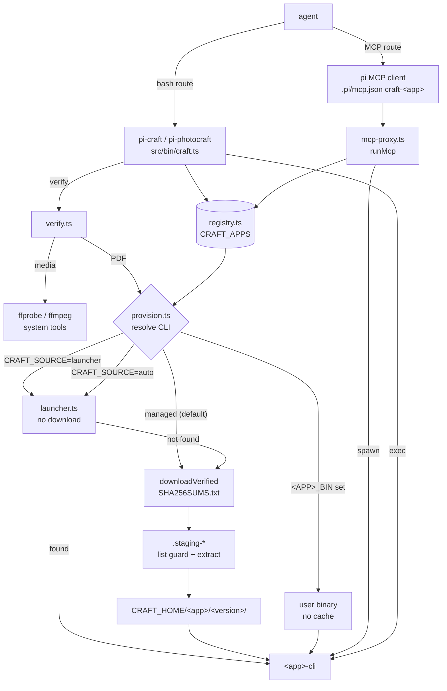

# craft-apps — ArtCraft craft apps for pi agents

Package: `@blackbelt-technology/pi-dashboard-craft-apps` (`packages/craft-apps`). Change: `add-craft-apps-core`.
Source of truth: `packages/craft-apps/README.md`, `packages/craft-apps/src/AGENTS.md`, `openspec/changes/archive/2026-10-14-add-craft-apps-core/design.md`.

## 1. What / why

- Headless CLIs for 13 ArtCraft apps: PhotoCraft, VectorCraft, FilmCraft, LightCraft, PdfCraft, EffectCraft,
  DesignCraft, FigCraft, WordCraft, SoundCraft, DeckCraft, CADCraft, GridCraft.
- `pi-craft` provisions `<app>-cli` on first use. No desktop app. Nothing installed system-wide.
- Exposes each app over bash (`pi-craft <app> exec`) and opt-in per-app stdio MCP (`pi-craft <app> mcp`).
- Verifies outputs mechanically (`pi-craft verify`).
- Ships `craft-studio` router skill + 13 app skills + 4 media workflow skills + 5 office workflow skills (23 total).
- Replaces `packages/photocraft` (`@blackbelt-technology/pi-dashboard-photocraft`). That package becomes a deprecation shim.
- Standalone pi package. No dashboard client/server code.

Install: `pi install npm:@blackbelt-technology/pi-dashboard-craft-apps`

Bins: `pi-craft` (main), `pi-photocraft` (alias + `replace-region`). Plain-JS launchers over esbuild bundles
(`dist/craft.js`, `dist/photocraft.js`). Runnable from an agent bash tool.

Deps: `@blackbelt-technology/pi-dashboard-nano-banana` (for `pi-photocraft replace-region`).
Optional system tools: `ffmpeg`, `ffprobe` (only `pi-craft verify` media checks).

## 2. Architecture



Notes:
- `PROXY` spawns `<app>-cli mcp` with confinement args (see §5).
- `verify` PDF path provisions `pdfcraft` through the same `provision()`.
- Cache hit skips `DL`. Cache key = `<app>/<version>`.

## 3. Provisioning pipeline

`provision(appOrId, deps)` in `src/provision.ts`. Steps in order:

1. `<APP>_BIN` set → use that path. Stop. Beats every source.
2. `CRAFT_SOURCE` = `managed` (default) | `launcher` | `auto`.
   - `launcher`: resolve from Craft Launcher install via `launcherBinary`. Never downloads. Fail if absent.
   - `auto`: launcher, then managed.
3. Pin: `<APP>_VERSION` (`v0.8.0` or `0.8.0`; one leading `v` stripped).
4. Latest: GitHub `storytold/<app>` latest non-prerelease. Cached 24 h in `latest.json`.
   - Lookup fails + version installed → highest installed, stderr warning.
   - Lookup fails + none installed → fail, suggest `GITHUB_TOKEN`, `<APP>_VERSION`, `<APP>_BIN`.
5. Asset candidates (per host, from registry, first existing wins):
   - CLI-only asset `<app>-cli-<v>-<host>.<ext>` preferred when release has one (macOS always; PdfCraft Linux).
   - Else portable: `<app>-<v>-linux-<arch>.tar.gz`, `<app>-<v>-freebsd-x86_64.tar.gz`, `<app>-<v>-windows-<arch>-portable.zip`.
   - Linux: enforce `glibcMin` first (2.35; SoundCraft 2.34).
   - Unsupported host → fail naming OS, arch, `<APP>_BIN`.
6. `downloadVerified`: fetch asset + `SHA256SUMS.txt`. Streamed SHA-256. Exactly one matching entry required. Mismatch → delete, nothing cached. Fail closed.
7. Listing guard (`assertSafeListing`): reject absolute paths, `..`, symlinks, hard links, special files. Before extract.
8. Extract (`ditto` / `tar`) into `.staging-*`.
9. `locateBinary`: registry-known path, else single file named `<cli>` outside `__MACOSX`.
10. chmod; delete desktop exe (`<app>` / `<app>.exe`); write asset marker.
11. Atomic rename → `<CRAFT_HOME>/<app>/<version>/`. Concurrent same-version runs → one complete install.
    Staging dirs older than 1 h removed.

Output: `ProvisionError` → exit `69`. Report JSON: `app`, `version`, `source`
(`override` | `pin` | `latest` | `latest-cached` | `fallback-installed` | `launcher`), `asset`, `cacheHit`,
`binary`, `durationMs`, macOS `gatekeeper` (advisory).

### Environment

| Variable | Effect |
|---|---|
| `<APP>_BIN` | Use this binary. Skip provisioning. Highest precedence. |
| `<APP>_VERSION` | Pin release. Per-app rollback lever. E.g. `FILMCRAFT_VERSION=0.8.0`. |
| `CRAFT_HOME` | Cache root. Default `<pi agent dir>/tools`. |
| `PI_CODING_AGENT_DIR` | Sets pi agent dir. Default `~/.pi/agent`. |
| `PHOTOCRAFT_HOME` | PhotoCraft per-app dir. Reuses old `photocraft` cache. |
| `CRAFT_SOURCE` | `managed` (default) · `launcher` · `auto`. |
| `CRAFT_LAUNCHER_HOME` | Launcher-installed apps dir. Overrides per-OS default. |
| `GITHUB_TOKEN` | Bearer for GitHub API. Avoids 60 req/h anonymous limit. |

Cache layout: `<CRAFT_HOME>/<app>/<version>/`. Identical to old `tools/photocraft/<version>`, so old installs = cache hits.

## 4. Craft Launcher probe (why `managed` is default)

Probe 0.3, Craft Launcher v0.4.1, macOS:

- Launcher is GUI-only (`ai.storyteller.artcraft-launcher`). No CLI.
- Installs desktop bundles only: downloads `<name>-<v>-macos-universal.dmg`, copies `<Name>.app` to `/Applications`.
- `.app` contains only GUI executable `Contents/MacOS/<Name>`. No `<app>-cli`.
- GUI executable opens a window for any argument (`--help` treated as file to open).

Consequences:
- macOS `launcher` finds no CLI → reports "desktop app only".
- `auto` falls back to `managed`.
- `launcher` kept for layouts that include a CLI and for `CRAFT_LAUNCHER_HOME`.
- Windows/Linux launcher roots in `launcher.ts`: best-effort, unverified.
- `pi-craft launcher install`: only command that fetches a desktop installer. Explicit. Checksum-verified against
  `storytold/craft-launcher` `SHA256SUMS.txt`. Installer assets named `artcraft-launcher-<v>-<host>.<ext>`.

## 5. MCP policy

Nothing registered implicitly. `pi-craft <app> mcp --register` writes `mcpServers["craft-<app>"]`
(PhotoCraft: `photocraft`) into `.pi/mcp.json` with absolute paths.

Proxy behaviour (`mcp-proxy.ts`):
- `tools/call` serialised: FIFO, one in flight, released on matching `id`.
- Non-JSON server stdout → stderr.
- SIGINT/SIGTERM → exit 130/143.
- `notifications/cancelled`: queued call dropped; in-flight slot released after `CANCEL_GRACE_MS`.
- Provisioning failure → exit 69, stdout untouched.
- Rejects `--bridge`, `--connect`, `--control-token`, `--automation-*-root` passed by caller.

| App | Confinement | Mechanism | MCP tools | Class | `--compact` | Bridge flag (rejected) |
|---|---|---|---:|---|---|---|
| photocraft | yes | `--automation-read-root/--automation-write-root` | 25 | small | – | `--bridge` |
| vectorcraft | yes | same | 32 | small | – | `--connect` |
| filmcraft | **no** | refuse w/o `--allow-unconfined` | 17 | small | – | `--bridge` |
| lightcraft | **no** | refuse w/o `--allow-unconfined` | 330 | large | yes | `--connect` |
| pdfcraft | yes | `--root DIR` | 163 | large | yes | – |
| effectcraft | yes | automation roots | 27 | small | – | `--bridge` |
| designcraft | **no** | refuse w/o `--allow-unconfined` | 25 | small | – | `--connect` |
| figcraft | **no** | refuse w/o `--allow-unconfined` | 18 | small | – | – |
| wordcraft | yes | automation roots | 16 | small | – | `--connect` |
| soundcraft | yes | automation roots | 17 | small | – | `--connect` |
| deckcraft | **no** | refuse w/o `--allow-unconfined` | 25 | small | – | `--connect` |
| cadcraft | **no** | refuse w/o `--allow-unconfined` | 12 | small | – | `--connect` |
| gridcraft | **no** | refuse w/o `--allow-unconfined` | 21 | small | – | `--connect` |

Rules:
- Confined: `--root` (default cwd) → both automation roots (or `--root` for PdfCraft).
- Unconfined: `mcp` and `--register` refuse without `--allow-unconfined`.
- `--allow-unconfined` persisted in registered entry. stderr warns: any path user can access.
- `large` app `--register` prints tool count; suggests bash route or `--compact` (helper tools only).
- Desktop GUI bridging out of scope.
- pi loads project MCP only for trusted project started in project root.
- Entry holds absolute paths. Do not commit for team.

## 6. `pi-craft verify`

`pi-craft verify <file> <assertion…> [--json]`. `src/verify.ts`. Requires ≥1 assertion.

| Assertion | Form | Default tol | Probe |
|---|---|---|---|
| duration | `--duration <s>[±tol]` | 0.05 s | ffprobe |
| streams | `--has-video` `--has-audio` `--no-audio` | – | ffprobe |
| size | `--size <W>x<H>` | – | ffprobe |
| fps | `--fps <n>` | ±0.01 | ffprobe |
| codec | `--codec <video\|audio>=<name>` | – | ffprobe |
| alpha | `--alpha` | – | ffprobe |
| loudness | `--loudness <LUFS>[±tol]` (integrated) | 1 LU | ffmpeg `ebur128` |
| peak | `--max-peak <dBFS>` (sample peak ≤) | – | ffmpeg `volumedetect` |
| silence | `--silent-below <dBFS>` (max volume <) | – | ffmpeg `volumedetect` |
| frame diff | `--frame-diff <t>:<ref>[@<rt>]<op><pct>` | luma Δ > 40/255 | ffmpeg (frame decode) |
| pages | `--pages <n>` (PDF) | – | pdfcraft (provisioned) |
| text | `--text-contains <s>` (PDF) | – | pdfcraft (provisioned) |

- `<op>` `>`: content must differ (overlay present). `<`: must match.
- Still images ignore `t`.
- `--json`: one JSON object.
- Probe tool missing → exit 3, report names tool.

Exit codes:

| Code | Meaning |
|---|---|
| `0` | all assertions pass |
| `1` | ≥1 fail, or file missing/unreadable |
| `2` | usage error (unknown assertion, bad value, none given) |
| `3` | probe tool missing (`ffprobe`, `ffmpeg`, `pdfcraft`) |

Other exit codes (`pi-craft`): `69` provisioning failure; `exec` returns binary's own exit code.

```bash
pi-craft verify final.mp4 --duration 5±0.1 --has-video --has-audio --size 1920x1080
pi-craft verify title.mov --alpha --frame-diff 3:plain.mp4\>0.5
pi-craft verify mix.wav --loudness -16±1 --max-peak -1
pi-craft verify report.pdf --pages 12 --text-contains "Quarterly"
```

### `pi-craft doc prepare`

`pi-craft doc prepare <in.md> --out <dir> [--template <name>] [--templates-dir <dir>] [--var k=v]... [--allow-path <dir>]... [--allow-missing] [--json]`. Source `src/doc-prepare.ts`.

| Code | Meaning |
|---|---|
| `0` | ok |
| `1` | failed, or unresolved placeholders without `--allow-missing`. Bare `pi-craft doc` or unknown sub → `1`. |
| `2` | usage error (bad `doc prepare` args) |

- Writes `template.filled.docx`, `body.md`, `prepare.json` into `--out`. Overwrites only those 3. Atomic temp + rename.
- Frontmatter engine keys: `template`, `templates_dir`, `language`, `document_title`, `document_name`, `enable_toc`, `toc_heading`, `nano_banana`.
- Other scalars → variables. Structured non-engine keys → `ignored`.
- Templates dir chain (first hit wins): `--templates-dir` > frontmatter `templates_dir` (realpath-confined to md dir or `--allow-path`) > `$PI_DOC_TEMPLATES_DIR` > `./templates` > `~/Documents/templates`.
- Template name: `^[A-Za-z0-9_-]+$`.
- Variable precedence, low → high: template `variables.xml` default < system < frontmatter < `--var`.
- System vars: `$date` (en/hu/de/fr like doc-engine), `$fileName`, `$year`, `$month`, `$day`.
- Report: source per var + `defaulted` list.
- Fill: in-memory fflate unzip. `w:t` text only. `document.xml` incl. textboxes + all header/footer parts.
- Split runs merged within one paragraph.
- `{{ name }}` always. `<name>` only for manifest `syntax="both"` names.
- Values XML-escaped. Untouched parts byte-identical. `logo:*` and `$toc` ignored.
- Variable values substituted after image/diagram pass (cannot smuggle syntax).
- Images → data URIs (realpath-confined; png/jpg/gif/webp/bmp ≤ 20 MB).
- Template owns images → `CRAFTIMG<NNNN>` markers + `images/` files + `prepare.json.pictures`. WordCraft 0.7.0 maps imported images onto template `rId1`.
- Mermaid → PNG via host `mmdc` (argv, no shell; `PUPPETEER_EXECUTABLE_PATH` if no Chromium).
- `nano_banana.enabled` → `pi-nano-banana "Diagram:\n<src>\n\n<style>" --output <png>` (paid). Cache `.mermaid-cache/<md5(style name+prompt+source)>.png`. `mmdc` fallback.
- No `mmdc` → block stays code + `mermaid.unrendered`.
- PlantUML stays code + `warnings` entry.
- Deps `yaml` + `fflate` bundled into `dist/craft.js` (esbuild banner `createRequire` for CJS yaml).
- Report keys: `defaulted`, `unresolved`, `mermaid.unrendered`, `images.skipped`, `images.remote`, `warnings`, `pictures`.

## 7. Skills

- `craft-studio`: router. App table, hand-off formats, loop, MCP vs bash, confinement policy.
- 13 app skills: `photocraft`, `vectorcraft`, `filmcraft`, `lightcraft`, `pdfcraft`, `effectcraft`,
  `designcraft`, `figcraft`, `wordcraft`, `soundcraft`, `deckcraft`, `cadcraft`, `gridcraft`.
- 4 media workflow skills (`packages/craft-apps/.pi/skills/<name>/SKILL.md`):
  - `craft-video-post`: footage → redaction → alpha overlay → FilmCraft assembly → captions → SoundCraft mix → mp4.
  - `craft-beat-cut`: music-analysis → music-edit-to-length → beat-sync-video hits → FilmCraft downbeat cuts + scale-keyframe punches → mp4.
  - `craft-podcast-master`: transcribe → speaker-id → per-speaker stems → SoundCraft mix → ffmpeg two-pass loudnorm master → chapters sidecar → mp4 mux.
  - `craft-motion-titles`: names from SRT → EffectCraft `templates.create` lower-third alpha renders → FilmCraft V2 overlay.
- Office workflow skills (5):
  - `craft-brand-kit`: logo → VectorCraft trace/variants → PhotoCraft png/tif set → DesignCraft brand sheet → PdfCraft package.
  - `craft-doc-publish`: Markdown → `pi-craft doc prepare` → WordCraft render (TOC, pictures) → pdf → optional PdfCraft package/protect.
  - `craft-deck`: outline → DeckCraft slides → transition previews → PdfCraft handout. `deck3d` HTML deck = separate branch, never converted.
  - `craft-photo-pipeline`: LightCraft develop + denoise → PhotoCraft retouch → webp/tif/jpg export set.
  - `craft-data-visual`: GridCraft workbook + read-back → chart → VectorCraft badge + DesignCraft infographic → DeckCraft slide.
- Location: `packages/craft-apps/.pi/skills/<name>/SKILL.md`. Declared under `pi.skills`. 23 total: router + 13 app + 4 media + 5 office.
- `craft-studio` workflow table lists all 9.
- Split: `craft-doc-publish` = default Markdown → templated DOCX/PDF. `document-converter` = ingest/OCR, round-trip, PlantUML, table profiles; fallback renderer.
- Split: `craft-deck` = DeckCraft. `deck3d` = HTML/3D web deck.
- Per app skill: dialect, document/project model, persistence flags, discovery commands, traps, 2–4 recipes.
- Discovery-first. Never guess command ids. Ids churn between alpha releases.
- Loop: plan → discover (`commands` / `describe` / `tools`) → execute → save → `pi-craft verify`.

### Recipe convention

- Recipe = fence tagged `` ```bash recipe: <id> ``.
- Must end with `pi-craft verify <output> …`.
- Tests run recipe under `bash -e` in fresh tmp dir, `pi-craft` on PATH.
- Recipe passes only if every line exits 0.

```bash recipe: tone-roundtrip
ffmpeg -v error -y -f lavfi -i sine=frequency=440:duration=3 tone.wav
pi-craft soundcraft exec commands --filter gain | head -3
pi-craft verify mix.wav --duration 3±0.1 --max-peak -20
```

(Abridged. Real recipe in `craft-studio/SKILL.md`.)

### Workflow skills

Multi-app pipelines. One tool call per step. Each step output = file contract for next step.

`craft-video-post`:

| # | Tool | Input → Output | Gate |
|---|---|---|---|
| 0 | agent | request → `job.json` | `check: job` |
| 1 | `veo-generator` / `footage-redaction` / user files | clips → `01-footage/*.mp4` | `pi-craft verify` per clip |
| 2 | EffectCraft / `hyperframes-showreel` (optional) | text/data → `02-graphics/*.mov` (ProRes 4444 alpha) | `pi-craft verify --alpha` |
| 3 | FilmCraft | clips + overlays → `03-assembly/cut.mp4`, `ref.mp4` | `pi-craft verify --frame-diff` |
| 4 | `video-transcription` | recording → `04-captions/cues.srt` | `check: srt` |
| 5 | SoundCraft | footage audio + music → `05-mix/mix.wav` (PCM 24-bit 48 kHz) | `pi-craft verify --codec audio=pcm_s24le` |
| 6 | FilmCraft | project + mix + srt → `06-delivery/final.mp4` | `pi-craft verify` h264 + aac |

`craft-beat-cut`:

| # | Tool | Input → Output | Gate |
|---|---|---|---|
| 0 | agent | request → `job.json` | `check: job` |
| 1 | `music-analysis` | track → `01-music/track_map.json` | `check: map` |
| 2 | `music-edit-to-length` | map → `02-music/edit.wav`, `edit_edit.json` | `pi-craft verify` + `check: edit` |
| 3 | `beat-sync-video` | edit → `03-hits/hits.json` (`music-hits/1`) | `check: hits` |
| 4 | SoundCraft | `edit.wav` → `04-audio/music.wav` (PCM 24-bit 48 kHz) | `pi-craft verify --codec audio=pcm_s24le` |
| 5 | FilmCraft | footage + grid + hits → `05-cut/p.fcproj`, `rough.mp4` | `pi-craft verify` duration |
| 6 | FilmCraft | project + music → `06-delivery/final.mp4` | `pi-craft verify` h264 + aac + `--frame-diff` |

`craft-podcast-master`:

| # | Tool | Input → Output | Gate |
|---|---|---|---|
| 0 | agent | request → `job.json` | `check: job` |
| 1 | `video-transcription` | recording → `01-transcript/rec.srt` | `check: srt` |
| 2 | `speaker-id` | srt → `02-speakers/rec.named.srt` (`[Name] text`) | `check: named` |
| 3 | ffmpeg | recording + named srt → `03-stems/<speaker>.wav` | `pi-craft verify` per stem |
| 4 | SoundCraft | stems → `04-mix/mix.wav` (PCM 24-bit 48 kHz) | `pi-craft verify --codec audio=pcm_s24le` |
| 5 | ffmpeg `loudnorm` | mix → `05-master/master.wav` | `pi-craft verify --loudness` |
| 6 | agent (optional) | named srt → `06-chapters/chapters.txt` | `check: chapters` |
| 7 | FilmCraft (video) / wav | master (+ picture) → `07-delivery/final.mp4` | `pi-craft verify` h264 + aac |

`craft-motion-titles`:

| # | Tool | Input → Output | Gate |
|---|---|---|---|
| 0 | agent | request → `job.json` | `check: job` |
| 1 | `speaker-id` / `video-transcription` / user | named srt → `01-names/names.json` | `check: names` |
| 2 | EffectCraft | `templates.list` → `02-template/choice.json` | `check: template` |
| 3 | EffectCraft | name + template → `03-titles/<name>.mov` (ProRes 4444 alpha) | `pi-craft verify --alpha` + `check: alpha` |
| 4 | FilmCraft | footage + titles → `04-overlay/final.mp4` | `pi-craft verify` h264 + aac + `--frame-diff` |

Office workflows (W5–W9):

`craft-brand-kit`:

| # | Tool | Input → Output | Gate |
|---|---|---|---|
| 0 | agent | request → `job.json` | `check: job` |
| 1 | VectorCraft | `logo.svg` as-is; raster → `01-logo/logo.svg` (`imageTrace.makeAndExpand`, preset `Flat Logo`, `ignoreWhite`) | png preview → `pi-craft verify --size --alpha` |
| 2 | VectorCraft | `logo.svg` → `02-variants/logo-black.svg`, `logo-white.svg` | png preview → `pi-craft verify --size` |
| 3 | PhotoCraft | `logo.svg` → `03-raster/logo-<w>.png`, `logo-print.tif` | `pi-craft verify --size --alpha` (png only) |
| 4 | DesignCraft | logo + name → `04-sheet/sheet.pdf` (`script`, `file.place`) | `pi-craft verify --pages --text-contains` |
| 5 | PdfCraft | sheet → `05-package/brand-kit.pdf` | `pi-craft verify --pages --text-contains` |

- svg never passed to `pi-craft verify`. Gated via png preview.
- `anti-slop-brandkit`: only on explicit user request + approval. Derived assets labelled "concept".
- Recipe `brand-kit-core`.

`craft-doc-publish`:

| # | Tool | Input → Output | Gate |
|---|---|---|---|
| 0 | agent | request → `job.json` | `check: job` |
| 1 | `pi-craft doc prepare` | `report.md` + template → `01-prepare/` (`template.filled.docx`, `body.md`, `prepare.json`) | `check: prepare` (+ user confirms defaults) |
| 2 | WordCraft | filled template + body → `02-render/out.docx`, `out.pdf` | `pi-craft verify --pages --text-contains` |
| 3 | PdfCraft | pdf → `03-package/final.pdf` (optional) | `pi-craft verify` (before protecting) |

- Use `run --file`. Never `--template`: drops header/footer parts.
- Render order: `references.toc`, then `caret.docEnd` (TOC leaves caret above itself), then page break + body.
- Pictures: per `CRAFTIMG` marker → `edit.find` + `insert.picture` + `edit.replaceAll`. Only when `prepare.json` has `pictures`.
- Protect: password via 0600 temp script file. Never in `job.json`. Protected pdf cannot be probed by `verify`.
- `document-converter` = fallback renderer.
- Recipes `doc-publish-core`, `doc-publish-protect`.

`craft-deck`:

| # | Tool | Input → Output | Gate |
|---|---|---|---|
| 0 | agent | request → `job.json` | `check: job` |
| 1 | agent | request → `01-outline/outline.md` | `check: outline` |
| 2 | DeckCraft | outline → `02-deck/deck.pptx`, `deck.pdf` (`file.new {"blank":true}`, `slide.new`, `insert.picture`, `transition.set`) | `pi-craft verify --pages --text-contains` |
| 3 | DeckCraft | deck → `03-transitions/t1.png` (`render-transition` previews, optional) | `pi-craft verify --size` |
| 4 | PdfCraft | deck pdf → `04-handout/handout.pdf` | `pi-craft verify --pages --text-contains` |

- `deck3d` HTML deck = alternative branch. Never converted from DeckCraft output.
- Recipe `deck-core`.

`craft-photo-pipeline`:

| # | Tool | Input → Output | Gate |
|---|---|---|---|
| 0 | agent | request → `job.json` | `check: job` |
| 1 | LightCraft | RAW → `01-develop/dev.png` (`render` develop; `detail.nrLuminance`, `detail.nrColor`) | `pi-craft verify --size` |
| 2 | PhotoCraft | `dev.png` → `02-retouch/retouched.png` (`edit.contentAwareFill`; optional) | `pi-craft verify --size --frame-diff` |
| 3 | PhotoCraft | master → `03-export/photo-<w>.webp`, `photo-print.tif`, `photo.jpg` | `pi-craft verify --size` |

- AI denoise: opt-in. Needs user model + explicit licence ack.
- `replace-region`: only with image credentials.
- Recipe `photo-pipeline-core` (synthetic DNG from `synth-merge`).

`craft-data-visual`:

| # | Tool | Input → Output | Gate |
|---|---|---|---|
| 0 | agent | request → `job.json` | `check: job` |
| 1 | GridCraft | data → `01-data/data.xlsx` | `check: readback` |
| 2 | GridCraft + PdfCraft + PhotoCraft | workbook → `02-chart/chart.pdf`, `chart.png` | `pi-craft verify --pages --text-contains`, `--size` |
| 3 | VectorCraft + DesignCraft | chart → `03-infographic/infographic.pdf` (badge: VectorCraft) | `pi-craft verify --pages --text-contains`, `--size` |
| 4 | DeckCraft | infographic → `04-slide/slide.pptx`, `slide.pdf` | `pi-craft verify --pages --text-contains` |

- `check: readback`: `gridcraft-cli cat --range`. GridCraft prints formula errors with exit 0. Fails on `#NAME?` `#DIV/0!` `#REF!` `#VALUE!` `#N/A` `#NUM!` `#NULL!`.
- Chart image: `pdfcraft render` + PhotoCraft `image.trim`. Chart anchored at A1. GridCraft has no chart image command.
- Recipe `data-visual-core`.

Gates:

- Every media step: `pi-craft verify <file> <assertions>`.
- Office steps: `check: readback` / `check: prepare` for text/data; `pi-craft verify` for outputs; svg via png preview.
- Office recipes need PdfCraft, WordCraft, VectorCraft, PhotoCraft, DesignCraft, DeckCraft, GridCraft, LightCraft + `ffmpeg` + `jq`.
- Text artefacts (srt, json, txt): labelled runnable snippets, `` ```bash check: <label> ``.
- Failed gate → `describe` re-discovery → retry. Max 2 retries, then stop.

Step 0 (soft refs):

- Sibling skill in loaded skill list.
- CLI on PATH: `pi-transcribe`, `pi-voiceid`, `pi-veo`.
- Runtime probe: music venv `.venv-music/bin/python`; `npx hyperframes --version`.
- Missing → fallback per skill table. Never invent data (e.g. hit times).

Resume (owned by `craft-studio` § "Craft jobs"):

- Layout: `craft-jobs/<slug>/NN-<step>/`.
- `job.json`: steps (`status`, inputs `path`/`size`/`mtime`, `upstream`, verify report).
- Resume at first step without passing report or with changed inputs. Re-run all downstream.
- Slug: lower-case; chars outside `[a-z0-9-]` → `-`.

Hand-off formats:

- wav: PCM 24-bit 48 kHz (`soundcraft convert --bit-depth 24 --rate 48000`).
- mov: ProRes 4444 alpha.
- srt.
- json: `music-hits/1`.
- mp4: h264 + aac.
- Chapters: sidecar text only. SoundCraft markers not written to wav.

Probed facts (FilmCraft 0.8.0, SoundCraft 0.7.0, EffectCraft 0.10.0, HyperFrames 0.8.168):

- Burned captions: `captions.import`, then `export --settings '{"burnCaptions":true}'`. Plain export draws none.
- Overlay: needs `timeline.setTargeting {"track":"V2","sourcePatch":true,"targeted":true}`. Else `source.overwrite` replaces V1 footage.
- SoundCraft: no LUFS target. Use ffmpeg two-pass `loudnorm` (`linear=true`), then `pi-craft verify --loudness`.
- Alpha mov: `npx hyperframes render . --format mov` → ProRes 4444 alpha.
- EffectCraft template projects carry opaque solid "Preview Background (delete over footage)". Delete via `project.delete`, or overlay opaque. `verify --alpha` passes anyway → corner-pixel check (`check: alpha`) required.
- Punch-in: FilmCraft `effects.setParam`, effect `motion`, param `scale`, `keyframe:true`.
- Hits → cuts via jq. No helper script.
- `mix` bash trap: write `${VAR}±0.1`, not `$VAR±0.1`.

Probed facts (office, 2026-10): VectorCraft 0.12.0, GridCraft 0.7.0, DeckCraft 0.7.0, LightCraft 0.8.0, WordCraft 0.7.0, PdfCraft 0.8.0. Fixture pin for VectorCraft still 0.11.0.
- `doc_protect` args: `open_password`, `permissions_password`.
- `pdfcraft-cli run --script` cannot read `/dev/fd`. Use 0600 temp file.

### Tests

| Test file | Mode | Checks |
|---|---|---|
| `skills.test.ts` | default | skill lint: 14 router/app skills + 9 workflow skills (workflow lint, executed `check:` snippets; office lint E28-E37 runs `check: readback` / `check: prepare`), frontmatter `name` = dir, required headings, recipe checks, offline drift vs `src/__tests__/fixtures/commands/<app>.json` |
| `doc-prepare.test.ts` | default | `pi-craft doc prepare`: E1-E24, picture markers, size cap. Fixtures: `src/__tests__/helpers/docx.ts` |
| `packaging.test.ts` | default | 23 skills declared under `pi.skills` |
| `skills-drift.test.ts` | `CRAFT_E2E=1` (nightly) | quoted command ids vs live provisioned binary list; workflow skills vs union of live lists of driven apps |
| `skills-recipes.test.ts` | `CRAFT_E2E=1` | run every `recipe:` fence under `bash -e`; `CRAFT_RECIPE_APPS=a,b` subset; workflow recipes need `CRAFT_WORKFLOW_E2E=1` (+ `ffmpeg`, `jq`; office recipes + the office apps above) |
| `real-apps.test.ts` | `CRAFT_E2E=1` | genuine release binaries: provision + spawn per app. `CRAFT_WORKFLOW_E2E=1` adds real office publish (X1/X2) |
| `real-binary.test.ts` | `PHOTOCRAFT_E2E=1` + `PHOTOCRAFT_BIN` | `replace-region` (no Gemini call) |

Commands:

```bash
npx vitest run packages/craft-apps                       # offline: unit, packaging, skill lint, fixture drift
CRAFT_E2E=1 CRAFT_HOME=/tmp/craft-home npx vitest run packages/craft-apps/src/__tests__/{real-apps,skills-recipes,skills-drift}.test.ts
CRAFT_E2E=1 CRAFT_WORKFLOW_E2E=1 CRAFT_HOME=/tmp/craft-home npx vitest run packages/craft-apps/src/__tests__/skills-recipes.test.ts   # workflow recipes (needs ffmpeg, jq)
CRAFT_HOME=/tmp/craft-home node --import tsx scripts/record-fixtures.mjs   # re-record fixtures
node scripts/build.mjs                                   # dist/craft.js + dist/photocraft.js (also on prepack)
```

Re-record fixtures after upstream version bump. Fixture = version, command ids, MCP tool names.
Fixture pins (probe time): photocraft 0.9.0, vectorcraft 0.11.0, filmcraft 0.8.0, lightcraft 0.8.0, pdfcraft 0.8.0,
effectcraft 0.10.0, designcraft 0.8.0, figcraft 0.6.0, wordcraft 0.7.0, soundcraft 0.7.0, deckcraft 0.7.0,
cadcraft 0.7.0, gridcraft 0.7.0.

Dialect quirks (drive `record-fixtures`):
- `commands` prints JSON by default: DesignCraft, DeckCraft, CADCraft (their `--json` wrong/empty).
- SoundCraft: text output.
- Others: `commands --json`.
- PdfCraft: `tools`.

## 8. Compatibility and rollback

Migration (design D7, Migration Plan):
- Final `@blackbelt-technology/pi-dashboard-photocraft` release: depends on `craft-apps`.
- Keeps `bin/pi-photocraft` at same path. Existing absolute paths in `.pi/mcp.json` stay valid. Forwards to craft-apps alias.
- `npm deprecate` on old package → message points to `craft-apps`.
- Manifest entry swaps to `craft-apps`.

Compatibility:
- PhotoCraft behaviour preserved. Entry name `photocraft` kept.
- `PHOTOCRAFT_HOME` honoured. Old cache reused, no re-download.
- `pi-photocraft` keeps `replace-region`.
- Caches shared and compatible across old and new package.

Rollback:
- Un-deprecate photocraft package.
- Revert manifest entry.
- Caches need no cleanup.
- Per-app pin: `<APP>_VERSION=<known-good>` to roll one app back.
- Offline pin: `<APP>_BIN=/path/to/cli`.

## 9. Known gaps

- Windows: run-time unverified. Layout only (probe 0.2, range-read of zip central directories). Manual VM test pending.
- Windows/Linux launcher roots in `launcher.ts`: unverified.
- riscv64, freebsd: assets listed, binaries not executed.
- O3 open: the 7 unconfined MCP servers may have undocumented confinement. Needs upstream question. Registry flags flip when upstream adds it.
- Integrity only, not authenticity: `SHA256SUMS.txt` comes from same origin as asset. Detects corruption and CDN tampering. Not compromised upstream release or downgrade.
  High-assurance: build/vet `<app>-cli`, set `<APP>_BIN`.
- Gatekeeper result advisory only (macOS `spctl`).
- 13 third-party executables run with user privileges.
- Alpha CLIs churn command ids. Mitigation: discovery-first skills, drift check, `<APP>_VERSION` pins.
- Disk: ≈0.8 GB all apps on macOS. On-demand per app. `pi-craft status` shows sizes.

Resolved probes: O1 (launcher installs desktop only), O2 (glibc floor 2.35; SoundCraft 2.34).
