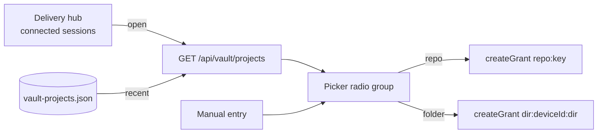
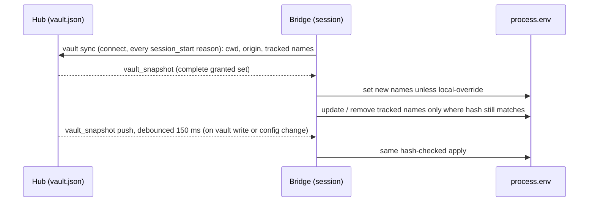

# Credential vault

Part 1 of 3. Static `key` accounts, env delivery to sessions. LLM creds/OAuth (change 2) and service secrets (change 3) ship separately.

See change: add-credential-vault. See change: retro-ux-credential-vault (§2, §10).

## 1. What it is

- Hub-owned store: `~/.pi/dashboard/vault.json`. Mode `0600` (POSIX). Atomic, locked (`locked-json-file`, `createIfMissing: false`).
- Entries: accounts, kind `key`. Several per provider allowed.
- Min value length: 8 chars. Enforced on entry and import.
- Env bindings: name → default `key` account. Names validated (see §3, deny list).
- Per-project grants: default deny. Grant picks binding + optional account override.
- Checkout confirmation per (device, dir, repoKey).
- Unknown fields and unknown kinds preserved on write (downgrade-safe).
- Corrupt file: byte-exact backup kept, all writes refused. Error shows backup path only, never `JSON.parse` text.

## 2. Settings → Vault page

Path: Settings → Network group → Vault (`SettingsPanel` page `vault`, `VaultSection`).

### Tabs

- APG tablist: `Variables`, `Accounts`, `Import`. Automatic activation. Arrow keys. `aria-controls`.
- Default tab: Variables. Active tab = component state. Not in URL.
- All three tabpanels stay mounted. Inactive → `hidden`.
- Panel testids: `vault-panel-bindings`, `vault-panel-accounts`, `vault-panel-import`.
- Loading: skeleton, `aria-busy`.
- First run (no accounts, no bindings): three-step guide replaces tab content. Primary: Import when candidates exist, else `Add a key`.
- Corrupt: error callout, backup path only. Write controls `disabled`, not hidden.

### Variables tab

- One `VaultVariableCard` per env binding. Wrapper `vault-bindings-list`. Card `vault-binding-<NAME>`.
- Default-account select. Change shows impact before save: `Used by N projects that don't pick their own account`.
- Grant rows `vault-grant-row`: `data-state` = server state (`ok` | `no-account`). `data-status` = page status (table below).
- Row subjects: repository key; folder (device, path); other (`service:<id>`): `Not delivered to sessions` pill, no delivery status.
- Revoked override → `no-account`. Never falls back to binding default.
- `Grant to a project` → picker (below).
- Plugin declarations of this name: checkbox switch `vault-plugin-approve`, row `vault-plugin-<pluginId>-<NAME>`.
- Declaration with no binding: request row above cards, `Create <NAME>` action.
- Confirmed checkouts: `
`, collapsed, under their repo grant. Confirmations with no matching grant: `Other confirmed checkouts` at tab end. Revoke in both.

Page status (`data-status`):

| Status | Pill | Meaning |
|---|---|---|
| `delivering` | success | grant `ok`, account resolved; folder grant, or repo grant with ≥1 confirmed checkout |
| `pending` | warning | repo grant, no confirmed checkout |
| `no-default` | warning | no override, binding has no default |
| `no-account` | error | override account missing |

### Destructive actions (two-step)

- `Delete variable`, `Revoke account`: re-fetch overview first. Then inline `role="alertdialog"` (`vault-confirm-impact`) built from fresh data.
- Delete variable impact: projects whose grants are removed; plugin approvals removed; connected sessions lose it within seconds; running processes keep old value.
- Revoke account impact: bindings losing default; grants whose override → `no-account` (no fallback); plugin approvals reading that default (read nothing); running-process note.
- Re-fetch fails: error shown, confirm disabled. Cancel and Retry remain.
- Confirm = danger button. Cancel takes focus. Esc cancels, focus returns to trigger.
- `Rotate`: running-process note inline. No dialog.
- Impact list is preview. Server applies state as it stands at confirm.
- Timing: hub pushes within 150 ms of store change (`credential-delivery` 5 s budget).

### Accounts tab

- Groups: keys first. `Sign-in accounts` (oauth) and `Services` (`service:*`) only when present. Other kinds: count line (`vault-accounts-other`).
- Add, rotate, revoke. Value never shown after save.
- Client checks before call: reserved or invalid name; value < 8 chars. Inline `aria-invalid` + `aria-describedby`. Server errors render in originating form.
- Add key proposes `<PROVIDER>_API_KEY` (provider upper-cased, each char outside `[A-Z0-9]` → `_`). Offered only when valid and not reserved (`isDeliverableEnvName`).
  - No binding of that name → `Create the variable X` (checked by default) → `createBinding`.
  - Binding exists → `Make it the default of X` (unchecked). Offered only when current default missing or same provider → `setBindingDefault`.
- Partial failure: account kept. `Key saved; the variable wasn't created: <reason>` + Retry. Retry finding binding already defaulting to this account = success.

### Import tab

- Known locations: fixed server-side list. Existence check only. Opaque ids; client never sends path.
- Upload: ≤ 64 KiB.
- Proposal: names only. Values never returned.
- Values < 8 chars skipped with notice.
- Each name confirmed (`import/confirm`). Names passing `isDeliverableEnvName` may get a binding. Others listed with reason.
- Done callout: created variables and failures. Sources never modified.

### Project picker

- Radio group. Options hold no interactive content. Search: name, repo key, path.
- `open`: connected sessions grouped by `(deviceId, dir)`. Untrusted or `transport-insecure` sessions: `blocked: <outcome>`, listed by cwd, never grantable, no repo key shown.
- `recent`: remembered projects, minus keys in `open`, newest first.
- Disabled options: already granted to this binding (subject match); blocked. Reason shown.
- Repo choice: note that delivery waits for checkout confirmation.
- `Not listed?` → manual repo or folder entry. Repo normalised by `normalizeOrigin` (`packages/shared/src/vault-project-key.ts`) before compare and grant.
- Already-granted subject: picker says so, sends no second grant (upsert without account would drop override).
- Older server (2xx HTML, or `404` `not_found`): lists hidden, manual entry opens.

Remembered projects file `~/.pi/dashboard/vault-projects.json`:

- Mode `0600`. Written through `locked-json-file`. Reads never create it. First valid record creates it.
- Entry `{ deviceId, dir, repoKey?, lastSeenAt }`. No values, no binding names.
- Bounds: 200 total; 100 per `deviceId`; 90 days (enforced on write and read). Least recently seen evicted first.
- Caps: `dir` 4096 chars, `repoKey` 512 chars. Longer → not recorded.
- Recorded from `deliver()` for trusted sessions. Fire-and-forget; never blocks delivery.
- Write throttle: in-memory map, ≤ 1 write per key per hour. Restart empties map.
- Corrupt: byte copy kept (`readJsonChecked`). `list()` returns empty. Next record replaces file.
- No per-entry delete. Deleting the file clears the list.
- Trade-off: list names projects never granted. A trusted session can plant an entry. Repo grant still needs checkout confirmation.

### Session dialog grant (chip)

- `GET /api/session/:id/vault-bindings` adds `ungranted: string[]` for manage callers only. `[]` when session has no resolved project (untrusted, `transport-insecure`, `no-project`, corrupt vault).
- Chip renders when bindings or ungranted names exist.
- Section `vault-ungranted`, rows `vault-ungranted-row`, Grant button `vault-grant-from-session`.
- Grant subject: `repo:<repoKey>` when session has repo key, else `dir:<deviceId>:<dir>`.
- Project line `vault-project-line`: resolved project, else outcome reason.
- Repo grant → `pending-confirmation` on next poll (≤ 2.5 s). Confirm callout appears in same dialog.
- Confirm callout: repo key, dir, device. Says any clone can claim an origin. Button `vault-confirm`: `Confirm and deliver N keys`. Applies to every session in checkout.
- Chip shows `Vault: confirm` (clock icon, `data-pending="true"`) while pending.

Chip states:

| State | Pill |
|---|---|
| `delivered` | success |
| `pending-confirmation`, `revoked`, `hub-unreachable`, `vault-unavailable` | warning |
| `no-account`, `blocked-name` | error |
| `local-override`, `inherited` | neutral |
| any other | neutral, label as explanation |

- Each row: one-line explanation from `vault.stateHelp.<state>`. `data-state` = machine hook.

## 3. Grants and project key

- Subject: repo key = normalised `origin`. Fallback: dir key = (deviceId, realpath cwd). Dir key matches exact dir only.
- Normalise: strip scheme and userinfo. scp `git@host:path` and `ssh://` → `host/path`. Drop default port (22 ssh, 443 https, 80 http). Keep other ports. Lower-case host, keep path case. Strip trailing `/`, then `.git`.
- `file://` and local-path origins: no repo key. Dir key used.
- Git failure: dir key used.
- Per-project account override. Revoked override → `no-account`. Never falls back to binding default (widening).
- Grants scope, not security boundary. Any process in a confirmed checkout gets granted values.
- Env name rule: `^[A-Z_][A-Z0-9_]*$`, case-insensitive. Checked at creation and at delivery.
- Deny exact: `PATH PATHEXT HOME USERPROFILE SHELL COMSPEC SYSTEMROOT PS4 SSH_AUTH_SOCK SSH_ASKPASS LOCPATH GCONV_PATH JAVA_TOOL_OPTIONS _JAVA_OPTIONS JDK_JAVA_OPTIONS CLASSPATH DOTNET_STARTUP_HOOKS LESSOPEN LESSCLOSE OPENSSL_CONF ENV BASH_ENV BASHOPTS SHELLOPTS PROMPT_COMMAND IFS CDPATH ZDOTDIR TMPDIR EDITOR VISUAL PAGER HTTP_PROXY HTTPS_PROXY ALL_PROXY NO_PROXY SSL_CERT_FILE SSL_CERT_DIR CURL_CA_BUNDLE REQUESTS_CA_BUNDLE`.
- Deny prefix: `LD_ DYLD_ NODE_ NPM_CONFIG_ PI_ PYTHON PERL RUBY GIT_ BASH_FUNC_ ELECTRON_ CONTEXT_MODE_ XDG_`. `PYTHON`/`PERL`/`RUBY` over-block on purpose.
- Source: `packages/shared/src/vault-delivery.ts`, `packages/shared/src/vault-project-key.ts`.

## 4. Checkout confirmation

- `origin` lives in checkout `.git/config`. Clone can claim any origin.
- Repo grant honoured only where (device, dir, repoKey) confirmed.
- Confirm via session Vault chip: "Deliver `<NAME>` to `<repo>` at `<dir>` on `<device>`?"
- Re-pointed `origin` → new repoKey → new confirmation.
- Unconfirmed checkout: nothing delivered. Session shows `pending-confirmation`.
- Spoofed `origin` gets nothing.
- Accepted residual: confirmed checkout whose contents are replaced under same origin. Hub cannot verify `origin`.

## 5. Delivery

- Bridge sets `process.env`. Visible from next shell command. No files written on session machine.
- Full snapshot on every connect and every `session_start` reason. Pushes debounced 150 ms (`pushDelayMs` default, `packages/server/src/vault/vault-delivery-hub.ts`), well inside 5 s budget. Snapshot = push = same message: missed push reconciled by next sync.
- Tracked set: name → SHA-256 of delivered value. Rotate/revoke touches a name only while value still matches. User-overwritten name dropped from tracking, left alone.
- Local override: name present before delivery, not tracked, not inherited → skipped, outcome `local-override`.
- Running processes keep old env copy. Only new processes see rotation/revocation.
- Nested pi: delivery sets `PI_DASHBOARD_VAULT_DELIVERED` (comma list of names, no values, no hashes). Nested bridge masks listed names as `inherited`. Never updates, never removes, never reports `local-override`. Inherited copies live as long as the child process.
- Outcomes (`VaultDeliveryOutcome`): `delivered`, `disabled`, `untrusted`, `transport-insecure`, `no-project`, `vault-unavailable`. Plus per-binding `delivered` / `local-override` / `inherited` / `no-account` / `blocked-name` / `pending-confirmation` / `revoked`.
- Project change, unreadable cwd (`ctx.sessionManager.getCwd()`), or any withdrawal reason → withdraw all delivered.
- Registry: `process` (survives jiti cache, extension reload). Holds tracked set and redaction set.

### Trust gate

- Allowed: hub-local (device id `hub`), or remote paired device over TLS.
- Remote delivery currently OFF. Hub cannot prove TLS: gateway is plain `ws`, TLS at proxy. `X-Forwarded-Proto` is client-settable, not evidence.
- Remote sessions get `transport-insecure`. Hub-local unaffected.
- Enabling remote needs gateway TLS termination or trusted-proxy allowlist. Follow-up change.
- Refusal order: config switch → trust → vault health → project.

## 6. Offline grace, downgrade, emergency off

- `vault.offlineGraceHours` in `~/.pi/dashboard/config.json`. Default 24. Clamped 1–168 on hub and bridge.
- Elapsed = max(monotonic, wall-clock) since last successful snapshot. Sleep cannot extend retention.
- Grace expired → bridge withdraws delivered values.
- Hub advertises `vault-delivery` in `dashboard_identity.features`. Bridge holding values connects to hub without feature → withdraw all.
- Hub vault corrupt → answers `vault-unavailable`, not empty snapshot. Bridge treats as unreachable (keeps values within grace).
- Emergency off: `vault.deliveryEnabled=false` in `config.json`. Checked first. Works while `vault.json` corrupt. Pushes withdrawal to all sessions. Default `true`.

## 7. Redaction

Exact-match masking of delivered values → `[REDACTED:<NAME>]`. Longest match first.

Masked points:

1. `tool_result`: deep mask `content`, `details` (incl. `details.truncation.content`), `structuredContent`. Rewrites full-output file at `details.fullOutputPath`. pi applies before recording: transcript and model see masked text.
2. `message_end`: replaces text and tool-call argument strings. Keeps `role`, `usage` (token-stats). Persisted by pi.
3. `user_bash`: wraps `createLocalBashOperations`. Masks `onData` chunks with hold-back. Streaming UTF-8 decoder. Flushes masked tail on exit. Executor full-output file written from masked chunks.
4. Forwarder (dashboard copy): deep copy, mask. Covers `tool_execution_update`, `tool_execution_end` (inlined `result`), `tool_result`, message events, EventBus payloads. pi event objects never mutated.
5. Hold-back: per stream (`toolCallId`, or message id for `message_update`). Delay trailing L−1 chars (L = longest held value). Cumulative snapshots: forward masked snapshot minus tail. Deltas: bounded tail buffer only. Held tails flushed (masked) before any later event of session.
6. Reload: redaction set restored from `process` registry before output.

Residuals (stated):

- Encoded or transformed forms not masked.
- Local TUI not masked.
- Spill files hold plaintext while command runs and after crash. Mode `0600` on pinned pi 1.1.0 (`dist/utils/output-files.js`); default mode on pi 1.0.x. Aborted command rewritten at `tool_execution_end`.
- Imported source files keep their copies. Delete yourself.
- Running processes keep revoked values.
- In-process plugins and other pi extensions read values (trusted code, like `process.env`).
- Confirmed checkout replaced under same origin.
- Handler order: a foreign `user_bash` handler registered first bypasses wrapper. Forwarded copy still masked.

## 8. Plugins

- Manifest: `vaultBindings: string[]`.
- User approves each declaration in Settings. Stored as plugin approval.
- Update adding declaration → new approval for that binding. Existing approvals kept.
- `ctx.vault.read(name)` → default-account value. Server-wide, not project-scoped. Deliberate exception.
- Echoed value into session output → only session-side redaction catches it.
- Not isolation. Plugins are trusted code.
- Unchanged: `ctx.credentials`, `plugin-credentials.json`, `ctx.providerAuth`.

## 9. Import

- Known locations: fixed server-side list (skill package `.env` files, `~/.pi/agent/system-one/auth.json`). Server checks existence only. Reads only on user selection. Opaque ids; client never sends path.
- Upload: ≤ 64 KiB (`MAX_UPLOAD_BYTES`). Parsed by local mirror of nano-banana `parseEnvFile` in `packages/server/src/vault/vault-import.ts` (server must not depend on optional skill package).
- Proposal: names only. Values never returned.
- Values < 8 chars skipped with notice.
- User confirms each name (`import/confirm`).
- Sources never modified.

## 10. Routes and authority

- Management `/api/vault*` (reads and writes): every caller kind needs `operate`, any network position. `canManageVault`:
  - device bearer: `principalTier === "operate"`.
  - login session: `principalTier === "operate"`. Observe-tier session on a trusted network refused.
  - identity principal: operator or local operator, or `HostPolicy.authorize` with `HostActions.vaultManage` (`vault.manage`) on `hostResource.vault()`.
  - no credential: local trust (`hasOperateAuthority`, strict-mode aware).
- Refusal: 403 `operate_required`. `reason` = `tier-too-low` | `no-credential`. `remedies` ⊆ `use-host`, `re-pair`, `request-access`, `sign-in`. Order fixed: `use-host, re-pair, request-access, sign-in` (`OPERATE_REMEDY_ORDER`, `packages/shared/src/operate-required.ts`). Source: `packages/server/src/auth/operate-required.ts`.
- `request-access` present iff all:
  - no verified credential: `authVia` unset. Revoked bearer = none.
  - no verified local credential: token or `pi_dash_local` proof cookie.
  - knock pre-switch gates pass (`knockPeerGate`, `packages/server/src/pairing/knock-admission.ts`): Host admitted (enforce semantics), private on-link raw socket peer, no proxy-forwarding header.
- Thunk `createRequestAccessAvailable(knockPeerDeps, localTrust)` wired in `packages/server/src/server.ts`. Passed to vault + services routes as `requestAccessAvailable`.
- Never reads `pairing.acceptLanRequests` or live-knock state. Discloses only verdict `POST /api/pair/request` already returns to same caller: `host_not_admitted` | `knock_not_lan`. Sole exception to `canDiscloseAccessPosture`. `/api/health` posture stays withheld.
- Body: exactly 5 keys `success,error,message,reason,remedies`. No address, subnet, host, device or vault names.
- Reachable: credential-less callers a trusted-network entry admits. Untrusted LAN browsers get `network_not_allowed` + banner Request access instead.
- Client: Settings → Vault callout row links to refusing server `/pair?request`. Same origin → same tab. Other server → new tab, `noopener`. Target rule `requestAccessTarget` (`packages/client/src/lib/pairing/request-access-target.ts`), shared with `ConnectionStatusBanner`.
- Switch off → landing explains `knock_disabled`.
- Follow-up `retire-trusted-networks-bypass`: extends knock eligibility inside `knockPeerGate` / `knockPeerState`. Remedy follows. See change: add-request-access-remedy.
- `ungranted` follows the same predicate.
- `GET /api/session/:id/vault-bindings`: names and states only. Session-read authority.
- No response carries a stored value.
- Routes: `GET /api/vault`; `GET /api/vault/projects` (`{ open, recent }`); `POST|PUT|DELETE /api/vault/accounts[/:id[/value]]`; `POST|PUT|DELETE /api/vault/bindings[/:name[/default]]`; `POST|DELETE /api/vault/grants`; `POST|DELETE /api/vault/confirmations`; `PUT|DELETE /api/vault/plugin-approvals/:pluginId/:bindingName`; `GET /api/vault/import/candidates`; `POST /api/vault/import/propose`, `POST /api/vault/import/confirm`.
- Unknown `/api/*` → JSON 404 `{ success: false, error: "not_found", message: "No API route for <METHOD> <path>" }`. Dev, production and no-build branches.
- Decided on guard's two path views (`parseGuardTarget`: `raw`, `resolved`). Encoded or dot-segment spellings never reach `index.html`. Unparseable target → same 404.
- Path in message truncated to 200 chars.
- Network guard 403 runs first.
- `--dev`: not forwarded to Vite (Vite proxies `/api` back here; loop).
- Limit: `%2F`, `%3F`, `%23` stay encoded. `/api%2Fx` still gets `index.html`. Matches no route; exposes nothing.
- Source: `packages/server/src/vault/vault-routes.ts`.

## 11. Rollback

1. Set `vault.deliveryEnabled=false` in `config.json` (pushes withdrawal).
2. Delete `vault.json` if needed. Affects nothing else.
3. Downgraded dashboard: keeps unknown fields. Bridges withdraw on reconnect (no `vault-delivery` feature).

Before change: no accounts → no behaviour change.

## Code map

| Area | Path |
|---|---|
| Store, grants, routes, import, hub delivery | `packages/server/src/vault/` |
| Bridge delivery, forwarder, redaction, masker | `packages/extension/src/vault-*.ts` |
| Shared constants, env name rule, project key | `packages/shared/src/vault-delivery.ts`, `packages/shared/src/vault-project-key.ts` |
| Settings UI, session chip | `packages/client/src/components/settings/vault/`, `packages/client/src/components/session/VaultBindingsChip.tsx` |
