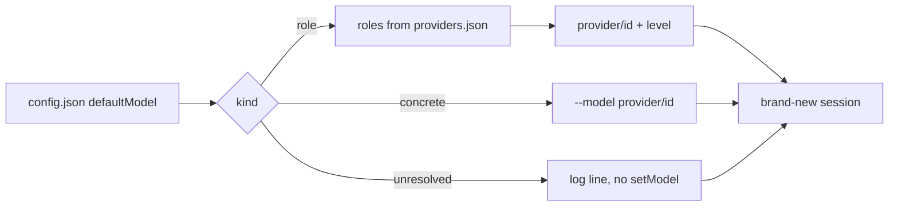

# Default model follows role

Settings `defaultModel` accepts a role ref. Default model tracks role assignment without editing Settings.

## Value grammar

`defaultModel` in `~/.pi/dashboard/config.json`:

- `provider/id` — concrete. Unchanged. No migration.
- `@role` — follows role assignment.
- `@role:level` — follows role, fixed level suffix.

Role map read from `~/.pi/agent/providers.json` (`readRoleConfigFromDisk`).

Helper: `resolveDefaultModel(value, cfg)` in `packages/shared/src/role-schema.ts`. Thin wrapper over `resolveModelRef`.

Returns:

- `{kind:"concrete"}`
- `{kind:"role", provider, id, level?}`
- `{kind:"unresolved"}` — unknown role, unassigned role, or no `provider/`.

## Level precedence

1. Non-empty `defaultThinkingLevel`.
2. Ref `:level` suffix.
3. Role-assigned level.
4. None.

Settings UI:

- Role pick saves `@role` + `defaultThinkingLevel:""`.
- Level control shows role level tagged `role`.
- Level pick writes `defaultThinkingLevel`.

## Resolve at use

Bridge: `packages/extension/src/default-model-apply.ts` `applyDefaultModel`.

- Re-resolves on every call.
- Calls: brand-new session startup; pending retry when custom provider registers late.
- Running / resumed sessions: untouched.
- Preset load → next brand-new session gets new model. No Settings edit.

## Spawn roads

- Thinking-only choice pairs with resolved role default.
  - `pairDefaultModel` in `packages/server/src/browser-handlers/spawn-choice.ts`.
  - Plugin road: `packages/server/src/spawn-process/plugin-spawn-choice.ts`.
- Unresolved → no `--model`. One log line. No warning. No 400.
- Promoted `@role` model (folder home / spawn chip) + unresolved → existing `choiceWarning`.

## Unresolved fallback

Bridge:

- Logs `[default-model] unresolved role @<role>; using pi default`.
- No `setModel`. Pi's own default applies.

Settings UI:

- Dangling notice: `default-model-dangling`.
- Follow hint: `default-model-follows` — names active preset + resolved model.

## Pi mirror

`packages/server/src/pi-agent-settings.ts`: `mirrorDefaultsToPi`, `resolveRoleDefault`.

- Writes RESOLVED `defaultProvider` / `defaultModel` / `defaultThinkingLevel` → `~/.pi/agent/settings.json` on save.
- Save carrying either default key derives both.
- Unresolved → `skipped:"unresolved-role"`. Pi file untouched.

## Re-mirror rule

`packages/server/src/pi-default-remirror.ts` (`createPiDefaultRemirror`).

Host services (registered in `packages/server/src/server.ts`):

- `host.remirrorPiDefaults`
- `host.defaultModelRef`

Roles plugin:

- Watcher `onChange` calls re-mirror. See `packages/roles-plugin/src/server/host-default-model.ts`.

In-memory last resolution:

- Seeded at server start. No write.
- Updated by every mirror write.
- Re-mirror writes only when resolution changed.

Effects:

- Unrelated role edit → no-op.
- No-op preset load → no-op.
- Restart → no clobber of model picked interactively in pi.
- Role change while server down → drift shown on pi settings page. Repair action available.

## Roles page

"Used by" lists `Default model (new sessions)` under the role. Owner: `dashboard.defaultModel`.

## Rollback

Re-pick a concrete default before downgrading.

See change: default-model-follows-role.
