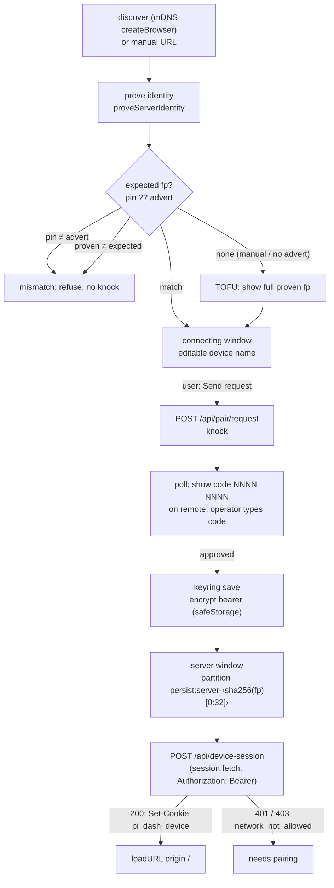

# Electron server windows

Electron main pairs with other dashboards on LAN. Opens each paired dashboard in its own window on its own origin.

Local dashboard keeps running. Remote mode (`remote-connect-window.ts` → `ensureServer`) unchanged. Browser in-page switch (`ServerSelector` → `performServerSwitch`) unchanged.

Why: remote's own client runs against remote's own server. Same-origin device cookie covers `/api/*`. No cross-origin bearer, no version skew between local client and remote server.

OpenSpec change `add-electron-server-windows` (moves to `openspec/changes/archive/` on ship).

## Flow



Paired server, open path: no knock. Host select → cookie exchange → load.

## Modules

`packages/electron/src/lib/`:

| File | Role |
|---|---|
| `server-discovery.ts` | `createBrowser()` at `app.whenReady`, stop at quit. Drops `isLocal`. `localFp` exclusion. `describeDiscovered`. |
| `server-keyring.ts` | `ServerKeyring` file store. `safeStorage` bearer. Atomic write. Corrupt set-aside. |
| `pairing-client.ts` | `startPairing`: prove → confirm → knock → poll. Phases → connecting window. |
| `server-windows.ts` | Registry fp → window. Open/focus/forget. Host select, cookie exchange, re-verify, recheck. Pure helpers: `classifyExchange`, `composeTitle`, `decideServerWindowNavigation`. |
| `server-windows-main.ts` | Wiring: deps, `server-windows-state.json` bounds, local-fp prove, CDP warning. |
| `servers-ipc.ts` | `servers:*` handlers. `isServerWindowsSender`. `validHostPort`. |
| `servers-menu.ts` | Servers submenu builder (app menu + tray). Rebuild on keyring change. |
| `connecting-window.ts` | `renderer/connecting.html` + `preload/connecting-preload.ts`. Only window that sees confirm code. |

Shared: `packages/shared/src/pairing-knock-client.ts` (knock state machine), `server-pinning.ts` (`proveServerIdentity`, `challengePinnedServer`), `mdns-discovery.ts`.

Main-window bridge: `packages/electron/src/preload-main.ts` → `piDashboard.openServerWindow({host,port})`.

## Identity

- Expected fp = `pin ?? advertFp`. Both set and differ ⇒ `mismatch`, no knock.
- Neither set (manual URL, advert without `fp`) ⇒ `tofu-confirm`. Full proven fp shown. Pin only after approval.
- Prove failure (non-200, timeout, no `/api/pair/challenge`) ⇒ `unverifiable`. Distinct message. No knock.
- Mismatch: no credential sent, no load, pin unchanged. Log names expected + proven short fp + host.
- Short fp: `sha256:` + first 16 chars of base64url part. Single helper `shortFingerprint`.
- Identity challenge runs against every candidate host, concurrent, deadline 5 s (`HOST_SELECTION_DEADLINE_MS`).

## Keyring

- Path: `~/.pi-dashboard/server-keyring.json` (`MANAGED_DIR`, same in dev and packaged).
- Shape v1:

```json
{ "version": 1, "servers": { "<fp>": { "label": "home-imac", "pinnedPubkey": "<b64url SPKI>", "lastHosts": [{"host":"192.168.16.204","port":8000,"scheme":"http"}], "bearer": {"enc":"safeStorage","data":"<base64>"}, "remembered": true, "needsPairing": false, "pairedAt": "<iso>" } } }
```

- Bearer: `safeStorage` only. Never plaintext on disk.
- File mode `0600`. Broader mode tightened on POSIX load. Windows: user-profile ACL.
- Write: temp `wx` mode `0600` → `fsync` → `rename`.
- `lastHosts`: MRU, cap 5 (`LAST_HOSTS_CAP`). Each host records `scheme`.
- Discovered (`http`) host added only after identity proof. Never precedes an `https` host.
- Unknown `version` or unparseable ⇒ rename to `server-keyring.corrupt-<ts>.json`. Start empty. Log.
- Undecryptable bearer ⇒ discard blob, `needsPairing: true`. Pin, label, hosts kept.
- `safeStorage.isEncryptionAvailable()` false, or Linux `getSelectedStorageBackend() === "basic_text"` ⇒ no bearer on disk. Entry `"bearer": null, "remembered": false`. Bearer in memory for run only. Next launch ⇒ "needs pairing". Partition non-persistent.
- Window bounds: separate `server-windows-state.json` (keyed by fp). Window moves never rewrite keyring.
- macOS unsigned build: first `safeStorage` use triggers Keychain prompt. Keyring touches `safeStorage` only when encrypting/decrypting.
- E2E: harness passes `--use-mock-keychain` on darwin (`tests/e2e-electron/electron-lifecycle.ts`).

## Server window posture

- `webPreferences`: `partition`, `sandbox: true`, `contextIsolation: true`, `nodeIntegration: false`, `webviewTag: false`. No `preload`.
- Partition: `server-` + first 32 hex of `sha256(fp)`. `persist:` prefix only when remembered. Derived from proven fp only (`partitionFor`).
- Open order: host select → `ses.fetch(origin/api/device-session, POST, redirect:"manual", Authorization)` → `loadURL(origin + "/")`.
- Nav: `will-navigate` + `will-redirect` (main frame) → `decideServerWindowNavigation(origin, url)`. Not `decideWillNavigate`.
  - same origin ⇒ `allow`
  - other + `http`/`https`/`mailto` ⇒ `external` (`shell.openExternal`), cancelled
  - other + other scheme ⇒ `drop`, cancelled
- Subframes not origin-restricted (inside remote page). No credential crosses partitions.
- `setWindowOpenHandler`: always `deny`. Allowlisted scheme ⇒ system browser.
- Permissions allowlist: `clipboard-sanitized-write`, `notifications`, `fullscreen`. Check handler mirrors request handler.
- `will-download`: explicit save dialog titled from live label.
- Title: `‹label› — ‹page title›`. `page-title-updated` preventDefault. Both sanitised (`sanitizeDisplayName`: control/format chars stripped, ≤ 64 UTF-8 bytes, empty ⇒ host).
- Focus existing window on re-open. Restore if minimised.
- Close: destroy (not tray). Bounds saved.

## Re-verification

- Triggers: 60 s interval (`REVERIFY_INTERVAL_MS`), `focus` when ≥ 60 s since last check (`FOCUS_REVERIFY_MIN_MS`), `powerMonitor` resume.
- Proven mismatch ⇒ `loadURL("about:blank")`, delete partition `pi_dash_device` cookie, log, report.
- Transport failure ⇒ keep page, title suffix `— not reachable`, retry next trigger.

## Revocation

- Refused = exchange `401`, or `403` with `error: "network_not_allowed"` (`classifyExchange`).
- Before load: refused ⇒ `needs pairing`, no load. Offer Pair again / Forget.
- Open window: `session.webRequest.onCompleted` on `origin/api/*` triggers only on `401`/`403`. Never reads bodies.
- Trigger ⇒ re-run exchange. Rate limit 5 min (`RECHECK_MIN_INTERVAL_MS`) per window.
- Re-run refused ⇒ clear bearer + cookie, `needs pairing`, one dialog (Pair again / Forget / Close).
- Re-run ok ⇒ nothing. No reload.
- `403 insufficient_scope` (tier) does not unpair. Exchange ok ⇒ keep.
- Trusted-network servers answer `/api/*` without credential ⇒ revocation hidden until next open.

## IPC

- Family `servers:*`. Separate from `dashboard:*` loading-page channels.
- Channels: `servers:list`, `servers:changed` (push, trusted only), `servers:connect`, `servers:connect-manual`, `servers:send-request`, `servers:stop-waiting`, `servers:connecting-ready`, `servers:connecting-close`, `servers:open`, `servers:open-from-dashboard`, `servers:forget`, `servers:pair-again`.
- Sender check `isServerWindowsSender`: `senderFrame === mainFrame` AND sender is held trusted `BrowserWindow` AND frame URL is expected document.
  - remote-connect: bundled `file://` page.
  - connecting: bundled `file://` page.
  - main: top frame on local dashboard origin only.
- Main-window bridge: `openServerWindow` exposed only when `location.origin === --pi-local-origin=<origin>` (passed via `additionalArguments`). Remote-mode doc never sees it.
- Targets by fp, or host+port matching discovered or keyring host. Manual URL only from remote-connect. Loopback hosts refused for manual.
- Validation: host ≤ 253 chars, port 1–65535, fp `^sha256:[A-Za-z0-9_-]{43}$`. Renderer never supplies credential, partition, or path.

## Forget

- Closes window.
- Removes keyring entry + bounds entry.
- Clears partition cookies + storage (both persistent and non-persistent variants).
- Message: device stays listed on remote until operator revokes.

## Limits

- `/live/` and `/editor/` not covered by `Path=/api/` cookie. Available only where remote's own network rules admit this machine.
- Knock works same-LAN only. Off-link ⇒ `knock_not_lan`.
- Plain `http` LAN: on-path relay sees bearer. Accepted (`lan-knock-pairing` D8).
- Cloned identity across machines: first proving candidate wins. Logged with host.
- CDP (`--debug-cdp`, `127.0.0.1:9222`) exposes partition cookies. Startup warning logged when CDP on and keyring non-empty (`server-windows-main.ts`).
- Mid-session revocation invisible from trusted network. Detected at next open.
- Server windows run remote's client. Its `ServerSelector` does browser in-page switch.

## Rollback / downgrade

- Revert removes windows + keyring use. Remote mode and in-page switch remain.
- Revert does NOT erase credentials. Keyring (encrypted bearer) and `persist:server-*` partitions stay valid until operator revokes.
- Before downgrade: Forget servers in app, or revoke device on each remote.
- Manual cleanup after downgrade:
  - `~/.pi-dashboard/server-keyring.json`
  - `~/.pi-dashboard/server-windows-state.json`
  - `Partitions/server-*` under Electron `userData`
- `pi-dashboard-last-server` never deleted (D13). Revert restores prior load behaviour.
- Local window ignores saved remote last-server when `window.piDashboard.openServerWindow` present (`App.tsx` `getInitialWsUrl`).

## Testing

- L1 vitest (`packages/electron/src/lib/__tests__/`):
  - `server-windows.test.ts`
  - `server-keyring.test.ts`
  - `server-discovery.test.ts`
  - `pairing-client.test.ts`
  - `servers-ipc.test.ts`
  - `servers-menu.test.ts`
- Electron E2E: `tests/e2e-electron/server-windows.electron.spec.ts`
  - `PW_ELECTRON_DEV=1 PW_ELECTRON_PORT=<free> npx playwright test --config playwright.electron.config.ts server-windows`
- L3 browser E2E: `tests/e2e/known-server-stale-name.spec.ts` (F4/F5).
