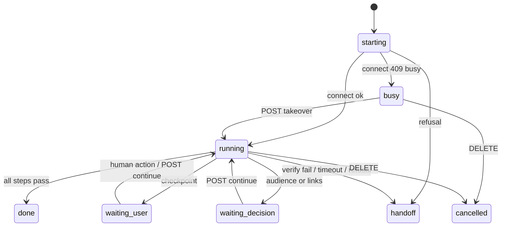

# Gmail plugin

## Overview

`packages/gmail-plugin` connects multiple Gmail accounts to pi-dashboard.
Settings → General → Gmail guides Google Cloud setup.
Create project; enable Gmail API; configure Branding and Audience; upload Desktop `client_secret_*.json`; test sign-in.
Google offers no setup API; dashboard never runs `gcloud`.
Audience Internal admits ONLY accounts of GCP project's own Workspace org.
Account from another org (second Workspace domain, gmail.com) → Google page `Error 403: org_internal`.
Fix → audience External; add each account as test user.
One OAuth client per dashboard (multiple clients = non-goal).
External apps in Testing status expire refresh tokens after 7 days; Internal/Workspace apps unaffected; panel shows `testing: 7-day`.
Every tool call except `gmail_accounts` names `account` by alias or email; no default account.
Accounts remain user-global across dashboard pi sessions.

See change: improve-gmail-settings-ux.

## Package layout

| Path | Job |
|---|---|
| `src/shared/` | Validate Desktop client JSON; define scopes, levels, lane protocol, Google endpoints. |
| `src/server/` | Mount routes; run OAuth; store accounts; gate token leases; revoke grants. |
| `src/bridge/` | Register tools; request leases; call Gmail REST; build MIME; confine attachments. |
| `src/client/` | Render setup wizard and accounts panel through settings-section claim. |

## Sign-in flow

```mermaid
sequenceDiagram
  participant C as client
  participant R as routes.ts
  participant O as google-oauth.ts
  participant G as Google
  participant S as AccountStore
  C->>R: POST /api/plugins/gmail/accounts (tier)
  R->>R: ctx.oauth.startFlow key add-<uuid> / reauth-<sub>
  R->>O: createGoogleLoginFlow
  O->>O: createLoopbackCallback path "/"; PKCE + nonce
  O->>C: auth_url (openid email + full tier scopes)
  C->>G: authorize (offline; consent select_account)
  par local callback
    G-->>O: loopback code + state
  and remote browser fallback
    C-->>O: manual_code pasted redirect URL
  end
  O->>O: race callback vs paste; check state
  O->>G: oauth4webapi code exchange (PKCE)
  G-->>O: tokens + id_token
  O->>O: validate iss/aud/exp/nonce + email_verified
  O-->>R: sub, email, scopes, tokens
  R->>S: persist via upsertFromSignIn
  S->>S: ctx.credentials.update("acct:<sub>")
```

Remote browser cannot reach dashboard-host `127.0.0.1`; paste full redirect URL.
Re-auth requires same `sub`; mismatch returns `account_mismatch`.
New account without refresh token fails without persistence.
Lower level applies immediately when scopes cover it; higher level starts full-scope re-consent.
Google may show a sign-in error on its own page and never redirects back → loopback callback waits until its 300 s timeout (code `timeout`).
While flow waiting, settings show `<details data-testid="gmail-google-error">` "Google showed an error instead of returning here?".
Buttons for closed code list: `org_internal`, `access_denied`, `admin_policy_enforced`, `other` (`gmail-report-<code>`).
Click → latch code in `reportedRef`, `setFlow(null)`, `oauthFlowClient.cancel(flowId)`.
Both poll callbacks (pending + done) return early while latched; host terminal `"Cancelled"` never overwrites code; flow view never re-mounts.
Latch resets on new flow (`addAccount`, `startFlow`).
While flow set, panel shows `gmail-consent-hint` "tick every permission (Select all)"; host drops `auth_url.instructions` → plugin renders hint.
Unticked Gmail scope → persist throws `scope_missing` → "add the account again with every permission ticked".

See change: improve-gmail-settings-ux.

## Sign-in errors

`packages/gmail-plugin/src/client/wizard.ts` → `errorKey(code)` maps every flow code to an i18n key; unknown → `errGeneric`; `"Cancelled"` matched case-insensitively → `errCancelled`.
`ERROR_EN` holds English sentences (`t()` fallback).
`errorStep`: `org_internal`/`access_denied` → step 3; `admin_policy_enforced` → null (fix lives in that account's Workspace Admin console: trust client id; message interpolates `{clientId}`).
UI renders sentence + raw code in muted `gmail-flow-error-code` span.

Closed code set `KNOWN_FLOW_CODES` lives in `packages/gmail-plugin/src/shared/flow-codes.ts` (`knownFlowCode(code)` exact match → code | null).
Shared by client table + server log allow-list.

Server `startSignIn` (`packages/gmail-plugin/src/server/routes.ts`) wraps `loginFlow.login`, `persist`, and the `deps.oauth.startFlow` catch.
Each logs `logger.warn("[gmail] sign-in failed: <code>")` with code from `knownFlowCode(err.code)` else `sign_in_failed`.
Per-call `logged` flag → exactly once (a login throwing before first event also rejects startFlow with `PluginFlowStartError("login_failed")`).
Never logs email, message, URL, token. Original error rethrown unchanged.

See change: improve-gmail-settings-ux.

## Automatic setup

Entry: `Set up automatically` secondary button, settings UI (`data-testid` `gmail-setup-run`).
Local-only. Drives Google Cloud console in dedicated Chrome → stores Desktop OAuth client.
Manual wizard stays fallback.
Deterministic server recipe. No model. No CLI.



### Availability

`GET state` → `autoSetup: {available, reason?, local, replacesClient?, runId?}`.
`available` requires all:
- `ctx.consume("browser.dedicated")` defined; looked up per request.
- `status().enabled && status().available`.
- Loopback peer, no proxy header (`isGenuinelyLocal`, `setup/local.ts`).
- No client, or client with zero accounts (else `client_in_use`; `replacesClient: true` when client exists).
- No live run (else `run_active` + `runId`).
`reason` values: `service_missing`, `disabled`, `status_failed`, `remote_dashboard`, browser refusal reason.
No `dependsOn` on browser plugin: hard + transitive, browser ships disabled.
Browser plugin provides `browser.dedicated` via `ctx.provide` (`browser-plugin/src/server/index.ts:200`).

### Run

`POST /api/plugins/gmail/setup/run {mode, projectId?, ownerEmail}` → `{runId}`.
- `mode`: `new` | `existing`. `existing` requires `projectId`.
- `projectId` must pass `classifyProjectId` → `ok`.
- `new` without `projectId` → `pi-dashboard-<6 random [a-z0-9]>` (`generateProjectId`).
- Start requires loopback peer, no proxy header; else 403 `remote_dashboard`.
- One live run per server; second start → 409 `run_active`.
- 400 errors: `invalid_mode`, `invalid_owner_email`, `invalid_project_id`.
- Saves `projectId`, `ownerAccount` to plugin config (best effort).
- Connects `browser.dedicated` with `{client: "gmail-setup", private: true, ephemeral: true}`.

Each step: check → act → verify. Verify fail, unknown page, or step > 60 s (`stepLimitMs`) → handoff.

| id | Effect | wizardStep |
|---|---|---|
| `project` | Create (`new`) or confirm project; reads parent org. | 1 |
| `api` | Enable Gmail API. Done when `Disable API` shown. | 1 |
| `branding` | Consent screen: app name, support email = owner, audience, contact email, policy checkpoint. | 2 |
| `publish` | External audience only: links, Save, click `Publish app`; user confirms dialog. | 3 |
| `client` | Create Desktop client `pi-dashboard` (or `pi-dashboard-<n>`). Never `done` (old secret unrecoverable). | 4 |
| `capture` | Read secret, store (see Secret capture). | 4 |

Navigation URLs: `authuser=<ownerEmail>`, `project=<projectId>`, `hl=en`.
Elements found by role + accessible name via `Accessibility.queryAXTree`.
Page `lang` not `en` → handoff `locale`.
Denied navigation → handoff `domain_blocked`, `domains: ["console.cloud.google.com", "accounts.google.com"]`.
Keep-alive `Runtime.evaluate` every 30 s (`keepAliveMs`); browser idle sweep is 5 min.
Socket closed by browser, not by run → handoff `browser_closed`.

### Decisions

State `waiting_decision`; `decision` in run view. Answer: `POST /api/plugins/gmail/setup/run/:runId/continue`.
- Audience, asked only when `branding` not done: `{audience: "internal" | "external"}`.
  - Detected `internal` when parent org exists, else `external`.
  - Other values → 400 `invalid_audience`.
- Links, asked before `publish`: `{links: {homePage, privacyPolicy, authorizedDomain}, confirmLinks: true}`.
  - Missing `confirmLinks: true` → 400 `confirm_required`.
  - Invalid links → 400 `links_required`, `invalid_authorized_domain`, or `invalid_<key>`.
  - Defaults (`DEFAULT_PUBLISH_LINKS`): home + privacy `https://github.com/BlackBeltTechnology/pi-agent-dashboard`; domain `github.com`.
  - Links appear on Google consent screen for every account. User may replace them.

### Human checkpoints

State `waiting_user`; `checkpoint.kind` in run view. Run never clicks sign-in, consent, terms, policy, or publish confirmation.
- `sign_in`:
  - Redirect guard: run tab `Fetch` pattern `https://accounts.google.com/*`; top-level hit → `Fetch.failRequest` (`BlockedByClient`) → checkpoint.
  - Run tab → `about:blank`.
  - Sign-in opens in hidden tab of run's ephemeral context (`open`, `login_hint: <ownerEmail>`), then `focus`.
  - Resume when `tabOrigin` leaves `https://accounts.google.com` or `POST …/continue`.
- `console_terms`: `Agree and continue` dialog gone.
- `policy`: User Data Policy checkbox; run `Page.bringToFront`; waits for user.
- `publish`: `Push to production?` dialog; resume at `In production`.
  - Dialog gone for 5 polls (`publishGracePolls`) without `In production` → handoff `publish_cancelled`.
- Limit 15 min (`checkpointLimitMs`) → handoff `timeout`.

### Busy and takeover

`connect` → 409 `busy` → state `busy`, `busy.holder` (session id or client label; never instance id).
`POST …/takeover` → 409 `not_busy` if not busy.
Takeover reconnects with `takeover: true`; atomic in browser plugin.
Other refusals → handoff at `project`.

### Handoff

State `handoff`; `handoff: {step, wizardStep, reason, domains?}`.
`wizardStep`: `project`, `api` → 1; `branding` → 2; `publish` → 3; `client`, `capture` → 4.
`created: {projectId?, clients[]}` lists Google resources made by run.
Reasons:
- recipe: `unexpected_page`, `locale`, `domain_blocked`, `publish_cancelled`, `timeout`, `secret_capture_failed`, `client_in_use`, `browser_closed`.
- browser refusal (step `project`): `disabled`, `unloaded`, `no-chrome`, `no-display`, `owned-by-other-server`, `profile-in-use`, `launch-failed`.

Logs: `[gmail] setup step <id> <done|skipped|handoff:<reason>> <ms>ms`; masked; no URLs.

### Secret capture (step `capture`)

1. Read client id + secret from `OAuth client created` dialog DOM. In-memory only.
2. Fallback: click `Download JSON`; read newest new `client_secret_*.json` in `downloadsDir`.
3. Every new download removed in `finally`.
4. Store via same function as `PUT /client`: validation, `client_in_use`, `projectId`.
5. Both reads fail → click `OK`, handoff `secret_capture_failed`.

Isolation:
- Run connects `private: true, ephemeral: true`: tabs absent from relay status and viewer.
- Owner Google session, downloads, cache live in throwaway browser context.
- Context discarded on run end, cancel, or Chrome exit.
- Later agent `browser_connect` not signed in as owner.

Masking: `maskSecrets` on every log line and handoff text. `GOCSPX-[A-Za-z0-9_-]+` → `GOCSPX-***`.
Run view and errors never carry secret or `instanceId`.

Unverified: real-console selectors until manual task 7.2.
See change: add-gmail-auto-setup.

## Token lease

```mermaid
sequenceDiagram
  participant T as bridge tool
  participant L as LeaseClient
  participant H as lease.ts
  participant S as AccountStore
  participant G as Google
  T->>L: lease(account, op)
  L->>H: requestPluginServer("gmail","gmail/lease",{account,op})
  H->>S: resolve alias then email from one snapshot
  H->>H: gate tier_denied → scope_missing → reauth_required
  opt expires − now ≤ 60 s
    H->>G: refresh token (single-flight per sub)
    G-->>H: access token or invalid_grant
    H->>S: update tokens if refresh grant unchanged
    Note over H,S: invalid_grant → status reauth_required
  end
  H-->>L: {accessToken,expiresAt,email,tier}
  L->>L: re-check tier; no token cache
  L-->>T: short-lived access token
```

Gate refusals happen before network calls.
`invalid_grant` marks `reauth_required`; later leases refuse without network calls.
Other refresh failures return `refresh_failed`.
Refresh token stays on server; reply contains exactly `{accessToken,expiresAt,email,tier}`.
Next tool call sees lowered level.

## Levels

| Level | Google scopes requested | Allowed tools |
|---|---|---|
| `readonly` | `gmail.readonly` | `gmail_search`, `gmail_get`, `gmail_labels`, `gmail_attachments` |
| `draft` | `gmail.readonly gmail.compose` | Read tools + `gmail_draft` |
| `send` | `gmail.modify` | Read and draft tools + `gmail_send`, `gmail_reply`, `gmail_modify`, `gmail_trash` |

Server gates level and granted scopes; bridge re-checks level.
Google grants bearer tokens for scopes, not plugin levels.
`gmail.compose` also permits sending; arbitrary in-process code could misuse draft-level token.
Levels constrain agent tools, not Google endpoints.

## Tools

`gmail_accounts` lists alias, email, level, status without `account`.
`gmail_search` returns metadata; `maxResults` ranges 1–50.
`gmail_get` reads message or thread; HTML sets `details.contentType: "text/html"`.
`gmail_labels` reads labels; `gmail_attachments` lists or saves in session cwd.
Mailbox reads carry `details.untrusted = true`; bridge declares reads untrusted to optional `untrusted-content-guard`.
`gmail_draft`, `gmail_send`, `gmail_reply`, `gmail_modify`, `gmail_trash` require `ctx.ui.confirm`; bridge declares writes selfConfirming to guard.
Confirmation shows account, recipients, subject, body preview; headless sessions block writes; dismissal or timeout denies.
`gmail_reply` threads via `In-Reply-To`, `References`, `threadId`; archive removes `INBOX`.

## Gmail API errors

Bridge 403 classification (`packages/gmail-plugin/src/bridge/gmail-api.ts` `classify403`).
Reads Google `reason` only from `error.details[]` entries whose `@type` ends `google.rpc.ErrorInfo` + legacy `error.errors[].reason`.
`SERVICE_DISABLED`/`accessNotConfigured` (and `metadata.service` absent or `gmail.googleapis.com`) → tool code `api_disabled`.
Message names project number only when `metadata.consumer` matches `^projects/(\d{1,20})$`; then `gcloud services enable gmail.googleapis.com --project=<n>`.
`ACCESS_TOKEN_SCOPE_INSUFFICIENT`/`insufficientPermissions` → `scope_insufficient` (re-authenticate with every permission ticked).
Anything else / parse failure → unchanged `gmail_error: Gmail returned HTTP 403`.
Google free text (`message`, `activationUrl`) never echoed.

See change: improve-gmail-settings-ux.

## Storage

`~/.pi/agent/plugin-credentials.json` stores records under namespace `gmail`, mode 0600, encrypted at rest (AES-256-GCM envelope `pi-dashboard-encrypted:v1`).
No key available → account reads and writes reject `store_locked` with `reason`. Remedy and recovery: [`credential-vault.md` §12](credential-vault.md#12-encryption-at-rest).
`client` stores Desktop OAuth `clientId`, `clientSecret`, optional `projectId`.
`acct:<sub>` stores email, alias, tier, scopes, refresh, access, expiry, status, testing hint, added time.
`AccountStore.upsertFromSignIn` merges re-auth records and keeps alias.
Revoke attempts Google endpoint, then deletes local record even when remote call fails.
Disable or uninstall leaves Google grants intact.

## REST routes

All routes use `operate` tier (`packages/shared/src/route-tiers.ts`), `networkGuard`, `@fastify/rate-limit`, MCP denylist.
Responses omit tokens and client secret.

| Method | Path | Action |
|---|---|---|
| `GET` | `/api/plugins/gmail/state` | Return client metadata and account summaries. |
| `PUT` | `/api/plugins/gmail/client` | Validate and save Desktop client JSON. |
| `POST` | `/api/plugins/gmail/accounts` | Start add flow; default `readonly`; optional `email` → `login_hint`. |
| `POST` | `/api/plugins/gmail/accounts/:sub/level` | Apply covered level or start re-consent. |
| `POST` | `/api/plugins/gmail/accounts/:sub/reauth` | Re-consent current level. |
| `PATCH` | `/api/plugins/gmail/accounts/:sub` | Change alias. |
| `DELETE` | `/api/plugins/gmail/accounts/:sub` | Attempt remote revoke; delete local account. |
| `POST` | `/api/plugins/gmail/setup/run` | Start automatic setup; local-only; → `{runId}`. |
| `GET` | `/api/plugins/gmail/setup/run/:id` | Secret-free run view. |
| `POST` | `/api/plugins/gmail/setup/run/:id/continue` | Answer decision or acknowledge `sign_in`. |
| `POST` | `/api/plugins/gmail/setup/run/:id/takeover` | Confirmed takeover of busy dedicated profile. |
| `DELETE` | `/api/plugins/gmail/setup/run/:id` | Cancel run. |

`GET /state` adds `autoSetup` (see Automatic setup).

## Settings UI

Revoke requires host `ui:confirm-dialog`; no DELETE until confirmed.
Alias blur shows `gmail-alias-feedback` ("Saved" role=status, or mapped `alias_taken`/`invalid_alias` sentence).
Level `<option>`s read `<tier> — <description>`.
Add-account select has visible `<label>` + `gmail-cross-org-hint`.
`Set up automatically` secondary button (`gmail-setup-entry`) rendered only when `autoSetup.available`; toggles run form (`gmail-setup-form`); run panel `gmail-setup-run`.
Collapsed wizard `<summary data-testid="gmail-setup-summary">` shows `✓ project <projectId>`, else `✓ <clientId>`, else `not configured`.
Theme uses only declared host tokens (`--border-primary`, `--bg-tertiary`, `--severity-{success,warning,error}-*`, `--accent` step highlight, `--accent-text` links).
`.focus-ring` on every control.
`packages/gmail-plugin/src/client` added to `SCAN_ROOTS` in `scripts/theme-token-guard.mjs`.

See change: improve-gmail-settings-ux.

## Test override

`PI_E2E_GOOGLE_BASE_URL` redirects Google endpoints only for `http://127.0.0.1:*` or `http://localhost:*`.
Other values trigger warning and fall back to Google defaults.
`docker/test-up.sh` sets harness default `http://127.0.0.1:18090`.
`tests/e2e/helpers/fake-google.ts` runs in-container; `tests/e2e/gmail-plugin.spec.ts` exercises flow.

## Security notes

Request lane stays private but unauthenticated; any user session can lease connected accounts within level.
Mail content remains attacker-controlled; without `untrusted-content-guard`, only write confirmations protect agent.
Attachment save rejects traversal and overwrite; symlinked targets/parents refused; parent-directory swap by another local process mid-save remains documented residual TOCTOU.
Logs contain email, operation, outcome; no tokens.
Credential file encrypted at rest. Same-user agent bash still reads the keychain on Linux, Windows and some macOS signatures. Threat model: [`credential-vault.md` §12.9](credential-vault.md#129-threat-model).
Local revoke failure needs manual Google removal at <https://myaccount.google.com/permissions>.
Automatic setup: start loopback-only (403 `remote_dashboard`); client secret never in run view, logs, errors; `maskSecrets` on logs; downloaded JSON deleted in `finally`; owner sign-in confined to ephemeral private context; redirect guard blocks `accounts.google.com` top-level loads in run tab.

See change: add-gmail-plugin.
