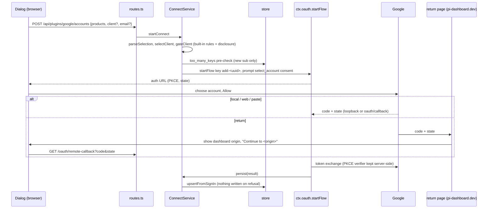

# Google plugin

## Overview

`packages/google-plugin` (id `google`) = single owner of Google OAuth clients, accounts, product grants, token leases.
Serves every Google product: Gmail (via Gmail plugin delegation), Calendar, Drive, Docs, Sheets, Slides, Tasks, Contacts.
Settings UI: Settings → Google accounts (`settings-section` claim, tab `general`).
Tokens exchanged and stored by dashboard server only. No broker on pi-dashboard.dev.
Refresh tokens never leave server. Responses never carry tokens or client secret.
Built-in app ships EMPTY (`BUILT_IN = { local: null, remote: null }`) until Google verification. Until then only own clients work.
See change: add-google-connect (`openspec/changes/add-google-connect/`).

## Package layout

| Path | Job |
|---|---|
| `src/shared/` | Products catalogue, default clients + switches, flow codes, endpoints, protocol (lanes, lease types). Pure. |
| `src/server/` | Store over `ctx.credentials`, client selection, connect/consent, leases, return-origin check, REST routes, legacy import, setup run. |
| `src/bridge/` | Agent tools per product; lease client; confirmed writes; Drive Picker tool. |
| `src/client/` | Settings → Google accounts, connect dialog, product/level editing, "Add organisation sign-in", disclosure. |
| `site/oauth/return.html` | Static return page (pi-dashboard.dev). Outside the plugin package. |

## Clients

Client = OAuth app used for consent and refresh. Two kinds.

| Ref | Kind | Source | Available for |
|---|---|---|---|
| `builtin` | Desktop (`installed`) | `BUILT_IN.local` (`src/shared/default-clients.ts`) | Browser on dashboard host (local). Project "pi-dashboard", every product scope. |
| `builtin-remote` | Web (`web`) | `BUILT_IN.remote` | Any browser, via return page only. No restricted scopes. |
| `own:<id>` | `installed` or `web` | Uploaded by user (`PUT /api/plugins/google/clients`) | Any browser. Linked to email `domains`. |

Own client fields: `id` (slug), `label`, `type`, `clientId`, `clientSecret`, `projectId?`, `ownerAccount?`, `domains[]` (lowercase, exact match, unique across own clients), `addedAt`.
`installed` = Desktop: loopback (local) or paste (remote).
`web` = redirect `<dashboard base>/api/plugins/google/oauth/callback`. Base: `auth.redirectBaseUrl` → tunnel → localhost (`ctx.getDashboardBaseUrl`).
Removing own client or replacing its client id → `client_in_use` while an account references it.
Upload with existing id updates; any other upload adds.
Client `gmail-legacy` (`installed`) created by legacy Gmail import (see Service `google.connect`).

### Built-in availability

`builtinFor(browser)`:
- local browser → `builtin` when `BUILT_IN.local` set AND `PI_GOOGLE_DEFAULT_CLIENTS` on.
- remote browser → `builtin-remote` when `BUILT_IN.remote` set AND `PI_GOOGLE_DEFAULT_CLIENTS` on AND `PI_GOOGLE_REMOTE_RETURN` on.
- Otherwise unavailable → `default_client_unavailable`.

### Selection order (new sign-in)

`selectClient()` in `src/server/clients.ts`:
1. Explicit `client` in request body.
2. Own client whose `domains` contains email domain (exact).
3. Built-in app available for this browser.
4. Else `400 client_required` + client list (no silent fallback to unrelated own client).

## Accounts and grants

Store record `acct:` (`Account`):
- `sub`, `email`, `alias?`, `addedAt`.
- `client`: `builtin` | `builtin-remote` | `own:<id>`.
- `grant`: `clientId` (client that minted refresh token), `refresh`, `access`, `expires`, `scopes[]`, `status` (`ok` | `reauth_required`), `testingHint?`, `grantedAt`.
- `products`: map product → `{ level, options? }`.

Rules:
- One grant per account. Refresh always uses recorded `grant.clientId` + its secret.
- Re-auth/consent returns different `sub` → `account_mismatch`. Nothing changes.
- Connect existing `sub` via different client (incl. `builtin` ↔ `builtin-remote`) → `client_mismatch`. Nothing changes.
- Reply narrower than what account relies on → `scope_missing`. Nothing changes.
- New connect: products Google did not grant stay off. No grant at all → `scope_missing`.
- Reconnect keeps alias, products, options.
- Disconnect deletes local record by default. `revoke=true` also revokes at Google first. Revoke failure still deletes local (`remoteRevoked: false`).
- Disconnect with revoke may affect other installs using same Google account + built-in client. Stated in UI.

## Products and levels

Catalogue: `src/shared/products.ts` (single source: server, client, tools, verification kit). Base scopes every consent: `openid email`.

| Product | Level → scopes | Google class | Built-in app offers |
|---|---|---|---|
| `gmail` | `readonly` → `gmail.readonly`; `draft` → + `gmail.compose`; `send` → `gmail.modify` | restricted | local yes; remote refused (`restricted_scope_remote`) |
| `gmail` option `filters` | `gmail.settings.basic` | sensitive | — |
| `calendar` | `read` → `calendar.readonly`; `write` → `calendar.events` | sensitive | yes |
| `drive` | `files` → `drive.file`; `read` → `drive.readonly`; `write` → `drive` | files: non-sensitive; read/write: restricted | `files` only |
| `docs` | `read` → `documents.readonly`; `write` → `documents` | sensitive | yes |
| `sheets` | `read` → `spreadsheets.readonly`; `write` → `spreadsheets` | sensitive | yes |
| `slides` | `read` → `presentations.readonly`; `write` → `presentations` | sensitive | yes |
| `tasks` | `read` → `tasks.readonly`; `write` → `tasks` | sensitive | yes |
| `contacts` | `read` → `contacts.readonly`; `write` → `contacts` | sensitive | yes |

Levels ordered low → high. `levelAtLeast()` checks rank.
Granted scope implies others (`IMPLIES`): e.g. `gmail.modify` ⇒ `gmail.readonly` + `gmail.compose`; `drive` ⇒ `drive.readonly` + `drive.file`.
Built-in refusal of full Drive → `own_client_required` (server-enforced, A2).

## Sign-in and consent

### Paths

`pathFor(client, browser)` in `src/server/connect.ts`:

| Path | Client | Browser | Redirect target | Code returned via |
|---|---|---|---|---|
| `local` | `builtin` or own `installed` | on dashboard host | loopback (`createLoopbackCallback`) | loopback listener |
| `paste` | own `installed` | remote | loopback; user pastes redirect URL | paste |
| `web` | own `web` | any | `<base>/api/plugins/google/oauth/callback` | `GET oauth/callback` |
| `return` | `builtin-remote` | any | `https://pi-dashboard.dev/oauth/return.html` | `GET oauth/remote-callback` after user confirm |

Return path needs `https:` dashboard origin or `http://localhost` / `http://127.0.0.1`, no userinfo (`allowedReturnOrigin`, `src/shared/return-origin.ts`). Else `409 remote_origin_unsupported`.
`web` / `return` need known dashboard base. Else `409 dashboard_address_unknown`.
Flow state = `<flowId>~<origin>` (`pending-flows.ts`, `STATE_ORIGIN_SEP`). One-shot. Unknown state → `400 invalid_state`.

### Connect (new account)

`paste` path: user pastes redirect URL into dialog (`ConnectDialog.tsx`).

### Return page (`site/oauth/return.html`)

- Removes `code`/`state`/`error` from address bar first (`history.replaceState`). Reads query or fragment.
- Refuses to act when framed (`window.top !== window`).
- Validates state origin = `<flowId>~<origin>` (B3). Else shows "Nothing was connected." only.
- Shows target origin. Navigates only after click "Continue to <origin>" to `<origin>/api/plugins/google/oauth/remote-callback?code&state`. No `window.opener`, no `postMessage`.
- Static CSP via `<meta>` with script/style sha256 hashes pinned in page header.
- Edit of inline script/style → paste new hashes (from browser CSP error) into the meta tag.

### Consent (existing account)

Triggered by `POST accounts/:sub/products` (raise / new product not covered) or `POST accounts/:sub/reauth`.

- Runs on account's OWN client: `builtin` → local browser only (`local_browser_required`); `builtin-remote` → return page; own → by type.
- `prompt=consent`, `login_hint=<email>`.
- Scopes = UNION(granted, required). No `include_granted_scopes` (D6).
- Lowering product level or turning off → no consent (applies at once).
- Raise covered by `grant.scopes` → applies at once.
- Concurrent consent for same account → `409 consent_in_progress`.
- Reply missing scopes account relies on → nothing changes (`scope_missing`). Reply covers new level only → that level applies.
- Consent with `missing` products → `scope_missing`; previous level stays.

### Client gate (`gateClient`)

- Built-in: `own_client_required` when product level not offered (Drive full).
- `builtin-remote`: `restricted_scope_remote` when any restricted product.
- Built-in (both refs): `409 disclosure_required` unless `DISCLOSURE_VERSION` accepted.
- Own clients not gated.

## Disclosure gate

- `DISCLOSURE_VERSION = 1` (`src/shared/default-clients.ts`). Bump → dialog shows notice again.
- Accept: `PUT /api/plugins/google/disclosure`, body-less. Server writes its current version. Hub-local only (`origin_denied` otherwise).
- Store record `disclosure` = `{ version, acceptedAt }`. Stored version ≥ shipped counts as accepted.
- Line 1 text varies by path (local: stays on computer; return: stored nothing on pi-dashboard.dev).

## Leases

`google/lease` (bridge → server) for every tool call. Hub-local only.

Request: `{ account, product, level? }`. `level` = minimum required.
Reply: `{ accessToken, expiresAt, email, level, options? }`. Options present only with enabled options (Gmail filters).

Server order (A13/A14):
1. `bad_request` (account not string, unknown product/level).
2. `not_found` / `ambiguous` (alias → email resolution).
3. `product_disabled` (no token needed).
4. `level_insufficient`.
5. `default_client_unavailable` / `no_client`.
6. `reauth_required` (grant status, no network).
7. `scope_missing` (grant does not cover product level).
8. Refresh when `expires − now ≤ 60 s`. Single-flight per `sub`. Timeout 30 s. Write only if record still holds refresh token used (`storeTokensIf`).

Refresh failures:
- `invalid_grant` → `markReauthIf` → `status: reauth_required`. Later leases refuse without network.
- Other → `refresh_failed`.
- Re-auth mid-refresh → `GrantChanged` → serve new grant from store.

Logs: `[google] lease product=
 op=<level|-> result=<code|ok>`.

Bridge (`src/bridge/runtime.ts`): one lease per call, no cache. Level re-checked on returned `level`.

## Lanes

| Lane | Type constant | Handler | Hub-local | Notes |
|---|---|---|---|---|
| `google/lease` | `LEASE_TYPE` | `createLeaseHandler` | yes (`hubLocalOnly`) | Returns live access token. |
| `google/accounts` | `ACCOUNTS_TYPE` | `store.list()` → `summarize` | yes | Secret-free account list. |

Remote-origin or deprecated-admission session refused by host with `origin_denied`. Both lanes.
Constants: `src/shared/protocol.ts`.

## Service `google.connect`

- Provided in-process via `ctx.provide?.("google.connect", createLegacyImporter(...))`.
- Only method: `importLegacyGmail(snapshot)`.
- Consumed only by Gmail plugin (`consumeAll`, provider must equal `google`).
- Import rules (`src/server/import.ts`):
  - each legacy `sub` imported AT MOST once (`imported:gmail` ledger). Later disconnect not undone.
  - existing Google Connect account never overwritten.
  - legacy client → own client `gmail-legacy` (`installed`, label "Gmail client (migrated)").
  - legacy account → `client: own:gmail-legacy`, grant copied (tokens, scopes, status, clientId), `products.gmail = { level: tier, options: { filters } }`.
  - legacy account without client → skipped, logged once (B14).
  - batch does not fit store → `too_many_keys`, NOTHING written (B13).
  - empty legacy namespace → no marker (B20).
- Returns `{ ok, imported, skipped }` or `{ ok: false, error }`.
- Tokens cross plugins only here, in-process, by trusted plugin.

## Setup: "Add organisation sign-in"

Entry: Settings → Google accounts → Advanced: organisation sign-in → "Add organisation sign-in" (`src/client/OrgSignIn.tsx`, wizard `src/client/SetupWizard.tsx`).
Manual path: upload Desktop/Web client JSON (`PUT /clients`), label, domains, owner account, expected project id (warns on mismatch).
Automatic run: secondary entry in Settings → Google accounts (`src/client/AutoSetup.tsx`); server-driven browser run (`src/server/setup/`). Local only.

Automatic run:
- Routes under `/api/plugins/google/setup/run` (paths Gmail used to serve).
- Availability (`state.autoSetup`): `browser.dedicated` consumed lazily per request (no `dependsOn`), enabled + available, loopback peer, no proxy header, no live run.
- `POST setup/run` → `{runId}`. Run start loopback-only (403 `remote_dashboard`). One live run per server (`run_active`).
- Steps (`src/server/setup/steps.ts`): `project` → `api` → `branding` → `publish` → `client` → `capture`.
- `api` enables every product API in `GOOGLE_APIS` (all products).
- Always adds a new client (never replaces).
- Captured client stored by `storeCapturedClient` (`src/server/setup/store-client.ts`).
- Decisions (`waiting_decision`): audience, links. Human checkpoints (`waiting_user`): sign-in, terms, policy, publish.
- Client secret never in run view, logs, errors. `maskSecrets` on logs.
- Log: `[google] setup step <id> <outcome> <ms>ms`, `[google] setup run done|cancelled|error`.
- Step limit 60 s, checkpoint limit 15 min (same as Gmail recipe). Handoff on failure; manual form is fallback.

## Agent tools

Bridge tools per product. Prefix per product. First argument `account` (alias or email).

| Product | Tools |
|---|---|
| Calendar | `gcal_calendars`, `gcal_events`, `gcal_event_get`, `gcal_event_create`, `gcal_event_update`, `gcal_event_delete`, `gcal_event_respond`, `gcal_freebusy` |
| Drive | `gdrive_search`, `gdrive_get`, `gdrive_download`, `gdrive_export`, `gdrive_upload`, `gdrive_create_folder`, `gdrive_move`, `gdrive_trash`, `gdrive_pick` |
| Docs | `gdocs_get`, `gdocs_create`, `gdocs_append_text`, `gdocs_replace_text` |
| Sheets | `gsheets_get`, `gsheets_read`, `gsheets_create`, `gsheets_write`, `gsheets_append` |
| Slides | `gslides_get`, `gslides_create`, `gslides_add_slide`, `gslides_replace_text` |
| Tasks | `gtasks_lists`, `gtasks_list`, `gtasks_create`, `gtasks_update`, `gtasks_complete`, `gtasks_delete` |
| Contacts | `gcontacts_search`, `gcontacts_get`, `gcontacts_create`, `gcontacts_update` |

Gmail keeps its own `gmail_*` tools (`docs/gmail-plugin.md`).

Rules:
- Reads: compact JSON, ids + human fields. Large bodies paged. `details.untrusted` on reads.
- Writes: `confirmWrite()` (`src/bridge/runtime.ts`) → host `ui.confirm`. Product-specific preview.
  - No UI → `blocked`. Deny / dismiss / timeout (`CONFIRM_TIMEOUT_MS`) → `denied`. Nothing changed.
- `gdrive_pick`: Google Picker in dashboard tab. Token from `POST /api/plugins/google/picker-token` (hub-local, `builtin` account with Drive grant only). Timeout → `{ files: [] }`.
- Google 403 mapping (`src/shared/google-errors.ts`): `api_disabled` (project number + enable hint), `scope_insufficient`, else `<product>_error`. Google free text never echoed.
- Retry (`src/shared/backoff.ts`): 3 attempts total. Waits 500 ms, 1 000 ms + ≤25 % jitter. `Retry-After` honoured; > 30 s → `rate_limited` at once. 429 retried for every method.

## REST routes

Base `/api/plugins/google`. Management routes: `networkGuard` (tier `operate`), `@fastify/rate-limit` (600/min, loopback allow-listed). Callbacks: no guard (unguessable `state` is credential), 30/min.

| Method | Path | Action |
|---|---|---|
| `GET` | `/state` | Availability, accounts, autoSetup, disclosure, product catalogue, `webRedirectUri`. |
| `PUT` | `/disclosure` | Accept current disclosure version. Hub-local only. |
| `PUT` | `/clients` | Add or update own client (JSON upload). |
| `PATCH` | `/clients/:id` | Label, domains, projectId, ownerAccount. |
| `DELETE` | `/clients/:id` | Remove client (refused while referenced). |
| `POST` | `/accounts` | Start connect `{products, client?, email?}`. |
| `POST` | `/accounts/:sub/products` | Change product map `{ product: null \| level \| {level, options} }`. |
| `POST` | `/accounts/:sub/reauth` | Consent again on own client. |
| `PATCH` | `/accounts/:sub` | Set/clear alias. |
| `DELETE` | `/accounts/:sub?revoke=true\|1` | Delete locally; optional revoke at Google first. |
| `POST` | `/picker-token` | Drive Picker token. Hub-local + built-in account only. |
| `GET` | `/oauth/callback` | Own `web` client + loopback return. |
| `GET` | `/oauth/remote-callback` | Return-page path. |
| `POST` | `/setup/run` | Start automatic setup run → `{runId}`. |
| `GET` | `/setup/run/:id` | Secret-free run view. |
| `POST` | `/setup/run/:id/continue` | Answer decision / acknowledge checkpoint. |
| `POST` | `/setup/run/:id/takeover` | Confirmed takeover of busy dedicated profile. |
| `DELETE` | `/setup/run/:id` | Cancel run. |

Responses: tokens and client secret never included.

## Error codes

### Request refusals (`{ error }`, HTTP status)

| Code | Status | Meaning |
|---|---|---|
| `bad_request` | 400 | Malformed body. |
| `no_products` | 400 | Empty product map. |
| `invalid_email` | 400 | Email not valid. |
| `client_required` | 400 | No client selectable; reply lists clients. |
| `own_client_required` | 400 | Built-in app cannot offer level (full Drive). |
| `restricted_scope_remote` | 400 | Restricted product via return page. |
| `invalid_alias` / `invalid_domain` / `missing_refresh` | 400 | Store validation. |
| `not_found` / `client_not_found` | 404 | Unknown account / client. |
| `ambiguous` / `alias_taken` / `domain_taken` / `client_in_use` | 409 | Store conflicts. |
| `too_many_keys` | 409 | Credential store full (256 keys). |
| `disclosure_required` | 409 | Built-in sign-in without accepted disclosure. |
| `consent_in_progress` | 409 | Consent already open for this account. |
| `local_browser_required` | 409 | Built-in account consent from remote browser. |
| `dashboard_address_unknown` | 409 | No dashboard base for web / return path. |
| `remote_origin_unsupported` | 409 | Dashboard origin not allowed for return page. |
| `default_client_unavailable` | 400 | Built-in not available for this browser / switch off / id mismatch. |
| `no_client` | 404 | Own client of account removed or id changed. |
| `origin_denied` | 403 | Hub-local-only route from remote browser. |
| `picker_unavailable` | 403 | Picker token refused. |
| `oauth_unavailable` | 501 | Host has no `ctx.oauth`. |
| `invalid_state` | 400 | Callback state unknown / not pending. |

### Sign-in flow codes (`KNOWN_FLOW_CODES`, `src/shared/flow-codes.ts`)

`org_internal`, `access_denied`, `admin_policy_enforced`, `redirect_uri_mismatch`, `invalid_client`, `scope_missing`, `account_mismatch`, `client_mismatch`, `missing_refresh`, `too_many_keys`, `email_unverified`, `invalid_redirect`, `state_mismatch`, `invalid_state`, `callback_failed`, `token_exchange_failed`, `id_token_invalid`, `authorization_failed`, `timeout`, `start_timeout`, `login_failed`, `cancelled`, `aborted`.

Unknown code → logged as `sign_in_failed`.

### Lease refusals (`LeaseRefusal`, thrown `<code>: <detail>`)

`bad_request`, `not_found`, `ambiguous`, `product_disabled`, `level_insufficient`, `scope_missing`, `default_client_unavailable`, `no_client`, `reauth_required`, `refresh_failed`.

Client copy: `src/client/connect-errors.ts` (request codes), `src/client/wizard.ts` (flow codes).

## Logging

Info-level never logs secrets, tokens, codes, emails (D13).

| Line | Fields |
|---|---|
| `[google] signin client=<ref> path=<local\|return\|web\|paste> products=<list> result=<code\|ok>` | One per sign-in. |
| `[google] refresh client=<ref> result=<ok\|invalid_grant\|refresh_failed>` | Per refresh. |
| `[google] lease product=
 op=<level> result=<code\|ok>` | Per lease. |
| `[google] products applied products=<list>` | Product change without consent. |
| `[google] disconnect client=<ref> revoke=<ok\|failed\|no>` | Disconnect. |
| `[google] client added\|updated type=<t>`, `[google] client removed` | Client registry. |
| `[google] disclosure accepted` | Disclosure. |
| `[google] legacy gmail import: <n> account(s)` | Migration done. |
| `[google] legacy gmail accounts skipped: no legacy client ...` | Legacy accounts without client (warn). |
| `[google] legacy gmail import deferred: the credential store is full` | Batch refused, nothing written (warn). |

Warn level for refusals/failures. `maskSecrets` on setup run logs.

## Storage

Host credential store via `ctx.credentials`, namespace `google`. Encryption at rest: [`credential-vault.md` §12](credential-vault.md#12-encryption-at-rest).

| Key | Content |
|---|---|
| `client:<id>` | Own client record. |
| `acct:` | Account (grant + products). ~3 KiB. |
| `disclosure` | `{ version, acceptedAt }`. |
| `imported:gmail` | Ledger of imported legacy subs. |
| `setup` | Record written by automatic setup run. |

Limits: 256 keys per namespace (`MAX_KEYS`) → documented account + client limit. 64 KiB per record.
`too_many_keys` text: "remove unused accounts or clients".

## Operator switches

| Variable | Effect |
|---|---|
| `PI_GOOGLE_DEFAULT_CLIENTS=off` | No built-in app. Also stops refresh of built-in grants. Set on server deployments. |
| `PI_GOOGLE_REMOTE_RETURN=off` | No return-page sign-in. New sign-ins only. |

Off values: `off`, `0`, `false` (case-insensitive). Read on every call. Unknown value → on, warned once.
Known limit: header-less port forwards (`ssh -L`) look local → desktop app path. Server deployments set `PI_GOOGLE_DEFAULT_CLIENTS=off`.

Test override: `PI_E2E_GOOGLE_BASE_URL` (honoured only for `http://127.0.0.1:*` / `http://localhost:*`). Redirects authorize/token/revoke to fake Google. Other values ignored with one warning.

## Migration and rollback

Migration (Gmail server, first request after start, when `google.connect` provided by `google`):
1. Gmail `consumeAll("google.connect")` → entry with `provider === "google"`.
2. Import legacy client + accounts (see Service `google.connect`).
3. Gmail writes `migrated: { at, version, subs }`. `gmail` namespace NOT deleted.
4. Gmail lanes reply `{ delegate: "google" }` for the life of the process (`src/server/google-link.ts`). Failed/partial import → Gmail leases from its own data; retried next start.

Enable/disable of `google` takes effect after restart (decision is per process).

Rollback:
- Previous build: Gmail reads untouched `gmail` namespace. Works for accounts whose legacy token still valid.
- Disable `google` plugin: Gmail falls back to own data (no `dependsOn`, so Gmail still loads).
- `PI_GOOGLE_DEFAULT_CLIENTS=off` / `PI_GOOGLE_REMOTE_RETURN=off`.

Rollback limits (design D10, documented in CHANGELOG/README):
- Accounts first connected after migration: not in legacy namespace → no legacy token.
- Accounts re-signed after `reauth_required`, or whose access removed at Google.
- Google invalidating older refresh tokens when new ones issued for same user + client (spike 0.1).
- Levels, aliases, filters changed after migration: not written back to legacy namespace.

## See also

- [`gmail-plugin.md`](gmail-plugin.md): Gmail tools, delegation, legacy fallback, Gmail REST routes (410/503).
- [`plugin-seams.md`](plugin-seams.md): `ctx.credentials`, `ctx.oauth`, lanes, soft consumer pattern.
- `packages/google-plugin/README.md`: package overview.
- `openspec/changes/add-google-connect/`: proposal, design (D1–D14), scenario-gate decisions.
