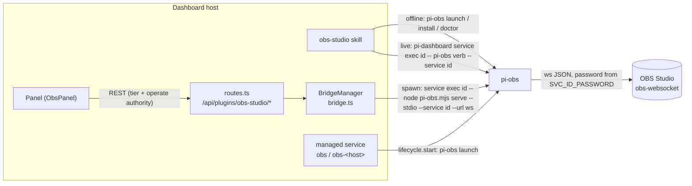
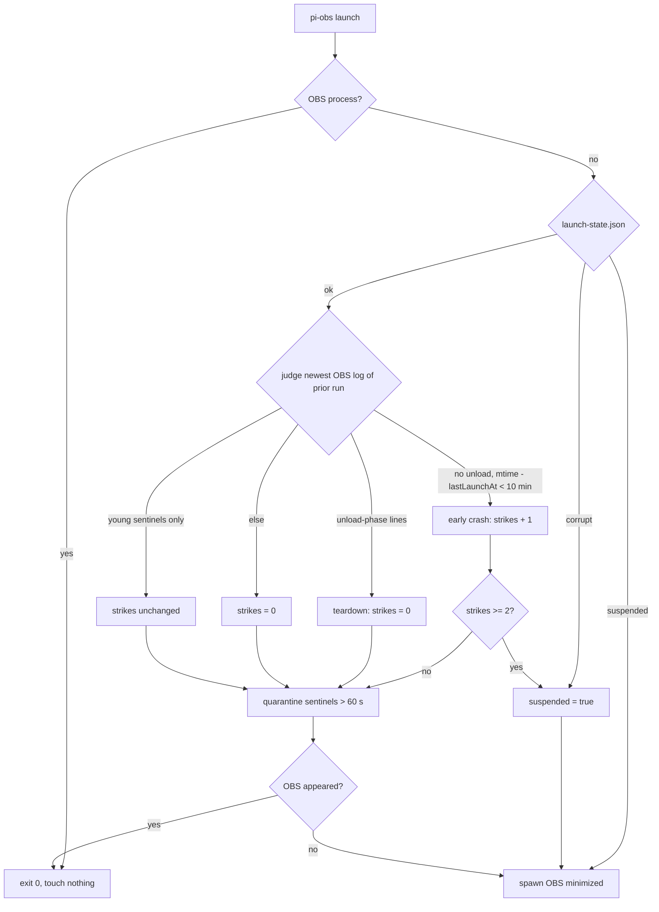

# OBS Studio plugin

Pkg: `packages/obs-studio-plugin/`. Change: `add-obs-studio-plugin`. Spike: `openspec/changes/add-obs-studio-plugin/spike-findings.md`.

Controls one local OBS Studio + N remote obs-websocket instances. Offline verbs and live verbs share one CLI, `pi-obs`.

## Components

| Part | Path | Role |
|---|---|---|
| `pi-obs` CLI | `src/bin/cli.ts`, `src/bin/pi-obs.ts`, `bin/pi-obs.mjs` | verb dispatch, `serve --stdio` |
| Core | `src/core/` | launch, policy, connection, install, doctor, provision, stop, presets, devices |
| Plugin server | `src/server/routes.ts`, `bridge.ts`, `service-state.ts` | REST routes, bridge to OBS, state reader |
| Panel | `src/client/ObsPanel.tsx`, `ObsAppRoute.tsx` (global app), `ObsSettingsCard.tsx` (settings) | UI, preview polling |
| Skill | `.pi/skills/obs-studio/SKILL.md` | agent guidance; `references/{install,permissions,presets,gotchas}.md` |

## Architecture

- Bridge spawns lazily. One child per instance. Stdin EOF ends `serve`. Kill after 5 s if alive. Wedged connection never reused.
- `BridgeManager` tracks `restarts` and `lastError` per instance.
- Bridge opens only when service state is `healthy`.
- Managed service `obs` (`LOCAL_ID`, mode `attached`) owns the local OBS. `lifecycle.start` = `[nodePath, entryPath, "launch"]`. No `lifecycle.stop`. `idleStopMinutes: null`.
- Remote id `obs-<slug>` from `ws://host:port`, e.g. `obs-10-0-0-5-4455`. Mode `external`.

## Host paths

State dir `~/.pi/dashboard/plugins/obs-studio/` (0700). Override: `pi-obs --state-dir <dir>`.

| Path | Mode | Content |
|---|---|---|
| `launch-state.json` | 0600 | `{lastLaunchAt, strikes, suspended}` |
| `instances.json` | 0600 | registered service ids |
| `sentinel-quarantine/<epoch-ms>/` | 0700 | moved `run_*` sentinels; 10 newest kept |
| `config-backups/` | 0600 | pre-write `config.json` copies; 3 newest kept |
| `apps/obs/` | — | win32 portable install root |

OBS config dir (`obsConfigDir`, `src/core/paths.ts`):

| OS | Default | Variant |
|---|---|---|
| darwin | `~/Library/Application Support/obs-studio` | — |
| win32 | `%APPDATA%\obs-studio` | portable: `<apps/obs>\config\obs-studio` |
| linux | `~/.config/obs-studio` | flatpak: `~/.var/app/com.obsproject.Studio/config/obs-studio` |

Under config dir:
- `plugin_config/obs-websocket/config.json` — websocket settings + password (plain text, OBS-owned).
- `.sentinel/run_*` — unclean-exit markers.
- `logs/` — newest file judged on launch.

Process match: darwin `OBS`, win32 `obs64`, linux `obs`.

## Routes

Prefix `/api/plugins/obs-studio`. Tier from `packages/shared/src/route-tiers.ts`. Unlisted route → `operate` (fail closed). Rate limit = `@fastify/rate-limit` per route, `global: false`, no loopback allowList (loopback limited too).

| Method | Path | Tier | Operate authority | Rate/min |
|---|---|---|---|---|
| GET | `/instances` | observe | no | 30 |
| GET | `/:service/status` | observe | no | 60 |
| GET | `/:service/screenshot` | operate | yes | 300 |
| POST | `/:service/scene` | operate | yes | 30 |
| POST | `/:service/virtualcam` | operate | yes | 10 |
| POST | `/:service/record` | operate | yes | 10 |

- `status` never opens a bridge. Live data only when bridge already open.
- Operate-authority check runs before membership check and state read. Refused request never starts OBS, opens socket or reads password.
- `:service` must match `^[a-z0-9][a-z0-9-]{0,62}$`, be in `instances.json`, and have current definition. Else 404.
- Bodies schema-validated; `additionalProperties: false`. Else 400.
- Non-healthy state → 409 `not-healthy` with status body.
- No raw obs-websocket passthrough.
- MCP: `/api/plugins/obs-studio/` denylisted (`packages/mcp-server-plugin/src/server/tools.denylist.ts`). UI and CLI only.
- Error codes: `obs-timeout` 504, `not-found` 404, `usage` 400, `unsupported-request` 409, `auth-failed` 502, `unreachable` 502, `obs-unavailable` 502.

## Recovery (launch)

`pi-obs launch` (`src/core/launch.ts`). Constants: `SENTINEL_MIN_AGE_MS` 60 s, `EARLY_CRASH_MS` 10 min, `STRIKE_LIMIT` 2, `QUARANTINE_KEEP` 10. Unload markers: `plugin unloaded`, `obs_module_unload`.

Rules:
- Strike = early mid-run crash only. Teardown (stop or quit) never strikes.
- Judges how run ended, not relaunch timing.
- `suspended` written atomically (temp + rename) before spawn.
- `suspended` set → no quarantine, no sentinel clear. OBS shows safe-mode prompt. Service → `blocked`.
- Corrupt `launch-state.json` → rewritten `suspended: true`. Reported.
- Only `pi-obs launch --reset-recovery` clears `suspended`. `doctor` offers it.
- Quarantined files stay quarantined.
- Spawn: darwin `open -a <OBS.app> --args --minimize-to-tray --disable-updater` (`open -a` measured; direct spawn unverified, not used). win32 `obs64.exe --minimize-to-tray --disable-updater [--portable]`, cwd `bin\64bit`. linux `obs` or `flatpak run com.obsproject.Studio --minimize-to-tray`.

## Stop

- No managed stop. `lifecycle.stop` absent.
- `pi-obs stop` refuses any service whose def mode is not `attached` (`src/core/stop.ts`).
- Warns: external quit may crash OBS 32; next launch recovers. Requires confirmation (`--yes` skips).
- Resolves pid by exact basename, sends per-OS quit. `--force` = force-kill, only with flag.
- Spike F2: external stop crashed OBS 32.2.2 on dev host, 3/3. Crash log contains unload-phase lines → teardown → no strike.

## Request policy

`src/core/policy.ts`. Applied in order before any request leaves the process. Shared by verbs, `call`, `serve`.

1. Capability gate: type absent from `GetVersion.availableRequests` → `unsupported-request`.
2. `call` deny-list: `Remove*`, `CreateSceneCollection`, `SetCurrentSceneCollection`, `CreateProfile`, `RemoveProfile`, `SetCurrentProfile`, `SetProfileParameter`, `SetStreamServiceSettings` → `denied`. Refusal names alternative.
3. Secret over non-loopback `ws://` (`SetStreamServiceSettings`) → `insecure-remote` unless `--allow-insecure-remote`.
4. Crash deny: `GetInputPropertiesListPropertyItems` on `screen_capture` input → `denied`. Target resolved by name/UUID via `GetInputList`. Unresolvable → `unresolved-target` (fail closed).

`call` request JSON only from stdin or `--json-file`. `call <Req> '{json}'` on argv → usage error.

## Secrets

- Password lives in: managed-services secret store (`store:<id>/password`), OBS `config.json`, `pi-obs` child env.
- Never in: dashboard server process memory beyond bridge env, plugin config, REST bodies, logs, argv, browser state.
- Delivery: `pi-dashboard service exec <id> -- pi-obs <verb> --service <id>` injects `SVC_<ID>_PASSWORD`.
- Id always explicit. `-` and `_` fold in env name; id not recoverable from env var.
- Resolution (`src/core/connection.ts`): `--service`/`--url` → `SVC_<ID>_PASSWORD` → fallback `OBS_URL` / `OBS_PASSWORD` (standalone; default `ws://127.0.0.1:4455`).
- Several `SVC_*_PASSWORD` and no `--service` → usage error.
- `--password` → usage error always.
- `auth-failed` (hello received, Identify rejected) distinct from `unreachable`. Managed `healthy` = reachable only.
- Rejected: `pluginCredentials` (duplicates secret, splits rotation); `vaultBindings` (needs absorb + user grant).
- Websocket enablement (`src/core/ws-config.ts`): password ≥ 8 chars else warn + rotate. Rotation: 24-char `base64url`. Write only while process absent (re-checked before write). Backup first, 0600, 3 kept. Secret-write failure → restore backup.

## Identity seam

`ctx.identity.hasOperateAuthority(request)` (design D14).

- Host impl: `packages/server/src/identity/plugin-identity.ts:108` → `hasOperateAuthority(request, deps.localTrust)` (`packages/server/src/auth/operate-required.ts:48`).
- New `localTrust?` field on `PluginIdentityDeps` (`plugin-identity.ts:62`).
- Same rule as `/api/services` mutations: operate-tier bearer, authenticated operator session/principal, or locally trusted caller (strict-mode aware).
- Refuses: trusted-network without credentials, observe/control tier.
- Read-only. Grants nothing. Not trust-gated.
- Optional on type. Absent → plugin refuses (`routes.ts:94` → 403 `operate_required`).
- Disclosure accepted: plugin can learn whether request would pass `/api/services` check.
- Rejected: reading `authVia` / `principalTier` (couples plugin to server internals).
- Plugin wiring: `src/server/index.ts:60`.

## Known limits / unverified

- Windows portable launch, `obs64` process match, registry detection, GitHub digest: manual (task 9.2). Unverified.
- Linux `obs` / flatpak launch, process match, flatpak config path: manual (task 9.3). Unverified.
- ⌘Q (UI quit) on 32.2.2: unmeasured. Leftover sentinel behaviour unknown (task 9.1).
- Earliest unload-phase line without background-removal plugin: unverified (task 9.1).
- Direct spawn on macOS (not `open -a`): unverified, not used.
- `screen_capture` crash: observed on OBS 32.1.2 via OBS-Transcribe. Unverified on 32.2.2. Not re-tested on purpose.
- Display mirroring warning: behaviour unverified (F4). Displays: darwin only (JXA); win32/linux report `unsupported`.
- Websocket config while running: no file write. OBS rewrites file on exit (OBS-Transcribe `OBS_INSTALLATION.md` §1, unverified here).
- `--state-dir` from `ctx.dataDir`: depends on unshipped `add-plugin-isolation-and-public-routes`. Default `os.homedir()` path used today.
- Remote `ws://`: plain, unencrypted. Password challenge and scene data cross network in clear.
- Residue on dev Mac: `pi-spike` scene collection. Removal pending user consent (task 8.1).
- No hardware/OS CI for Windows/Linux (manual tasks only).

See change: add-obs-studio-plugin.
