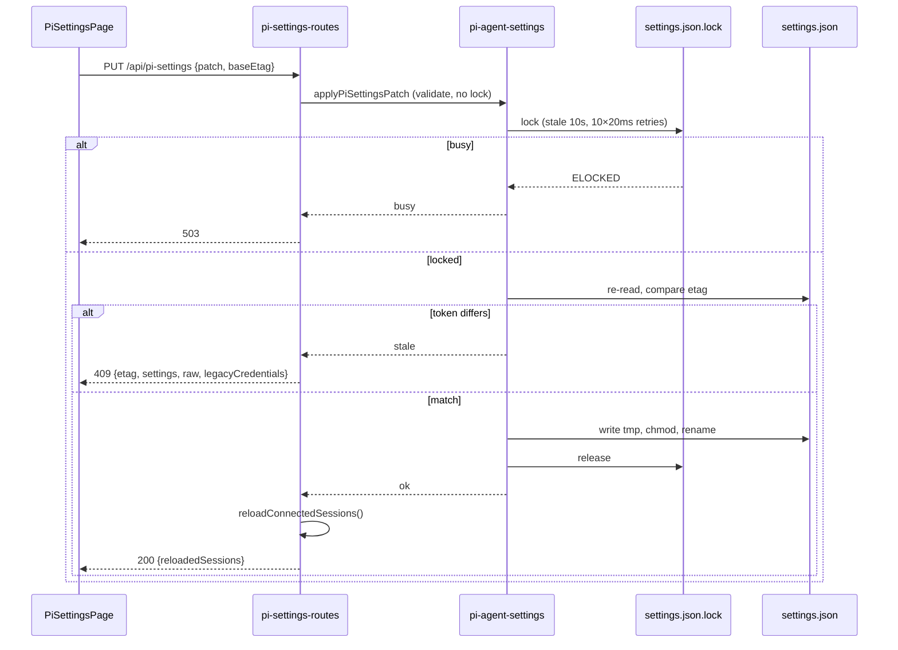
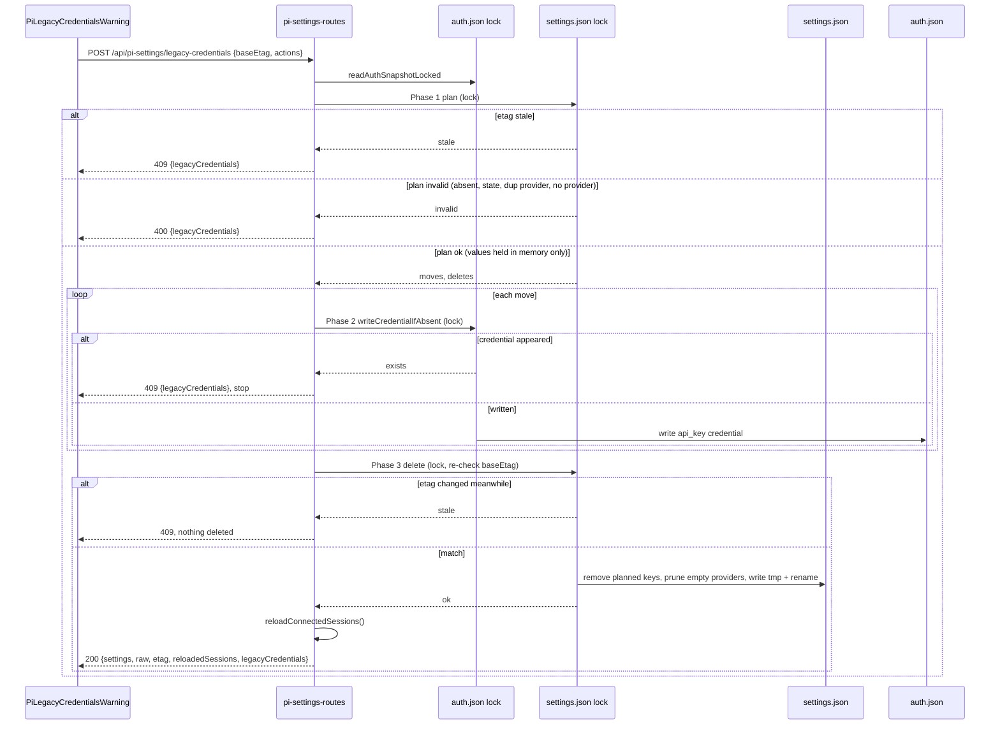

# pi settings editor + default-model mirror

Edits pi's global `settings.json` from Settings → pi → `pi settings` (route `/settings/pi-settings`).
Replaces the former Sessions section. Mirrors dashboard default model into pi.
Moves plain-text API keys out of `settings.json` into `auth.json`.
See change: pi-settings-full-coverage (design D1–D11); base editor: edit-pi-agent-settings (design D1–D8).

## Files

Server:
- `packages/server/src/pi-agent-settings.ts` — engine: `readPiSettings`, `computePiSettingsEtag`, `withPiSettingsLock`, `applyPiSettingsPatch`, `validateRawKeys`, `writePiSettingsRaw`, `mirrorDefaultsToPi`, `describeParseFailure`. `RAW_LEGACY_TYPED` (frozen raw check list, 10 keys).
- `packages/server/src/routes/pi-settings-routes.ts` — REST. `PI_SETTINGS_RAW_BODY_LIMIT` = 256 KiB. Registers `POST /api/pi-settings/legacy-credentials`.
- `packages/server/src/auth/pi-legacy-credentials.ts` — legacy detection (`detectLegacyCredentials`), `maskSecret`, `withoutLegacyValues`, `applyLegacyCredentialActions` (3-phase apply).
- `packages/server/src/auth/provider-auth-storage.ts` — `writeCredentialIfAbsent(provider, cred)` (`"written" | "exists"`), `resolveAuthJsonKey`.
- `packages/server/src/auth/scan-legacy-provider-ids.ts` — `PI_RENAMED_PROVIDER_IDS` (`azure-openai-responses` → `azure`).
- `packages/server/src/pi-settings-themes.ts` — `listPiThemes`, `BUILTIN_PI_THEMES` (`system`, `dark`, `light`).
- `packages/server/src/pi/pi-resource-scanner.ts` — theme resources (global + package buckets) fed to `listPiThemes`.
- `packages/server/src/routes/system-routes.ts` (~L558) — `PUT /api/config` mirror hook.
- `packages/server/src/server.ts` (~L2267, L2283) — `reloadConnectedSessions`, route registration.

Shared:
- `packages/shared/src/pi-settings-schema.ts` — `PI_SETTINGS_SCHEMA` (49 typed keys: kind, options, min/max, pi default, category, label, hint), `PI_SETTING_CATEGORIES`, `PI_SETTINGS_BLOCKS`, `checkPiSettingValue`. Drives server validation and client rows.
- `packages/shared/src/pi-settings-keys.ts` — `PI_MANAGED_SETTINGS_KEYS` (`defaultProvider`, `defaultModel`, `defaultThinkingLevel`). Excluded from schema.
- `packages/shared/src/enabled-models-match.ts` — `stripThinkingLevel`, `matchesPattern`, `modelInScope`. Shared by extension and scope editor.
- `packages/shared/src/dashboard-paths.ts` (L61) — `resolvePiAgentDir`.
- `packages/shared/src/role-schema.ts` — `THINKING_LEVELS`.
- `packages/shared/src/rest-api.ts` — `PiSettingsReadResponse` (`themes`, `legacyCredentials`), `PiLegacyCredentialsRequest/Response`.

Extension:
- `packages/extension/src/session-sync.ts` — `filterByEnabledModels` uses shared matcher.

Client:
- `packages/client/src/components/settings/PiSettingsPage.tsx` — page; `deriveMirror`; draft via `useSettingsDraftSource({ id:"pi-settings", page:"pi-settings" })`.
- `packages/client/src/components/settings/PiSettingsRows.tsx` — typed row controls.
- `packages/client/src/components/settings/pi-settings-form.ts` — form ↔ patch helpers.
- `packages/client/src/components/settings/ModelScopeEditor.tsx` — `enabledModels` scope editor.
- `packages/client/src/components/settings/PiLegacyCredentialsWarning.tsx` — legacy key warning + queued actions.
- `packages/client/src/components/settings/SettingsPanel.tsx` — rail group `pi`, item `pi-settings`, `activeTab === "pi-settings"` branch.
- `packages/client/src/lib/model-scope.ts` — `parseScope`, `serializeScope`, `toggleProvider`, `toggleModel`, `countInScope`.
- `packages/client/src/lib/api/pi-settings-api.ts` — `getPiSettings`, `patchPiSettings`, `putPiSettingsRaw`, `syncPiDefaults`, `migrateLegacyCredentials`.
- `packages/client/src/lib/api/models-api.ts` — `GET /api/models?annotated=1` (full catalogue).

Electron:
- `packages/electron/src/lib/wizard-state.ts` — `writeApiKey` removed. `hasAnyProviderCredential` (detection) unchanged.

Global file only. `<cwd>/.pi/settings.json` never read or written.

## Paths

- `agentDir` = `$PI_CODING_AGENT_DIR` (tilde-expanded) else `~/.pi/agent`.
- Settings = `<agentDir>/settings.json`.
- Auth = `<agentDir>/auth.json`.
- Lock = `<settings.json>.lock` (unresolved path; same artifact as pi).
- Write target = `realpath` if path is symlink, else path.

## REST

All behind `networkGuard`.

| Route | Body | 200 body |
|---|---|---|
| `GET /api/pi-settings` | — | `{ settings, raw, etag, parseError?, themes, legacyCredentials }` |
| `PUT /api/pi-settings` | `{ patch, baseEtag }` | `{ settings, raw, etag, reloadedSessions, restoredKeys?, legacyCredentials }` |
| `PUT /api/pi-settings/raw` | `{ raw, baseEtag }` | same as above |
| `POST /api/pi-settings/sync-defaults` | — | `{ piMirror, settings, raw, etag }` (no reload) |
| `POST /api/pi-settings/legacy-credentials` | `{ baseEtag, actions:[{ key, action:"move"\|"remove" }] }` | `{ settings, raw, etag, reloadedSessions, legacyCredentials }` |

Status:

- `200` ok.
- `400` invalid (`errors[]`), unparseable current file (`parseError`), missing `baseEtag`, bad `actions`. Legacy endpoint `400` carries refreshed `legacyCredentials`.
- `409` stale: `{ error:"stale", etag, settings, raw, legacyCredentials }`. Legacy endpoint also `409` when a credential appeared in auth.json (`CredentialTypeConflictError`, fixed message, refreshed list).
- `413` raw body > 256 KiB: `{ success:false, error }`.
- `503` lock busy: `{ error:"busy" }`.
- `500` I/O.

`settings` in every response omits legacy key values. `raw` is the file as stored (JSON mode shows it unmasked).

## Content token (etag)

- Canonical: strip BOM → parse → delete mirrored keys → sort keys recursively → `JSON.stringify` → sha256.
- Absent file → `"absent"`. Unparseable → sha256 of raw bytes.
- Mirrored keys excluded: mirror writes never stale the draft.
- Reorder or reformat → same etag.
- Token re-checked under lock. Mismatch → `409`, nothing written.
- Success returns post-write `{ etag, settings, raw }`. Client re-baselines from it.

## Lock + atomic write

`withPiSettingsLock(fn, { baseEtag }, deps)`:

1. Validate and prepare input BEFORE lock (keeps critical section short).
2. `mkdir -p` settings dir.
3. `proper-lockfile.lock(path, { realpath:false, stale:10_000, retries:{retries:10, minTimeout:20, maxTimeout:20} })`. Async. Locks even when file absent.
4. Re-read (BOM stripped). Compare etag if `baseEtag` set → `stale`.
5. Run pure, synchronous `fn(state)` → new text or failure.
6. Write tmp `.<hex>.settings.tmp` in target dir.
7. `chmod` tmp to target `mode & 0o7777` when target exists.
8. `rename(tmp, target)`. Tmp removed on failure.
9. Release in `finally`.

- `ELOCKED` → `busy` → `503`.
- Crashed holder → lock stale after 10 s, reclaimed.
- Failed tmp write → `io`; target untouched.
- All fs calls via injectable `FsDeps`.
- `withPiSettingsLock` callback is sync. auth.json `withLock` is sync. Locks never nest.

## Typed form (D3)

Schema-driven. `PI_SETTINGS_SCHEMA` = single source for server and client.

- Kinds: `bool`, `enum`, `mixed` (`true|false|"header"`, `"auto"`, `"kitty"|"iterm2"|"auto"|false`), `int` (min/max), `string`, `stringArray`.
- Categories: Model and thinking, Interaction, Tools, Sessions and context, Terminal and display, Network, Shell, Resources, Updates and privacy.
- Blocks (leaf patch only): `compaction`, `branchSummary`, `codemode`, `terminal`, `images`, `markdown`, `warnings`, `thinkingBudgets`.
- Whole-value key: `enabledModels` (array of non-empty strings).
- Leaf patch. Nested objects merge. Unknown siblings survive.
- `null` leaf → delete key. Whole block cannot be nulled.
- Key outside schema → `400`, points to JSON mode.
- Mirrored keys → `400`.
- Out-of-range / wrong type → `400 { errors }`, whole patch rejected.
- Unparseable file → `400 { parseError }`. Never patch over `{}`.
- Parity test: `packages/server/src/__tests__/pi-settings-schema-parity.test.ts` reads installed pi `docs/settings.md`.
- Schema excludes managed keys. `checkPatchKey` keeps `isManaged` rejection first.

Form rows (`PiSettingsRows.tsx`):

- Boolean and enum ≤3 options → segmented control (`Default · value…`). Longer enum → select.
- Unknown stored value → extra selected option. Not changed unless user edits.
- Set key → `Changed` text marker + reset → `null`.
- Integer out of range → inline error on entry. Save fails, nothing sent.
- Link rows (no editor): default model keys, `retry.*` (Retry editor), `packages` (Add-ons), `extensions` and `skills` (Skills).
- Edit-in-JSON rows: `modelThinkingLevels`, `compaction.modelOverrides`, `defaultTools`, `npmCommand`, `prompts`, `themes`, `tuiMode`, `fullscreen*`, `outputPad`.
- `thinkingBudgets` → four integer inputs.
- Read-only collapsed list: `dashboardPluginBridges`, `_dashboardManagedPackages`, `lastChangelogVersion`.
- Filter: label / dotted key / hint, case-insensitive. "Set or changed only" toggle. Category jump chips. Empty category hidden.

### Model scope editor (`enabledModels`, D7)

- Catalogue: `GET /api/models?annotated=1`, fetched on page open, grouped by provider.
- Modes: "All models" (key unset; `[]` loads as All models) / "Selected only".
- `parseScope(entries, catalogue)` → `{ wholeProviders, picks, patterns }`. Keeps each entry's original string.
  - `
/*` (optional `:<level>`) → provider toggle.
  - `
/<id>[:<level>]` with `
/<id>` in catalogue → model pick. Full id checked before suffix strip (`openrouter/x:free` stays intact).
  - Other → pattern, verbatim.
- `serializeScope` keeps original relative order; new entries appended. Dirty = set comparison. Load + save without edits sends nothing.
- Provider toggle → `
/*`. If any id contains `/` → explicit picks instead (`*` does not match `/`).
- Deselect one model of whole provider → `
/*` replaced by explicit picks of remaining catalogue models.
- In-scope count: `countInScope` via shared `modelInScope`. Labelled as catalogue models (pi further filters by credentials).
- Empty "Selected only" → commit throws field error. Nothing sent.
- Catalogue fetch fails → notice, no toggles, `enabledModels` excluded from patch.
- Shows saved-array preview. States: does not restrict roles or subagents. pi appends default model when missing.

### Theme control

- `theme` select fed by `themes` from `GET /api/pi-settings`.
- `themes` = `system`, `dark`, `light` + global and package theme files.
- Theme name = JSON `name` field; fallback basename. Parse fail → skipped.
- `system` reserved → skipped. Name with `/` → dropped (`light/dark` pair is typed, not listed).
- Collision: global beats package. Sorted, de-duplicated.
- Scanner failure → built-ins only. Read still succeeds.
- Project-local themes not listed (global file only).
- "Custom…" → free text (accepts `light/dark`).
- Unknown stored value → extra selected option.

## Legacy plain-text API keys (D4, D5a, D5b)

Detection (`detectLegacyCredentials`), reported in every read and write response as `legacyCredentials`:

- Sources: `anthropicApiKey` → `anthropic`; `openaiApiKey` → `openai`; `providers.<id>.apiKey` → `<id>`; top-level `apiKey` → no provider.
- Only non-empty strings count. `apiKeys` object NOT listed (pi migrates it to auth.json at startup).
- Provider normalised: `resolveAuthJsonKey`, then `PI_RENAMED_PROVIDER_IDS`.
- Auth state per entry:
  - `none` — no auth.json credential under id or pre-rename id.
  - `same` — API-key credential, exact value (`crypto.timingSafeEqual`, equal length).
  - `different` — OAuth, different key, or auth.json unreadable/corrupt (fail safe).
- Masking: `maskSecret(v)` → `…` + last 4 when `v.length >= 32`; else `••••`.
- Entry shape: key path, provider or null, auth state, masked value. Never the full value.
- Form mode never renders these keys as editable.
- Layout: legacy warning lists each key. Actions:
  - `same` → "Remove from settings.json".
  - `none` → "Move to Providers".
  - `different` or providerless → no action. Manual step: keep credential in Providers, delete key in JSON mode.
- Actions queue in Form mode only. Run on unified Save. Undo before Save. Discard clears queue.
- JSON mode: warning says cleanup runs from Form mode (raw save would write keys back).

### Apply: 3 phases (D4)

`POST /api/pi-settings/legacy-credentials` body `{ baseEtag, actions:[{ key, action:"move"|"remove" }] }`.
Neither lock may be held across the other. Values stay in server memory. Never returned.

1. Plan (settings lock, no write). Read auth.json under auth lock first. Check etag (`409`). Resolve each key's provider and auth state. Validate every action:
   - key present;
   - `move` needs provider and state `none`;
   - `remove` needs state `same`;
   - no two actions share a provider.
   Any failure → `400`, nothing written.
2. Credential writes (per move). `writeCredentialIfAbsent` runs one auth.json `withLock`: absence check + write in one callback. Credential appeared → `409` with refreshed list; stop. Earlier moves stay (key now in both files, safe).
3. Delete (settings lock, write). Re-check etag = `baseEtag`; mismatch → `409`, nothing deleted. Otherwise delete planned keys, prune empty `providers.<id>` and empty `providers`. Changed value stays and reads as `different`.

Save sequence in the page (D9), single `commit()`:

1. Validate fields. Any error → throw, nothing sent.
2. Compute form patch from `form` vs `formBase`.
3. Run queued legacy actions (Form mode only). Failure → throw, patch not sent.
4. Send precomputed patch with cleanup's returned etag.

After cleanup success: rebase `formBase`, `jsonBase`, `jsonDraft`, `loaded`, etag to cleanup snapshot. `form` keeps user values. Never `adopt()`. Queue cleared. Patch failure after cleanup → throw patch errors; retry sends patch only.

### Parse errors (D5b)

- `describeParseFailure` returns only `Invalid JSON at line L, column C` or `Invalid JSON`.
- Source: `SyntaxError` message. `(line L column C)` → used. `position N` → converted via `lineColumnAt`. Else fixed.
- Node messages quote source text (`Unexpected token …`). Text never forwarded.
- Applies to `parseError`, raw-validation messages, logs.

## Raw editor (D6)

Validation, before write:

- BOM stripped; valid JSON; root plain object.
- `RAW_LEGACY_TYPED` keys present → correct type (frozen list, 10 pre-change keys). Newer typed-patch keys NOT checked in raw mode.
- `retry`, `retry.provider` plain objects; present known fields follow retry-editor rules.
- String arrays: `extensions`, `prompts`, `themes`, `enabledModels`, `defaultTools`, `npmCommand`.
- `skills`: string array or legacy object. `packages`: string or object array.
- `shellPath`, `shellCommandPrefix`: string. `modelThinkingLevels`: valid levels.
- Failure → `400 { errors:[{field,message}] }`.
- Unlisted keys NOT type-checked.
- Mirrored keys overwritten with on-disk values (read under lock); substituted keys → `restoredKeys`.
- Written text: `JSON.stringify(obj, null, 2)` + `\n`.
- Unparseable current file does not block raw write (repair path).

## Default-model mirror (D1)

Trigger: `PUT /api/config` partial carries `defaultModel` and/or `defaultThinkingLevel`.

- Runs after `writeConfigPartial`. Never fails the save.
- Reads persisted `loadConfig()` INSIDE lock. Last overlapping save wins.
- `defaultModel`: split on FIRST `/`. Both sides non-empty → write `defaultProvider` + `defaultModel`. Else → `skipped:"no-provider-separator"`.
- `defaultThinkingLevel` in `THINKING_LEVELS` → write `defaultThinkingLevel`.
- Empty value → pi key untouched. Only differing keys written.
- Unparseable pi file → `{ok:false, error:"parse"}`; never written from `{}`.
- Other failure → `{ok:false, error}`, logged.
- No mirror attempted → `piMirror` omitted. Mirror never reloads.

**Drift repair.** `POST /api/pi-settings/sync-defaults` runs same mirror from current config, both keys, no reload. UI offers "Apply dashboard default to pi" only when `deriveMirror` yields a value differing from pi.

## Reload (D7)

- Typed, raw, and legacy-credential writes → `reloadConnectedSessions()` on success only.
- Mirror and sync-defaults never reload. Defaults read at session construction only.

## Shared matcher (enabledModels)

- `packages/shared/src/enabled-models-match.ts`: `stripThinkingLevel` drops trailing valid `:<level>`; `matchesPattern` minimatch (case-insensitive) on `provider/id` and bare `id`; `modelInScope`.
- Used by `filterByEnabledModels` (`packages/extension/src/session-sync.ts`) and scope editor count.
- Empty list = all models (pi semantics).
- `minimatch` dependency in `packages/shared`.

## UI (D8, D11)

- Settings → pi → `pi settings` (rail group `pi`, item `pi-settings`, route `/settings/pi-settings`). Sessions page no longer renders a pi settings section.
- Form (typed; mirrored keys read-only) and JSON (Monaco, whole file).
- One draft: `useSettingsDraftSource({ id:"pi-settings", page:"pi-settings" })`. No validity gate; field errors shown inline, `commit()` throws.
- Mode switch while dirty → discard or stay. No Form↔JSON conversion. Discard clears legacy queue.
- `409` → conflict banner; "Reload from disk" discards draft. No auto-merge, no auto-retry.
- `400` → per-field errors; draft stays dirty.
- `413` / `503` → shown like failed commit; draft stays dirty.
- JSON draft changing mirrored key → pre-submit warning.
- `piMirror.ok === false` → warning in Default Model callout. `skipped` → info notice.
- Page states: saving reloads running sessions; project `<cwd>/.pi/settings.json` may override.

## Electron (D10)

- `writeApiKey` removed from `packages/electron/src/lib/wizard-state.ts`. Its tests removed.
- No code path writes API keys into settings.json.
- `hasAnyProviderCredential` detection unchanged (reads both files).

## Known limits

- pi flush wins its own field. Queued pi flush landing after dashboard write overwrites that field only. Reload narrows window.
- First-creation race. Absent file: pi reads unlocked, locks before write. Dashboard creating file in that window → pi replaces it. Later writes fully serialized.
- Dashboard writes do not preserve whitespace, key order, or BOM.
- Code-executing keys (`packages`, `extensions`, `shellPath`, `shellCommandPrefix`, `npmCommand`, `externalEditor`, `httpProxy`) editable behind `networkGuard`. Validation prevents type confusion, not intent.
- Secrets visible in JSON mode (`raw`). Legacy endpoint and `settings` never carry values.
- Mixed state after phase 2/3 race: key in both files (`same`, Remove offered) or differing values (`different`, no automatic action). No path deletes last copy.
- Phase 2 moves already written stay when a later move hits `409`.
- E2E harness seed `defaultProvider:"faux"` is rewritten by any saved Default model.
- Project `<cwd>/.pi/settings.json` may override at runtime.
- pi appends persisted default model to non-empty `enabledModels`. Scope editor shows the resulting entry on next load.
- Schema mirrors pi docs at one point in time. Raw mode tolerates newer keys (D2). Re-check on pi bump.
