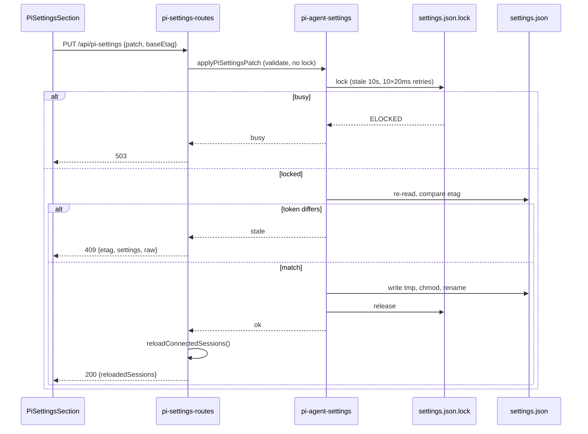

# pi settings editor + default-model mirror

Edits pi's global `settings.json` from Settings → Sessions. Mirrors dashboard default model into pi.
See change: edit-pi-agent-settings (design D1–D8).

## Files

- `packages/server/src/pi-agent-settings.ts` — engine: `readPiSettings`, `computePiSettingsEtag`, `withPiSettingsLock`, `applyPiSettingsPatch`, `writePiSettingsRaw`, `mirrorDefaultsToPi`.
- `packages/server/src/routes/pi-settings-routes.ts` — REST. `PI_SETTINGS_RAW_BODY_LIMIT` = 256 KiB.
- `packages/server/src/routes/system-routes.ts` (~L558) — `PUT /api/config` mirror hook.
- `packages/server/src/server.ts` (~L2267, L2283) — `reloadConnectedSessions`, route registration.
- `packages/shared/src/dashboard-paths.ts` (L61) — `resolvePiAgentDir`.
- `packages/shared/src/pi-settings-keys.ts` — `PI_MANAGED_SETTINGS_KEYS` (`defaultProvider`, `defaultModel`, `defaultThinkingLevel`).
- `packages/shared/src/role-schema.ts` — `THINKING_LEVELS`.
- `packages/client/src/components/settings/PiSettingsSection.tsx` — UI, `deriveMirror`.

Global file only. `<cwd>/.pi/settings.json` never read or written.

## Paths

- `agentDir` = `$PI_CODING_AGENT_DIR` (tilde-expanded) else `~/.pi/agent`.
- Settings = `<agentDir>/settings.json`.
- Lock = `<settings.json>.lock` (unresolved path; same artifact as pi).
- Write target = `realpath` if path is symlink, else path.

## REST

All behind `networkGuard`.

| Route | Body | 200 body |
|---|---|---|
| `GET /api/pi-settings` | — | `{ settings, raw, etag, parseError? }` |
| `PUT /api/pi-settings` | `{ patch, baseEtag }` | `{ settings, raw, etag, reloadedSessions, restoredKeys? }` |
| `PUT /api/pi-settings/raw` | `{ raw, baseEtag }` | same as above |
| `POST /api/pi-settings/sync-defaults` | — | `{ piMirror, settings, raw, etag }` (no reload) |

Status:

- `200` ok.
- `400` invalid (`errors[]`), unparseable current file (`parseError`), or missing `baseEtag`.
- `409` stale: `{ error:"stale", etag, settings, raw }`.
- `413` raw body > 256 KiB: `{ success:false, error }`.
- `503` lock busy: `{ error:"busy" }`.
- `500` I/O.

## Content token (etag)

- Canonical: strip BOM → parse → delete mirrored keys → sort keys recursively → `JSON.stringify` → sha256.
- Absent file → `"absent"`. Unparseable → sha256 of raw bytes.
- Mirrored keys excluded: mirror writes never stale the draft.
- Reorder or reformat → same etag.
- Token re-checked under lock. Mismatch → `409`, nothing written.
- Success returns post-write `{ etag, settings, raw }`. Client re-baselines from it.

## Lock + atomic write

`withPiSettingsLock(fn, { baseEtag }, deps)`:

1. Validate and prepare input BEFORE lock (keeps critical section short).
2. `mkdir -p` settings dir.
3. `proper-lockfile.lock(path, { realpath:false, stale:10_000, retries:{retries:10, minTimeout:20, maxTimeout:20} })`. Async. Locks even when file absent.
4. Re-read (BOM stripped). Compare etag if `baseEtag` set → `stale`.
5. Run pure `fn(state)` → new text or failure.
6. Write tmp `.<hex>.settings.tmp` in target dir.
7. `chmod` tmp to target `mode & 0o7777` when target exists.
8. `rename(tmp, target)`. Tmp removed on failure.
9. Release in `finally`.

- `ELOCKED` → `busy` → `503`.
- Crashed holder → lock stale after 10 s, reclaimed.
- Failed tmp write → `io`; target untouched.
- All fs calls via injectable `FsDeps`.

## Typed form (D3)

- Keys: `compaction.{enabled,reserveTokens,keepRecentTokens}`, `branchSummary.{reserveTokens,skipPrompt}`, `steeringMode`, `followUpMode`, `defaultProjectTrust`, `hideThinkingBlock`, `quietStartup`.
- Leaf patch. Nested objects merge. Unknown siblings survive.
- `null` leaf → delete key. Whole block cannot be nulled.
- Other keys (incl. `shellPath`) → `400`, points to JSON mode.
- Mirrored keys → `400`.
- Unparseable file → `400 { parseError }`. Never patch over `{}`.

## Raw editor (D6)

Validation, before write:

- BOM stripped; valid JSON; root plain object.
- D3 keys present → correct type.
- `retry`, `retry.provider` plain objects; present known fields follow retry-editor rules.
- String arrays: `extensions`, `prompts`, `themes`, `enabledModels`, `defaultTools`, `npmCommand`.
- `skills`: string array or legacy object. `packages`: string or object array.
- `shellPath`, `shellCommandPrefix`: string. `modelThinkingLevels`: valid levels.
- Failure → `400 { errors:[{field,message}] }`.
- Unlisted keys NOT type-checked.
- Mirrored keys overwritten with on-disk values (read under lock); substituted keys → `restoredKeys`.
- Written text: `JSON.stringify(obj, null, 2)` + `\n`.
- Unparseable current file does not block raw write (repair path).

## Default-model mirror (D1)

Trigger: `PUT /api/config` partial carries `defaultModel` and/or `defaultThinkingLevel`.

- Runs after `writeConfigPartial`. Never fails the save.
- Reads persisted `loadConfig()` INSIDE lock. Last overlapping save wins.
- `defaultModel`: split on FIRST `/`. Both sides non-empty → write `defaultProvider` + `defaultModel`. Else → `skipped:"no-provider-separator"`.
- `defaultThinkingLevel` in `THINKING_LEVELS` → write `defaultThinkingLevel`.
- Empty value → pi key untouched. Only differing keys written.
- Unparseable pi file → `{ok:false, error:"parse"}`; never written from `{}`.
- Other failure → `{ok:false, error}`, logged.
- No mirror attempted → `piMirror` omitted. Mirror never reloads.

**Drift repair.** `POST /api/pi-settings/sync-defaults` runs same mirror from current config, both keys, no reload. UI offers "Apply dashboard default to pi" only when `deriveMirror` yields a value differing from pi.

## Reload (D7)

- Typed and raw writes → `reloadConnectedSessions()` on success only.
- Mirror and sync-defaults never reload. Defaults read at session construction only.

## UI (D8)

- Settings → Sessions, after Retry. Title "pi settings (global)".
- Form (typed; mirrored keys read-only) and JSON (Monaco, whole file).
- One draft: `useSettingsDraftSource({ id:"pi-settings", page:"sessions" })`.
- Mode switch while dirty → discard or stay. No Form↔JSON conversion.
- `409` → conflict banner; "Reload from disk" discards draft. No auto-merge.
- `400` → per-field errors; draft stays dirty.
- JSON draft changing mirrored key → pre-submit warning.
- `piMirror.ok === false` → warning in Default Model callout. `skipped` → info notice.

## Known limits

- pi flush wins its own field. Queued pi flush landing after dashboard write overwrites that field only. Reload narrows window.
- First-creation race. Absent file: pi reads unlocked, locks before write. Dashboard creating file in that window → pi replaces it. Later writes fully serialized.
- Dashboard writes do not preserve whitespace, key order, or BOM.
- Code-executing keys (`packages`, `extensions`, `shellPath`, `shellCommandPrefix`, `npmCommand`) editable behind `networkGuard`. Validation prevents type confusion, not intent.
- E2E harness seed `defaultProvider:"faux"` is rewritten by any saved Default model.
- Project `<cwd>/.pi/settings.json` may override at runtime.
