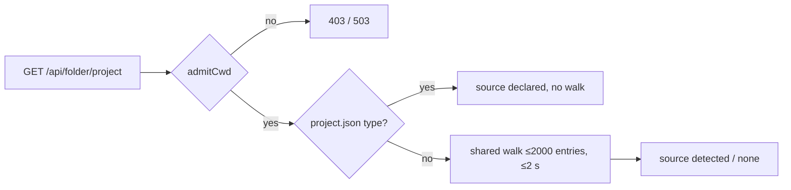

# Plugin apps (embedded + standalone)

Plugin React app → two hosts: embedded in dashboard content area (beside sidebar) and standalone at `/apps/<id>/`. Same app source. See change: add-plugin-app-host.

Packages:
- `@blackbelt-technology/pi-dashboard-app-kit/react` — `AppHost`, `defineDashboardApp`, `AppHostProvider`, `useAppHost`, `createStandaloneHost`, `StandaloneBar`. Contract unchanged.
- `@blackbelt-technology/dashboard-plugin-runtime` — `EmbeddedAppShellProvider`, `EmbeddedAppReturnPill`, `isSafeDashboardPath`, `createReturnTargetStore`, `useShellOverlayRouteDepth`.
- `@blackbelt-technology/dashboard-plugin-runtime/embedded-app` — `EmbeddedApp` (subpath only, keeps app-kit out of runtime root).
- Reference fixture: `packages/demo-plugin` (`demo-app/`).

## Slots recipe

Folder plugin entry + menu + content route. OpenSpec-board style.

```json
"claims": [
  { "slot": "sidebar-folder-section", "component": "FolderWallEntry" },
  { "slot": "shell-overlay-route", "component": "WallRoute",
    "path": "/folder/:encodedCwd/wall/*?", "depth": 2,
    "parentPath": "/folder/:encodedCwd", "presentation": "content" }
]
```

- `sidebar-folder-section`: state-only pill `<App> (state) →`. Navigates to claim path. No own UI beyond the pill.
- `useFolderMenuItem`: open / share / open-standalone entries.
- `shell-overlay-route` `presentation: "content"`: renders in content area beside sidebar. No scrim. Sidebar stays interactive.
- `depth: 2` + `parentPath: "/folder/:encodedCwd"`: Back target = folder. Mobile = detail panel depth 2.
- Path ends `/*?`: base route + all sub-routes deep-link (`/folder/x/wall/graph`).
- Global app (e.g. team `/team/`): `depth: 1` claim, path `/team/*?`, no `parentPath`. Back → `/`.

Claim rules (validator, `manifest-validator.ts`):
- `"content"` requires `depth` (`1` or `2`); missing → fatal.
- Only literal trailing `/*?` wildcard accepted. Any other `*` (incl. `/*`) → fatal.
- Unknown `presentation` → fatal.

Matching: one shared matcher `matchWouterPatternWithParams` (`slot-consumers.tsx`) for matched hook, presentation hook, sync params path. Rest segments → `params["*"]` (`""` at base). `back-target.ts` treats `*?` as ≥0 rest segments; excluded from specificity score, so wildcard claim never outranks core descriptor.

## Presentation

| presentation | Desktop | Mobile | Depth source |
|---|---|---|---|
| `dialog` | route-backed dialog, scrim + underlay | dialog | fixed 2 |
| `page` | full viewport | full viewport (before `MobileShell`) | n/a |
| `content` | content area beside sidebar, no scrim | `MobileShell` detail panel | declared `depth` |

Background capture: `dialog` and `content` skip `captureBackground`. `page` unchanged.

## `<EmbeddedApp>` props

```tsx
import { EmbeddedApp } from "@blackbelt-technology/dashboard-plugin-runtime/embedded-app";

export default function WallRoute({ params, onBack }: { params: Record<string, string>; onBack: () => void }) {
  return (
    <EmbeddedApp
      app={wallApp}
      basePath={`/folder/${params.encodedCwd}/wall`}
      folderParam={params.encodedCwd}
      standaloneUrl="/apps/wall/"
      onBack={onBack}
    />
  );
}
```

| Prop | Req | Purpose |
|---|---|---|
| `app` | yes | `DashboardAppDefinition` (`defineDashboardApp`) |
| `basePath` | yes | Route base app renders under |
| `onBack` | yes | Claim's descriptor back action |
| `folderParam` | no | Encoded folder token. Decodes to `folder = { cwd, name }` |
| `standaloneUrl` | no | Enables *Open standalone*; absent → no button |
| `projectScope` | no | `{ type?, id? }`. Mount only on matching folder project. ≥1 field. Needs `folderParam`. Scoped → no standalone. See Project-scoped apps |

Route components: export `React.lazy` (see Build + lazy route).

## Embedded AppHost

| Field | Value |
|---|---|
| `mode` | `"embedded"` |
| `basePath` | `EmbeddedApp` `basePath` |
| `folder` | `{ cwd, name }` from `folderParam`; absent for global apps |
| `capabilities.dashboard` | `true` |
| `capabilities.fullscreen` | `document.fullscreenEnabled` |
| `capabilities.standaloneUrl` | `standaloneUrl` prop |
| `api.fetch` / `api.wsUrl` | shell services (see below) |
| `identity.current` | `null` (dashboard session; no operator model) |
| `theme` | `data-theme` attr, MutationObserver |
| `i18n` | dashboard language |

Host methods:
- `setTitle(t)`: sets shell title + `document.title`. Restored on unmount.
- `setActions(a)`: top-bar actions.
- `openSession(id)`: → `/session/<encodeURIComponent(id)>`.
- `openFolder(cwd)`: → `/folder/<encodeFolderPath(cwd)>`.
- `navigateDashboard(path)`: validated (below), else no-op + `console.warn`.
- `openStandalone(appPath?)`: `window.open(<standaloneUrl><suffix>, "pi-app-<appId>")`.
- `requestFullscreen(el?)`.

## Top bar

Layout (OpenSpec-board style):

`← Back · <folder> › <app title> · HeaderContext · ≤2 actions + ⋯ overflow · Open standalone ⧉`

- Breadcrumb omits folder for global apps.
- `HeaderContext` = app component, optional.
- Inline actions: first `INLINE_ACTIONS = 2`. Rest → overflow menu.
- Narrow (< 640 px): Back icon · HeaderContext · ⋯. Touch targets 44 px.
- Open standalone hidden below `sm`.

## Shell services and auth

Injected by `App.tsx` via `EmbeddedAppShellProvider`. Built by `createEmbeddedAppShell` (`packages/client/src/lib/plugins/embedded-app-shell.ts`).

- `fetch(path)`: root-relative, scheme-free only. Else rejects. Adds `Authorization: Bearer` when `getApiBearer()`; else cookie/loopback.
- `wsUrl(path)`: same path rule; else `null`. Mints ticket via `mintWsTicket("browser")` only when `getApiBearer() || isDevicePaired()` (same predicate as `useWebSocket`).
- `encodeFolder` / `decodeFolder`: core `lib/util/folder-encoding.ts`.
- Missing provider → `embedded-app-no-shell` state.

Stricter than app-kit standalone transport: absolute URLs refused. Bearer never leaves origin.

## Host navigation and validation

Path rules (`isSafeDashboardPath`):
- Starts with exactly one `/`. Not `//`.
- No `\`, whitespace, control char — raw or percent-decoded.
- No `.` / `..` segment after decoding.
- `navigateDashboard`: first segment may not be `apps`.
- Query / hash allowed; checked for same characters.

Rules:
- Navigation uses wouter `navigate` (push). Never `window.location`.
- `openSession` / `openFolder` build own path; skip `navigateDashboard`. Unknown session → existing redirect to `/` (`App.tsx:1327-1331`).
- `openStandalone(appPath)`: `appPath` must start `/` or `#`, pass the char rules. Else no-op + warn.
- Standalone URL: suffix = `appPath` or current location relative to `basePath`.
- `#`-router apps pass hash themselves (e.g. wall `#/s/<token>`).
- Electron: `setWindowOpenHandler` sends every `window.open` to `shell.openExternal` (system browser). Named-window reuse does not apply. Standalone signs in via app-kit OIDC; Electron session bearer not shared.

```mermaid
flowchart LR
  F[Folder pill / menu] -->|claim path| A[EmbeddedApp in content area]
  A -->|openSession / openFolder / navigateDashboard| D[Dashboard route]
  A -->|openStandalone| W[Named window pi-app-id or system browser in Electron]
  A -->|record returnTarget| R[Return pill on dest]
  D -->|dest reached| R
  R -->|click: push href| A
  D -->|other location| X[Clear returnTarget]
  S[/apps/id/ standalone] -.same app source.- A
```

## Return pill

- Before any host navigation: records `returnTarget = { appId, title, context, href, dest }` in in-memory store (`createReturnTargetStore`).
- `context` = last `setTitle()`, else folder name, else empty (drops ` · <context>`).
- Pill `← <title> · <context>` shows only while location === `dest`.
- Click: clears target, pushes `href`. Never `history.back()`.
- Location moves to a path ≠ `dest` after dest reached → cleared.
- One target at a time. Lost on reload. Push adds one history entry.

## States

| State | Trigger | UI |
|---|---|---|
| loading | lazy chunk / Suspense | top-bar-shaped skeleton (`content-claim-loading`), app `aria-busy` |
| running | normal | app |
| crashed | error boundary | message + *Reload app* (remount via epoch key) + *Back* |
| folder not found | `folderParam` decode fails | message + Back |
| no shell | no `EmbeddedAppShellProvider` | message + Back |
| plugin disabled | plugin off | claim absent; URL handled as unmatched (no new fallback) |
| not available (folder) | `projectScope` mismatch or folder entry `error` | *Not available for this folder* (app title + folder name) + top bar + Back → `onBack` |
| not available (here) | `projectScope` set, no `folderParam` | *Not available here* (app title only) |

## Project-scoped apps

Scope app to repo type or declared identity. Gates folder routes only. Data stays bound to admitted cwd.



### Identity file

- Path: `<cwd>/.pi/dashboard/project.json`. Dashboard namespace, beside `knowledge_base.json`.
- Shape: `{ "schemaVersion": 1, "id"?: string, "type"?: string }`.
- `id` / `type` regex: `^[a-z][a-z0-9-]{0,63}$`. Validated per field.
- Bad field → absent. Other field kept.
- Unknown fields ignored.
- Whole file ignored when:
  - not regular file
  - `.pi`, `.pi/dashboard`, or file is symlink
  - size > 64 KiB (65536 ok; read ≤ 64 KiB+1)
  - not JSON object
  - `schemaVersion` ≠ 1
- Parent dev/ino re-checked after open.

### Detection

Plugin manifest: `projectTypes: [{ type, markers: string[] }]`. ≤8 entries. 1–16 markers each.

- Marker grammar:
  - root-anchored. 1–3 `/` segments.
  - `*` inside segment only. = zero or more non-`/` chars.
  - last segment needs non-`*` char.
  - forbidden: leading/trailing `/`, `\`, `.`/`..`/`.git`/`node_modules` segments, `**`, any of `?[]{}!`.
  - violation → fatal manifest error naming plugin + pattern.
- Case-sensitive. Names starting `.` match normally.
- Matches regular file or directory only.
- Symlinks never matched or followed.
- `.git` and `node_modules` never visited.

### Resolution

- Declared `type` wins → `types: [type]`, `source: "declared"`, no walk.
- Else all matching types → sorted, unique, `source: "detected"`.
- None matched → `source: "none"`.
- `id` only from declaration.
- Rules from plugins loaded + enabled + `fixtureEntryAllowed` only.
- No rules → no walk.

### Bounds

One shared walk per request.

- ≤2000 dir entries. Budget spent → no further read.
- ≤256 patterns. Plugins in `(priority, id)` order. Plugin not fitting → whole plugin skipped.
- ≤4 concurrent walks process-wide.
- 2 s deadline. Starts when slot acquired.
- `truncated: true` on entry budget hit, deadline hit, or plugin skipped.
- Declare `type` → no missed deep marker.

### Endpoint

`GET /api/folder/project?cwd=<abs>`

- 200 → `{ id: string|null, types: string[], source: "declared"|"detected"|"none", truncated?: true }`.
- 400 missing or relative `cwd`.
- 403 not admitted.
- 503 + `Retry-After` + `{ error: "cwd-admission-unavailable", message, retryAfterMs }`. Indeterminate.
- 404 admitted, folder missing.
- Admission = `admitCwd` (session cwds + pinned dirs + git checkout roots). Runs before any fs read.
- Never prompts. No `holdDenial`.
- Read-only. Route tier `observe`.
- In-flight de-dup per cwd.
- Impl: `packages/server/src/routes/folder-project-routes.ts`, `packages/server/src/lib/folder-project.ts`.

### Runtime client

`@blackbelt-technology/dashboard-plugin-runtime` root exports:

- `useFolderProject(cwd)`, `getFolderProject(cwd)`, `invalidateFolderProject(cwd)`, `clearFolderProjects()`.
- `folderHasProjectType(type)`, `folderHasProjectId(id)` → `(folder: { cwd }) => boolean`.

Entry state: `loading | ready | error`.

- Miss → predicate false + queued. Flush on microtask. No render-time state update.
- Landings coalesce → one `bumpSlotClaimsVersion()`.
- `error` fails closed. Expires after 60 s (entry dropped + bump → refetch).
- Per-folder generation + global epoch. Stale landings discarded (re-queued).
- Cleared by `usePluginEnabledSet` only when enabled set changes.
- Requires single runtime module instance.
- Folder consumers (`sidebar-folder-section`, `worktree-card-section`) re-evaluate on bump (`useSlotClaimsVersion`).
- Entry pops in after first sidebar render (same as installed-gate).

Plugin exports predicate as named export of client entry, referenced by claim `predicate`:

```ts
export const isJudoFolder = folderHasProjectType("judo");
```

### Embedding

```tsx
<EmbeddedApp app={judoApp} basePath={`/folder/${params.encodedCwd}/judo`} folderParam={params.encodedCwd} projectScope={{ type: "judo" }} onBack={onBack} />
```

- `projectScope = { type?, id? }`. ≥1 field. Empty → fails closed.
- Needs `folderParam`.
- Mounts only on `ready` entry matching every set field.
- `loading` → loading state.
- Mismatch or `error` → *Not available for this folder*.
- No `folderParam` → *Not available here*.
- Unscoped → unchanged, no fetch.
- Scoped → no `standaloneUrl`, no standalone entry.
- Closes folder-route deep links. Does not gate `shell-overlay-route` in registry.

### Security

- Declared `id` UNAUTHENTICATED. Any repo declares any id.
- Scoped apps MUST NOT grant privileged data by `id` alone.
- Data stays bound to admitted cwd.

### Identity vs team slug

- Folder `id` (repo-declared) ≠ team-plugin `projects` slug (admin config). Independent namespaces.

### Scaffold

`dashboard-plugin-scaffold` mode `new`:

- App scope prompt: `none|global|project-type|project-specific`.
- Generates app + lazy route + claims.
- `project-specific` → write `id` after final confirm: `pi-dashboard-plugin-scaffold --write-project-id <abs-folder> <id>`.
- Write: atomic temp+rename.
- Refuses: symlink, non-regular, oversized, non-object, `schemaVersion` ≠ 1, different existing `id`.

### Reference consumer

- `packages/demo-plugin` second app `demo-scoped`.
- `projectTypes` type `demo-scoped`, marker `.pi/dashboard/demo-scoped`.
- Route `/folder/:encodedCwd/demo-scoped/*?`.
- Original `demo-app` unchanged.

### Limits

- No server cache, no file watcher. After identity edit → `invalidateFolderProject(cwd)`. Plugin-set change or reload clears.
- No session-scoped gating.
- No per-folder plugin enable.
- Same-path claims from two plugins shadow by `(priority, id)`.

### Rollback

- Revert change.
- Leftover `project.json` files inert.
- External scoped consumers fail dashboard build until removed.

## Runtime-loaded embedded apps (one app, two builds)

External plugin (not bundled into dashboard build) embeds an app through runtime delivery. Option C layered on B. Mechanism: [`runtime-plugin-clients.md`](runtime-plugin-clients.md). Build recipe: [`publishing-plugins.md`](publishing-plugins.md) § "Runtime-delivered plugin client".

- Embedded half = `shell-overlay-route` claim rendering `<EmbeddedApp>`. Loaded as runtime ESM chunk. `serveApp` stays the standalone / share-link half.
- Import map carries the three host shims the app needs: `…/dashboard-plugin-runtime/embedded-app` (`/host/embedded-app.js`), `@blackbelt-technology/pi-dashboard-app-kit/react` (`/host/app-kit-react.js`), `wouter` (`/host/wouter.js`). One shared instance each, so `AppHost` context, `EmbeddedAppShellProvider`, wouter router reach plugin code.
- Plugin bundles NOTHING of app-kit, wouter, React. SDK preset externalizes them. Singleton guard fails the build otherwise.
- Same app source, two builds:

| Build | Preset fn | Output | React |
|---|---|---|---|
| Embedded | `dashboardClientViteConfig` | `dist/client/` (`clientBundle`: entry + lazy `module` chunk) | Host's, via import map |
| Standalone | `dashboardStandaloneViteConfig` | `dist/standalone/` (`index.html` SPA, `serveApp`) | Own |

- `host.api.fetch` works in both builds (embedded shell transport; standalone authed transport). `host.mode` tells which.
- Route claim = ~3 lines of plugin code in a lazy module:

```tsx
// src/client/S6Route.tsx  (claim module ./dist/client/s6-route.js)
import { EmbeddedApp } from "@blackbelt-technology/dashboard-plugin-runtime/embedded-app";
import { canaryApp } from "./canary-app.js";
export function S6Route({ onBack }: { onBack: () => void }) {
  return <EmbeddedApp app={canaryApp} basePath="/s6" onBack={onBack} />;
}
```

- Claim (manifest): `{ slot: "shell-overlay-route", component: "S6Route", module: "./dist/client/s6-route.js", path: "/s6/*?", depth: 1, presentation: "content" }`. Lazy: app code stays out of the entry module.
- Route descriptors (`path`, `depth`, `parentPath`) ride the listing. Client re-registers union of build-time + runtime descriptors.
- Trust applies: untrusted runtime plugin = no route. Operator trust + pin first.
- Remote-server mode + `--dev` page: runtime apps not loaded. Embedded runtime apps need production page on local server.

### Canary

Fixture `tests/fixtures/runtime-canary-plugin` (id `runtime-canary`, `fixture: true`). Proves the path in a stock production build.
- Build: `npm run build:canary` → `scripts/build-runtime-canary.mjs` (SDK preset). `dist/` never committed. Harness builds, hashes, trusts the hash.
- Claims: `settings-section` + `shouldRender`, lazy `settings-section`, `shell-overlay-route` `/s6/*?` (embedded app), `sidebar-folder-section` (`useFolderMenuItem` → `/s6`).
- App: `src/client/canary-app.tsx` (`defineDashboardApp`, wouter `/sub` route).
- Failure variants (`variants/`): `bundled-app-kit` (no host provider → throws in claim boundary), `bundled-react` (invalid hook call), `missing-export` (link-time `SyntaxError`), `throws-in-render` (contained by slot error boundary).

See change: decouple-plugins-from-core.

## Standalone

- Plugin serves `/apps/<id>/`.
- `standalone.tsx`: `<AppHostProvider host={createStandaloneHost(...)}><StandaloneBar app={app}/><app.App/></AppHostProvider>`.
- `capabilities.dashboard = false` → navigation no-ops (test-asserted).
- Same app source as embedded. No dashboard chrome.

## Build + lazy route

Two builds per app: library entry + standalone `index.html`.

Generated registry imports client entries statically. Keep app code out of dashboard initial bundle:

1. Plugin client entry exports route as `React.lazy`.
2. Lazy module renders `<EmbeddedApp>` with the app definition. App code → own chunk.
3. Slot consumer wraps `content` claim in `React.Suspense` (skeleton fallback).

Demo (`packages/demo-plugin`):
- `src/client.tsx`: `export const DemoAppRoute = lazy(() => import("./demo-app/DemoAppRoute.js"));`
- `src/demo-app/DemoAppRoute.tsx`: `<EmbeddedApp app={demoApp} basePath={/folder/${encodedCwd}/demo-app} folderParam onBack />`.
- `src/demo-app/fixture-app.tsx`: `defineDashboardApp({ id: "demo", title: "Demo", App })`. Views `/`, `/sub`; `openSession`; `setTitle("Demo ctx")`.
- Claim: `/folder/:encodedCwd/demo-app/*?`, `depth: 2`, `parentPath`, `presentation: "content"`.

Gate: dashboard initial bundle before/after + one fixture app ≤ +5 KB gzip (runtime + shell only).

Build wiring:
- `app-kit` resolves to source via aliases in `packages/client/vite.config.ts`, `packages/client/vitest.config.ts`, `packages/dashboard-plugin-runtime/vitest.config.ts`, root `tsconfig.json` `paths`.
- `app-kit` in `BUNDLED_WORKSPACE_PKGS` (`packages/electron/scripts/bundle-server.mjs`).
- `app-kit` precedes `dashboard-plugin-runtime` in `.github/workflows/publish.yml`.

## Embedding rules

- Route relative to `basePath` only.
- No `window.location` writes.
- No global CSS on `html` / `body` / `:root` in library entry.
- Use dashboard tokens (`var(--…)`).
- Title via `host.setTitle`, not `document.title`. Dev warns on mismatch.
- Do not mutate `<html>` / `<body>` class/style. Dev warns.
- History writes: review-only. Not auto-detected (dashboard router and app router share `pushState`).
- Key handlers scoped to app root.
- Storage keys prefixed `<appId>:`.
- Data via `host.api` only.
- Clean up on unmount.
- Peer deps `react`, `react-dom`, `wouter` at dashboard ranges.

## Rollback

Order matters: unknown `presentation` and `/*?` are fatal on old dashboards.

1. Revert consumer manifests declaring `"content"` or `/*?` first.
2. Remove `"content"` presentation, `/*?` matcher, shell transport provider, `<EmbeddedApp>`.
3. Apps stay standalone at `/apps/<id>/`.

## Verification

- Unit: `packages/dashboard-plugin-runtime/src/__tests__/embedded-app.test.tsx`, `manifest-validator.test.ts`, `shell-overlay-route-match.test.tsx`.
- Client: `packages/client/src/lib/__tests__/embedded-app-shell.test.ts`, `overlay-background.test.ts`, `mobile-depth.test.ts`.
- Lazy route: `packages/demo-plugin/src/__tests__/lazy-route.test.ts`.
- E2E (opt-in): `tests/e2e/plugin-embedded-app.spec.ts`.
