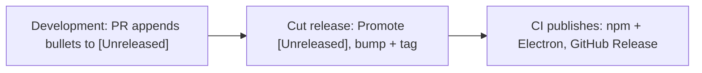

# Release Process

How-to for cutting pi-agent-dashboard release.
Goal: **low-friction, human-curated release notes** — no generator
tooling; discipline during dev + curation pass at tag time.

## Overview



Single source of truth: [`CHANGELOG.md`](../CHANGELOG.md). GitHub Release
body **extracted automatically** from matching section at tag time.

## Commit Conventions

[Conventional Commits](https://www.conventionalcommits.org/) prefixes,
enforced **by code review only** (no commit lint, no husky hooks).

| Prefix      | Meaning                                          |
|-------------|--------------------------------------------------|
| `feat:`     | User-visible new capability                      |
| `fix:`      | Bug fix                                          |
| `refactor:` | Internal restructure, no behaviour change        |
| `docs:`     | Docs-only changes                                |
| `test:`     | Test-only changes                                |
| `chore:`    | Dependency bumps, tooling, version bumps         |
| `ci:`       | CI / release workflow changes                    |

Optional scopes in parens encouraged (`feat(error-banner): …`).

## During Development

PR ships user-visible behaviour → **add bullet** under matching subsection
of `## [Unreleased]` in `CHANGELOG.md`:

```markdown
## [Unreleased]

### Added
- Drop-and-paste screenshots directly into the OpenSpec explore dialog.

### Changed

### Fixed
- Fork entryId timing: leaf registry now resolves the parent message correctly.
```

Bullets in **end-user language**, not commit-subject shorthand. Link to
relevant docs when helpful. Missing bullet does **not** block PR —
release author back-fills during curation.

## Cutting a Release

### 1. Curate `Unreleased`

- Review `git log <last-tag>..HEAD`; confirm every user-visible change has
  bullet under `## [Unreleased]`.
- Add anything contributors missed.
- Tighten wording. Reorder for impact.
- Pick next version per SemVer: feature additions → minor, bug fixes only
  → patch, breaking changes → major.

### 2. Promote `Unreleased` → versioned section

In `CHANGELOG.md`:

1. Rename `## [Unreleased]` → `## [<version>] - <YYYY-MM-DD>` (today, no
   leading `v`).
2. Insert fresh empty `## [Unreleased]` section **above** it:

   ```markdown
   ## [Unreleased]

   ### Added

   ### Changed

   ### Fixed

   ## [<version>] - <YYYY-MM-DD>
   ...
   ```

### 3. Bump workspace versions

```bash
npm version <version> --workspaces --include-workspace-root --no-git-tag-version
node scripts/sync-versions.js
```

First command updates `version` in `package.json` + every workspace under
`packages/*` in single edit. Second (`sync-versions.js`) rewrites every
inter-package dependency specifier (e.g.
`"@blackbelt-technology/pi-dashboard-shared": "^<old>"`) to bumped
version. Without it, published root declares `"pi-dashboard-server":
"^<old>"` while actual server tarball `^<new>` — inconsistent registry
metadata.

Verify: `git diff package.json packages/*/package.json` — expected:
lockstep `version` bumps + synchronised inter-package dep specifiers.

> Why separate script? npm CLI does not implement `workspace:` protocol
> (pnpm/yarn-only). Use plain semver ranges (`"^0.3.0"`) + sync at bump
> time. CI also runs `sync-versions.js` defensively in `publish.yml`
> after `npm version`, so forgotten local invocation does not corrupt
> release.

### 4. Commit

```bash
git add CHANGELOG.md package.json package-lock.json packages/*/package.json
git commit -m "chore(release): v<version>"
```

### Before step 5: read both nightlies

Tag gate does not prove the tag publishes. Check before tagging:
- `nightly-tests.yml` (03:00 UTC, issue label `nightly-tests`): unit suite that `pnpm test` runs in the tag gate, plus `budget` job green on `develop`.
- `nightly.yml` (04:13 UTC, issue label `nightly`): rehearsal of publish (`npm@latest` loopback publish), install smoke, Electron matrix green.
- The two can test different commits (design D1). Each report names its SHA (`<name> is red|green at <sha>.`). Compare SHAs, not times.
- Neither runs on the commit `tag-and-push` creates.
- Tag gate `pnpm test` does not collect the budget lane (`*.budget.test.*` needs `RUN_BUDGET_TESTS=1`). Release path never sets `RUN_BUDGET_TESTS` (pinned by release-gate clause 6, `packages/shared/src/__tests__/publish-workflow-contract.test.ts`). Wall-clock and memory assertions not yet in budget files still run in the tag gate.
- Open, owner follow-up: GitHub reports `macos-14` not supported for this repo on 2026-11-23 (`The configuration 'macos-14-arm64-us-default' is not supported`). Affects `_electron-build.yml:122` (darwin/arm64 leg) and `publish.yml:611`. Not fixed by `schedule-release-rehearsal`.

Residual risk: what a green rehearsal does not prove (from `schedule-release-rehearsal` proposal.md). A green rehearsal does not prove the next tag will publish. These release failure classes stay uncovered:

| Failure class (seen in a real release) | Covered after this change? | Why not |
|---|---|---|
| `ci-checks :: Run pnpm test` (the most frequent measured failure: 4 attempts, mostly wall-clock and memory budget assertions) | Not by the rehearsal | `nightly.yml` runs no unit suite and no `pnpm run lint`; the tag gate still runs `pnpm test` (B3). What reduces this class is change `stabilize-blocking-test-lanes`: the budget files it creates are not collected by `pnpm test` and run in the `budget` job of `nightly-tests.yml`, and `nightly-tests.yml` runs the full suite on `develop` every night (issue label `nightly-tests`). Still open: budget assertions not yet moved into budget files (until `migrate-budget-assertions`), non-budget flakes, and the untested `tag-and-push` commit (next row). |
| Windows `runtime-asset` `tar`/`EXDEV`, and every other path of the release `runtime-asset` job | No | Not rehearsed. Moved to `rehearse-runtime-asset-matrix`. |
| A defect in `publish.yml`'s own step text. Example: the v0.9.0 `EALLOWREMOTE` in "Set version from resolved tag", caused by `publish.yml`'s own `npm version` call under `npm@latest` | No | The rehearsal runs its own copies of the release commands (`nightly.yml` steps, `nightly-verdaccio-publish.mjs`), never `publish.yml`'s steps. `nightly.yml` never used `npm version`, so it would not have caught that failure. That instance was fixed in commit 60a155465 and is pinned by `publish-version-step-contract.test.ts`. |
| npm `E404` on publish, packages not resolving on the registry, `ETARGET` from propagation lag | No | Verdaccio makes a version visible at once. Public-registry visibility and lag cannot be reproduced on loopback. |
| OIDC token exchange, `--provenance`, `--access public`, `403`/`409` on publish, and any `npm@latest` behaviour that appears only on an authenticated upload to the real registry | No | Needs `id-token: write` and the real registry. The rehearsal must never hold either. `verify-publish` uploads to loopback with a fake token and `--no-provenance`. |
| An `npm@latest` refusal that `--allow-remote=all` suppresses | No | The rehearsal's workspace lock step and `generate-runtime-lock.mjs` pass that flag. |
| `assert-bundled-plugins-published.mjs` and the per-package `npm view` idempotency check of the release publish loop | No | The rehearsal publish script does not run them (`nightly-verdaccio-publish.mjs:211-233`). |
| `npm@latest` drift on macOS or Windows runners | No | Only `verify-publish` (ubuntu, the release `publish` job's runner) uses `npm@latest`. The Verdaccio publishes inside the `electron` legs use the runner's npm; the release `electron` job does not publish. |
| `tag-and-push` (commit, tag, push) | No | Forbidden by the safety contract (`nightly-workflow-contract.test.ts:71-89`). |
| `github-release` (notes extraction, `latest-mac.yml` merge, asset upload) | No | Creating a release is forbidden. |
| `runtime-release-assert`, `site-redeploy`, `discord-announce` | No | They act on a published release. |
| Deterministic test failure on the tagged commit | No | `tag-and-push` creates a new commit that was never tested (`publish.yml:224-227`). `nightly-tests.yml` tests `develop` HEAD as of its 03:00 UTC run and the rehearsal builds `develop` HEAD as of its 04:13 UTC run, which can be a different commit (design D1); neither runs on that commit. |
| macOS signing and notarisation (once `macos-notarization` lands) | No | `nightly.yml` passes no signing secrets to `_electron-build.yml` (`nightly.yml:178-192`), so the macOS legs take the unsigned path. |
| Release-only jobs proposed by active changes (`server-launch-smoke`, `mobile-android`, Authenticode signing) | No | Non-goal here. See Impact. |

Newly covered:
- A new `npm@latest` that breaks `npm pkg set`, runtime-lock generation and lint, or per-package publishing (`verify-publish` under `npm@latest`, to loopback). This is preventive: no measured release failure is known that it would have caught.
- The install-smoke legs (`smoke` job).
- The macOS Intel launch smoke and runtime-lock generation for a first-party package that is missing from the publish set. Both already exist in the `electron` legs (`nightly-verdaccio-publish.mjs:229`). They only start running nightly because the cron is enabled.

### 5. Tag and push

```bash
git tag v<version>
git push origin develop
git push origin v<version>
```

Tag push triggers `.github/workflows/publish.yml`.

## What CI Does

On `v*` tag push, `publish.yml`:

1. **`publish` job** — publishes **five npm packages** in one invocation
   of `npm publish --workspaces --include-workspace-root --provenance
   --access public`:
   - `@blackbelt-technology/pi-agent-dashboard` (root metapackage)
   - `@blackbelt-technology/pi-dashboard-shared`
   - `@blackbelt-technology/pi-dashboard-extension`
   - `@blackbelt-technology/pi-dashboard-server`
   - `@blackbelt-technology/pi-dashboard-web`

   Job runs `node scripts/sync-versions.js` between `npm version` +
   `npm run build` so inter-package dep specifiers match bumped version
   even if release author forgot local invocation.

   `packages/electron` marked `"private": true`, auto-skipped by
   `npm publish --workspaces`; ships as native installers via Electron
   job.

2. **`electron` job (matrix)** — builds DMG (macOS arm64), DEB + AppImage
   (Linux x64 + arm64), NSIS `Setup.exe` + ZIP (Windows x64 + arm64).
   Per-user NSIS artifact `PI-Dashboard-Setup-<version>-<arch>.exe`; portable
   `.exe` dropped; `.zip` unchanged. appId `hu.blackbelt.pi-dashboard`
   immutable after first NSIS release — changing it strands installed users
   on the old Add/Remove Programs entry.
3. **`github-release` job** —
   - Extracts `## [<version>]` section from `CHANGELOG.md` →
     `release-notes.md`.
   - Extraction fails / returns empty → writes one-line fallback body
     pointing at `CHANGELOG.md`, logs warning.
   - Calls `softprops/action-gh-release@v2` with
     `body_path: release-notes.md`, `draft: true`, all Electron artifacts
     attached.
4. **`discord-announce` job** — posts release notes to community Discord.
   `needs: [resolve, github-release]`; runs alongside `site-redeploy`.
   Fires only when `github-release` succeeded AND `is_prerelease != 'true'`
   — prereleases stay quiet. `continue-on-error: true` — webhook failure
   never reds release. Reads repo secret `DISCORD_RELEASE_WEBHOOK` via env
   `DISCORD_WEBHOOK_URL`; secret unset → step logs skip, exits 0.
   Sparse `actions/checkout@v4` of `scripts/discord-release-announce.mjs`.
   `gh release view "$TAG" --json name,url,body > release.json`, then
   `node scripts/discord-release-announce.mjs release.json "$TAG"`.
   Script posts FULL body, no truncation. Splits on line boundaries into
   ≤ 4000-char embeds, one embed per message, sequential (`?wait=true`).
   Titles `Released <name>`; continuations `Released <name> (i/N)`. Title
   ≤ 256 chars (name shortened with `…`). Empty body → `_No release notes._`.
   Every message `allowed_mentions: { parse: [] }` blocks @everyone / role /
   user pings. HTTP 429 → waits `retry_after`, max 5 retries per message;
   `retry_after` > 60 s aborts. Other failure → exits non-zero with Discord
   status + body, never webhook URL.

Release lands as **draft** — nothing published until *Publish* clicked on
GitHub Releases page.

## Manual Fallback

Auto-extracted body rendered incorrectly (missing section, wrong version,
truncated bullets) → fix before publishing:

1. Open draft release on GitHub.
2. Replace body with correct content from `CHANGELOG.md`.
3. Click *Publish release*.

Worst case (no release at all, wrong artifacts) → delete tag, fix, re-push:

```bash
git push --delete origin v<version>
git tag --delete v<version>
# fix the issue, bump if needed
git tag v<version>
git push origin v<version>
```

## After Publishing

- Discord announce fires from `discord-announce` job — see
  [Discord Announcement](#discord-announcement).
- X / other channels still manual.
- Monitor GitHub Issues for install/upgrade regressions.
- Leave `## [Unreleased]` empty-but-present so next contributor has
  obvious target.

## Discord Announcement

Automatic. `discord-announce` job in `publish.yml` posts release notes to
community Discord `#releases` (announcement channel) after `github-release`
succeeds. Posts full release body via `scripts/discord-release-announce.mjs`
(split into ≤ 4000-char embeds; v0.10.0 ≈ 37k chars → ~10 messages). Best-effort — see
[What CI Does](#what-ci-does) job 4.

One-time setup:

1. Discord channel → Edit Channel → Integrations → Webhooks → New Webhook.
2. Copy webhook URL.
3. `gh secret set DISCORD_RELEASE_WEBHOOK` (repo secret).

Partial failure: may leave only first messages posted. Recovery: delete
partial messages in `#releases`, then GitHub Actions → release run →
"Re-run failed jobs" on `discord-announce`.

Rollback: delete `DISCORD_RELEASE_WEBHOOK` secret (job skips, exits 0) or
delete `discord-announce` job.

Community invite: <https://discord.gg/DrNebZ3pF5>.

## Rollback: bad auto-update release

Production tags `vX.Y.Z` publish immediately, not draft.
Production releases ship `latest.yml`, `latest-mac.yml`, `latest-linux.yml`.
electron-updater clients resolve `/releases/latest`.

Stop NEW clients updating to bad release: flip release back to draft.

```bash
gh release edit v<version> --draft
```

Draft release excluded from `/releases/latest`.
electron-updater stops resolving it.
Unpublish via GitHub UI works too.

Flip to draft does NOT recall update already downloaded or applied.
Draft only prevents further clients resolving release.

Supersede bad release clients already pulled: cut higher production tag `vX.Y.Z+1`.
Clients update forward.
Deletion alone does not roll clients back.

Bad `latest*.yml` shipped (wrong sha512, missing file): re-cut corrected metadata under higher tag.
Do not hand-edit release assets.
sha512 in `latest*.yml` must match uploaded binary.

Full revoke (delete release + tag + npm deprecate): use `release-revoke` skill.
