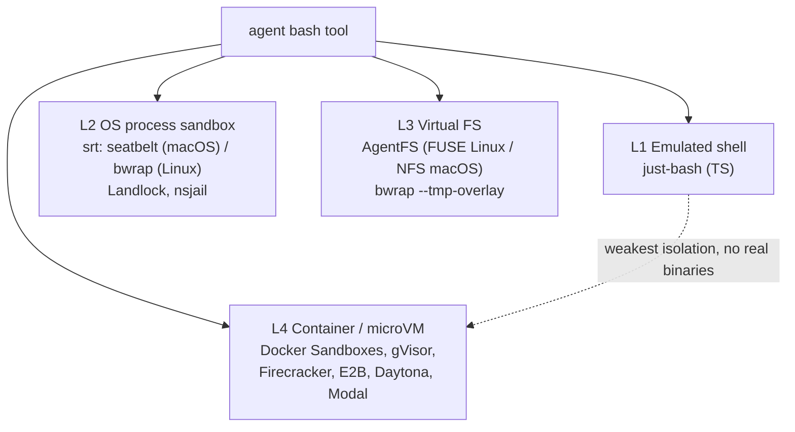
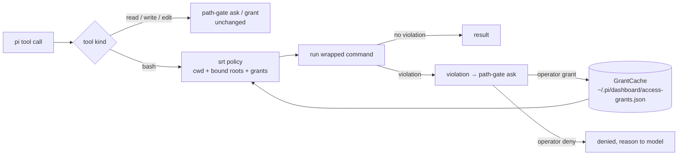

# Agent bash sandboxing — isolate file/dir access for arbitrary shell

> Status: **research / explore-mode** (no change, no impl).
> Goal: isolate agent file and directory access when tools run arbitrary bash. path-gate covers `read`/`write`/`edit` only.
> Date: 2026-10-14 (actual `date +%F`; brief said 2026-10-11, brief date ignored).
> Sources (read 2026-10-14):
> - github.com/vercel-labs/just-bash — `packages/just-bash/README.md`
> - github.com/anthropic-experimental/sandbox-runtime — README
> - github.com/tursodatabase/agentfs — README
> - pi example `examples/extensions/sandbox/index.ts` in `@earendil-works/pi-coding-agent` (321 lines, read locally)
> Related: `packages/extension/src/path-gate/AGENTS.md`.

---

## 1. Problem

- path-gate (`packages/extension/src/path-gate/`) gates pi `read`/`write`/`edit`.
- Its row says: "Approval control, not a sandbox (`bash`/custom tools uncovered)."
- `bash` spawns processes. Process syscalls bypass any tool-level guard.
- Command-string parsing is unsound:
  - `eval`, `$(…)`, backticks, here-docs.
  - `python -c`, `node -e`, `perl -e`.
  - Makefiles, package scripts, git hooks.
  - symlinks, hardlinks, `..` traversal, env-var expansion.
- Enforcement must sit below the shell:
  - (a) emulate the shell so every op passes through our FS layer, OR
  - (b) constrain the OS process (seatbelt / bwrap / Landlock / namespaces), OR
  - (c) isolate the whole environment (overlay FS, VM, container).

---

## 2. Four layers (light → heavy)

| Layer | Isolation | Compat with real toolchain | Startup cost | Effort |
|---|---|---|---|---|
| L1 just-bash | FS + net via emulator | ✗ no real binaries | ~0 | medium |
| L2 srt / Landlock / nsjail | kernel-enforced FS + net | ✓ | ~0 | low–medium |
| L3 AgentFS / overlay | FS view, undo, audit | ✓ (real binaries on top) | low | medium–high |
| L4 container / microVM | full | ✓ full | high | high |

Ordering = weakest → strongest isolation. Layers are not exclusive; L2 + L3 combine.

---

## 3. L1 — just-bash (Vercel Labs)

- npm `just-bash`. Apache-2.0. Beta.
- Bash interpreter in TypeScript. Commands reimplemented in JS. Pluggable FS.
- Default FS `InMemoryFs`. No disk touched.
- `OverlayFs` (`just-bash/fs/overlay-fs`):
  - copy-on-write over a real dir.
  - reads hit disk; writes stay in memory.
  - `getMountPoint()` returns view root.
  - `maxCopyOnWriteSize` default 100 MB.
- `ReadWriteFs` (`just-bash/fs/read-write-fs`):
  - real r/w confined to `root`.
  - keep `root` off trusted code (no sandbox escape guarantees beyond path confinement).
- Optional features:
  - `python: true` → CPython.
  - `javascript: true` → QuickJS (`js-exec`).
  - `curl` / html-to-markdown → need network config.
  - sqlite.
- `executionLimits` e.g. `maxCallDepth`.
- `date` defaults UTC.
- Custom commands receive `ResolvedCommandContext` = `{fs, cwd, env, stdin, limits, exec}`.
- Limit: no real binaries. No `git`, `npm`, `pnpm`, native toolchains.
- Fit: analysis / data agents. Poor fit for coding agent in this repo.

---

## 4. L2 — srt (`@anthropic-ai/sandbox-runtime`)

- Install: `npm i -g @anthropic-ai/sandbox-runtime`. Beta research preview. Used by Claude Code.
- OS-level FS + network restriction. No container.
- Mechanisms: seatbelt (`sandbox-exec`) on macOS, bubblewrap (`bwrap`) on Linux.
- Network: proxy allowlist.
  - config `allowedDomains`, `deniedDomains`.
- FS config: `denyRead`, `allowRead`, `allowWrite`, `denyWrite`.
- Read rules:
  - deny-then-allow.
  - `allowRead` beats `denyRead`.
  - exception: more-specific `denyRead` stays denied.
- Write rules: `denyWrite` beats `allowWrite`.
- Violation telemetry:
  - macOS: reads system sandbox log.
  - `SandboxViolationStore`.
  - per-invocation attribution: `commandId`, `commandText`.
  - `getViolationsForCommand`, `annotateStderrWithSandboxFailures`.
  - keys compare first 100 chars.
- Network `ask` callback may return `{allow:false, reason}` → reason surfaced to model.

### pi example (`examples/extensions/sandbox/index.ts`)

- Overrides built-in `bash` via `pi.registerTool`, label `"bash (sandboxed)"`.
- Wraps: `SandboxManager.wrapWithSandbox(command)` → `spawn("bash", ["-c", wrapped])`.
- Config merge:
  - `~/.pi/agent/extensions/sandbox.json` (global).
  - `<cwd>/.pi/sandbox.json` (project).
- Flags / commands: `--no-sandbox` flag; `/sandbox` command.
- Also hooks `user_bash`.
- Alternative noted in example header: mutate `input` in `tool_call` instead of replacing tool.
- → lowest-effort path. Spike candidate.

---

## 5. L3 — AgentFS (Turso)

- MIT. Beta.
- SDKs: TypeScript, Rust, Python (`agentfs-sdk`).
- Upper layer stored in one SQLite file → queryable, snapshot, fork, portable.
- Mount: FUSE (Linux), NFS (macOS).
- `agentfs run /bin/bash` = experimental sandbox. FS visible at `/agent`.
- Firecracker example via NFSv3.
- Self-described complement to Docker Sandboxes. Not a security replacement.
- Value: audit trail + undo. Not hard isolation by itself.
- Related primitive: `bwrap --tmp-overlay` gives throwaway writes on Linux without AgentFS.

---

## 6. L4 — containers / microVMs

- Strongest isolation. Full toolchain compat.
- Cost: startup latency, mount plumbing, cwd/toolchain divergence from host.
- Repo `docker/` all-in-one = coarse instance (server + pi + code-server + zrok + tmux). Not per-command.
- Products named from general knowledge — NOT verified in this research: Docker Sandboxes, gVisor, Firecracker, E2B, Daytona, Modal.

---

## 7. Comparison

| Property | just-bash | srt / bwrap | AgentFS | container / VM |
|---|---|---|---|---|
| Real binaries | ✗ | ✓ | ✓ | ✓ |
| Bypass-proof vs bash tricks | ✓ (emulator) | ✓ (kernel) | ✓ (FS only) | ✓ |
| Network control | allowlist (config) | proxy allowlist | ✗ | ✓ |
| Undo / discard writes | ✓ overlay | ✗ | ✓ snapshots | ✓ |
| macOS native | ✓ pure JS | ✓ seatbelt | NFS mount | VM |
| Fits interactive ask model | ✓ FS callbacks | ✗ static policy | ✗ | ✗ |

---

## 8. Mapping to path-gate — hybrid

- read/write/edit → path-gate ask/grant. Unchanged.
- bash → srt policy built from:
  - session cwd.
  - bound roots.
  - grants from SAME store: `~/.pi/dashboard/access-grants.json` via `GrantCache`.
- srt violation → surfaced as path-gate ask → grant → re-run command.
- Trade:
  - lose: mid-command blocking prompt.
  - gain: one grant store; gate guarantee extends to bash; post-hoc grant + retry.
- Mid-command blocking requires FUSE-level interception (L3). Much larger build.

---

## 9. Open questions

1. Threat model.
   - confused agent → srt enough.
   - untrusted code escape → L4 required.
2. Real toolchains needed? Yes → just-bash out.
3. Static policy + retry acceptable vs mid-command block?
4. Platform.
   - srt covers macOS + Linux.
   - Windows support NOT checked.
   - Electron / Windows needs fallback.

---

## 10. Next steps (candidate, NOT decided)

- Spike pi `sandbox` example in this repo: `pi -e <path> ` with `.pi/sandbox.json`, measure denial behaviour on `git`, `npm test`, `node -e`.
- OR OpenSpec proposal for path-gate × srt hybrid (`openspec change new`).
- Verify srt API names (`wrapWithSandbox`, `SandboxViolationStore`, `commandId`) against installed package before design.
