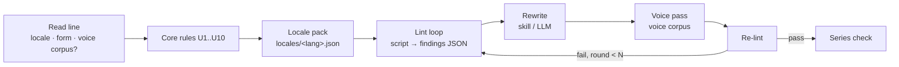

# Research Dossier — anti-slop-prose: multilingual AI-prose tell linter (YouTube)

Research dossier. Explore-mode — no OpenSpec change, no implementation.
Date: 2026-10-20.
Goal: skill making AI-generated text read human for YouTube (scripts, titles, descriptions, community posts), multilingual.

Legend: **[V]** verified in repo this session; **[R]** recalled public knowledge, NOT re-fetched this session — verify before citing in a proposal; **[H]** hypothesis / uncalibrated guess.

---

## 1. Framing decision (user chose option B)

- Option A "detector evasion" (paraphrase until GPTZero-style detectors say human) — **rejected**.
  - Detector arms race. Detectors noisy.
  - Does not address YouTube's actual policy risk.
  - Main real use = hiding content that needs disclosure label.
- Option B "anti-slop prose + originality" — **chosen**. Strip countable AI tells, inject real voice + specifics.
- Non-goal: no detector-score optimization loop. Skill never targets a third-party detector.
- YouTube enforcement surface [R]:
  1. YPP "inauthentic content" policy (2025 rename of "repetitious content"). Mass-produced/templated channels. Judged as pattern across uploads, not one text.
  2. Altered/synthetic content disclosure in Creator Studio. Realistic AI faces/voices/events. AI-written script alone needs no label.
  3. Spam/deceptive practices. Comments, metadata, keyword stuffing, misleading titles.
- No public evidence YouTube runs AI-text detector on scripts/descriptions [R].

## 2. Decisions so far

- Locales v1: `en`, `hu`. Others later as packs.
- Placement: new package `packages/anti-slop-prose` + small zero-dep Node linter script.
- NOT in `packages/anti-slop`: npm name `@blackbelt-technology/anti-slop-frontend` [V] makes prose skill awkward.
- `packages/anti-slop` has no code, skills only (SKILL.md grep pre-flight) [V]. → linter = first code in anti-slop family.
- Cross-link: `anti-slop-frontend` SKILL.md `B6. Copy self-audit` [V] could point to new skill later.

## 3. Two-layer tell model

- Layer 1 universal (structural, any language):
  - uniform sentence length (low burstiness)
  - triads "A, B and C"
  - "not just X, but Y" frame
  - hook → 3 sections → "in conclusion" skeleton
  - hedge stacking
  - zero concrete numbers/names/dates
  - paragraphs end on moral/summary
  - no opinion / first-hand claim
- Layer 2 per-locale: lexicon, typography, calques.
- Key finding: layers interact, not additive. **Locale rules must OVERRIDE universal rules.**
- Example:
  - `anti-slop-frontend` A3 bans every `—` and `–`-as-separator, "any hit = fail" [V]. Correct for en UI.
  - Wrong for hu/de: spaced ` – ` (hu "gondolatjel") = correct typography.
  - Unspaced `—` in hu text = AI tell (English punctuation leak).
  - Copying A3 verbatim would "fix" correct Hungarian into wrong Hungarian.
- Strongest multilingual tell: English typography + phrasing leaking into target language.

## 4. Architecture (proposed)

Script vs skill split:

| Concern | Owner | Output |
|---|---|---|
| lexicon hits / 1k words | script | findings JSON, rule ids |
| locale typography | script | findings JSON |
| sentence-length CV (burstiness) | script | findings JSON |
| triad + contrast-frame regex per locale | script | findings JSON |
| series opener/CTA n-gram overlap | script | findings JSON |
| moral-ending check | skill (LLM) | judgment |
| specificity (real numbers/names/first-hand claims) | skill (LLM) | judgment |
| rewrite toward voice corpus | skill (LLM) | text |
| form rules | skill (LLM) | judgment |
| re-lint, max N rounds | skill (LLM) drives script | loop |

- Single source of truth: `locales/en.json`, `locales/hu.json`. Shape `{ lexicon[], typography[], frames[], overrides{ U3: "spaced – ok" } }`.
- CLI sketch:
  - `anti-slop-prose lint script.md --locale hu --form voiceover`
  - `anti-slop-prose series ./scripts/ --locale hu`
- Zero deps: `Intl.Segmenter` gives locale-aware sentence split for hu + en [R].
- Tests: per-locale fixtures.
  - True positives.
  - Native-correct negatives that must NOT flag: hu spaced `–`, `„…”` quotes, sentence-case titles.
- Voice corpus: existing `youtube-srt` skill (`packages/video-transcription`) [V] pulls user's own transcripts → extract real phrasing → rewrite toward it.

## 5. Universal rules draft

All thresholds [H], uncalibrated.

| id | rule | check | draft threshold |
|---|---|---|---|
| U1 | lexicon hard tier; lexicon soft tier | script | hard: 0 hits; soft: ≤ 2 / 1k words |
| U2 | burstiness sentence-length CV | script | ≥ 0.45 (calibrate) |
| U3 | punctuation leak, locale-defined | script | 0 |
| U4 | contrast frame "not X, but Y" | script | ≤ 1 per text |
| U5 | triads "A, B and C" | script | ≤ 1 / 300 words |
| U6 | template open/close clichés | script | 0 in first/last 2 sentences |
| U7 | rhetorical-question density | script | ≤ 1 / 500 words |
| U8 | specificity floor: digits, names (mid-sentence capitals; ok for en+hu), dates | script + judgment | ≥ 1 / 150 words |
| U9 | paragraph ends on moral/summary | judgment | ≤ 1 per text |
| U10 | format tells: `**Label:** text` bullets, emoji headers | script | 0 (outside docs form) |

- U8 = backbone. Only rule adding human signal instead of removing tells.
- U8 fail → skill ASKS user for 2-3 real specifics (number, example, first-hand observation).
- Never invents plausible statistic (hallucination).

## 6. hu locale pack draft

**HU-T typography** (overrides U3):

- T1 unspaced `—` → flag. Spaced ` – ` correct.
- T2 `"..."` / `“...”` → `„...”` (inner `»...«`).
- T3 Title Case In Titles → sentence case. Proper nouns exempt.
- T4 `1,000.5` / "October 20" → `1 000,5` / "október 20.".

**HU-C calques** (translationese, grammatical → survive model-generation lexicon drift):

- C1 "egy" density (English a/an leak). Per 1k words. Calibrate.
- C2 "által" agentive passive ("a csapat által fejlesztett").
- C3 "rendelkezik vmivel" (= "has"; "kiváló funkciókkal rendelkezik").
- C4 "kerül" pseudo-passive ("bemutatásra kerül").
- C5 "számára" overuse (= "for").
- C6 "nem csupán/csak ..., hanem" (= U4).
- C7 Ön/te drift within one text. YouTube default tegezés.
- Grounding: C2–C5 match long-standing Hungarian style-correction (nyelvművelés) translationese markers [R].

**HU-L lexicon seed** (verify via spike):

- hard: "merüljünk el", "a mai rohanó világban", "izgalmas utazás", "játékváltó"
- soft: "kulcsfontosságú", "zökkenőmentes", "átfogó", "összességében", "fontos megjegyezni", "felfedezzük ... világát"

**en lexicon examples**: delve, tapestry, testament to, game-changer, "In today's fast-paced world", Title Case Everywhere.

Lexicon drifts per model generation ("delve" faded after 2024 [R]).

## 7. Form profiles draft

| form | typography | U2 | extra |
|---|---|---|---|
| voiceover | ignored | strong | sentence ≤ ~25 words (breath); no parentheses/lists (unspeakable); numbers as spoken |
| title | strict | n/a | ≤ ~70 chars; no "X: The Ultimate Y" colon template; hu sentence case |
| description | strict | normal | first ~150 chars (above "show more") must pass U8; hashtags ≤ 3 |
| community | strict | normal | — |

Char limits [R]/[H]. Verify.

## 8. Series check (YouTube-specific differentiator)

- Targets "inauthentic content" = sameness across uploads.
- Opener/CTA n-gram overlap (first/last ~50 words) + structure fingerprint across last N scripts.
- Needs allow-list: consistent channel intro = brand, not slop.
- No known prose linter does cross-document series check [H].

## 9. Calibration spike plan

- Machine corpus: 3-4 models × 20 topics × {hu, en}, YouTube-script prompts (~160 generations; cheap but paid).
- Human corpus:
  - Hungarian blogs/news.
  - MANUAL SRTs. NOT YouTube auto-subs: no punctuation → no sentence boundaries → useless for U2/typography.
- Method: log-odds ratio with informative Dirichlet prior (Monroe, Colaresi, Quinn 2008, "Fightin' Words") [R].
  - Over words + bigrams + C1–C5 rates + sentence CV.
- Output: top ~200 candidates → human review → hard/soft tiers → `locales/hu.json` + thresholds for U2, C1.
- en: run same pipeline. Don't copy published list.
- Academic cross-check: Kobak et al. 2024 "Delving into ChatGPT usage in academic writing through excess vocabulary" [R]. Academic register ≠ YouTube register.
- Maintenance: lexicon model-generation dependent.
  - Each pack records "calibrated against models X,Y on date Z" + refresh procedure.
  - Mirrors `packages/anti-slop/UPSTREAM.md` refresh pattern [V].

## 10. Risks

- Goodhart: rewrite loop optimizing metrics → bursty but empty text. Metrics = smoke detector, not target. Cap rounds. Done-criterion = content (specifics, opinion), not score.
- Threshold calibration: U2 CV needs human corpus. hu manual-sub supply limited.
- hu lexicon: no published list known [H] → spike required.
- Series false positives: brand intros → allow-list.
- Proper-noun heuristic (mid-sentence capitals) breaks for de (noun capitalization). Fine for en/hu v1.

## 11. Open questions

- Spike before proposal, or as first task of the change?
- Headless/batch mode: U8 can't ask user → flag gap only, never fill? (leaning yes)
- hu human corpus source: user's own writing, own channel manual subs, or reference YouTuber?
- Exact form list for v1.

## 12. Next step

- Run `pre-scaffold-openspec-coherence-check`.
- Then `openspec new change "add-anti-slop-prose"` + `proposal.md` (with `## Discipline Skills` section).
