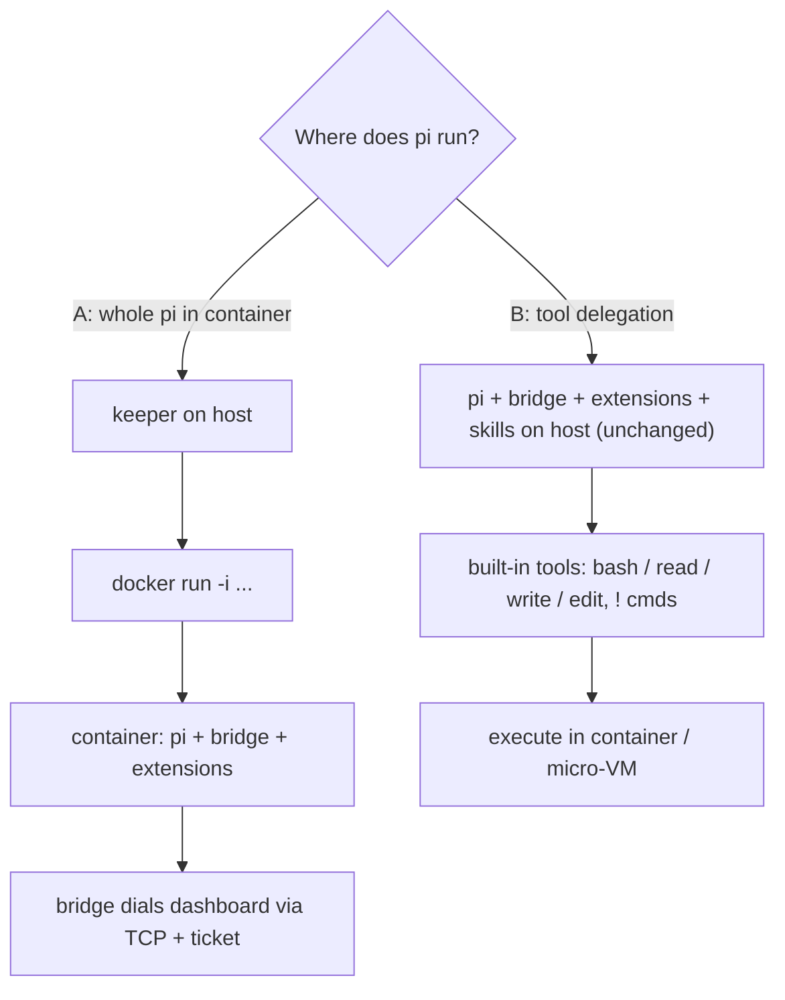

# Containerized spawn — pi in docker/podman, runtime mounts, worktree isolation, CWD snapshot

Research dossier. Explore-mode, no change / no impl.
Date: 2026-10-21.
Status: OPEN — spikes + B prototype done, direction not chosen.

## Problem

Spawn modes today: `tmux`, `headless` (keeper), `wt`, `wsl-tmux`.
- `SpawnStrategy = "tmux" | "headless"` in `packages/shared/src/config.ts`.
- process-manager also knows `wt`, `wsl-tmux`.

Want:
- container spawn (docker / podman) with all tools + pi.
- bridge, plugins, extensions, skills behave as on host.
- host dirs + project dirs mountable.
- mounts / ports changeable at runtime.
- worktree-in-container isolation.
- optional snapshot of CWD at session start.

## Related

- `docs/research/oci-cwd-delegation.md` — OCI snapshot / delta model (L0–L3 layers, whiteouts).
- `docs/research/agent-bash-sandboxing.md` — bash isolation layers (srt, container/VM).
- `docs/managed-services.md` — `oci:docker` / `oci:podman` driver, ToolRegistry.
- `docker/` all-in-one image — path-identical `PI_WORKSPACES` mounts, `docker/up.sh`.
- Active change `add-supervised-tool-approval` — D1 delegates isolation to "the Docker path" (does not exist yet).
- Active change `add-workspace-checkpointing` — git private refs per turn.
- Active change `add-plugin-spawn-worktree` — worktree spawn.
- Upstream pi: `node_modules/@earendil-works/pi-coding-agent/docs/containerization.md`.

## Prior art (external)

### pi upstream `docs/containerization.md`

4 methods:
1. Plain Docker — whole pi in container.
2. Docker Sandboxes (`sbx`) — proxy keeps real provider key on host.
3. NVIDIA OpenShell — local / remote sandbox, policy.
4. Gondolin extension — pi on host, built-in tools in micro-VM.

Warning: mounting `~/.pi/agent` exposes credentials, settings, extensions, sessions.

### Docker Sandboxes (`sbx`, docs.docker.com/ai/sandboxes)

- microVM per sandbox.
- workspace mounted at SAME absolute path.
- extra workspaces, `:ro` supported.
- virtiofs passthrough, no sync.
- ports changeable at runtime: `sbx ports <name> --publish 8080:3000`.
- workspaces fixed at create.
- `--clone` mode: private git clone; host repo ro at `/run/sandbox/source`.
- credentials via host proxy sentinel substitution.

### Dagger container-use (github.com/dagger/container-use)

- MCP server.
- each agent = fresh container + own git branch.
- history as git notes.

### Apple `container` / Containerization (WWDC25)

- lightweight VM per container on Apple silicon.

### Gondolin (github.com/earendil-works/gondolin, npm `@earendil-works/gondolin@0.13.0`)

- local Linux micro-VM. QEMU default; krun experimental.
- macOS + Linux. ARM64 most tested.
- programmable JS VFS: `RealFSProvider`, `ReadonlyProvider`, `ShadowProvider` (`writeMode: "deny" | "tmpfs"`), `MemoryProvider`, hooks.
- HTTP/TLS egress allowlist + secret placeholder injection.
- ingress: `vm.enableIngress()`.
- disk checkpoints. VFS data NOT included.
- Example `host/examples/pi-gondolin.ts`:
  - overrides `read` / `write` / `edit` / `bash` + `user_bash`.
  - rewrites system-prompt cwd.
  - mounts cwd at fixed `/workspace` (NOT path-identical).
  - VFS built once at create.

### Papers / runtimes

- OpenHands — arXiv 2407.16741, Docker sandbox runtime.
- SWE-ReX — same agent code local / Docker / Modal / AWS.

### Hard limits

- Docker / Podman cannot add bind mount to running container (docker/cli#5328).
- Host mounts after start do not propagate (private mount namespace).
- Workaround: `-v $GRANTS:/grants:rshared` — Linux host only.
- Podman overlay volume `-v src:dst:O` (docs.podman.io volume options). Non-volatile `upperdir=` / `workdir=` since containers/podman PR #14474.
- Docker has no `:O` equivalent.

## Core fork

- A — whole pi in container.
  - keeper on host → `docker run -i` → container runs pi + bridge + extensions.
  - bridge dials dashboard via TCP + ticket.
- B — tool delegation (Gondolin-style).
  - pi + bridge + extensions + skills stay on host, unchanged.
  - built-in tools (`bash`, `read`, `write`, `edit`, `!` commands) execute in container / micro-VM.

### Tradeoffs

| Axis | A: whole pi in container | B: tool delegation |
|---|---|---|
| Extensions | as on host only via mount; native addons break | native (on host) |
| Bridge | TCP + ticket | UDS unchanged |
| Credentials | `auth.json` in container, or proxy | stay on host |
| Runtime mount change | recreate container → pi restart + `--session` resume | recreate tool backend only, or Gondolin runtime grant |
| Isolation strength | full, incl. extension tools | extension FS tools bypass; partly covered by `packages/extension/src/path-gate/` + path-containment-guard |
| Precedent | `docker/` image; wsl-tmux | pi-gondolin example |

## Spike results (2026-10-21)

Env: macOS Apple silicon, Docker Desktop 29.1.3, podman 6.1.0 applehv machine, QEMU 10.1.1. All throwaway, cleaned up.

### S2 — host UDS via bind mount → container

- Docker: `ENOTSUP`. podman: `ENOTSUP`. virtiofs has no socket passthrough.
- Dashboard gateway socket `~/.pi/dashboard/gateway-9999.sock` unreachable from container.
- A needs TCP + ticket (`packages/extension/src/bridge-ticket-client.ts`).
- Live host gateway TCP 9999 not listening (TCP opt-in, `PI_GATEWAY_TCP`).
- Loopback `PI_DASHBOARD_REQUIRE_SERVER_PROOF` N/A in container.
- `buildSpawnEnv` pins `PI_DASHBOARD_URL=ws://localhost:<port>` + `PI_DASHBOARD_SOCKET`. Wrong inside container. Needs `host.docker.internal` / `host.containers.internal`.

### S1a — stdin/stdout RPC

- `docker run -i --rm pi-dashboard:local pi --mode rpc --no-session`, path-identical `-v cwd:cwd -w cwd`.
- `{"id":"r1","type":"get_state"}` round-trips over stdin/stdout.
- Keeper `childCmd` can be `docker run -i …`. Precedent: `packages/server/src/spawn-process/acp-spawn.ts` → `spawnPiSession({childCmd,...,strategy:headless})`. Durability for free.

### S3 — host extensions in Linux container

Setup: path-identical mounts of `~/.pi/agent`, repo, `~/Project/pi-flows`; `--network none`.
Result: 182 commands loaded, empty stderr, after fixes.

Requirements found:
1. pi needs WRITE on agent dir (`EROFS mkdir ~/.pi/agent/trust.json.lock` with ro mount).
2. WRITE on `<cwd>/.pi` (`settings.json.lock`).
3. WRITE on `~/.pi/context-mode/sessions` (context-mode extension load fails EACCES otherwise).
4. Missing npm package → pi auto-runs `npm install <pkg> --prefix ~/.pi/agent/npm` → fails offline (EAI_AGAIN).
5. Host 192 commands vs container 182. Missing 10 = skills auto-discovered from `~/.agents/skills` (hyperframes*, media-use). Mount `~/.agents`.

Native addons FAIL:
- `better-sqlite3` → `ERR_DLOPEN_FAILED … invalid ELF header` (darwin binary). context-mode registers but breaks at use.
- repo `esbuild` fails in container.

Consequence: project `node_modules` needs Linux install. A needs Linux build of npm packages with native addons.

### S4 — podman `:O` overlay

- Volatile `-v d:d:O` on macOS: container sees writes, host untouched.
- `:O,upperdir=<host path>,workdir=<host path>` on virtiofs → mount read-only. Overlay upper cannot be virtiofs.
- upperdir / workdir VM-local (`/var/tmp/...` inside podman machine): works.
  - upper = exact delta: `a.txt` modified, `c.txt` added, `gone.txt` deleted as char-device 0,0 whiteout.
  - export: `podman machine ssh "sudo tar -C <upper> -cf - ."` → host tar.
- Consequence: cheap "snapshot CWD at session start" outside git. Delta → review diff → apply / discard.
- Converter needed: char 0,0 → OCI `.wh.*` (ties to `oci-cwd-delegation` L2/L3).

### S5 — walk cost, `find node_modules -type f | wc -l` (101058 files), single cold run

| Target | Time |
|---|---|
| host | 1.68 s |
| podman virtiofs | 4.71 s |
| podman `:O` | 8.48 s |
| Docker Desktop virtiofs | 11.12 s |

### G — Gondolin 0.13.0 (custom spike script, SDK)

- first `VM.create`: 11489 ms (includes ~326MB guest asset download into `~/.cache/gondolin`).
- warm `VM.create`: 68 ms. first exec ~781 ms.
- Path-identical mount works:
  - mount key `$HOME` (`/Users/robson`) → `ShadowProvider(new RealFSProvider(HOME), {shouldShadow: p => !visible(p)})`.
  - `visible` reads MUTABLE grant Set (inside-grant or ancestor-of-grant).
- Runtime grant:
  - add grant → `cat` of previously-ENOENT file succeeds immediately.
  - revoke → ENOENT again. No remount.
  - Caveat: directory LISTING of parent stays stale after grant. `ls` still omits new entry, even after `stat` (readdir cache).
  - writes to granted path reach host.
- Nested `ShadowProvider(..., {shouldShadow: /node_modules/, writeMode:"tmpfs"})`:
  - host `node_modules` hidden (ENOENT).
  - guest-created `node_modules` stays in memory; host untouched.
  - fixes native-addon mismatch for B.
- Perf: `find packages -type f` (65418 files)
  - guest 28422 ms (warm 29130 ms)
  - host 941 ms
  - ≈ 30x slower. Deps / large trees must live VM-local, not via FUSE.
- Guest image `alpine-base` aarch64: has node, bash. NO git.

## Prototype B (2026-10-22)

Throwaway pi extension. Deleted after.

### Setup

- Overrides `bash` tool only:
  - `pi.registerTool({...createBashTool(cwd), execute → createBashTool(cwd,{operations})})`.
  - `pi.on("user_bash", → {operations})` for `!` commands.
- `read` / `write` / `edit` stay on host. Paths host-identical + live mount ⇒ no remap. path-gate keeps governing them.
- Backend switch: `SPIKE_BACKEND=podman|gondolin`.
- Host env NOT forwarded to backend (credentials).
- Podman backend:
  - long-lived `podman run -d … -v <cwd>:<cwd> -v <name>-nm:<cwd>/node_modules node:24-alpine sleep infinity`.
  - per-command `podman exec -w <cwd> <name> sh -lc <cmd>`.
  - removed on `session_shutdown`.
- Gondolin backend:
  - `VM.create({vfs:{mounts:{[HOME]: ShadowProvider(RealFSProvider(HOME), shouldShadow: !grants)}}})`.
  - `vm.exec(["/bin/sh","-lc",cmd],{cwd})`.
- Target: `pi-flows` repo copy (`git archive HEAD`). Standalone. `vitest run`. 45 test files / 328 tests. npm lockfile. 156 top-level node_modules entries.

### Verification (all passed)

- Model-driven bash tool (pi-ai faux provider, `pi -p --model faux/faux-1`, clean `PI_CODING_AGENT_DIR`) → podman:
  - model saw `Linux aarch64`, host-identical pwd, `328 passed`.
  - `npm ci` + vitest in one tool call: 11944 ms.
  - backend_ready 331 ms (container create).
- `!` path via RPC `{"type":"bash"}` → podman: `Linux aarch64`, `cwd=<host path>` ⇒ `user_bash` hook routes RPC bash.
- Gondolin, same extension:
  - backend_ready 110 ms (warm). one exec 460 ms.
  - guest `ls /Users/robson` shows only granted ancestor `Project` ⇒ gate works.
  - guest HOME=`/root`. Caveat: `~` ≠ host home.
- Host `node_modules` never polluted: podman volume mount leaves only EMPTY mount-point dir on host (0 entries).

### Benchmarks

Hosts: pi-flows, 4 vCPU VMs. Host Mac 18 cores.

| Env | CPU loop `node -e` 3e8 | vitest run | npm ci |
|---|---|---|---|
| host | 0.88 s | 1.95 s | 3.93 s (warm cache) |
| podman applehv, source virtiofs, deps named volume | 1.17 s | 6.63 s / 6.39 s | 6.67 s |
| podman, source copied container-local | — | 6.02 s | — |
| Gondolin QEMU, source FUSE (RealFS), deps guest tmpfs `/deps` via symlink `node_modules -> /deps/nm` | — | 47262 ms / 47210 ms | 72747 ms |
| Gondolin, source+deps fully guest-local (`/tmp/local`) | 2.45 s | 6.14 s | 8.13 s (copy + ci) |

Exec overhead per command:
- podman `exec true`: 0.12 s.
- Gondolin `exec true`: 104 ms.
- Gondolin first `VM.create` in fresh cache: 8495 ms (asset download). warm: 68–110 ms.

### Findings

- virtiofs source costs ~7% (6.02 vs 6.39–6.63 s).
- podman 3.3x host = VM CPU count (4 vs 18), not filesystem.
- Gondolin FUSE source = bottleneck (~8x vs guest-local). Guest-local Gondolin ≈ podman.
- Gondolin `tmpfs` VM option mounts at guest init BEFORE VFS bind mounts ⇒ tmpfs at project path hidden.
  - workaround: tmpfs at `/deps` + symlink in ShadowProvider tmpfs upper.
- Gondolin egress needs `createHttpHooks({allowedHosts:["registry.npmjs.org"]})` for npm.
- Implication:
  - Gondolin model = copy project into guest at session start (= snapshot) + FUSE grants only for auxiliary dirs.
  - podman model = live virtiofs source + VM-local deps volume.

### Env / process notes

- pi path-gate denied Write to `~/.pi-spike-b` (120 s prompt timeout = deny, then "recently-denied").
  - spike moved to repo-local `.tmp/spike-b`, excluded via `.git/info/exclude` `/.tmp/`. removed afterwards.
- Root vitest config: explicit per-package projects. shared `no-direct-*` walkers scan `packages/*/src` ⇒ repo-root scratch dir safe.

## Runtime mount / port options

| # | Mechanism | Status | Notes |
|---|---|---|---|
| 1 | recreate-on-grant | portable | keeper restarts container with new mount list. cheap in B; pi resume (`--session`) in A |
| 2 | mount propagation `rshared` | Linux host only | `-v $GRANTS:/grants:rshared` |
| 3 | Gondolin programmable VFS runtime grant | proven (S/G) | stale readdir caveat; FUSE slow |
| 4 | ports | options | `sbx ports` runtime; dashboard reverse proxy into container network; pre-published port range; Gondolin `vm.enableIngress()` |

Grant source already exists:
- cwd-policy registry: `packages/server/src/spawn-process/cwd-policy.ts`.
- path-gate: `packages/extension/src/path-gate/`.
- `.pi/access.json` (project-access skill).

## Snapshot options

| Option | Model | Status |
|---|---|---|
| worktree + container | container-use model. Dashboard has worktree spawn + init hook. Tracked files only. | candidate |
| podman `:O` + VM-local upperdir | delta = exact upper | proven (S4) |
| `sbx --clone` | private git clone, host repo ro | Docker Sandboxes only |
| OCI layers + mtree | `oci-cwd-delegation` | designed, not spiked |

Universal trap: host `node_modules` darwin-native → Linux install needed.
- Fix: lockfile-keyed L0 layer, or Gondolin tmpfs shadow.

## Takeaways

- Podman > Docker on this Mac:
  - 2.4x faster virtiofs walk (S5).
  - has `:O`.
  - has `podman secret`.
  - S6 secret delivery: docker `--env-file` leaks via inspect / environ. 0600 file mount or podman secret clean.
- B (tool delegation) dodges S2 + S3 entirely.
- Gondolin VFS gives runtime grants with path-identical paths. Cost = FUSE speed → keep deps VM-local.
- A viable, needs "container agent home":
  - writable overlays: agent dir, `cwd/.pi`, `~/.pi/context-mode`.
  - `~/.agents` mount.
  - Linux npm volume for native addons.
  - gateway TCP + ticket.
  - `PI_DASHBOARD_URL` rewrite.
- Placement axis: container orthogonal to tmux / headless (where process runs vs how IO hosted). Separate placement setting. wsl-tmux is precedent.
- Shared runtime risk: stopping Docker Desktop / podman machine kills peers' harnesses.
- Env quirk: podman on this Mac hits gcloud docker credential helper ("error getting credentials") even with `--pull=never`.
  - workaround: `REGISTRY_AUTH_FILE=<{} file>`.
  - move images via `docker save | podman load`.
- B prototype viable: bash-only override + host-identical paths = smallest surface. read/write/edit untouched.
- Podman backend = best perf/complexity today (6.4 s vs host 1.95 s, 0.12 s/exec). Gondolin = best policy (runtime grants, egress allowlist, secret placeholders) but needs copy-in workspace.

## Open questions

1. Goal = safety (A / micro-VM) or reproducibility (worktree + container, B)?
2. A vs B vs tiered (B default, A "secure" tier)?
3. Gondolin dependency (QEMU, 326MB assets, no git in base image → custom image) vs podman tool backend?
4. readdir staleness fix (custom provider invalidation / remount listing)?
5. Linux deps layer strategy (tmpfs per session vs persistent VM-local cache keyed by lockfile)?
6. gateway TCP default-on for container spawns + auto-minted ticket per spawn?
7. Copy-in workspace (Gondolin) ⇒ need delta-back step (ties to podman `:O` / OCI layer converter) — accept?
8. Guest HOME=/root vs host HOME — set HOME to host path inside backend?

## Next spikes

- A full round trip: isolated test dashboard (NOT live one) with `PI_GATEWAY_TCP=1`; container pi bridge via `host.docker.internal` + ticket.
- ~~B prototype: pi extension overriding tools → podman `exec` backend vs Gondolin backend. Measure `pnpm test` with VM-local deps.~~ DONE 2026-10-22 → see Prototype B.
- Gondolin readdir invalidation after grant.
- podman `:O` delta → `.wh.*` converter + apply on host.
- B on this repo: `pnpm install` Linux deps volume for monorepo (hoisted, nested `packages/*/node_modules`) + `npm test` timing.

## Continue this research

Reopen explore mode with this file.
Questions above remain open.
No code changes implemented.
