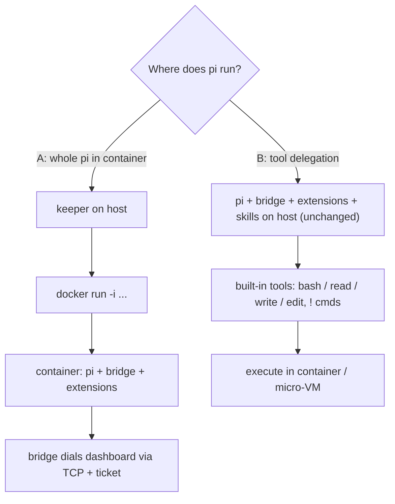

# Containerized spawn — pi in docker/podman, runtime mounts, worktree isolation, CWD snapshot

Research dossier. Explore-mode, no change / no impl.
Date: 2026-10-21.
Status: OPEN — spikes C–G done; SECURITY finding + remote-bridge bug found; direction not chosen.

## Security finding — loopback trust from containers (2026-10-22)

**SECURITY. Fix independently, urgently. Not part of containerized spawn.**

Env: macOS Docker Desktop; podman 6 applehv; live dashboard `:8000`.

Observed:
- Container → `host.docker.internal` reaches host servers bound `127.0.0.1` only.
- Host server sees `peer=127.0.0.1`.
- Podman applehv: injected `host.containers.internal` = `169.254.1.2` → connection refused.
- gvproxy gateway `192.168.127.254` works; `peer=127.0.0.1`.
- Honest `Host: host.docker.internal` → 403 `host_not_allowed` (host admission).
- Spoofed `Host: 127.0.0.1:<port>` from container → treated as genuinely-local caller.

Isolated test dashboard (HOME scratch, ports 18777/18779):
- `POST /api/ws-ticket {scope:"bridge"}`, no bearer → 200 ticket.
- `POST /api/paired-devices` (operatorGuard) → 200 DURABLE device token.
- Tier `observe` default; tier `operate` on request.

LIVE dashboard `:8000`, one read-only probe from a container:
- Spoofed Host `GET /api/paired-devices` → 200, count 7.
- Honest Host → 403.

Impact:
- Any process in any Docker Desktop container on this Mac can mint `operate`-tier durable credential.
- Example: malicious package postinstall in unrelated container.

Root cause (as observed):
- `operatorGuard` and `/api/ws-ticket` accept bare loopback peer + admitted Host header.
- Safe pattern: `createApprovalGuard`. No bare-loopback branch. Requires login session / local-proof cookie / `X-Pi-Local-Token`.

Also observed:
- Unrelated local service `127.0.0.1:18791` (browser control endpoint) readable from container.
- General Docker Desktop loopback exposure.

Action:
- Separate security-hardening change. Not containerized spawn.
- Never trust bare loopback.

## Problem

Spawn modes today: `tmux`, `headless` (keeper), `wt`, `wsl-tmux`.
- `SpawnStrategy = "tmux" | "headless"` in `packages/shared/src/config.ts`.
- process-manager also knows `wt`, `wsl-tmux`.

Want:
- container spawn (docker / podman) with all tools + pi.
- bridge, plugins, extensions, skills behave as on host.
- host dirs + project dirs mountable.
- mounts / ports changeable at runtime.
- worktree-in-container isolation.
- optional snapshot of CWD at session start.

## Related

- `docs/research/oci-cwd-delegation.md` — OCI snapshot / delta model (L0–L3 layers, whiteouts).
- `docs/research/agent-bash-sandboxing.md` — bash isolation layers (srt, container/VM).
- `docs/managed-services.md` — `oci:docker` / `oci:podman` driver, ToolRegistry.
- `docker/` all-in-one image — path-identical `PI_WORKSPACES` mounts, `docker/up.sh`.
- Active change `add-supervised-tool-approval` — D1 delegates isolation to "the Docker path" (does not exist yet).
- Active change `add-workspace-checkpointing` — git private refs per turn.
- Active change `add-plugin-spawn-worktree` — worktree spawn.
- Upstream pi: `node_modules/@earendil-works/pi-coding-agent/docs/containerization.md`.

## Prior art (external)

### pi upstream `docs/containerization.md`

4 methods:
1. Plain Docker — whole pi in container.
2. Docker Sandboxes (`sbx`) — proxy keeps real provider key on host.
3. NVIDIA OpenShell — local / remote sandbox, policy.
4. Gondolin extension — pi on host, built-in tools in micro-VM.

Warning: mounting `~/.pi/agent` exposes credentials, settings, extensions, sessions.

### Docker Sandboxes (`sbx`, docs.docker.com/ai/sandboxes)

- microVM per sandbox.
- workspace mounted at SAME absolute path.
- extra workspaces, `:ro` supported.
- virtiofs passthrough, no sync.
- ports changeable at runtime: `sbx ports <name> --publish 8080:3000`.
- workspaces fixed at create.
- `--clone` mode: private git clone; host repo ro at `/run/sandbox/source`.
- credentials via host proxy sentinel substitution.

### Dagger container-use (github.com/dagger/container-use)

- MCP server.
- each agent = fresh container + own git branch.
- history as git notes.

### Apple `container` / Containerization (WWDC25)

- lightweight VM per container on Apple silicon.

### Gondolin (github.com/earendil-works/gondolin, npm `@earendil-works/gondolin@0.13.0`)

- local Linux micro-VM. QEMU default; krun experimental.
- macOS + Linux. ARM64 most tested.
- programmable JS VFS: `RealFSProvider`, `ReadonlyProvider`, `ShadowProvider` (`writeMode: "deny" | "tmpfs"`), `MemoryProvider`, hooks.
- HTTP/TLS egress allowlist + secret placeholder injection.
- ingress: `vm.enableIngress()`.
- disk checkpoints. VFS data NOT included.
- Example `host/examples/pi-gondolin.ts`:
  - overrides `read` / `write` / `edit` / `bash` + `user_bash`.
  - rewrites system-prompt cwd.
  - mounts cwd at fixed `/workspace` (NOT path-identical).
  - VFS built once at create.

### Papers / runtimes

- OpenHands — arXiv 2407.16741, Docker sandbox runtime.
- SWE-ReX — same agent code local / Docker / Modal / AWS.

### Hard limits

- Docker / Podman cannot add bind mount to running container (docker/cli#5328).
- Host mounts after start do not propagate (private mount namespace).
- Workaround: `-v $GRANTS:/grants:rshared` — Linux host only.
- Podman overlay volume `-v src:dst:O` (docs.podman.io volume options). Non-volatile `upperdir=` / `workdir=` since containers/podman PR #14474.
- Docker has no `:O` equivalent.

## Core fork

- A — whole pi in container.
  - keeper on host → `docker run -i` → container runs pi + bridge + extensions.
  - bridge dials dashboard via TCP + ticket.
- B — tool delegation (Gondolin-style).
  - pi + bridge + extensions + skills stay on host, unchanged.
  - built-in tools (`bash`, `read`, `write`, `edit`, `!` commands) execute in container / micro-VM.

### Tradeoffs

| Axis | A: whole pi in container | B: tool delegation |
|---|---|---|
| Extensions | as on host only via mount; native addons break | native (on host) |
| Bridge | TCP + ticket | UDS unchanged |
| Credentials | `auth.json` in container, or proxy | stay on host |
| Runtime mount change | recreate container → pi restart + `--session` resume | recreate tool backend only, or Gondolin runtime grant |
| Isolation strength | full, incl. extension tools | extension FS tools bypass; partly covered by `packages/extension/src/path-gate/` + path-containment-guard |
| Precedent | `docker/` image; wsl-tmux | pi-gondolin example |

## Spike results (2026-10-21)

Env: macOS Apple silicon, Docker Desktop 29.1.3, podman 6.1.0 applehv machine, QEMU 10.1.1. All throwaway, cleaned up.

### S2 — host UDS via bind mount → container

- Docker: `ENOTSUP`. podman: `ENOTSUP`. virtiofs has no socket passthrough.
- Dashboard gateway socket `~/.pi/dashboard/gateway-9999.sock` unreachable from container.
- A needs TCP + ticket (`packages/extension/src/bridge-ticket-client.ts`).
- Live host gateway TCP 9999 not listening (TCP opt-in, `PI_GATEWAY_TCP`).
- Loopback `PI_DASHBOARD_REQUIRE_SERVER_PROOF` N/A in container.
- `buildSpawnEnv` pins `PI_DASHBOARD_URL=ws://localhost:<port>` + `PI_DASHBOARD_SOCKET`. Wrong inside container. Needs `host.docker.internal` / `host.containers.internal`.

### S1a — stdin/stdout RPC

- `docker run -i --rm pi-dashboard:local pi --mode rpc --no-session`, path-identical `-v cwd:cwd -w cwd`.
- `{"id":"r1","type":"get_state"}` round-trips over stdin/stdout.
- Keeper `childCmd` can be `docker run -i …`. Precedent: `packages/server/src/spawn-process/acp-spawn.ts` → `spawnPiSession({childCmd,...,strategy:headless})`. Durability for free.

### S3 — host extensions in Linux container

Setup: path-identical mounts of `~/.pi/agent`, repo, `~/Project/pi-flows`; `--network none`.
Result: 182 commands loaded, empty stderr, after fixes.

Requirements found:
1. pi needs WRITE on agent dir (`EROFS mkdir ~/.pi/agent/trust.json.lock` with ro mount).
2. WRITE on `<cwd>/.pi` (`settings.json.lock`).
3. WRITE on `~/.pi/context-mode/sessions` (context-mode extension load fails EACCES otherwise).
4. Missing npm package → pi auto-runs `npm install <pkg> --prefix ~/.pi/agent/npm` → fails offline (EAI_AGAIN).
5. Host 192 commands vs container 182. Missing 10 = skills auto-discovered from `~/.agents/skills` (hyperframes*, media-use). Mount `~/.agents`.

Native addons FAIL:
- `better-sqlite3` → `ERR_DLOPEN_FAILED … invalid ELF header` (darwin binary). context-mode registers but breaks at use.
- repo `esbuild` fails in container.

Consequence: project `node_modules` needs Linux install. A needs Linux build of npm packages with native addons.

### S4 — podman `:O` overlay

- Volatile `-v d:d:O` on macOS: container sees writes, host untouched.
- `:O,upperdir=<host path>,workdir=<host path>` on virtiofs → mount read-only. Overlay upper cannot be virtiofs.
- upperdir / workdir VM-local (`/var/tmp/...` inside podman machine): works.
  - upper = exact delta: `a.txt` modified, `c.txt` added, `gone.txt` deleted as char-device 0,0 whiteout.
  - export: `podman machine ssh "sudo tar -C <upper> -cf - ."` → host tar.
- Consequence: cheap "snapshot CWD at session start" outside git. Delta → review diff → apply / discard.
- Converter needed: char 0,0 → OCI `.wh.*` (ties to `oci-cwd-delegation` L2/L3).

### S5 — walk cost, `find node_modules -type f | wc -l` (101058 files), single cold run

| Target | Time |
|---|---|
| host | 1.68 s |
| podman virtiofs | 4.71 s |
| podman `:O` | 8.48 s |
| Docker Desktop virtiofs | 11.12 s |

### G — Gondolin 0.13.0 (custom spike script, SDK)

- first `VM.create`: 11489 ms (includes ~326MB guest asset download into `~/.cache/gondolin`).
- warm `VM.create`: 68 ms. first exec ~781 ms.
- Path-identical mount works:
  - mount key `$HOME` (`/Users/robson`) → `ShadowProvider(new RealFSProvider(HOME), {shouldShadow: p => !visible(p)})`.
  - `visible` reads MUTABLE grant Set (inside-grant or ancestor-of-grant).
- Runtime grant:
  - add grant → `cat` of previously-ENOENT file succeeds immediately.
  - revoke → ENOENT again. No remount.
  - Caveat: directory LISTING of parent stays stale after grant. `ls` still omits new entry, even after `stat` (readdir cache).
  - writes to granted path reach host.
- Nested `ShadowProvider(..., {shouldShadow: /node_modules/, writeMode:"tmpfs"})`:
  - host `node_modules` hidden (ENOENT).
  - guest-created `node_modules` stays in memory; host untouched.
  - fixes native-addon mismatch for B.
- Perf: `find packages -type f` (65418 files)
  - guest 28422 ms (warm 29130 ms)
  - host 941 ms
  - ≈ 30x slower. Deps / large trees must live VM-local, not via FUSE.
- Guest image `alpine-base` aarch64: has node, bash. NO git.

## Prototype B (2026-10-22)

Throwaway pi extension. Deleted after.

### Setup

- Overrides `bash` tool only:
  - `pi.registerTool({...createBashTool(cwd), execute → createBashTool(cwd,{operations})})`.
  - `pi.on("user_bash", → {operations})` for `!` commands.
- `read` / `write` / `edit` stay on host. Paths host-identical + live mount ⇒ no remap. path-gate keeps governing them.
- Backend switch: `SPIKE_BACKEND=podman|gondolin`.
- Host env NOT forwarded to backend (credentials).
- Podman backend:
  - long-lived `podman run -d … -v <cwd>:<cwd> -v <name>-nm:<cwd>/node_modules node:24-alpine sleep infinity`.
  - per-command `podman exec -w <cwd> <name> sh -lc <cmd>`.
  - removed on `session_shutdown`.
- Gondolin backend:
  - `VM.create({vfs:{mounts:{[HOME]: ShadowProvider(RealFSProvider(HOME), shouldShadow: !grants)}}})`.
  - `vm.exec(["/bin/sh","-lc",cmd],{cwd})`.
- Target: `pi-flows` repo copy (`git archive HEAD`). Standalone. `vitest run`. 45 test files / 328 tests. npm lockfile. 156 top-level node_modules entries.

### Verification (all passed)

- Model-driven bash tool (pi-ai faux provider, `pi -p --model faux/faux-1`, clean `PI_CODING_AGENT_DIR`) → podman:
  - model saw `Linux aarch64`, host-identical pwd, `328 passed`.
  - `npm ci` + vitest in one tool call: 11944 ms.
  - backend_ready 331 ms (container create).
- `!` path via RPC `{"type":"bash"}` → podman: `Linux aarch64`, `cwd=<host path>` ⇒ `user_bash` hook routes RPC bash.
- Gondolin, same extension:
  - backend_ready 110 ms (warm). one exec 460 ms.
  - guest `ls /Users/robson` shows only granted ancestor `Project` ⇒ gate works.
  - guest HOME=`/root`. Caveat: `~` ≠ host home.
- Host `node_modules` never polluted: podman volume mount leaves only EMPTY mount-point dir on host (0 entries).

### Benchmarks

Hosts: pi-flows, 4 vCPU VMs. Host Mac 18 cores.

| Env | CPU loop `node -e` 3e8 | vitest run | npm ci |
|---|---|---|---|
| host | 0.88 s | 1.95 s | 3.93 s (warm cache) |
| podman applehv, source virtiofs, deps named volume | 1.17 s | 6.63 s / 6.39 s | 6.67 s |
| podman, source copied container-local | — | 6.02 s | — |
| Gondolin QEMU, source FUSE (RealFS), deps guest tmpfs `/deps` via symlink `node_modules -> /deps/nm` | — | 47262 ms / 47210 ms | 72747 ms |
| Gondolin, source+deps fully guest-local (`/tmp/local`) | 2.45 s | 6.14 s | 8.13 s (copy + ci) |

Exec overhead per command:
- podman `exec true`: 0.12 s.
- Gondolin `exec true`: 104 ms.
- Gondolin first `VM.create` in fresh cache: 8495 ms (asset download). warm: 68–110 ms.

### Findings

- virtiofs source costs ~7% (6.02 vs 6.39–6.63 s).
- podman 3.3x host = VM CPU count (4 vs 18), not filesystem.
- Gondolin FUSE source = bottleneck (~8x vs guest-local). Guest-local Gondolin ≈ podman.
- Gondolin `tmpfs` VM option mounts at guest init BEFORE VFS bind mounts ⇒ tmpfs at project path hidden.
  - workaround: tmpfs at `/deps` + symlink in ShadowProvider tmpfs upper.
- Gondolin egress needs `createHttpHooks({allowedHosts:["registry.npmjs.org"]})` for npm.
- Implication:
  - Gondolin model = copy project into guest at session start (= snapshot) + FUSE grants only for auxiliary dirs.
  - podman model = live virtiofs source + VM-local deps volume.

### Env / process notes

- pi path-gate denied Write to `~/.pi-spike-b` (120 s prompt timeout = deny, then "recently-denied").
  - spike moved to repo-local `.tmp/spike-b`, excluded via `.git/info/exclude` `/.tmp/`. removed afterwards.
- Root vitest config: explicit per-package projects. shared `no-direct-*` walkers scan `packages/*/src`.
- CORRECTION (Spike C): repo-root scratch OK only for small files. NEVER repo clone/copy.
  - shared lint tests `real-process-project-guard`, `no-legacy-pi-fork`, `source-reading-tests-pinned` walk WHOLE repo tree incl. untracked/ignored dirs.
  - ⇒ fail for every session running them (verified Spike C).

## Spike C — B on this monorepo (2026-10-22)

Target: pi-agent-dashboard monorepo. Throwaway clone, deleted after. Subset tests only.

### Problem shape

- pnpm 11.15.1, `nodeLinker: hoisted`.
- Root `node_modules` 1.5G + 63 nested `node_modules` dirs (`packages/*/node_modules`, `scripts/node_modules`, …) (Spike D filter excl. `__tests__/fixtures` + `.worktrees`, incl. root: 57).
- ⇒ per-dir volume shadowing does not scale.
- darwin native addons in root `node_modules`:
  - `@earendil-works/pi-tui`, `@img/sharp-darwin-arm64`, `@koromix/koffi-darwin-arm64`, `@napi-rs/canvas-darwin-arm64`
  - `@oxc-parser/binding-darwin-arm64`, `@oxc-resolver/binding-darwin-arm64`, `@rollup/rollup-darwin-arm64`
  - `@tailwindcss/oxide-darwin-arm64`, `fs-xattr`, `fsevents`, `lightningcss-darwin-arm64`, `macos-alias`
  - `node-pty`, `playwright`, `sherpa-onnx-darwin-arm64` (+ `@electron-internal/extract-zip`)
- Full suite `npm test` (= `test:parallel` + `test:real-process`): 3227 test files, host Duration 1124.70–1388.78 s.
- Spike subset: `packages/shared` (301 files) + `packages/extension` (199 files).

### Setup

- `git clone --local --branch develop` → repo-local scratch. 4 s, 23048 files.
- Image `node:22-bookworm`: node v22.23.3, git, gcc, python3, corepack. engines `>=22.19.0 <27`.
- `podman run -d --cpus 4 --memory 5g -e ELECTRON_SKIP_BINARY_DOWNLOAD=1 -e PLAYWRIGHT_SKIP_BROWSER_DOWNLOAD=1 -e CI=1 -v R:R:O,upperdir=/var/tmp/<x>/upper,workdir=/var/tmp/<x>/work -v <store-vol>:/pnpm-store`
  - `R` = repo path.
- `corepack enable`; `pnpm config set store-dir /pnpm-store`.

### Install

- `pnpm install --frozen-lockfile` exit 0, "Done in 1m 1.4s", wall 62 s (cold store).
- upper 1.8G, VM-local.
- Host clone: NO `node_modules`.
- Native check: `@rollup/rollup-linux-arm64-gnu` present; `require("node-pty")` OK.

### Tests

HOME=mktemp (like `test:parallel`), `npx vitest run` per package, default maxWorkers "50%".

| Project | container (4 vCPU) | host (18 cores) |
|---|---|---|
| shared | Duration 56.36 s; 3 failed / 297 passed / 1 skipped (301); 8 failed tests | Duration 13.16 s; 3 failed / 297 passed / 1 skipped |
| extension | Duration 27.23 s; 1 failed / 198 passed (199) | Duration 15.94 s; 199 passed |

Container-only failures = environment, not mechanism:
- `project-trust.test.ts` #X11 unreadable parent folder: container runs as ROOT ⇒ chmod-000 no-op.
- `openspec-effective-status-script.test.ts` (5 tests): `effective-status.sh`.
- `platform-process.test.ts` E55/E56: `killProcessGroup` POSIX real processes.
- extension `node-electron-resolution.test.ts`: system node fall-through.
- ⇒ run container as non-root uid + add missing tools to image.

Host failures (3 files) = repo-walking lint tests: `no-legacy-pi-fork`, `real-process-project-guard`, `source-reading-tests-pinned`.
- Cause (a): spike clone at `.tmp/spike-c/repo/...` (`real-process-project-guard` listed `.tmp/spike-c/repo/packages/server/vitest.real-process.config.ts`).
- Cause (b): pre-existing git-ignored `packages/electron/resources/server` build copy.
- After clone removal only (b) remains.

### `:O` live-edit semantics (overlay over virtiofs lower)

| Scenario | Result |
|---|---|
| host edits file not copied-up | container sees edit ✓ |
| container writes file (copy-up), then host edits it | split-brain: container sees `CONTAINER`, host sees host edit ⚠️ |
| host creates new file | container sees it ✓ |
| host deletes lower file | container `Stale file handle` (ESTALE), also in `git status` ⚠️ |
| `git status` in container | linux node_modules ignored ✓; ESTALE noise |
| upper delta excl. node_modules after install | 474 files (bin chmod copy-ups `packages/*/bin/*`, `packages/client/dist/*`, `packages/client/src/generated/plugin-registry.tsx`) |

### Findings

- `:O` isolates Linux deps. Cheap (62 s install). Host untouched.
- Bash writes (formatter `biome --write`, build, codegen, `git commit`) land in upper ⇒ never reach host.
- B split: file tools on host + bash in container ⇒ diverges.
- ⇒ `:O` alone unfit for B-live. Needs delta-back/merge or different layout.
- Container 4 vCPU ⇒ 1.7–4.3x host on subset (shared 4.3x, extension 1.7x).

### Layout options for B on monorepo

| # | Layout | Pros | Open / risks |
|---|---|---|---|
| 1 | `:O` whole repo | deps isolated | bash writes trapped; needs delta-back; split-brain risk |
| 2 | rw bind source + per-dir `:O` (or volume) on each EXISTING node_modules dir (63 mounts, auto-generated from `find`) | source live both ways; deps isolated | tested → Spike D: coherent writes both ways, deps isolated; dirs missing from mount list leak to host (compile cache, new nested node_modules) |
| 3 | copy-in workspace (Gondolin-style snapshot) + explicit delta-back | clean semantics | needs apply/merge UI |
| 4 | whole pi in container (A) | sidesteps file-tool split entirely | A tradeoffs (see Tradeoffs) |

- Full suite (3227 files) not run. Subset only.

## Spike D — layout (2): rw source + per-dir node_modules volumes (2026-10-22)

Target: pi-agent-dashboard monorepo. Layout 2 from Spike C table. Scratch clone outside repo.

### Why scratch outside repo

- `real-process-project-guard` skips `.worktrees` only.
  - SKIP_DIRS: `node_modules`, `.git`, `dist`, `.worktrees`.
- `no-legacy-pi-fork`: SKIP_DIRS `node_modules`, `out`, `dist`, `.git`.
- `source-reading-tests-pinned`: walks everything.
- ⇒ no in-repo copy safe. Not even under `.worktrees`.
- Scratch: `~/.pi-spike-d/repo`.

### Setup

- `git clone --local --branch develop` → `~/.pi-spike-d/repo`.
- Mount list: `find` over main repo `node_modules` dirs. Excl `.worktrees`, `.git`, `__tests__/fixtures`. Plus root ⇒ 57 dirs.
- Per dir:
  - `mkdir -p` empty mount point in host tree.
  - `-v spike-d-nm-<i>:<abs path>` (podman named volume, VM-local).
- Source: `-v R:R` rw bind, path-identical. `R` = clone.
- Image `node:22-bookworm`. `--cpus 4 --memory 5g`.
- Env: `ELECTRON_SKIP_BINARY_DOWNLOAD=1 PLAYWRIGHT_SKIP_BROWSER_DOWNLOAD=1 CI=1`. pnpm store volume.

### Install

| Metric | Value |
|---|---|
| `pnpm install --frozen-lockfile` | "Done in 59.3s" |
| wall | 61 s |
| host `git status --porcelain` before / after | 0 / 0 lines |
| host write outside node_modules | `packages/client/dist/` only (gitignored build artefact) |
| host node_modules mount points | empty. Root `node_modules` 0 entries (test marker only) |

### Live semantics

| # | Scenario | Result |
|---|---|---|
| 1 | host edit → container | sees `// HOST-1` ✓ |
| 2 | container write → host | sees `// CONT-2` ✓ |
| 3 | host edit after container write → container | sees `// HOST-3` ✓ (no split-brain) |
| 4 | host delete → container | clean ENOENT ✓ (no ESTALE) |
| 5 | container delete → host | file gone ✓ |
| 7 | host `node_modules/HOST_DARWIN_MARKER` → container | invisible ✓ (volume shadows host dir) |
| 7b | container deps → host | invisible ✓ (host root `node_modules` only marker) |
| 8 | `git status` in container | clean, correct ` D` / ` M` / `??` ✓ |
| 9 | extension tests in container | 1 failed / 198 passed (199), Duration 28.56 s |

Contrast Spike C `:O`: stale ESTALE on host delete, split-brain on container write.

### Tests

- Extension tests in container: 1 failed / 198 passed (199). Duration 28.56 s.
- Same env-only failure as Spike C.

### Biome

- `npx biome format --write` in container: paths ignored, "No files were processed".
- Host darwin, same clone: also ignored.
- Main repo `biome format` on `server.ts`, `App.tsx`, `bridge.ts`, `check-conventions.mjs` → "Checked 0 file".
- ⇒ repo Biome config/invocation quirk (vcs `useIgnoreFile`). Not container-related.
- Write-through proven by plain echo / rm.
- Repo wrapper: `npm run quality:changed`.

### Findings

- Layout 2 fixes Spike C write split.
  - bash writes, host file tools, git: coherent.
  - deps isolated both directions.
  - install cost = `:O` (61 s wall vs 62 s Spike C).
- Weak spot = mount-list completeness.
  - Forced leak: container `mkdir -p packages/anti-slop/node_modules/fake-dep` + `x.node` ⇒ host sees `x.node`.
  - Real leak: `packages/pi-forms-bpmn/node_modules/.tmp/node-compile-cache/v22.23.3-arm64-…` (2.5M) on host.
    - Dir absent from mount list (main repo has no `packages/pi-forms-bpmn/node_modules`).
    - Node compile cache, not deps.
  - ⇒ ANY node_modules dir missing from mount list leaks Linux artefacts to host (new nested dir after `pnpm add`, lockfile drift, compile cache).
- Mount count 57: ok for podman.
- List changes with deps ⇒ container recreate on drift. pi process unaffected under B.

### Mitigations (unbuilt)

| # | Mitigation |
|---|---|
| a | after each in-container `pnpm install` / `add`: diff actual node_modules dirs vs mount list → recreate container with added volumes (move content in) |
| b | derive list from lockfile / hoist result in pre-pass |
| c | host-side watcher deletes stray Linux artefacts |
| d | mount whole `packages/` rw + `NODE_COMPILE_CACHE` → VM-local dir (kills leak 1) |

## Spike E — node_modules drift detect + recreate loop (2026-10-22)

Setup:
- Scratch clone `~/.pi-spike-e` (outside repo).
- `up.sh` recreates container from `nm-dirs.txt`.
- Volume name = hash of dir path. Mount `:U`.
- podman `--userns=keep-id --init`.

Timings:
| Step | Result |
|---|---|
| Root install, fresh store | 55 s ("Done in 53.9s") |
| Recreate container, first | 4 s |
| Recreate container, later | 13 s |
| Deps after recreate | volumes persist ⇒ 1106 entries, no reinstall |

Drift forced:
- `semver@5.7.2` added to `packages/anti-slop` (root semver 7.8.5).
- Nested `packages/anti-slop/node_modules` (6 files) leaked to host.
- Detector also caught `packages/pi-forms-bpmn/node_modules` (552 files, node compile cache).

`drift.sh` loop:
1. Detect non-empty `node_modules` dirs not in list.
2. Append to `nm-dirs.txt`.
3. Purge host-side content.
4. Recreate container.
5. Reinstall.

| Step | Time |
|---|---|
| detect + purge | 1 s |
| recreate | 2 s |
| reinstall | 2 s |
| total | 5 s |

- Mounts 57 → 59.
- Second run: "no drift" (idempotent).
- Host clean.

Hazard — plain reinstall = no-op:
- `pnpm install --frozen-lockfile` after recreate → no-op ("Done in 470ms" / "317ms").
- New volume empty ⇒ container resolved semver 7.8.5 (wrong).
- Delete only `node_modules/.modules.yaml` → still no-op.
- Delete `node_modules/.modules.yaml` AND `node_modules/.pnpm-workspace-state-v1.json` ⇒ forced relink 128 s ("Done in 2m 8.6s").
- After relink: container anti-slop semver 5.7.2 ✓; root 7.8.5 ✓; host anti-slop entries 0 ✓.

pnpm hazards:
1. `packages/client` `prepare` (`node scripts/vite-build.mjs build && node scripts/precompress.mjs`) → V8 "JavaScript heap out of memory" in 5g container (passed in Spike D once) ⇒ `NODE_OPTIONS=--max-old-space-size=3072`.
2. Interrupted pnpm run (OOM abort / failed `pnpm add` exit 1 after 157 s) ⇒ next install stalls on `[WARN] GET …@biomejs/cli-<other-platform>… error (23)` retries (cross-platform optional tarballs). Recovery = wipe store volume.
3. Relinks also emit `error (23)` retries (8 in 128 s run) but complete.

## Spike F — non-root re-run (2026-10-22)

- Container uid 502 (`--userns=keep-id`).
- Container-written files appear on host as `robson` 501:20.
- `corepack enable` impossible non-root ⇒ use `corepack pnpm`.

Fix-by-fix:
| Former env failure | Cause | Fix | Result |
|---|---|---|---|
| extension `project-trust.test.ts` #X11 unreadable parent | root ignores chmod 000 | non-root | 60/60 ✓ |
| shared `openspec-effective-status-script.test.ts` (5) | `.pi/skills/openspec-shared/scripts/effective-status.sh` needs `jq` (9 uses) + `openspec` (8 uses); image has neither ⇒ `ready` instead of `done` | `apt-get install jq` + `PATH=<repo>/node_modules/.bin:$PATH` | ✓ |
| shared `platform-process.test.ts` E55/E56 | PID 1 `sleep infinity` doesn't reap ⇒ zombies ⇒ `{ok:false,forced:true}` | `--init` (PID 1 `podman-init`) | ✓ |
| shared `node-electron-resolution.test.ts` "falls through to where" | fully mocked (`platform:"darwin"`, `which` → `/usr/local/bin/node`) yet fails when real `/usr/local/bin/node` exists (host lacks it → passes) | — | suspected test-isolation bug, still fails |

Full re-run (non-root, `--init`, jq, `.bin` PATH):
- extension 199/199, Duration 27.41 s.
- shared 2 failed / 298 passed / 1 skipped (301), Duration 50.26 s.
- Remaining:
  - `node-electron-resolution` (above).
  - `bundled-server-materialization.test.ts` ("Stale/broken bundle: packages/electron/resources/server is missing …pi-dashboard-web/dist/index.html") = Electron bundle artefact dependency. Same family as host pre-existing failure. Not container env.

## Spike G — option A round trip on isolated dashboard (2026-10-22)

Setup:
- Main-repo server code. `HOME=~/.pi-spike-g/home`.
- `PI_GATEWAY_TCP=1 PI_DASHBOARD_NO_MDNS=1 … cli.ts --port 18777 --pi-port 18779 --no-tunnel`.
- Health: `gateway.listeners ["unix","tcp"]`, both bound `127.0.0.1`.

Pairing:
- `/api/pair/payload` → `no_reachable_endpoint` on loopback-only bind. QR flow needs LAN-reachable endpoint.
- Operator `POST /api/paired-devices {label, tier:"operate"}` + `X-Pi-Local-Token` (`~/.pi/dashboard/local/token`) → device token len 43.
- Tiers: `observe`, `control`, `operate`.

Bridge in container:
- Image `pi-dashboard:local` (`--entrypoint pi`).
- Host repo mounted ro, path-identical.
- `pi --mode rpc -e <repo>/packages/extension/src/bridge.ts`.
- Env: `PI_DASHBOARD_URL`, `PI_DASHBOARD_TOKEN`, `PI_DASHBOARD_NO_MDNS=1`, `PI_DASHBOARD_BRIDGE=on`.
- `allowedHosts: ["host.docker.internal"]` added to isolated config.

BUG — remote bridge cannot authenticate as shipped:
- `PI_DASHBOARD_URL=ws://host.docker.internal:18779` (gateway TCP) ⇒ `bridge.ts` `prepareRemoteUpgrade` mints ticket at `httpBaseUrlFor(endpoint)` = `http://host.docker.internal:18779/api/ws-ticket`.
- Gateway answers HTTP 426 ⇒ bridge logs "bridge ticket refused: ticket mint refused with HTTP 426 — the bearer may be unpaired or revoked" (misleading cause). 6 retries, 0 sessions.
- `PI_DASHBOARD_URL=ws://host.docker.internal:18777/ws/bridge` (dashboard port) ⇒ ticket mints; server rejects upgrade by design (`server.ts` ~4643: scope `bridge` on dashboard listener → 400). Log: `[ws-upgrade] rejected status=400 scope=bridge peer=127.0.0.1 fwd=none ticket=present`.
- Cause: ticket origin (dashboard port) ≠ bridge listener (gateway port). Bridge derives both from one URL.
- e2e helper `tests/e2e/helpers/bridge-credential.ts` mints at dashboardBase, dials gatewayPort separately ⇒ masks bug.

Workaround (spike only):
- ~25-line in-container shim: HTTP `/api/*` → dashboard 18777; WS upgrade → gateway 18779.
- Shim on container IP `ws://172.17.0.2:9000` (non-loopback ⇒ bridge stays on remote/ticket path).
- Result: `[gateway] session registered: 01a16177-… cwd=/Users/robson/.pi-spike-g/proj`.
- `/api/sessions`: 1 session, status active, path-identical cwd.
- Bridge registered MCP server `pi-dashboard`.
- Bridge warns `remote identity unpinned-legacy` (no server pin).

Reverse path (dashboard → container):
- `POST /api/session/<id>/prompt` → 200 `transmitted:true`.
- Container pi processed it: `extension_error` "No API key found for the selected model" (container has no credentials).
- ⇒ delivery proven.

## Runtime mount / port options

| # | Mechanism | Status | Notes |
|---|---|---|---|
| 1 | recreate-on-grant | portable | keeper restarts container with new mount list. cheap in B; pi resume (`--session`) in A |
| 2 | mount propagation `rshared` | Linux host only | `-v $GRANTS:/grants:rshared` |
| 3 | Gondolin programmable VFS runtime grant | proven (S/G) | stale readdir caveat; FUSE slow |
| 4 | ports | options | `sbx ports` runtime; dashboard reverse proxy into container network; pre-published port range; Gondolin `vm.enableIngress()` |

Grant source already exists:
- cwd-policy registry: `packages/server/src/spawn-process/cwd-policy.ts`.
- path-gate: `packages/extension/src/path-gate/`.
- `.pi/access.json` (project-access skill).

## Snapshot options

| Option | Model | Status |
|---|---|---|
| worktree + container | container-use model. Dashboard has worktree spawn + init hook. Tracked files only. | candidate |
| podman `:O` + VM-local upperdir | delta = exact upper | proven (S4) |
| `sbx --clone` | private git clone, host repo ro | Docker Sandboxes only |
| OCI layers + mtree | `oci-cwd-delegation` | designed, not spiked |

Universal trap: host `node_modules` darwin-native → Linux install needed.
- Fix: lockfile-keyed L0 layer, or Gondolin tmpfs shadow.

## Takeaways

- Podman > Docker on this Mac:
  - 2.4x faster virtiofs walk (S5).
  - has `:O`.
  - has `podman secret`.
  - S6 secret delivery: docker `--env-file` leaks via inspect / environ. 0600 file mount or podman secret clean.
- B (tool delegation) dodges S2 + S3 entirely.
- Gondolin VFS gives runtime grants with path-identical paths. Cost = FUSE speed → keep deps VM-local.
- A viable, needs "container agent home":
  - writable overlays: agent dir, `cwd/.pi`, `~/.pi/context-mode`.
  - `~/.agents` mount.
  - Linux npm volume for native addons.
  - gateway TCP + ticket.
  - `PI_DASHBOARD_URL` rewrite.
- Placement axis: container orthogonal to tmux / headless (where process runs vs how IO hosted). Separate placement setting. wsl-tmux is precedent.
- Shared runtime risk: stopping Docker Desktop / podman machine kills peers' harnesses.
- Env quirk: podman on this Mac hits gcloud docker credential helper ("error getting credentials") even with `--pull=never`.
  - workaround: `REGISTRY_AUTH_FILE=<{} file>`.
  - move images via `docker save | podman load`.
- B prototype viable: bash-only override + host-identical paths = smallest surface. read/write/edit untouched.
- Podman backend = best perf/complexity today (6.4 s vs host 1.95 s, 0.12 s/exec). Gondolin = best policy (runtime grants, egress allowlist, secret placeholders) but needs copy-in workspace.
- Monorepo deps: Linux install via `:O` upper = 62 s, host untouched — solved.
- Layout (2) = viable B layout for this monorepo: coherent writes both ways + isolated deps; cost = maintaining node_modules mount list (drift ⇒ recreate container).
- Solved by layout (2) (Spike D), residual risk: mount-list drift leaks.
- SECURITY: containers on this Mac reach host loopback and can impersonate local operator via Host spoof. Fix independently, urgently. Any container spawn design must not rely on loopback trust.
- Option A works end-to-end only with a shim today. Remote-bridge ticket-origin bug blocks it. Fix = separate ticket HTTP base from bridge WS URL (or gateway serves `/api/ws-ticket`).
- Option B layout (2) operationally viable: non-root + `--init` + jq/`.bin` in image clears env failures. Drift loop = 5 s; forced relink 128 s. pnpm store hazards need store-wipe recovery.

## Open questions

1. Goal = safety (A / micro-VM) or reproducibility (worktree + container, B)?
2. A vs B vs tiered (B default, A "secure" tier)?
3. Gondolin dependency (QEMU, 326MB assets, no git in base image → custom image) vs podman tool backend?
4. readdir staleness fix (custom provider invalidation / remount listing)?
5. Linux deps layer strategy (tmpfs per session vs persistent VM-local cache keyed by lockfile)?
6. gateway TCP default-on for container spawns + auto-minted ticket per spawn?
7. Copy-in workspace (Gondolin) ⇒ need delta-back step (ties to podman `:O` / OCI layer converter) — accept?
8. Guest HOME=/root vs host HOME — set HOME to host path inside backend?
9. B layout for writes: per-dir node_modules overlay vs copy-in + delta-back vs A?
10. Container user: non-root uid mapping (root defeats permission tests).
11. Mount-list maintenance: lockfile-derived vs post-install diff + recreate?
12. Drift loop trigger: watch lockfile/package.json changes vs post-install scan?
13. Image contents for B/A: jq, openspec on PATH, `--init`, non-root default — bake into `docker/` image?
14. Remote bridge fix shape: env `PI_DASHBOARD_HTTP_URL` vs gateway-served ticket route?

## Next spikes

- ~~A full round trip: isolated test dashboard (NOT live one) with `PI_GATEWAY_TCP=1`; container pi bridge via `host.docker.internal` + ticket.~~ DONE 2026-10-22 (needs shim) → see Spike G.
- A without shim once remote-bridge bug fixed.
- Security fix verification: after hardening, container spoofed-Host probe must get 401/403 on `/api/ws-ticket` + `/api/paired-devices`.
- ~~B prototype: pi extension overriding tools → podman `exec` backend vs Gondolin backend. Measure `pnpm test` with VM-local deps.~~ DONE 2026-10-22 → see Prototype B.
- Gondolin readdir invalidation after grant.
- podman `:O` delta → `.wh.*` converter + apply on host.
- ~~B on this repo: `pnpm install` Linux deps volume for monorepo (hoisted, nested `packages/*/node_modules`) + `npm test` timing.~~ DONE 2026-10-22 (subset) → see Spike C.
- ~~Layout (2): rw bind + `:O` on each existing node_modules dir (63 mounts). Verify bash writes reach host, deps stay isolated, new nested node_modules behaviour.~~ DONE 2026-10-22 (named volumes, 57 dirs) → see Spike D.
- ~~Run as `--userns=keep-id` non-root; re-run shared/extension to clear env failures.~~ DONE 2026-10-22 → see Spike F.
- node-electron-resolution test isolation (real `/usr/local/bin/node` leak).
- ~~Post-install drift detector + container recreate loop prototype.~~ DONE 2026-10-22 → see Spike E.
- `NODE_COMPILE_CACHE` relocation to kill compile-cache leak.

## Continue this research

Reopen explore mode with this file.
Questions above remain open.
No code changes implemented.
