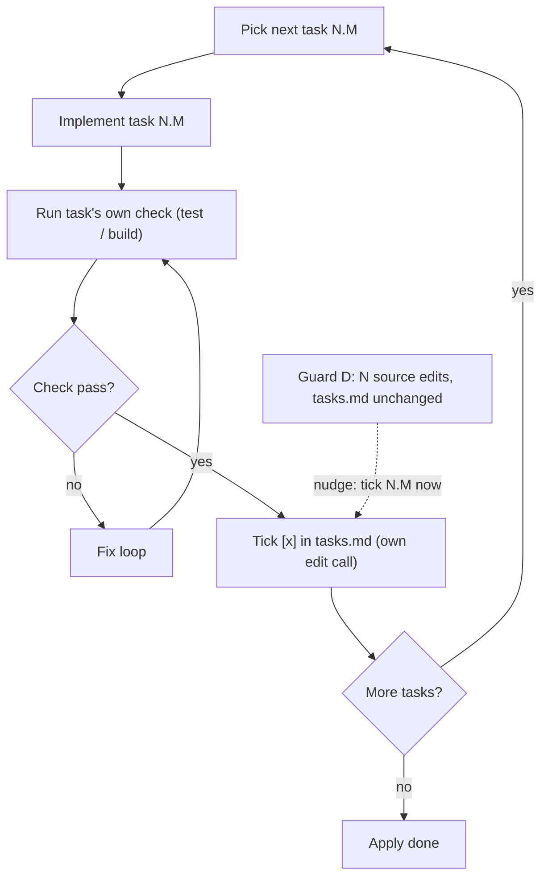

# OpenSpec Apply Checkbox Granularity — Research Dossier

> Status: **research / pre-planning** (explore mode output, no implementation).
> Goal: explain why apply batches `tasks.md` ticks per phase, and map levers that tick per task.
> Scope: no OpenSpec change, no code. Design investigation only. Pick up later.
> Date: 2026-10-22.

---

## 1. Question

During OpenSpec apply, agent ticks `tasks.md` checkboxes in large batches (per phase), not per task.
Can checklist update more often?

---

## 2. Current State (findings)

- `.pi/skills/openspec-apply-change/SKILL.md` — generated (`generatedBy: "1.6.0"`).
- Gitignored via `.pi/.gitignore` line `skills/openspec-*/**`.
- Regenerated by `openspec update`. Hand edits lost.
- Skill step 6: mark task `- [ ]` → `- [x]`, continue to next.
- Guardrail: "Update task checkbox immediately after completing each task".
- `openspec instructions apply --change <name> --json` keys:
  `changeName, changeDir, schemaName, contextFiles, progress, tasks, taskTrackingConfigured, state, instruction, root`.
- `instruction` = "Read context files, work through pending tasks, mark complete as you go. Pause if you hit blockers or need clarification."
- Instruction source: `node_modules/@fission-ai/openspec/schemas/spec-driven/schema.yaml` → `apply:` block (`requires: [tasks]`, `tracks: tasks.md`, `instruction:`).
- Same schema, tasks artifact: "Tasks should be small enough to complete in one session".
- OpenSpec CLI version: 1.14.3.
- This repo `openspec/config.yaml`: `schema: spec-driven`.
- No `openspec/schemas/` dir → dashboard-managed `pi-spec-driven` schema NOT enabled here.
- `rules:` keyed per artifact (`proposal`, `tasks`). Existing `tasks` rule: "Offer plan-proposal instead of apply".
- Dashboard-managed schema: `packages/server/src/openspec/workflow-schema.ts`.
  - `generateWorkflowSchema` forks built-in spec-driven.
  - `patchAndStampSchemaYaml` patches + stamps `CURRENT_PATCH` (const in `workflow-schema-status.ts`, currently 2).
  - See change: add-pi-spec-driven-schema, add-openspec-change-dependencies.
- Dashboard progress reads `tasks.md`:
  - `packages/server/src/openspec/openspec-tasks.ts` (`parseTasksMarkdown`, `readTasks`, `toggleTask`).
  - Watcher: `packages/server/src/openspec/openspec-change-watcher.ts`.
  - Batched ticks → progress bar jumps (e.g. 3/20 → 11/20).
- `.pi/skills/ship-it/SKILL.md` §4: "apply marks `- [ ]` → `- [x]` and never revisits a checked task". Ship-it treats checkbox as never proof of done.

---

## 3. Root Causes (hypotheses, not measured)

1. Coarse tasks. Phase heading holds many sub-boxes. Agent implements as unit, tests once, ticks once.
2. Harness rule conflict. System prompt: "multiple separate locations in one file → one edit call". Favours one multi-edit to `tasks.md` at end.
3. TDD shape. Tests written for whole section → implement → green together → tick together.
4. Subagent delegation. Subagent returns whole phase; parent ticks phase.
5. Long-context drift. Guardrail at skill bottom fades. Nothing enforces it.

---

## 4. Levers

| Lever | Survives `openspec update` | Reach | Strength |
|---|---|---|---|
| A. Edit generated apply `SKILL.md` | No (gitignored, regenerated) | n/a | Wiped |
| B. `tasks:` rule in `openspec/config.yaml` (authoring-time granularity: one checkbox ≈ one verifiable unit, no phase-sized box) | Yes | New changes only | Medium. Fixes cause 1 |
| C. Override `apply.instruction` in `pi-spec-driven` schema via new patch version in `patchAndStampSchemaYaml` | Yes | Only projects with pi-spec-driven enabled (not this repo yet) | Medium |
| D. Extension guard (like kb read-discipline guard): during apply, after N source edits with `tasks.md` unchanged → inject "tick task X.Y now" nudge | Yes | Every apply, any schema | Strong, mechanical |
| E. Explicit loop protocol text: "finish task → run its check → tick in own edit call → next task" | Depends on host | Prompt-level | Weak alone. Pair with B or D |

### Desired apply loop

---

## 5. Tension

- Tick more often ≠ tick early.
- Ship-it says apply never revisits a checked task → premature `[x]` = false done.
- Rule must be: tick when that task's own verification passes. Not: tick on touch.

---

## 6. Recommendation (conditional)

- Pain = live visibility (progress bar jumps). → B + D.
- Pain = resumability after interrupted apply. → D primary.
- Cheapest first → B (one YAML rule). Observe a few apply runs before anything heavier.

---

## 7. Open Questions

- Which pain dominates: visibility or resumability? **Unanswered.**
- Does OpenSpec 1.14.3 `config.yaml` `rules:` accept an `apply:` key (apply is not an artifact)? **Unverified.** ~2 min spike.
- How often do ticks batch across real apply sessions? Session-log analysis. **Not done.**

---

## 8. Sources

- `.pi/skills/openspec-apply-change/SKILL.md`
- `.pi/.gitignore`
- `.pi/skills/ship-it/SKILL.md`
- `node_modules/@fission-ai/openspec/schemas/spec-driven/schema.yaml`
- `openspec/config.yaml`
- `packages/server/src/openspec/workflow-schema.ts`
- `packages/server/src/openspec/workflow-schema-status.ts`
- `packages/server/src/openspec/openspec-tasks.ts`
- `packages/server/src/openspec/openspec-change-watcher.ts`
