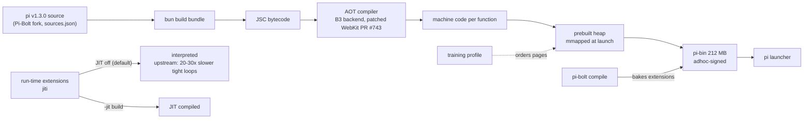
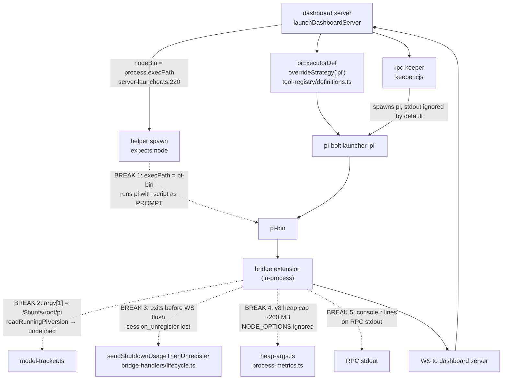

# Pi-Bolt AOT Runtime Spike — Can Pi-Bolt Replace Stock pi Under pi-dashboard?

Research artifact. Explore-mode + spike, no OpenSpec change. No repo code change. Source: https://github.com/opensec-git/Pi-Bolt (release `bolt-v0.9.6`, published 2026-10-20). Date: 2026-10-20. Question answered: *can Pi-Bolt (AOT-compiled pi fork) replace stock pi under pi-dashboard for performance, and can the dashboard server be built the same way?*

> Pi-Bolt is an independent third-party fork. Not affiliated with the pi authors or Oven. All numbers measured in this spike on one host (§2). Upstream claims are marked as such.

---

## 0. TL;DR

- Pi-Bolt = pi v1.3.0 (our pinned version) compiled AOT to one executable on JavaScriptCore/Bun. Installs beside pi as `pi-bolt`.
- Measured: empty-config ready 141 ms → 35 ms (4×). Real `~/.pi/agent` (38 packages + bridge) ready 3062 ms → 2160 ms (−29%). 60k-char stream + bridge CPU 1130 ms → 340 ms (3.3×).
- Regression: large-session resume peak RSS ~490 MB → ~710 MB (+45%).
- Extension parity: 141/141 commands, identical names, all extensions load.
- Interpreted bridge is not the bottleneck. JIT-off ≈ JIT-on for our load. Use default (JIT off) build.
- **5 integration breaks** in dashboard code. Break 1 (`process.execPath` is not node) hits helper spawns. Break 3 (`session_unregister` lost on exit) leaves live state stale.
- **Verdict:** opt-in alternative runtime, not default. Do **not** build the dashboard server with the AOT toolchain.
- Ship runtime-neutral hardening first (real-node resolver, execPath fallback, WS flush on shutdown, V8-gated heap telemetry). Fix `pi-hermes-memory` startup stall separately. Re-measure large-session RSS before any default switch.

---

## 1. What Pi-Bolt is

- Independent fork of `earendil-works/pi`. Forked at tag `v1.3.0` (`sources.json`). Our `package.json` peer range: `@earendil-works/pi-coding-agent >=1.3.0` (no exact pin).
- Build pipeline (upstream): `bun build` bundles pi → JavaScriptCore bytecode → AOT compiler (B3 backend, patched oven-sh/WebKit PR #743) → machine code per function. Prebuilt heap is mmapped at launch. Training profile orders pages. See §1.1.
- One executable per platform. Platforms:
  - Linux x64 / arm64 (glibc ≥ 2.17, **no musl**)
  - macOS 13+ **Apple silicon only** (no Intel)
  - Windows x64 (ARM via emulation)
  - Android / Termux
- Installs beside pi as `pi-bolt`. Uses `~/.pi/agent` unchanged.
- Two builds:
  - **Default (JIT off):** pi core compiled. Run-time extensions (jiti) **interpreted**. Upstream docs: tight loops 20–30× slower. `eval` / `new Function` interpreted.
  - **`-jit`:** JIT on for extensions. Required for `bun:ffi`.
- `pi-bolt compile` bakes extensions into the binary. Rules: peerDeps for pi packages, static imports only, embed files instead of reading next to source, workers via `--plugin-worker`.

### 1.1 Build pipeline and launch



---

## 2. Spike setup and method

- Release: `bolt-v0.9.6` (published 2026-10-20). Assets: `pi-bolt-darwin-arm64.tar.xz` + `-jit`. Both `SHA256SUMS` verified OK.
- `pi --version` output: `1.3.0 (Pi-Bolt 0.9.6, darwin-arm64, JIT off|on)`.
- Binary layout: `pi` launcher, `pi-bin` (212 MB, adhoc-signed), `pi-spawn`, `assets/`, `theme/`, `export-html` beside it.
- Host: macOS 26.4, Apple silicon arm64, 18 cores, 48 GB.
- Stock baseline: pi 1.3.0 on Node v24.15.0.
- Throwaway harness `/tmp/pibolt-spike` (not in repo). No installer. Nothing on `PATH`.
- Method:
  - `--mode rpc` (what the headless keeper uses).
  - Ready = time to first `get_state` response.
  - CPU / peak RSS via `/usr/bin/time -l`.
  - Isolated runs: `PI_CODING_AGENT_DIR=<empty dir>`.
  - Hot-path runs: fake OpenAI-compatible SSE LLM (models.json provider `fake`; 60k chars in 4-char deltas = 15,002 `message_update`). Fake dashboard gateway (ws over unix socket via `PI_DASHBOARD_SOCKET`). Bridge loaded via `--extension packages/extension/src/bridge.ts`.
  - Medians, n = 5–7 (resume n = 3).

---

## 3. Results

| Scenario | stock pi (Node 24) | Pi-Bolt JIT off | Pi-Bolt JIT on |
|---|---|---|---|
| Empty config: ready / CPU / RSS | 141 ms / 170 ms / 123 MB | 35 ms / 20 ms / 61 MB | 41 ms / 30 ms / 64 MB |
| Real `~/.pi/agent` (38 packages + bridge): ready / CPU / RSS | 3062 ms / 3310 ms / 336 MB | 2160 ms / 2020 ms / 217 MB | 2411 ms / 2120 ms / 226 MB |
| `createAgentSessionRuntime` (`PI_TIMING`, ext loading) | 2266 ms | 778 ms | – |
| `bridge.ts` module import | 623 ms | 207 ms | – |
| 60k-char stream, no bridge: CPU / RSS | 420 ms / 187 MB | 70 ms / 87 MB | 60 ms / 90 MB |
| 60k-char stream, +bridge: CPU / RSS | 1130 ms / 236 MB | 340 ms / 138 MB | 330 ms / 148 MB |
| Resume 56 MB session copy, +bridge: ready / CPU | ~1000 ms / ~1250 ms | ~530 ms / ~460 ms | ~560 ms / ~470 ms |
| Resume 56 MB session copy, +bridge: peak RSS | ~490 MB | ~710 MB **(regression)** | ~740 MB |

Findings:

- Startup: 4× faster empty; −29% real config. Gain capped by runtime-independent stall (§3.1).
- Stream CPU: ~3.3× less with bridge. Bridge coalesces 15k deltas into ~27 gateway frames.
- Interpreted bridge not a bottleneck: JIT-off ≈ JIT-on on this load. JIT build not needed.
- Large-session resume: same 54.6 MB replayed to gateway, but JSC holds large strings longer → +45% peak RSS.
- `pi-blackhole` `typebox` dependencies warning appears on both runtimes (pre-existing, not Pi-Bolt).

### 3.1 Runtime-independent stall

- `pi-hermes-memory` `database.quick-check` ~1.25 s on **both** runtimes.
- `session-start.load`: 1268 ms (Pi-Bolt) vs 1254 ms (stock).
- Separate quick win. Fixes startup regardless of runtime.

---

## 4. Extension parity

- `get_commands`: 141 = 141. Identical names.
- All extensions load under JIT-off build.
- Bridge (`packages/extension/src/bridge.ts`) loads and forwards events under both builds.

---

## 5. Integration breaks

Five breaks found by running the dashboard bridge + launcher paths under Pi-Bolt.



### Break 1 — `process.execPath` is not node

- Code:
  - `packages/shared/src/server-launcher.ts:220`: `const nodeBin = opts.nodeBin ?? process.execPath;`
  - `packages/extension/src/openspec-cli-shim.ts`: shim shebang uses absolute `process.execPath` (default `execPath` option, line 37–38) and runs `exec "<process.execPath>" bin.js`.
- Under Pi-Bolt: `process.execPath` = `<dir>/pi-bin`, not node.
- Effect: helper runs `pi-bin script.js` → `script.js` treated as **prompt** → starts real LLM session (see §10).
- Probe: `BUN_BE_BUN=1 pi-bin script.js` runs it as Bun (prints `node-script-ok`).
- Fix direction: resolve a real node binary for helper scripts. Never assume `execPath` is node.

### Break 2 — `pi_version_update` never sent

- Code: `packages/extension/src/model-tracker.ts` → `readRunningPiVersion(argv1 = process.argv[1])`.
- Under Pi-Bolt: `process.argv` = `["bun", "/$bunfs/root/pi"]`. Walk-up from argv[1] finds nothing → `undefined`.
- The code already anticipates a "bun-compiled binary" case, but the fallback path is not taken.
- Effect: dashboard loses version-skew and below-floor signal (`pi_version_update` never emitted).
- Fix direction: fallback walk-up from `process.execPath` (Pi-Bolt ships `package.json` beside `pi-bin`).

### Break 3 — `session_unregister` lost on exit

- Code: `packages/extension/src/bridge-handlers/lifecycle.ts` → `sendShutdownUsageThenUnregister` (imports `usage-drain.js`).
- Under Pi-Bolt: probe extension shows `session_shutdown reason=quit` **fires** (also on SIGTERM, which stock does not). Process exits before WS frame flushes.
- Observed: spike session stayed `streaming` in live dashboard after process death.
- Recovery used in spike: `POST /api/session/:id/shutdown` → `ended/manual`.
- Fix direction: await WS flush / drain before process exit on shutdown.

### Break 4 — `node:v8` is JSC-synthesized

- Under Pi-Bolt:
  - `heap_size_limit` ~260 MB (Node: ~4.5 GB).
  - `process.versions` = `{node: "26.3.0", bun: "1.4.3", v8: "14.6.202.34-node.20"}`.
  - `NODE_OPTIONS=--max-old-space-size=512` **ignored**.
- Affected code:
  - `packages/server/src/spawn-process/heap-args.ts` (bound-session-heap cap; change `bound-session-heap-and-gc-telemetry`). Already handles single-argv shape with fallback when no runtime slot.
  - `packages/extension/src/process-metrics.ts` (GC / heap telemetry) — misleading under JSC.
- Fix direction: detect `process.versions.bun`; skip or label heap telemetry.

### Break 5 — bridge `console.*` on RPC stdout

- Under Pi-Bolt: `[dashboard] endpoint …` and `[dashboard] registered MCP server …` lines leak to RPC **stdout**. Stock: stderr.
- Dashboard impact: none. Keeper discards pi stdout when capture disabled (default): `stdio: ["pipe", "ignore", "ignore"]` (spec `rpc-keeper-sidecar`, env `PI_KEEPER_CAPTURE_PI_OUTPUT`).
- Third-party RPC / JSONL clients break on non-JSON stdout lines.
- Fix direction: route bridge logs to stderr.

---

## 6. Spawn-path fit

- Tool registry: `packages/shared/src/tool-registry/definitions.ts` → `piExecutorDef` (line 642). First strategy `overrideStrategy("pi")` → pointing at `pi-bolt` = **config override**. No code change for the spawn itself.
- Headless path: dashboard server → rpc-keeper (`packages/server/src/rpc-keeper/keeper.cjs`) → pi. Keeper spawns pi with `stdio: ["pipe", logFd, logFd]` when capture enabled, else `["pipe", "ignore", "ignore"]`.
- Breaks on this path:
  1. Break 1 (helper spawn via `execPath`) — any helper spawned via `process.execPath` runs pi, not node.
  2. Break 3 (shutdown unregister) — live dashboard state goes stale.
- Breaks 2, 4, 5 degrade telemetry / third-party clients, not spawn.

---

## 7. Dashboard server via same toolchain: NOT recommended

- AOT toolchain is Bun / JSC only. Server runs on **Node** and under **Electron** (`ELECTRON_RUN_AS_NODE`, rpc-keeper).
- `node-pty` 1.2.0-beta.15 native addon: Bun support unproven. Terminal depends on it.
- jiti + runtime dashboard plugins + `/api/restart` no-build workflow conflict with the AOT "static imports only" rule. Dynamic code is interpreted.
- Known server stalls are spawn / I/O bound, not CPU bound:
  - openspec poller slow tick (spawning node CLIs).
  - JSON persistence.
  - large replay.
- Runtime speed does not fix these. Better levers:
  - fewer `openspec` child spawns (in-process or cached).
  - change `fix-large-session-resume-replay`.
- Cross-ref: `research/native-rewrite-go-rust-candidates.md` — same verdict: bottleneck is spawn / IO / polling, not CPU.

---

## 8. Risks

- **Third-party fork.** Patched WebKit + Bun. Installer from `pi-bolt.opensec.in`. Every pi bump waits on their rebase.
- **Platform gaps.** No Intel Mac, no musl. Docker image `node:24-bookworm-slim` (glibc) OK.
- **Memory regression** on very large sessions (+45% peak RSS, §3).
- **Break 3 data integrity.** Sessions stuck `streaming` after crash until manual shutdown.
- **Break 1 silent failure.** Helper runs pi as prompt → unexpected LLM spend.

---

## 9. Recommendation

- **Opt-in alternative runtime.** Not default. Selectable via `piExecutorDef` `overrideStrategy("pi")` config.
- **Runtime-neutral hardening change** (helps any non-Node host):
  - real-node resolver for helpers instead of `execPath`.
  - `execPath` fallback for pi version (`readRunningPiVersion`).
  - flush WS before exit on shutdown.
  - gate heap telemetry on V8 (`process.versions.bun`).
- **Separate:** fix `pi-hermes-memory` `database.quick-check` startup stall (~1.25 s every session, both runtimes).
- **Before any default switch:** re-measure large-session RSS (+45% regression).
- No dashboard server rebuild on AOT toolchain.

---

## 10. Spike pitfalls

- **Never run a pi binary with a bare positional arg to "test" it.** pi treats it as the initial prompt → real LLM call. Cost ~$0.31 on Opus in this spike.
- **Spike against live dashboard registers sessions.** `--no-session` still registers with bridge. Use fake gateway via `PI_DASHBOARD_SOCKET` + isolated `PI_CODING_AGENT_DIR`.
- `POST /api/session/:id/hide` no longer exists (404). Use `/api/session/:id/shutdown` to end stale sessions.

---

## 11. Reproduce

Download and verify:

```bash
gh release download bolt-v0.9.6 --repo opensec-git/Pi-Bolt -p 'pi-bolt-darwin-arm64*.tar.xz' -p SHA256SUMS
shasum -a 256 -c SHA256SUMS
```

Isolated RPC ready bench:

- Spawn `<bin> --mode rpc --no-session` under `/usr/bin/time -l`.
- Write `{"id":"r1","type":"get_state"}` to stdin.
- Time to response.
- Set `PI_CODING_AGENT_DIR` to an empty dir.

Stream bench:

- `models.json`:

```json
{"providers":{"fake":{"baseUrl":"http://127.0.0.1:18555/v1","api":"openai-completions","apiKey":"x","models":[{"id":"fake-model"}]}}}
```

- Run with `--provider fake --model fake-model`.
- RPC: `{"type":"prompt","message":"go"}`. Wait for `agent_end`.
- Fake OpenAI-compatible SSE server must listen on `127.0.0.1:18555` (matches `baseUrl`).

Load timing: set `PI_TIMING=1`.

---

## Sources

- Pi-Bolt: https://github.com/opensec-git/Pi-Bolt — release `bolt-v0.9.6` (2026-10-20), `sources.json`, upstream benchmark claims (Linux x64, 1 CPU, vs pi on Node 24: ready 38 vs 277 ms; tmux session memory 24 vs 212 MB; 60k-char stream CPU 1.6 vs 28.9 s — **upstream claims, not reproduced here**).
- Spike harness: `/tmp/pibolt-spike` (throwaway, not in repo).
- pi-dashboard code refs: `packages/shared/src/server-launcher.ts`, `packages/extension/src/openspec-cli-shim.ts`, `packages/extension/src/model-tracker.ts`, `packages/extension/src/bridge-handlers/lifecycle.ts`, `packages/server/src/spawn-process/heap-args.ts`, `packages/extension/src/process-metrics.ts`, `packages/shared/src/tool-registry/definitions.ts`, `packages/server/src/rpc-keeper/keeper.cjs`.
- Specs: `openspec/specs/rpc-keeper-sidecar/spec.md`.
