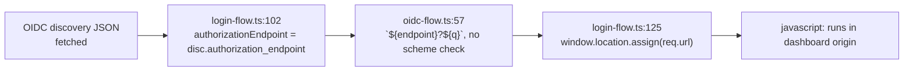
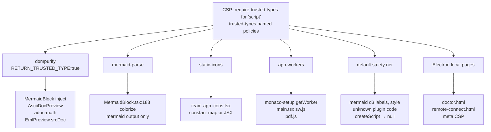

# Trusted Types for the dashboard client — spike report

> Research artifact. Explore-mode spike, no change / no impl.
> Date: 2026-10-21.
> Question: can Trusted Types (TT, CSP `require-trusted-types-for 'script'`) eliminate client-side XSS in `packages/client/`, and what breaks?
> Origin: user idea "only server-generated, digitally signed URLs for navigation".
> Method: throwaway Playwright 1.62.1 harness in `/tmp/tt-spike` (not in repo). Production build, server on `:8000`. Server untouched.

---

## 1. Verdict

- TT does not eliminate XSS in general. It covers DOM-XSS sinks that take strings. It does not cover URL navigation.
- Signed URLs do not fix it. Signing proves provenance, not safety.
- TT is worth a phased rollout. Spike shows ~10 distinct app-owned sites plus library-owned sinks.
- Real script-exec bug exists today: OIDC `authorization_endpoint` → `window.location.assign`. Fix in Phase 0.
- Phishing / open-redirect is NOT covered by TT. Needs a shared URL policy.
- Signed tokens fit only authority-carrying navigations (see §6).

---

## 2. Question origin — signed URLs

- User idea: navigate only to server-generated, digitally signed URLs.
- Explore finding: most URLs are server-RELAYED or CONTENT, not server-authored.
  - Relayed: git remote → `gitPrUrl` (`packages/extension/src/pr-status.ts:212`, `packages/extension/src/vcs-info.ts:333`).
  - Relayed: npm → `changelogUrl` (`packages/server/src/routes/pi-changelog-routes.ts:104`).
  - Relayed: OAuth `authUrl` / `verificationUri`, OIDC `authorization_endpoint`.
  - Content: agent tool args, markdown links, file frontmatter.
- Signing relayed/content URLs launders taint: signed = trusted label on attacker-influenced data.
- Signing fits only authority-carrying navigations: `returnTo`, LoginGate `redirectTo`, action deep links.
- Existing precedents to reuse:
  - Capability minting: `packages/server/src/live-server/live-capability.ts` (`LiveCapabilityStore`, line 152).
  - HMAC: `packages/server/src/auth/passkey/challenge-store.ts` (`SignedChallenges<T>`, line 30).

---

## 3. Static sink inventory (`packages/`, tests excluded)

| Sink class | Count | Protected by React? | Risk |
|---|---|---|---|
| JSX `href={var}` | 51 | Yes for `javascript:` | phishing / open-redirect only |
| `window.open(x)` | 14 | No | script-capable |
| `location.assign` / `href=` / `replace` | 14 | No | script-capable |
| `innerHTML` / `dangerouslySetInnerHTML` | ~8 real | No | DOM-XSS |
| iframe `src` | 5 | n/a | all minted / opaque origin / never `allow-same-origin` |
| iframe `srcDoc` | 1 | n/a | `EmlPreview`, `sandbox=""` |
| Electron `openExternal` | 3 | n/a | behind scheme allowlist |

Notes:
- React 19.2.8 blocks `javascript:` in `href` and iframe `src`. Verified via `renderToString`: replaced with `javascript:throw new Error('React has blocked a javascript: URL…')`. Case-insensitive.
- React does NOT rewrite `data:text/html` in `href`.
- Five separate URL gates exist. Each differs:
  1. `UrlLink` regex.
  2. `safeUrlTransform` in `packages/client/src/components/preview/markdown-sanitize.ts`.
  3. `isExternalHref`.
  4. `packages/electron/src/lib/link-handling.ts`.
  5. `CraftFrame` `navigateUnsafe`.
- Gates bypassed by:
  - `CtxToolRenderer` agent tool-arg `url` (×3).
  - `ToolsSection` `hint.url`.
  - `WhatsNewDialog` `changelogUrl`.
  - `TabActions` `target.url`.
  - `SessionCard` `openUrl`.
- CodeQL baseline (`codeql-baseline.json`): 8 `js/xss` untriaged, 6 `js/client-side-unvalidated-url-redirection` untriaged. Owned by openspec change `triage-codeql-alert-debt`.

---

## 4. Real bug — OIDC `authorization_endpoint`

Chain:

- No scheme check at any hop.
- Matches CodeQL `js/xss` untriaged entry.
- Fix: allow `https:` only; `http:` only for loopback.
- TT enforcement would also block it: `location.assign` of string → `TrustedScriptURL` / string-to-script rule under `require-trusted-types-for 'script'`. Treat TT as backstop, not fix.

Files:
- `packages/client-utils/src/identity/login-flow.ts` (lines 102, 125).
- `packages/client-utils/src/identity/oidc-flow.ts` (line 57).

---

## 5. Runtime spike — distinct TT sink sites

Measured with TT enforced-in-report-only, default policy pass-through recording, and wrapped `trustedTypes.createPolicy`.

| # | Site | Sink type | Hits | Source |
|---|---|---|---|---|
| 1 | mermaid d3 `.html()` labels (`addHtmlSpan`) | TrustedHTML | 155 | library internal |
| 2 | React `dangerouslySetInnerHTML` svg | TrustedHTML | ~36 | `packages/client/src/components/preview/MermaidBlock.tsx:1020` |
| 3 | `DOMParser.parseFromString(svg,'image/svg+xml')` colorize | TrustedHTML | 17 | `MermaidBlock.tsx:183` |
| 4 | mermaid `<style>.innerHTML` | TrustedHTML | 13 | library internal |
| 5 | React `dangerouslySetInnerHTML` | TrustedHTML | ~6 | `packages/client/src/components/preview/AsciiDocPreview.tsx:139` |
| 6 | `template.innerHTML` + KaTeX `out.innerHTML` | TrustedHTML | 3 | `packages/client/src/lib/preview/adoc-math.ts:30,45` |
| 7 | `new Worker(pdf.worker)` | TrustedScriptURL | 2 | pdf.js internal (`PdfPreview`) |
| 8 | `getWorker` → `new Worker(editor.worker)` | TrustedScriptURL | 2 | `packages/client/src/components/editor-pane/monaco-setup.ts:24` |
| 9 | `navigator.serviceWorker.register('/sw.js')` | TrustedScriptURL | 1 | `packages/client/src/main.tsx:107` |
| 10 | `srcDoc` on sandboxed iframe | TrustedHTML | 2 | `packages/client/src/components/preview/EmlPreview.tsx:180` |
| 11 | `dangerouslySetInnerHTML` constant SVG icons | TrustedHTML | 217 | `packages/team-app/src/ui/icons.tsx` |

Zero sinks observed:
- Chat markdown (react-markdown + rehype-sanitize + React 19).
- Markdown without diagrams.
- csv, xlsx, png.
- All 15 core + 21 plugin settings pages, except Monaco worker on `/settings/instructions`.
- openspec, pi-resources, `/atlas`.

Library-owned policies observed:
- `dompurify`.
- Monaco ships 9: `defaultWorkerFactory`, `tokenizeToString`, `standaloneColorizer`, `editorViewLayer`, `domLineBreaksComputer`, `diffReview`, `diffEditorWidget`, `editorGhostText`, `stickyScrollViewLayer`.
- Our `monaco-setup` `getWorker` bypasses them.

Other facts:
- DOMPurify `RETURN_TRUSTED_TYPE` defaults `false`. No app code sets it.
- React 19 commit path does `el.innerHTML = value` without string coercion. `TrustedHTML` passes through `dangerouslySetInnerHTML`.
- Agent content reaches `innerHTML` via mermaid labels. Recorded sample: label text from an agent-written diagram.
- Under enforcement: 0 `createScript` calls. No eval-string sinks hit.
- pdf.js and Monaco workers pass a same-origin `createScriptURL` rule.

Diagram types rendering (13): flowchart-v2, sequence, classDiagram, stateDiagram, er, gantt, pie, mindmap, journey, gitGraph, timeline, quadrantChart, xychart.

---

## 6. Signed URLs — where they fit

| Navigation kind | Signing? | Reason |
|---|---|---|
| `returnTo` after login | Yes | authority-carrying; reuse `SignedChallenges` pattern |
| LoginGate `redirectTo` | Yes | same |
| Action deep links (session open, tool action) | Yes | authority-carrying |
| `gitPrUrl`, `changelogUrl` | No | server-relayed; signing launders taint |
| OAuth `authUrl` / `verificationUri`, OIDC endpoint | No | external IdP-provided; validate scheme + host allowlist instead |
| Agent tool-arg `url`, markdown links | No | content; validate via URL policy |
| iframe capability URLs | Already | `LiveCapabilityStore` |

---

## 7. Mermaid identical-render test

Method: TT ENFORCED vs no-TT baseline. Per-diagram screenshot pixel diff. Baseline run twice for noise.

| Policy variant | Result |
|---|---|
| naive default (`DOMPurify.sanitize(s)` default cfg) | 6/13 broken. Strips `<foreignObject>`, HTML labels lost. |
| tuned default (see rules below) | 11/13 pixel-identical. #09 gitGraph ±8 px width varies between baseline runs too (noise). #00 flowchart lost accent colorization. |

Tuned default rules:
- No `<` in input → passthrough.
- `/^<svg/` → `sanitizeMermaidSvg` config from `MermaidBlock.tsx`:
  - `USE_PROFILES`: svg, svgFilters, html.
  - `ADD_TAGS`: `foreignObject`.
  - `HTML_INTEGRATION_POINTS`: `foreignobject`, `annotation-xml`.
  - `FORBID_TAGS`: form, input, button, textarea, select, iframe, object, embed.
- Else: DOMPurify html + svg + svgFilters + mathMl.

#00 root cause:
- Site 3 colorize pass parses mermaid output as `image/svg+xml`.
- Via default policy it receives HTML-serialized sanitized markup.
- XML parse fails → colorize silently skipped. No error.

Lessons:
- Sanitizing default policy can degrade silently.
- Every app-owned sink needs a named, context-specific policy.
- Rollout needs a visual regression gate.

---

## 8. Proposed policy design (NOT implemented)

| Policy | Covers | Rule |
|---|---|---|
| `dompurify` (`RETURN_TRUSTED_TYPE:true`) | MermaidBlock inject, AsciiDocPreview, adoc-math, EmlPreview srcDoc | existing sanitize configs |
| `mermaid-parse` | `MermaidBlock.tsx:183` colorize | mermaid's own output pre-final-sanitize; never raw input |
| `static-icons` | team-app `icons.tsx` | constant map only, or convert to JSX |
| `app-workers` | `monaco-setup.ts` `getWorker`, `main.tsx` `sw.js`, pdf.js | same-origin `/assets/*.m?js` + `/sw.js` |
| `default` (safety net) | mermaid d3 labels + `<style>`, unknown plugin code | tuned rules §7; `createScript` → null |
| Electron local pages | `doctor.html`, `remote-connect.html` | meta CSP `require-trusted-types-for` |

Bonus:
- `require-trusted-types-for 'script'` blocks `location.assign` / `window.open` of `javascript:` URLs. Neutralizes §4 bug.

Not covered by TT:
- `https://evil` phishing / open-redirect.
- Needs shared `shared/url-policy.ts`, `<SafeLink>` / `openUrl`, lint ban on raw `window.open` / `location.*` / `dangerouslySetInnerHTML`.

---

## 9. Electron (static only)

- `packages/electron` Electron 44.9.0.
- Main window loads server URL → same Chromium TT behaviour + server CSP.
- Splash: `packages/electron/src/main.ts:402` `executeJavaScript` sets `textContent` with escaped JSON literal → NOT a sink.
- Local pages outside server header:
  - `packages/electron/src/renderer/remote-connect.html`: meta CSP present. `innerHTML` via `esc()`.
  - `packages/electron/src/renderer/doctor.html`: `innerHTML` via `escapeHtml()`. NO CSP meta.
- Each needs own `<meta http-equiv="Content-Security-Policy">` with `require-trusted-types-for 'script'`.

---

## 10. CSP today

- `packages/server/src/auth/csp.ts` `buildCsp()`.
- Default mode `report`. Env: `PI_DASHBOARD_CSP=report|enforce|off`.
- `script-src 'self' 'unsafe-inline' 'unsafe-eval'`.
- TT works alongside `unsafe-inline`.
- Later: drop `unsafe-inline` / `unsafe-eval` (separate phase).

---

## 11. Harness traps

Each trap produced a false "zero sinks" result during the spike.

| Trap | Symptom | Fix |
|---|---|---|
| Service worker | app registers `/sw.js`; later navigations served from SW cache, bypass `page.route` → TT header missing | `newContext({serviceWorkers:'block'})` |
| Chromium Local Network Access | `route.fulfill`-ed document treated non-local → `ws://localhost:8000/ws` fails `net::ERR_BLOCKED_BY_LOCAL_NETWORK_ACCESS_CHECKS` → "Server offline", chat empty | launch args `--disable-features=LocalNetworkAccessChecks,LocalNetworkAccessChecksWebSockets,BlockInsecurePrivateNetworkRequests,PrivateNetworkAccessSendPreflights` |
| Plugin settings load | ~10 s to load sections; 4 s wait shows only enable toggle | wait ≥10 s |
| SPA nav uses buttons | `<a href>` BFS finds nothing | enumerate via known route list |
| Click-crawl on live dashboard | hit sidebar "New Session" → spawned real empty session | never heuristic click-crawl live dashboard; shut down via `POST /api/session/:id/shutdown` |

Method details:
- TT injected client-side via `ctx.route` on document responses. Appends to `content-security-policy-report-only`. Enforced variant sets `content-security-policy`.
- Mode A: `securitypolicyviolation` listener (counts).
- Mode B: pass-through recording `default` TT policy (stack per sink) + wrapped `trustedTypes.createPolicy` (lists lib policies).
- Mode A counts == Mode B counts.
- Attribution: first app stack frame → dist chunk line:col → source grep.
- Reusable procedure saved as global skill `spike-csp-trusted-types-playwright`.

---

## 12. Coverage

Covered:
- 20 core routes:
  - home, session chat.
  - file view `/folder/:cwd/view?path=` for: md, mermaid md, `.mmd`, 2× adoc, docx, pdf, eml, csv, xlsx, png, README.
  - session editor (Monaco).
  - openspec.
  - settings general / security.
  - pi-resources.
  - Fixtures: `docker/fixtures/sample-git/`.
- 15 core settings pages.
- 21 plugin settings pages (`/settings/plugins/<id>`).
- `/atlas`, `/apps/team/`.
- 14-diagram mermaid gallery (temporary file, deleted).

NOT covered:
- `DiagramPreview` (`.mmd` shows "can't preview").
- `DocxPreview` innerHTML path (docx renders via pdf.js).
- deck3d.
- craft-web editor frames (sandboxed, own docs).
- Chat plugin entry renderers beyond this session.
- Safari / Firefox: ignore TT → no breakage, no protection.
- Electron: static only.

---

## 13. Suggested phase order (input for a future change; none created)

| Phase | Scope | Size |
|---|---|---|
| 0 | Login-flow scheme check (`login-flow.ts`, `oidc-flow.ts`). `https:` only; `http:` loopback. | tiny |
| B | Trusted Types: named policies + ~10 sites → report-only in prod → visual regression gate → enforce. | S–M (de-risked by spike) |
| A | Shared URL policy + chokepoints + lint. Phishing / open-redirect. | M |
| C | Signed tokens only for authority-carrying navigations (`returnTo`, action deep links). Reuse `SignedChallenges`. | S |
| Later | CSP enforce without `unsafe-inline` / `unsafe-eval`. | — |

Relates to openspec change `triage-codeql-alert-debt` (stub; owns `js/xss` + redirect CodeQL debt).

---

## 14. Side findings (separate tickets, not TT)

- `AsciiDocPreview` sets identical 3.8 KB HTML 6–11× per load (re-render churn).
- `docs/architecture.md` lists `POST /api/session/:id/hide`; server returns 404 (doc drift).
- `/api/restart` caller not logged in `~/.pi/dashboard/server.log`. Two restarts during spike traced to concurrent ship flows in other sessions only by commit / worktree evidence.
- `doctor.html` has no CSP.

---

## 15. Open questions

- Rollout gate: which visual regression tool / baseline set for Phase B.
- Whether `dompurify` config per call site or shared profile.
- Whether `static-icons` converts to JSX or keeps constant-map policy.
