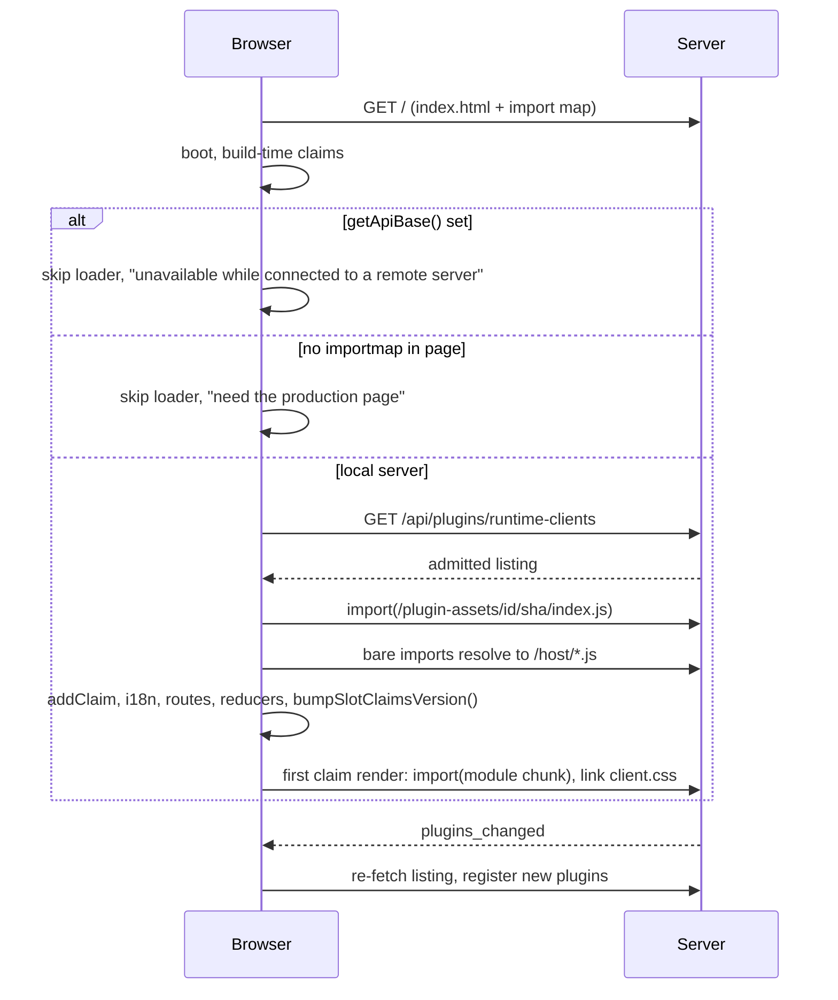

# Runtime plugin clients

Plugin client JS delivered at runtime. Stock production dashboard. No rebuild. Prebuilt ESM loaded with `import()` through a server-injected import map. Opt-in per plugin by operator trust + content-hash pin.

Audience: operator (trust it) + plugin author (build it). Author side: [`publishing-plugins.md`](publishing-plugins.md). Embedded apps on this path: [`plugin-apps.md`](plugin-apps.md). Discovery sources: `architecture.md` § "Plugin Discovery, Trust and Runtime Delivery".

See change: decouple-plugins-from-core.

## Why

- Build-time bundling needs monorepo + Vite. Electron + npm-global ship `dist/` only. No toolchain.
- External plugin client cannot reach those hosts at build time.
- Runtime ESM: plugin ships prebuilt `dist/client/`. Host loads it.
- One React instance. Host shims re-export host modules. Contexts shared.

## Bundled vs runtime

Rule: plugin id ∈ served build's `bundledPluginIds` → bundled. Else runtime-eligible.

- Source: `pi-dashboard-build.json#bundledPluginIds`. Sorted ids. Written by Vite plugin. Host-independent. `schemaVersion` unchanged.
- `PLUGIN_REGISTRY` embeds the same ids.
- Helper: `isBundledPlugin(id, declaration)` in `packages/dashboard-plugin-runtime/src/server/client-registry-set.ts`. Single predicate for delivery, status, hash.
- Same rule on every host. Filesystem roots cannot tell what a build bundled (npm-global has no root; Electron root holds only `BUNDLED_WORKSPACE_PKGS`).
- Bundled id → build's own copy wins discovery, both halves (server + client). Copy = `workspace` if exists, else `bundled` (`resources/plugins`) if exists, else plain priority. Other copies → winner's `shadowed[]`. Never load.
- Operator who dropped newer first-party copy in `~/.pi/dashboard/plugins` sees it shadowed. Update first-party plugins by updating dashboard.
- npm-global: no build copy on disk. Declared id falls back to plain priority. Halves can differ. Status shows that `source`.
- No declaration or no `bundledPluginIds` (old artifact, `metadata-missing`, API-only) → runtime delivery suspended: `refusedReason: "build-undeclared"`. Selection falls back to source priority + `bundleRootsFor`.
- Staleness hash covers winners of declared ids. Runtime plugins never enter it. npm-global (no build copy): compares against declaration's `pluginRegistryHash`.

## Manifest fields

| Field | Meaning |
|---|---|
| `clientBundle` | Prebuilt ESM entry module, e.g. `./dist/client/index.js`. Eager `import()` when listed. Its directory = served asset root. |
| `clientStyles` | Optional CSS, e.g. `./dist/client/client.css`. Must sit inside asset root. `<link>` on first render of a claim of that plugin. |
| `hostApi` | Caret range of host API. Required for `clientBundle` + `pi-package` plugins. Checked at discovery for both halves. |
| `client` | Build-time source entry. Unchanged. May coexist with `clientBundle`. |
| `eventTypes` | Event types plugin owns. Fed to owner lookup on register. |

- Asset root must be a dedicated client dir. Root = package root or contains `server`/`bridge` entry → client refused `no-bundle`, layout error logged. Prevents publishing server JS under `/plugin-assets`.
- Entry module exports: claim static fns (`predicate`, `shouldRender`, `resultPending`, `labelComponent`), components of claims without `module`, optional `sessionEventReducer` / `toolRowFinalizers`, and the `i18nCatalog` export when declared.
- Claim `module` = separate chunk in asset root. Component stays lazy.
- `i18nCatalog` = export name of entry. Not a file. Listing has no i18n URL.
- Runtime-delivered plugin with only `client` source entry → `client.delivery: "refused"`, reason `no-bundle`.

## Import map

Server injects static `<script type="importmap">` into `index.html`. Source of truth: `packages/shared/src/dashboard-plugin/host-import-map.ts` (`HOST_IMPORT_MAP_IMPORTS`).

| Specifier | Shim URL | Shim source (`packages/client/src/host-shims/`) |
|---|---|---|
| `react` | `/host/react.js` | `react.ts` |
| `react/jsx-runtime` | `/host/react-jsx-runtime.js` | `react-jsx-runtime.ts` |
| `react-dom` | `/host/react-dom.js` | `react-dom.ts` |
| `react-dom/client` | `/host/react-dom-client.js` | `react-dom-client.ts` |
| `@blackbelt-technology/dashboard-plugin-runtime` | `/host/runtime.js` | `runtime.ts` (re-exports `public.ts` only) |
| `@blackbelt-technology/dashboard-plugin-runtime/embedded-app` | `/host/embedded-app.js` | `embedded-app.ts` |
| `@blackbelt-technology/pi-dashboard-app-kit/react` | `/host/app-kit-react.js` | `app-kit-react.ts` |
| `wouter` | `/host/wouter.js` | `wouter.ts` |

- Shims = rollup `input` entries in `packages/client/vite.config.ts`, `preserveEntrySignatures: "exports-only"`. Co-chunked with `react-vendor` → ES module singletons → one React.
- Injection: `sendIndexWithImportMap` in `packages/server/src/lib/index-html.ts`. Used by `GET /`, `GET /index.html`, SPA not-found fallbacks, `--dev` fallback.
- Map inserted before first module script / modulepreload. `Cache-Control: no-cache, no-store, must-revalidate`.
- Map = constant. No plugin- or request-derived value interpolated. Zero runtime plugins → inert.
- Surface behind `/host/runtime.js` = `public.ts` only. Shell internals (`./host`) not reachable. Version gate: `scripts/host-api-surface.mjs` + `packages/dashboard-plugin-runtime/host-api-surface.json`.
- Plugin reads host version via `PLUGIN_HOST_API_VERSION` (import-mapped). `./sdk` carries only pure `satisfiesHostApiRange`.

## Admission

Listing includes a plugin only when all hold:

1. Served build declares bundled ids; plugin not bundled.
2. Enabled in persisted config; server entry (if any) loaded.
3. Every `dependsOn` id discovered, enabled, loaded. Else `missing-dep`.
4. `hostApi` compatible.
5. `auth.trustedPlugins` entry with `clientSha256` == current content hash of `clientBundle` dir.

Else `PluginStatus.client = {delivery: "refused", refusedReason}`. One reason, fixed precedence:

`build-undeclared` > `no-bundle` > `host-api` > `disabled` > `missing-dep` > `untrusted` > `pin-mismatch`

Operator fixes what cannot load before asked to trust it. Refused plugins show in Settings ▸ Plugins tab with reason. No `dev-mode` reason: server cannot know which HTML a `--dev` browser got; client reports it.

## Trust and pin

Config: `auth.trustedPlugins: { id, clientSha256?, server?: true }[]` (`packages/shared/src/config.ts`). Reader/writer: `packages/server/src/auth/plugin-trust-store.ts`.

- Entry without `clientSha256` never admits a client. Gates `serveApp` only. Reports `untrusted`.
- Legacy `auth.capabilityRoutePlugins` still read for `serveApp`.
- `PUT /api/config` ignores `auth.trustedPlugins`. Only trust endpoints write. Dedicated writer read-modify-writes `auth.trustedPlugins` alone. Preserves `capabilityRoutePlugins` + every other auth key.
- `isServeAppTrusted` (`packages/server/src/auth/serve-app-host.ts`): bundled ∨ id ∈ `trustedPlugins` ∨ id ∈ `capabilityRoutePlugins`. Bundled = source ∈ {`workspace`,`bundled`,`installed`} + realpath containment + basename in `piDashboard.bundledPlugins`. Basename alone no longer trusts. `pi-package` + `local-detected` never count as bundled.

### Endpoints

| Route | Tier | Notes |
|---|---|---|
| `POST /api/plugins/:id/trust` `{sha256}` | `operate` + genuinely local | Pins client bundle hash. |
| `POST /api/plugins/:id/trust` `{server:true}` | `operate` + genuinely local | Grants `pi-package` server-entry trust. |
| `DELETE /api/plugins/:id/trust` | `operate` | Removes whole entry. |
| `GET /api/plugins/runtime-clients` | `observe` | Admitted listing. |

- Body: exactly one of `sha256` (64 hex) or `server: true`. Else 400.
- Local-only grant: `isLocallyTrusted` (`localhost-guard.ts`). Paired remote device cannot grant page authority. Revoke needs `operate` only.
- Rows in `packages/shared/src/route-tiers.ts`. Handler: `packages/server/src/routes/plugin-runtime-client-routes.ts`.
- Every trust write: `withSettingsWriteLock(TRUST_WRITE_LOCK_KEY)`, logs id + action + 12-hex hash prefix (never full hash), then one `plugins_changed`.

### Pi-package server entries

- Server entry runs in dashboard server process next to auth, vault, config. Root of trust.
- `pi-package` winner: server entry not loaded, bridge not auto-registered, unless entry has `server: true`. Status `loaded: false`, error `server-untrusted`.
- Holds for first-party ids too.
- Grant → refresh loads entry if never loaded this process. Revoke = restart-effective (`restartRequired`).
- No hash pin: updating the package is an operator `pi install`; loaded entry update needs restart anyway.
- `installed` (`~/.pi/dashboard/plugins`), `bundled`, `workspace` sources load as before. Residual risk: only local operator writes those dirs.

### Hash lifecycle

- Hash = sha256 over sorted `(relpath, sha256(file))` of allowlisted, realpath-confined files in client dir. Symlink escaping dir skipped.
- Recomputed on every listing + status read, behind stat cache keyed `(relpath, size, mtimeMs, ino, ctimeMs)`. `mtimeMs` alone insufficient: npm normalises mtimes.
- Cache dropped on every discovery refresh + package-op completion.
- Rebuilt bundle → status `pin-mismatch`. Plugins tab shows **Trust this version** (same endpoint, one click). No wildcard pin. Full hash + source path shown at trust time.

### Freshness per surface

| Surface | Grant | Revoke |
|---|---|---|
| Runtime client | Live. Next listing admits. Open pages pick up via `plugins_changed`. | Live for new loads: listing omits, `/plugin-assets` 404. Loaded modules stay until reload; reload notice shows. |
| `serveApp` | Restart-effective. Status `restartRequired`. | Restart-effective. Mount stays until restart. |

Refused `serveApp` mount → `PluginStatus.serveApp = "refused"`.

## Serving: `/plugin-assets/<id>/<sha256>/*`

Handler: `packages/dashboard-plugin-runtime/src/server/plugin-assets-route.ts`. Confinement helpers: `confined-static.ts` (shared with `app-mount.ts`).

- Route `GET /plugin-assets/:id/:sha/*`. Outside network guard jurisdiction. Code only, like `/assets`.
- Serves only admitted `(id, sha256)` pairs. Else 404 (`Cache-Control: no-store`).
- Per request: URL sha vs current content hash via stat cache. Mismatch → 404. Bytes rewritten after listing never served under old immutable URL.
- Extensions allowed: `.js`, `.mjs`, `.css`, fonts, images. Not `.map`, `.json`, `.html`.
- `.gz` negotiation. Realpath confinement.
- `Cache-Control: public, max-age=31536000, immutable`.
- Host baseline CSP stamped by `onSend` hook. No per-app CSP.
- `/host/*` shims: same shape. Documented public code-only prefixes in `network-guard-namespace-coverage.test.ts`.
- `public/sw.js` forwards `/plugin-assets/*` + `/host/*` untouched (`PASS_THROUGH_PREFIXES`).

### Auth rule

Rule: `/plugin-assets/*` behaves exactly like `/assets/*`. Never weaker. No OAuth skip. No guard jurisdiction.

- Verified by code reading in Phase 5B (design Open Question 3). Not run on a real paired device.
- `/assets/*` has no exemption. OAuth on: passes only via session cookie, genuinely-local source, or configured bypass.
- Device bearer hook sets `isAuthenticated` only from `Authorization` header (`<script>` / `import()` cannot send one) or `pi_dash_device` cookie (`Path=/api/`, never rides `/assets/*`).
- Consequence: bearer-only paired device gets no admission for `/assets/*` under OAuth. Loads freely only when OAuth off. Same for `/plugin-assets/*` + `/host/*`.
- Listing stays guarded. Fetched with bearer-carrying `window.fetch`.

## Listing: `GET /api/plugins/runtime-clients`

Payload entry (`RuntimeClientListingEntry`, `runtime-client-listing.ts`):

- `id`, `displayName`, `priority`, `sha256`.
- `entry` = URL of entry module. `styles` = CSS URL if declared. `i18nCatalog` = export name.
- `eventTypes`, `routes` (route descriptors: `pattern`, `depth`, `parentPath`).
- `claims` = every manifest field. `module` replaced by asset URL.
- All URLs under `/plugin-assets/<id>/<sha>/`.
- Refused plugins omitted. Reasons in guarded `GET /api/plugins`.

Visibility split:

| Endpoint | Auth | Carries |
|---|---|---|
| `/api/health.plugins[]` | public | `source`, `restartRequired`, `hostApi`, `client.delivery`, `client.refusedReason`, `serveApp`. No path, no hash. |
| `GET /api/plugins` + `plugins_changed` | guarded / authed WS | Adds `client.sha256`, `shadowed[]` (with `packageDir`), `local-detected` rows. |

## Client load sequence

Loader: `packages/client/src/lib/plugins/runtime-plugin-loader.ts`. Per admitted plugin:

1. `import()` entry module. Read static claim fns.
2. `addClaim` each claim. Component from entry, or `lazyClaim(() => import(moduleUrl), name)` when claim names `module`.
3. Register i18n from entry export named by `i18nCatalog`.
4. Re-register route descriptors as union build-time + runtime.
5. Add display name. Register `eventTypes` owners, then `regroupOwnedEvents` over loaded session states.
6. Register `sessionEventReducer` / `toolRowFinalizers` via `./host` fns.
7. `bumpSlotClaimsVersion()`. Recompute enabled set.

- Build-time id always wins over runtime.
- Failing entry import → that plugin skipped, id logged. Claim-level failure contained by `SlotErrorBoundary`.
- All 12 direct registry readers subscribe to claims version → late claims render. `tool-renderer` lookup is one-shot per lookup, re-runs on bump.

## Reload semantics

| Change | Effect |
|---|---|
| New plugin id (Packages-tab install, trust grant) | Hot. No reload. |
| Plugin removed, refused, or hash changed | Loaded module stays. ES modules cannot unload. Shell shows "Plugin changes need a reload". |
| Lazy chunk of old sha not yet loaded | Fails inside claim boundary. Reload notice. |
| Server-entry code changed / removed | Needs server restart. Status `restartRequired`. |
| Re-enable of discovered plugin whose server entry never loaded | Needs restart. Client stays refused until then. |
| Toggle | Server contract unchanged (dependency graph, 409 on blockers, cascade). Adds one `plugins_changed`. |

- Hot server entries cannot register Fastify routes after listen (`FST_ERR_INSTANCE_ALREADY_LISTENING`). Entry recorded `loaded: false`, `restartRequired: true`, error `HOT_ROUTE_RESTART_ERROR`. Plugins tab shows restart hint.

## Limitations

- **Remote server.** `getApiBase()` non-empty → page on local origin talks to remote dashboard. `import()` + import map would resolve against wrong origin. Loader does nothing. Plugins tab: "Runtime plugins are unavailable while connected to a remote server". Build-time plugins unaffected. (Design Open Question 6.)
- **`--dev`.** Vite-served page has no import map. Client checks `script[type=importmap]`. Missing → loads none. Tab: "Runtime plugins need the production page". (Design Open Question 1.)
- **npm-global halves skew.** See Bundled vs runtime.
- **Not signing, not sandbox.** Plugin JS runs same-origin with page authority. Untrusted path stays descriptor protocol: [`untrusted-plugin-ui-gap.md`](untrusted-plugin-ui-gap.md).

## CSP note

- Baseline CSP allows inline scripts (`'unsafe-inline'`). Import map is inline `<script>`. Depends on it.
- `blob:` scripts not allowed. No `blob:` imports.
- Plugin code is same-origin by construction. CSP cannot confine it. Trust + pin is the control.
- Future nonce/hash `script-src`: must stamp the import-map tag. `injectImportMap(html, {nonce})` already accepts a nonce.
- Spec: `baseline-content-security-policy` (delta in this change).

## CSS contract

- Runtime plugin CSS = utilities-only Tailwind v4: `@import "tailwindcss/theme.css" theme(reference); @import "tailwindcss/utilities.css";`. No preflight. No `:root` theme redeclare.
- Theme via host CSS variables + `HOST_FX_CLASSES`. Both in surface snapshot.
- SDK preset owns the template. See `publishing-plugins.md`.

## Observability

- Admission + trust decisions: structured log lines, 12-hex hash prefix only.
- One `plugins_changed` per refresh cycle or trust/toggle write.
- Listing + status: stat-cached hash. Budgets (gated): zero runtime plugins ≤ +10 kB gzip host JS, ≤ +2 requests; one trusted plugin claim-visible p95 ≤ first-party p95 + 300 ms; `/api/plugins` + listing p95 ≤ 50 ms; `/plugin-assets` p95 ≤ 10 ms (10 plugins × 50 files, warm).

## Verification

- Canary: `tests/fixtures/runtime-canary-plugin` (id `runtime-canary`). Built by `scripts/build-runtime-canary.mjs` (`npm run build:canary`) via SDK preset. Failure variants under `variants/`: `bundled-app-kit`, `bundled-react`, `missing-export`, `throws-in-render`.
- Surface gate: `node scripts/host-api-surface.mjs`.
- Boundary gate: `npm run check:plugin-boundary`.
- Dist-only install: `qa/` VM clean-install scenario (change task 7.8; docker harness has a monorepo root at `/app`, so it cannot prove dist-only).
