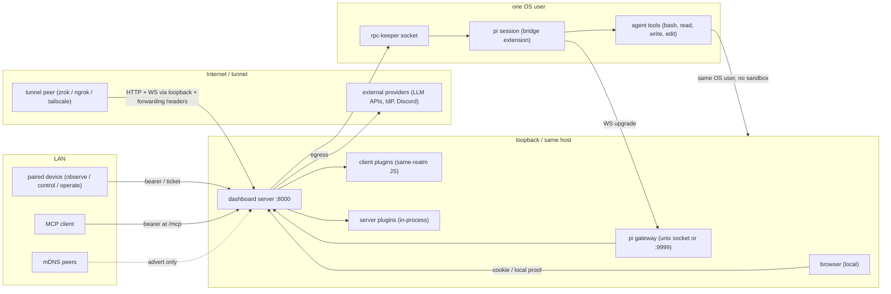
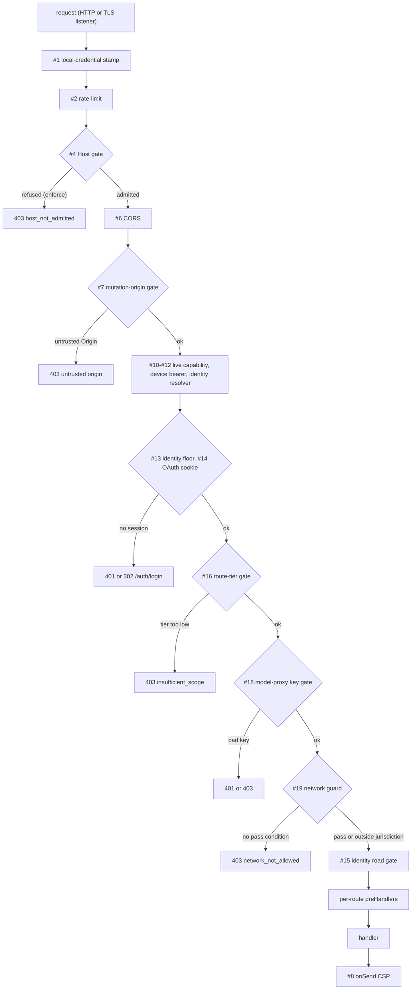

# Security map

Audit entry point for pi-agent-dashboard. Overview only. Detail in chapters under [`security/`](security/AGENTS.md).

- Evidence base: HEAD `e54074304`, v0.10.0, map date 2026-10-22.
- Every chapter claim cites `path:line`.
- Line numbers drift. Re-verify against HEAD before relying.
- Planned work in `openspec/changes/` = NOT shipped. Code is truth.
- See change: security-map-audit.

## Scope

In scope:
- Core: server, extension (bridge), client, shared, electron, docker.
- Security-relevant plugins: tool guards, model-proxy, MCP server/client, browser relay, gmail, chat-gateway, credential stores, listener-opening plugins.

Out of scope: plugins with no listener and no secrets.

## Trust boundaries

Boundaries that hold:
- Network bind + Host admission + gate chain between remote peer and `/api/*`.
- Credential + tier between caller and route.
- Ticket / upgrade auth between caller and WS.

Boundaries that do NOT hold:
- Server ↔ pi sessions ↔ terminals ↔ plugins: one OS user (DEP-06).
- Server plugin ↔ server: in-process, full privilege (PLUG-01).
- Agent `bash` ↔ host: no OS sandbox (TOOL-02).

## Defense layers

| Layer | Controls | Default | Chapter |
|---|---|---|---|
| 1 Network bind + host admission | `bindHost`, Host gate (DNS rebinding), TLS, tunnels | bind `127.0.0.1`, Host gate `enforce` | [network-surface](security/network-surface.md) |
| 2 HTTP gate chain | rate-limit, CORS, mutation-origin (CSRF), Host gate, CSP, network guard | all on; CSP `report` only | [http-gates-and-routes](security/http-gates-and-routes.md) |
| 3 Identity + tier | local proof, device bearer, OAuth/passkey session, identity resolver; tiers `observe < control < operate` | `requireLocalProof=true`; unlisted route → `operate` | [http-gates-and-routes](security/http-gates-and-routes.md) |
| 4 Route preHandler + cwd + containment | per-route guards, `admitRouteCwd`, file containment, dashboard-state guard | on; containment lexical (DEP-02) | [http-gates-and-routes](security/http-gates-and-routes.md), [deployment-process-supply-chain](security/deployment-process-supply-chain.md) |
| 5 WS ticket / bridge upgrade auth | Origin gate, `authorizeWsUpgrade`, single-use tickets, `decideBridgeUpgrade` | tickets 15 s; loopback tokenless grace open (WS-01) | [websocket-and-bridge](security/websocket-and-bridge.md) |
| 6 Agent tool guards | Agent Path Gate, opt-in containment, taint guard, chat-gw/team guards | path gate ON for `read`/`write`/`edit` only | [tool-call-guards](security/tool-call-guards.md) |
| 7 Secret storage + redaction | `0600` files, hashed bearers, vault masking, `safeStorage` (Electron) | plaintext at rest except Electron bearer | [credentials-and-secrets](security/credentials-and-secrets.md) |
| 8 Plugin trust | `pi-package` grant, `clientSha256` pin, sandboxed iframes, DOMPurify | server plugins in-process, no sandbox | [plugins-client-electron](security/plugins-client-electron.md) |
| 9 Electron shell | `contextIsolation`, `senderFrame` checks, permission allowlist | main window has no permission handler | [plugins-client-electron](security/plugins-client-electron.md) |
| 10 Supply chain + deployment | OIDC npm publish, `permissions: contents: read`, non-root Docker | actions tag-pinned, binaries unsigned | [deployment-process-supply-chain](security/deployment-process-supply-chain.md) |

## Ports & protocols

Full table (L1–L18, config keys, notes): [network-surface § Inventory A](security/network-surface.md).

| ID | Component | Protocol | Default port | Default bind | Auth | On by default | Evidence |
|---|---|---|---|---|---|---|---|
| L1 | Dashboard main server (REST, SPA, `/mcp`, `/auth/*`, `/api/pair/*`) | HTTP | 8000 | `127.0.0.1` | gate chain; `/mcp` bearer; pairing prefixes public | Yes | `packages/server/src/server.ts:5012`; `packages/shared/src/config.ts:1628,1795` |
| L1a | Browser WS `/ws` | WS on L1 | 8000 | as L1 | Host gate → Origin → cookie / local / ticket | Yes | `packages/server/src/auth/ws-ticket.ts:105`; `packages/server/src/server.ts:4778,4814` |
| L1b | Terminal WS `/ws/terminal/:id` | WS on L1 | 8000 | as L1 | as L1a + `authorize(termId)` | Yes | `packages/server/src/auth/ws-ticket.ts:106`; `packages/server/src/terminal/terminal-gateway.ts:40,48` |
| L1c | Live preview `/live/<id>/…` | HTTP/WS on L1 | 8000 | as L1 | network guard + capability token; upstream loopback only | Yes (no targets until added) | `packages/server/src/auth/ws-ticket.ts:107`; `packages/server/src/live-server/live-server-manager.ts:86` |
| L1d | `/ws/bridge` on main port | WS on L1 | 8000 | as L1 | always 400 | n/a | `packages/server/src/server.ts:4791` |
| L1e | Plugin WS `/ws/browser-ext/<guid>`, `/ws/browser-cdp/<guid>` | WS on L1 | 8000 | as L1 | pinned origin + loopback peer + relay ticket | When plugin enabled | `packages/server/src/server.ts:4717,4723`; `packages/browser-plugin/src/server/ws-routes.ts:47,97-100,133` |
| L2 | TLS listener | HTTPS/WSS | 8443 | `127.0.0.1` | same dispatch as L1 | No | `packages/shared/src/config.ts:630-637`; `packages/server/src/tls/tls-listener.ts:219-250` |
| L3 | pi gateway unix socket | WS over unix socket | n/a (`~/.pi/dashboard/gateway-<piPort>.sock`) | fs, dir 0700, socket 0600 | file mode | Yes (POSIX) | `packages/shared/src/dashboard-paths.ts:158`; `packages/server/src/pi/gateway-socket-bind.ts:154-157,170,176` |
| L4 | pi gateway TCP (opt-in) | WS | 9999 | `config.host` | `decideBridgeUpgrade`; loopback tokenless grace (NET-01) | No (POSIX); Yes (Docker) | `packages/server/src/pi/gateway-transport-policy.ts:20-22,54-58`; `packages/server/src/pi/pi-gateway.ts:1122-1175` |
| L4w | pi gateway TCP loopback (Windows / long socket path) | WS | 9999 | `127.0.0.1` | as L4 | Yes (win32) | `packages/shared/src/dashboard-paths.ts:178-194`; `packages/server/src/pi/gateway-listeners.ts:34-36` |
| L4f | pi gateway loopback fallback (socket bind failed) | WS | 9999 | `127.0.0.1` | ticket or local credential required | Only on socket failure | `packages/server/src/pi/gateway-listeners.ts:56-67`; `packages/server/src/pi/pi-gateway.ts:1309-1314` |
| L5 | Model-proxy second port `/v1/*` | HTTP | none (`secondPort` unset) | `127.0.0.1` hardcoded | `proxyAuthGate` Bearer key only; no network guard | No | `packages/server/src/server.ts:5049-5083`; `packages/server/src/model-proxy/auth-gate.ts:39,51` |
| L6 | Recovery server (dependency-missing boot) | HTTP | 8000 | `config.host` | local token or loopback + same Origin for `POST /api/recovery/*` | Only on `ERR_MODULE_NOT_FOUND` | `packages/server/src/cli.ts:310-319`; `packages/server/src/lifecycle/recovery-server.ts:431-458,538` |
| L7 | rpc-keeper per headless session | unix socket / named pipe | `~/.pi/dashboard/sessions/<id>.rpc.sock` | fs | file mode 0600; win32 pipe ACL | Per headless session | `packages/server/src/rpc-keeper/keeper.cjs:44-53,203,232-236` |
| L8 | `serve_mockup` agent tool | HTTP static | caller port or ephemeral | `0.0.0.0` | NONE (NET-02) | On tool call | `packages/mockup-loop/src/extension.ts:75-112,197-212` |
| L9 | `deck3d serve` | HTTP + SSE | `opts.port` or ephemeral | `127.0.0.1` | NONE | On CLI run | `packages/deck3d/src/serve/index.ts:97,401-411,434-446,535` |
| L10 | document-converter PlantUML container | HTTP (docker publish) | random | all host interfaces | NONE (NET-03) | On conversion | `packages/document-converter/engine/document_converter/plantuml_server.py:27,59,163-168` |
| L11 | document-converter Gotenberg container | HTTP (docker publish) | random | all host interfaces | NONE (NET-03) | On PDF conversion | `packages/document-converter/engine/document_converter/pdf_server.py:29,64,177` |
| L12 | OAuth loopback callback | HTTP | ephemeral | `127.0.0.1` | `state` match, 300 s timeout | During OAuth flow | `packages/dashboard-plugin-runtime/src/server/loopback-callback.ts:65-67,81-88,127` |
| L13 | Electron browser-host shim | HTTP/WS | ephemeral | `127.0.0.1` | pinned Origin + single-use `linkId` | Electron, on demand | `packages/electron/src/lib/browser-host/shim.ts:29-31,99-110,140` |
| L14 | system-one engines (`von`/`laya`) | HTTP | configured | `127.0.0.1` | engine-native | When plugin starts engine | `packages/system-one-plugin/src/server/engines.ts:38,47` |
| L15 | Managed services (OCI / native) | service-defined | `allocateLoopbackPort` | OCI `-p 127.0.0.1::
` | service-native | Only if defined | `packages/server/src/services/ports.ts:11-20`; `packages/server/src/services/oci-driver.ts:323` |
| L16 | mDNS responder/browser (`bonjour-service`) | UDP multicast | 5353 | all interfaces | none | Yes (`PI_DASHBOARD_NO_MDNS=1` disables) | `packages/shared/src/mdns-discovery.ts:5,48-51`; `packages/server/src/server.ts:5095-5130` |
| L18 | Docker image publishes | TCP | 8000, 9999 | all host interfaces | as L1 / L4 | Docker only | `docker/compose.yml:22-28,39,44`; `docker/Dockerfile:218` |

Notes:
- L17 vendored Playwright `CDPRelayServer` inert (shim `listen()` rejects). See chapter.
- Tunnels (zrok / ngrok / tailscale / zerotier) forward to `localhost:<dashboard port>`. `tunnel.enabled` default `true`, needs enrolled provider (`packages/shared/src/config.ts:1807-1808`).
- Gateway port 9999 never tunnelled.
- mDNS advert skipped for loopback bind (`packages/shared/src/mdns-discovery.ts:112-129`).
- Egress with operator/agent URL: `POST /api/providers/test` (NET-04).

## Callable surfaces

| Surface | Count | Where |
|---|---|---|
| Core HTTP routes | 364 (199 high-danger) | [http-route-inventory](security/http-route-inventory.md); [http-gates-and-routes § G](security/http-gates-and-routes.md) |
| `ROUTE_TIERS` entries | 447 (`packages/shared/src/route-tiers.ts:546-548`: unlisted `/api` route → `operate`) | [http-gates-and-routes](security/http-gates-and-routes.md) |
| Plugin-owned HTTP routes | 130 `ROUTE_TIERS` entries with no core registration; not enumerated | [http-gates-and-routes § H](security/http-gates-and-routes.md) |
| WS / socket endpoints | 14 rows (4 core scopes, gateway UDS/TCP/fallback, ACP in-process, plugin scopes, Electron shim, rpc-keeper, `/mcp`) | [websocket-and-bridge § Inventory](security/websocket-and-bridge.md) |
| Dashboard MCP tools exposed to agents | 160 manifest rows; tier from `ROUTE_TIERS` unless row declares one; session callers hard-wired `control` (`packages/mcp-server-plugin/src/server/tokens.ts:46,123`) | [tool-call-guards § MCP tiers](security/tool-call-guards.md) |
| Browser → server message types | 17 side-effecting types, tier per `ws-message-tiers.ts` | [websocket-and-bridge § Inbound](security/websocket-and-bridge.md) |
| Server → bridge message types | 11 side-effecting types; bridge trusts server | [websocket-and-bridge § Inbound](security/websocket-and-bridge.md) |
| Bridge → server message types | 12 side-effecting types; self-asserted `sessionId` | [websocket-and-bridge § Inbound](security/websocket-and-bridge.md) |

## Gate chain (HTTP)

17 root `onRequest` hooks + 1 root `preHandler` + 1 `onSend` (CSP). Order = execution order within phase. Final arbiter = universal network guard #19, registered last (`packages/server/src/server.ts:3639-3649`). Table: [http-gates-and-routes § A](security/http-gates-and-routes.md).

Key facts:
- `trustProxy` never set. `request.ip` = socket peer (`packages/server/src/server.ts:1956-1963`).
- Network guard pass: genuine-local (+proof) → local credential → `isAuthenticated` → trusted CIDR (`legacy` mode) (`packages/server/src/auth/localhost-guard.ts:432-464`).
- Jurisdiction `/api/ /v1/ /editor/ /live/` (`packages/server/src/auth/localhost-guard.ts:517`).
- Public by construction: `/auth/*`, `/__pi/csp-report/:policy`, `/manifest.json`, SPA shell, `/apps/<id>/…`, plugin roots such as `/mcp`.
- Tier gate applies only to `authVia ∈ {device, session}` (`packages/server/src/auth/route-tier-gate.ts:71-90`).
- Defaults: `hostGate.mode=enforce` (`packages/shared/src/config.ts:1837`), CSP `report` (`packages/server/src/auth/csp.ts:82-85`).

## Tool-call guards

No OS sandbox. `bash` runs as operator OS user. Every guard = pi `tool_call`/`tool_result` hook or server policy. None confines a spawned process. See TOOL-02.

| Guard | Hook | Tools | Decision | Default | Fail mode | Evidence |
|---|---|---|---|---|---|---|
| Agent Path Gate | `tool_call` | `read`, `write`, `edit` | out-of-root → operator prompt (allow once / deny / always) | ON | closed (no UI, timeout, error → deny) | `packages/extension/src/path-gate/handler.ts:40,272-278,345`; `packages/shared/src/config.ts:979` |
| Grant store + Always-allow redemption | bridge WS `path_grant_request` | path-gate tools | single-use confirm, realpath subject | ON with gate | refuse on mismatch | `packages/server/src/access/agent-grant.ts`; `event-wiring.ts:1111` |
| YOLO (agent-path) | bridge WS `path_yolo_request` | path-gate asks | auto-allow in time window | OFF | decline → normal prompt | `yolo-session.ts:46,195-231`; `yolo-env.ts:26-40` |
| path-containment-guard | `tool_call` (`-e` / `scope.extensions`) | `read`,`write`,`edit`,`grep`,`find`,`ls` + `deniedTools` | hard block | OFF (plugin opt-in) | closed | `packages/path-containment-guard/src/extension.ts:45-85`; `decide.ts:33,56-78` |
| Untrusted-content guard | `tool_result`, `message_end`, `tool_call` | taint sources → sensitive tools (`bash`, `*_send`, …) | confirm while tainted | OFF unless package installed; then `strip` | closed | `packages/untrusted-content-guard/src/guard.ts:110-231`; `settings.ts:30-36` |
| Chat-gateway L3 guard | `tool_call` (gateway-spawned) | all by name | allow / approve / deny | OFF unless `toolPolicy` + `guardExtension` | closed (deny-all) | `packages/chat-gateway/src/guard/index.ts:49,55-110,125-143` |
| Team guard | `tool_call`, `before_agent_start`, `input` | preset allowlist; path check on file tools | hard block | ON for team sessions | closed | `packages/team-plugin/src/extension/guard.ts:13-17,68,113-138` |
| Subagent fan-out admission | `tool_call` | `Agent` | block over in-flight cap | ON | OPEN (`safe()` swallows throws) | `packages/extension/src/subagent-fanout-admission.ts:171-213`; `bridge.ts:958-971` |
| Pi trust mirror | `project_trust` | project `.pi/` loading | yes / undecided | on | `undecided` | `packages/extension/src/project-trust.ts:125-186` |
| Vault redaction | `tool_result`, `message_end`, `user_bash`, outbound filter | all results + forwarded events | exact-value `[REDACTED:<NAME>]` | ON when vault delivered | closed (output withheld) | `packages/extension/src/vault-redaction.ts:1-21,122`; `vault-masker.ts:1-19` |
| Gmail write confirm + tier + lease | tool `execute` | `gmail_send`, `_reply`, `_draft`, `_modify`, `_trash`, filters | `ctx.ui.confirm` + tier | tier `readonly` | closed | `packages/gmail-plugin/src/bridge/tools.ts:160-175`; `server/lease.ts:147-148` |
| `update_roles` confirm | tool `execute` | `update_roles` | `ctx.ui.confirm` | ON | closed | `packages/extension/src/role-model-tools.ts:248-294` |
| craft_control host policy | lane `craft-web/control` | `craft_control` | command allowlist, 20/10 s | ON | closed | `packages/craft-web-plugin/src/client/control-host.ts:149,308` |
| Browser relay deny sets | server CDP proxy | `browser_connect` cdpUrl | cookie deny, scheme fence, `allowedDomains` | ON, `@dedicated` | dedicated: unclassified → deny | `packages/browser-plugin/src/server/relay/deny-list.ts:10-31`; `dedicated/dedicated-deny.ts:139,172,214` |
| Dashboard MCP server (to agents) | `POST /mcp`, bearer | 160 manifest rows | tier filter + self-target refusal + denylist | ON; session token per bridge | refuse on auth fail | `packages/mcp-server-plugin/src/server/tokens.ts:46,123`; `dispatch.ts:552-567`; `guard.ts:77-96` |
| ACP permission bridge | ACP `session/request_permission` | external ACP agent tools | dashboard select prompt | ON for ACP | dismiss → `cancelled` | `packages/server/src/acp-bridge/permission-bridge.ts:1-15,85-90` |

Coverage gaps:
- `bash`, `grep`, `find`, `ls`, MCP, custom tools NOT covered by path gate (`packages/extension/src/path-gate/handler.ts:40`).
- Session MCP token = `control` tier → can answer other sessions' prompts (TOOL-01).
- ACP agents bypass pi guards (TOOL-15).
- Matrix: [tool-call-guards § Tool × guard coverage](security/tool-call-guards.md).

## Findings at a glance

Source: [residual-risks](security/residual-risks.md). Canonical rows after dedup; raw 132.

| Severity | Count |
|---|---|
| Critical | 0 |
| High | 6 |
| Medium | 29 |
| Low | 46 |
| Info | 40 |
| **Total** | **121** |

High findings:

| ID | Finding | Chapter |
|---|---|---|
| HTTP-01 | OAuth with empty `auth.allowedUsers` admits any IdP account at `operate` | [http-gates-and-routes](security/http-gates-and-routes.md#findings) |
| WS-01 | Tokenless loopback bridge grace open; default transport on win32 | [websocket-and-bridge](security/websocket-and-bridge.md#findings) |
| TOOL-01 | Agent answers other session's guard prompts via MCP `prompt_response` | [tool-call-guards](security/tool-call-guards.md#findings) |
| PLUG-01 | Server plugins in-process, full server privilege, no isolation | [plugins-client-electron](security/plugins-client-electron.md#findings) |
| ELEC-04 | Desktop binaries unsigned | [plugins-client-electron](security/plugins-client-electron.md#findings) |
| DEP-01 | File-read routes anchor `~/.pi`; provider credentials readable at `observe` | [deployment-process-supply-chain](security/deployment-process-supply-chain.md#findings) |

Also in the register:
- Fix order: [Top priorities](security/residual-risks.md#top-priorities).
- By-design non-goals: [Accepted / by-design risks](security/residual-risks.md#accepted--by-design-risks).
- Doc/code mismatches: [Doc/code mismatches](security/residual-risks.md#doccode-mismatches).
- Open verification items: [Open verification items](security/residual-risks.md#open-verification-items).

## Chapters

| File | Covers | Finding prefix |
|---|---|---|
| [network-surface.md](security/network-surface.md) | Listeners, ports, bind hosts, egress, discovery, tunnels | NET- |
| [http-gates-and-routes.md](security/http-gates-and-routes.md) | Hook chain, identities, tiers, browser protections, route danger | HTTP- |
| [http-route-inventory.md](security/http-route-inventory.md) | All 364 core routes: handler, tier, guard, danger class | (rows only) |
| [websocket-and-bridge.md](security/websocket-and-bridge.md) | WS endpoints, tickets, bridge ↔ server trust, message handling | WS- |
| [tool-call-guards.md](security/tool-call-guards.md) | Agent tool guards, MCP surface toward agents, coverage matrix | TOOL- |
| [credentials-and-secrets.md](security/credentials-and-secrets.md) | Secret lifecycle: storage, transport, rotation, redaction | CRED- |
| [plugins-client-electron.md](security/plugins-client-electron.md) | Plugin trust, browser sinks + isolation, Electron shell | PLUG-, CLI-, ELEC- |
| [deployment-process-supply-chain.md](security/deployment-process-supply-chain.md) | Docker/native deploy, OS user, spawns, file API, CI, supply chain | DEP-, SUP- |
| [residual-risks.md](security/residual-risks.md) | Consolidated register, priorities, accepted risks, mismatches | all |

## Maintaining this map

Method:
- One mapper per chapter.
- Code is truth. `openspec/changes/` = planned, not shipped.
- Every claim cites `path:line`.
- Orchestrator re-reads High rows at HEAD.

Per fix:
- Update the finding row in `security/residual-risks.md`.
- Update the chapter inventory and finding.
- Update counts here.
- Add `See change: <id>` to the touched rows.

Re-run map:
- Re-verify evidence at new HEAD.
- Bump evidence base (HEAD, version, date) here and in chapters.
- Dedup new rows into the register.
