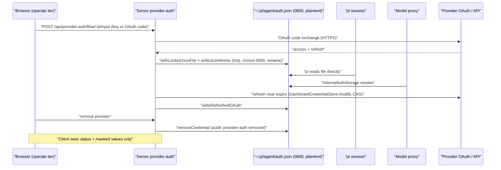
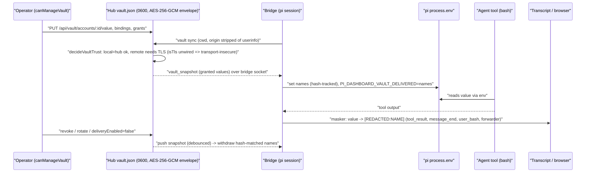

# Credentials, tokens, keys and secrets — lifecycle
> Scope: creation, storage, transport, rotation, revocation, redaction of every host-held secret · Evidence base: HEAD e54074304 · Mapper: 05-credentials-and-secrets (prefix CRED-) · Map index: [security-map.md](../security-map.md) · Register: [residual-risks.md](residual-risks.md)

## Summary
- Encrypted at rest: Electron paired-server bearer (`safeStorage`, `packages/electron/src/lib/server-keyring.ts:402`); `plugin-credentials.json` + `vault.json` (AES-256-GCM envelope, key in OS keychain or `PI_DASHBOARD_DATA_KEY_FILE`).
- Every other store = plaintext JSON/PEM, protection = POSIX mode `0600` only.
- `openspec/changes/archive/2026-10-26-encrypt-credentials-at-rest/` = SHIPPED. Specs: `openspec/specs/credential-at-rest-encryption/`, `openspec/specs/credential-file-guard/`; modified `credential-vault`, `plugin-credential-store`, `service-secrets`. Code: `packages/server/src/auth/credential-key.ts`, `credential-envelope.ts`, `credential-migration.ts`, `packages/server/src/cli/credentials-command.ts`, `packages/extension/src/credential-guard.ts`, `packages/shared/src/credential-encryption.ts`.
- Shared write primitive `writeJsonAtomic` = tmp + `chmod` + rename, mode `0600` or existing mode masked `& 0o700` (strips group/world) — `packages/server/src/auth/locked-json-file.ts:297-315`. Placeholder create `0600` `wx` — `locked-json-file.ts:130`.
- Durable bearers stored HASHED (SHA-256) only: paired-device bearers (`packages/server/src/pairing/paired-devices.ts:113`), passkey invites (`packages/server/src/auth/passkey/user-directory.ts:81`), model-proxy API keys (`packages/server/src/model-proxy/api-key-store.ts:14`), MCP tokens in memory (`packages/mcp-server-plugin/src/server/tokens.ts:59`), relay tickets (`packages/browser-plugin/src/server/relay/relay-ticket.ts:82`), break-glass codes/bearers (`packages/server/src/identity/break-glass.ts:37,54`).
- Every token minted with `crypto.randomBytes`/`randomUUID`/`randomInt`. One `Math.random` hit: zrok reserved-name suffix (`packages/server/src/tunnel-providers/zrok.ts:171`) — hostname, not a credential.
- Comparisons on secret-equality paths use `timingSafeEqual`; ticket/challenge stores use `Map` lookup keyed by the 256-bit value (no per-byte compare).
- Agent `read` of `~/.pi/agent/auth.json` / `providers.json` = in-root, no prompt (`packages/extension/src/path-gate/roots.ts:132`, `decide.ts:78` before sensitive check `:88`). `plugin-credentials.json` + `vault.json` now blocked by credential guard. Finding CRED-01 partial. Server file routes now refuse pi-agent credential files (`auth.json`, `mcp-auth.json`, `providers.json`, `plugin-credentials.json`, `models.json`, `mcp.json`, `system-one/auth.json` + `<name>.*` siblings) for every caller (DEP-01 closed by close-security-map-high-findings); agent-side `read` unchanged (TOOL-04 open).
- Dashboard session JWT (`pi_dash_token`, 7 d) has no server-side revocation on logout; only `auth.secret` change revokes. Finding CRED-03. Partly mitigated by close-security-map-high-findings: JWT of a refused public provider or a removed provider rejected on validation; allowlist edit still does not revoke other sessions.
- Fastify request logging off (`logger: false`, `packages/server/src/server.ts:1957`) → query-string tickets never reach a request log.
- Vault values → pi `process.env` (hub-local only; remote refused `transport-insecure` because `isTls` never wired, `packages/server/src/server.ts:1869-1880`, default `false` at `packages/server/src/vault/vault-delivery-hub.ts:212`). Exact-match masking `[REDACTED:<NAME>]` on transcript + forwarded events.

## Inventory

### 1. Secret-at-rest inventory
Dir legend: `~/.pi/dashboard` created without explicit mode (`packages/shared/src/config.ts:2909` `mkdirSync(configDir,{recursive:true})`, `packages/server/src/routes/plugin-config-routes.ts:37`) → umask (typ. 0755). `~/.pi/agent` = pi's dir (not created by dashboard).

| Secret | File path on disk | Writer path:line | File mode + dir mode | Encrypted at rest? | Readers | Rotation | Evidence |
|---|---|---|---|---|---|---|---|
| pi provider creds (API keys + OAuth access/refresh) | `~/.pi/agent/auth.json` | `writeAuthJson` → `writeJsonAtomic` `packages/server/src/auth/provider-auth-storage.ts:130`; `writeCredential` `:277`; `writeCredentialIfAbsent` `:302`; `removeCredential` `:336`; OAuth refresh CAS `writeRefreshedOAuth` `:222` | 0600 (corrupt→forced 0600 `:292,:309,:358`); dir = pi's | No | pi core (direct), `DashboardCredentialStore` (`packages/server/src/auth/dashboard-credential-store.ts:133`), model proxy `InternalAuthStorage` (`packages/server/src/model-proxy/internal-auth-storage.ts:82`), agent `read` tool (CRED-01) | OAuth refresh by store (`RECENT_REFRESH_MS` 30 s dedupe `dashboard-credential-store.ts:74`); API keys manual | path `provider-auth-storage.ts:41-42`; lock `LOCK_OPTIONS` `locked-json-file.ts:39` |
| Legacy plain keys in pi `settings.json` (`anthropicApiKey`, `openaiApiKey`, `providers.<id>.apiKey`) | `~/.pi/agent/settings.json` | dashboard only moves/deletes: `packages/server/src/auth/pi-legacy-credentials.ts:289,311` | pi-owned | No | detection returns masked only (`maskSecret` `pi-legacy-credentials.ts:49-51`) | move→auth.json | compare `timingSafeEqual` `:106` |
| Custom-provider API keys | `~/.pi/agent/providers.json` | server `writeProvidersFileData` `packages/server/src/routes/provider-routes.ts:227-245` (0600 + chmod + fsync); bridge `saveRoleConfig` `packages/extension/src/role-manager.ts:113-114` (NO mode) | 0600 via server; **umask after role write** (CRED-02) | No | model proxy `registry-singleton.ts:31`; bridge `provider-register.ts:536-538` (`$ENV` indirection allowed) | manual | client sees `***` sentinel `provider-routes.ts:30` |
| Plugin credentials (`ctx.credentials`; gmail OAuth refresh/access, client secret) | `~/.pi/agent/plugin-credentials.json` | `packages/server/src/auth/plugin-credential-store.ts:151` (`writeJsonAtomic`) | 0600 | **Yes** — AES-256-GCM envelope (`packages/server/src/auth/credential-envelope.ts`); key keychain or `PI_DASHBOARD_DATA_KEY_FILE`. Docstring `packages/dashboard-plugin-runtime/src/server/server-context.ts:861` stale | host per plugin namespace (`createPluginCredentialStore` `plugin-credential-store.ts:156`); gmail `accounts.ts` ns `gmail` (`packages/gmail-plugin/src/server/accounts.ts:2`); agent `read` (CRED-01) | gmail refresh rotates (`packages/gmail-plugin/src/server/lease.ts:114`) | path `plugin-credential-store.ts:76` |
| Credential vault (env secrets, ACME DNS solver secrets `tls:<id>`) | `~/.pi/dashboard/vault.json` | `packages/server/src/vault/vault-store.ts:264` (`writeJsonAtomic`, `createIfMissing:false`) | 0600 (new file); dir umask | No | delivery `getKeyValue` `vault-store.ts:283`; plugin read seam `vault-plugin-read.ts`; ACME `readTlsSecret` | `rotateAccount` (`vault-store.ts:128`), `PUT /api/vault/accounts/:id/value` (`vault-routes.ts:202`) | path `vault-store.ts:151`; min value length 8 `:36,:210` |
| Vault remembered projects (no values) | `~/.pi/dashboard/vault-projects.json` | `packages/server/src/vault/vault-projects.ts:113` | 0600 | No | picker | n/a | — |
| Service secrets (`store:<id>/<name>`) | `~/.pi/dashboard/services-secrets.json` | `packages/server/src/services/secrets-store.ts:99` (forced 0600) | 0600 | No | `secrets-resolver.ts` | manual | `keychain:` refs read-only `secrets-resolver.ts:63-70` |
| Service secrets delivered to OCI | `services-run/<id>/secrets/<name>` | `packages/server/src/services/secret-delivery.ts:29-30` | 0600, dir 0700 (`paths.ts:62-64`) | No | container `/run/secrets/<name>:ro` | per start | removed `secret-delivery.ts:60` |
| Dashboard config secrets: `auth.secret` (JWT/HMAC key), `auth.providers.*.clientSecret` (OAuth), plugin `writeOnly` fields (chat-gateway Discord `token`, browser SSO `token`), model-proxy key hashes | `~/.pi/dashboard/config.json` | `writeConfigFileSecure` `packages/shared/src/config.ts:2716-2721`; callers `auth/auth.ts:170`, `routes/plugin-config-routes.ts:38`, `server.ts:4499`, `config-api.ts:176,478` | 0600; loose file tightened at load `config.ts:2729-2748` | No | server | `auth.secret`: one-shot epoch rotation only (`secret-rotation.ts:28,180,224`) | client gets `redactWriteOnly` (`dashboard-plugin-runtime/src/server/config-redact.ts:63`); schema `chat-gateway/src/configSchema.json:15` |
| Local IPC token (root of local proof, proof-cookie HMAC key) | `~/.pi/dashboard/local/token` | `ensureLocalToken` `packages/server/src/auth/local-token.ts:52-56`; rotation `secret-rotation.ts:214` | 0600, dir `local/` 0700 (`local-token.ts:41-44`) | No | server (`server.ts:762`), bridge `readLocalToken` (`extension/src/local-token-header.ts`), CLI `readLocalTokenIfPresent` `local-token.ts:69` | epoch rotation only (CRED-03) | existing file not re-tightened `:48-50` (CRED-06) |
| Rotation lock/epoch | `~/.pi/dashboard/local/rotation.lock`, `rotation-epoch` | `packages/server/src/auth/secret-rotation.ts:117,183-185` | 0600 / dir 0700 | n/a | server | n/a | — |
| Server Ed25519 identity | `~/.pi/dashboard/identity.key` (PKCS8 PEM) | `packages/server/src/auth/identity.ts:70-76` | 0600 + chmod at create | No | server only (`signNonce` `:81-83`) | none | existing file reused without mode check `:64-67` (CRED-06) |
| Paired-device registry (bearer hashes) | `~/.pi/dashboard/paired-devices.json` | `persist()` `packages/server/src/pairing/paired-devices.ts:147-155` → `writeJsonFile` (`persistence/json-store.ts:31-37`, no mode) then chmod 0600 | 0600 after write (brief umask window on tmp) | Hash only (SHA-256 `:113`) | server | browser rows: `rotate` `:337`; others none | `REGISTRY_FILENAME` `:22,110` |
| Passkey user directory (credential pubkeys, invite hashes) | `~/.pi/dashboard/users.json` | `packages/server/src/auth/passkey/user-directory.ts:140` | 0600 | Invite tokens hashed `:233` | server | invites TTL 24 h default / 7 d max `:72-73`; `revokeInvite` `:246` | path `:78` |
| Push VAPID private key | `<dataDir>/push-vapid.json` | `packages/server/src/push/push-vapid.ts:33` | 0600 | No | push dispatcher | regenerated only if unreadable `:27-31` | file name `push-service.ts:22` |
| Push device tokens | `<dataDir>/push-tokens.json` | `packages/server/src/push/push-token-registry.ts:106` | 0600 (`:20`) | No | dispatcher | delete via registry | — |
| TLS leaf private keys | `~/.pi/dashboard/tls/<source>/<name>/` | `packages/server/src/tls/cert-files.ts:167-174` | key 0600, cert 0644, dir 0700 | No | `tls-listener.ts` | ACME/tailscale renew | `meta.json` 0600 `:150,:182` |
| ACME account key | `<tlsRoot>/acme-account-<hash>.key` | `packages/server/src/tls/sources/acme/accounts.ts:48-51` | 0600, dir 0700 | No | ACME client | none | tlsRoot `runtime.ts:43` |
| Tailscale-issued cert/key (transient) | `<dataDir>/.issue-*/x.key` | `packages/server/src/tls/sources/tailscale-cert.ts:135-140` | dir 0700 | No | cert-files import | per obtain | — |
| CSP counters (no secrets by design) | `~/.pi/dashboard/csp-reports.json` | `packages/server/src/auth/csp-report-store.ts:244-246` | 0600 | n/a | server | n/a | CRED-16 |
| Plugin trust decisions (integrity, not secret) | `~/.pi/dashboard/config.json` | `packages/server/src/auth/plugin-trust-store.ts:77` | 0600 | n/a | server | n/a | path `:40` |
| Electron paired-server bearers (fp keyring) | `~/.pi-dashboard/server-keyring.json` | `packages/electron/src/lib/server-keyring.ts:402,418` | 0600 `wx` tmp; load tightens `:214` | **Yes** — Electron `safeStorage` (OS keychain/DPAPI); Linux `basic_text` treated as unavailable → memory only (`:176-180`) | Electron main only | re-pair | dir `managed-paths.ts:11` |
| Server log | `~/.pi/dashboard/server.log` | `packages/shared/src/server-launcher.ts:260` `openSync(logFile,"a")` | default umask (CRED-08) | No | operator | none | path `packages/server/src/cli.ts:596` |
| Model-proxy request log | `~/.pi/dashboard/model-proxy.jsonl` | `packages/server/src/model-proxy/request-log.ts:49` | default umask | No; carries `apiKeyId`, not key (`:21`) | operator | size rotation | — |
| In-memory only (no disk) | ws tickets, local-proof codes, spawn tokens, MCP tokens, relay tickets, nav-intent key, passkey challenge key, break-glass, live capabilities | see Token table | — | — | — | restart invalidates | `tokens.ts:15-23` (MCP) |
| External tool stores (outside dashboard writers) | zrok account env (`ZROK_TOKEN` in `docker/.env.example:37`), git credentials, OS keychain | zrok/git/OS | tool-owned | tool-owned | — | — | dashboard stores only zrok reserved NAME `zrok.ts:140-150` |

### 2. Secret-in-transit
| Secret | Path to consumer | Channel | Exposure notes | Evidence |
|---|---|---|---|---|
| Provider API key (user entry) | browser → `POST /api/provider-auth/flow/:flowId/input` body → `auth.json` | HTTP body | audit line logs flow id prefix only | `packages/server/src/routes/provider-auth-routes.ts:262,272` |
| Provider OAuth tokens | provider token endpoint → server → `auth.json`; pi reads file directly | HTTPS back-channel + file | never sent to browser | `provider-auth-storage.ts:222` |
| Provider keys to LLM via model proxy | `auth.json` → `InternalAuthStorage.resolve` → upstream request headers | HTTPS to provider | proxy callers present proxy key (hashed store) | `internal-auth-storage.ts:123-124`; `api-key-store.ts:42-48` |
| Custom-provider key | `providers.json` literal or `$ENV` → bridge `resolveApiKey` | file / env | client gets `***` | `extension/src/provider-register.ts:536-538`; `provider-routes.ts:30` |
| Spawn correlation token | server → spawned pi env `PI_DASHBOARD_SPAWN_TOKEN`; tmux `-e` argv | env + **argv** | argv visible to `ps` (CRED-09); bridge scrubs env on read | `process-manager.ts:432,624-626`; `extension/src/spawn-token.ts:27` |
| Local token | file → bridge/CLI; on wire as HMAC proof `X-Pi-Local-Proof` (raw token never sent by bridge) | header | raw `X-Pi-Local-Token` still accepted (CRED-07) | `local-token.ts:20`; `server.ts:768`; `shared/src/local-credential-proof.ts:49-50` |
| Local proof bootstrap code | `pi-dashboard open`/Electron → `GET /auth/local-proof?code=` | **URL query** | 60 s, single use; redirect after redeem | `routes/local-proof-routes.ts:51-66`; `local-proof.ts:27,140-157` |
| Local proof cookie `pi_dash_local` | Set-Cookie | cookie httpOnly, SameSite=Strict | port-bound HMAC | `local-proof-routes.ts:40,58` |
| Paired-device bearer | poll response once → client `Authorization: Bearer` (REST) / `pi_dash_device` cookie `Path=/api/` | header/cookie | never on WS | `routes/pairing-routes.ts:577-606`; `auth/bearer-auth.ts:11-19,152-158` |
| Remote bridge bearer | env `PI_DASHBOARD_TOKEN` → `POST /api/ws-ticket` → ticket | env + header | durable bearer never on gateway | `extension/src/bridge-ticket-client.ts:20,53-68` |
| WS ticket | `?ticket=` or `Sec-WebSocket-Protocol: pi-ticket.<t>` | **URL query** or subprotocol | 15 s, single use; logger off | `ws-ticket.ts:117-141`; `server.ts:1957` |
| Relay ticket | in issued `cdpUrl` / `mcpRelayUrl` | **URL query** | 60 s, single use, hash stored; `chrome-extension:` URLs redacted in tab list | `relay-ticket.ts:1-28`; `relay-instance.ts:300-310` |
| Live-preview capability | URL path segment | **URL path** | redacted in logs, `Referer` stripped | `live-capability.ts:178`; `live-server-proxy.ts:261,383`; `localhost-guard.ts:773` |
| Passkey invite / phone approval | `/auth/invite#<t>`, `/auth/phone#<t>` | URL **fragment** (not sent to server) | — | `auth/passkey/passkey-pages.ts:16`; `passkey-routes.ts:173` |
| MCP bearer | server → bridge WS `mcp_token_minted` → `pi.registerMcpServer(... headers Authorization)` | WS (bridge socket) + HTTP header | never in `process.env`/logs/`pi.events` | `extension/src/mcp-token-delivery.ts.AGENTS.md`; `mcp-server-plugin/src/server/tokens.ts:101` |
| Vault values | hub `vault_snapshot` over bridge socket → bridge sets `process.env` | WS (loopback/unix) + env | remote sessions refused (`transport-insecure`) | `vault-delivery-hub.ts:37-41,212`; `extension/src/vault-delivery.ts:168` |
| Gmail access token | `gmail/lease` lane → bridge tool | WS lane | refresh token never leaves server | `gmail-plugin/src/server/lease.ts:5,164` |
| Service secrets | child env / OCI file mount | env / file | never `-e`/`--env-file` | `services/secret-delivery.ts:1-9` |
| OAuth client secret | server → IdP token endpoint body | HTTPS | — | `auth/auth.ts:458` |
| Git remote userinfo | origin stripped before vault keying; git text redacted before client | — | — | `vault-delivery-hub.ts:253`; `git-worktree/redact-git-text.ts:4-6,101` |

### 3. Token table
| Token | Format / entropy | TTL | Single-use? | Comparison | Binding | Revocation | path:line |
|---|---|---|---|---|---|---|---|
| WS ticket | `randomBytes(32)` b64url | 15 s | Yes (deleted on first attempt) | Map key lookup | route scope, deviceId, principal | consume / sweep | `auth/ws-ticket.ts:51-52,165,194-206` |
| Bridge ticket | = WS ticket, scope `bridge` | 15 s | Yes | Map lookup | bridge scope + device | consume | `extension/src/bridge-ticket-client.ts:53`; `auth/bridge-ticket-eligibility.ts` |
| Spawn token | `randomUUID()` | watchdog-aligned (in-mem) | scrubbed at bridge activation | string equality on link | spawned process | n/a | `auth/spawn-token.ts:15-17,20` |
| Pairing code (QR / knock internal) | `randomBytes(16)` b64url | 300 s | Yes (redeem) | Map lookup | pending device | expiry | `pairing/pairing.ts:55,385,422` |
| Compare / confirm code | `randomInt` 8 digits (~26.5 bit) | code TTL | n/a; 5 attempts then `locked_out` | `timingSafeEqual` | pendingId | lockout | `pairing.ts:56,58,213-216,584-586` |
| Paired-device bearer | `randomBytes(32)` b64url; SHA-256 stored | browser 7 d, ceiling 30 d; others none | No | `timingSafeEqual` on hex hash | device row, tier | `revoke(id)` `:356`; rotate grace 60 s | `pairing/paired-devices.ts:23,29-36,181,240-243,337` |
| Local IPC token | `randomBytes(32)` b64url | none | No | `timingSafeEqual` | same OS user (file) | epoch rotation | `auth/local-token.ts:21,52,79-88` |
| Local credential proof | HMAC(deriveKey(token)) over binding/ts/nonce | ±30 s window | Yes (nonce replay cache 61 s) | `timingSafeEqual` | socket local addr/port | — | `shared/src/local-credential-proof.ts:32,49,123`; `auth/local-credential.ts:81,175,197-202` |
| Local-proof code | `randomBytes(32)` b64url | 60 s | Yes | Map lookup | — | expiry | `auth/local-proof.ts:27,140-157` |
| `pi_dash_local` cookie | `<id>.<iat>.<lastUse>.<port>.HMAC` | idle 12 h, abs 30 d | No | `timingSafeEqual` | listener port | local-token rotation | `auth/local-proof.ts:20-26,47,95` |
| Session JWT `pi_dash_token` | HS256 over `auth.secret` (32 B hex) | 7 d | No | jwt verify, alg pinned HS256 | sub/provider/tier | **none on logout** (CRED-03); passkey rows re-checked | `auth/auth.ts:160,180-181,201`; `auth-plugin.ts:331-338,468-471` |
| OAuth state | nonce `randomBytes(16)` + HMAC cookie `pi_dash_oauth_state` | 600 s | cleared at callback | `timingSafeEqual` | browser cookie | — | `auth-plugin.ts:124-150,309-318,413-427` |
| `pi_dash_device` cookie | = device bearer | Max-Age 400 d (row TTL governs) | No | as bearer | `Path=/api/`, SameSite=Strict | row revoke | `auth/bearer-auth.ts:43,49,152-158` |
| Passkey challenge | HMAC, key `randomBytes(32)` per process | 5 min | Yes (used-set) | `timingSafeEqual` | ceremony | restart | `auth/passkey/challenge-store.ts:22,33,61` |
| Passkey invite | `randomBytes(32)`; SHA-256 stored | 24 h default, 7 d max | maxUses 1 default (≤10) | hash lookup | user | `revokeInvite` | `passkey/user-directory.ts:72-74,226-241` |
| Phone sign-in approval | `randomBytes(32)` | 5 min | state machine | Map lookup | requestId | expiry | `passkey/phone-signin.ts:23,115-116` |
| Break-glass code / bearer | `randomBytes(32)`; SHA-256 stored | 60 s / 60 min | code yes | hash Map lookup | — | expiry | `identity/break-glass.ts:20-22,36-59` |
| Live capability | `randomBytes(32)`; SHA-256 stored | idle 30 min / max 12 h (static 10 min / 2 h) | No | hash | target, device, session cookie hash | `revokeByTarget/Device/SessionKey` | `live-server/live-capability.ts:29-33,145,178,318-337` |
| Nav intent `ni` | HMAC-SHA256, per-process key | 600 s | No | `timingSafeEqual` | principal + kind + target | restart | `auth/nav-intent.ts:42,70` |
| MCP token | `mcp_` + `randomBytes(32)`; SHA-256 in memory | session lifetime | No | `timingSafeEqual` hex | session | `revokeToken`/`revokeSession` | `mcp-server-plugin/src/server/tokens.ts:32-35,101,121-140` |
| Model-proxy API key | `randomBytes(36)` b64url; SHA-256 in config | optional expiry | No | `timingSafeEqual` (after `!==` hash prefilter) | scopes | `revokedAt` | `model-proxy/api-key-store.ts:14-48` |
| Relay ticket | `randomBytes(32)`; SHA-256 | 60 s | Yes | `timingSafeEqual` | guid + role | consume | `browser-plugin/src/server/relay/relay-ticket.ts:27-28,63,82` |
| CSP nonce | `randomBytes(16)` b64 | per response | n/a | n/a | response | n/a | `auth/csp.ts:102` |
| Vault import proposal | `randomUUID()` | single use | Yes | Map lookup | — | confirm | `vault/vault-import.ts:122` |

### 4. Log / telemetry redaction
| Sink | What is redacted | Mechanism | Evidence |
|---|---|---|---|
| Fastify request log | n/a — disabled | `logger: false` | `server.ts:1957` |
| Network-guard denials (`server.log`) | query/fragment stripped; capability segment redacted | `bestEffortPathForLog`, `redactCapability`, `sanitizeLogField` | `auth/localhost-guard.ts:654-663,769-775` |
| WS upgrade rejections | ticket logged as `present|absent` only | fixed line shape | `auth/ws-upgrade-reject-log.ts:1-14` |
| Auth audit lines | values sanitised `[\w.:-]`, ids prefixed 8 chars; callers pass ids only | `auditLine`/`auditPrefix` | `auth/audit-log.ts:1-35` |
| Configured URL warnings | userinfo, query, fragment | `redactUrlForLog` | `auth/auth.ts:312-330` |
| Live-preview log | capability tokens | `redactCapability` | `live-server/live-log.ts:16` |
| Spawned-turn log | Bearer, `AIza`, `ya29.`, `sk-`, ≥40-char blobs | regex | `spawn-process/spawned-turn-log.ts:30-45` |
| Pending-question snapshots | strings + sensitive keys | `redactDeep` → shared `redactSecrets` (V1 patterns) | `questions/question-snapshot.ts:47`; `shared/src/redaction.ts:44` |
| Service logs route | resolved secret values | `redactSecrets(text, secrets)` | `services/log-text.ts:19`; `service-manager.ts:1155` |
| ACME errors | solver secret values | `redactSecrets(message, secrets)` | `tls/sources/acme/credentials.ts:70,179` |
| Git text to client | URL userinfo, token shapes, abs paths | `redactGitText` | `git-worktree/redact-git-text.ts:4-12,101` |
| Webhook push URLs | URL secrets | `redactWebhookUrl` | `push/push-transports/webhook-url.ts:156` |
| Runtime health | — | `redactRuntimeHealth` | `runtime-overlay/runtime-health.ts:95` |
| CSP report store | only directive + document pathname (no query) | `URL().pathname` | `auth/csp-report-sink.ts:178-181,286` (CRED-16) |
| Plugin config to client | `writeOnly` schema fields | `redactWriteOnly` | `dashboard-plugin-runtime/src/server/config-redact.ts:63,84` |
| Vault HTTP routes | no response carries a value | route design | `vault/vault-routes.ts:168-263` (AGENTS lead; GET handlers list accounts without values `vault-store.ts` `listAccounts`) |
| Provider/legacy keys to client | masked `…xxxx` / `••••`; providers `***` | `maskSecret`; sentinel | `pi-legacy-credentials.ts:49-51,125`; `provider-routes.ts:30` |
| Session transcript (JSONL) + model context | vault values → `[REDACTED:<NAME>]` at `tool_result`, `message_end`, `user_bash` | bridge masker, longest-first | `extension/src/vault-masker.ts:4,62,163`; `vault-redaction.ts:122` |
| Events forwarded to browser | vault values (deep copy) | `createVaultForwardFilter` | `extension/src/vault-forwarder.ts:59` |
| Bash spill file | written masked, mode 0600 | `fs.promises.open(tmp,"wx",0o600)` | `extension/src/vault-redaction.ts:105` |
| MCP registration failure | fixed reason only, no exception text | — | `extension/src/mcp-token-delivery.ts.AGENTS.md` |
| Not covered | provider keys / arbitrary secrets typed by user or printed by tools (non-vault); local TUI; encoded vault forms | — | `docs/credential-vault.md` §7 residuals |

## Flows

### (a) Provider API key / OAuth credential lifecycle

### (b) Vault secret → agent tool env

## Controls detail
| Control | Purpose | Enforcement | Default | Bypass / exception | Fail mode | Tests |
|---|---|---|---|---|---|---|
| Atomic 0600 JSON write | no torn file, no group/world bits | `locked-json-file.ts:297-315` | 0600 / preserve `&0o700` | writers not using it: `role-manager.ts:113` (CRED-02), `json-store.ts:31` (mode optional) | closed (throws) | `server/src/__tests__/vault-store.test.ts` (lead) |
| Lock coordination with pi | no lost update vs pi OAuth refresh | `LOCK_OPTIONS {stale:30000, realpath:false}` `locked-json-file.ts:39`; retry ELOCKED only `:63-86` | 2 s budget `:42` | compromise contained `:133-142` | closed (op fails) | — |
| Corrupt quarantine | keep byte-exact backup | `locked-json-file.ts:205`; vault refuses writes `vault-store.ts` (AGENTS) | on | plugin store overwrites after backup (`plugin-credential-store.ts:151`) | closed for vault | `vault-store.test.ts` |
| Config tighten | fix legacy loose config.json | `tightenConfigMode` `config.ts:2729-2737` at `loadConfig` `:2748` | on (POSIX) | win32 skipped | best-effort | — |
| One-shot rotation | rotate local token + auth.secret once | `rotateSecretsOnce` `secret-rotation.ts:28,180,214,224`; `server.ts:635` | epoch 1 | no operator-triggered path | server exits 1 on failure | — |
| Short secret warning | flag weak `auth.secret` | `auth.ts:136,149-156` | <32 chars warns | keeps value | open (warn only) | — |
| Owner-only check | verify vault mode/ACL | `vault-permissions.ts:25-39` | **no live caller** (CRED-05) | — | n/a | `vault-store.test.ts` |
| Electron safeStorage | encrypt bearer at rest | `server-keyring.ts:176-180,402` | on when OS encryption | Linux `basic_text` → memory only | closed (not persisted) | electron tests (lead) |
| Vault delivery trust | no plaintext delivery to remote | `decideVaultTrust` `vault-delivery-hub.ts:37-41` | `isTls` false | — | closed | `vault-delivery-trust.test.ts` |
| Vault kill switch | withdraw all | `vault.deliveryEnabled` `config.ts:375,1977`; `server.ts:1878` | `true` | — | closed | `vault-delivery-wiring.test.ts` |
| Vault masking | keep values out of transcript/UI | `vault-masker.ts`, `vault-forwarder.ts:59`, `vault-redaction.ts:122` | on when values held | encoded forms, local TUI, foreign earlier `user_bash` handler (doc §7) | open for unknown forms | extension vault tests (lead) |
| MCP token isolation | bearer not in env/events | `mcp-token-delivery.ts`; registry in-memory `tokens.ts:15-26` | on | — | closed | — |
| Spawn token scrub | single-use correlation | `extension/src/spawn-token.ts:27` | on | tmux argv copy (CRED-09) | — | `spawn-token.test.ts` |

## Config & env knobs
| Key / env | Default | Effect | path:line |
|---|---|---|---|
| `auth.secret` (config.json) | generated 32 B hex if absent | JWT + OAuth-state HMAC key | `auth/auth.ts:148-174` |
| `auth.providers.<id>.clientSecret` | none | OAuth client secret, plaintext | `shared/src/config.ts:127,1920-1928` |
| `vault.deliveryEnabled` | `true` | emergency off for delivery | `shared/src/config.ts:375,1977` |
| `vault.offlineGraceHours` | 24 (clamp 1–168) | bridge keeps values offline | `shared/src/vault-delivery.ts:20`; `config.ts:1978` |
| `acceptLegacyToken` (code const) | `true` | raw `X-Pi-Local-Token` admitted | `server.ts:768` |
| `PI_DASHBOARD_ALLOW_UNPROVEN_LOCAL_SERVER=1` | unset | bridge skips server counter-proof | `extension/src/local-token-header.ts:53` |
| `PI_DASHBOARD_TOKEN` | unset | remote bridge paired bearer (env) | `extension/src/bridge-ticket-client.ts:20` |
| `PI_DASHBOARD_SPAWN_TOKEN` | per spawn | correlation token | `auth/spawn-token.ts:20` |
| `PI_DASHBOARD_VAULT_DELIVERED` | set by bridge | names only, nested pi masks inherited | `shared/src/vault-delivery.ts:18` |
| `ZROK_TOKEN` (docker `.env`) | empty | zrok account token (external) | `docker/.env.example:37` |
| Browser bearer TTL / ceiling / grace | 7 d / 30 d / 60 s | paired bearer lifetime | `pairing/paired-devices.ts:29-33` |
| JWT expiry | `7d` | session lifetime | `auth/auth.ts:180` |

## Test/dev-only
| Item | Note | Evidence |
|---|---|---|
| `createLocalCredentialVerifier({acceptLegacyToken:true})` stamp | test helper | `server/src/test-support/local-credential-stamp.ts:25` |
| test HOME env scrubbing of `PI_DASHBOARD_SPAWN_TOKEN` | test setup | `shared/src/test-support/setup-home-perfile.ts:55-65` |

## Planned (not shipped)
| Change | Relevance |
|---|---|
| `openspec/changes/absorb-service-secrets-into-vault/` | moves `services-secrets.json` into vault. |
| `openspec/changes/close-loopback-legacy-window/` | raises rotation epoch to 2 / closes legacy token window (proposed). |
| `openspec/changes/prove-vault-bridge-tls/` | would enable remote vault delivery over proven TLS. |
| `openspec/changes/add-vault-llm-delivery/`, `add-vault-reach-all-projects/` | broaden vault delivery. |

## Findings
| ID | Sev | Title | Evidence (path:line) | Impact | Suggested remedy |
|---|---|---|---|---|---|
| CRED-01 | Medium | Agent `read` of pi agent dir credential files never prompts | `packages/extension/src/path-gate/roots.ts:132` (agentDir = read-only root); `path-gate/decide.ts:78` returns `in-root` before sensitive flag `:88`; sensitive list `shared/src/forbidden-subjects.ts:113` | agent/LLM (prompt injection) reads `auth.json`, `plugin-credentials.json`, `providers.json` silently and can exfiltrate via any egress tool | exclude credential files from agentDir root or force `ask`; partial: `plugin-credentials.json` + `vault.json` closed by `credential-file-guard` (encrypt-credentials-at-rest); open: `auth.json`, `providers.json` |
| CRED-02 | Medium | Bridge rewrites `providers.json` (API keys) without 0600 | `packages/extension/src/role-manager.ts:113-114` (`writeFileSync(tmp, …)` no mode, then rename); contrast `server/src/routes/provider-routes.ts:235-238` | any role edit replaces the 0600 file with umask mode (typ. 0644) → other local OS users read provider API keys | write tmp with `{mode:0o600}` + chmod, or reuse `writeJsonAtomic` |
| CRED-03 | Medium | Session JWT not revocable; logout only clears cookie | `server/src/auth/auth-plugin.ts:468-471`; `auth/auth.ts:180,201`; rotation only one-shot epoch `auth/secret-rotation.ts:28,180` | stolen `pi_dash_token` valid up to 7 d after logout for OAuth sessions; no operator rotate command (passkey sessions re-checked `auth-plugin.ts:343-349`) | server-side session id denylist / short JWT + refresh; `pi-dashboard rotate-secrets` CLI Partial: sessions of refused-open-enrolment + removed providers now rejected on validation (close-security-map-high-findings D3); logout still cookie-only. |
| CRED-04 | Medium | Some host secret stores plaintext at rest | `auth/provider-auth-storage.ts:130`; `shared/src/config.ts:2716`; `auth/identity.ts:74`; `push/push-vapid.ts:33`; `services/secrets-store.ts:99`; docstring `dashboard-plugin-runtime/src/server/server-context.ts:861` | backups, sync, support bundles, any same-user process leak every secret partial: `vault.json` + `plugin-credentials.json` closed by encrypt-credentials-at-rest (archived 2026-10-26); open: `provider-auth-storage.ts`, `config.ts`, `identity.ts`, `push-vapid.ts`, `secrets-store.ts` |
| CRED-05 | Low | `checkOwnerOnly` is dead code; vault mode never verified | `server/src/vault/vault-permissions.ts:25` (no non-test caller; `rg checkOwnerOnly` → definition only); AGENTS row presents it as a check | loosened `vault.json` mode never detected/refused | call at vault load; refuse or tighten |
| CRED-06 | Low | Existing token/identity files reused without mode re-tightening | `server/src/auth/local-token.ts:48-50`; `server/src/auth/identity.ts:64-67` | pre-existing loose `identity.key` (dir `~/.pi/dashboard` not 0700, `shared/src/config.ts:2909`) readable by other users → server impersonation | `chmod 0600` on load (as `server-keyring.ts:214`) |
| CRED-07 | Low | Raw local token still accepted on the wire | `server/src/server.ts:768` (`acceptLegacyToken: true` constant); `auth/local-credential.ts:218` | raw `X-Pi-Local-Token` replayable if captured (proxy/tunnel log); HMAC proof not enforced | default off behind config; ship close-loopback-legacy-window |
| CRED-08 | Low | `server.log` / `model-proxy.jsonl` created with umask mode; dashboard dir not 0700 | `shared/src/server-launcher.ts:260`; `model-proxy/request-log.ts:46-49`; `shared/src/config.ts:2909` | any redaction miss lands in world-readable log | open logs `0600`; mkdir dir `0700` |
| CRED-09 | Low | Spawn token in tmux argv | `server/src/spawn-process/process-manager.ts:624-626` | other local users see token via `ps`; correlation only (needs gateway credential to abuse) | pass via env file / `set-environment` not argv |
| CRED-10 | Low | Non-browser paired bearers never expire; holder self-declared | `server/src/pairing/paired-devices.ts:167-169,191-195` | durable bearer valid until manual revoke `:356` | optional TTL / rotation for all holders |
| CRED-11 | Info | Short-lived secrets in URL query | `auth/ws-ticket.ts:117-128`; `routes/local-proof-routes.ts:52-54`; `relay-ticket.ts:1-28` | browser history / proxy logs; mitigated: ≤60 s, single use, `logger:false` `server.ts:1957`; accepted D11 | prefer subprotocol / POST |
| CRED-12 | Info | Cross-origin device bearer in `localStorage` | `client/src/lib/pairing/device-auth.ts:121,136` | XSS on that origin reads bearer; same-origin uses httpOnly cookie | keep CSP strict; documented choice |
| CRED-13 | Info | Doc/code mismatches | `shared/src/protocol.ts:1428` says MCP token goes to `process.env.PI_DASHBOARD_MCP_TOKEN` — code never sets it (`mcp-token-delivery.ts.AGENTS.md`); `secret-rotation.ts.AGENTS.md` says epoch raised to 2 by `close-loopback-legacy-window` — code `REQUIRED_ROTATION_EPOCH = 1` (`secret-rotation.ts:28`), change proposed | auditor confusion | fix comments |
| CRED-14 | Info | Tunnel reserved name from `Math.random` | `server/src/tunnel-providers/zrok.ts:171` | 32-bit non-CSPRNG public hostname; obscurity only | `crypto.randomBytes(4)` |
| CRED-15 | Info | Vault values plaintext in pi `process.env`; masking exact-match only | `extension/src/vault-delivery.ts:168`; `docs/credential-vault.md` §7 residuals | agent `env`/encoded output leaks; documented residual | sandbox agent bash (follow-up) |
| CRED-16 | Info (Needs verification) | CSP store persists document pathname | `auth/csp-report-sink.ts:178-181,286`; `auth/csp-report-store.ts:160` | if a capability-path page reports to the baseline sink, token persisted in `csp-reports.json` (0600) | apply `redactCapability` to `docPath` |
| CRED-17 | Info | OCI secret files plaintext on disk while service runs | `services/secret-delivery.ts:29-30,60` | 0600 in 0700 dir; residue after crash | tmpfs mount / cleanup on boot |
| CRED-18 | Info | Ticket/code stores use Map lookup, not constant-time compare | `auth/ws-ticket.ts:196`; `auth/local-proof.ts:150`; `auth/passkey/phone-signin.ts:146` | 256-bit values, timing oracle impractical | none required |
