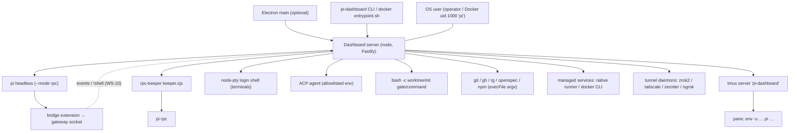
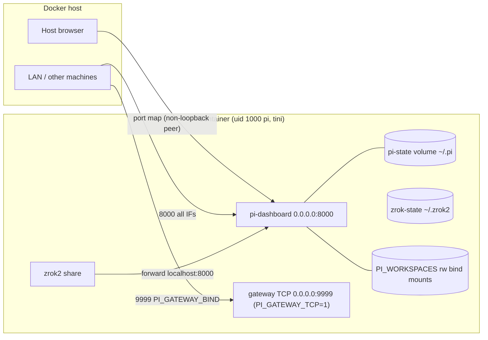
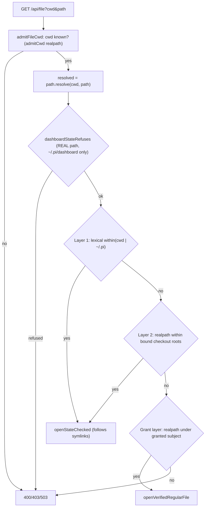
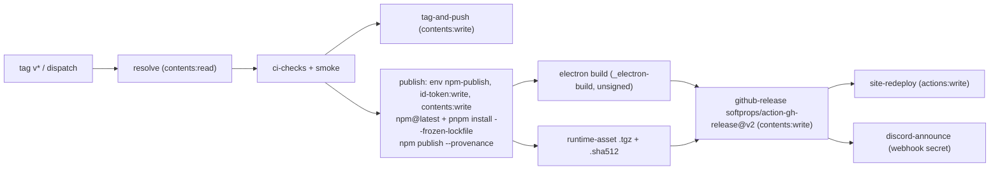

# Deployment topologies, OS/process model, command execution, filesystem confinement, supply chain & CI
> Scope: how the dashboard is deployed + launched; which OS user runs what; every server-side process spawn class; server file-API confinement; build/release pipeline + dependency policy; logging/audit trail · Evidence base: HEAD e54074304 · Mapper: 07 (DEP-/SUP-) · Map index: [security-map.md](../security-map.md) · Register: [residual-risks.md](residual-risks.md)

Cross-refs used instead of re-derivation: listeners/ports → NET-* ([network-surface.md](network-surface.md)); HTTP gate chain + route tiers → HTTP-* ([http-gates-and-routes.md](http-gates-and-routes.md)); WS/bridge + `!` shell prefix → WS-* ([websocket-and-bridge.md](websocket-and-bridge.md)); agent tool guards → TOOL-* ([tool-call-guards.md](tool-call-guards.md)); credential stores/modes → CRED-* ([credentials-and-secrets.md](credentials-and-secrets.md)); plugins/Electron/runtime overlay → PLUG-/ELEC-* ([plugins-client-electron.md](plugins-client-electron.md)).

## Summary
- No privilege separation anywhere. Server, pi sessions, terminals, rpc-keeper, ACP agents, managed services, tunnel daemons, worktree-init hooks all run as ONE OS user (operator; Docker = `pi` UID 1000). `docker/Dockerfile:110-111`, `docker/Dockerfile:214`. Boundary = dashboard gates only ([http-gates-and-routes.md](http-gates-and-routes.md), [websocket-and-bridge.md](websocket-and-bridge.md), [tool-call-guards.md](tool-call-guards.md)).
- Native default bind `127.0.0.1` (NET summary); host chain `--host` → `PI_DASHBOARD_HOST` → `config.bindHost` (`packages/server/src/cli.ts:249`). Docker overrides to `0.0.0.0` + publishes `8000` and `9999` on all host interfaces (`docker/compose.yml:24`, `:28`, `:44`) → NET-05.
- All-interfaces exposure warning exists ONLY in the Settings UI picker (`packages/client/src/components/settings/SettingsPanel.tsx:3758-3763`). `--host`/env/Docker path emits no exposure warning; startup only warns about UNREACHABLE trusted entries (`packages/server/src/auth/bind-reachability-service.ts:117-131`) → DEP-03.
- Docker image: non-root `pi`, `tini` (`init: true`), no docker socket, no code-server (removed; docs stale → DEP-05). No `cap_drop` / `no-new-privileges` / `read_only`; `/app` (server code) owned by `pi` (`docker/Dockerfile:200`) → DEP-04.
- Spawns: all core spawns argv-form (`shell:false`). Shell interpreters appear deliberately in: tmux pane command (`shellEscape`, `packages/server/src/spawn-process/process-manager.ts:560-563`), worktree-init `bash -c` (`packages/server/src/git-worktree/worktree-init.ts:113`, `:231`), terminals (login shell `-l`, `packages/server/src/terminal/terminal-manager.ts:337-338`), `!` prompts (WS-10), Windows `cmd.exe /d /s /c` wrapper with no metachar escaping (`packages/shared/src/platform/exec.ts:90-96`) → DEP-07.
- Child env: pi sessions + terminals + hooks inherit full server `process.env` (no allowlist). Only ACP agents get an env allowlist (`packages/server/src/acp-bridge/child-env.ts:9-13`) → DEP-06.
- File API: `/api/file`, `/api/file/raw`, `/api/file/render` anchor on session cwd AND `~/.pi` (`packages/server/src/routes/file-routes.ts:443`, `:1254`, `:1492`). Anchor kept. Dashboard-state guard `always` tier now also refuses pi-agent credential files (`AGENT_CREDENTIAL_NAMES`: `auth.json`, `mcp-auth.json`, `providers.json`, `plugin-credentials.json`, `models.json`, `mcp.json`, `system-one/auth.json` + `<name>.*` siblings) under every agent dir, every caller → DEP-01 closed by close-security-map-high-findings. Residuals DEP-13…DEP-17.
- Layer ① containment is lexical (`within`, no realpath) → in-cwd symlink to any outside path is readable (`packages/server/src/lib/path-containment.ts:160-163`) → DEP-02.
- CI: no `pull_request_target`, no `workflow_run`; workflow-level `permissions: contents: read` default nearly everywhere. All 16 action refs tag-pinned, zero SHA-pinned → SUP-01. npm publish = OIDC Trusted Publisher + `--provenance`, no `NPM_TOKEN` (`.github/workflows/publish.yml:229-249`, `:445-447`). Bundled Node downloaded without checksum → SUP-03.
- Audit trail: one sanitising emitter `auditLine` used only for pairing + provider-auth (`packages/server/src/auth/audit-log.ts:49-55`); everything goes to `console` → `~/.pi/dashboard/server.log`, append, no rotation (`packages/shared/src/server-launcher.ts:260`) → DEP-10.

## Inventory

### A. Deployment topologies
| Topology | How launched | Bind default | Auth default | Exposure warning? | Evidence |
|---|---|---|---|---|---|
| Local CLI `pi-dashboard start` | `cli.ts` → detached daemon via `server-launcher` (stdout/stderr → `server.log`) | `127.0.0.1:8000`; gateway = unix socket (POSIX) | genuine-local + `requireLocalProof=true`; remote needs credential ([http-gates-and-routes.md](http-gates-and-routes.md)) | UI only; none for `--host 0.0.0.0` / `PI_DASHBOARD_HOST` | `packages/server/src/cli.ts:249`; `packages/shared/src/server-launcher.ts:258-262`; `packages/server/src/auth/bind-reachability-service.ts:117-131` |
| `--dev` (Vite proxy) | `--dev` flag → server proxies SPA to local Vite (3000/5173/5174) | same as CLI; Vite `server.port: 3000`, Vite default host (localhost) | same | none | `packages/server/src/cli.ts:255`; `packages/client/vite.config.ts:205-216`; NET-17 |
| Electron bundled server | Electron main spawns server with `config.json bindHost` | `bindHost` default `127.0.0.1` | same as CLI | UI only | `packages/electron/src/lib/server-lifecycle.ts:396-397`; ELEC-* ([plugins-client-electron.md](plugins-client-electron.md)) |
| Docker all-in-one | `docker compose up -d` → `entrypoint.sh` seeds auth, `tmux start-server`, zrok enroll, `pi-dashboard start`, supervises pidfile | `PI_DASHBOARD_HOST=0.0.0.0`; ports `8000` (all host IFs) + `${PI_GATEWAY_BIND:-0.0.0.0}:9999`; `PI_GATEWAY_TCP=1` | host browser via port map = non-loopback peer → needs credential; browse confined | none at server; README note only | `docker/compose.yml:24`, `:28`, `:39`, `:44`; `docker/entrypoint.sh:24`, `:37`, `:56`, `:82-86`; `docs/architecture.md:3148` |
| Docker dev overlay | `compose.yml + compose.dev.yml` | adds `5173:5173`; bind-mounts repo `..:/app` rw | same | none | `docker/compose.dev.yml:17-25` |
| Docker Kroki overlay | adds `yuzutech/kroki:latest` on internal net, no host ports | n/a | n/a | n/a | `docker/compose.kroki.yml:18` |
| Docker `up.sh` workspaces | `PI_WORKSPACES` → path-identical **rw** bind mounts + `PI_DASHBOARD_PIN_DIRS` | as Docker | as Docker | none | `docker/up.sh:27-28`, `:39-43` |
| Tunnels (zrok/ngrok/tailscale/zerotier) / Remote-access wizard | `tunnel.enabled` default true, needs enrolled provider; Docker `ZROK_TOKEN` → `zrok2 enable --headless` | forward to `localhost:<port>` | forwarded peer handled by network guard ([http-gates-and-routes.md](http-gates-and-routes.md), NET) | wizard status landing (spec) | `docker/entrypoint.sh:43-57`; `openspec/specs/remote-access-wizard/spec.md:8`; NET summary |
| Recovery server | `runForeground` dynamic import fails `ERR_MODULE_NOT_FOUND` → `startRecoveryServer` | `config.host` | `GET /`,`/api/health` open; `POST /api/recovery/retry|reinstall` = local token OR loopback+no fwd headers+loopback Host+same-origin | n/a | `packages/server/src/cli.ts:311-326`; `packages/server/src/lifecycle/recovery-server.ts:99-125`, `:454-461`; NET-07 |
| Peer servers (mDNS) | mDNS browser → `peerServers` map; move suggestions only after Ed25519 identity challenge; operator accept writes config | n/a (egress) | identity pin (`decidePinnedIdentity`) | n/a | `packages/server/src/peer-servers.ts:1-12`; `packages/server/src/known-server-moves.ts:1-22`; NET-12 |

### B. Process & OS model
| Process | Spawned by | OS user | Env | Isolation | Evidence |
|---|---|---|---|---|---|
| Dashboard server (node) | CLI launcher / Electron / Docker entrypoint | operator (`pi` in Docker) | launcher env | none | `packages/shared/src/server-launcher.ts:258-262`; `docker/Dockerfile:214` |
| pi session — headless | `spawnHeadless` / `spawnHeadlessViaKeeper` | same | `buildSpawnEnv`: copy of server `process.env` + PATH/runtime + spawn token + endpoint + contributors | none | `packages/server/src/spawn-process/process-manager.ts:296-352`, `:1028`, `:1093` |
| pi session — tmux / wsl-tmux / wt | `tmux new-window|new-session` argv via `execFileSync`; pane cmd through tmux shell (`shellEscape`) | same | tmux SERVER env + per-window `-e` (token, URL/socket, marker, heap, contributors) | none | `process-manager.ts:596-662`, `:908-963`, `:970-1006` |
| rpc-keeper (`keeper.cjs`) → pi rpc | keeper-manager, detached | same | spawn env | socket perms best-effort (NET-09/WS-14) | `packages/server/src/rpc-keeper/keeper-manager.ts:190`, `:358` |
| Terminal (node-pty login shell) | `create_terminal` WS → `terminalManager.spawn(cwd)` | same | `stripDashboardHeapFlag({...process.env, ...hints})` | cwd admission only (shell can `cd` anywhere) | `packages/server/src/terminal/terminal-manager.ts:303-348`; `packages/server/src/browser-handlers/terminal-handler.ts:101-127` |
| ACP agent | `spawnAcpSession` (local host or durable via `acp-bridge.mjs`) | same | ALLOWLIST (`PATH HOME USER … LC_*`) minus `PI_*`/`ELECTRON_*`/`NODE_OPTIONS` | none (doc "same-user caveat") | `packages/server/src/acp-bridge/child-env.ts:1-38`; TOOL-15 |
| Worktree-init hook (`bash -c gate|command`, or detached `pi -p`) | `/api/git/worktree/init` after TOFU hash confirm | same | `defaultHookEnv()` = server env minus heap flag | none | `packages/server/src/git-worktree/worktree-init.ts:113`, `:231`, `:320`; `packages/server/src/routes/git-routes.ts:580-622` |
| Managed services (native runner / OCI) | `/api/services/:id/start` etc. (operate) | same; OCI = Docker daemon | service manifest | container per OCI driver | `packages/server/src/services/native-driver.ts:144`; `packages/server/src/services/oci-driver.ts:126`; `packages/shared/src/route-tiers.ts:470-480` |
| Tunnel daemons (zrok/tailscale/zerotier/ngrok) | tunnel providers via `execFile` | same | server env | none | `packages/server/src/tunnel-providers/daemon-exec.ts:39`; `packages/server/src/tunnel/tunnel-enroll.ts:107` |
| Recovery server | `runForeground` fallback | same | — | node built-ins only | `packages/server/src/cli.ts:311-326` |
| Docker PID 1 | `tini` → `entrypoint.sh` → `supervise_daemon` (signals pid from pidfile in volume) | `pi` | compose env (incl. provider API keys) | container | `docker/compose.yml:19`; `docker/supervise-daemon.sh:52` |

### C. Command execution entry points
| Entry point (route / WS msg / tool) | Executes what | Shell or execFile (injection risk) | Arg source (user-controlled?) | Gate | path:line |
|---|---|---|---|---|---|
| `POST /api/session/spawn`, WS spawn/resume/fork | `pi` (headless/tmux/wt) | argv; tmux pane via tmux shell + `shellEscape` (single-quote, safe POSIX) | cwd, name, model, sessionFile (user) — values follow their flag, no `-` validation | `control` (`route-tiers.ts:482`) + cwd admission | `packages/server/src/session/session-api.ts:340`; `process-manager.ts:560-563`, `:660-662`; `packages/shared/src/platform/spawn-mechanism.ts:165-199` |
| Bridge `spawn_new_session` | `pi` at bridge-chosen cwd | argv | bridge msg (remote bridge) | none (WS-07) | `packages/server/src/event-wiring.ts:2736` |
| `!` / `!!` prompt prefix | host shell in pi | pi `user_bash` | prompt text | `control` (WS-10) | see [websocket-and-bridge.md](websocket-and-bridge.md) WS-10 |
| WS `create_terminal` | login shell | node-pty argv (`-l`) | cwd (admitted) | `operate` per [websocket-and-bridge.md](websocket-and-bridge.md); `admitRouteCwd` | `packages/server/src/browser-handlers/terminal-handler.ts:101-127`; `terminal-manager.ts:337-338` |
| `/api/git/{checkout,commit,init,stash-pop,worktree/*}` | `git` | `execFileSync`/`spawn` argv; refs validated `assertRefArg` (no leading `-`, no C0) | branch/ref/path/message (user) | `control` (`route-tiers.ts:331-345`) | `packages/server/src/git-worktree/ref-arg.ts:30-41`; `packages/server/src/git-worktree/git-operations.ts:328-333`, `:496-501` |
| `/api/git/worktree/pr`, PR list, from-pr | `gh pr create|list`, `git fetch -- origin refs/pull/<n>/head` | argv, absolute gh path | title/body/base (user) | `control` | `git-operations.ts:1567-1581`, `:1903`, `:2014` |
| `/api/git/worktree/init` | repo `.pi/settings.json#worktreeInit` → `bash -c` / detached `pi -p <prompt>` | **shell by design** | repo-controlled hook; caller sends `confirmHash` (TOFU) | `control` + TOFU hash (`worktree-init-trust.json`) | `routes/git-routes.ts:580-622`; `worktree-init.ts:113`, `:231`, `:320` → DEP-08 |
| Git recipes (`GIT_DIFF`, `GIT_NUMSTAT`, `GIT_DIFF_ALL`) | `git diff <ref>` | argv via `runner.run` (Windows → `buildSafeArgv`) | `ref` unvalidated in recipe; current callers pass none | internal | `packages/shared/src/platform/git.ts:205`, `:217`, `:238`; callers `packages/server/src/session/session-diff.ts:423`, `:566` |
| openspec routes (`/api/openspec/init|update|config…`) | `openspec ` | argv recipes | `change`, `name`, `preset`, `cwd` | `control` (`route-tiers.ts:376-380`) | `packages/shared/src/platform/openspec.ts:46-179` |
| `GET /api/grep` | `rg --json … -e <q> -- .` | argv; pattern bound to `-e`, `--` terminator | query (user) | `observe` + cwd admission | `packages/server/src/lib/grep.ts:148-159`; `packages/server/src/routes/grep-routes.ts:63-70` |
| `POST /api/open-in-system`, `/api/reveal-in-file-manager` | `open` / `rundll32 url.dll,FileProtocolHandler` / `xdg-open` / `explorer /select,` | `execFile` argv; **default handler may execute file** | path (user, contained) | `operate` + `Origin` must be loopback + containment (`allowGrant:false`) | `packages/server/src/routes/file-routes.ts:883-930`; `packages/server/src/system-open-capability.ts:41-67` → DEP-09 |
| `/api/packages/install|remove|move` | pi `DefaultPackageManager` → npm/git | `SafePackageManager` → `SubprocessAdapter` (Windows `cmd.exe /d /s /c`) | package source (user) | `operate` (`route-tiers.ts:384-386`) | `packages/server/src/package/package-manager-wrapper.ts:117-145`; `packages/shared/src/platform/subprocess-adapter.ts:63-75` |
| `POST /api/pi-core/update` | `npm install [-g] <pkg>@latest` | argv | none (fixed) | `operate` (`route-tiers.ts:403`) | `packages/server/src/pi/pi-core-updater.ts:91-95` |
| `/api/runtime/update|activate|rollback|source` | `npm pack`, `npm ci --omit=dev --allow-remote=all`, `tar -x` (members pre-vetted) | argv; npm install scripts run | version (user, pin permits downgrade ELEC-06) | `operate` (`route-tiers.ts:421-424`) | `packages/server/src/runtime-overlay/runtime-stager.ts:199`; `packages/server/src/runtime-overlay/runtime-io.ts:39-65` |
| `/api/services/*` start/ensure/prefetch | native runner / `docker` CLI | argv (`buildSafeArgv` on Windows) | service manifest (plugin) | `operate` (`route-tiers.ts:470-480`) | `services/native-driver.ts:118`, `:144`, `:277`; `services/oci-driver.ts:126`; `services/command-runner.ts:45-60` |
| Tunnel start/enroll | `zrok2`, `tailscale`, `zerotier-cli`, `ngrok` | `execFile` / runner recipe | token/name (operator) | `operate` (tunnel routes, [http-gates-and-routes.md](http-gates-and-routes.md)) | `tunnel-providers/daemon-exec.ts:39`; `tunnel/tunnel-enroll.ts:107` |
| Recovery `POST /api/recovery/reinstall` | `npm install -g @blackbelt-technology/pi-agent-dashboard` (or monorepo `<pm> install`) | `spawn` argv, `shell:false` | none | local token OR same-origin loopback | `recovery-server.ts:340-372`, `:490-495` |
| Recovery `POST /api/recovery/retry` | `process.execPath <cli> …argv` detached | argv | none | same | `recovery-server.ts:469-475` |
| Tool ensure (`ensureTools autoInstall`) | first-party `installHints.commands[pkgmgr]` | **`execAsync` shell string** | registry definition only (never manifest) | opt-in + `requiresConfirm` | `packages/shared/src/tool-registry/ensure.ts:1-19`, `:84-88` |
| Login-shell `which` probe | `${SHELL} -lc "which ${cmd}"` | **shell string** | internal tool names | internal | `packages/shared/src/platform/binary-lookup.ts:437-438` |
| Process scan / kill helpers | `pgrep -f "${pattern}"`, `tasklist`, `taskkill /PID ${pid}`, `ps -p ${pid}` | **shell string** | internal patterns; pid integer-checked in `processStartedAt` | internal; `kill_process` pgid WS-09 | `packages/shared/src/platform/process-scan.ts:84-90`; `packages/shared/src/platform/process.ts:143-150`, `:209` |
| Doctor probes | `safeExec(cmd)` via `execSync` | **shell string** | fixed doctor commands | doctor routes | `packages/shared/src/doctor-core.ts:148-152`; `packages/server/src/routes/doctor-routes.ts:108` |
| Office preview | `docker image inspect <image>` | argv | config | file render | `packages/server/src/lib/office-preview.ts:136` |

Windows note: `buildSafeArgv` wraps `.cmd`/`.bat`/extensionless names as `cmd.exe /d /s /c <cmd> …args` with `shell:false`; args NOT escaped for cmd metacharacters (`&`, `|`, `^`, `%VAR%`) → DEP-07. Direct `execFile("git"|absolute .exe)` paths skip cmd.exe. `detached-spawn` asserts `shell:false` always (`packages/shared/src/platform/detached-spawn.ts:23-26`, `:147`).

### D. Filesystem confinement (server-side file APIs)
| Surface | Anchors / roots | Rule | Symlink / realpath handling | Tier | path:line |
|---|---|---|---|---|---|
| `GET /api/file`, `/api/file/digest`, `/api/file/tree`, `md-*`, `exists` | admitted session cwd (+ canon cwd) + **`~/.pi`** | `gateReadPath` → `admitFileCwd` → `evaluateContainment` | layer ① lexical `within(resolved, anchor)` (NO realpath); layer ② realpath of bound checkout roots; grant layer realpath + `openVerifiedRegularFile`; non-grant reads `openStateChecked` (follows symlinks) | `observe` | `packages/server/src/routes/file-routes.ts:164`, `:423-459`, `:755-757`; `packages/server/src/lib/path-containment.ts:55-58`, `:152-172` → DEP-01, DEP-02 |
| `GET /api/file/raw`, `/api/file/render` | cwd + `~/.pi` | same | same | `observe` | `file-routes.ts:1254`, `:1492`; `packages/shared/src/route-tiers.ts:133-134` |
| Dashboard state guard (all containment sites) | `~/.pi/dashboard` + pi agent dir(s) (server `PI_CODING_AGENT_DIR` ∪ `~/.pi/agent`) | `always` tier: dashboard `local/**`, `identity.key`, AND `AGENT_CREDENTIAL_NAMES` + `<name>.*` siblings (basename-own match; children of a dir named `<name>.*` admitted) refused for every caller + mode, before anchors/grants; `gated` tier: rest of dashboard dir refused unless locally-trusted-now or login session | decided on REAL paths; post-open (dev,ino) recheck for `always` tier made structural at every content site (`openVerifiedRegularFile` `state-file`, `openStateChecked`, `readFileStateChecked`); case compare exact on case-sensitive volume, folded where volume folds | all | `packages/server/src/lib/dashboard-state-guard.ts` (`AGENT_CREDENTIAL_NAMES`, `isAgentCredentialFileSync`, `identityIsAlwaysRefused`); `packages/server/src/access/containment-gate.ts:247`; `packages/server/src/access/verified-read.ts` |
| `GET /api/session-file` | session cwd | guard runs on real path BEFORE in-cwd `rel` shortcut; both tiers; refusal 403 `path outside session directory`, no remedy fields | real path; `readFileStateChecked` | `observe` | `packages/server/src/routes/session-routes.ts:543`, `:570` → DEP-01 closed |
| `GET /api/pi-resource-file` | prefix/substring allowlist (`~/.pi/agent/`, `<knownCwd>/.pi/`, `.pi/git/`, `node_modules/`) | `dashboardStateRefuses` on real path, both tiers, after allowlist; 403 `path not in allowed resource location` | real path; `readFileStateChecked` | `observe` | `packages/server/src/routes/openspec-routes.ts:1138`, `:1144` → DEP-16 |
| `GET/POST /api/grep` | cwd | gate 2 drops matches whose `(dev,ino)` equals an always-refused file (hard links); JS walker skips credential files without reading (`isAgentCredentialFileSync`) | basename pre-filter + realpath; identity via `stat` | `observe` | `packages/server/src/routes/grep-routes.ts`; `packages/server/src/lib/grep.ts` → DEP-17 |
| Plugin routes that read files | plugin-supplied | `ServerPluginContext.readFileGuarded?(absPath)` → `null` when refused; plugin refuses on `null`/absent member, no plain-`fs` fallback | real path + post-open recheck | per route | `packages/dashboard-plugin-runtime/src/server/server-context.ts`; `packages/server/src/server.ts` (`guardedReadFile`); users `packages/flows-plugin/src/server/flow-files.ts:263`, `packages/automation-plugin/src/server/routes.ts` → PLUG-09 in [residual-risks](residual-risks.md#plugin-file-route-audit-d1) |
| `POST /api/file/write` (markdown) | `resolveScopedMdPath` + `isWritableMdTarget` allowlist | writes realpath target; tmp `wx` random name + rename; mtime 409 | realpath before write | `control` | `file-routes.ts:233-249`, `:256-282`; `packages/server/src/lib/writable-md-target.ts:93` |
| `POST /api/file/write-binary` | same gate road | realpath lock; content-hash check; tmp + rename keep mode | realpath; `isWritableHandlerTarget` calls `dashboardStateRefuses(real)` (both tiers) — hard link `x.docx` → `auth.json` refused, no `sha1` oracle (`sha1OfFile` via `openStateChecked`) | `control` | `packages/server/src/routes/file-write-binary-routes.ts:22`, `:148`, `:288-290` |
| `/api/browse`, `/flags`, `/mkdir`, `/create-project` | local: full FS; remote (`browse.confineRemote` default true): `$HOME` + pinned + session cwds + workspaces + worktree trust roots + project grants | `isWithinBrowseRoots`; sensitive `~/.ssh`, `~/.pi` refused | `safeRealpath(target)`; roots strict realpath | `observe`/`control` | `packages/server/src/lib/browse-roots.ts:66-117`; `packages/shared/src/config.ts:722-736`; `docs/architecture.md:3134-3156` |
| Terminal / spawn cwd | known folders (session cwds ∪ pinned ∪ workspace ∪ worktree of one) | `admitCwd` tri-state; `.git` segment refused; indeterminate → 503 | realpath both sides | `operate`/`control` | `packages/shared/src/cwd-guard.ts:405-476` |
| Attachments `GET /api/sessions/:id/attachments/:aid` | transcript-scoped lookup by id (no path input) | id shape check, mime allowlist, `nosniff`, `sandbox` CSP | n/a (no path) | per [http-gates-and-routes.md](http-gates-and-routes.md) | `packages/server/src/routes/attachment-routes.ts.AGENTS.md` (row); `packages/server/src/attachments/attachment-resolver.ts` |
| Live/canvas static | target root | `safeSegments` (dot/ext allowlist) | realpath root + realpath file, containment | per [http-gates-and-routes.md](http-gates-and-routes.md) | `packages/server/src/live-server/live-static.ts:77`, `:101-113`, `:145-146` |
| Plugin app mounts | plugin dist root | `confined-static` | realpath per request | plugin | `packages/dashboard-plugin-runtime/src/server/confined-static.ts:40-73` |
| `resolve-file-mention` | cwd (+canon) + `~/.pi` | normalize before gate (`~/../../etc/passwd` rejected) | via `isAllowed` (same layer ① caveat) | `observe` | `packages/server/src/lib/resolve-file-mention.ts:38-40`, `:53`, `:82` |
| `resolve-path.ts` helper | — | `safeRealpathSync` falls back to input on error (fail-open helper) | best-effort | internal | `packages/server/src/resolve-path.ts` (`safeRealpathSync`) |
| OpenSpec schema write guard | `realpath(root)/openspec/` | fresh `openspec status --all`; `root.source==="nearest"`; `openspec/`, `changes/`, `schemas/`, `config.y*ml` not symlinks; tmp+rename | realpath equality | `control` | `docs/architecture.md:7137-7149` (doc lead) |

### E. Supply chain & CI
| Item | State | Evidence |
|---|---|---|
| Triggers | `push`, `pull_request` (develop), `workflow_dispatch`, `schedule`, `workflow_call`. No `pull_request_target`, no `workflow_run` (rg over `.github/workflows/*.yml`) | `.github/workflows/ci.yml:14-21`; `publish.yml:21-30` |
| Default token perms | workflow-level `contents: read` on all except: `codeql.yml` (`security-events: write`, `actions: read`), `deploy-site.yml` (`pages: write`, `id-token: write`), `sync-release-version.yml` (`contents: write`, dispatch-only) | `codeql.yml:20-23`; `deploy-site.yml:24-27`; `sync-release-version.yml:43-44` |
| Job-level elevation | `publish.yml`: `tag-and-push` `contents: write` (`:144`); `publish` `contents: write` + `id-token: write` + `environment: npm-publish` (`:245-249`); `github-release` `contents: write` (`:649`); `site-redeploy` `actions: write` (`:858`); nightly `issues: write` | `.github/workflows/publish.yml:144`, `:245-249`, `:649`, `:821`, `:858`; `nightly.yml:200` |
| Action pinning | 0 SHA pins. Tags: `actions/*@v3-v7`, `pnpm/action-setup@v4` (34×), `softprops/action-gh-release@v2`, `astral-sh/setup-uv@v6`, `github/codeql-action/*@v4` | `rg 'uses:' .github/workflows` ; `publish.yml:786` → SUP-01 |
| `actions/checkout` credentials | `persist-credentials` never set (default true) → token in `.git/config` for later steps (incl. dependency scripts) | rg `persist-credentials` = 0 hits; `publish.yml:251-256` → SUP-02 |
| Secrets | `GITHUB_TOKEN` only + `DISCORD_RELEASE_WEBHOOK`. No `NPM_TOKEN`, no Apple/Windows signing secrets (unsigned → ELEC-04) | `publish.yml:150`, `:831`, `:862`, `:899`, `:925-926` |
| npm publish | OIDC Trusted Publisher; `npm publish --provenance --access public`; `npm install -g npm@latest` (unpinned) in OIDC job | `publish.yml:229-249`, `:272`, `:445-447` → SUP-02 |
| Release dependency cache | publish job: no dependency cache (`harden-ci-cache-poisoning` D3); smoke/electron release callers `use_dependency_cache: false`; 27 cache-poisoning alerts dismissed in baseline | `publish.yml:263`; `codeql-baseline.json` (`actions/cache-poisoning/poisonable-step` ×27) |
| Runtime assets | `pi-dashboard-runtime-*.tgz` + `.sha512` from same release (integrity only) | `publish.yml:592`, `:811`; NET-15, ELEC-05 |
| Bundled Node (Electron) | `curl` / `Invoke-WebRequest` from nodejs.org, **no SHASUMS256 check** | `packages/electron/scripts/download-node.sh:41-46`; `.github/workflows/_electron-build.yml:296-299`, `:475-476` → SUP-03 |
| Bundled PortableGit (Windows) | sha256 pinned per arch in `_git-version.json`; mismatch refuses extract | `packages/electron/scripts/download-git-windows.mjs:147-167` |
| Docker tool downloads | zrok, gh: sha256 from release `checksums` file (same origin); jj: none ("rely on HTTPS + pinned tag"); base `node:24-bookworm-slim` tag (no digest); `openspec` global npm unpinned | `docker/Dockerfile:13`, `:52-56`, `:76-79`, `:97-99`, `:116` → DEP-04/SUP-07 |
| CodeQL | CI `codeql.yml` (push/PR/schedule) + local ratchet `scripts/codeql-local.mjs` (`npm run codeql`) sharing `.github/codeql/codeql-config.yml`; baseline 93 entries: `js/path-injection` 50, `actions/cache-poisoning` 27, `js/shell-command-constructed-from-input` 6, `js/command-line-injection` 3, `js/server-side-unvalidated-url-redirection` 3, `js/request-forgery` 1 (accepted-risk, provider probe = NET-04), `js/shell-command-injection-from-environment` 1, `js/missing-rate-limiting` 1, `js/polynomial-redos` 1 | `.github/workflows/codeql.yml:1-47`; `codeql-baseline.json`; `package.json:118` |
| Sink linter | `scripts/check-client-sinks.mjs` in CI | `.github/workflows/ci.yml:138` |
| Dependency update / audit | no `.github/dependabot.yml`, no renovate config, no `npm/pnpm audit` CI step | rg/ls → SUP-04 |
| Package manager | `pnpm@11.15.1` (`packageManager`); `--frozen-lockfile` in every CI install; Docker `pnpm install --frozen-lockfile` | `package.json:10`; `docker/Dockerfile:193`; workflow rg |
| pnpm policy | `nodeLinker: hoisted`; `blockExoticSubdeps: false` (git subdeps allowed); `strictDepBuilds: false`; `ignoredBuiltDependencies` + `allowBuilds` (electron, esbuild, node-pty, sharp, koffi, protobufjs, ffmpeg-static, @ffprobe-installer/*, @fission-ai/openspec, @google/genai, fs-xattr, macos-alias = true); `minimumReleaseAgeExclude` for `@earendil-works/*@1.3.0` (no explicit `minimumReleaseAge` key — relies on pnpm default, Needs verification) | `pnpm-workspace.yaml:10`, `:19`, `:77`, `:81-92`, `:94-120`, `:122-130` |
| Overrides | `bonjour-service 1.4.2`, `which@<2 → 2.0.2`, `@peculiar/asn1-schema 2.10.0`, pi core trio `1.3.0` | `pnpm-workspace.yaml:33-65` |
| Root postinstall | `scripts/maybe-patch-package.cjs` + `scripts/fix-pty-permissions.cjs` (chmod 0755 node-pty `spawn-helper`) | `package.json:63`; `packages/server/src/fix-pty-permissions.ts:34` |
| Remote tarball dep | `xlsx-0.20.3` from `cdn.sheetjs.com`, sha512 integrity in lock | `pnpm-lock.yaml:10164` |
| Vendored code | browser-plugin relay = playwright-core CDP relay; provenance per file in `vendor-hashes.json` (`upstream-verbatim` / `authored`); refresh procedure doc | `docs/vendored-relay-refresh.md:1-40`; `packages/browser-plugin/src/server/relay/vendor/` |
| Runtime install at user machine | runtime overlay `npm ci --omit=dev --allow-remote=all` (install scripts ON) from `runtime-lock.json`; recovery `npm install -g` latest; pi-core `@latest` | `runtime-stager.ts:199`; `recovery-server.ts:361-362`; `pi-core-updater.ts:91` → SUP-05 |
| Release revoke | manual: `gh release edit --draft` stops new electron-updater resolves; full revoke = `release-revoke` skill (delete release+tag, npm deprecate); already-applied updates not recalled | `docs/release-process.md:225-248`; `.pi/skills/release-revoke/` |

### F. Logging / audit trail
| Sink | Content | Location / mode | Retention | Evidence |
|---|---|---|---|---|
| `server.log` | all server `console.*` (Fastify `logger:false`) + launch header | `~/.pi/dashboard/server.log`, `openSync(…,"a")`, umask mode (CRED-08) | unbounded append, no rotation | `packages/shared/src/server-launcher.ts:258-262`; `packages/shared/src/dashboard-paths.ts:117`; `packages/server/src/server.ts:1957` |
| `auditLine` | `[pairing] minted|revoked|rotated|rotate_refused`, `[provider-auth] key_set|removed|oauth_start|oauth_refreshed|flow_input|legacy_migrated|radius_mcp`; `actor=` + socket `ip=`; values sanitised `[^\w.:-]→_`; write failure swallowed | server.log | as server.log | `packages/server/src/auth/audit-log.ts:22-55`; callers `routes/pairing-routes.ts`, `routes/provider-auth-routes.ts`, `auth/bearer-auth.ts`, `auth/dashboard-credential-store.ts`, `auth/pi-legacy-credentials.ts` |
| `[local-proof] refused` | per (route, reason) ≤1/60 s, ≤256 keys | server.log | in-memory throttle | `packages/server/src/auth/local-proof-refusal-log.ts.AGENTS.md` |
| `[ws-upgrade] rejected` | status/scope/peer/fwd names/ticket presence | server.log | ≤1/key/60 s | `packages/server/src/auth/ws-upgrade-reject-log.ts.AGENTS.md` |
| Network-trust telemetry | counts of network-only admissions; 256-peer LRU, 7 d hourly buckets; `/api/health trustPosture.networkOnly` (no IPs) | memory | 7 d, lost on restart | `packages/server/src/auth/network-trust-telemetry.ts.AGENTS.md` |
| `[path-gate] grant …` | agent path-grant decisions (control chars stripped) | server.log | — | `packages/server/src/access/agent-grant.ts:36-42` |
| Access grants / refusals | stores `access-grants.json`, `access-refusals.json` (`grantedAt`, `origin`); grant creation emits no log line (only eviction/read errors) | `~/.pi/dashboard/` | durable until revoked | `packages/server/src/access/access-grants.ts:166-185`, `:314`, `:373-378`; `packages/server/src/access/refusal-ledger.ts:46` |
| `[cwd-admission] indeterminate` | 1/cwd/60 s, LRU 512 | server.log | — | `packages/server/src/access/cwd-admission-log.ts.AGENTS.md` |
| Spawn failures | NDJSON `~/.pi/dashboard/sessions/spawn-failures.log` (rolling) | file | rolling | `packages/server/src/spawn-process/spawn-failure-log.ts.AGENTS.md` |
| Spawned-turn log | redacted (`redactSecrets`: bearer, `AIza`, `ya29`, `sk-`, long blobs) | server.log | — | `packages/server/src/spawn-process/spawned-turn-log.ts.AGENTS.md` |
| Model proxy | `model-proxy.jsonl` 50 MB rotation | `~/.pi/dashboard/` (CRED-08) | rotated | `.pi/skills/debug-dashboard/references/log-locations.md` |
| Recovery refusals | `[recovery] refused <method> <url>` | stderr | — | `recovery-server.ts:461` |

## Flows

## Controls detail

**Bind host + exposure advisory.** Purpose: keep native installs loopback-only. Enforcement: `buildConfig` host chain `packages/server/src/cli.ts:249`; default `bindHost:"127.0.0.1"` (NET summary, `packages/shared/src/config.ts:1795`). Advisory: Settings picker `hasGuardConfig` (providers, trustedNetworks, bypassHosts) → warning string `settings.listenExposureWarning` (`SettingsPanel.tsx:3758-3763`, `:3776-3779`); spec `openspec/specs/server-bind-host/spec.md:60-64` scopes it to "user selects All interfaces". Bypass: flag/env/Docker never pass through UI → no warning. Failure mode: advisory only; request guard unchanged (fail-closed via network guard, [http-gates-and-routes.md](http-gates-and-routes.md)).

**Docker hardening.** Non-root `useradd --uid 1000 pi` (`docker/Dockerfile:110-111`), `USER pi` (`:214`); volumes pre-chowned (`:207`); `tini` (`docker/compose.yml:19`); `/tmp` tmpfs (`:64-66`); memory limit `MEM_LIMIT:-4g` (`:78`); auth seeding `0600` `wx` first run only (`docker/scripts/seed-auth.js:47`). Absent: `cap_drop`, `security_opt`, `read_only` (rg over `docker/compose*.yml`: only test overlays use `cap_add` / `user: root`). Build toolchain purged (`docker/Dockerfile:198`). Test-only content in production image: `/srv/fixtures-outside` (`:211-212`), `tests/`, `.github/`, qa, e2e pi peers (`:133-139`).

**Spawn argv discipline.** `buildTmuxCommand` returns argv; only the pane command crosses tmux's shell with `shellEscape` (`process-manager.ts:584-595`, `:560-563`). `detached-spawn` invariant `shell:false` (`detached-spawn.ts:23-26`). Git: `assertRefArg` rejects leading `-` and C0/DEL (`ref-arg.ts:30-41`), `--` before pathspecs (`git-operations.ts:328`, `:333`). rg: `-e <query>` + `--` (`grep.ts:146-157`). ACP: `.cmd/.bat` refused on Windows (`child-env.ts:41-45`). Failure mode: per-site; no central policy. Tests: `packages/shared/src/__tests__` (not enumerated here).

**Worktree-init TOFU.** Hook hash `hookDefHash` keyed `repoRoot + sha256(canonical)` stored `~/.pi/dashboard/worktree-init-trust.json`; untrusted → status reports presence only, gate NOT evaluated (`routes/git-routes.ts:550-555`); run requires `confirmHash === hash` (`:611`). Bypass: any `control`-tier caller can send the hash it was shown → DEP-08.

**Recovery server lockdown.** `isRecoveryActionAllowed`: local token timing-safe OR (loopback peer ∧ no fwd headers ∧ loopback `Host` ∧ `Origin` absent/same) (`recovery-server.ts:99-125`). Bind `config.host` (`cli.ts:318`). Residual (doc): `ssh -R` rewriting Host, no Origin, passes (`docs/architecture.md:3185-3196`). Loopback admission does NOT require local proof (unlike main server) — local other-user can trigger reinstall/retry (Info, same-host).

**File-read containment.** See Inventory D + flow. Credential files (DEP-01) are `always` tier: refused before layer ① and before any grant (grant over `~/.pi/agent` does not admit `auth.json`), also with cwd=`$HOME` and git-root widening. Grep drops hard links by identity. Residual windows: DEP-17. Dashboard-state guard fail-closed for `always` tier with post-open inode check (`dashboard-state-guard.ts:206-218`); `gated` tier pre-open only (documented residual race, `:23-26`). Layer ① lexical by design (no spawn, hot path) — spec only requires realpath at layer ② and grant layer (`openspec/specs/file-read-containment/spec.md:18-31`, `:228-231`).

**Remote browse confinement.** `browse.confineRemote` default true; only literal `false` disables (`config.ts:731-736`); realpath target, `~/.ssh` + `~/.pi` refused even under `$HOME` (`browse-roots.ts:112-117`). Remote sockets cannot widen roots (doc `docs/architecture.md:3146`). Fail-closed.

**Child env hygiene.** ACP allowlist (`child-env.ts:9-38`). Spawn-env contributors: denylist `PATH/HOME/USERPROFILE/SHELL`, `NODE_*`, `LD_*`, `DYLD_*`, `PI_DASHBOARD_*`, `ELECTRON_*` (spawn-process `AGENTS.md` row `spawn-env-contributors.ts`). Electron identity markers stripped (`process-manager.ts:353-360`). Everything else inherited.

**Release integrity.** npm provenance via OIDC (positive). Desktop/runtime artifacts: sha512 same-origin, unsigned (ELEC-04/05). PortableGit pinned sha256 (positive); Node not (SUP-03).

## Config & env knobs
| Key | Default | Effect | path:line |
|---|---|---|---|
| `--host` / `PI_DASHBOARD_HOST` / `config.bindHost` | `127.0.0.1` native; Docker `0.0.0.0` | listen interface | `packages/server/src/cli.ts:249`; `docker/compose.yml:44` |
| `--port` / `PI_DASHBOARD_PORT` / `DASHBOARD_PORT` | 8000 | HTTP port | `cli.ts:243-247`; `docker/compose.yml:32` |
| `PI_GATEWAY_TCP` | off native; Docker `1` | TCP gateway listener | `docker/compose.yml:39`; NET summary |
| `PI_GATEWAY_BIND` (compose) | `0.0.0.0` | host publish IF for 9999 | `docker/compose.yml:28` |
| `TUNNEL_ENABLED` (Docker) / `tunnel.enabled` | `1` / `true` | tunnel start (`--no-tunnel` when 0) | `docker/entrypoint.sh:66-68`; NET summary |
| `ZROK_TOKEN` | empty | headless zrok enroll | `docker/entrypoint.sh:43-57` |
| `ANTHROPIC_API_KEY`/`OPENAI_API_KEY`/`GEMINI_API_KEY` (Docker) | empty | seeded into `auth.json` first run; ALSO stay in container env → inherited by all children | `docker/compose.yml:52-54`; `docker/entrypoint.sh:24` |
| `PI_SPAWN_STRATEGY` (Docker) | `tmux` | seeded `spawnStrategy` | `docker/compose.yml:47`; `docker/entrypoint.sh:29-34` |
| `PI_WORKSPACES` → `PI_DASHBOARD_PIN_DIRS` | empty | rw bind mounts + first-run pins | `docker/up.sh:17-36` |
| `MEM_LIMIT` | `4g` | container memory | `docker/compose.yml:78` |
| `browse.confineRemote` | `true` | remote browse confinement | `packages/shared/src/config.ts:731-736` |
| `requireLocalProof` | `true` | loopback needs proof (also gates dashboard-state `gated` tier) | `packages/shared/src/config.ts:1839` (per [http-gates-and-routes.md](http-gates-and-routes.md)) |
| `--dev` | false | Vite proxy for SPA | `cli.ts:255`; NET-17 |
| `PIDFILE_WAIT_TICKS` / `RESTART_GRACE_TICKS` | 60 / 24 | Docker supervisor timing | `docker/supervise-daemon.sh:36`, `:58` |
| `PI_ENTRYPOINT_NO_SUPERVISE` | unset | exec server as PID 1 (test harness) | `docker/entrypoint.sh:72-75` |
| `ZROK_VERSION` / `GH_VERSION` / `JJ_VERSION` (build args) | 2.0.4 / 2.62.0 / 0.24.0 | pinned tool versions | `docker/Dockerfile:16-18` |
| `PI_DASHBOARD_FIXTURE_PLUGINS` (build arg) | `""` | keep fixture plugin clients in bundle | `docker/Dockerfile:189` |
| `use_dependency_cache` (`_electron-build` input) | false (release) | CI dependency cache | `codeql-baseline.json` justification; `nightly.yml:192` (`true` nightly) |

## Test/dev-only
| Item | Note | Evidence |
|---|---|---|
| `docker/compose.test*.yml` | `user: "root"`, `cap_add` in test overlays | `docker/compose.test.yml:71`; `docker/compose.test.peer.yml:20-35`; `docker/compose.test.cap.yml:12` |
| `docker/test-entrypoint.sh` | wires baked e2e peers per `PI_TEST_PEERS` | `docker/Dockerfile:125-139` (peers baked into shared image) |
| `browse.confineRemote:false` | Docker e2e harness lifts confinement | `docs/architecture.md:3150-3151` |
| `compose.dev.yml` | rw source mount + `5173` publish | `docker/compose.dev.yml:20-28` |

## Planned (not shipped)
- `openspec/changes/add-claude-marketplace-plugins/` — proposes "resolved paths stay inside allowed roots" + symlink-escape refusal for marketplace sources (`openspec/changes/add-claude-marketplace-plugins/specs/claude-marketplace-sources/spec.md`). Not shipped.

## Findings
| ID | Sev | Title | Evidence (path:line) | Impact | Suggested remedy |
|---|---|---|---|---|---|
| DEP-01 | High — **status: closed by close-security-map-high-findings** | File-read routes anchor `~/.pi` → provider credentials readable at `observe` tier | `packages/server/src/routes/file-routes.ts:164`, `:443`, `:1254`, `:1492`; guard `packages/server/src/lib/dashboard-state-guard.ts`; `packages/server/src/routes/session-routes.ts:543`; `packages/server/src/routes/openspec-routes.ts:1138` | Pre-change: any caller ≥`observe` with one known session cwd read `~/.pi/agent/auth.json`, `providers.json`, `plugin-credentials.json`, `mcp-auth.json` via `GET /api/file`; `/api/session-file` in-cwd shortcut skipped the guard (cwd=`$HOME` also served `~/.pi/dashboard/local/token`); `/api/pi-resource-file`, `write-binary` had no state predicate. Post-change: refused everywhere (see Inventory D). Related agent-side CRED-01 / TOOL-04 NOT closed. | Done (D1): fixed credential-name set joins `always` tier; anchor NOT narrowed (rejected: breaks mention preview of skills/prompts). Add new pi credential file = add name to `AGENT_CREDENTIAL_NAMES`. |
| DEP-02 | Medium | Layer ① containment is lexical → in-cwd symlink escapes | `packages/server/src/lib/path-containment.ts:55-58`, `:160-163`; open follows symlinks `packages/server/src/routes/file-routes.ts:755-757`, `packages/server/src/lib/dashboard-state-guard.ts:206-210` | A symlink inside any known cwd (planted by agent `bash`, or committed in a cloned repo) pointing at `~/.ssh/id_rsa`, `/etc/shadow`-readable files etc. is served to `observe` callers (only `~/.pi/dashboard` refused). Remote browse confinement does realpath; file read does not. | Realpath the resolved path before layer ① (or `lstat` each component); keep fast path by comparing realpath(resolved) against realpath(anchor). Add regression test with escaping symlink. |
| DEP-03 | Low | No server-side exposure warning for all-interfaces bind outside Settings UI | `packages/server/src/auth/bind-reachability-service.ts:117-131` (warns only unreachable trusted entries); UI-only `packages/client/src/components/settings/SettingsPanel.tsx:3758-3763`; Docker `docker/compose.yml:44` | CLI `--host 0.0.0.0`, `PI_DASHBOARD_HOST`, Docker deploy LAN-exposed with no boot banner; operator unaware. Spec scenario limited to UI. Cross-ref NET-05. | Emit `[bind-exposure]` startup line when bind non-loopback and no auth provider / pairing configured; surface in `/api/health`. |
| DEP-04 | Low | Docker image hardening gaps | `docker/Dockerfile:13` (tag, no digest), `:116` (`openspec` unpinned), `:97-99` (jj no checksum), `:200` (`chown -R pi:pi /app`), `:211-212` + `:133-139` + `:175-177` (test fixtures/peers/.github in prod image); no `cap_drop`/`no-new-privileges`/`read_only` in `docker/compose.yml` | Agent (as `pi`) can rewrite server code under `/app` → persists until container recreate; non-reproducible builds; larger attack surface. Container user non-root (positive). | Digest-pin base; pin `openspec@x.y.z`; `chown` only writable dirs (keep `/app` root-owned); `security_opt: [no-new-privileges:true]`, `cap_drop: [ALL]`; split test image stage. |
| DEP-05 | Info | Doc/code mismatch: code-server + Vite port | `AGENTS.md:51` and `docker/README.md:155` list code-server; removed per `docker/Dockerfile.AGENTS.md` (no install in `docker/Dockerfile`); `docker/compose.dev.yml:22` publishes 5173 while Vite `server.port: 3000` default host `packages/client/vite.config.ts:205-206` | Auditors look for an unauthenticated code-server that does not exist; dev publish maps a port nothing listens on. | Update docs; fix dev overlay port. |
| DEP-06 | Low | pi sessions, terminals, hooks inherit full server environment | `packages/server/src/spawn-process/process-manager.ts:350-352`; `packages/server/src/terminal/terminal-manager.ts:330`; `worktree-init.ts.AGENTS.md` (`defaultHookEnv`); contrast `packages/server/src/acp-bridge/child-env.ts:9-13`; Docker keys `docker/compose.yml:52-54` | Any secret in server env (Docker provider keys, `GITHUB_TOKEN`, cloud creds of the launching shell) visible to every agent `bash`, terminal, repo hook. Same-user model, but defeats vault redaction scope (TOOL-12). | Scrub known secret vars (`*_API_KEY`, `*_TOKEN`) from child env or allowlist like ACP; Docker: unset `*_API_KEY` after seeding. |
| DEP-07 | Low (Needs verification) | Windows `cmd.exe /d /s /c` wrapper does not escape metacharacters | `packages/shared/src/platform/exec.ts:90-96`; users `packages/shared/src/platform/subprocess-adapter.ts:63-75`, `packages/shared/src/platform/runner.ts:312`, `packages/server/src/services/command-runner.ts:45-46` | On win32 an arg containing `&`, `|`, `^`, `%VAR%` reaching an extensionless/`.cmd` command (npm/package source, openspec name, service args) is interpreted by cmd.exe (BatBadBut class). Reached sites found are `operate`/plugin-controlled; lower-tier reach not confirmed. | Quote/escape per cmd rules or reject metachar args; prefer resolving to `node.exe + cli.js` (already done for executor tools). |
| DEP-08 | Low | `control` tier runs repo-defined bash via worktree-init confirm | `packages/server/src/routes/git-routes.ts:580-622` (`confirmHash`); `packages/shared/src/route-tiers.ts:338`; `packages/server/src/git-worktree/worktree-init.ts:113`, `:231` | `control` device that can point a worktree at a repo with malicious `.pi/settings.json#worktreeInit` records trust + executes arbitrary shell. Same tier-model gap as WS-10. | Require `operate` (or genuine-local) for recording init trust; show hook def server-side to a local operator. |
| DEP-09 | Info | `open-in-system` launches files with OS default handler | `packages/server/src/system-open-capability.ts:41-45`; `packages/server/src/routes/file-routes.ts:883-911` | Executable/`.app`/`.lnk` in a session cwd runs on host. Gate = `operate` + Origin header loopback (non-browser callers set Origin freely). Operate already has terminals → no new privilege. | Refuse executable types / use reveal only for them; doc the capability. |
| DEP-10 | Low | Audit trail narrow and unrotated | `packages/server/src/auth/audit-log.ts:49-55` (callers: pairing, provider-auth only); `packages/server/src/access/access-grants.ts:373-378` (no log on grant); `packages/shared/src/server-launcher.ts:260` (append, no rotation); CRED-08 (mode) | No durable record of terminal opens, session spawns, file writes, config changes, plugin trust, access grants, logins/OAuth sign-ins; `server.log` grows unbounded, mixes debug + audit, same-user writable (tamperable). Insufficient for incident reconstruction. | Dedicated append-only `audit.jsonl` (0600) via `auditLine` for all `operate`/`control` mutations + auth events; size rotation. |
| DEP-11 | Info | Unpinned runtime installs from npm | `packages/server/src/lifecycle/recovery-server.ts:361-362` (`npm install -g @blackbelt-technology/pi-agent-dashboard`); `packages/server/src/pi/pi-core-updater.ts:91` (`@latest`) | Recovery/update installs whatever `latest` is at click time (npm provenance exists but not verified client-side). | Pin to expected version; optionally `npm audit signatures`. |
| DEP-12 | Info | Recovery actions admit loopback without local proof | `packages/server/src/lifecycle/recovery-server.ts:112-125` | Other local OS users on multi-user host can trigger reinstall/respawn. Documented residual (`docs/architecture.md:3185-3196`). | Require local token in recovery mode. |
| SUP-01 | Medium | Actions pinned by mutable tag, incl. third-party in privileged jobs | `.github/workflows/publish.yml:786` (`softprops/action-gh-release@v2`, `contents: write`); `publish.yml:258` (`pnpm/action-setup@v4` in `id-token: write` job); `astral-sh/setup-uv@v6`; all 0 SHA pins | Tag move / compromise of upstream action executes in release jobs holding write token or OIDC publish rights → malicious npm/GitHub release. | Pin every `uses:` to full commit SHA (+ Dependabot for actions). |
| SUP-02 | Medium | npm-publish OIDC job runs unpinned npm + dependency install scripts with persisted token | `.github/workflows/publish.yml:245-249` (perms), `:251-256` (checkout, default `persist-credentials`), `:272` (`npm install -g npm@latest`), `:274` (`pnpm install --frozen-lockfile`); `pnpm-workspace.yaml:77`, `:94-120` (build scripts allowed) | Compromised `npm@latest` or allowed-build dependency script runs with `ACTIONS_ID_TOKEN_REQUEST_*` + `contents: write` → can mint npm OIDC token / push tags. `environment: npm-publish` reviewer gate only "if configured" (Needs verification in repo settings). | Build in unprivileged job, pass tarballs as artifact; publish job only `npm publish` of artifacts; pin npm version; `persist-credentials: false`; `--ignore-scripts` where possible. |
| SUP-03 | Medium | Bundled Node.js downloaded without checksum | `packages/electron/scripts/download-node.sh:41-46`; `.github/workflows/_electron-build.yml:296-299`, `:475-476`; contrast `packages/electron/scripts/download-git-windows.mjs:147-167` | Shipped desktop runtime trusts HTTPS only; combined with unsigned binaries (ELEC-04) no integrity chain for the bundled interpreter. | Verify against `SHASUMS256.txt` (+ GPG) or pin sha256 like `_git-version.json`. |
| SUP-04 | Low | No automated dependency vulnerability/update scanning; CodeQL ratchet local | no `.github/dependabot.yml`/renovate; no audit step (rg); `package.json:118` (`codeql` local script); `codeql-baseline.json` 93 accepted entries (50 `js/path-injection`) | Known-vuln deps undetected; CodeQL blocking depends on branch protection (Needs verification). | Add Dependabot (npm + actions), `pnpm audit --prod` in CI, required CodeQL check. |
| SUP-05 | Low | Runtime overlay installs with scripts + remote tarballs on user machines | `packages/server/src/runtime-overlay/runtime-stager.ts:199` (`npm ci --omit=dev --allow-remote=all`); `pnpm-workspace.yaml:19` (`blockExoticSubdeps: false`); `pnpm-lock.yaml:10164` (cdn tarball) | Install-script execution on operator host at `operate` request; integrity from `runtime-lock.json` but source authenticity = ELEC-05/NET-15. | `--ignore-scripts` + targeted rebuild; signature check of overlay manifest. |
| SUP-06 | Info | Release revoke manual; applied updates not recalled | `docs/release-process.md:225-248`; `.pi/skills/release-revoke/` | Bad release remains on clients until a higher version ships. Documented. | Keep; add kill-switch min-version feed. |
| SUP-07 | Info | Docker tool integrity = same-origin checksum / none | `docker/Dockerfile:52-56` (zrok), `:76-79` (gh), `:97-99` (jj none) | Integrity vs corruption, not authenticity. | Verify upstream signatures (gh: attestation/cosign; zrok: release signatures) or pin sha256 in Dockerfile. |
| DEP-13 | Low | Legacy plain keys in `~/.pi/agent/settings.json` + project `<cwd>/.pi/mcp.json` not refused (new, close-security-map-high-findings) | `packages/server/src/auth/pi-legacy-credentials.ts` | `settings.json` is pi's primary editable file; refusal would break settings editor + previews. | Mitigation: `pi-legacy-credentials` moves keys to `auth.json`. Owner none. |
| DEP-14 | Low | Session-side `PI_CODING_AGENT_DIR` override uncovered (new) | `dashboard-state-guard.ts` `agentCredentialDirs` (server env ∪ `~/.pi/agent`) | Session whose pi agent dir differs keeps credentials outside the set. | Start server with same variable. Pinned by test. |
| DEP-15 | Low | `~/.pi/agent/backups/**` tool-made credential copies not refused (new) | none (no writer in pi or dashboard) | Not enumerable. `<name>.bak*` siblings of fixed names refused. | Owner none. |
| DEP-16 | Low | `/api/pi-resource-file` allowlist substring-loose, `path.resolve` without `realpath` (new) | `packages/server/src/routes/openspec-routes.ts:1109-1144` | `.pi/git/` and `node_modules/` match anywhere in path. Only credential/state refusal added. | Redesign allowlist; DEP-02 family. |
| DEP-17 | Low | D1 path-vs-handle windows (new) | `rendered-pdf` converter (path, not handle); JS grep walker reads hard-linked file before gate 2; Windows alternate names (`auth.json::$DATA`, `AUTHJS~1.JSON`) at path-level sites | Content never returned except via swap window in converter output (PDF render). No Windows test. | Accepted residual. |
