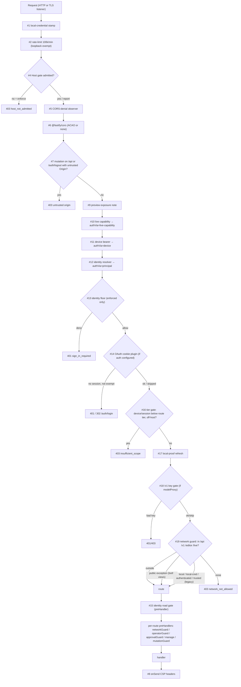
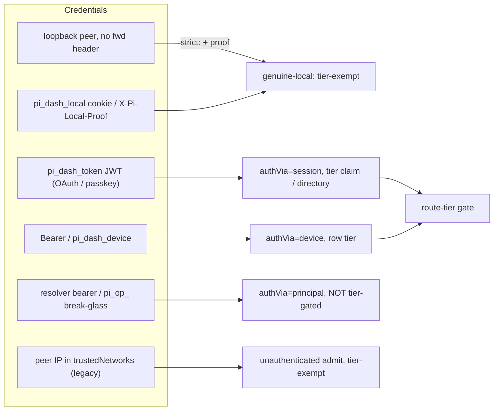

# HTTP security gate chain, authentication/authorization, route inventory (main dashboard server)
> Scope: Fastify app `createServer` (`packages/server/src/server.ts`) HTTP surface — request hook chain, identities, tiers, browser protections, every core-registered route, auth-endpoint throttling. WS upgrade internals, plugin-registered routes' handlers, terminal/editor WS = other mappers. · Evidence base: HEAD e54074304 · Mapper: 02-http-gates-and-routes · Map index: [security-map.md](../security-map.md) · Register: [residual-risks.md](residual-risks.md)

## Summary
- One Fastify instance serves all HTTP on `config.port`; optional TLS listener dispatches into SAME instance → same gate chain (`packages/server/src/server.ts:1964-1984`).
- `trustProxy` never set → `request.ip` = socket peer; `X-Forwarded-*` cannot spoof IP (`packages/server/src/server.ts:1956-1963`, rationale `packages/server/src/auth/auth-plugin.ts:320-325`).
- 17 root `onRequest` hooks (incl. `@fastify/rate-limit` + `@fastify/cors`; OAuth + model-proxy conditional) + 1 root `preHandler` + 1 `onSend` (CSP). Final arbiter = universal network guard, registered LAST, covers `/api/` `/v1/` `/editor/` `/live/` (`packages/server/src/server.ts:3639-3649`, `packages/server/src/auth/localhost-guard.ts:517`).
- Network guard pass conditions: genuine-local (+proof under `requireLocalProof`) → local credential → `isAuthenticated` → trusted CIDR (`legacy` mode only) (`packages/server/src/auth/localhost-guard.ts:432-464`). Unparseable URL → deny (fail-closed) (`:782-786`).
- Outside guard jurisdiction (public by construction): `/auth/*`, `/__pi/csp-report/:policy`, `/manifest.json`, SPA shell/static, `/apps/<id>/…` serve-app mounts, plugin roots such as `/mcp` (`packages/server/src/auth/localhost-guard.ts:642-644`).
- Tiers `observe < control < operate` (`packages/shared/src/tiers.ts:17`). `ROUTE_TIERS` 447 entries; unlisted `/api` route → `operate` (fail-closed) (`packages/shared/src/route-tiers.ts:546-548`). Tier gate applies ONLY to `authVia ∈ {device, session}`; genuine-local + trusted-network callers exempt (`packages/server/src/auth/route-tier-gate.ts:71-90`).
- Defaults: `requireLocalProof=true` (`packages/shared/src/config.ts:1839`), `hostGate.mode=enforce` (`packages/shared/src/config.ts:1837`), CSP `report` only (`packages/server/src/auth/csp.ts:82-85`), global rate limit 100 000 req/min, loopback exempt (`packages/server/src/server.ts:2013-2018`).
- 364 core HTTP routes found (excl. plugin-registered). 199 classified high-danger (exec/spawn, git, fs-write, secrets, config, egress, proxy) — table below + full appendix.
- Highest residual risks: OAuth `allowedUsers` empty ⇒ any IdP account = `operate` (HTTP-01); loopback-any-port origin trusted for credentialed CORS + mutations (HTTP-02); `control` tier can delete OAuth providers (HTTP-03).

## Inventory

### A. Root hook chain (registration order = execution order within a phase)

| # | Phase | Gate | Registered | Decision logic | Checks | Outcome | Fail mode |
|---|---|---|---|---|---|---|---|
| 1 | onRequest | Local-credential edge stamp | `packages/server/src/server.ts:2001` | `packages/server/src/auth/local-credential.ts:127` (`createLocalCredentialVerifier`), verdict read `:86-98` | `X-Pi-Local-Proof` HMAC (±30 s window, bind-time floor, socket binding, replay cache) or legacy `X-Pi-Local-Token` (`acceptLegacyToken: true`, `packages/server/src/server.ts:768`); stamps Symbol on headers | never refuses; unstamped = `absent` | fail-closed (absent) |
| 2 | onRequest | `@fastify/rate-limit` | `packages/server/src/server.ts:2013` | plugin | `max 100_000 / 1 minute`, allowList `127.0.0.1`,`::1` | 429 | n/a (ceiling only) |
| 3 | — | `@fastify/compress` (no gate) | `packages/server/src/server.ts:2027` | — | — | — | — |
| 4 | onRequest | Host gate (DNS-rebinding) | `packages/server/src/server.ts:2261` | `packages/server/src/auth/host-gate.ts:361-383`, `evaluateHostGate :230-240`, `isHostAdmitted packages/server/src/auth/host-admission.ts:125-132` | `Host` header ∈ loopback / any IP literal / bind host / `.local` / publicBaseUrls / cors origins / live tunnels / TLS cert names / `allowedHosts` (`host-admission.ts:100-119`) | 403 JSON or HTML (`host-gate.ts:378-380`); `report` mode logs `would-refuse` + proceeds | fail-closed on missing/malformed Host (`host-admission.ts:129-130`); typo'd mode ⇒ `report` (fail-open) |
| 5 | onRequest | CORS-denial observer | `packages/server/src/server.ts:2265` | `packages/server/src/access/cors-denial.ts` (`createCorsDenialObserver`) | raises deferred cors-plane grant prompt | never alters response | n/a |
| 6 | onRequest | `@fastify/cors` | `packages/server/src/server.ts:2280` | `isCorsOriginAllowed packages/server/src/auth/cors-origin.ts:225`, `classifyCorsOrigin :160-222` | Origin allow-list → ACAO + `credentials: true` | no ACAO on deny (never 500) | fail-closed (no ACAO) |
| 7 | onRequest | Mutation-origin gate (CSRF) | `packages/server/src/server.ts:2307` | `packages/server/src/auth/mutation-origin-gate.ts:34-55`, `isOriginAdmitted packages/server/src/auth/cors-origin.ts:292-305` | non-GET/HEAD/OPTIONS on routed `/api/*` or `/auth/logout`: Origin absent ⇒ allow; `""`/padded ⇒ deny; same-origin-by-Host or CORS-allowed (zrok wildcard forced off) | 403 `untrusted origin` | fail-closed for browser Origins |
| 8 | onSend | CSP (+Trusted Types) | `packages/server/src/server.ts:2318` | `packages/server/src/auth/csp.ts:145-167` | adds CSP headers unless route set one; skips `/live/` (`csp.ts:46`) | header only | default report-only |
| 9 | onRequest | Preview-exposure note | `packages/server/src/server.ts:2398` | `previewExposure.noteRequest` | forwarding header pins exposure `exposed` | none | fail-closed (pins exposed) |
| 10 | onRequest | Live-capability admit | `packages/server/src/server.ts:2401` | `packages/server/src/live-server/live-capability.ts:434-461` | `/live/<id>/~c/<token>/…` capability valid ⇒ `isAuthenticated=true`, `authVia="live-capability"` | never refuses | n/a |
| 11 | onRequest | Device bearer | `packages/server/src/server.ts:2402` → `packages/server/src/auth/bearer-auth.ts:109-134` | `registry.verifyDetailed` | `Authorization: Bearer` or `pi_dash_device` cookie (`/api/*` only, `:83-86`) ⇒ `authVia="device"`, `principalTier` | 401 `bearer_expired` only for expired header bearer (`:120`) | invalid ⇒ unauthenticated (falls through) |
| 12 | onRequest | Identity resolver dispatch | `packages/server/src/server.ts:2444` → `packages/server/src/identity/resolver-hook.ts:55-122` | `dispatchResolvers`, `BreakGlass.resolveBearer` | inert unless identity enforced; `pi_op_` break-glass bearer; resolver plugins (e.g. Keycloak) ⇒ `authVia="principal"` | 401 `invalid_credential` (bad `pi_op_`, resolver reject) | inert ⇒ no-op |
| 13 | onRequest | Identity signed-out floor (D24) | `packages/server/src/server.ts:2463-2479` | `identityFloorAllows packages/server/src/identity/identity-floor.ts:30-44` | enforced + no principal + no local credential ⇒ only `/api/health`, `/api/identity/login-config` (GET), `/api/identity/local-exchange` (POST) | 401 `sign_in_required` | fail-closed (unparseable ⇒ governed) |
| 14 | onRequest | OAuth/session cookie (conditional on `config.authConfig`) | `packages/server/src/server.ts:2491` → `packages/server/src/auth/auth-plugin.ts:516-597` | `tagSessionCookie :495-516` | skips: genuine-local, local credential, `/auth/*`, CSP sink POST, pairing prefixes, `/api/health`, `/api/identity/login-config`, `/v1/*`, serve-app mounts, `bypassUrls`, trusted source; else JWT cookie | 302 `/auth/login` (HTML) or 401 | fail-closed when registered; ABSENT when no `auth` block → guard #18 is the only gate |
| 15 | preHandler | Identity road gate | `packages/server/src/server.ts:2577` | `packages/server/src/identity/identity-road-gate.ts:38-74` | enforced only: session routes ⇒ owner equality (404); others ⇒ optional host policy | 404 / 403 | inert ⇒ no-op; no policy ⇒ ungated |
| 16 | onRequest | REST route-tier gate | `packages/server/src/server.ts:2591` | `packages/server/src/auth/route-tier-gate.ts:104-141`, `tierRefusalFor :76-90` | `authVia ∈ {device, session}` AND not genuine-local AND not trusted source: `rank(routeTier) > rank(principalTier)` | 403 `insufficient_scope` + `WWW-Authenticate` (`:93-98`) | only refuses; unmatched route ⇒ `operate` |
| 17 | onRequest | Local-proof sliding refresh | `packages/server/src/server.ts:3425` → `packages/server/src/routes/local-proof-routes.ts:37-41` | `inspectLocalProofCookie` | re-signs `pi_dash_local` | none | n/a |
| 18 | onRequest | Model-proxy key gate (conditional `modelProxy.enabled`) | `packages/server/src/server.ts:3577` | `packages/server/src/model-proxy/auth-gate.ts:31-120` | raw `url.startsWith("/v1/")`; `Bearer pi-proxy-*` key, scope; backoff per IP | 401/403; valid ⇒ `isAuthenticated=true` | fail-closed |
| 19 | onRequest | Universal network guard | `packages/server/src/server.ts:3639-3649` | `createNetworkGuardHook packages/server/src/auth/localhost-guard.ts:757-829`, `hasNetworkPassCondition :432-464` | jurisdiction union raw∪dot-resolved; public exceptions must hold on BOTH views (`:812-819`); pass conditions | 403 `network_not_allowed` (`sendNetworkDenied :368-416`), `reason: local_proof_required` variant | fail-closed |
| 20 | onRequest | State-caller ALS | `packages/server/src/server.ts:3656-3658` | `packages/server/src/auth/dashboard-state-caller.ts:22-29` | scopes containment decisions to caller | none | n/a |

Per-route `preHandler`s run after #15 (route-level after root preHandler): `networkGuard` (same predicate as #19, defense-in-depth, `packages/server/src/auth/localhost-guard.ts:491-508`), `operatorGuard` (`packages/server/src/routes/pairing-routes.ts:126-155`), `approvalGuard` (`packages/server/src/routes/pairing-routes.ts:168`), vault `manage` (`packages/server/src/vault/vault-routes.ts:143-156`), services `mutationGuard` (`packages/server/src/services/routes.ts:64-70`), `localhostGuard` (`packages/server/src/auth/localhost-guard.ts:1091-1098`).

Hook-order source comment at `packages/server/src/server.ts:3613-3620` lists stale line numbers and omits #1, #10, #12, #13, #17 → see HTTP-13.

### B. Bypass / public lists

| List | Defined | Match rule | Consumers | Entries |
|---|---|---|---|---|
| `PUBLIC_IN_NAMESPACE_PATHS` | `packages/server/src/auth/localhost-guard.ts:529-532` | exact pathname, GET/HEAD only (`:812`) | network guard | `/api/health`, `/api/identity/login-config` |
| `PUBLIC_PAIRING_PREFIXES` | `packages/server/src/routes/pairing-routes.ts:72-79` | `startsWith` (guard: both views; auth plugin: raw `request.url`, `auth-plugin.ts:548`) | network guard, auth plugin | `/api/pair/challenge`, `/api/pair/redeem`, `/api/pair/poll`, `/api/pair/request` |
| `auth.bypassUrls` | config; `isBypassed packages/server/src/auth/bypass-urls.ts:20-22` | `startsWith`, no segment boundary | auth plugin (`auth-plugin.ts:573`), network guard (`localhost-guard.ts:818`) | default none (operator-set) |
| `auth.bypassHosts` ∪ `trustedNetworks` | `packages/shared/src/config.ts:1292` (`resolvedTrustedNetworks`); live list `admissionTrustedNetworks packages/server/src/auth/trust-mode.ts:79-83` | CIDR / `*` / exact via `isTrustedSource packages/server/src/auth/localhost-guard.ts:224-240` (relayed loopback never trusted) | auth plugin, tier gate, network guard, WS | `[]` under `pair` |
| Identity floor pre-auth | `packages/server/src/identity/identity-floor.ts:19,26` | exact, both views | floor #13 | GET `/api/health`, `/api/identity/login-config`; POST `/api/identity/local-exchange` |
| Auth plugin skip `/auth/*` | `packages/server/src/auth/auth-plugin.ts:539` | raw prefix | auth plugin | all `/auth/*` |
| Serve-app mounts | `packages/server/src/auth/auth-plugin.ts:570` (`getAppMountRegistry().isMountPath`) | exact registered ids | auth plugin | trusted plugin app shells (`packages/server/src/auth/serve-app-host.ts`) |

### C. Identity & authentication methods

| Method | Credential | Where verified | Resulting principal / tier | Lifetime / rotation |
|---|---|---|---|---|
| Genuine-local | loopback socket peer + no core forwarding header (`isGenuinelyLocal packages/server/src/auth/localhost-guard.ts:82-84`) | `isLocallyTrusted :93-103` | unmarked request; exempt from tier gate (`route-tier-gate.ts:84`) ⇒ effective `operate` | per request |
| Genuine-local + proof (strict, default) | `pi_dash_local` cookie (HMAC, port-bound) or local credential | `hasLocalProof` via `packages/server/src/auth/local-proof.ts`; strict read `ctx.strict()` | as above; without proof only observe-tier `/api` reads + `/v1/*` (`localhost-guard.ts:443-449`) | cookie idle 12 h, refresh after 1 h, absolute 30 d (`local-proof.ts:22-26`); mint code 60 s (`:27`); local-token rotation invalidates all |
| Local credential | `X-Pi-Local-Proof` HMAC header; legacy raw `X-Pi-Local-Token` | `packages/server/src/auth/local-credential.ts:127-230`; token file `~/.pi/dashboard/local/token` 0600 (`packages/server/src/auth/local-token.ts:39-56`) | network-guard pass (`localhost-guard.ts:452`), operator in `operatorGuard` | token persists across restarts (`local-token.ts:35-38`); proof window ±30 s |
| OAuth session (GitHub/Google/Keycloak/OIDC providers) | `pi_dash_token` JWT HS256 cookie | `verifyToken packages/server/src/auth/auth.ts:197-209` (alg pinned HS256, unknown tier ⇒ reject) ; callback `packages/server/src/auth/auth-plugin.ts:404-462` (state nonce cookie `safeEqual` `:426-428`, `isUserAllowed :441`, `resolveGroupTier :451-454`) | `authVia="session"`, tier = JWT `tier` claim, absent ⇒ `operate` (`auth-plugin.ts:615-617`) | 7 d JWT (`auth.ts:180`), cookie `maxAge` 7 d (`auth-plugin.ts:338`); logout only clears cookie (`:468-473`); revoke-all = `auth.secret` rotation (`packages/server/src/auth/secret-rotation.ts`) |
| Passkey user | WebAuthn assertion → same `pi_dash_token` (provider `PASSKEY_PROVIDER`) | `packages/server/src/auth/passkey/passkey-routes.ts:123-165`; tier re-read from directory every request `effectiveSessionTier packages/server/src/auth/auth-plugin.ts:615-617` | `authVia="session"`, directory tier; revoked ⇒ unauthenticated | 7 d cookie; live revocation via `/api/users/:id/revoke`; invites 24 h default, 7 d max (`packages/server/src/auth/passkey/user-directory.ts:72-73`); phone sign-in request 5 min (`phone-signin.ts:23`) |
| Paired device bearer | `Authorization: Bearer <token>` or `pi_dash_device` cookie (`Path=/api/`, HttpOnly, SameSite=Strict) | `packages/server/src/auth/bearer-auth.ts:109-134`; sha256 + `timingSafeEqual` (`packages/server/src/pairing/paired-devices.ts:114-122`) | `authVia="device"`, row tier; pairing default `operate`, manual default `observe` (`packages/shared/src/tiers.ts:45-47`) | browser bearer 7 d, ceiling 30 d, rotation grace 60 s (`paired-devices.ts:29-36`); manual/MCP rows non-expiring (`:58-63`); device cookie Max-Age 400 d (`bearer-auth.ts:49`) |
| Identity principal (resolver plugin, e.g. `keycloak-resolver-plugin`) | plugin-owned bearer | `packages/server/src/identity/resolver-hook.ts:97-120` | `authVia="principal"`; NOT tier-gated (`route-tier-gate.ts:71-74`); owner-gated on session roads; host policy else (`identity-road-gate.ts:61-72`) | resolver `expiresAt` → `principalExpiresAt` |
| Break-glass operator (D23) | one-time code (`POST /api/identity/local-code`, needs local credential) → `pi_op_` bearer | `packages/server/src/server.ts:2542-2560`; `packages/server/src/identity/break-glass.ts:20-50` | `authVia="principal"`, local operator, sees every session | code 60 s single-use, bearer 60 min (`break-glass.ts:20-22`); in-memory |
| Trusted network (legacy mode only) | socket peer IP ∈ `resolvedTrustedNetworks` | `isTrustedSource packages/server/src/auth/localhost-guard.ts:224-240` via `admissionTrustedNetworks packages/server/src/auth/trust-mode.ts:79-83` | unauthenticated, admitted; tier-gate exempt (`route-tier-gate.ts:85`) ⇒ effective `operate` except vault/services/operator routes | live per request |
| Live-preview capability | `/live/<id>/~c/<token>/…` path | `packages/server/src/live-server/live-capability.ts:434-461` | `authVia="live-capability"`, minter's tier copied | revoked on device/session end (`packages/server/src/server.ts:2339-2347`) |
| Model-proxy key | `Bearer pi-proxy-*` | `packages/server/src/model-proxy/auth-gate.ts:66-117` | `isAuthenticated` for `/v1/*` only; scope check | per-key expiry/revoke (config) |

Trust modes (`TrustMode = "pair" | "legacy"`, `packages/shared/src/config.ts:159`):

| Mode | Effect | Where |
|---|---|---|
| `legacy` | trusted-network/bypass-host IP match AUTHENTICATES (admission list = configured list) | `packages/server/src/auth/trust-mode.ts:79-83` |
| `pair` | IP match grants nothing; admission list `[]`; peer may only knock | `packages/server/src/auth/trust-mode.ts:81` |
| absent | boot decides once: all entries loopback-only ⇒ `pair`, else `legacy`; persisted `origin: upgrade` | `packages/server/src/auth/trust-mode-boot.ts:54-93` |
| unrecognised value | `pair` (fail-closed) + warning | `packages/shared/src/config.ts:195`, `packages/server/src/auth/trust-mode.ts:57-62` |
| config unparseable | process fallback `legacy` | `packages/server/src/auth/trust-mode-boot.ts:64-70` |

### D. Authorization model

Tier enum `TIERS = ["observe","control","operate"]` (`packages/shared/src/tiers.ts:17`); `routeTier(method, pattern)` (`packages/shared/src/route-tiers.ts:546-548`). Map counts: operate 233, observe 139, control 75.

| Tier | Allowed capability (core routes, from `ROUTE_TIERS`) |
|---|---|
| `observe` | read sessions/events/transcripts, file read (`/api/file*`, `/api/browse`, `/api/grep`), git read, openspec read, health, device-session cookie exchange, bearer rotate, nav-intent, csp-violations POST, start-static preview, live capability mint |
| `control` | session prompt/spawn/resume/abort/lifecycle/model, file write (`/api/file/write`, `/api/file/write-binary`, mkdir, create-project), git mutations (checkout/commit/worktree/push/PR/merge), openspec mutate/init/update, diagram render, mermaid repair, live-server egress grants, `DELETE /api/tools/:name`, `DELETE /api/model-proxy/api-keys/:id`, `DELETE /api/config/auth/providers/:id` |
| `operate` | config (`PUT /api/config`, pi-settings), access/trust/YOLO, packages install/update, runtime/pi-core update, restart/shutdown, tunnel connect, vault, provider-auth, services, users, pairing mint/approve, TLS/ACME, plugin trust/toggle, every unlisted route |

Additional per-capability predicates:

| Predicate | Rule | Where |
|---|---|---|
| `operatorGuard` | device bearer refused; session / local credential / genuine-local; plus `isHostAdmitted` ENFORCE regardless of gate mode | `packages/server/src/routes/pairing-routes.ts:126-155` |
| `approvalGuard` | as operator, no bare-loopback branch | `packages/server/src/routes/pairing-routes.ts:168-190` |
| `hasOperateAuthority` | device ⇒ tier `operate`; session/principal ⇒ true; else genuine-local (trusted-network NOT enough) | `packages/server/src/auth/operate-required.ts:52-57` |
| `canOperate` | `hasOperateAuthority` ∧ tier gate at `operate` | `packages/server/src/auth/operate-required.ts:67-75` |
| vault manage | stricter `canManageVault` (session needs operate, principal needs host policy) | `packages/server/src/vault/vault-routes.ts:120-152` |
| plugin trust grant | genuine-local only | `packages/server/src/routes/plugin-runtime-client-routes.ts:124-126` |
| `stateCallerFor` | dashboard-state (token/config) readable only by local-trusted or session | `packages/server/src/auth/dashboard-state-caller.ts:22-29` |
| `localhostGuard` | `isLoopback(request.ip)` only | `packages/server/src/auth/localhost-guard.ts:1091-1098` (used `packages/server/src/routes/system-routes.ts:1678`) |
| operate-required refusal | 403 `operate_required`, 5-key body | `packages/server/src/auth/operate-required.ts:112-126` |
| approval refusal remedies | `describeApprovalRefusal` | `packages/server/src/auth/approval-refusal.ts` |
| `requestPrincipalKey` | rate-limit / nav-intent binding key | `packages/server/src/auth/request-principal.ts:20-32` |

### E. Browser protections

| Control | Setting | Where |
|---|---|---|
| CORS allow | absent Origin; loopback ANY port; active/live tunnel origins; opt-in zrok wildcard (reads only); `https://pi-dashboard.dev`; trusted-network host; configured origins; `null` denied | `packages/server/src/auth/cors-origin.ts:160-222` |
| CORS credentials | `credentials: true`, methods `CORS_ALLOWED_METHODS` | `packages/server/src/server.ts:2280-2292` |
| CSRF | mutation-origin gate (#7) | `packages/server/src/auth/mutation-origin-gate.ts:34-55` |
| DNS rebinding | host gate (#4) + `operatorGuard` enforce-always | `packages/server/src/auth/host-gate.ts:361`, `packages/server/src/routes/pairing-routes.ts:151` |
| CSP | baseline `default-src 'self'`, `script-src 'self' 'unsafe-inline' 'unsafe-eval'`, `frame-ancestors 'self'`, `object-src 'none'`; strict nonce policy in parallel; mode env `PI_DASHBOARD_CSP` default `report` | `packages/server/src/auth/csp.ts:56-80`, `:82-85`, `:120-138` |
| Trusted Types | `PI_DASHBOARD_TRUSTED_TYPES`, default follows CSP (`report`) | `packages/server/src/auth/csp.ts:90-93` |
| CSP report sink | `POST /__pi/csp-report/:policy`, size cap + timeout, outside guard | `packages/server/src/auth/csp-report-sink.ts:271-292`, `packages/server/src/auth/csp-report-paths.ts:13` |
| Session cookie `pi_dash_token` | `HttpOnly`, `SameSite=Lax`, `Secure` iff `isSecureOrigin`, Path `/`, 7 d | `packages/server/src/auth/auth-plugin.ts:331-340` |
| OAuth state cookie | `HttpOnly`, `SameSite=Lax`, Path `/auth/`, 600 s, HMAC | `packages/server/src/auth/auth-plugin.ts:308-319` |
| Device cookie `pi_dash_device` | `HttpOnly`, `SameSite=Strict`, Path `/api/`, Secure per `deviceCookieSecure` | `packages/server/src/auth/bearer-auth.ts:152-158`, `:60-71` |
| Local-proof cookie `pi_dash_local` | `HttpOnly`, `SameSite=Strict`, Path `/`, no `Secure` | `packages/server/src/routes/local-proof-routes.ts:40,58-63` |
| `Secure` predicate | TLS socket ∨ https redirect base ∨ (loopback peer ∧ Host = live https tunnel) | `packages/server/src/auth/secure-origin.ts` |
| Other headers | no global `X-Frame-Options`/HSTS/`nosniff`; `nosniff` per-route on raw/eml/attachment responses | `packages/server/src/routes/file-routes.ts:1310,1772`, `packages/server/src/routes/attachment-routes.ts:75` |
| Raw-file sandbox CSP | `sandbox; default-src 'none'…` | `packages/server/src/routes/file-routes.ts:138` |

### F. Route inventory — grouped by registering file

Columns: routes · mutating · tier distribution (from `ROUTE_TIERS`; `n/a` = outside `/api`). All `/api/*`, `/v1/*`, `/live/*` routes sit behind gates #4–#19 regardless of per-route guards.

| File | Routes | Mutating | Tiers |
|---|---|---|---|
| `packages/server/src/auth/auth-plugin.ts` | 5 | 1 | n/a:5 |
| `packages/server/src/auth/bearer-auth.ts` | 2 | 2 | observe:2 |
| `packages/server/src/auth/passkey/passkey-routes.ts` | 15 | 9 | n/a:15 |
| `packages/server/src/auth/csp-report-sink.ts` | 3 | 3 | operate:1 n/a:2 |
| `packages/server/src/server.ts` | 10 | 3 | n/a:5 observe:2 operate:3 |
| `packages/server/src/routes/preferences-auto-name-routes.ts` | 3 | 1 | observe:2 control:1 |
| `packages/server/src/routes/pi-changelog-routes.ts` | 1 | 0 | observe:1 |
| `packages/server/src/routes/model-proxy-routes.ts` | 3 | 2 | n/a:3 |
| `packages/server/src/routes/session-routes.ts` | 11 | 1 | observe:10 control:1 |
| `packages/server/src/routes/tls-routes.ts` | 1 | 1 | operate:1 |
| `packages/server/src/routes/runtime-routes.ts` | 5 | 4 | observe:1 operate:4 |
| `packages/server/src/routes/plugin-config-routes.ts` | 1 | 1 | operate:1 |
| `packages/server/src/routes/acme-routes.ts` | 3 | 3 | operate:3 |
| `packages/server/src/routes/package-health-routes.ts` | 2 | 1 | observe:1 operate:1 |
| `packages/server/src/routes/addons-routes.ts` | 2 | 1 | observe:1 operate:1 |
| `packages/server/src/routes/model-proxy-api-key-routes.ts` | 4 | 3 | operate:3 control:1 |
| `packages/server/src/routes/pi-core-routes.ts` | 2 | 1 | observe:1 operate:1 |
| `packages/server/src/routes/pi-retry-routes.ts` | 2 | 1 | observe:1 control:1 |
| `packages/server/src/routes/folder-project-routes.ts` | 1 | 0 | observe:1 |
| `packages/server/src/routes/known-servers-routes.ts` | 6 | 5 | operate:6 |
| `packages/server/src/routes/pairing-routes.ts` | 14 | 10 | operate:13 observe:1 |
| `packages/server/src/routes/preferences-worktree-init-routes.ts` | 2 | 1 | observe:1 control:1 |
| `packages/server/src/routes/pi-settings-routes.ts` | 5 | 4 | operate:5 |
| `packages/server/src/routes/csp-violations-routes.ts` | 2 | 1 | observe:1 operate:1 |
| `packages/server/src/routes/manifest-route.ts` | 1 | 0 | n/a:1 |
| `packages/server/src/routes/git-routes.ts` | 24 | 15 | observe:9 control:15 |
| `packages/server/src/routes/nav-intent-routes.ts` | 2 | 2 | observe:2 |
| `packages/server/src/routes/host-gate-routes.ts` | 1 | 0 | operate:1 |
| `packages/server/src/routes/plugin-runtime-client-routes.ts` | 3 | 2 | observe:1 operate:2 |
| `packages/server/src/routes/push-routes.ts` | 5 | 3 | observe:1 operate:4 |
| `packages/server/src/routes/provider-routes.ts` | 6 | 5 | observe:1 operate:5 |
| `packages/server/src/routes/local-proof-routes.ts` | 2 | 1 | operate:1 n/a:1 |
| `packages/server/src/routes/recommended-routes.ts` | 1 | 0 | observe:1 |
| `packages/server/src/routes/tool-routes.ts` | 6 | 4 | observe:2 operate:3 control:1 |
| `packages/server/src/routes/user-routes.ts` | 7 | 5 | operate:7 |
| `packages/server/src/routes/attachment-routes.ts` | 1 | 0 | observe:1 |
| `packages/server/src/routes/mermaid-repair-routes.ts` | 1 | 1 | control:1 |
| `packages/server/src/routes/access-prompt-routes.ts` | 6 | 4 | observe:2 operate:4 |
| `packages/server/src/routes/node-runtime-routes.ts` | 2 | 1 | observe:1 operate:1 |
| `packages/server/src/routes/access-routes.ts` | 18 | 13 | observe:5 operate:13 |
| `packages/server/src/routes/resource-activation-routes.ts` | 3 | 3 | operate:3 |
| `packages/server/src/routes/file-write-binary-routes.ts` | 1 | 1 | control:1 |
| `packages/server/src/routes/model-proxy-refresh-routes.ts` | 1 | 1 | operate:1 |
| `packages/server/src/routes/provider-auth-routes.ts` | 13 | 6 | operate:12 observe:1 |
| `packages/server/src/routes/package-routes.ts` | 9 | 6 | observe:3 operate:6 |
| `packages/server/src/routes/model-proxy-diagnostics-routes.ts` | 1 | 0 | operate:1 |
| `packages/server/src/routes/plugin-activation-routes.ts` | 2 | 1 | observe:1 operate:1 |
| `packages/server/src/routes/system-routes.ts` | 21 | 11 | operate (unlisted→fail-closed):1 operate:14 control:1 observe:5 |
| `packages/server/src/routes/doctor-routes.ts` | 1 | 0 | observe:1 |
| `packages/server/src/routes/grep-routes.ts` | 1 | 0 | observe:1 |
| `packages/server/src/routes/live-server-routes.ts` | 10 | 7 | operate:3 observe:4 control:3 |
| `packages/server/src/routes/preferences-display-routes.ts` | 2 | 1 | observe:1 control:1 |
| `packages/server/src/routes/acp-routes.ts` | 1 | 0 | control:1 |
| `packages/server/src/routes/canvas-types-routes.ts` | 2 | 1 | observe:1 control:1 |
| `packages/server/src/routes/file-routes.ts` | 23 | 7 | observe:17 control:4 operate:2 |
| `packages/server/src/routes/models-introspection-routes.ts` | 1 | 0 | observe:1 |
| `packages/server/src/routes/custom-event-groups-routes.ts` | 1 | 0 | observe:1 |
| `packages/server/src/routes/openspec-routes.ts` | 13 | 5 | observe:8 control:5 |
| `packages/server/src/routes/openspec-group-routes.ts` | 6 | 5 | observe:1 control:5 |
| `packages/server/src/routes/pi-runtime-routes.ts` | 2 | 1 | observe:1 operate:1 |
| `packages/server/src/live-server/live-server-proxy.ts` | 2 | 2 | n/a:2 |
| `packages/server/src/services/routes.ts` | 17 | 12 | observe:4 operate:13 |
| `packages/server/src/vault/vault-routes.ts` | 18 | 14 | operate:17 observe:1 |
| `packages/server/src/questions/question-routes.ts` | 4 | 2 | observe:2 control:2 |
| `packages/server/src/session/session-api.ts` | 15 | 15 | control:15 |
| `packages/server/src/routes/pi-trust-query-routes.ts` | 1 | 1 | operate:1 |

Full 364-row table → [http-route-inventory.md](http-route-inventory.md).

### G. High-danger routes (individually listed)

Columns: Required tier = `ROUTE_TIERS` value (enforced only for device/session credentials, gate #16) + per-route guard. "Mutating" = non-GET/HEAD. Danger class assigned from route path + registering module purpose. Public pairing routes show map tier `operate` but are reached unauthenticated via `PUBLIC_PAIRING_PREFIXES` (no tiered credential ⇒ tier gate inert).

| Method | Path | Handler path:line | Required tier / gate | Mutating | Danger class |
|---|---|---|---|---|---|
| POST | `/api/device-session` | `packages/server/src/auth/bearer-auth.ts:146` | observe | Y | secrets/credentials |
| DELETE | `/api/device-session` | `packages/server/src/auth/bearer-auth.ts:162` | observe | Y | secrets/credentials |
| POST | `/api/csp-reports/reset` | `packages/server/src/auth/csp-report-sink.ts:296` | operate + `networkGuard` | Y | config |
| POST | `/api/identity/local-code` | `packages/server/src/server.ts:2542` | operate | Y | secrets/credentials |
| POST | `/api/identity/local-exchange` | `packages/server/src/server.ts:2551` | operate | Y | secrets/credentials |
| POST | `/api/ws-ticket` | `packages/server/src/server.ts:3459` | operate + `networkGuard` | Y | secrets/credentials |
| GET | `/v1/models` | `packages/server/src/routes/model-proxy-routes.ts:149` | n/a | N | network-egress |
| POST | `/v1/chat/completions` | `packages/server/src/routes/model-proxy-routes.ts:178` | n/a | Y | network-egress |
| POST | `/v1/messages` | `packages/server/src/routes/model-proxy-routes.ts:181` | n/a | Y | network-egress |
| POST | `/api/tls/issue` | `packages/server/src/routes/tls-routes.ts:31` | operate + `deps.networkGuard` | Y | config, network-egress |
| POST | `/api/runtime/source` | `packages/server/src/routes/runtime-routes.ts:216` | operate + `quietMutation` | Y | exec/spawn |
| POST | `/api/runtime/update` | `packages/server/src/routes/runtime-routes.ts:224` | operate + `mutation` | Y | exec/spawn |
| POST | `/api/runtime/activate` | `packages/server/src/routes/runtime-routes.ts:241` | operate + `quietMutation` | Y | exec/spawn |
| POST | `/api/runtime/rollback` | `packages/server/src/routes/runtime-routes.ts:276` | operate + `quietMutation` | Y | exec/spawn |
| POST | `/api/config/plugins/:id` | `packages/server/src/routes/plugin-config-routes.ts:66` | operate + `networkGuard` | Y | config |
| PUT | `/api/tls/acme/:sourceId` | `packages/server/src/routes/acme-routes.ts:88` | operate + `networkGuard` | Y | config |
| DELETE | `/api/tls/acme/:sourceId` | `packages/server/src/routes/acme-routes.ts:127` | operate + `networkGuard` | Y | config |
| PUT | `/api/tls/acme/:sourceId/credentials` | `packages/server/src/routes/acme-routes.ts:146` | operate + `[networkGuard, manageGuard]` | Y | secrets/credentials, config |
| POST | `/api/packages/cleanup` | `packages/server/src/routes/package-health-routes.ts:75` | operate | Y | exec/spawn |
| POST | `/api/addons/:featureId/toggle` | `packages/server/src/routes/addons-routes.ts:168` | operate + `networkGuard` | Y | exec/spawn |
| GET | `/api/model-proxy/api-keys` | `packages/server/src/routes/model-proxy-api-key-routes.ts:37` | operate + `networkGuard` | N | secrets/credentials |
| POST | `/api/model-proxy/api-keys` | `packages/server/src/routes/model-proxy-api-key-routes.ts:62` | operate + `networkGuard` | Y | secrets/credentials |
| POST | `/api/model-proxy/api-keys/:id/revoke` | `packages/server/src/routes/model-proxy-api-key-routes.ts:112` | operate + `networkGuard` | Y | secrets/credentials |
| DELETE | `/api/model-proxy/api-keys/:id` | `packages/server/src/routes/model-proxy-api-key-routes.ts:142` | control + `networkGuard` | Y | secrets/credentials |
| POST | `/api/pi-core/update` | `packages/server/src/routes/pi-core-routes.ts:64` | operate | Y | exec/spawn |
| PUT | `/api/pi-retry` | `packages/server/src/routes/pi-retry-routes.ts:42` | control + `networkGuard` | Y | config |
| POST | `/api/known-servers` | `packages/server/src/routes/known-servers-routes.ts:215` | operate + `mutationGuard` | Y | config |
| DELETE | `/api/known-servers` | `packages/server/src/routes/known-servers-routes.ts:301` | operate + `mutationGuard` | Y | config |
| POST | `/api/known-servers/accept-move` | `packages/server/src/routes/known-servers-routes.ts:336` | operate + `mutationGuard` | Y | config |
| POST | `/api/known-servers/probe` | `packages/server/src/routes/known-servers-routes.ts:437` | operate + `mutationGuard` | Y | config, network-egress |
| POST | `/api/discover-servers` | `packages/server/src/routes/known-servers-routes.ts:470` | operate + `networkGuard` | Y | network-egress |
| POST | `/api/pair/redeem` | `packages/server/src/routes/pairing-routes.ts:373` | operate | Y | secrets/credentials |
| POST | `/api/pair/approve` | `packages/server/src/routes/pairing-routes.ts:473` | operate + `approvalGuard` | Y | secrets/credentials |
| POST | `/api/pair/approve-pending` | `packages/server/src/routes/pairing-routes.ts:528` | operate + `approvalGuard` | Y | secrets/credentials |
| POST | `/api/pair/poll` | `packages/server/src/routes/pairing-routes.ts:578` | operate | Y | secrets/credentials |
| GET | `/api/paired-devices` | `packages/server/src/routes/pairing-routes.ts:607` | operate + `networkGuard` | N | secrets/credentials |
| POST | `/api/paired-devices` | `packages/server/src/routes/pairing-routes.ts:638` | operate + `operatorGuard` | Y | secrets/credentials |
| PUT | `/api/pi-settings` | `packages/server/src/routes/pi-settings-routes.ts:182` | operate + `networkGuard` | Y | fs-write, config |
| PUT | `/api/pi-settings/raw` | `packages/server/src/routes/pi-settings-routes.ts:195` | operate + `networkGuard` | Y | fs-write, config |
| POST | `/api/pi-settings/sync-defaults` | `packages/server/src/routes/pi-settings-routes.ts:218` | operate + `networkGuard` | Y | fs-write, config |
| POST | `/api/pi-settings/legacy-credentials` | `packages/server/src/routes/pi-settings-routes.ts:236` | operate + `networkGuard` | Y | secrets/credentials, config |
| GET | `/api/git/branches` | `packages/server/src/routes/git-routes.ts:286` | observe + `networkGuard` | N | git |
| POST | `/api/git/checkout` | `packages/server/src/routes/git-routes.ts:309` | control + `networkGuard` | Y | git |
| POST | `/api/git/init` | `packages/server/src/routes/git-routes.ts:337` | control + `networkGuard` | Y | git |
| GET | `/api/git/status` | `packages/server/src/routes/git-routes.ts:361` | observe + `networkGuard` | N | git |
| GET | `/api/git/changed-files` | `packages/server/src/routes/git-routes.ts:379` | observe + `networkGuard` | N | git |
| POST | `/api/git/commit` | `packages/server/src/routes/git-routes.ts:400` | control + `networkGuard` | Y | git |
| POST | `/api/git/commit-draft` | `packages/server/src/routes/git-routes.ts:438` | control + `networkGuard` | Y | git |
| GET | `/api/git/head` | `packages/server/src/routes/git-routes.ts:482` | observe + `networkGuard` | N | git |
| GET | `/api/git/worktrees` | `packages/server/src/routes/git-routes.ts:500` | observe + `networkGuard` | N | git |
| GET | `/api/git/worktree/init-status` | `packages/server/src/routes/git-routes.ts:522` | observe + `networkGuard` | N | git |
| GET | `/api/git/worktree/active-inits` | `packages/server/src/routes/git-routes.ts:567` | observe + `networkGuard` | N | git |
| POST | `/api/git/worktree/init` | `packages/server/src/routes/git-routes.ts:580` | control + `networkGuard` | Y | git |
| POST | `/api/git/worktree` | `packages/server/src/routes/git-routes.ts:692` | control + `networkGuard` | Y | git |
| POST | `/api/git/worktree/orphan-cleanup` | `packages/server/src/routes/git-routes.ts:754` | control + `networkGuard` | Y | git |
| POST | `/api/git/worktree/remove` | `packages/server/src/routes/git-routes.ts:824` | control + `networkGuard` | Y | git |
| POST | `/api/git/worktree/remove-batch` | `packages/server/src/routes/git-routes.ts:890` | control + `networkGuard` | Y | git |
| POST | `/api/git/worktree/prune` | `packages/server/src/routes/git-routes.ts:1008` | control + `networkGuard` | Y | git |
| POST | `/api/git/worktree/merge` | `packages/server/src/routes/git-routes.ts:1023` | control + `networkGuard` | Y | git |
| POST | `/api/git/worktree/push` | `packages/server/src/routes/git-routes.ts:1056` | control + `networkGuard` | Y | git |
| POST | `/api/git/worktree/pr` | `packages/server/src/routes/git-routes.ts:1085` | control + `networkGuard` | Y | git |
| GET | `/api/git/pull-requests` | `packages/server/src/routes/git-routes.ts:1131` | observe + `networkGuard` | N | git |
| POST | `/api/git/worktree/from-pr` | `packages/server/src/routes/git-routes.ts:1161` | control + `networkGuard` | Y | git |
| GET | `/api/git/worktree/diff-stat` | `packages/server/src/routes/git-routes.ts:1203` | observe + `networkGuard` | N | git |
| POST | `/api/git/stash-pop` | `packages/server/src/routes/git-routes.ts:1227` | control + `networkGuard` | Y | git |
| POST | `/api/plugins/:id/trust` | `packages/server/src/routes/plugin-runtime-client-routes.ts:119` | operate + `networkGuard` | Y | config |
| DELETE | `/api/plugins/:id/trust` | `packages/server/src/routes/plugin-runtime-client-routes.ts:137` | operate + `networkGuard` | Y | config |
| POST | `/api/push/test` | `packages/server/src/routes/push-routes.ts:166` | operate | Y | network-egress |
| PUT | `/api/providers` | `packages/server/src/routes/provider-routes.ts:308` | operate + `networkGuard` | Y | config |
| PATCH | `/api/providers/:name` | `packages/server/src/routes/provider-routes.ts:422` | operate + `networkGuard` | Y | config |
| DELETE | `/api/providers/:name` | `packages/server/src/routes/provider-routes.ts:510` | operate + `networkGuard` | Y | config |
| POST | `/api/providers/:name/refresh` | `packages/server/src/routes/provider-routes.ts:549` | operate + `networkGuard` | Y | config, network-egress |
| POST | `/api/providers/test` | `packages/server/src/routes/provider-routes.ts:573` | operate + `networkGuard` | Y | config, network-egress |
| POST | `/api/local-proof` | `packages/server/src/routes/local-proof-routes.ts:43` | operate | Y | secrets/credentials |
| GET | `/auth/local-proof` | `packages/server/src/routes/local-proof-routes.ts:51` | n/a | N | secrets/credentials |
| GET | `/api/packages/recommended` | `packages/server/src/routes/recommended-routes.ts:334` | observe | N | network-egress |
| POST | `/api/tools/rescan` | `packages/server/src/routes/tool-routes.ts:91` | operate + `networkGuard` | Y | exec/spawn |
| PUT | `/api/tools/:name` | `packages/server/src/routes/tool-routes.ts:112` | operate + `networkGuard` | Y | fs-write |
| DELETE | `/api/tools/:name` | `packages/server/src/routes/tool-routes.ts:160` | control + `networkGuard` | Y | fs-write |
| GET | `/api/users` | `packages/server/src/routes/user-routes.ts:92` | operate + `operatorGuard` | N | secrets/credentials |
| POST | `/api/users` | `packages/server/src/routes/user-routes.ts:105` | operate + `operatorGuard` | Y | secrets/credentials |
| PATCH | `/api/users/:id` | `packages/server/src/routes/user-routes.ts:121` | operate + `operatorGuard` | Y | secrets/credentials |
| POST | `/api/users/:id/revoke` | `packages/server/src/routes/user-routes.ts:131` | operate + `operatorGuard` | Y | secrets/credentials |
| POST | `/api/users/:id/invites` | `packages/server/src/routes/user-routes.ts:141` | operate + `operatorGuard` | Y | secrets/credentials |
| DELETE | `/api/users/invites/:inviteId` | `packages/server/src/routes/user-routes.ts:167` | operate + `operatorGuard` | Y | secrets/credentials |
| GET | `/api/users/credentials/impact` | `packages/server/src/routes/user-routes.ts:173` | operate + `operatorGuard` | N | secrets/credentials |
| POST | `/api/mermaid/repair` | `packages/server/src/routes/mermaid-repair-routes.ts:211` | control + `deps.networkGuard` | Y | network-egress |
| POST | `/api/access/prompts/:promptId` | `packages/server/src/routes/access-prompt-routes.ts:184` | operate + `networkGuard` | Y | config |
| POST | `/api/access/yolo` | `packages/server/src/routes/access-prompt-routes.ts:221` | operate + `networkGuard` | Y | config |
| DELETE | `/api/access/yolo` | `packages/server/src/routes/access-prompt-routes.ts:242` | operate + `networkGuard` | Y | config |
| DELETE | `/api/access/refusals` | `packages/server/src/routes/access-prompt-routes.ts:249` | operate + `networkGuard` | Y | config |
| POST | `/api/node/installs/select` | `packages/server/src/routes/node-runtime-routes.ts:112` | operate + `networkGuard` | Y | exec/spawn |
| DELETE | `/api/access/grants` | `packages/server/src/routes/access-routes.ts:188` | operate + `networkGuard` | Y | config |
| DELETE | `/api/access/worktree-trust` | `packages/server/src/routes/access-routes.ts:218` | operate + `networkGuard` | Y | config |
| DELETE | `/api/access/bypass-hosts` | `packages/server/src/routes/access-routes.ts:248` | operate + `networkGuard` | Y | config |
| DELETE | `/api/access/trusted-network` | `packages/server/src/routes/access-routes.ts:276` | operate + `networkGuard` | Y | config |
| DELETE | `/api/access/cors-origin` | `packages/server/src/routes/access-routes.ts:296` | operate + `networkGuard` | Y | config |
| DELETE | `/api/access/preview-egress` | `packages/server/src/routes/access-routes.ts:323` | operate + `networkGuard` | Y | config |
| DELETE | `/api/access/project-trust` | `packages/server/src/routes/access-routes.ts:350` | operate + `networkGuard` | Y | config |
| DELETE | `/api/access/pinned-directory` | `packages/server/src/routes/access-routes.ts:379` | operate + `networkGuard` | Y | config |
| POST | `/api/access/grants` | `packages/server/src/routes/access-routes.ts:405` | operate + `networkGuard` | Y | config |
| PUT | `/api/access/pi-trust/choice` | `packages/server/src/routes/access-routes.ts:580` | operate + `networkGuard` | Y | config |
| POST | `/api/access/provision` | `packages/server/src/routes/access-routes.ts:642` | operate + `networkGuard` | Y | config |
| POST | `/api/access/provision/dismiss-all` | `packages/server/src/routes/access-routes.ts:666` | operate + `networkGuard` | Y | config |
| POST | `/api/access/provision/:id/settle` | `packages/server/src/routes/access-routes.ts:674` | operate + `networkGuard` | Y | config |
| POST | `/api/resources/toggle` | `packages/server/src/routes/resource-activation-routes.ts:130` | operate | Y | exec/spawn |
| POST | `/api/resources/trust` | `packages/server/src/routes/resource-activation-routes.ts:195` | operate + `networkGuard` | Y | config |
| POST | `/api/resources/reload` | `packages/server/src/routes/resource-activation-routes.ts:237` | operate + `networkGuard` | Y | exec/spawn |
| POST | `/api/file/write-binary` | `packages/server/src/routes/file-write-binary-routes.ts:288` | control + `networkGuard` | Y | fs-write |
| GET | `/api/provider-auth/providers` | `packages/server/src/routes/provider-auth-routes.ts:129` | operate | N | secrets/credentials |
| GET | `/api/provider-auth/handlers` | `packages/server/src/routes/provider-auth-routes.ts:137` | operate | N | secrets/credentials |
| GET | `/api/provider-auth/radius/mcp` | `packages/server/src/routes/provider-auth-routes.ts:156` | operate | N | secrets/credentials |
| POST | `/api/provider-auth/radius/mcp` | `packages/server/src/routes/provider-auth-routes.ts:161` | operate | Y | secrets/credentials |
| GET | `/api/provider-auth/status` | `packages/server/src/routes/provider-auth-routes.ts:172` | operate | N | secrets/credentials |
| GET | `/api/provider-auth/catalogue-ready` | `packages/server/src/routes/provider-auth-routes.ts:190` | observe | N | secrets/credentials |
| GET | `/api/provider-auth/legacy-provider-ids` | `packages/server/src/routes/provider-auth-routes.ts:204` | operate | N | secrets/credentials |
| POST | `/api/provider-auth/start` | `packages/server/src/routes/provider-auth-routes.ts:211` | operate | Y | secrets/credentials |
| GET | `/api/provider-auth/flow/:flowId` | `packages/server/src/routes/provider-auth-routes.ts:249` | operate | N | secrets/credentials |
| POST | `/api/provider-auth/flow/:flowId/input` | `packages/server/src/routes/provider-auth-routes.ts:261` | operate | Y | secrets/credentials |
| DELETE | `/api/provider-auth/flow/:flowId` | `packages/server/src/routes/provider-auth-routes.ts:279` | operate | Y | secrets/credentials |
| PUT | `/api/provider-auth/api-key` | `packages/server/src/routes/provider-auth-routes.ts:290` | operate | Y | secrets/credentials |
| DELETE | `/api/provider-auth/:provider` | `packages/server/src/routes/provider-auth-routes.ts:327` | operate | Y | secrets/credentials |
| GET | `/api/packages/search` | `packages/server/src/routes/package-routes.ts:65` | observe | N | network-egress |
| GET | `/api/packages/readme` | `packages/server/src/routes/package-routes.ts:80` | observe | N | network-egress |
| POST | `/api/packages/install` | `packages/server/src/routes/package-routes.ts:132` | operate | Y | exec/spawn |
| POST | `/api/packages/remove` | `packages/server/src/routes/package-routes.ts:165` | operate | Y | exec/spawn |
| POST | `/api/packages/update` | `packages/server/src/routes/package-routes.ts:198` | operate | Y | exec/spawn |
| POST | `/api/packages/move` | `packages/server/src/routes/package-routes.ts:228` | operate | Y | exec/spawn |
| POST | `/api/packages/reset-to-npm` | `packages/server/src/routes/package-routes.ts:309` | operate | Y | exec/spawn |
| POST | `/api/packages/check-updates` | `packages/server/src/routes/package-routes.ts:368` | operate | Y | network-egress |
| POST | `/api/plugins/:id/toggle` | `packages/server/src/routes/plugin-activation-routes.ts:363` | operate + `networkGuard` | Y | exec/spawn |
| POST | `/api/tunnel/enroll` | `packages/server/src/routes/system-routes.ts:513` | operate + `networkGuard` | Y | exec/spawn |
| PUT | `/api/config` | `packages/server/src/routes/system-routes.ts:616` | operate + `networkGuard` | Y | config |
| DELETE | `/api/config/auth/providers/:id` | `packages/server/src/routes/system-routes.ts:808` | control + `networkGuard` | Y | config |
| POST | `/api/tunnel-connect` | `packages/server/src/routes/system-routes.ts:921` | operate | Y | exec/spawn |
| POST | `/api/tunnel-disconnect` | `packages/server/src/routes/system-routes.ts:1093` | operate | Y | exec/spawn |
| POST | `/api/shutdown` | `packages/server/src/routes/system-routes.ts:1523` | operate + `networkGuard` | Y | exec/spawn |
| POST | `/api/electron/reextract` | `packages/server/src/routes/system-routes.ts:1552` | operate + `networkGuard` | Y | exec/spawn |
| POST | `/api/restart` | `packages/server/src/routes/system-routes.ts:1571` | operate + `networkGuard` | Y | exec/spawn |
| POST | `/api/live-server/start` | `packages/server/src/routes/live-server-routes.ts:189` | operate + `networkGuard` | Y | exec/spawn |
| POST | `/api/browse/mkdir` | `packages/server/src/routes/file-routes.ts:669` | control + `networkGuard` | Y | fs-write |
| POST | `/api/browse/create-project` | `packages/server/src/routes/file-routes.ts:700` | control + `networkGuard` | Y | fs-write |
| POST | `/api/open-in-system` | `packages/server/src/routes/file-routes.ts:925` | operate + `networkGuard` | Y | exec/spawn |
| POST | `/api/reveal-in-file-manager` | `packages/server/src/routes/file-routes.ts:931` | operate + `networkGuard` | Y | exec/spawn |
| POST | `/api/file/write` | `packages/server/src/routes/file-routes.ts:1016` | control + `networkGuard` | Y | fs-write |
| POST | `/api/diagram/render` | `packages/server/src/routes/file-routes.ts:1783` | control + `networkGuard` | Y | exec/spawn |
| POST | `/api/openspec/config` | `packages/server/src/routes/openspec-routes.ts:402` | control + `networkGuard` | Y | fs-write |
| POST | `/api/openspec/update` | `packages/server/src/routes/openspec-routes.ts:449` | control + `networkGuard` | Y | exec/spawn |
| PUT | `/api/openspec/dependencies` | `packages/server/src/routes/openspec-routes.ts:781` | control + `networkGuard` | Y | fs-write |
| POST | `/api/openspec/init` | `packages/server/src/routes/openspec-routes.ts:835` | control + `networkGuard` | Y | exec/spawn |
| POST | `/api/openspec/tasks/toggle` | `packages/server/src/routes/openspec-routes.ts:1173` | control + `networkGuard` | Y | fs-write |
| POST | `/api/openspec/groups` | `packages/server/src/routes/openspec-group-routes.ts:127` | control + `networkGuard` | Y | fs-write |
| PATCH | `/api/openspec/groups/:id` | `packages/server/src/routes/openspec-group-routes.ts:155` | control | Y | fs-write |
| DELETE | `/api/openspec/groups/:id` | `packages/server/src/routes/openspec-group-routes.ts:200` | control + `networkGuard` | Y | fs-write |
| PUT | `/api/openspec/groups/assignments` | `packages/server/src/routes/openspec-group-routes.ts:221` | control + `networkGuard` | Y | fs-write |
| PUT | `/api/openspec/groups/change-order` | `packages/server/src/routes/openspec-group-routes.ts:250` | control + `networkGuard` | Y | fs-write |
| POST | `/api/pi/runtime` | `packages/server/src/routes/pi-runtime-routes.ts:112` | operate + `networkGuard` | Y | exec/spawn |
| ALL | `/live/:id/*` | `packages/server/src/live-server/live-server-proxy.ts:304` | n/a | Y | proxy (live preview) |
| ALL | `/live/:id` | `packages/server/src/live-server/live-server-proxy.ts:305` | n/a | Y | proxy (live preview) |
| POST | `/api/services` | `packages/server/src/services/routes.ts:91` | operate + `write`=[networkGuard, mutationGuard] | Y | exec/spawn |
| DELETE | `/api/services/:id` | `packages/server/src/services/routes.ts:100` | operate + `write`=[networkGuard, mutationGuard] | Y | exec/spawn |
| POST | `/api/services/:id/ensure` | `packages/server/src/services/routes.ts:104` | operate + `write`=[networkGuard, mutationGuard] | Y | exec/spawn |
| POST | `/api/services/:id/start` | `packages/server/src/services/routes.ts:119` | operate + `write`=[networkGuard, mutationGuard] | Y | exec/spawn |
| POST | `/api/services/:id/retry` | `packages/server/src/services/routes.ts:120` | operate + `write`=[networkGuard, mutationGuard] | Y | exec/spawn |
| POST | `/api/services/:id/stop` | `packages/server/src/services/routes.ts:121` | operate + `write`=[networkGuard, mutationGuard] | Y | exec/spawn |
| POST | `/api/services/:id/pin` | `packages/server/src/services/routes.ts:124` | operate + `write`=[networkGuard, mutationGuard] | Y | exec/spawn |
| POST | `/api/services/:id/unpin` | `packages/server/src/services/routes.ts:125` | operate + `write`=[networkGuard, mutationGuard] | Y | exec/spawn |
| POST | `/api/services/:id/prefetch` | `packages/server/src/services/routes.ts:126` | operate + `write`=[networkGuard, mutationGuard] | Y | exec/spawn |
| POST | `/api/services/:id/reset-data` | `packages/server/src/services/routes.ts:127` | operate + `write`=[networkGuard, mutationGuard] | Y | exec/spawn |
| POST | `/api/services/prune` | `packages/server/src/services/routes.ts:128` | operate + `write`=[networkGuard, mutationGuard] | Y | exec/spawn |
| PUT | `/api/services/:id/secrets/:name` | `packages/server/src/services/routes.ts:135` | operate + `write`=[networkGuard, mutationGuard] | Y | exec/spawn, secrets/credentials |
| GET | `/api/vault` | `packages/server/src/vault/vault-routes.ts:168` | operate + `manage`=[networkGuard, vaultManageGuard] | N | secrets/credentials |
| GET | `/api/vault/projects` | `packages/server/src/vault/vault-routes.ts:181` | operate + `manage`=[networkGuard, vaultManageGuard] | N | secrets/credentials |
| POST | `/api/vault/accounts` | `packages/server/src/vault/vault-routes.ts:198` | operate + `manage`=[networkGuard, vaultManageGuard] | Y | secrets/credentials |
| PUT | `/api/vault/accounts/:id/value` | `packages/server/src/vault/vault-routes.ts:202` | operate + `manage`=[networkGuard, vaultManageGuard] | Y | secrets/credentials |
| DELETE | `/api/vault/accounts/:id` | `packages/server/src/vault/vault-routes.ts:206` | operate + `manage`=[networkGuard, vaultManageGuard] | Y | secrets/credentials |
| POST | `/api/vault/bindings` | `packages/server/src/vault/vault-routes.ts:208` | operate + `manage`=[networkGuard, vaultManageGuard] | Y | secrets/credentials |
| PUT | `/api/vault/bindings/:name/default` | `packages/server/src/vault/vault-routes.ts:212` | operate + `manage`=[networkGuard, vaultManageGuard] | Y | secrets/credentials |
| DELETE | `/api/vault/bindings/:name` | `packages/server/src/vault/vault-routes.ts:217` | operate + `manage`=[networkGuard, vaultManageGuard] | Y | secrets/credentials |
| POST | `/api/vault/grants` | `packages/server/src/vault/vault-routes.ts:222` | operate + `manage`=[networkGuard, vaultManageGuard] | Y | secrets/credentials |
| DELETE | `/api/vault/grants` | `packages/server/src/vault/vault-routes.ts:227` | operate + `manage`=[networkGuard, vaultManageGuard] | Y | secrets/credentials |
| POST | `/api/vault/confirmations` | `packages/server/src/vault/vault-routes.ts:233` | operate + `manage`=[networkGuard, vaultManageGuard] | Y | secrets/credentials |
| DELETE | `/api/vault/confirmations` | `packages/server/src/vault/vault-routes.ts:238` | operate + `manage`=[networkGuard, vaultManageGuard] | Y | secrets/credentials |
| PUT | `/api/vault/plugin-approvals/:pluginId/:bindingName` | `packages/server/src/vault/vault-routes.ts:244` | operate + `manage`=[networkGuard, vaultManageGuard] | Y | secrets/credentials |
| DELETE | `/api/vault/plugin-approvals/:pluginId/:bindingName` | `packages/server/src/vault/vault-routes.ts:248` | operate + `manage`=[networkGuard, vaultManageGuard] | Y | secrets/credentials |
| GET | `/api/vault/import/candidates` | `packages/server/src/vault/vault-routes.ts:253` | operate + `manage`=[networkGuard, vaultManageGuard] | N | secrets/credentials |
| POST | `/api/vault/import/propose` | `packages/server/src/vault/vault-routes.ts:254` | operate + `manage`=[networkGuard, vaultManageGuard] | Y | secrets/credentials |
| POST | `/api/vault/import/confirm` | `packages/server/src/vault/vault-routes.ts:263` | operate + `manage`=[networkGuard, vaultManageGuard] | Y | secrets/credentials |
| GET | `/api/session/:id/vault-bindings` | `packages/server/src/vault/vault-routes.ts:268` | observe + `networkGuard` | N | secrets/credentials |
| POST | `/api/questions/:id/summarize` | `packages/server/src/questions/question-routes.ts:120` | control + `guard` | Y | network-egress |
| POST | `/api/session/:id/prompt` | `packages/server/src/session/session-api.ts:120` | control | Y | exec/spawn (agent) |
| POST | `/api/session/:id/abort` | `packages/server/src/session/session-api.ts:206` | control | Y | exec/spawn (agent) |
| POST | `/api/session/:id/shutdown` | `packages/server/src/session/session-api.ts:221` | control | Y | exec/spawn (agent), exec/spawn |
| POST | `/api/session/spawn` | `packages/server/src/session/session-api.ts:302` | control | Y | exec/spawn (agent) |
| POST | `/api/session/:id/resume` | `packages/server/src/session/session-api.ts:374` | control | Y | exec/spawn (agent) |
| POST | `/api/session/:id/lifecycle` | `packages/server/src/session/session-api.ts:601` | control + `networkGuard` | Y | exec/spawn (agent) |
| POST | `/api/paired-devices/rotate` | `packages/server/src/routes/pairing-routes.ts:232` | observe | Y | secrets/credentials |
| POST | `/api/services/:id/heartbeat` | `packages/server/src/services/routes.ts:110` | operate + `write`=[networkGuard, mutationGuard] | Y | exec/spawn |
| POST | `/api/services/:id/release` | `packages/server/src/services/routes.ts:110` | operate + `write`=[networkGuard, mutationGuard] | Y | exec/spawn |

### H. Plugin-registered HTTP routes (not enumerated here)

- 130 `ROUTE_TIERS` entries name routes with no literal core registration (e.g. `/api/kb/*`, `/api/mcp-client/*`, `/api/plugins/team/*`, `/api/plugins/gmail/*`, `/api/plugins/automation/*`, `/api/system-one/*`, `/api/folders/goals*`) — plugin-owned (`packages/shared/src/route-tiers.ts:30-540`).
- Plugin routes register into the root instance during `loadServerEntries`; root hooks bind at `preReady` so gates #1–#20 cover them; post-`ready()` registration refused by Fastify (`packages/server/src/server.ts:3624-3637`).
- Route→plugin attribution `routeOwners.record` (`packages/server/src/server.ts:2565`) feeds identity policy.
- `/mcp`, `/editor/*` WS/HTTP surfaces = plugin/other mapper. `/editor/` in guard jurisdiction (`packages/server/src/auth/localhost-guard.ts:517`); `/mcp` NOT (own per-(ip, credential) throttle per `packages/server/src/server.ts:2008-2012` comment — Needs verification by MCP mapper).

### I. Auth-endpoint throttling, lockout, body limits

| Endpoint | Control | Value | Where |
|---|---|---|---|
| all routes | `@fastify/rate-limit` global | 100 000/min per IP; loopback exempt | `packages/server/src/server.ts:2013-2018` |
| all routes | body limit | Fastify default (no `bodyLimit` on instance) | `packages/server/src/server.ts:1956-1963` |
| `POST /api/file/write` | bodyLimit | 600 MiB | `packages/server/src/routes/file-routes.ts:1021` |
| `POST /api/file/write-binary` | bodyLimit | `HANDLER_MAX_BYTES` (128 MiB per AGENTS row) | `packages/server/src/routes/file-write-binary-routes.ts:284,290` |
| `POST /__pi/csp-report/:policy` | size cap `CSP_REPORT_MAX_BYTES`, read deadline → 413/408 | | `packages/server/src/auth/csp-report-sink.ts:255-268` |
| `POST /api/pair/redeem` | per-code attempts | 10 then lockout; code TTL 300 s | `packages/server/src/pairing/pairing.ts:55-57` |
| `POST /api/pair/approve*` | wrong confirm-code attempts | 5 then lockout; confirm code 8 digits | `packages/server/src/pairing/pairing.ts:56-58` |
| `POST /api/pair/request` (LAN knock) | per-source 5 / 10 min, global 10 / 10 min, live 3, cooldown 10 min on deny/lockout; raw socket peer, not `request.ip` | | `packages/server/src/pairing/knock-admission.ts:28-36` |
| `/auth/passkey/phone/*` | pending ≤3 per client key, ≤1000 global, TTL 5 min; short-code fails 5/client/min, 50 global/min | key = LAST `X-Forwarded-For` hop else socket | `packages/server/src/auth/passkey/phone-signin.ts:23-34`, `packages/server/src/auth/passkey/requester.ts:76-82` |
| `/auth/passkey/*` POST | `admit`: enabled, stable RP origin, `Origin == rpOrigin` | 404/409/403 | `packages/server/src/auth/passkey/passkey-routes.ts:83-99` |
| `GET /auth/callback/:provider` | state nonce cookie HMAC + `safeEqual`, single-use; no throttle | | `packages/server/src/auth/auth-plugin.ts:415-428` |
| `/v1/*` | failed-auth backoff per IP | `FailedAuthBackoff` | `packages/server/src/model-proxy/auth-gate.ts:32-46` |
| `POST /api/pi-trust/query` | per-requester window limiter | local vs device limits | `packages/server/src/routes/pi-trust-query-routes.ts:183-203` |
| `POST /api/identity/local-exchange` | 256-bit single-use code ≤60 s | no attempt counter | `packages/server/src/identity/break-glass.ts:20-50` |

## Flows

## Controls detail

**Host gate (#4).** Purpose: DNS-rebinding defence on `Host`. Enforcement `packages/server/src/auth/host-gate.ts:361-383`. Default `enforce` (`packages/server/src/auth/host-gate.ts:69-75`, `packages/shared/src/config.ts:1837`). Env `PI_DASHBOARD_HOST_GATE` wins (`host-gate.ts:73`). Bypass: any IP literal, `.local`, live tunnels (`packages/server/src/auth/host-admission.ts:100-119`). Failure: malformed Host refused; unrecognised config value ⇒ `report` (`packages/shared/src/config.ts:67-75`). Tests: `packages/server/src/__tests__/host-gate.test.ts`, `host-gate-inject.test.ts`, `host-gate-wiring.test.ts`, `host-gate-upgrade.test.ts`, `host-admission.test.ts`.

**Mutation-origin gate (#7).** Purpose: block blind cross-site POST. Enforcement `packages/server/src/auth/mutation-origin-gate.ts:39-54`. Scope = routed pattern `/api/*` + `/auth/logout` (`:30-32`); `/auth/passkey/*` rely on own Origin check (`packages/server/src/auth/passkey/passkey-routes.ts:93-97`). Absent Origin allowed (non-browser). Fail-closed for browser Origins. Tests: `packages/server/src/__tests__/cors-origin-classification.test.ts`, `cors-origin-canonical.test.ts`.

**CORS (#6).** Read-allowance only. Allowed kinds `packages/server/src/auth/cors-origin.ts:160-222`. Loopback any port + `https://pi-dashboard.dev` structural, not revocable. Trusted-network branch reads `liveTrustedNetworks` (not mode-filtered) (`packages/server/src/server.ts:2056`). Denial = no ACAO.

**Device bearer (#11).** Header bearer wins over cookie; cookie only for `/api/*` (`packages/server/src/auth/bearer-auth.ts:83-86`). Expired header bearer ⇒ 401 even from loopback (`:120`). Operator routes refuse `authVia=device` (`packages/server/src/routes/pairing-routes.ts:139-142`). Tests: `packages/server/src/__tests__/bearer-auth.test.ts`.

**OAuth plugin (#14).** Registered only when `config.authConfig` (`packages/server/src/server.ts:2490-2502`). JWT HS256 pinned (`packages/server/src/auth/auth.ts:197-209`). Secret auto-generated 32 bytes, persisted via `writeConfigFileSecure` (`packages/server/src/auth/auth.ts:160-170`); short secret warns only (`:149-157`). `allowedUsers` empty ⇒ allow all (`packages/server/src/auth/auth.ts:279-280`). `groupTiers` empty ⇒ `operate` (`:247`); configured but no match ⇒ refused (`auth-plugin.ts:451-454`). Invalid cookie cleared (`auth-plugin.ts:592`).

**Identity floor (#13) / road gate (#15).** Inert unless identity armed (`packages/server/src/server.ts:735`). Floor: only `/api/health`, `/api/identity/login-config`, `POST /api/identity/local-exchange` pre-auth (`packages/server/src/identity/identity-floor.ts:19-26`). Road gate: session roads owner-equal ⇒ 404; non-session ⇒ host policy; no policy ⇒ ungated (`packages/server/src/identity/identity-road-gate.ts:61`).

**Route-tier gate (#16).** Only refuses. Applies to `authVia` `device`/`session` (`packages/server/src/auth/route-tier-gate.ts:71-74`); exempts genuine-local + trusted source (`:84-85`); `/api/*` via map, `/live/*` via `LIVE_PREVIEW_TIER` (`:124-127`). Same `tierRefusalFor` reused in-handler for lifecycle `force_kill`/`kill_process` (`:60-66` doc). Tests: `packages/server/src/__tests__/route-tier-gate.test.ts`.

**Universal network guard (#19).** Registered last, unconditional (`packages/server/src/server.ts:3639-3649`). Jurisdiction union raw ∪ dot-resolved (`packages/server/src/auth/localhost-guard.ts:624-644`). Public exceptions need BOTH views (`:819`). Strict local-proof exception: bare loopback may read observe-tier `/api` + `/v1/*` (`:443-449`). Denial body never discloses trust mode (`:408-416`). Tests: `packages/server/src/__tests__/localhost-guard.test.ts`, `network-guard-namespace-coverage.test.ts`, `post-start-route-registration.test.ts`, `trusted-source-single-predicate.test.ts`, `forwarded-ip-trust.test.ts`.

**Model-proxy second port.** Separate Fastify instance, ONLY `proxyAuthGate`, bound hard-coded `127.0.0.1` (`packages/server/src/server.ts:5048-5085`). No network guard, no host gate, no CORS. Safe only while bind stays loopback (invariant comment `:5048-5056`).

**Break-glass (D23).** `POST /api/identity/local-code` requires local credential (`packages/server/src/server.ts:2542-2549`); `POST /api/identity/local-exchange` pre-auth in floor, but universal guard still requires a pass condition (not in `PUBLIC_IN_NAMESPACE_PATHS`, `packages/server/src/auth/localhost-guard.ts:529-532`) ⇒ effectively local/authenticated/trusted only.

**Local-proof routes.** `POST /api/local-proof` needs local credential (`packages/server/src/routes/local-proof-routes.ts:43-49`); `GET /auth/local-proof?code=` redeems 60 s code → cookie, `next` sanitized (`:51-67`).

## Config & env knobs

| Key / env | Default | Effect | path:line |
|---|---|---|---|
| `requireLocalProof` | `true` (missing/non-boolean ⇒ true) | bare loopback needs proof except observe reads + `/v1` | `packages/shared/src/config.ts:1839`, `:2814` |
| `hostGate.mode` | `enforce`; typo ⇒ `report` | DNS-rebinding refusal | `packages/shared/src/config.ts:1837`, `:67-75` |
| `PI_DASHBOARD_HOST_GATE` | unset | `report`/`enforce` overrides config | `packages/server/src/auth/host-gate.ts:69-75` |
| `network.trustMode` | absent ⇒ boot decides `pair`/`legacy`; unparseable config ⇒ `legacy` | IP match authenticates (legacy) or not (pair) | `packages/server/src/auth/trust-mode-boot.ts:54-93`, `packages/server/src/auth/trust-mode.ts:66` |
| `trustedNetworks` / `auth.bypassHosts` | `[]` | admission list (legacy), CORS read allowance (always) | `packages/shared/src/config.ts:1838`, `packages/server/src/auth/cors-origin.ts:205-207` |
| `auth.bypassUrls` | none | prefix skip of auth plugin + guard | `packages/server/src/auth/bypass-urls.ts:20-22` |
| `auth.allowedUsers` | empty ⇒ allow all | OAuth account allow-list | `packages/server/src/auth/auth.ts:279-280` |
| `auth.groupTiers` | empty ⇒ `operate` | OAuth tier mapping | `packages/server/src/auth/auth.ts:243-254` |
| `auth.secret` | auto 32-byte hex | JWT/state HMAC key | `packages/server/src/auth/auth.ts:141-176` |
| `auth.passkeys.enabled` | off | passkey routes respond 404 when off | `packages/server/src/auth/passkey/passkey-routes.ts:84-87` |
| `auth.capabilityRoutePlugins` | — | serve-app trust for non-bundled plugins | `packages/shared/src/config.ts:231`, `packages/server/src/auth/serve-app-host.ts` |
| `cors.allowedOrigins` | `[]` | configured CORS/mutation/host allowance | `packages/server/src/server.ts:2055` |
| `cors.allowZrokWildcard` | false | `*.share(s).zrok.io` CORS reads | `packages/server/src/config-snapshot.ts:131-133` |
| `allowedHosts`, `publicBaseUrls` | — | host admission | `packages/server/src/auth/host-admission.ts:19-37` |
| `PI_DASHBOARD_CSP` | `report` | `off`/`report`/`enforce` | `packages/server/src/auth/csp.ts:82-85` |
| `PI_DASHBOARD_TRUSTED_TYPES` | follows CSP (`report`) | TT header mode | `packages/server/src/auth/csp.ts:90-93` |
| `modelProxy.enabled` / `secondPort` | — | mounts `/v1/*` + key gate; loopback second listener | `packages/server/src/server.ts:3569-3577`, `:5061-5085` |
| `accessGrants.promptEnabled` | prompts only when `=== true` | access-grant prompts | `packages/server/src/server.ts:2193` |
| `PI_DASHBOARD_GRANT_YOLO` (`YOLO_ENV`) | unset | YOLO activation at boot | `packages/server/src/server.ts:2175` |
| `PI_E2E_FORCE_SHED` | unset | registers `POST /api/test/force-shed` | `packages/server/src/routes/system-routes.ts:439` |
| `PI_E2E_SEED` | unset | adds `http://localhost` pairing URL | `packages/server/src/server.ts:796` |
| legacy `X-Pi-Local-Token` acceptance | on (`acceptLegacyToken: true`) | raw token header still admitted | `packages/server/src/server.ts:768` |

## Test/dev-only

| Surface | Gate | Where |
|---|---|---|
| `POST /api/test/force-shed` | registered only `PI_E2E_FORCE_SHED=1`; `networkGuard`; unlisted tier ⇒ operate | `packages/server/src/routes/system-routes.ts:439-452` |
| `config.onRoute` route-inventory hook | test-only caller | `packages/server/src/server.ts:1993-1996` |
| `test-support/local-credential-stamp.ts` | test stamp w/ legacy token | `packages/server/src/test-support/local-credential-stamp.ts:25-30` |
| pairing loopback http URL | `PI_E2E_SEED=1` | `packages/server/src/pairing/pairing.ts:44-48` |

## Planned (not shipped)

| Change | Relevance |
|---|---|
| `openspec/changes/enforce-strict-csp-default/` | proposes enforcing CSP by default (today `report`) — PROPOSED |
| `openspec/changes/enforce-trusted-types-default/` | proposes TT enforce default — PROPOSED |
| `openspec/changes/add-google-oauth-provider/` | new OAuth provider — PROPOSED |
| `openspec/changes/add-oauth-key-sync-service/`, `add-mid-turn-tool-oauth/` | credential flows — PROPOSED |

## Findings

| ID | Sev | Title | Evidence (path:line) | Impact | Suggested remedy |
|---|---|---|---|---|---|
| HTTP-01 | High | OAuth with empty `auth.allowedUsers` admits ANY IdP account at `operate` | `packages/server/src/auth/auth.ts:279-280`, `:247`; `packages/server/src/auth/auth-plugin.ts:441-462`; docs state "Empty = allow all" (`README.md:366`) | Remote unauth (anyone with e.g. a GitHub account) reaching the login over a tunnel gets session spawn, file write, terminal-equivalent exec. No boot warning found. | Refuse to start (or refuse login) when providers exist and `allowedUsers`+`groupTiers` both empty; at least boot-warn + Settings banner. |
| HTTP-02 | Medium | Any loopback origin (any port) is CORS-readable AND mutation-admitted with credentials | `packages/server/src/auth/cors-origin.ts:176-178`, `:292-305`; `credentials: true` `packages/server/src/server.ts:2289`; `pi_dash_local` `SameSite=Strict` is same-site across localhost ports `packages/server/src/routes/local-proof-routes.ts:58-63` | Untrusted content served on another localhost port (dev server, local web app, preview) in the operator's browser drives the full API as genuine-local `operate` caller and reads responses. | Restrict loopback CORS/mutation allowance to the dashboard's own port(s) + explicit list; bind proof cookie check to `Origin` port. |
| HTTP-03 | Medium | `control` tier can delete OAuth providers (incl. last, with `?force=true`) | `packages/shared/src/route-tiers.ts:71`; handler `packages/server/src/routes/system-routes.ts:808-830` (comment claims "same guard as PUT /api/config", which is `operate`) | `control` device/session removes login method ⇒ remote-operator lockout (DoS of auth config); doc/code mismatch. | Map `DELETE /api/config/auth/providers/:id` to `operate`. |
| HTTP-04 | Medium | Identity-plane principals bypass route-tier gate; no host policy ⇒ ungated | `packages/server/src/auth/route-tier-gate.ts:71-74`; `packages/server/src/identity/identity-road-gate.ts:61`; `packages/server/src/auth/operate-required.ts:55` | Every principal a resolver plugin claims gets operate-equivalent access to non-session roads. Needs verification of resolver plugin claim rules. | Carry a tier on `Principal` and include `authVia="principal"` in `isTieredCredential`; or require a host policy when identity enforced. |
| HTTP-05 | Medium | `legacy` trust mode: trusted-network peer with NO credential is tier-exempt (operate) | `packages/server/src/auth/route-tier-gate.ts:85`; `packages/server/src/auth/localhost-guard.ts:457-463`; boot picks `legacy` if any non-loopback entry `packages/server/src/auth/trust-mode-boot.ts:76` | Any host on listed LAN range reaches exec/spawn/config routes unauthenticated (except vault/services/operator routes). Documented legacy behaviour. | Default to `pair` on upgrade with a migration prompt; cap trusted-network tier at `observe`/`control`. |
| HTTP-06 | Low | OAuth session JWT not server-revocable; logout clears cookie only | `packages/server/src/auth/auth-plugin.ts:468-473`; `packages/server/src/auth/auth.ts:180`, `:197-209` | Stolen `pi_dash_token` valid up to 7 d unless `auth.secret` rotated. Passkey sessions ARE revocable (directory re-check). | Server-side session id / denylist on logout; shorter TTL with sliding refresh. |
| HTTP-07 | Low | Global rate limit effectively off; no throttle on `/auth/callback`, `/auth/start`, `/api/pair/challenge` | `packages/server/src/server.ts:2013-2018` | Resource/abuse amplification from remote callers; brute-force mitigated only per-feature. | Per-route limits on pre-auth endpoints. |
| HTTP-08 | Low | Passkey short-code rate key trusts last `X-Forwarded-For` hop when no proxy | `packages/server/src/auth/passkey/requester.ts:76-82` | Direct (LAN/TLS-listener) caller rotates XFF to evade per-client limit; global 50/min cap holds (40-bit code ⇒ infeasible brute force). | Use socket peer unless peer is loopback tunnel agent. |
| HTTP-09 | Low | `bypassUrls` and pairing prefixes match by raw `startsWith` (no segment boundary) | `packages/server/src/auth/bypass-urls.ts:20-22`; `packages/server/src/auth/localhost-guard.ts:817-818`; `packages/server/src/auth/auth-plugin.ts:548` | Operator entry `/api/foo` also exempts `/api/foobar…`; future route sharing a public prefix becomes public. | Match on segment boundary (`prefix` + `/` or exact). |
| HTTP-10 | Low | No enforced anti-framing by default (CSP report-only, no `X-Frame-Options`) | `packages/server/src/auth/csp.ts:82-85`, `:145-167` | Clickjacking possible when `requireLocalProof=false` (loopback UI usable without cookies). Default strict mode mitigates (proof cookie `SameSite=Strict` not sent cross-site). | Emit `frame-ancestors 'self'` as enforcing header (or `X-Frame-Options: SAMEORIGIN`) independent of CSP mode. |
| HTTP-11 | Low | `localhostGuard` checks raw `isLoopback` only, ignores forwarding headers | `packages/server/src/auth/localhost-guard.ts:1091-1098`; used `packages/server/src/routes/system-routes.ts:1678` | Tunnel-relayed authenticated callers pass `/api/network-interfaces` while LAN-authenticated are refused; inconsistent with `isGenuinelyLocal`. Universal guard still requires auth first. | Replace with `isLocallyTrusted`. |
| HTTP-12 | Low | Third-party origin `https://pi-dashboard.dev` structurally CORS + mutation trusted | `packages/server/src/auth/cors-origin.ts:201` | Compromise of that origin ⇒ credentialed API driving of any reachable dashboard. Not revocable. | Make PWA-shell origin opt-in / revocable. |
| HTTP-13 | Info | Doc/code mismatches in source comments | `packages/server/src/server.ts:2256-2259` says host gate "Report-only default" vs `packages/server/src/auth/host-gate.ts:74` default `enforce`; `packages/server/src/auth/local-proof.ts:2` "Opt-in strict local proof" vs default `true` `packages/shared/src/config.ts:1839`; hook-order comment `packages/server/src/server.ts:3613-3620` stale | Auditor/maintainer confusion. | Update comments. |
| HTTP-14 | Info | Fail-open defaults on malformed config | `packages/shared/src/config.ts:67-75` (host gate typo ⇒ `report`); `packages/server/src/auth/trust-mode-boot.ts:64-70` (unparseable ⇒ `legacy`) | Documented anti-lockout trade-off. | Surface as health warning. |
| HTTP-15 | Info | Deprecated raw `X-Pi-Local-Token` still accepted | `packages/server/src/server.ts:765-768`; `packages/server/src/auth/local-credential.ts:218-222` | Replayable static header (same-user process only). | Set removal date; flip `acceptLegacyToken` off. |
| HTTP-16 | Info | Manual/MCP device bearers non-expiring; device cookie 400 d | `packages/server/src/pairing/paired-devices.ts:58-63`; `packages/server/src/auth/bearer-auth.ts:49` | Long-lived credential; revocation manual. | Optional expiry for manual tokens. |
| HTTP-17 | Info | Model-proxy second port has no network guard / host gate | `packages/server/src/server.ts:5048-5085` | Safe only while bind hard-coded `127.0.0.1` (documented invariant). | Keep test `model-proxy-second-port.test.ts`; never make host configurable. |
| HTTP-18 | Info | Global CORS trusted-network allowance ignores trust mode | `packages/server/src/server.ts:2056`, `packages/server/src/auth/cors-origin.ts:205-207` | Under `pair`, LAN-IP origins still CORS/mutation-admitted (credentials still required). | Feed `admissionList` instead of `liveTrustedNetworks`. |

