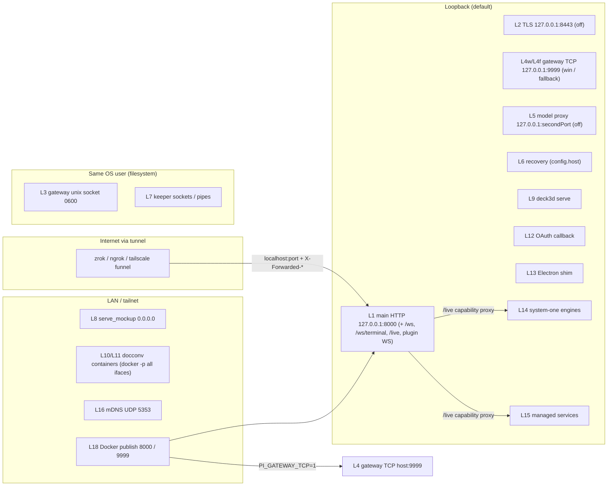
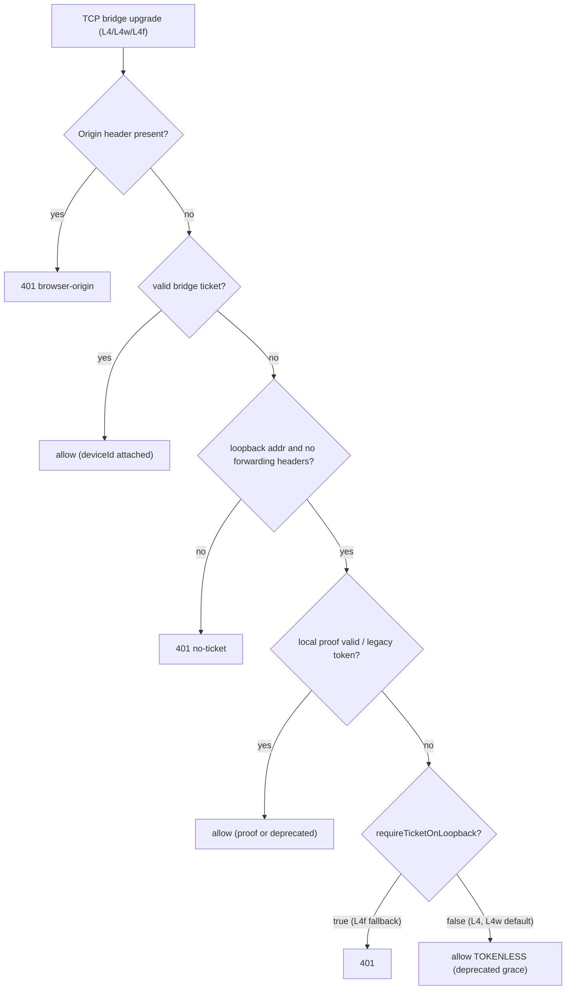

# Network attack surface — listeners, ports, protocols, bind hosts, egress
> Scope: every socket the shipped code opens (TCP/HTTP/WS/TLS/unix/named pipe/UDP multicast), discovery adverts, tunnels, outbound egress · Evidence base: HEAD e54074304 · Mapper: 01-network-surface (prefix NET-) · Map index: [security-map.md](../security-map.md) · Register: [residual-risks.md](residual-risks.md)

## Summary
- Main listener = one Fastify HTTP server. Default `127.0.0.1:8000`. Bind via `listenWithProofFloor` (`packages/server/src/server.ts:5012`, `packages/server/src/auth/local-credential.ts:250-258`). Defaults `packages/shared/src/config.ts:1628` (port 8000), `packages/shared/src/config.ts:1795` (`bindHost: "127.0.0.1"`).
- Port/host chain: `--port` → `PI_DASHBOARD_PORT` → `config.port`; `--host` → `PI_DASHBOARD_HOST` → `config.bindHost` (`packages/server/src/cli.ts:245-249`).
- All browser WS routes (`/ws`, `/ws/terminal/:id`, `/live/…`, plugin `/ws/<seg>/…`) ride the main listener through one `onUpgrade` switch (`packages/server/src/server.ts:4983`). Optional TLS listener shares the same switch (`packages/server/src/tls/tls-listener.ts:234`).
- pi gateway (bridge plane): default POSIX = unix socket `~/.pi/dashboard/gateway-<piPort>.sock`, NO TCP port (`packages/server/src/pi/gateway-transport-policy.ts:50-53`). TCP `:9999` only with `PI_GATEWAY_TCP` opt-in, on Windows (`127.0.0.1`), or when the socket path is too long (`packages/shared/src/dashboard-paths.ts:178-194`).
- TCP bridge upgrades all pass `decideBridgeUpgrade` (`packages/server/src/pi/pi-gateway.ts:1122`). Loopback peers still get a TOKENLESS grace: `requireTicketOnLoopback: false` (`packages/server/src/server.ts:1304`, `packages/server/src/pi/bridge-upgrade-auth.ts:167`) → NET-01.
- Second Fastify for model proxy binds hardcoded `127.0.0.1:<modelProxy.secondPort>`. Runs only `proxyAuthGate`, no network guard (`packages/server/src/server.ts:5049-5081`). Off unless `secondPort` set.
- Non-loopback default binds in shipped code: `serve_mockup` tool binds `0.0.0.0`, no auth (`packages/mockup-loop/src/extension.ts:112`) → NET-02. document-converter publishes Docker containers on all interfaces (`packages/document-converter/engine/document_converter/plantuml_server.py:167`, `pdf_server.py:177`) → NET-03. Docker compose publishes 8000 + 9999 on all host interfaces (`docker/compose.yml:24,28`).
- Discovery: mDNS `_pi-dashboard._tcp` advert, skipped for loopback bind (`packages/shared/src/mdns-discovery.ts:112-129`). mDNS peer browser runs unless `PI_DASHBOARD_NO_MDNS` (`packages/server/src/server.ts:5095,5125`).
- Tunnels (zrok/ngrok/tailscale/zerotier) all forward to `localhost:<dashboard port>`; `tunnel.enabled` defaults `true` (`packages/shared/src/config.ts:1807-1808`) but needs an enrolled provider.
- Egress with operator/agent-controlled URL: `POST /api/providers/test` sends stored or env-var secrets to an arbitrary `baseUrl`; MCP exposes it as `providers_test` → NET-04. Push webhooks have an SSRF guard (`packages/server/src/push/push-transports/webhook-url.ts:38-40,115`).

## Inventory

### A) Listeners

| # | Component | Protocol | Default port | Default bind host | Config key / env var | Reachable from (default) | Auth on this listener | Enabled by default? | Evidence |
|---|---|---|---|---|---|---|---|---|---|
| L1 | Dashboard main server (REST + SPA + `/mcp` + `/auth/*` + `/api/pair/*`) | HTTP | 8000 (`PRODUCTION_DEFAULT_PORT`) | `127.0.0.1` | `--port`/`PI_DASHBOARD_PORT`/`config.port`; `--host`/`PI_DASHBOARD_HOST`/`config.bindHost` | loopback (LAN if bindHost widened; internet via tunnel) | onRequest chain: host gate (`enforce` default) → CORS → mutation-origin gate → bearer → OAuth (cond.) → route-tier gate → universal network guard (jurisdiction `/api/ /v1/ /editor/ /live/`). `/mcp` self-guards with bearer. Pairing prefixes public. See [http-gates-and-routes.md](http-gates-and-routes.md), [websocket-and-bridge.md](websocket-and-bridge.md) | Yes | `packages/server/src/server.ts:5012`; `packages/server/src/cli.ts:199,245-249`; `packages/shared/src/config.ts:1628,1795`; `packages/server/src/server.ts:2261,2307,3641`; `packages/server/src/auth/localhost-guard.ts:517`; `packages/server/src/auth/host-gate.ts:74`; `packages/mcp-server-plugin/src/server/routes.ts:188`; `packages/server/src/routes/pairing-routes.ts:72-79` |
| L1a | Browser WS `/ws` | WS on L1 | 8000 | as L1 | as L1 | as L1 | host gate → `isWsOriginTrusted` → cookie/local-token/CIDR/ticket; identity ticket required when identity enforced | Yes | `packages/server/src/auth/ws-ticket.ts:105`; `packages/server/src/server.ts:4778,4814` |
| L1b | Terminal WS `/ws/terminal/:id` | WS on L1 | 8000 | as L1 | as L1 | as L1 | same gates as L1a + `authorize(termId)` | Yes | `packages/server/src/auth/ws-ticket.ts:106`; `packages/server/src/terminal/terminal-gateway.ts:40,48` |
| L1c | Live preview proxy `/live/<id>/…` (HTTP + WS) → loopback `host:port` or static root | HTTP/WS on L1 | 8000 | as L1 | per-target capability URL | as L1 | network guard + capability token `/live/<id>/~c/<token>/`; upstream target restricted to loopback | Yes (no targets until added) | `packages/server/src/auth/ws-ticket.ts:107`; `packages/shared/src/live-server.ts:87`; `packages/server/src/live-server/live-server-manager.ts:86` |
| L1d | `/ws/bridge` on main port | WS on L1 | 8000 | as L1 | — | — | Always refused 400 (bridge belongs to gateway) | n/a | `packages/server/src/server.ts:4791` |
| L1e | Plugin WS scopes `/ws/browser-ext/<guid>`, `/ws/browser-cdp/<guid>` (browser-plugin) | WS on L1 | 8000 | as L1 | plugin enable | loopback peer only | host gate → pinned `admitOrigins` (`chrome-extension://mmlmfjhmonkocbjadbfplnigmagldckm`) or no-Origin → `isPluginScopePeerLocal` (loopback + loopback Host + no 8 forwarding headers) → single-use relay ticket | When plugin enabled | `packages/server/src/server.ts:4717,4723`; `packages/browser-plugin/src/server/ws-routes.ts:47,97-100,133` |
| L2 | Optional TLS listener (Tailscale cert / ACME DNS-01) | HTTPS/WSS | 8443 | `127.0.0.1` | `config.tls.{enabled,port,host}` | loopback | same request/upgrade dispatch as L1; SNI cert, no session tickets | No (`enabled:false`) | `packages/shared/src/config.ts:630-637`; `packages/server/src/tls/tls-listener.ts:219-250`; `packages/server/src/server.ts:5020` |
| L3 | pi gateway — unix socket | WS over unix socket | n/a (`~/.pi/dashboard/gateway-<piPort>.sock`) | filesystem, dir 0700, socket 0600 | `PI_DASHBOARD_PI_PORT` names the file | same OS user | file mode only (kernel); `decideBridgeUpgrade` short-circuits allow | Yes (POSIX) | `packages/shared/src/dashboard-paths.ts:158`; `packages/server/src/pi/gateway-socket-bind.ts:154-157,170,176`; `packages/server/src/pi/bridge-upgrade-auth.ts:108-110`; `packages/server/src/pi/pi-gateway.ts:1129` |
| L4 | pi gateway — TCP (opt-in) | WS | 9999 (`DEFAULT_GATEWAY_PORT`) | `config.host` (same as L1) | `PI_GATEWAY_TCP=1`/`config.gatewayTcp`; `--pi-port`/`PI_DASHBOARD_PI_PORT`/`config.piPort` | as L1 bind | `verifyClient` → `decideBridgeUpgrade`: any `Origin` → 401; bridge ticket; loopback + local proof/legacy token; loopback tokenless grace (NET-01) | No on POSIX; Yes in Docker (`PI_GATEWAY_TCP:-1`) | `packages/server/src/pi/gateway-transport-policy.ts:20-22,54-58`; `packages/shared/src/config.ts:1629`; `packages/server/src/cli.ts:248`; `packages/server/src/pi/pi-gateway.ts:1122-1175`; `docker/compose.yml:39` |
| L4w | pi gateway — TCP loopback (Windows / long socket path) | WS | 9999 | `127.0.0.1` (pinned unless opt-in) | as L4 | loopback | same as L4, kind `loopback`; tokenless grace applies (NET-01) | Yes on win32 | `packages/shared/src/dashboard-paths.ts:178-194`; `packages/server/src/pi/gateway-transport-policy.ts:60-64`; `packages/server/src/pi/gateway-listeners.ts:34-36` |
| L4f | pi gateway — loopback fallback (socket bind failed: occupied/unsupported) | WS | 9999 | `127.0.0.1` | — | loopback | ticket or local credential REQUIRED (`requireLocalCredential:true`) | Only on socket failure | `packages/server/src/pi/gateway-listeners.ts:56-67`; `packages/server/src/pi/pi-gateway.ts:1309-1314`; `packages/server/src/pi/pi-gateway.ts:1147` |
| L5 | Model-proxy second port (`/v1/*`) | HTTP | none (`secondPort` unset) | `127.0.0.1` hardcoded | `config.modelProxy.secondPort`, `modelProxy.enabled` (default `true`) | loopback | `proxyAuthGate` only (Bearer API key) — no host gate, no network guard | No (needs `secondPort`) | `packages/server/src/server.ts:5049-5083`; `packages/shared/src/config.ts:693-699`; `packages/server/src/model-proxy/auth-gate.ts:39,51` |
| L6 | Recovery server (dependency-missing boot) | HTTP | = `config.port` (8000) | `config.host` (fallback `127.0.0.1`) | as L1 | as L1 | `GET /`, `GET /api/health` unauth; `POST /api/recovery/{retry,reinstall}` need local token OR loopback+loopback Host+no forwarding+same Origin | Only on `ERR_MODULE_NOT_FOUND` | `packages/server/src/cli.ts:310-319`; `packages/server/src/lifecycle/recovery-server.ts:431-458,538`; `packages/server/src/lifecycle/recovery-server.ts:99-124` |
| L7 | rpc-keeper per headless session | unix socket / Windows named pipe | `~/.pi/dashboard/sessions/<id>.rpc.sock` / `\\.\pipe\pi-rpc-<id>` | filesystem | — | same OS user (POSIX); pipe ACL (win) | none beyond file mode 0600 (set after bind) | Per spawned headless session | `packages/server/src/rpc-keeper/keeper.cjs:44-53,203,232-236` |
| L8 | `serve_mockup` agent tool (mockup-loop pi extension) | HTTP static | caller port or ephemeral | `0.0.0.0` | tool params `dir`, `port` | LAN | NONE | On tool call | `packages/mockup-loop/src/extension.ts:75-112,197-212` |
| L9 | `deck3d serve` authoring server (CLI/skill) | HTTP + SSE | `opts.port` or ephemeral | `127.0.0.1` | CLI | loopback | NONE (no Host/Origin/content-type check on POST `/__overrides`, `/__apply`) | On CLI run | `packages/deck3d/src/serve/index.ts:97,401-411,434-446,535` |
| L10 | document-converter PlantUML container | HTTP (docker publish) | random (probe `127.0.0.1:0`) | all host interfaces (`-p <port>:8080`) | — | LAN | NONE | On conversion needing PlantUML | `packages/document-converter/engine/document_converter/plantuml_server.py:27,59,163-168` |
| L11 | document-converter Gotenberg container (`gotenberg/gotenberg:8`) | HTTP (docker publish) | random | all host interfaces (`-p <port>:<CONTAINER_PORT>`) | — | LAN | NONE | On PDF conversion | `packages/document-converter/engine/document_converter/pdf_server.py:29,64,177` |
| L12 | OAuth loopback callback (plugin runtime) | HTTP | ephemeral | `127.0.0.1` | — | loopback | `state` (32 B random) match; GET + exact path only; 300 s timeout | During OAuth flow | `packages/dashboard-plugin-runtime/src/server/loopback-callback.ts:65-67,81-88,127` |
| L13 | Electron browser-host shim | HTTP/WS | ephemeral | `127.0.0.1` | — | loopback | pinned `Origin: chrome-extension://<PLAYWRIGHT_EXTENSION_ID>` + known unclaimed linkId, single claim | Electron, on demand | `packages/electron/src/lib/browser-host/shim.ts:29-31,99-110,140` |
| L14 | system-one engines (`von`/`laya`) spawned by plugin | HTTP | configured | `127.0.0.1` (`--host`, `LAYA_HOST`) | plugin config | loopback | none (engine-native) | When plugin starts engine | `packages/system-one-plugin/src/server/engines.ts:38,47`; `packages/system-one-plugin/src/server/supervisor.ts:342` |
| L15 | Managed services (OCI / native) | service-defined | `allocateLoopbackPort` | OCI: `-p 127.0.0.1::
`; native: port handed to child, child binds | `~/.pi/dashboard/services.json` | loopback (OCI enforced) | service-native | Only if defined | `packages/server/src/services/ports.ts:11-20`; `packages/server/src/services/oci-driver.ts:323` |
| L16 | mDNS responder/browser (`bonjour-service`) | UDP multicast 5353 | 5353 | all interfaces (library default) | `PI_DASHBOARD_NO_MDNS=1` disables | LAN | none (mDNS) | Yes | `packages/shared/src/mdns-discovery.ts:5,48-51`; `packages/server/src/server.ts:5095-5130` |
| L17 | Vendored Playwright `CDPRelayServer.start()` | — | — | — | — | — | Inert: shim `listen()` rejects | No | `packages/browser-plugin/src/server/relay/vendor/playwright-core/src/tools/mcp/cdpRelay.ts:138`; `packages/browser-plugin/src/server/relay/vendor/shims/wsServer.ts:41` |
| L18 | Docker image publishes | TCP | 8000, 9999 | host all-interfaces (8000); `PI_GATEWAY_BIND:-0.0.0.0` (9999) | `DASHBOARD_PORT`, `PI_GATEWAY_PORT`, `PI_GATEWAY_BIND`, `PI_DASHBOARD_HOST:-0.0.0.0` | LAN | as L1 / L4 | Docker only (area [deployment-process-supply-chain.md](deployment-process-supply-chain.md)) | `docker/compose.yml:22-28,39,44`; `docker/Dockerfile:218` |

Not listeners (port probes only, bind+close): `packages/server/src/services/ports.ts:16`, `packages/system-one-plugin/src/server/supervisor.ts:123`, `plantuml_server.py:27`, `pdf_server.py:29`.
No listener: chat-gateway (Discord outbound client only, `packages/chat-gateway/src/adapters/discord.ts:6`), mcp-server-plugin (`/mcp` on L1).

### B) Outbound egress

| # | Origin | Destination | Purpose | Trigger | User-controlled URL? | Guard | Evidence |
|---|---|---|---|---|---|---|---|
| E1 | server | `registry.npmjs.org` (search, metadata) | package browser / install | UI package search (operator) | No (fixed host; query param) | none; no timeout on 2 calls | `packages/server/src/package/npm-search-proxy.ts:5-6,76,118` |
| E2 | server | `raw.githubusercontent.com/<owner>/<repo>/HEAD/package.json` | package metadata | package browser | path segments | fixed host; 10 s timeout | `packages/server/src/package/npm-search-proxy.ts:222-224` |
| E3 | server | custom provider `baseUrl` (`/models`) with `Authorization: Bearer`/`x-api-key`/`?key=` | provider probe | `POST /api/providers/test` (tier `operate`), `PUT /api/providers`; MCP `providers_test` | YES (body `baseUrl`) + key may be `***` (stored) or `$ENV` (server env) | `redirect:"error"`, response scrubbed; NO host/IP restriction | `packages/server/src/routes/provider-routes.ts:573-600`; `packages/server/src/package/provider-probe.ts:75,83,90,131-153,253`; `packages/shared/src/route-tiers.ts:448`; `packages/mcp-server-plugin/src/server/tools.manifest.ts:195` |
| E4 | server | GitHub OAuth, Google issuer, generic OIDC `issuerUrl/.well-known/openid-configuration` + token/userinfo | dashboard login | OAuth configured | operator config (`auth.providers.*.issuerUrl`) | none; no timeout on discovery | `packages/server/src/auth/auth.ts:46-52,62-66,110-116,472` |
| E5 | server | `api.github.com/repos/<RUNTIME_GITHUB_REPO>/releases`, `github.com/.../releases/download`, npm `pack` | runtime overlay update | operator update | No | `.sha512` fetched from same origin (integrity, not authenticity) | `packages/server/src/runtime-overlay/runtime-io.ts:68-72,85,90,108,124-125` |
| E6 | server | Kroki (`KROKI_URL` / `kroki.url` / `https://kroki.io` if `allowRemote`) | diagram render | diagram view | operator config/env | `http(s)://` only; remote off by default; SVG sanitized | `packages/shared/src/config.ts:775-777,832-849`; `packages/server/src/lib/diagram-render.ts:131,161` |
| E7 | server | Web Push endpoints / FCM HTTP v1 / webhooks | push notifications | session attention | YES (registered token/webhook URL; tier `operate`) | `resolveAndVet`: blocks `169.254/16`, `fe80::/10`, `fd00:ec2::254`, self port on loopback; DNS pinned; no redirects. RFC1918 + other loopback ports allowed | `packages/shared/src/config.ts:2101` (`push.enabled` default false); `packages/server/src/push/push-transports/webhook-url.ts:38-60,115`; `packages/shared/src/route-tiers.ts:449-450` |
| E8 | server | Let's Encrypt ACME, Cloudflare API, acme-dns, DoH (`cloudflare-dns.com`, `dns.google`) | TLS cert issuance (DNS-01) | `POST /api/tls/issue` (operate) | ACME directory/solver URL (https only, no credentials) | `https://` enforced | `packages/server/src/tls/sources/acme/entry.ts:11-12,45-59,147`; `packages/server/src/tls/sources/acme/dns.ts:37-38`; `packages/server/src/tls/sources/acme/types.ts:43` |
| E9 | server | `tailscale cert`, zrok/ngrok/tailscale/zerotier control planes (via CLIs) | tunnel + cert | tunnel connect | reserved name/domain | CLI argv, whitelisted enroll steps | `packages/server/src/tls/sources/tailscale-cert.ts:142`; `packages/server/src/tunnel-providers/zrok.ts:382-383` |
| E10 | server | `${publicUrl}/api/health` | tunnel watchdog | interval 60 s | tunnel URL | — | `packages/server/src/tunnel/AGENTS.md` (row `tunnel-watchdog.ts`; lead only) |
| E11 | server | managed-service health `probeHttp` | service health | scheduler | service def | `redirect:"manual"`, timeout | `packages/server/src/services/health.ts:17` |
| E12 | server (dev only) | `http://localhost:{3000,5173,5174}` | Vite proxy | `--dev` | No | dev only | `packages/server/src/server.ts:3737-3759` |
| E13 | server (live preview) | loopback `host:port` targets | preview proxy | user-added target | port only | loopback-only hosts; dashboard `port`,`piPort`,`tls.port` refused | `packages/shared/src/live-server.ts:87`; `packages/server/src/server.ts:1406-1409` |
| E14 | extension (bridge) | unix socket / `ws://<host>:<piPort>`; `PI_DASHBOARD_URL`/`PI_DASHBOARD_SOCKET` pin | bridge→server | session start | env pin | rendezvous file under HOME, server counter-proof | `packages/extension/src/bridge.ts:987-988`; `packages/extension/src/server-auto-start.ts:259`; `packages/shared/src/rendezvous.ts:36-37` |
| E15 | extension | custom provider URL | provider discovery | session start | providers.json | — | `packages/extension/src/provider-register.ts:600` |
| E16 | chat-gateway | Discord gateway/API (discord.js) | chat bridge | plugin enabled | No | — | `packages/chat-gateway/src/adapters/discord.ts:6` |
| E17 | electron | user-entered remote server URL; `localhost` health | remote connect | operator | YES | — | `packages/electron/src/lib/remote-probe.ts`; `packages/electron/src/lib/update-checker.ts:41` |
| E18 | docker helpers | `docker run plantuml/plantuml-server:latest`, `gotenberg/gotenberg:8` | doc conversion | conversion | No | unpinned `:latest` tag (PlantUML) | `packages/document-converter/engine/document_converter/plantuml_server.py:59`; `pdf_server.py:64` |

Agent-side egress (pi tools such as web fetch, `git push/fetch`, npm) runs inside pi session processes, not the server; covered by tool-guard area.

### C) Discovery / advertising

| Mechanism | What it advertises | Default | Guard | Evidence |
|---|---|---|---|---|
| mDNS advert, service type `pi-dashboard` | instance name from SHA-256(fingerprint), port, TXT `version`, `piPort`, `fp` | On unless bind is loopback or `PI_DASHBOARD_NO_MDNS` | `shouldAdvertise` skips `localhost`/`127.x`/`::1` | `packages/shared/src/mdns-discovery.ts:13,112-129,260-271`; `packages/server/src/server.ts:5095-5113` |
| mDNS peer browser (server) | consumes LAN adverts → peer list | On unless `PI_DASHBOARD_NO_MDNS` | own fingerprint filtered | `packages/server/src/server.ts:5122-5130`; `packages/server/src/peer-servers.ts:13,41` |
| mDNS browser (Electron) | LAN server discovery | On | fingerprint pinning (keyring) | `packages/electron/src/lib/server-discovery.ts:17,369` |
| LAN knock pairing `POST /api/pair/request` | device-initiated pairing over plain http | `pairing.acceptLanRequests: false` | `admitKnock` gates; operator types confirm code | `packages/shared/src/config.ts:1842,2827`; `packages/server/src/routes/pairing-routes.ts:76-78` |
| Rendezvous file `~/.pi/dashboard/server.lock.meta.json` | `piPort`, `httpPort`, `instanceId`, `pid` | Always | HOME-owned file; bridge never falls back to network | `packages/shared/src/rendezvous.ts:1-15,36-37` |
| Gateway socket file `~/.pi/dashboard/gateway-<piPort>.sock` | bridge endpoint | POSIX | dir 0700 / socket 0600 | `packages/shared/src/dashboard-paths.ts:158`; `packages/server/src/pi/gateway-socket-bind.ts:154-176` |
| Keeper sockets `~/.pi/dashboard/sessions/<id>.rpc.sock` (+ `.pid`, `.pi-pid`) | per-session RPC endpoint | per headless session | 0600 after bind | `packages/server/src/rpc-keeper/keeper.cjs:44-66,236` |
| `GET /api/tunnel/endpoints` | reachable URLs (tunnel, TLS, manual `publicBaseUrls`) | On L1 | network guard (area [http-gates-and-routes.md](http-gates-and-routes.md)) | `packages/server/src/server.ts.AGENTS.md:92` (lead) |

No raw UDP broadcast / dgram code found (`rg dgram` → none outside `bonjour-service`).

### D) Tunnels / remote access providers

| Provider | Model | What it exposes | Command | Public? | Auth implication | Evidence |
|---|---|---|---|---|---|---|
| zrok (v1/v2) | child process | `localhost:<dashboard port>` (L1 incl. all WS) | `zrok[2] share public --headless [-n public:<name>] localhost:<port>` | Yes (internet) | Requests arrive from loopback WITH forwarding headers → treated remote; relies on `PROXY_FORWARDING_HEADERS` heuristic | `packages/server/src/tunnel-providers/zrok.ts:382-393`; `packages/server/src/auth/localhost-guard.ts:20-33` |
| ngrok | child | `http <port>` | `ngrok http <port> --log stdout --log-format json` | Yes | same as zrok | `packages/server/src/tunnel-providers/ngrok.ts:103` |
| Tailscale | daemon | `localhost:<port>` via `serve` (tailnet) or `funnel` (internet, gated) | `tailscale serve --bg --set-path=/ localhost:<port>` / `tailscale funnel --bg localhost:<port>` | serve: tailnet; funnel: internet | funnel gated by `checkFunnelGates`; disconnect = `serve reset` | `packages/server/src/tunnel-providers/tailscale.ts:278,290,293,321` |
| ZeroTier | daemon | mesh IP `http://<ip>:PORT` (no TLS) | `zerotier-cli join <netid>` | mesh only | reaches L1 directly only if bindHost is non-loopback; pairing gate drops no-TLS endpoint | `packages/server/src/tunnel-providers/AGENTS.md` (row `zerotier.ts`; lead) |

Defaults: `tunnel.enabled: true`, watchdog on 60 s (`packages/shared/src/config.ts:1807-1814`); `--no-tunnel` disables (`packages/server/src/cli.ts:188-189,262`); Docker `TUNNEL_ENABLED:-1` (`docker/compose.yml:49`). Gateway port 9999 is never tunnelled.

## Flows

## Controls detail

| Control | Purpose | Enforcement point | Default | Bypass / exception | Fail mode | Tests |
|---|---|---|---|---|---|---|
| Loopback default bind | keep L1 off LAN | `packages/shared/src/config.ts:1795`; `packages/server/src/cli.ts:249` | `127.0.0.1` | `--host`/`PI_DASHBOARD_HOST`/`bindHost`; Docker forces `0.0.0.0` | n/a | spec `openspec/specs/server-bind-host/spec.md` (lead) |
| Temp-HOME port guard | avoid shadowing prod port | `packages/server/src/cli.ts:218-234` | on | — | ephemeral port | — |
| Gateway listener policy | no TCP bridge port by default | `packages/server/src/pi/gateway-transport-policy.ts:48-65` | unix socket only | `PI_GATEWAY_TCP`; win32; long sun_path | fallback pinned 127.0.0.1 + credential | `packages/server/src/__tests__/gateway-transport-policy.test.ts`, `gateway-listener-wiring.test.ts`, `pi-gateway-bind-host.test.ts` |
| Gateway socket perms | kernel-level entitlement | `packages/server/src/pi/gateway-socket-bind.ts:154-176` | dir 0700, sock 0600 | chmod best-effort (no-op win) | — | `packages/server/src/__tests__/gateway-socket-bind.test.ts` |
| Bridge upgrade auth | authenticate TCP bridges | `packages/server/src/pi/bridge-upgrade-auth.ts:107-189`; `packages/server/src/pi/pi-gateway.ts:1122-1175` | Origin refused; ticket / proof / legacy token / loopback grace | tokenless loopback grace (`server.ts:1304`); L4-forwarder blind spot (comment `bridge-upgrade-auth.ts:126-135`) | refuse before socket (401) | `packages/server/src/__tests__/bridge-upgrade-auth.test.ts` |
| Main-port bridge refusal | stop ticket burn on wrong port | `packages/server/src/server.ts:4791` | on | — | 400 | — |
| WS upgrade gate chain | host → origin → auth for core scopes | `packages/server/src/server.ts:4657-4983` | host gate `enforce` | plugin scopes skip credential branches, own `handleUpgrade` | destroy socket | `packages/server/src/__tests__/host-gate-upgrade.test.ts` |
| Universal network guard | deny-by-default in `/api/ /v1/ /editor/ /live/` | `packages/server/src/auth/localhost-guard.ts:517,757`; `packages/server/src/server.ts:3641` | `trustedNetworks: []` (`config.ts:1838`) | outside jurisdiction: SPA, `/auth`, `/mcp` (self-auth), pairing prefixes | deny | `packages/server/src/__tests__/network-guard-namespace-coverage.test.ts` |
| Forwarded-header relay detection | tunnel ≠ local | `packages/server/src/auth/localhost-guard.ts:27-33,65-70` | 5 headers core / 8 plugin | marker-less forwarders (`ssh -R/-L`, socat) not detected (doc'd `localhost-guard.ts:20-25`) | heuristic | — |
| Model-proxy second port loopback pin | no network policy there | `packages/server/src/server.ts:5049-5081` | `127.0.0.1` hardcoded | none | bind fail → continue | `packages/server/src/__tests__/model-proxy-second-port.test.ts` |
| Recovery action gate | only local operator restarts/reinstalls | `packages/server/src/lifecycle/recovery-server.ts:99-124,455-467` | local token or same-origin loopback | GET routes public | 403 | `packages/server/src/__tests__/recovery-server.test.ts` |
| TLS listener isolation | TLS failure never breaks L1 | `packages/server/src/server.ts:5017-5022`; `packages/server/src/tls/tls-listener.ts:219-262` | off, loopback | `tls.host` configurable | bind retry, log | `packages/server/src/tls/__tests__/tls-listener.test.ts` |
| mDNS honest advert | never advertise loopback-only | `packages/shared/src/mdns-discovery.ts:112-129` | on | — | skip | `packages/shared/src/__tests__/mdns-advertise.test.ts` |
| Live target restriction | preview only loopback, not own ports | `packages/shared/src/live-server.ts:87`; `packages/server/src/live-server/live-server-manager.ts:78-86`; `packages/server/src/server.ts:1406-1409` | on | `secondPort` and other loopback services not in `ownPorts` (NET-11) | reject | `packages/shared/src/__tests__/live-server.test.ts` |
| Webhook SSRF vet | block metadata/link-local/self | `packages/server/src/push/push-transports/webhook-url.ts:38-60,115` | on when push enabled | RFC1918, other loopback ports allowed | refuse | push tests (lead: AGENTS row) |
| Plugin WS peer-local | browser relay only from this host | `packages/server/src/server.ts:4717-4730` | on | — | 403 | browser-plugin tests (lead) |

## Config & env knobs

| Key / env | Default | Effect | Evidence |
|---|---|---|---|
| `config.port` / `PI_DASHBOARD_PORT` / `--port` | 8000 | L1 port | `packages/shared/src/config.ts:1628`; `packages/server/src/cli.ts:245` |
| `config.bindHost` / `PI_DASHBOARD_HOST` / `--host` | `127.0.0.1` | L1 + L4 + L6 bind host | `packages/shared/src/config.ts:1795`; `packages/server/src/cli.ts:249` |
| `config.piPort` / `PI_DASHBOARD_PI_PORT` / `--pi-port` | 9999 | gateway port / socket filename | `packages/shared/src/config.ts:1629`; `packages/server/src/cli.ts:248` |
| `PI_GATEWAY_TCP` / `config.gatewayTcp` | unset (off) | adds TCP gateway on bindHost | `packages/server/src/pi/gateway-transport-policy.ts:20-22`; `packages/server/src/server.ts:3972` |
| `requireTicketOnLoopback` (code constant) | `false` | tokenless loopback bridge grace | `packages/server/src/server.ts:1304` |
| `PI_DASHBOARD_HOST_GATE` / `hostGate.mode` | `enforce` | Host admission | `packages/server/src/auth/host-gate.ts:69-75` |
| `trustedNetworks` | `[]` | CIDR admission | `packages/shared/src/config.ts:1838` |
| `tls.enabled/port/host` | `false` / 8443 / `127.0.0.1` | L2 | `packages/shared/src/config.ts:630-637` |
| `modelProxy.enabled` / `secondPort` | `true` / unset | `/v1` on L1; L5 when port set | `packages/shared/src/config.ts:693-699`; `packages/server/src/server.ts:5059` |
| `tunnel.enabled` / `--no-tunnel` | `true` | tunnel autoconnect (needs enrolled provider) | `packages/shared/src/config.ts:1807-1808`; `packages/server/src/cli.ts:262` |
| `PI_DASHBOARD_NO_MDNS` | unset | disables advert + browser | `packages/server/src/server.ts:5094-5095` |
| `pairing.acceptLanRequests` | `false` | LAN knock pairing | `packages/shared/src/config.ts:1842` |
| `push.enabled` | `false` | push egress | `packages/shared/src/config.ts:2101` |
| `kroki.url` / `KROKI_URL` / `kroki.allowRemote` | unset / unset / `false` | diagram egress | `packages/shared/src/config.ts:775-777,843-847` |
| `PI_DASHBOARD_URL` / `PI_DASHBOARD_SOCKET` (bridge) | unset | pins bridge endpoint | `packages/extension/src/bridge.ts:987-988` |
| Docker `PI_DASHBOARD_HOST`, `PI_GATEWAY_TCP`, `PI_GATEWAY_BIND`, `TUNNEL_ENABLED` | `0.0.0.0`, `1`, `0.0.0.0`, `1` | container exposure | `docker/compose.yml:28,39,44,49` |

## Test/dev-only

| Listener | Bind | Evidence |
|---|---|---|
| Vite dev server (client) | Vite default host, port 3000; proxies `/api`, `/ws` to dashboard | `packages/client/vite.config.ts:205-216` |
| Dashboard `--dev` proxy probe of 3000/5173/5174 | n/a (egress) | `packages/server/src/server.ts:3737-3767` |
| `assert-bundled-server-plugin-load.mjs` | `127.0.0.1:0` | `packages/electron/scripts/assert-bundled-server-plugin-load.mjs:196` |
| system-one fake engine fixture | `127.0.0.1` | `packages/system-one-plugin/src/server/__tests__/fixtures/fake-engine.mjs:50` |
| `test-support/raw-http-client.ts` | `port: 0` | `packages/server/src/test-support/raw-http-client.ts:4` |

## Findings

| ID | Sev | Title | Evidence (path:line) | Impact | Suggested remedy |
|---|---|---|---|---|---|
| NET-01 | Medium | Gateway TCP accepts TOKENLESS loopback bridges (deprecation grace) on default Windows listener and on `PI_GATEWAY_TCP` listener | `packages/server/src/server.ts:1304`; `packages/server/src/pi/bridge-upgrade-auth.ts:167-175`; `packages/shared/src/dashboard-paths.ts:178-183`; `packages/server/src/pi/gateway-listeners.ts:34-36` | Any local process (any OS user on Windows; any process in the container with Docker TCP default) registers an arbitrary `sessionId`, can displace a live bridge and receive `send_prompt`/`set_model`. Doc/policy text says win32 is "authorised by the local token" — code accepts without it. Browser pages blocked by Origin refusal | Flip `requireTicketOnLoopback` to `true` (planned for 1.0.0 per `bridge-upgrade-auth.ts:173`); at minimum for `kind:"loopback"` (win32) as already done for `loopback-fallback` |
| NET-02 | Medium | `serve_mockup` binds `0.0.0.0`, no auth, agent picks any directory | `packages/mockup-loop/src/extension.ts:112`; `packages/mockup-loop/src/extension.ts:197-212` | LLM/agent (incl. prompt-injected) can publish e.g. `~` or a repo with `.env` to the whole LAN; no Host check (DNS rebinding), no dotfile filter; server lives until stopped | Default bind `127.0.0.1`, LAN opt-in flag; random path token; deny dotfiles/credential names; confine `dir` to cwd |
| NET-03 | Medium | document-converter publishes PlantUML and Gotenberg containers on all host interfaces | `packages/document-converter/engine/document_converter/plantuml_server.py:167`; `packages/document-converter/engine/document_converter/pdf_server.py:177` | `-p <port>:8080` binds 0.0.0.0 (Docker bypasses host firewall rules). LAN peers get unauth Gotenberg (headless Chromium HTML→PDF — SSRF into host network) and PlantUML. Container persists across invocations | Use `-p 127.0.0.1:<port>:<cport>`; pin PlantUML image digest instead of `:latest` (`plantuml_server.py:59`) |
| NET-04 | Medium | `POST /api/providers/test` sends stored provider keys or any server env var to caller-chosen URL (SSRF + secret exfil); exposed via MCP `providers_test` | `packages/server/src/routes/provider-routes.ts:573-600`; `packages/server/src/package/provider-probe.ts:131-153,253`; `packages/shared/src/route-tiers.ts:448`; `packages/mcp-server-plugin/src/server/tools.manifest.ts:195`; `packages/mcp-server-plugin/src/server/tokens.ts:46` | Operate-tier paired device (or MCP session token, tier `control`) sets `baseUrl=https://attacker` + `apiKey="$ANTHROPIC_API_KEY"` or `"***"`+`name` → secret in `Authorization`/`x-api-key`/`?key=`. Also blind GET SSRF to internal/metadata hosts. Same-user agent already has env access (lower marginal impact); remote operate devices do not | Resolve `***`/`$ENV` only when `baseUrl` equals the saved provider's `baseUrl`; restrict `$ENV` to an allowlist; block link-local/metadata as in `webhook-url.ts`; consider control tier + denylist in MCP |
| NET-05 | Low | Docker defaults publish 8000 (all interfaces) and 9999 (`0.0.0.0`), TCP gateway on, tunnel on | `docker/compose.yml:24,28,39,44,49`; `docker/Dockerfile:218` | Container is LAN-reachable by default; protection rests entirely on L1 auth and NET-01-free bridge auth. Detail → [deployment-process-supply-chain.md](deployment-process-supply-chain.md) | Default publish to `127.0.0.1`; document LAN opt-in |
| NET-06 | Low | L4 forwarders (ssh -L/-R, socat, possibly Docker userland proxy) indistinguishable from local callers | `packages/server/src/pi/bridge-upgrade-auth.ts:126-137`; `packages/server/src/auth/localhost-guard.ts:20-25` | Combined with NET-01 grace, a forwarded remote peer is admitted as loopback. Code-acknowledged ("KNOWN BLIND SPOT"). Docker userland-proxy case: Needs verification (proxy normally presents bridge-gateway IP, not 127.0.0.1) | Remove tokenless grace (NET-01); strict trust mode requires local proof |
| NET-07 | Low | Recovery server serves error text + install layout unauthenticated on configured host | `packages/server/src/lifecycle/recovery-server.ts:433-453`; `packages/server/src/cli.ts:313-319` | On non-loopback bind (Docker `0.0.0.0`) LAN peers read error messages, missing module, filesystem layout. Mutating actions are gated | Gate GET on same predicate or redact layout/paths for non-loopback peers |
| NET-08 | Low | `deck3d serve` write endpoints lack Origin/Host/content-type checks | `packages/deck3d/src/serve/index.ts:401-411,445-499` | Any web page open in the author's browser can POST `text/plain` JSON to `127.0.0.1:<port>/__apply` (CSRF / DNS rebinding) → overwrite deck overrides (validated, confined to deck dir) | Require `Content-Type: application/json` + same-origin `Origin` + loopback `Host` |
| NET-09 | Low | rpc-keeper socket perms set after bind; sessions dir created without explicit mode; Windows pipe uses default ACL | `packages/server/src/rpc-keeper/keeper.cjs:45-46,232-236,51-53` | Brief window where socket has umask perms; any connector writes RPC lines to pi stdin (no auth on the socket). Windows named-pipe default DACL breadth: Needs verification | Create dir 0700 explicitly (as `gateway-socket-bind.ts:155-157`); set umask before listen; explicit pipe ACL |
| NET-10 | Low | Push webhook vet allows RFC1918 and non-self loopback ports | `packages/server/src/push/push-transports/webhook-url.ts:38-60,115` | Operate-tier caller registers webhook → blind POST to LAN/loopback services on each trigger (push off by default) | Optional private-range block, operator allowlist |
| NET-11 | Low | Live preview `ownPorts` omits model-proxy `secondPort` and other loopback-only listeners (L9–L15) | `packages/server/src/server.ts:1406-1409`; `packages/shared/src/live-server.ts:87` | A user-added target re-exposes loopback-only services (no-auth engines, managed services) to remote paired devices via capability URL | Add `modelProxy.secondPort` to `ownPorts`; warn when target port belongs to a known managed service |
| NET-12 | Info | mDNS browser listens on LAN even for loopback-bound servers; advert TXT carries `piPort` even when no TCP gateway exists | `packages/server/src/server.ts:5122-5130`; `packages/shared/src/mdns-discovery.ts:270` | Untrusted LAN adverts parsed into peer list (fingerprint-keyed); stale `piPort` hint | Skip browser when bind is loopback unless UI needs it; omit `piPort` when TCP gateway off |
| NET-13 | Info | Research doc claims ":9999 pi gateway has NO auth" — stale | `docs/research/bridge-transport-and-identity.md:109-117` vs `packages/server/src/pi/pi-gateway.ts:1122`, `packages/server/src/pi/gateway-transport-policy.ts:48-58` | Doc-code mismatch; current code authenticates TCP upgrades (except NET-01 grace) and defaults to unix socket | Mark doc superseded |
| NET-14 | Info | Several egress fetches lack timeouts | `packages/server/src/auth/auth.ts:64`; `packages/server/src/package/npm-search-proxy.ts:76,118` | Slow/hostile IdP or registry can hang request handlers / boot provider registry | Add `AbortSignal.timeout` |
| NET-15 | Info | Runtime overlay checksum fetched from same origin as artifact | `packages/server/src/runtime-overlay/runtime-io.ts:124-125` | Integrity vs corruption only, not authenticity (GitHub account compromise) → supply-chain area | Signed releases / pinned key |
| NET-16 | Info | Model-proxy second port has no network guard — safe only by hardcoded loopback | `packages/server/src/server.ts:5049-5056,5081` | Documented invariant; regression if host ever made configurable | Keep test `model-proxy-second-port.test.ts`; install guard if host becomes configurable |
| NET-17 | Info | `--dev` serves SPA from whatever local process answers on 3000/5173/5174 | `packages/server/src/server.ts:3739-3759` | Dev-only: a local squatter supplies dashboard JS | Dev-only; document |
