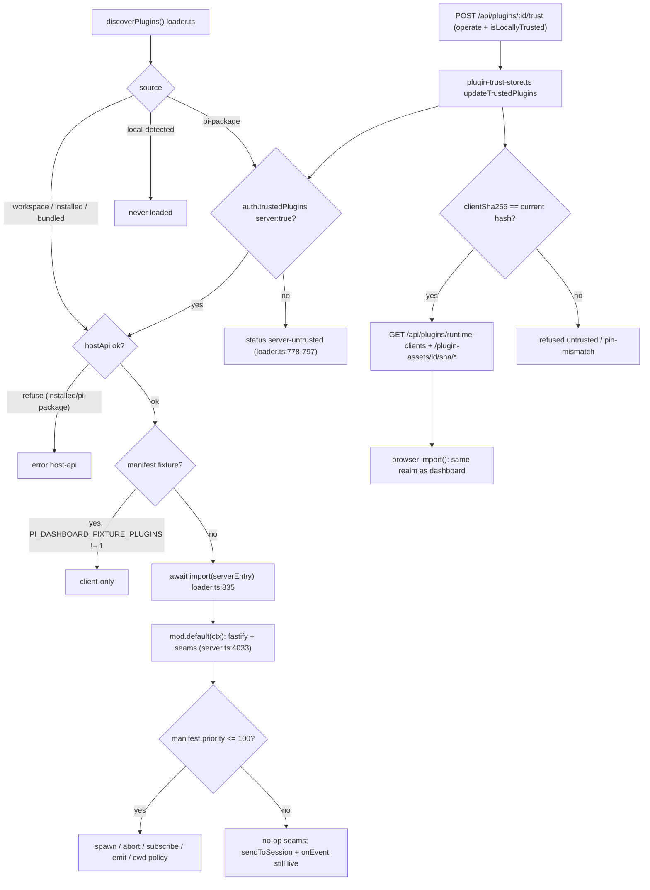
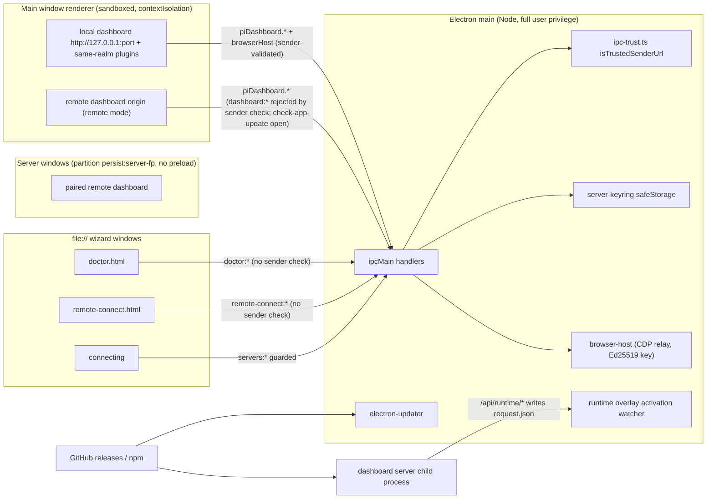

# Plugin trust model · Web client (browser-side) · Electron shell
> Scope: dashboard plugin discovery/trust/runtime, browser-side rendering sinks + isolation + credential storage, Electron windows/IPC/navigation/updates/signing · Evidence base: HEAD e54074304 · Mapper: 06-plugins-client-electron · Map index: [security-map.md](../security-map.md) · Register: [residual-risks.md](residual-risks.md)

## Summary
- Server plugin entry = in-process ESM `import()` into the dashboard Node process. No sandbox, no worker, no VM. `packages/dashboard-plugin-runtime/src/server/loader.ts:835`.
- Plugin context hands the raw Fastify instance to every plugin. `packages/server/src/server.ts:4033-4035`. Plugin = full server privilege (fs, env, child_process, all routes, `auth.json`).
- In-process "trust" gates (`priority <= 100`, first-party npm scope, credential namespaces) = cooperative policy, not isolation. Plugin-authored `priority` decides spawn/abort/subscribe rights. `packages/server/src/server.ts:4127`, `packages/server/src/spawn-process/spawn-env-contributors.ts:46-48`.
- Real trust boundary = WHICH code loads: `workspace`/`installed`/`bundled` server entries load with no grant; `pi-package` server entry + bridge default-deny until local `{server:true}` grant. `loader.ts:577-583`, `loader.ts:778-797`.
- Runtime client bundles (`clientBundle`) = same-realm, same-origin JS in the dashboard page. Gate = `auth.trustedPlugins[].clientSha256` pin, granted only by `operate` + genuinely-local request. `runtime-client-registry.ts:168-169`, `routes/plugin-runtime-client-routes.ts:119-125`.
- Browser sinks: markdown via `rehype-raw → rehype-sanitize(MARKDOWN_SCHEMA)`; every `dangerouslySetInnerHTML` routed through DOMPurify `pi-sanitized-html` policy; CI sink linter `scripts/check-client-sinks.mjs`. Trusted Types + strict CSP default = `report` only (not enforced). `packages/server/src/auth/csp.ts:83-92`.
- Untrusted HTML runs only in opaque-origin sandboxed iframes (live preview, HTML preview, e-mail, craft apps). `allow-same-origin` never emitted. `lib/live-preview/preview-policy.ts:26-31`.
- Electron: all 6 window kinds `contextIsolation:true`, `nodeIntegration:false`; sandbox explicit on doctor/connecting/server windows, Electron 44 default elsewhere. Privileged `dashboard:*` + `servers:*` + browser-host IPC validate `senderFrame`. `doctor:*` / `remote-connect:*` handlers do not.
- Main window (local + remote dashboard content) has NO permission request handler → Electron default grants. Server windows have an allowlist. `lib/server-windows.ts:85-90,575-576`.
- Desktop binaries unsigned (mac + win); runtime overlay `github` source = sha512 from same release (integrity, not authenticity); no Electron fuses; RunAsNode used intentionally on a fallback path.

## Inventory

### A1. Plugin discovery sources + default trust
| Source | Location | Server entry / bridge default | Client default | Enforcement path:line |
|---|---|---|---|---|
| `workspace` | `<repo>/packages` | loads, no grant | build-time bundled (core bundle) | `loader.ts:577-580` (`source !== "pi-package"` → allowed) |
| `installed` | `~/.pi/dashboard/plugins` | loads, no grant | runtime client needs pin | `loader.ts:172-176`, `loader.ts:580` |
| `bundled` | `resources/plugins` (Electron) | loads, no grant | build-time bundled | `loader.ts:580` |
| `pi-package` | `~/.pi/agent/settings.json#packages[]` | DENIED `server-untrusted` until `{server:true}` | runtime client needs pin | `loader.ts:574`, `loader.ts:581-582`, `loader.ts:778-797`, `auth/plugin-server-trust.ts:17-29` |
| `local-detected` | `<cwd>/.pi/settings.json#packages[]` | never loaded | never loaded | lead: `docs/architecture.md` "Local-scope detection" (not re-verified) |
| fixture (`manifest.fixture:true`) | any | server entry skipped unless `PI_DASHBOARD_FIXTURE_PLUGINS=1` | — | `dashboard-plugin-runtime/src/server/fixture-gate.ts:14-25`, `loader.ts:802` |

### A2. Plugin capability table
| Plugin capability | Who grants | Enforcement path:line | Runs where | Isolation boundary |
|---|---|---|---|---|
| Server entry execution (`mod.default(ctx)`) | auto (workspace/installed/bundled); local operator for `pi-package` | `loader.ts:835-839` | dashboard server process | NONE — same Node process, same uid |
| Raw `fastify` instance (`ctx.fastify` path) | auto with server entry | `server.ts:4035` | server process | none; plugin may register any route (hot-add refused after listen per arch doc) |
| `spawnSession` / `abortSession` / `shutdownSession` / `abortSpawnedRun` / `registerCwdPolicy` / `holdCwdDenial` / session-close hooks | manifest `priority <= 100` (plugin-authored) | `server.ts:4126-4130`, `server.ts:4247-4248`, `server.ts:4256`, `server.ts:4269`, `server.ts:4287`, `server.ts:4296`, `server.ts:4306` | server process | policy only |
| `subscribeSession` (in-process session stream + pending prompts) | `priority <= 100` | `server.ts:4089` | server process | policy only |
| `emitEventToSession` (into pi.events) | `priority <= 100` + manifest `emits` allowlist | `server.ts:4436-4452` | server → bridge → pi | policy only |
| `sendExtensionMessage` (raw control msg to bridge) | `priority <= 100` | `server.ts:4456-4461` | server → bridge | policy only |
| `sendToSession` (send prompt / `/command`) | NO gate (any loaded plugin) | `server.ts:4120-4121` | server → pi | none |
| `registerPiHandler` / `onEvent` / `onSessionEnded` | NO gate | `server.ts:4097-4109` | server process | none (sees all forwarded events) |
| `providerAuth.getCredential` (provider OAuth/API creds from `auth.json`) | npm name prefix `@blackbelt-technology/` | `dashboard-plugin-runtime/src/server/first-party.ts:13-38`, `server.ts:4550` | server process | policy only; in-process code can read `auth.json` directly |
| `ctx.credentials` (per-plugin namespace in `~/.pi/agent/plugin-credentials.json`) | auto | `auth/plugin-credential-store.ts` (sidecar `plugin-credential-store.ts.AGENTS.md`) | server process | API namespacing only, file shared |
| `registerPrincipalResolver` | config `identity.trustedResolverPlugins` | `server.ts:724`, `server.ts:4569` | server process | config allowlist |
| `registerHostAccessPolicy` | config `identity.trustedPolicyPlugin` | `server.ts:753`, `server.ts:4587` | server process | config allowlist |
| `serveApp` mount `/apps/<appId>/` | bundled (path-contained) ∨ `auth.trustedPlugins` ∨ legacy `auth.capabilityRoutePlugins` | `auth/serve-app-host.ts:89`, `server.ts:4424` (`createHostServeApp`) | browser, served by server | app CSP per plugin (`app-mount.ts:188`) |
| Private request lane (`plugin_request`→`plugin_reply`) | auto (`registerPiRequestHandler`) | `packages/server/src/plugin-request-lane.ts:21`, `:30`, `:57-84` | bridge (pi process) → server | sessionId from socket key; payload NOT authenticated |
| Bridge entry (`dashboard:plugin-message`, `dashboard:enqueue-followup`) | auto for non-`pi-package`; `{server:true}` for `pi-package` | `loader.ts:778-797` | pi process (agent privileges incl. shell) | none vs pi |
| Runtime client bundle (`clientBundle`) | local operator pin `clientSha256` | `runtime-client-registry.ts:168-169`; loader `packages/client/src/lib/plugins/runtime-plugin-loader.ts:136-138` (`import(url)`) | browser, SAME realm/origin as dashboard | NONE in page; hash pin only |
| Build-time client (`client` in workspace/bundled) | auto (compiled into SPA) | vite plugin `dashboard-plugin-runtime/src/vite-plugin/index.ts:649` | browser same realm | none |
| Enable/disable | `operate` tier | `shared/src/route-tiers.ts:427` (`POST /api/plugins/:id/toggle`) | config | restart-required to unload |
| Trust grant | `operate` + `isLocallyTrusted` | `route-tiers.ts:429`, `routes/plugin-runtime-client-routes.ts:119-125` | config `auth.trustedPlugins` | local-only |
| Trust revoke | `operate` | `route-tiers.ts:83`, `routes/plugin-runtime-client-routes.ts:137` | config | — |

Direct statements:
- Server plugin code runs in-process with full server privileges: YES (`loader.ts:835`, `server.ts:4035`).
- Client plugin bundles run same-realm JS: YES — build-time claims and runtime `clientBundle` both. `runtime-plugin-loader.ts:138`. Doc confirms: `docs/untrusted-plugin-ui-gap.md` "Same-realm JS = no security boundary".
- Only browser-enforced boundary for plugin UI = sandboxed opaque-origin iframe (craft-web `/apps/craft-*`). `packages/craft-web-plugin/src/client/CraftFrame.tsx:141`.

### A3. Security-relevant plugins (privilege one-liners)
All below: npm scope `@blackbelt-technology/` (first-party for `providerAuth`), `clientBundle:false` (build-time client). Priority from `package.json#pi-dashboard-plugin`.
| Plugin (id, priority) | Halves | Privilege held |
|---|---|---|
| `browser` (500) | server+bridge+client | Drives Chrome via CDP: dedicated dashboard profile or relay into user's logged-in Chrome (vendored Playwright relay); per-profile SSO tokens. `priority>100` → no spawn/subscribe seams. |
| `gmail` (210) | server+bridge+client | Google OAuth refresh tokens per account; server-side token leasing; agent Gmail tools (writes confirmed). |
| `mcp-client` (100) | server+client | Reads/writes pi MCP config (`mcp.json` global + trusted-folder) → defines commands pi launches. Trusted seams. |
| `mcp-server` (100) | server | Exposes `POST /mcp` MCP endpoint over dashboard; mints session tokens delivered via `sendExtensionMessage`. Trusted seams. |
| `chat-gateway` (100) | server+client | Inbound Discord control plane → drives sessions (`subscribeSession`, `sendToSession`, `shutdownSession`); bot token. |
| `craft-web` (400) | server+bridge+client | `serveApp` mounts `/apps/craft-<app>/`; third-party WASM editors in `sandbox="allow-scripts"` iframe; saves files to disk. |
| `web-access` (—) | client only | Renders `web-search-results` entries; plain text + safe links (`packages/web-access-plugin/src/client/WebSearchEntryCard.tsx:14`). |
| `system-one` (200) | server+client | `/api/system-one/*`; model backend API keys; supervises local Von/Laya processes. |
| `automation` (100) | server+bridge+client | Cron scheduler spawning headless pi sessions (`spawnSession`, `abortSpawnedRun`); reads `.pi/automation/*.yaml`. |
| `goal` (100) | server+bridge+client | Session supervisor: spawns/resumes/kills driver sessions; `mintSpawnToken`. |
| `flows` (100) | server+bridge+client | Reacts to `flow_*` events; flow architect UI; trusted seams. |
| `team` (100) | server+client | Persistent per-user AI agents; spawns sessions; same-origin app `/apps/team/`; operate-tier `/api/plugins/team/*` (`route-tiers.ts:87-90,195-203`). |
| `keycloak-resolver` (100) | server | Validates Keycloak JWTs → `(iss,sub)` principal; active only if listed in `identity.trustedResolverPlugins`. |
| `apple-tools` (100) | server+client | Provisions iMCP (Calendar/Contacts/Messages/Location) into pi MCP; writes plugin config path. macOS. |
| `obs-studio` (215) | server+client | Installs/controls OBS + obs-websocket managed service; `pi-obs` CLI; scene/record/virtual-camera. |
| `fixture-policy` (100) | server (fixture) | TEST FIXTURE: host access policy allow-list; server entry loads only with `PI_DASHBOARD_FIXTURE_PLUGINS=1` + `identity.trustedPolicyPlugin`. |
| `blackhole` (200) | server+client | Settings UI for `pi-blackhole` extension (memory pipeline); `GET`/`PUT /api/plugins/blackhole/config` writes `<agentDir>/pi-blackhole/pi-blackhole-config.json`. Renders extension-authored entries without `dangerouslySetInnerHTML` (`packages/blackhole-plugin/src/client/OmEntryCard.tsx:20`). |

### B1. Browser rendering sinks
| Sink | File:line | Input source | Sanitizer | Notes |
|---|---|---|---|---|
| ReactMarkdown + `rehype-raw` | `packages/client/src/components/preview/MarkdownContent.tsx:630-631`, `:656-658` | agent output, tool results, READMEs, flow detail | `rehype-sanitize` `MARKDOWN_SCHEMA` (`markdown-sanitize.ts:15`) after raw, before KaTeX | `urlTransform={safeUrlTransform}` `:737`; svg/math/iframe/style/object/embed stripped |
| KaTeX (markdown) | `MarkdownContent.tsx:658` | math in markdown | runs after sanitize; KaTeX output not re-sanitized | KaTeX `trust` not set (default false) — Needs verification |
| Mermaid SVG `dangerouslySetInnerHTML` | `components/preview/MermaidBlock.tsx:1041` | diagram source from agent/docs | DOMPurify `MERMAID_SVG_PROFILE` `:114`, `:193` | `mermaid-config.ts:15` `secure` keys; `htmlLabels:true` `:19`; `securityLevel` unset → mermaid default `strict` |
| Kroki diagram SVG | `components/preview/DiagramPreview.tsx:151` | server-rendered diagram | `trustedSanitizedHtml(.., "diagram-svg")` `:99` | — |
| DOCX HTML | `components/preview/DocxPreview.tsx:114` | file → server HTML | server DOMPurify + client `trustedSanitizedHtml(.., "docx")` `:62` | — |
| AsciiDoc HTML | `components/preview/AsciiDocPreview.tsx:156` | file → server HTML | server DOMPurify + `trustedSanitizedHtml` | math via `lib/preview/adoc-math.ts:32,48` (sanitized) |
| E-mail body `srcdoc` | `components/preview/EmlPreview.tsx:71`, iframe `:185` | `.eml` file | `trustedEmlSrcDoc` (DOMPurify `eml`) | `sandbox=""` — no scripts, opaque origin; headers as text nodes |
| HTML file preview | `components/preview/HtmlPreview.tsx:5-6` → `LiveFrame` | local `.html` | none (isolation instead) | capability URL iframe; never `srcdoc`, never `allow-same-origin` |
| Live preview iframe | `components/editor-pane/live/LiveFrame.tsx:86`, `:184` | agent/user loopback app or static root | isolation: `sandboxFor()` `lib/live-preview/preview-policy.ts:26-31` + server response CSP `sandbox` | see B2 |
| Craft app iframe | `packages/craft-web-plugin/src/client/CraftFrame.tsx:141` | third-party WASM editor + user file | isolation `sandbox="allow-scripts"` | host checks `e.source === frame.contentWindow` `frame-session.ts:259`; posts with `"*"` `:196` (required for opaque origin) |
| YouTube embed | `components/preview/YouTubePreview.tsx:50-53` | id from URL | `encodeURIComponent(id)` | cross-origin youtube.com; no `sandbox` attr |
| Team-app static SVG | `packages/team-app/src/ui/icons.tsx:14`, `:41` | static assets | `trustedStaticSvg` | linter pins helper to this file |
| Electron Doctor / remote-connect HTML | `packages/electron/src/renderer/doctor.html:133,168,174`; `remote-connect.html:295` | doctor results, server list | `escapeHtml()` / `esc()` + page TT policy + meta CSP `require-trusted-types-for 'script'` (`doctor.html:6`, `remote-connect.html:5`) | bundled `file://` pages |
| `deck3d` harvest `innerHTML` | `packages/deck3d/src/parse/harvest/harness.ts:160` | svg in harness | none | harvest harness, not dashboard SPA (outside linter roots) |
| Unused restrictive-CSP helper | `packages/client/src/lib/canvas/canvas-doc-csp.ts:50` (`withRestrictiveCsp`) | — | — | no production caller (only test) |

Sink guard: `scripts/check-client-sinks.mjs` (CI step + ship-it gate per sidecar) bans `dangerouslySetInnerHTML`/`srcdoc`/`innerHTML`/`eval`/`new Function`/nav sinks outside allowlist or `// client-sinks: allow — <reason>`. Roots: `packages/client/src`, `client-utils`, `*-plugin/src/client`, `dashboard-plugin-runtime/src` (non-server), `team-app/src`. Test `scripts/__tests__/client-sinks.test.mjs`.

### B2. Iframe isolation matrix
| Frame | sandbox tokens | Origin | Response CSP | path:line |
|---|---|---|---|---|
| Live/HTML preview, open + scripts | `allow-scripts allow-forms allow-popups allow-downloads` | opaque | `sandbox …; object-src 'none'; frame-ancestors 'self'` (arch lead) | `preview-policy.ts:28-29` |
| Live/HTML preview, restricted + scripts | `allow-scripts allow-forms` | opaque | `sandbox` + `default-src 'none'` + egress allowlist | `preview-policy.ts:30` |
| Live/HTML preview, scripts off | `""` | opaque | `sandbox` | `preview-policy.ts:27` |
| E-mail | `""` | opaque (srcdoc) | inherits | `EmlPreview.tsx:185` |
| Craft app | `allow-scripts` (+`allow="clipboard-write"`) | opaque in frame | `default-src 'none'; script-src <mount> 'wasm-unsafe-eval'; connect-src <mount> blob:; frame-ancestors 'self'` — NO `sandbox` directive | `craft-web-plugin/src/server/csp.ts:39-52`; header set `dashboard-plugin-runtime/src/server/app-mount.ts:188`; `ACAO: *` `:192` |

### B3. Browser credential + PWA storage
| Item | Store | Key | Scope / notes | path:line |
|---|---|---|---|---|
| Same-origin device credential | httpOnly `SameSite=Strict` cookie `pi_dash_device` (path `/api/`) | — | bearer exchanged once, only paired MARKER in localStorage | `client/src/lib/pairing/device-auth.ts:16-20` |
| Cross-origin device bearer | `localStorage` | `pi-dashboard:device-bearer:<apiOrigin>` JSON `{token,expiresAt}` | readable by any same-realm JS | `device-auth.ts:41`, `:57`, `:121`, `:136` |
| Paired marker | `localStorage` | `pi-dashboard:device-paired` | non-secret | `device-auth.ts:42`, `:70` |
| WS auth | short-lived single-use ticket `POST /api/ws-ticket`; bearer never on WS | — | — | `device-auth.ts:12-13` |
| Local proof cookie | httpOnly `pi_dash_local`, `sameSite:"strict"` | — | — | `packages/server/src/routes/local-proof-routes.ts:40` |
| Push subscription id | `localStorage` | `pi-dashboard.push.tokenId` | id only | `client/src/hooks/usePushSubscription.ts:37`, `:123` |
| Service worker | `/sw.js` scope `/` | — | network pass-through for `/api/`, `/plugin-assets/`, `/host/`; push → `openWindow(payload.url)` unvalidated | `client/src/lib/boot/client-boot.ts:19`; `public/sw.js:13`, `:50-57` |
| Fetch wrapper | global `fetch` adds `Authorization: Bearer` to same-origin `/api/*`,`/v1/*` | — | — | `device-auth.ts:9-11` |

### C1. Electron BrowserWindow webPreferences
| Window | contextIsolation | nodeIntegration | sandbox | webviewTag | partition | preload | path:line |
|---|---|---|---|---|---|---|---|
| Splash | true | false | default (Electron 44 → true) | default false | default | none | `packages/electron/src/main.ts:361-370` |
| Main (loading page, local dashboard, remote dashboard) | true | false | default (→ true) | default | default session | `preload-main` (`piDashboard`) | `main.ts:605-617` |
| Doctor | true | false | `true` | default | default | `preload.ts` → `doctor-preload` | `lib/doctor-window.ts:178-187` |
| Connecting | true | false | `true` | default | default | `connecting-preload` | `lib/connecting-window.ts:34-44` |
| Remote-connect | true | false | default (→ true) | default | default | `preload.ts` (remote-connect bridge) | `lib/remote-connect-window.ts:134-142` |
| Server window (per paired server) | true | false | `true` | `false` | `persist:server-<32hex>` / in-memory (`partitionFor`) | none | `lib/server-windows.ts:498`, `lib/server-discovery.ts:64` |

Electron version pinned `44.9.0` (`packages/electron/package.json:34`). No `sandbox:false`, `--no-sandbox`, `webSecurity:false`, `allowRunningInsecureContent` in `src/` (rg, non-test). `--no-sandbox` only in Docker test scripts (`scripts/test-deb-install-inner.sh:93`).

### C2. IPC surface
| Channel | Kind | Exposed via | Sender validation | path:line |
|---|---|---|---|---|
| `dashboard:request-launch` | handle | `piDashboard.requestLaunch` | `trustedHandler` + `isTrustedSender` | `main.ts:471` |
| `dashboard:navigate-to-server` | handle | `piDashboard.navigateToServer` | `trustedHandler` | `main.ts:480` |
| `dashboard:read-server-log` | handle | `piDashboard.readServerLog` | `trustedHandler` | `main.ts:488` |
| `dashboard:probe-server` | handle | `piDashboard.probeServer` | `trustedHandler` | `main.ts:501` |
| `dashboard:open-doctor` | on | `piDashboard.openDoctor` | `trustedListener` | `main.ts:511` |
| `dashboard:check-app-update` | handle | `piDashboard.checkAppUpdate` | NONE (documented: remote page can only trigger a check) | `main.ts:493-498` |
| `servers:list` | handle | main(local origin)/remote-connect/connecting | `guarded` (top-frame of trusted window kind) | `lib/servers-ipc.ts:210` |
| `servers:connect`, `-manual`, `open`, `forget` | handle | remote-connect | `guarded` RC | `servers-ipc.ts:212-285` |
| `servers:open-from-dashboard`, `servers:pair-with-code` | handle | main (local origin only) | `guarded ["main"]` | `servers-ipc.ts:241`, `:253` |
| `servers:submit-code`, `send-request`, `stop-waiting`, `connecting-ready` | handle | connecting | `guarded ["connecting"]` | `servers-ipc.ts:263-316` |
| `servers:pair-again` | handle | remote-connect/connecting | `guarded` | `servers-ipc.ts:285` |
| `servers:connecting-close` | on | connecting | inline check | `servers-ipc.ts:321` |
| Browser-host `BROWSER_HOST_CHANNELS` (identity, sign, setTarget, connect, cancelConnect, extSend, extClose, tee, setToken, listConsents, revokeConsent) | handle/on | `piDashboard.browserHost` (local origin only) | `trustedHandler`/`trustedListener` + `event.sender === attached win` + top-frame | `lib/browser-host/ipc.ts:141-160`; preload `preload-main.ts:129-145` |
| `doctor:run`, `open-log`, `open-doctor-log`, `copy`, `open-managed-dir` | handle | Doctor window `window.electron.doctor` | NONE | `lib/doctor-window.ts:51`, `:76`, `:87`, `:98`, `:107` |
| `remote-connect:get-state`, `probe`, `connect`, `use-local`, `forget`, `close` | handle/on | remote-connect window `window.remoteConnect` | NONE | `lib/remote-connect-window.ts:83`, `:92`, `:101`, `:109`, `:114`, `:119` |

`isTrustedSenderUrl`: true only for exact `loading.html` file URL or `http://{localhost,127.0.0.1,[::1]}:<config port>`; remote/tunnel/https denied; malformed → false. `lib/ipc-trust.ts:27-46`, `main.ts:454-459`. Local-origin gate for optional APIs = `--pi-local-origin=` additionalArgument checked in preload. `preload-main.ts:100-104`, `main.ts:616`. Test: `packages/electron/src/__tests__/ipc-trust.test.ts`, `lib/__tests__/servers-ipc.test.ts`.

### C3. Navigation / external / permission / cert
| Control | Main window | Server windows | Doctor | Connecting / Remote-connect |
|---|---|---|---|---|
| `setWindowOpenHandler` | deny + `safeOpenExternal` (`main.ts:624-627`) | deny; external → rate-limited openExternal (`server-windows.ts:543-546`) | deny; http(s) → openExternal (`doctor-window.ts:155-162`) | deny (`connecting-window.ts:50`, `remote-connect-window.ts:148`) |
| `will-navigate` | `decideWillNavigate` same-origin else external/cancel (`main.ts:628-636`, `lib/link-handling.ts:34-46`) | same-origin only (`server-windows.ts:537`) | same file only (`doctor-window.ts:163-165`) | always prevent (`connecting-window.ts:49`, `remote-connect-window.ts:147`) |
| `will-redirect` | not handled | handled (`server-windows.ts:540`) | not handled | not handled |
| `shell.openExternal` filter | `openExternalIfAllowed` → `classifyUrl` ∈ external/loopback/mailto, parsed `href` (`link-handling.ts:126-140`, `main.ts:440-446`) | same classifier | `isWebUrl` | n/a |
| Permission handler | NONE (default session → Electron default grant) | allowlist `clipboard-sanitized-write`,`notifications`,`fullscreen` (`server-windows.ts:85-90`, `:575-576`) | NONE | NONE |
| `certificate-error` / `setCertificateVerifyProc` | not registered anywhere → Chromium default reject (fail-closed) | same | same | same |
| Global `web-contents-created` / `will-attach-webview` guard | not registered | `webviewTag:false` | — | — |

Other shell surfaces:
| Surface | State | path:line |
|---|---|---|
| CDP `remote-debugging-port` | opt-in `--debug-cdp[=port]` / `PI_DEBUG_CDP`; default port 9222; Chromium loopback bind; warning logged when paired servers exist | `main.ts:30-33`; `lib/resolve-cdp-activation.ts` (sidecar); `lib/server-windows-main.ts:205` |
| Deep links / protocol handlers | none (`setAsDefaultProtocolClient`, `open-url` absent) | rg `src/` |
| `second-instance` | argv only inspected for `--debug-cdp` warning; focuses main window | `main.ts:743-760` |
| Auto-launch at login | none (`setLoginItemSettings`/`openAtLogin` absent) | rg `src/` |
| Keyring | server bearers + browser-host Ed25519 key via `safeStorage`; unavailable → memory-only | `lib/server-keyring.ts:6`, `:402`; `lib/browser-host/store.ts:25-39`; `lib/browser-host/identity.ts:5` |
| Browser-host shim | loopback `127.0.0.1:0` WS, pinned `chrome-extension://` Origin, per-link id, 60 s TTL | sidecar `lib/browser-host/AGENTS.md` (`shim.ts`) |
| `ELECTRON_RUN_AS_NODE` | set by app on execPath fallback when bundled Node missing | `lib/launch-source.ts:534` |
| Fuses (`@electron/fuses`) | none configured | rg `packages/electron` (no hits) |
| asar | `asar: true` | `packages/electron/forge.config.ts:51` |

### C4. Updates + signing
| Channel | Source | Integrity | Authenticity | Downgrade | path:line |
|---|---|---|---|---|---|
| App update (electron-updater) | GitHub provider `BlackBeltTechnology/pi-agent-dashboard` | `latest*.yml` sha512 (electron-updater) | unsigned builds → no publisher signature check (mac Squirrel refuses unsigned; see planned change) | electron-updater default | `packages/electron/electron-builder.yml:29-32`; `lib/app-updater.ts:111-112` (`autoDownload=false`, `autoInstallOnAppQuit=true`) |
| Runtime overlay `github` | `https://github.com/<repo>/releases/download/v<X>/<asset>` + `<asset>.sha512` | sha512 compared | NONE — hash fetched from same release | operator `pin` accepts any valid semver | `packages/server/src/runtime-overlay/runtime-io.ts:122-129`; `runtime-stager.ts:206-210`; `runtime-update-checker.ts:48-51` |
| Runtime overlay `npm` | `npm pack server@X` → `runtime-lock.json` → `npm ci --omit=dev` | npm lock `integrity` | npm registry (Trusted Publisher/OIDC for publish per `docs/publishing-plugins.md`) | pin any version | `docs/electron-immutable-bundle.md:63-65` (lead); `runtime-stager.ts:196` |
| Runtime overlay `local` | app menu only; server cannot set | n/a | local folder | n/a | lead `docs/electron-immutable-bundle.md:67-69` |
| Overlay activation | `/api/runtime/{source,update,activate,rollback}` | — | `operate` tier | — | `shared/src/route-tiers.ts:421-424`; `routes/runtime-routes.ts:216-276` |
| macOS signing/notarization | NOT configured (block removed) | — | — | — | `forge.config.ts:151-156`; `.github/workflows/publish.yml:686-693` |
| Windows Authenticode | NOT configured (`CSC_IDENTITY_AUTO_DISCOVERY=false`, `WIN_CSC_LINK=""`) | — | — | — | `.github/workflows/_electron-build.yml:916-920` |

## Flows

### Plugin trust + activation

### Electron process + trust boundaries

## Controls detail

### PLUG-C1 pi-package server default-deny
- Purpose: third-party pi packages never execute in server/bridge without host-owner grant.
- Enforcement: `loader.ts:577-583` (`pluginServerAllowed`), `loader.ts:778-797`; predicate `auth/plugin-server-trust.ts:27-29`.
- Default: deny (`SERVER_UNTRUSTED_ERROR` `loader.ts:574`).
- Bypass: none for `pi-package`. Scope gap: `installed` (`~/.pi/dashboard/plugins`) + `workspace` + `bundled` load without any grant (`loader.ts:580`).
- Failure mode: fail-closed (`isServerTrusted?.(plugin) === true`, absent predicate → deny `loader.ts:582`).
- Tests: `packages/dashboard-plugin-runtime/src/__tests__/loader.test.ts`, `plugin-refresh.test.ts` (reference `server-untrusted`).

### PLUG-C2 Trust grant endpoint
- Purpose: only host owner trusts code.
- Enforcement: `routes/plugin-runtime-client-routes.ts:119-125` (`isLocallyTrusted` → 403 `local_only`) after tier `operate` (`route-tiers.ts:429`). Revoke `operate` only (`:137`, `route-tiers.ts:83`).
- Writer: `auth/plugin-trust-store.ts:57` `updateTrustedPlugins` (only writer of `auth.trustedPlugins`); `PUT /api/config` cannot write it (arch lead; not re-verified here).
- Failure mode: fail-closed (403).
- Tests: `packages/server/src/__tests__/plugin-trust-store.test.ts`. Route-level local-only test: Needs verification.

### PLUG-C3 Runtime client hash pin
- Enforcement: `runtime-client-registry.ts:168` (no `clientSha256` → `untrusted`), `:169` (`pin-mismatch`). Assets served only for admitted id + current sha (sidecar). Client loader skips in remote-server mode `runtime-plugin-loader.ts:268`.
- Default: refused. Fail-closed.
- Limit: pin authenticates bytes, not behaviour; admitted bundle = full page authority.
- Tests: `dashboard-plugin-runtime/src/server/__tests__/runtime-client-registry.test.ts`, `client/src/lib/plugins/__tests__/runtime-plugin-loader.test.tsx`.

### PLUG-C4 Priority gate (`priority <= 100`)
- Enforcement: `server.ts:4089`, `:4127`, `:4247`, `:4256`, `:4269`, `:4287`, `:4296`, `:4306`, `:4314`, `:4437`, `:4457`; `spawn-env-contributors.ts:46-48`.
- Default: manifest `priority` absent → 1000 → untrusted.
- Bypass: plugin author sets `priority ≤ 100` (validator allows 0..10000, `manifest-validator.ts:619`). In-process code can also reach internals directly.
- Comment states it: "policy, not a sandbox" `spawn-env-contributors.ts:46`.

### PLUG-C5 Fixture gate
- `fixture-gate.ts:14-25`: `manifest.fixture === true` server/bridge entry loads only when `PI_DASHBOARD_FIXTURE_PLUGINS === "1"`. Default off. Test `dashboard-plugin-runtime/src/__tests__/fixture-gate.test.ts`.

### PLUG-C6 First-party provider credential gate
- `first-party.ts:16-18` prefix `@blackbelt-technology/`; `:25-38` returns `undefined` otherwise. `packageName` read from plugin `package.json` (self-declared). Policy only.

### PLUG-C7 Private request lane
- Caps 256 KiB (`plugin-request-lane.ts:21`, `:80`); sessionId from socket key `:30`; `no_handler` `:61`. Not authenticated — handler must authorize payload (arch doc "Private request/reply lane").

### CLI-C1 Markdown sanitization
- `MarkdownContent.tsx:630-631`, `:656-658`, `:737`; schema `markdown-sanitize.ts`. Error → plain-text fallback (sidecar). Test `components/preview/__tests__/markdown-sanitize.test.ts`. Fail mode: sanitizer throw → text, fail-closed.

### CLI-C2 Trusted Types + DOMPurify policies
- Policies `pi-sanitized-html`, `pi-worker-url`, `default` in `lib/security/trusted-types.ts` (DOMPurify `:132-153`). Sanitizes with or without TT support (sidecar).
- Server header mode: `PI_DASHBOARD_TRUSTED_TYPES` default follows CSP → `report` (`csp.ts:89-92`). Enforcement off by default.
- Tests: `lib/security/__tests__/trusted-types.test.ts`, `client/src/__tests__/trusted-types-boot-order.test.ts`.

### CLI-C3 Dashboard CSP
- `csp.ts:74` baseline `script-src 'self' 'unsafe-inline' 'unsafe-eval'`; `:79` strict nonce; `:83-84` default `report`. Enforce only with `PI_DASHBOARD_CSP=enforce`. Test `packages/server/src/__tests__/csp.test.ts`. Detail owned by HTTP mapper ([http-gates-and-routes.md](http-gates-and-routes.md)).

### CLI-C4 Preview sandbox policy
- `preview-policy.ts:26-31`; server capability + response CSP (arch "Live Preview" D1–D10). Fail-closed defaults: absent egress → restricted, absent scripts → false (arch lead). Tests `client/src/lib/live-preview/__tests__/preview-policy.test.ts`, `server/src/__tests__/live-preview-policy.test.ts`.

### CLI-C5 Client sink linter
- `scripts/check-client-sinks.mjs`; CI + ship gate. Static, comment/string-aware (TS compiler). Test `scripts/__tests__/client-sinks.test.mjs`.

### ELEC-C1 Renderer hardening
- `contextIsolation:true`, `nodeIntegration:false` all windows (C1 table). Main-window preload deliberately excludes wizard bridges (`preload-main.ts:1-8`).

### ELEC-C2 IPC sender validation
- `ipc-trust.ts:27-46` + `trustedHandler`/`trustedListener` `:64`, `:83`. `servers-ipc.ts` `guarded` (top frame of window kind). Browser-host adds `event.sender === win.webContents` + top-frame (`browser-host/ipc.ts:141-148`). Fail-closed (malformed URL → false).
- Exceptions: `doctor:*`, `remote-connect:*`, `dashboard:check-app-update` (C2 table).

### ELEC-C3 External link filter
- `link-handling.ts:126-140`, `main.ts:440-446`. Blocks `file:`, `smb:`, `ms-msdt:` etc. Test `packages/electron/src/__tests__/link-handling.test.ts`.

### ELEC-C4 Server-window isolation
- Per-fingerprint partition (`server-discovery.ts:64`), no preload, sandbox, `webviewTag:false`, same-origin nav, permission allowlist, identity re-verify 60 s (sidecar `server-windows.ts.AGENTS.md`). Test `lib/__tests__/server-windows.test.ts`.

### ELEC-C5 Overlay checksum
- `runtime-stager.ts:206-210` sha512 compare → `checksum_mismatch`. Version must be exact semver `:250-251`. Never replaces current/previous `:263-266`. Test `packages/server/src/__tests__/runtime-stager.test.ts`.

## Config & env knobs
| Key | Default | Effect | path:line |
|---|---|---|---|
| `auth.trustedPlugins[]` `{id, clientSha256?, server?}` | absent (empty) | client pin + pi-package server trust | `auth/plugin-trust-store.ts:30`, `:82-92` |
| `auth.capabilityRoutePlugins[]` (legacy) | absent | trusts `serveApp` mount for listed ids | `server.ts:4424-4428` (`readConfiguredIds`); `auth/serve-app-host.ts:89` |
| `plugins.<id>.enabled` | enabled | toggle; restart-required to unload | `route-tiers.ts:427` |
| manifest `priority` | 1000 | ≤100 unlocks trusted seams | `server.ts:4127` |
| manifest `fixture` | false | true → needs env | `fixture-gate.ts:25` |
| `PI_DASHBOARD_FIXTURE_PLUGINS` | unset | `"1"` loads fixture server entries | `fixture-gate.ts:14-17` |
| `identity.trustedResolverPlugins` | per config default | resolver plugin allowlist | `server.ts:724` |
| `identity.trustedPolicyPlugin` | per config default | host access policy plugin | `server.ts:753` |
| `PI_DASHBOARD_CSP` | `report` | `enforce` → strict CSP enforced | `csp.ts:83-84` |
| `PI_DASHBOARD_TRUSTED_TYPES` | follows CSP (`report`, `off` iff CSP off) | TT enforce | `csp.ts:89-92` |
| `liveServer.previewExposure` | derived | force `exposed` | lead: arch "Exposure policy (D5)" |
| `--debug-cdp[=port]` / `PI_DEBUG_CDP` | off; port 9222 when on | Chromium CDP on loopback | `main.ts:30-33` |
| `--pi-local-origin=` (internal arg) | set only for local server URL | exposes `openServerWindow`/`listServers`/`pairWithCode`/`browserHost` | `main.ts:616`, `preload-main.ts:100-104` |
| `ELECTRON_DEV` | unset | skips auto-updater | `lib/app-updater.ts:104` |
| `autoDownload` / `autoInstallOnAppQuit` | false / true | update download needs consent | `lib/app-updater.ts:111-112` |
| runtime `pin` | unset | any semver accepted (downgrade possible) | `runtime-update-checker.ts:48-51` |

## Test/dev-only
| Item | Note | path:line |
|---|---|---|
| `fixture-policy` plugin | E2E identity-plane fixture; env-gated | `packages/fixture-policy-plugin`, `fixture-gate.ts:14` |
| `--no-sandbox` | Docker .deb launch tests only | `packages/electron/scripts/test-deb-install-inner.sh:93`, `test-desktop-launch-inner.sh:95` |
| Vite `--dev` | runtime plugin loader disabled; CSP dev baseline | `runtime-plugin-loader.ts:268`; `csp.ts:132-133` |

## Planned (not shipped)
| Change | Relevance |
|---|---|
| `openspec/changes/add-plugin-isolation-and-public-routes` | env/agentDir isolation for plugin-spawned sessions; fail-closed host policy |
| `openspec/changes/enforce-strict-csp-default` | flip `PI_DASHBOARD_CSP` default to enforce |
| `openspec/changes/enforce-trusted-types-default` | flip TT default to enforce |
| `openspec/changes/macos-notarization` | Developer-ID signing + notarization; unblocks Squirrel.Mac updates |
| `openspec/changes/windows-authenticode-signing` | Authenticode for NSIS/portable |
| `docs/untrusted-plugin-ui-gap.md` option (c) | sandboxed-iframe escape hatch for untrusted plugin UI — analysis only, "No OpenSpec change opened yet" |

## Findings
| ID | Sev | Title | Evidence (path:line) | Impact | Suggested remedy |
|---|---|---|---|---|---|
| PLUG-01 | High | Server plugins run in-process with full server privilege; no isolation | `packages/dashboard-plugin-runtime/src/server/loader.ts:835`; `packages/server/src/server.ts:4035` | Any loaded server entry = RCE as dashboard user, reads `auth.json`, keyring-exchanged cookies, all plugin credentials; can register routes bypassing gates. Reachability: plugin author / supply chain of any workspace/installed/bundled/trusted plugin. Accepted design per `docs/untrusted-plugin-ui-gap.md` ("direct RCE"). | Document as accepted; long-term run third-party server entries in a worker/child process with capability RPC. |
| PLUG-02 | Medium | `installed` plugins (`~/.pi/dashboard/plugins`) load server entry without any trust grant | `loader.ts:172-176`, `loader.ts:580` | Any process/user able to write `~/.pi/dashboard/plugins` gains server code exec on next start; asymmetric vs `pi-package` default-deny. Reachability: local user / any tool writing home dir (incl. agent with shell). | Require `server:true` grant (or bundled-list membership) for `installed` too. |
| PLUG-03 | Medium | Trusted-seam gate keyed on plugin-authored `priority` | `server.ts:4127`; `spawn-env-contributors.ts:46-48`; `manifest-validator.ts:619` | Third-party plugin self-declares `priority: 0` → spawn/abort/subscribe/emit/cwd-policy rights. Moot for in-process code (PLUG-01) but misleads auditors. Reachability: plugin author. | Key on host-side identity (bundled list / `auth.trustedPlugins`), like `serveApp`; keep priority for ordering only. |
| PLUG-04 | Low | `sendToSession`, `onEvent`, `registerPiHandler` ungated | `server.ts:4097-4109`, `server.ts:4120-4121` | Any loaded plugin (even `priority > 100`) can inject prompts/slash-commands into any session and observe all events — inconsistent with gated `abortSession`. Reachability: plugin author. | Apply same trust gate or document as intentional. |
| PLUG-05 | Low | First-party credential gate trusts self-declared npm name | `first-party.ts:16-18`, `server.ts:4550` | `pi-package` granted `server:true` with name `@blackbelt-technology/*` receives provider credentials. Policy only (PLUG-01). Reachability: plugin author after local grant. | Derive first-party from bundled list / source+realpath, not `packageName`. |
| PLUG-06 | Info | Credential namespaces not a boundary | `auth/plugin-credential-store.ts` (sidecar: single `~/.pi/agent/plugin-credentials.json`) | In-process plugin reads other namespaces via `fs`. | Document; encrypt per plugin only if isolation added. |
| PLUG-07 | Info | Doc line drift: untrusted-plugin-ui-gap cites `loader.ts:442` for `import()` | `docs/untrusted-plugin-ui-gap.md:12` vs `loader.ts:835` | Audit doc points to wrong line. | Update doc reference. |
| PLUG-08 | Info | Same-realm client plugins (build-time + pinned runtime) = full page authority | `runtime-plugin-loader.ts:136-138`; `docs/untrusted-plugin-ui-gap.md:7-19` | Admitted client JS reads cross-origin bearers in localStorage, calls `/api/*` with session cookie, and in Electron local mode reaches `window.piDashboard.browserHost`. Accepted; gated by local pin. | Keep descriptor protocol for untrusted UI; ship planned iframe hatch. |
| CLI-01 | Medium | CSP + Trusted Types not enforced by default | `packages/server/src/auth/csp.ts:74`, `:83-84`, `:89-92` | Any sanitizer gap → executable XSS; baseline allows `'unsafe-inline' 'unsafe-eval'`. Reachability: agent/LLM output, tool results, file content. | Ship `enforce-strict-csp-default` + `enforce-trusted-types-default`. |
| CLI-02 | Low | Cross-origin device bearers in `localStorage` | `client/src/lib/pairing/device-auth.ts:41`, `:57`, `:136` | XSS or same-realm plugin exfiltrates durable bearer for other servers (same-origin uses httpOnly cookie). Documented trade-off (`device-auth.ts:16-20`). Reachability: XSS / plugin. | Short `expiresAt` + rotation already exist; consider per-origin cookie via server window instead. |
| CLI-03 | Low (Needs verification) | Craft app mount CSP lacks `sandbox` directive | `packages/craft-web-plugin/src/server/csp.ts:39-52`; `dashboard-plugin-runtime/src/server/app-mount.ts:188`, `:192` | Top-level navigation to `/apps/craft-<app>/index.html` runs third-party app JS in the dashboard origin (localStorage, same-origin windows); in-iframe use stays opaque. Reachability: user lured to URL / link click. | Add `sandbox allow-scripts` to app-mount CSP (as live preview does). |
| CLI-04 | Low | Service worker opens unvalidated push `url` | `public/sw.js:50-57` | `openWindow(payload.url)` with any URL; payload originates from dashboard server (VAPID). Reachability: compromised server / plugin pushing. | Restrict to same-origin path. |
| CLI-05 | Info | `withRestrictiveCsp` (auto-open doc CSP) has no production caller | `client/src/lib/canvas/canvas-doc-csp.ts:50` | Dead control; docs may imply protection. | Remove or wire; update `lib/canvas/AGENTS.md`. |
| CLI-06 | Info | YouTube iframe without `sandbox` | `client/src/components/preview/YouTubePreview.tsx:50-53` | Cross-origin third-party frame; SOP protects; egress to youtube on render. | Optional `sandbox="allow-scripts allow-same-origin allow-presentation"` + `referrerpolicy`. |
| ELEC-01 | Medium | Main window has no permission request/check handler | `packages/electron/src/main.ts:605-617` (no `setPermissionRequestHandler`); contrast `lib/server-windows.ts:85-90`, `:575-576` | Electron default grants permission requests (media, geolocation, notifications, etc.) to any top-level doc in main window — incl. remote dashboard origin in remote mode and same-realm plugin code. Reachability: remote server operator / plugin / XSS. | Install allowlist handler on default session mirroring server windows. |
| ELEC-02 | Low | `doctor:*` and `remote-connect:*` IPC handlers lack sender validation | `lib/doctor-window.ts:51-107`; `lib/remote-connect-window.ts:83-119` | Only exposed to `file://` wizard windows, but compromised/other renderer could invoke (`remote-connect:connect` switches dashboard target; `doctor:copy` writes clipboard). Defense-in-depth gap. Reachability: renderer compromise. | Wrap with `trustedHandler` keyed on window/file URL. |
| ELEC-03 | Info | `dashboard:check-app-update` unguarded by design | `main.ts:493-498` | Remote page can trigger update check only. Documented in code comment. | None. |
| ELEC-04 | High | Desktop binaries unsigned; update authenticity rests on GitHub release only | `forge.config.ts:151-156`; `.github/workflows/_electron-build.yml:916-920`; `.github/workflows/publish.yml:686-693`; `electron-builder.yml:14-17` | No OS-level publisher verification; users trained to bypass Gatekeeper/SmartScreen; electron-updater on Windows cannot verify publisher. Compromised release/repo token → arbitrary code to all users. Reachability: supply chain. | Ship `macos-notarization` + `windows-authenticode-signing`. |
| ELEC-05 | Medium | Runtime overlay `github` source: checksum from same release, no signature | `packages/server/src/runtime-overlay/runtime-io.ts:122-129`; `runtime-stager.ts:206-210` | sha512 detects corruption, not substitution; release write access = server code exec on update. Reachability: supply chain; `operate`-tier triggers (`route-tiers.ts:421-424`). | Sign assets (minisign/Sigstore) with key pinned in shell. |
| ELEC-06 | Low | Overlay pin permits arbitrary downgrade | `runtime-update-checker.ts:48-51`; `runtime-stager.ts:250-251` | `operate` caller (incl. remote operate bearer) can stage + activate older vulnerable server version. Reachability: paired `operate` device. | Refuse pins below shell `minShellVersion`/known-vulnerable floor, or require local for downgrade. |
| ELEC-07 | Low | No Electron fuses; RunAsNode relied on | `packages/electron` (no `@electron/fuses`); `lib/launch-source.ts:534` | `ELECTRON_RUN_AS_NODE`, `--inspect` args, no asar integrity → local code-injection via app binary; signed-binary trust abuse once signing ships. Reachability: local user. | Add fuses (disable `EnableNodeCliInspectArguments`, enable asar integrity); keep RunAsNode only if fallback retained. |
| ELEC-08 | Low | Doc/code mismatch on macOS signing | `electron-builder.yml:14-17` says Forge `osxSign/osxNotarize` gated on `APPLE_IDENTITY`; `forge.config.ts:151-156` says block removed | Auditors may assume signed mac builds. | Fix `electron-builder.yml` comment. |
| ELEC-09 | Info | Main window handles `will-navigate` but not `will-redirect` | `main.ts:628-636` vs `lib/server-windows.ts:540` | Server-side redirects to foreign origin load inside main window (preload exposes only sender-gated APIs). | Add `will-redirect` with same decision. |
| ELEC-10 | Info | CDP opt-in exposes partitions/cookies to local processes | `main.ts:30-33`; `lib/server-windows-main.ts:205` | Documented warning; loopback only. | Keep off by default (current). |
