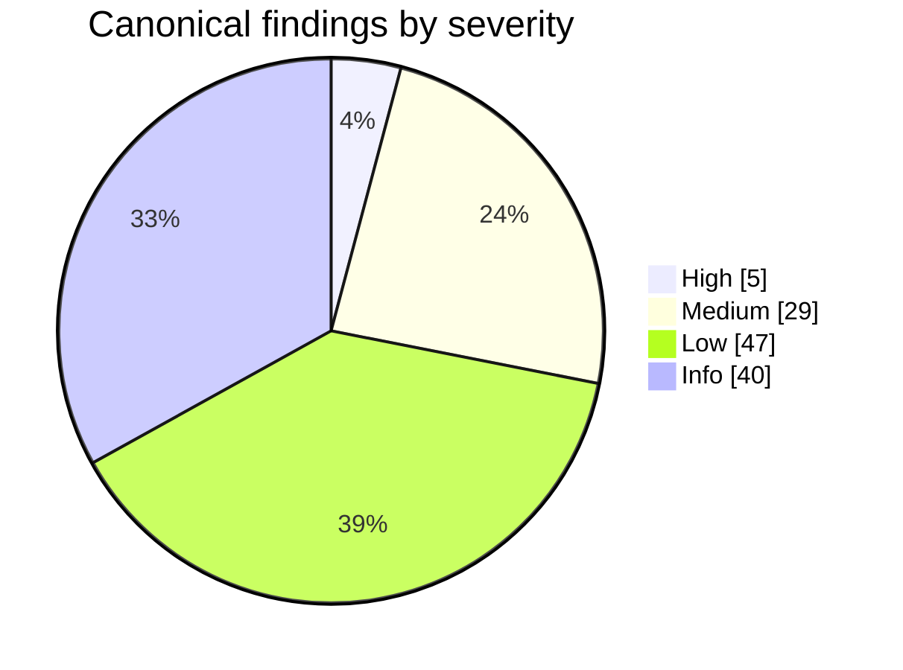

# Residual risks — consolidated register

> Evidence base: HEAD `e54074304` (branch `develop`, v0.10.0). Map date: 2026-10-22.
> Method: 7 mappers (one per chapter) + orchestrator re-read of 6 findings at HEAD. Raw 132 rows deduped to 121 canonical rows + 11 aliases.
> Post-map status (change `close-security-map-high-findings`): HTTP-01, DEP-01, TOOL-01 closed by close-security-map-high-findings. Register rows keep map-time severity; see [Closed findings](#closed-findings) and [Residuals added after the map](#residuals-added-after-the-map).
> Index: [security-map.md](../security-map.md). Line numbers drift — re-verify against HEAD before relying.
>
> **Severity scale**
> - Critical — unauth remote compromise, default config.
> - High — secret theft / code exec / guard defeat reachable with low privilege or default config.
> - Medium — exploitable with a precondition (tier, non-default, local access) or weak default.
> - Low — hardening gap, narrow reach, or low uplift.
> - Info — documented non-goal, doc/code mismatch, or defense-in-depth note.
>
> **Reachability legend**
> - `remote-unauth` — no credential, over LAN/tunnel.
> - `LAN` — peer on same network.
> - `tunnel` — caller via zrok/public tunnel.
> - `paired <tier>` — paired device at `observe`/`control`/`operate`.
> - `local other-user` — different OS user on same host.
> - `local same-user` — process of the operator's OS user.
> - `agent/LLM` — pi agent tool call, incl. prompt injection.
> - `plugin author` — code loaded as plugin.
> - `supply chain` — dependency, CI, release, installer.
>
> **Verified column**
> - `orchestrator` — re-read source at HEAD.
> - `mapper` — mapper evidence only.
> - `Needs verification` — raw row flags an open sub-question. See [Open verification items](#open-verification-items).

## Severity counts

| Severity | Canonical rows |
|---|---|
| Critical | 0 |
| High | 5 |
| Medium | 29 |
| Low | 47 |
| Info | 40 |
| **Total** | **121** |

Counts computed from rows in [Register](#register) after dedup. Map-time: closed rows (HTTP-01, DEP-01 High; TOOL-01 Low) still counted. Rows added after the map are in [their own section](#residuals-added-after-the-map), not counted. Canonical rows keep their raw severity. Alias rows add no count. Only NET-01 (raw Medium) is absorbed upward into WS-01 (High).

**WS-01 scope note.** High where TCP gateway is default: win32, `PI_GATEWAY_TCP=1`, Docker. POSIX default = unix socket, not affected. NET-01 (Medium) reconciled to High.

## Top priorities

Fix order. High rows first, then Medium rows reachable remotely, by paired device, or by agent/LLM.

1. HTTP-01 — **closed by close-security-map-high-findings**. Public IdP + empty `allowedUsers`/`groupTiers` ⇒ login refused; startup warning; Settings banner.
2. DEP-01 — **closed by close-security-map-high-findings**. Anchor not narrowed. Credential files joined `always` refusal tier instead.
3. WS-01 — set `requireTicketOnLoopback: true` (`server.ts:1304`). Drop tokenless loopback grace. Closes NET-01, NET-06 chain.
4. ELEC-04 — ship `macos-notarization` + `windows-authenticode-signing`.
5. PLUG-01 — document in-process plugin trust as accepted. Long-term: child process + capability RPC.
6. TOOL-04 — narrow path-gate read-only root; mark `auth.json`, `mcp-auth.json`, `sessions/` sensitive. Pairs with DEP-01.
7. HTTP-05 — default `pair` trust mode on upgrade; cap trusted-network tier.
8. HTTP-02 — restrict loopback CORS/mutation admission to dashboard port(s).
9. HTTP-04 — carry tier on `Principal`; require host policy when identity enforced.
10. HTTP-03 — map `DELETE /api/config/auth/providers/:id` to `operate`.
11. NET-04 — resolve `***`/`$ENV` in `/api/providers/test` only for saved `baseUrl`; block metadata hosts.
12. NET-02 — bind `serve_mockup` to `127.0.0.1`; confine `dir`.
13. NET-03 — publish document-converter containers on `127.0.0.1`.
14. WS-02 — gate same-pid bridge takeover on probe failure or per-session secret.
15. WS-03 — per-session reconnect secret; refuse cross-origin auto-claim.
16. WS-04 — close open sockets on device revoke (4401).
17. WS-05 — pass `SessionOrigin` to plugin request lane; credential plugins refuse non-local.
18. CRED-03 — server-side session revocation for OAuth JWT.
19. DEP-02 — realpath before containment layer ① in file read.
20. TOOL-03 — pin guard state at session start or document config-edit bypass.
21. TOOL-05 — extend `sensitive` list (`~/.aws`, `~/.kube`, `~/.gnupg`, …); exclude from YOLO.
22. TOOL-07 — refuse chat-spawned session when `toolPolicy` set but guard unresolved.
23. TOOL-08 — no activation auto-trust for MCP/plugin-originated spawns.
24. TOOL-09 — enable untrusted-content guard by default; extend sources.
25. CLI-01 — enforce strict CSP + Trusted Types by default.
26. ELEC-01 — install permission handler on main window default session.

Remaining Medium (local or supply chain, not remote/agent): PLUG-02, PLUG-03, CRED-02, CRED-04, ELEC-05, SUP-01, SUP-02, SUP-03. Fix after list above.

## Register

Sorted Severity → ID. Chapter links point to each chapter's `#findings`.

| ID | Sev | Area | Title | Reachability | Key evidence (path:line) | Remedy (short) | Aliases | Verified | Chapter |
|---|---|---|---|---|---|---|---|---|---|
| HTTP-01 | High | HTTP | OAuth with empty `auth.allowedUsers` admits ANY IdP account at `operate` | remote-unauth (tunnel/LAN, any IdP account) | `packages/server/src/auth/auth.ts:279-280` `packages/server/src/auth/auth-plugin.ts:441-462` | Refuse login for public IdP when `allowedUsers`+`groupTiers` empty; warn + banner. **Status: closed by close-security-map-high-findings** | — | orchestrator | [02](http-gates-and-routes.md#findings) |
| WS-01 | High | WebSocket/Bridge | Tokenless loopback bridge grace still open; default transport on win32 (and long-UDS-path hosts) | local other-user (win32); L4 forwarder | `server.ts:1301-1304` `bridge-upgrade-auth.ts:167-175` | `requireTicketOnLoopback: true`; require proof on win32 listener; drop grace | NET-01 | orchestrator | [03](websocket-and-bridge.md#findings) |
| PLUG-01 | High | Plugins | Server plugins run in-process with full server privilege; no isolation | plugin author; supply chain | `packages/dashboard-plugin-runtime/src/server/loader.ts:835` `packages/server/src/server.ts:4035` | Document as accepted; long-term worker/child process + capability RPC | — | mapper | [06](plugins-client-electron.md#findings) |
| ELEC-04 | High | Electron | Desktop binaries unsigned; update authenticity rests on GitHub release only | supply chain | `forge.config.ts:151-156` `.github/workflows/_electron-build.yml:916-920` | Ship `macos-notarization` + `windows-authenticode-signing` | — | orchestrator | [06](plugins-client-electron.md#findings) |
| DEP-01 | High | Deployment | File-read routes anchor `~/.pi` → provider credentials readable at `observe` tier | paired observe; local-credential holder | `packages/server/src/routes/file-routes.ts:164` `packages/server/src/lib/dashboard-state-guard.ts:95` | Credential files added to `always` refusal at every containment site (anchor kept, decided on real path). **Status: closed by close-security-map-high-findings** | — | orchestrator | [07](deployment-process-supply-chain.md#findings) |
| NET-02 | Medium | Network | `serve_mockup` binds `0.0.0.0`, no auth, agent picks any directory | agent/LLM; LAN | `packages/mockup-loop/src/extension.ts:112` `packages/mockup-loop/src/extension.ts:197-212` | Bind `127.0.0.1`; LAN opt-in flag; deny dotfiles; confine `dir` to cwd | — | mapper | [01](network-surface.md#findings) |
| NET-03 | Medium | Network | document-converter publishes PlantUML and Gotenberg containers on all host interfaces | LAN | `packages/document-converter/engine/document_converter/plantuml_server.py:167` `packages/document-converter/engine/document_converter/pdf_server.py:177` | Publish `-p 127.0.0.1:<port>:<cport>`; pin PlantUML digest | — | mapper | [01](network-surface.md#findings) |
| NET-04 | Medium | Network | `POST /api/providers/test` sends stored provider keys or any server env var to caller-chosen URL (SSRF + secret exfil); exposed via MCP `providers_test` | paired operate; MCP session (agent/LLM) | `packages/server/src/routes/provider-routes.ts:573-600` `packages/server/src/package/provider-probe.ts:131-153,253` | Resolve `***`/`$ENV` only when `baseUrl` matches saved provider; allowlist env; block metadata hosts | — | mapper | [01](network-surface.md#findings) |
| HTTP-02 | Medium | HTTP | Any loopback origin (any port) is CORS-readable AND mutation-admitted with credentials | web content on other localhost port | `packages/server/src/auth/cors-origin.ts:176-178` `packages/server/src/server.ts:2289` | Limit loopback CORS/mutation to dashboard port(s); bind proof cookie to `Origin` port | — | mapper | [02](http-gates-and-routes.md#findings) |
| HTTP-03 | Medium | HTTP | `control` tier can delete OAuth providers (incl. last, with `?force=true`) | paired control | `packages/shared/src/route-tiers.ts:71` `packages/server/src/routes/system-routes.ts:808-830` | Map `DELETE /api/config/auth/providers/:id` to `operate` | — | mapper | [02](http-gates-and-routes.md#findings) |
| HTTP-04 | Medium | HTTP | Identity-plane principals bypass route-tier gate; no host policy ⇒ ungated | plugin author (resolver principal) | `packages/server/src/auth/route-tier-gate.ts:71-74` `packages/server/src/identity/identity-road-gate.ts:61` | Carry tier on `Principal`; require host policy when identity enforced | — | Needs verification | [02](http-gates-and-routes.md#findings) |
| HTTP-05 | Medium | HTTP | `legacy` trust mode: trusted-network peer with NO credential is tier-exempt (operate) | LAN (trusted network) | `packages/server/src/auth/route-tier-gate.ts:85` `packages/server/src/auth/localhost-guard.ts:457-463` | Default `pair` on upgrade; cap trusted-network tier at `observe`/`control` | — | mapper | [02](http-gates-and-routes.md#findings) |
| WS-02 | Medium | WebSocket/Bridge | Self-reported `pid` displaces a LIVE bridge (session hijack) | paired device bridge; local | `bridge-contention.ts:96-100` `pi-gateway.ts:582-590` | Same-pid takeover only if incumbent fails probe; per-session secret | — | mapper | [03](websocket-and-bridge.md#findings) |
| WS-03 | Medium | WebSocket/Bridge | Session id is an unauthenticated name: any bridge claims unheld / disconnected ids | paired device bridge; local | `pi-gateway.ts:764-791` `bridge-contention.ts:88-90` | Per-session reconnect secret; refuse cross-origin auto-claim | — | mapper | [03](websocket-and-bridge.md#findings) |
| WS-04 | Medium | WebSocket/Bridge | Paired-device revocation does not close open sockets | revoked paired device | `packages/server/src/routes/pairing-routes.ts:617-628` `server.ts:3506` | Record deviceId per socket; close (4401) on revoke | — | mapper | [03](websocket-and-bridge.md#findings) |
| WS-05 | Medium | WebSocket/Bridge | Plugin request lane has no origin gate — remote bridge leases Gmail access tokens | paired device bridge; local | `plugin-request-lane.ts:1-12` `event-wiring.ts:1103-1106` | Pass `SessionOrigin` in lane meta; credential plugins refuse non-local | — | mapper | [03](websocket-and-bridge.md#findings) |
| TOOL-03 | Medium | Tool guards | Agent can self-disable guards by editing config files via `bash` | agent/LLM | `path-gate/index.ts:64-80` `config.ts:979` | Document; pin gate state at session start | — | mapper | [04](tool-call-guards.md#findings) |
| TOOL-04 | Medium | Tool guards | Path gate treats whole pi agent dir as read-only root — `auth.json`, `mcp-auth.json`, other sessions' transcripts readable without prompt | agent/LLM | `path-gate/roots.ts:132` `decide.ts:71` | Narrow read-only root; mark `auth.json`, `mcp-auth.json`, `sessions/` sensitive | CRED-01 | mapper | [04](tool-call-guards.md#findings) |
| TOOL-05 | Medium | Tool guards | Sensitive set only `~/.ssh` + `~/.pi`; other credential dirs grantable + YOLO auto-allowed | agent/LLM | `packages/shared/src/forbidden-subjects.ts:112-113` `yolo-session.ts:322-327` | Extend `sensitive` list; exclude from YOLO | — | mapper | [04](tool-call-guards.md#findings) |
| TOOL-07 | Medium | Tool guards | Chat-originated sessions unguarded unless operator sets both `toolPolicy` and `guardExtension` | remote chat user | `chat-gateway/src/server/gateway.ts:634,650-656` `server/config.ts:97-99` | Refuse spawn when `toolPolicy` set but guard unresolved | — | Needs verification | [04](tool-call-guards.md#findings) |
| TOOL-08 | Medium | Tool guards | Activation trust rule auto-trusts any dashboard-spawned cwd → project `.pi/` extensions + guard settings load | agent/LLM; operator spawn | `extension/src/project-trust.ts:143-144` `untrusted-content-guard/src/extension.ts:26-34` | No auto-trust for MCP/plugin spawns; ignore project `mode:"off"` | — | Needs verification | [04](tool-call-guards.md#findings) |
| TOOL-09 | Medium | Tool guards | Untrusted-content guard optional + narrow defaults | agent/LLM | `recommended-extensions.ts:658-673` `settings.ts:32-33` | Enable by default; add browser/MCP sources; keep taint on non-human input | — | mapper | [04](tool-call-guards.md#findings) |
| CRED-02 | Medium | Credentials | Bridge rewrites `providers.json` (API keys) without 0600 | local other-user | `packages/extension/src/role-manager.ts:113-114` `server/src/routes/provider-routes.ts:235-238` | Write tmp `{mode:0o600}` + chmod or reuse `writeJsonAtomic` | — | orchestrator | [05](credentials-and-secrets.md#findings) |
| CRED-03 | Medium | Credentials | Session JWT not revocable; logout only clears cookie | tunnel (stolen token) | `server/src/auth/auth-plugin.ts:468-471` `auth/auth.ts:180,201` | Server-side session id denylist / short JWT + refresh; rotate CLI | HTTP-06 | mapper | [05](credentials-and-secrets.md#findings) |
| CRED-04 | Medium | Credentials | Some host secret stores plaintext at rest | backups, sync, support bundles, any same-user process leak | `auth/provider-auth-storage.ts:130` `shared/src/config.ts:2716` `auth/identity.ts:74` `push/push-vapid.ts:33` `services/secrets-store.ts:99` | partial: `vault.json` + `plugin-credentials.json` closed by encrypt-credentials-at-rest (archived 2026-10-26); open: `provider-auth-storage.ts`, `config.ts`, `identity.ts`, `push-vapid.ts`, `secrets-store.ts` | — | mapper | [05](credentials-and-secrets.md#findings) |
| PLUG-02 | Medium | Plugins | `installed` plugins (`~/.pi/dashboard/plugins`) load server entry without any trust grant | local other-user; agent/LLM (writes home dir) | `loader.ts:172-176` `loader.ts:580` | Require `server:true` grant for `installed` | — | mapper | [06](plugins-client-electron.md#findings) |
| PLUG-03 | Medium | Plugins | Trusted-seam gate keyed on plugin-authored `priority` | plugin author | `server.ts:4127` `spawn-env-contributors.ts:46-48` | Key on host-side identity, not `priority` | — | mapper | [06](plugins-client-electron.md#findings) |
| CLI-01 | Medium | Client | CSP + Trusted Types not enforced by default | agent/LLM output (XSS) | `packages/server/src/auth/csp.ts:74` | Ship `enforce-strict-csp-default` + `enforce-trusted-types-default` | — | mapper | [06](plugins-client-electron.md#findings) |
| ELEC-01 | Medium | Electron | Main window has no permission request/check handler | remote server origin; plugin; XSS | `packages/electron/src/main.ts:605-617` `lib/server-windows.ts:85-90` | Allowlist permission handler on default session | — | mapper | [06](plugins-client-electron.md#findings) |
| ELEC-05 | Medium | Electron | Runtime overlay `github` source: checksum from same release, no signature | supply chain; paired operate trigger | `packages/server/src/runtime-overlay/runtime-io.ts:122-129` `runtime-stager.ts:206-210` | Sign assets (minisign/Sigstore); pin key in shell | NET-15 | mapper | [06](plugins-client-electron.md#findings) |
| DEP-02 | Medium | Deployment | Layer ① containment is lexical → in-cwd symlink escapes | paired observe; agent/LLM plants symlink | `packages/server/src/lib/path-containment.ts:55-58` `packages/server/src/routes/file-routes.ts:755-757` | Realpath before layer ①; symlink regression test | — | mapper | [07](deployment-process-supply-chain.md#findings) |
| SUP-01 | Medium | Supply chain | Actions pinned by mutable tag, incl. third-party in privileged jobs | supply chain | `.github/workflows/publish.yml:786` `publish.yml:258` | Pin every `uses:` to commit SHA; Dependabot for actions | — | mapper | [07](deployment-process-supply-chain.md#findings) |
| SUP-02 | Medium | Supply chain | npm-publish OIDC job runs unpinned npm + dependency install scripts with persisted token | supply chain | `.github/workflows/publish.yml:245-249` `pnpm-workspace.yaml:77` | Unprivileged build job; publish-only job; pin npm; `persist-credentials: false` | — | Needs verification | [07](deployment-process-supply-chain.md#findings) |
| SUP-03 | Medium | Supply chain | Bundled Node.js downloaded without checksum | supply chain | `packages/electron/scripts/download-node.sh:41-46` `.github/workflows/_electron-build.yml:296-299` | Verify `SHASUMS256.txt`/pin sha256 | — | mapper | [07](deployment-process-supply-chain.md#findings) |
| NET-05 | Low | Network | Docker defaults publish 8000 (all interfaces) and 9999 (`0.0.0.0`), TCP gateway on, tunnel on | LAN | `docker/compose.yml:24,28,39,44,49` | Publish to `127.0.0.1` by default; document LAN opt-in | — | mapper | [01](network-surface.md#findings) |
| NET-06 | Low | Network | L4 forwarders (ssh -L/-R, socat, possibly Docker userland proxy) indistinguishable from local callers | LAN/tunnel via L4 forwarder | `packages/server/src/pi/bridge-upgrade-auth.ts:126-137` `packages/server/src/auth/localhost-guard.ts:20-25` | Drop tokenless grace (WS-01); strict mode needs local proof | — | Needs verification | [01](network-surface.md#findings) |
| NET-07 | Low | Network | Recovery server serves error text + install layout unauthenticated on configured host | LAN | `packages/server/src/lifecycle/recovery-server.ts:433-453` `packages/server/src/cli.ts:313-319` | Gate GET like mutations or redact paths for non-loopback | — | mapper | [01](network-surface.md#findings) |
| NET-08 | Low | Network | `deck3d serve` write endpoints lack Origin/Host/content-type checks | web page in operator browser | `packages/deck3d/src/serve/index.ts:401-411,445-499` | Require JSON content-type + same-origin `Origin` + loopback `Host` | — | mapper | [01](network-surface.md#findings) |
| NET-09 | Low | Network | rpc-keeper socket perms set after bind; sessions dir created without explicit mode; Windows pipe uses default ACL | local other-user | `packages/server/src/rpc-keeper/keeper.cjs:45-46,232-236,51-53` | mkdir 0700; set umask before listen; explicit pipe ACL | — | Needs verification | [01](network-surface.md#findings) |
| NET-10 | Low | Network | Push webhook vet allows RFC1918 and non-self loopback ports | paired operate | `packages/server/src/push/push-transports/webhook-url.ts:38-60,115` | Block private ranges or operator allowlist | — | mapper | [01](network-surface.md#findings) |
| NET-11 | Low | Network | Live preview `ownPorts` omits model-proxy `secondPort` and other loopback-only listeners (L9–L15) | paired device (live preview) | `packages/server/src/server.ts:1406-1409` `packages/shared/src/live-server.ts:87` | Add `modelProxy.secondPort` to `ownPorts`; warn on managed-service ports | — | mapper | [01](network-surface.md#findings) |
| HTTP-07 | Low | HTTP | Global rate limit effectively off; no throttle on `/auth/callback`, `/auth/start`, `/api/pair/challenge` | remote-unauth | `packages/server/src/server.ts:2013-2018` | Per-route limits on pre-auth endpoints | — | mapper | [02](http-gates-and-routes.md#findings) |
| HTTP-08 | Low | HTTP | Passkey short-code rate key trusts last `X-Forwarded-For` hop when no proxy | LAN | `packages/server/src/auth/passkey/requester.ts:76-82` | Use socket peer unless loopback tunnel agent | — | mapper | [02](http-gates-and-routes.md#findings) |
| HTTP-09 | Low | HTTP | `bypassUrls` and pairing prefixes match by raw `startsWith` (no segment boundary) | remote-unauth (future routes) | `packages/server/src/auth/bypass-urls.ts:20-22` `packages/server/src/auth/localhost-guard.ts:817-818` | Match on segment boundary | — | mapper | [02](http-gates-and-routes.md#findings) |
| HTTP-10 | Low | HTTP | No enforced anti-framing by default (CSP report-only, no `X-Frame-Options`) | web page (framing) | `packages/server/src/auth/csp.ts:82-85` | Emit enforcing `frame-ancestors 'self'` / `X-Frame-Options` | — | mapper | [02](http-gates-and-routes.md#findings) |
| HTTP-11 | Low | HTTP | `localhostGuard` checks raw `isLoopback` only, ignores forwarding headers | tunnel/LAN authenticated | `packages/server/src/auth/localhost-guard.ts:1091-1098` `packages/server/src/routes/system-routes.ts:1678` | Use `isLocallyTrusted` | — | mapper | [02](http-gates-and-routes.md#findings) |
| HTTP-12 | Low | HTTP | Third-party origin `https://pi-dashboard.dev` structurally CORS + mutation trusted | third-party origin | `packages/server/src/auth/cors-origin.ts:201` | Make PWA-shell origin opt-in/revocable | — | mapper | [02](http-gates-and-routes.md#findings) |
| WS-06 | Low | WebSocket/Bridge | No `maxPayload` on core WS servers (100 MiB default) | paired control+ | `browser-gateway.ts:658` `terminal-gateway.ts:40` | Set `maxPayload` per scope; cap asset cache | — | mapper | [03](websocket-and-bridge.md#findings) |
| WS-07 | Low | WebSocket/Bridge | Bridge-initiated `spawn_new_session` spawns pi at arbitrary cwd, no gate | paired device bridge | `event-wiring.ts:2734-2757` | Refuse for non-local origin; known-folder admission | — | mapper | [03](websocket-and-bridge.md#findings) |
| WS-08 | Low | WebSocket/Bridge | `sessions_list` writes other sessions' `sessionFile`/`sessionDir` + broadcasts to all browsers | bridge peer | `event-wiring.ts:2759-2790` | Accept only own-connection items; never update existing paths | — | Needs verification | [03](websocket-and-bridge.md#findings) |
| WS-09 | Low | WebSocket/Bridge | `kill_process` pgid unvalidated end-to-end | paired operate | `session-action-handler.ts:1205-1210` `command-handler.ts:1184-1191` | Validate pgid in last `process_list`; reject ≤1 | — | mapper | [03](websocket-and-bridge.md#findings) |
| WS-10 | Low | WebSocket/Bridge | `control` tier executes host shell (`!`/`!!` prompt prefix); terminals classed `operate` | paired control | `ws-message-tiers.ts:79` `command-handler.ts:366-373` | Document control ≈ code-exec; optionally gate `!` at operate | — | mapper | [03](websocket-and-bridge.md#findings) |
| TOOL-01 | Low | Tool guards | MCP `prompt_response` mis-bound: object delivered as `send_prompt` text to any session (cannot answer prompts) | agent/LLM (prompt injection); malformed prompt into target session (runtime unverified) | `packages/server/src/server.ts:4166-4167` `packages/mcp-server-plugin/src/server/dispatch.ts:622-633` | Removed `prompt_response` + `extension_ui_response` from MCP surface (D2). Premise corrected: broken tool, not answer bypass. **Status: closed by close-security-map-high-findings** | — | orchestrator (corrected 2026-10-22) | [04](tool-call-guards.md#findings) |
| TOOL-06 | Low | Tool guards | `/tmp` and `os.tmpdir()` are read+write roots without prompt | agent/LLM | `path-gate/roots.ts:135` | Per-session tmp subdir | — | mapper | [04](tool-call-guards.md#findings) |
| TOOL-10 | Low | Tool guards | image-fit `read` rewrite can sidestep path gate | agent/LLM | `image-fit-extension/src/extension.ts:103-121` `docs/extensions.md:208` | image-fit skip out-of-root paths or run after gate | — | Needs verification | [04](tool-call-guards.md#findings) |
| TOOL-13 | Low | Tool guards | Browser relay: `Runtime.evaluate` allowed; domain list navigation-only | agent/LLM | `browser-plugin/src/server/relay/deny-list.ts:15-18,27-31` | Per-session confirm for real profile; deny `Runtime.evaluate` there | — | mapper | [04](tool-call-guards.md#findings) |
| TOOL-17 | Low | Tool guards | Fan-out admission + `project_trust` handlers wrapped in fail-open `safe()` | none (resource guard) | `extension/src/bridge.ts:958-971,1957` `bridge-handlers/lifecycle.ts:200` | Keep; fan-out not a security control | — | mapper | [04](tool-call-guards.md#findings) |
| TOOL-18 | Low | Tool guards | YOLO `unscoped` via env is process-lifetime auto-allow | agent/LLM | `yolo-env.ts:27,40` `yolo-session.ts:261-262` | Startup warning; bounded duration | — | mapper | [04](tool-call-guards.md#findings) |
| CRED-05 | Low | Credentials | `checkOwnerOnly` is dead code; vault mode never verified | local other-user | `server/src/vault/vault-permissions.ts:25` | Call at vault load; refuse or tighten | — | mapper | [05](credentials-and-secrets.md#findings) |
| CRED-06 | Low | Credentials | Existing token/identity files reused without mode re-tightening | local other-user | `server/src/auth/local-token.ts:48-50` `server/src/auth/identity.ts:64-67` | `chmod 0600` on load | — | mapper | [05](credentials-and-secrets.md#findings) |
| CRED-07 | Low | Credentials | Raw local token still accepted on the wire | local same-user (captured header) | `server/src/server.ts:768` `auth/local-credential.ts:218` | Default off; ship `close-loopback-legacy-window` | HTTP-15, WS-12 | mapper | [05](credentials-and-secrets.md#findings) |
| CRED-08 | Low | Credentials | `server.log` / `model-proxy.jsonl` created with umask mode; dashboard dir not 0700 | local other-user | `shared/src/server-launcher.ts:260` `model-proxy/request-log.ts:46-49` | Open logs 0600; dir 0700 | — | mapper | [05](credentials-and-secrets.md#findings) |
| CRED-09 | Low | Credentials | Spawn token in tmux argv | local other-user | `server/src/spawn-process/process-manager.ts:624-626` | Pass via env file / `set-environment`, not argv | — | mapper | [05](credentials-and-secrets.md#findings) |
| CRED-10 | Low | Credentials | Non-browser paired bearers never expire; holder self-declared | paired device | `server/src/pairing/paired-devices.ts:167-169,191-195` | Optional TTL/rotation for all holders | HTTP-16 | mapper | [05](credentials-and-secrets.md#findings) |
| PLUG-04 | Low | Plugins | `sendToSession`, `onEvent`, `registerPiHandler` ungated | plugin author | `server.ts:4097-4109` `server.ts:4120-4121` | Apply trust gate or document | — | mapper | [06](plugins-client-electron.md#findings) |
| PLUG-05 | Low | Plugins | First-party credential gate trusts self-declared npm name | plugin author | `first-party.ts:16-18` `server.ts:4550` | Derive first-party from bundled list/realpath | — | mapper | [06](plugins-client-electron.md#findings) |
| CLI-02 | Low | Client | Cross-origin device bearers in `localStorage` | XSS; plugin author | `client/src/lib/pairing/device-auth.ts:41` | Short `expiresAt` + rotation exist; consider per-origin cookie | CRED-12 | mapper | [06](plugins-client-electron.md#findings) |
| CLI-03 | Low | Client | Craft app mount CSP lacks `sandbox` directive | user lured to URL | `packages/craft-web-plugin/src/server/csp.ts:39-52` `dashboard-plugin-runtime/src/server/app-mount.ts:188` | Add `sandbox allow-scripts` to app-mount CSP | — | Needs verification | [06](plugins-client-electron.md#findings) |
| CLI-04 | Low | Client | Service worker opens unvalidated push `url` | compromised server/plugin | `public/sw.js:50-57` | Restrict to same-origin path | — | mapper | [06](plugins-client-electron.md#findings) |
| ELEC-02 | Low | Electron | `doctor:*` and `remote-connect:*` IPC handlers lack sender validation | renderer compromise | `lib/doctor-window.ts:51-107` `lib/remote-connect-window.ts:83-119` | Wrap with `trustedHandler` | — | mapper | [06](plugins-client-electron.md#findings) |
| ELEC-06 | Low | Electron | Overlay pin permits arbitrary downgrade | paired operate | `runtime-update-checker.ts:48-51` `runtime-stager.ts:250-251` | Refuse pins below `minShellVersion`; local-only downgrade | — | mapper | [06](plugins-client-electron.md#findings) |
| ELEC-07 | Low | Electron | No Electron fuses; RunAsNode relied on | local same-user | `lib/launch-source.ts:534` | Add `@electron/fuses`; asar integrity | — | mapper | [06](plugins-client-electron.md#findings) |
| ELEC-08 | Low | Electron | Doc/code mismatch on macOS signing | none (doc) | `electron-builder.yml:14-17` `forge.config.ts:151-156` | Fix `electron-builder.yml` comment | — | mapper | [06](plugins-client-electron.md#findings) |
| DEP-03 | Low | Deployment | No server-side exposure warning for all-interfaces bind outside Settings UI | LAN (operator unaware) | `packages/server/src/auth/bind-reachability-service.ts:117-131` `packages/client/src/components/settings/SettingsPanel.tsx:3758-3763` | Emit `[bind-exposure]` boot line; surface in `/api/health` | — | mapper | [07](deployment-process-supply-chain.md#findings) |
| DEP-04 | Low | Deployment | Docker image hardening gaps | agent/LLM | `docker/Dockerfile:13` `docker/Dockerfile:200` | Digest-pin base; pin `openspec`; root-owned `/app`; `no-new-privileges`, `cap_drop: [ALL]` | — | mapper | [07](deployment-process-supply-chain.md#findings) |
| DEP-06 | Low | Deployment | pi sessions, terminals, hooks inherit full server environment | agent/LLM | `packages/server/src/spawn-process/process-manager.ts:350-352` `packages/server/src/terminal/terminal-manager.ts:330` | Scrub `*_API_KEY`/`*_TOKEN` from child env or allowlist | — | mapper | [07](deployment-process-supply-chain.md#findings) |
| DEP-07 | Low | Deployment | Windows `cmd.exe /d /s /c` wrapper does not escape metacharacters | paired operate; plugin (win32) | `packages/shared/src/platform/exec.ts:90-96` `packages/shared/src/platform/subprocess-adapter.ts:63-75` | Escape per cmd rules or reject metachar; use `node.exe + cli.js` | — | Needs verification | [07](deployment-process-supply-chain.md#findings) |
| DEP-08 | Low | Deployment | `control` tier runs repo-defined bash via worktree-init confirm | paired control | `packages/server/src/routes/git-routes.ts:580-622` `packages/shared/src/route-tiers.ts:338` | Require `operate`/local for init trust | — | mapper | [07](deployment-process-supply-chain.md#findings) |
| DEP-10 | Low | Deployment | Audit trail narrow and unrotated | none (forensics gap) | `packages/server/src/auth/audit-log.ts:49-55` `packages/server/src/access/access-grants.ts:373-378` | Append-only `audit.jsonl` 0600 for all mutations; rotation | — | mapper | [07](deployment-process-supply-chain.md#findings) |
| SUP-04 | Low | Supply chain | No automated dependency vulnerability/update scanning; CodeQL ratchet local | supply chain | `package.json:118` | Dependabot; `pnpm audit --prod`; required CodeQL check | — | Needs verification | [07](deployment-process-supply-chain.md#findings) |
| SUP-05 | Low | Supply chain | Runtime overlay installs with scripts + remote tarballs on user machines | supply chain; paired operate trigger | `packages/server/src/runtime-overlay/runtime-stager.ts:199` `pnpm-workspace.yaml:19` | `--ignore-scripts` + targeted rebuild; sign overlay manifest | DEP-11 | mapper | [07](deployment-process-supply-chain.md#findings) |
| NET-12 | Info | Network | mDNS browser listens on LAN even for loopback-bound servers; advert TXT carries `piPort` even when no TCP gateway exists | LAN | `packages/server/src/server.ts:5122-5130` `packages/shared/src/mdns-discovery.ts:270` | Skip browser on loopback bind; omit `piPort` when TCP gateway off | — | mapper | [01](network-surface.md#findings) |
| NET-13 | Info | Network | Research doc claims ":9999 pi gateway has NO auth" — stale | none (doc) | `docs/research/bridge-transport-and-identity.md:109-117` `packages/server/src/pi/pi-gateway.ts:1122` | Mark research doc superseded | — | mapper | [01](network-surface.md#findings) |
| NET-14 | Info | Network | Several egress fetches lack timeouts | external IdP/registry | `packages/server/src/auth/auth.ts:64` `packages/server/src/package/npm-search-proxy.ts:76,118` | Add `AbortSignal.timeout` | — | mapper | [01](network-surface.md#findings) |
| NET-17 | Info | Network | `--dev` serves SPA from whatever local process answers on 3000/5173/5174 | local other-user (dev only) | `packages/server/src/server.ts:3739-3759` | Dev-only; document | — | mapper | [01](network-surface.md#findings) |
| HTTP-13 | Info | HTTP | Doc/code mismatches in source comments | none (doc) | `packages/server/src/server.ts:2256-2259` `packages/server/src/auth/host-gate.ts:74` | Fix stale comments | — | mapper | [02](http-gates-and-routes.md#findings) |
| HTTP-14 | Info | HTTP | Fail-open defaults on malformed config | operator misconfig | `packages/shared/src/config.ts:67-75` `packages/server/src/auth/trust-mode-boot.ts:64-70` | Surface as health warning | — | mapper | [02](http-gates-and-routes.md#findings) |
| HTTP-17 | Info | HTTP | Model-proxy second port has no network guard / host gate | none (invariant) | `packages/server/src/server.ts:5048-5085` | Keep `model-proxy-second-port.test.ts`; never make host configurable | NET-16 | mapper | [02](http-gates-and-routes.md#findings) |
| HTTP-18 | Info | HTTP | Global CORS trusted-network allowance ignores trust mode | LAN | `packages/server/src/server.ts:2056` `packages/server/src/auth/cors-origin.ts:205-207` | Feed `admissionList`, not `liveTrustedNetworks` | — | mapper | [02](http-gates-and-routes.md#findings) |
| WS-11 | Info | WebSocket/Bridge | No schema validation / per-socket rate limit on WS inbound | authenticated peer | `browser-gateway.ts:2001-2007` `pi-gateway.ts:653-656` | Schemas for side-effecting types; per-socket token bucket | — | mapper | [03](websocket-and-bridge.md#findings) |
| WS-13 | Info | WebSocket/Bridge | Doc/code mismatches | none (doc) | `docs/research/bridge-transport-and-identity.md:109-117` `server.ts:1301-1303` | Update research doc; fix comments/reason strings | — | mapper | [03](websocket-and-bridge.md#findings) |
| WS-14 | Info | WebSocket/Bridge | Socket permission hardening is best-effort | local same-user | `gateway-socket-bind.ts:156-160` `keeper.cjs:44-46` | Fail closed on chmod failure; cap keeper line length | — | mapper | [03](websocket-and-bridge.md#findings) |
| WS-15 | Info | WebSocket/Bridge | Ticket store unbounded outstanding set; not bound to Origin/IP | paired device | `ws-ticket.ts:157-170` | Cap per caller; optionally bind to minting IP | — | mapper | [03](websocket-and-bridge.md#findings) |
| WS-16 | Info | WebSocket/Bridge | Remote bridge with no pins trusts any endpoint; plain `ws` allowed | LAN/tunnel on-path | `remote-registration-gate.ts:70` `vault-delivery-hub.ts:10-13` | Require `wss` + pin for remote (`prove-vault-bridge-tls`) | — | mapper | [03](websocket-and-bridge.md#findings) |
| WS-17 | Info | WebSocket/Bridge | `/mcp` global rate limit exempts loopback; session token tier fixed `control` | bridge peer; agent/LLM | `routes.ts:113-118` `tokens.ts:46` | Scope session tokens to own session/cwd | — | mapper | [03](websocket-and-bridge.md#findings) |
| TOOL-02 | Info | Tool guards | `bash`/`grep`/`find`/`ls`/MCP/custom tools bypass path gate; agent = OS user | agent/LLM | `path-gate/handler.ts:40` `docs/architecture.md:4003,4091` | Supervised mode / OS sandbox (planned) | — | mapper | [04](tool-call-guards.md#findings) |
| TOOL-11 | Info | Tool guards | TOCTOU symlink swap between gate decision and pi open | local same-user | `docs/architecture.md:4091` `yolo-session.ts:313-315` | OS sandbox | — | mapper | [04](tool-call-guards.md#findings) |
| TOOL-12 | Info | Tool guards | Vault values in `process.env`; masking exact-match only | agent/LLM | `vault-delivery.ts:205` `vault-masker.ts:5` | Deliver per command, not process env; detect encodings | CRED-15 | mapper | [04](tool-call-guards.md#findings) |
| TOOL-14 | Info | Tool guards | No SSRF/egress policy for agent web fetch in repo | agent/LLM | `packages/web-access-plugin/AGENTS.md` | Document; egress proxy if required | — | mapper | [04](tool-call-guards.md#findings) |
| TOOL-15 | Info | Tool guards | ACP sessions bypass all pi tool guards | agent/LLM | `server/src/acp-bridge/child-env.ts:11-17` `docs/acp-sessions.md:110` | Document in UI | — | mapper | [04](tool-call-guards.md#findings) |
| TOOL-16 | Info | Tool guards | path-containment-guard has no in-repo consumer | plugin author (unconfined spawns) | `docs/architecture.md:1645` `process-manager.ts:439` | Adopt in automation/goal spawns | — | mapper | [04](tool-call-guards.md#findings) |
| TOOL-19 | Info | Tool guards | Doc/code drift | none (doc) | `handler.ts:26-36` `guard.ts:27` | Update doc; remove dead const | — | mapper | [04](tool-call-guards.md#findings) |
| CRED-11 | Info | Credentials | Short-lived secrets in URL query | LAN/proxy logs | `auth/ws-ticket.ts:117-128` `routes/local-proof-routes.ts:52-54` | Prefer subprotocol / POST | — | mapper | [05](credentials-and-secrets.md#findings) |
| CRED-13 | Info | Credentials | Doc/code mismatches | none (doc) | `shared/src/protocol.ts:1428` `secret-rotation.ts:28` | Fix comments | — | mapper | [05](credentials-and-secrets.md#findings) |
| CRED-14 | Info | Credentials | Tunnel reserved name from `Math.random` | tunnel observer | `server/src/tunnel-providers/zrok.ts:171` | `crypto.randomBytes(4)` | — | mapper | [05](credentials-and-secrets.md#findings) |
| CRED-16 | Info | Credentials | CSP store persists document pathname | local same-user | `auth/csp-report-sink.ts:178-181,286` `auth/csp-report-store.ts:160` | Apply `redactCapability` to `docPath` | — | Needs verification | [05](credentials-and-secrets.md#findings) |
| CRED-17 | Info | Credentials | OCI secret files plaintext on disk while service runs | local same-user | `services/secret-delivery.ts:29-30,60` | tmpfs mount; cleanup on boot | — | mapper | [05](credentials-and-secrets.md#findings) |
| CRED-18 | Info | Credentials | Ticket/code stores use Map lookup, not constant-time compare | remote (impractical) | `auth/ws-ticket.ts:196` `auth/local-proof.ts:150` | None required | — | mapper | [05](credentials-and-secrets.md#findings) |
| PLUG-06 | Info | Plugins | Credential namespaces not a boundary | plugin author | `auth/plugin-credential-store.ts` | Document | — | mapper | [06](plugins-client-electron.md#findings) |
| PLUG-07 | Info | Plugins | Doc line drift: untrusted-plugin-ui-gap cites `loader.ts:442` for `import()` | none (doc) | `docs/untrusted-plugin-ui-gap.md:12` `loader.ts:835` | Fix doc line ref | — | mapper | [06](plugins-client-electron.md#findings) |
| PLUG-08 | Info | Plugins | Same-realm client plugins (build-time + pinned runtime) = full page authority | plugin author; XSS | `runtime-plugin-loader.ts:136-138` `docs/untrusted-plugin-ui-gap.md:7-19` | Keep descriptor protocol; ship iframe hatch | — | mapper | [06](plugins-client-electron.md#findings) |
| CLI-05 | Info | Client | `withRestrictiveCsp` (auto-open doc CSP) has no production caller | none (dead control) | `client/src/lib/canvas/canvas-doc-csp.ts:50` | Remove or wire; update `lib/canvas/AGENTS.md` | — | mapper | [06](plugins-client-electron.md#findings) |
| CLI-06 | Info | Client | YouTube iframe without `sandbox` | third-party frame | `client/src/components/preview/YouTubePreview.tsx:50-53` | Optional `sandbox` + `referrerpolicy` | — | mapper | [06](plugins-client-electron.md#findings) |
| ELEC-03 | Info | Electron | `dashboard:check-app-update` unguarded by design | remote page | `main.ts:493-498` | None | — | mapper | [06](plugins-client-electron.md#findings) |
| ELEC-09 | Info | Electron | Main window handles `will-navigate` but not `will-redirect` | remote server origin | `main.ts:628-636` `lib/server-windows.ts:540` | Add `will-redirect` handler | — | mapper | [06](plugins-client-electron.md#findings) |
| ELEC-10 | Info | Electron | CDP opt-in exposes partitions/cookies to local processes | local same-user | `main.ts:30-33` `lib/server-windows-main.ts:205` | Keep off by default | — | mapper | [06](plugins-client-electron.md#findings) |
| DEP-05 | Info | Deployment | Doc/code mismatch: code-server + Vite port | none (doc) | `AGENTS.md:51` `docker/README.md:155` | Update docs; fix dev overlay port | — | mapper | [07](deployment-process-supply-chain.md#findings) |
| DEP-09 | Info | Deployment | `open-in-system` launches files with OS default handler | paired operate | `packages/server/src/system-open-capability.ts:41-45` `packages/server/src/routes/file-routes.ts:883-911` | Refuse executable types; reveal only | — | mapper | [07](deployment-process-supply-chain.md#findings) |
| DEP-12 | Info | Deployment | Recovery actions admit loopback without local proof | local other-user | `packages/server/src/lifecycle/recovery-server.ts:112-125` | Require local token in recovery mode | — | mapper | [07](deployment-process-supply-chain.md#findings) |
| SUP-06 | Info | Supply chain | Release revoke manual; applied updates not recalled | supply chain | `docs/release-process.md:225-248` | Keep; add min-version kill-switch feed | — | mapper | [07](deployment-process-supply-chain.md#findings) |
| SUP-07 | Info | Supply chain | Docker tool integrity = same-origin checksum / none | supply chain | `docker/Dockerfile:52-56` `docker/Dockerfile:97-99` | Verify upstream signatures or pin sha256 | — | mapper | [07](deployment-process-supply-chain.md#findings) |

**ID coverage: 121 canonical rows + 11 aliases = 132 raw.** Script-checked against `ALL-FINDINGS.md`: 0 missing.

## Closed findings

Change `close-security-map-high-findings` (design D1 DEP-01, D2 TOOL-01, D3 HTTP-01).

| ID | Status | How |
|---|---|---|
| DEP-01 | closed by close-security-map-high-findings | D1. `AGENT_CREDENTIAL_NAMES` (`auth.json`, `mcp-auth.json`, `providers.json`, `plugin-credentials.json`, `models.json`, `mcp.json`, `system-one/auth.json`) + `<name>.*` siblings refused in `always` tier of `packages/server/src/lib/dashboard-state-guard.ts`, every agent dir (server `PI_CODING_AGENT_DIR` ∪ `~/.pi/agent`), every caller, every mode. Real-path decision + post-open `(dev,ino)` recheck at content sites. Covers cwd anchor (cwd=`$HOME`), `~/.pi` anchor, git-root, grants, mention resolver, grep, writable-md, `/api/session-file` in-cwd shortcut, `/api/pi-resource-file`, `POST /api/file/write-binary`, plugin file routes via `ServerPluginContext.readFileGuarded`. New credential file = one-line addition to `AGENT_CREDENTIAL_NAMES`. |
| TOOL-01 | closed by close-security-map-high-findings (Low, re-rated) | D2. `prompt_response` + `extension_ui_response` deleted from `tools.manifest.ts`; denylisted in `tools.denylist.ts`; generated artifacts regenerated; chat answers keep working via chat-local tier. |
| HTTP-01 | closed by close-security-map-high-findings | D3. Public provider (`github`/`google` key, or `issuerUrl` host in `PUBLIC_IDP_HOSTS` `packages/server/src/auth/auth.ts:142`) with empty `allowedUsers` + `groupTiers` ⇒ login refused (403 `renderOpenEnrolmentPage`, audit `oauth login_refused`) at `/auth/login`, `/auth/start/:provider`, `/auth/callback/:provider` (`auth-plugin.ts`). Already-issued sessions rejected (`isSessionProviderRejected`; removed-provider JWT rejected, fail closed). Auth reload sweeps open browser + terminal sockets (`WS_CLOSE_SESSION_REVOKED` 4401, `onAuthReloaded` → `sweepRevokedSockets`). Unknown-issuer `keycloak`/`oidc` keep allow-all + startup warning. `GET /api/auth/diagnostics` gains `openEnrolment`; Settings → Security banner. |

**Ship-time instruction.** Statuses above assume change `close-security-map-high-findings` merges in the PR that carries this edit. At ship (`ship-change` archive): confirm merge. If the change did not ship, revert the three statuses to "open" and drop this section. After archive, remove this paragraph.

**TOOL-04 note.** NOT closed. Agent `read` of `~/.pi/agent/auth.json` etc. still in-root for the path gate (`path-gate/roots.ts:132`, `decide.ts:71`). DEP-01 fixed server routes only.

## Residuals added after the map

Added by change `close-security-map-high-findings`. Not in the 121 count. Owner none unless stated. IDs continue each prefix.

| ID | Sev | Residual | Evidence | Note |
|---|---|---|---|---|
| TOOL-20 | Low | Prompt-answer roads remain after MCP removal | REST `POST /api/questions/:id/answer` non-file kinds (`questions/question-routes.ts:94-107`, `control`); browser WS `prompt_response` (`pairing/browser-gateway.ts:2418`, `control`); `POST /api/access/prompts/:promptId` (path-gate, `routes/access-prompt-routes.ts:185`, `operate` `shared/src/route-tiers.ts:65`) | Same-host agent with shell can obtain loopback proof (`requireLocalProof` default `true`). `add-supervised-tool-approval` related. |
| TOOL-21 | Low | Three other broken `session`-bind MCP rows | `set_session_tags`, `edit_followup_entry`, `history_backfill` in `tools.manifest.ts`; wrap `server.ts:4166-4167` | Not answer roads. Fix or remove `session` bind kind. |
| DEP-13 | Low | Legacy plain keys in `~/.pi/agent/settings.json` and project-layer `<cwd>/.pi/mcp.json` not refused | `settings.json` = pi primary user-editable file; refusing breaks settings editor + previews | Mitigation: `pi-legacy-credentials` moves keys to `auth.json` (`packages/server/src/auth/pi-legacy-credentials.ts`). TOOL-04 / CRED family. |
| DEP-14 | Low | Session-side `PI_CODING_AGENT_DIR` override not covered | Guard reads server process env + `~/.pi/agent` only (`agentCredentialDirs`, `dashboard-state-guard.ts`) | Operator starts server with same variable. Pinned by test. |
| DEP-15 | Low | `~/.pi/agent/backups/**` and other tool-made credential copies | Neither pi nor dashboard creates `backups/`; contents tool-dependent, not enumerable | `<name>.bak*` siblings of fixed names ARE refused. |
| DEP-16 | Low | `/api/pi-resource-file` prefix/substring allowlist loose | `routes/openspec-routes.ts` (~`:1121-1126`): `~/.pi/agent/`, `<knownCwd>/.pi/`, `.pi/git/` and `node_modules/` substring; `path.resolve` without `realpath` | Only credential/state refusal added in front (real path, both tiers). Allowlist itself not redesigned. DEP family. |
| DEP-17 | Low | D1 path-vs-handle windows | `rendered-pdf` converter takes a path (swap in last gap; output = PDF render, not bytes); JS grep walker reads hard-linked credential file before gate 2 drops its matches (never returned); Windows alternate names (`auth.json::$DATA`, 8.3 `AUTHJS~1.JSON`, trailing dot) at path-level sites (mention resolver, `tree`); no Windows test | Content sites covered by post-open `(dev,ino)` recheck. |
| HTTP-19 | Medium | Open-enrolment state created before upgrade survives | While public provider open, a stranger signs in at `operate`, can create passkey users, invites, device bearers; bearers outlive OAuth session | Server cannot tell which entries. **Operator action:** review Settings ▸ Users and Settings ▸ Paired devices after upgrade. Startup warning for a refused provider says so. Severity = reviewer judgement. |
| CRED-03 | Medium (existing) | Partly mitigated, not closed | D3 rejects sessions of refused-open-enrolment and removed providers on validation. Allowlist edit does not revoke already-issued tokens of a still-allowed provider; logout still cookie-only | Owner none. Out of scope of D3. |
| WS-18 | Low | Live-preview sockets not swept on auth reload | `case "live"` → `handleLiveServerUpgrade` (`server.ts`) capability-URL scoped, no `sessionTier` | New refused-provider cookie cannot open one (`isSessionLive`); open one ends at ticket expiry (`scheduleAtExpiry`). |
| PLUG-09 | Info | Plugin-registered file routes need per-route audit | Verdicts table below. Seam `ServerPluginContext.readFileGuarded?(absPath)` (`dashboard-plugin-runtime/src/server/server-context.ts`, host impl `server.ts` → `guardedReadFile`). Plugin route gets `null` or finds member absent (older host) ⇒ refuse, never plain `fs` | New plugin route that reads files = audit against table. |

### Plugin file-route audit (D1)

Scan: `rg "readFile|readFileSync|createReadStream|fs\.open|readSync" packages/*-plugin/src/server`.

| Route / reader | Path source | Verdict |
|---|---|---|
| flows `GET /api/plugins/flows/file` (`flow-files.ts`) | bridge-reported name → `realpath` | FIXED via `readFileGuarded` (symlink `x.md` → `auth.json` served before) |
| automation `GET …/result`, `GET …/definition` (`routes.ts`) | fixed filenames under admitted cwd; run id + name validated | FIXED via `readFileGuarded` (symlinkable in-cwd file returned verbatim before) |
| flows `flow-inputs`, `codeHandlerPaths` | fixed `.pi/flows/...` path; projection / parse only | accepted: no content returned |
| automation `scanner`, `run-store`, `engine`, `action-registry` | scheduler internals | accepted: content to agent session, never to client |
| team `static.ts` | request path under plugin dist | accepted: `realpath`-contained in dist root |
| team `skills-service`, `store`, `users`, `records`, `projects` | operator-managed / plugin-owned fixed paths | accepted: frontmatter keys only / fixed |
| kb `kb-routes.ts:199` | `dox-staleness.json` row paths | accepted: SHA-256 compare, count only |
| roles `roles-routes`, system-one `llm-caller` (`providers.json`) | fixed `~/.pi/agent/providers.json` | accepted: parsed to role map, never raw |
| system-one, blackhole, hermes-memory, context-mode-settings, grammar, goal, subagents, browser, craft-web, gmail config/IO | fixed or server-env paths | accepted: no request-supplied path |
| claude, skill-atlas, mcp-client, keycloak-resolver, mcp-server, obs-studio, quota, web-access, demo, fixture-policy | no file read in `src/server` | n/a (skill-atlas + flows clients read via `/api/pi-resource-file`, guarded) |

## Related findings (cross-ref, kept separate)

| Pair | Link |
|---|---|
| DEP-03 ↔ NET-05 | exposure warning / Docker defaults |
| WS-17 ↔ TOOL-01 | MCP session token tier fixed `control`. TOOL-01 closed; WS-17 unchanged (token still `control`, fewer verbs) |
| DEP-02 ↔ TOOL-11 | symlink handling (server file read vs agent TOCTOU) |
| DEP-01 ↔ TOOL-04 | same secret files; server route (observe) vs agent `read`. DEP-01 closed; TOOL-04 NOT closed |
| NET-13 ↔ WS-13 | stale ":9999 NO auth" research claim appears in both |

## Accepted / by-design risks

Documented non-goals. No fix planned in current scope.

| ID | Risk | Doc ref |
|---|---|---|
| TOOL-02 | No OS sandbox. `bash`/`grep`/`find`/`ls`/MCP/custom tools bypass path gate. Agent = operator OS user. | `docs/architecture.md:4003,4091` |
| TOOL-11 | TOCTOU symlink swap after gate decision. Same-user model. | `docs/architecture.md:4091` |
| TOOL-12 | Vault values in pi `process.env`; exact-match masking only. Alias CRED-15. | `docs/credential-vault.md` §7 residuals |
| TOOL-13 | Browser relay `Runtime.evaluate` allowed. Default `@dedicated` profile. Severity Low. | `browser-plugin/src/server/relay/deny-list.ts:15-18` |
| TOOL-14 | No egress policy for agent web fetch. Third-party `pi-web-access`. | `packages/web-access-plugin/AGENTS.md` |
| TOOL-15 | ACP sessions bypass pi tool guards. | `docs/acp-sessions.md:110` |
| PLUG-01 | In-process server plugins = full server privilege. Accepted design. Severity High — kept visible. | `docs/untrusted-plugin-ui-gap.md` |
| PLUG-06 | Credential namespaces not a boundary. Follows PLUG-01. | `auth/plugin-credential-store.ts` |
| PLUG-08 | Same-realm client plugins = full page authority. | `docs/untrusted-plugin-ui-gap.md:7-19` |
| CRED-11 | Short-lived secrets in URL query. Mitigated ≤60 s, single use. Accepted D11. | `auth/ws-ticket.ts:117-128` |
| CRED-12 / CLI-02 | Cross-origin device bearer in `localStorage`. Documented trade-off. | `client/src/lib/pairing/device-auth.ts:16-20` |
| CRED-18 | Map lookup, not constant-time compare. 256-bit values. No fix required. | `auth/ws-ticket.ts:196` |
| HTTP-14 | Fail-open on malformed config. Anti-lockout trade-off. | `packages/shared/src/config.ts:67-75` |
| HTTP-17 / NET-16 | Model-proxy second port safe only by hardcoded loopback. Documented invariant. | `packages/server/src/server.ts:5048-5085` |
| DEP-12 | Recovery actions admit loopback without local proof. | `docs/architecture.md:3185-3196` |
| SUP-06 | Release revoke manual; applied updates not recalled. | `docs/release-process.md:225-248` |
| ELEC-03 | `dashboard:check-app-update` unguarded by design. | `main.ts:493-498` |
| ELEC-10 | CDP opt-in exposes partitions/cookies. Off by default. | `main.ts:30-33` |

## Doc/code mismatches

Fix list. Doc or comment change only unless noted.

| ID | Mismatch | Fix |
|---|---|---|
| NET-13 | `docs/research/bridge-transport-and-identity.md:109-117` says ":9999 NO auth". Code authenticates TCP upgrades. | Mark doc superseded |
| HTTP-13 | `server.ts:2256-2259` "Report-only default" vs `host-gate.ts:74` `enforce`. `local-proof.ts:2` "Opt-in" vs default `true`. Hook-order comment `server.ts:3613-3620` stale. | Update comments |
| WS-13 | Research doc ":9999 NO auth". `server.ts:1301-1303` "refused from 1.0.0" (HEAD 0.10.0, still open). `dashboard-paths.ts:182` "authorised by the local token". `bridge-contention.ts:96-97` same-pid "never to grant" (grants displacement). | Update research doc status; fix comments/reason strings |
| TOOL-19 | `docs/architecture.md` observability list omits `yolo-allowed`/`yolo-refused`. `guard.ts:27` `SESSION_TARGETING_TOOLS` unused. | Update doc; remove dead const |
| CRED-13 | `protocol.ts:1428` claims `process.env.PI_DASHBOARD_MCP_TOKEN` set — code never sets. `secret-rotation.ts.AGENTS.md` says epoch 2 — code `REQUIRED_ROTATION_EPOCH = 1` (`secret-rotation.ts:28`). | Fix comments |
| PLUG-07 | `docs/untrusted-plugin-ui-gap.md:12` cites `loader.ts:442`; `import()` at `loader.ts:835`. | Update doc line ref |
| ELEC-08 | `electron-builder.yml:14-17` says Forge `osxSign/osxNotarize` gated on `APPLE_IDENTITY`. `forge.config.ts:151-156` block removed. | Fix `electron-builder.yml` comment |
| DEP-05 | `AGENTS.md:51`, `docker/README.md:155` list code-server (removed). `docker/compose.dev.yml:22` publishes 5173; Vite listens on 3000. | Update docs; fix dev overlay port |
| CLI-05 | `withRestrictiveCsp` (`canvas-doc-csp.ts:50`) no production caller. Docs may imply protection. | Remove or wire; update `lib/canvas/AGENTS.md` |

## Open verification items

Rows flagged `Needs verification` plus mapper open questions.

| ID | Open question | Needed check |
|---|---|---|
| TOOL-01 | Runtime of mis-bound `send_prompt` delivery unverified (static trace). | Moot: tool removed (closed by close-security-map-high-findings) |
| WS-01 | Win32 behaviour. Orchestrator verified code, not a win32 host. | Test on win32 host |
| HTTP-04 | Resolver plugin claim rules unknown. | Read resolver plugins' principal claims |
| NET-06 | Docker userland proxy: bridge-gateway IP or `127.0.0.1`? | Test published port bridge origin |
| NET-09 | Windows named-pipe default DACL breadth. | Inspect pipe ACL on win32 |
| WS-08 | Downstream file-read impact of overwritten `sessionFile`/`sessionDir`. | Trace transcript/resume readers |
| TOOL-07 | Which chat users may approve guard prompts. | Read chat-gateway approver config |
| TOOL-08 | Hostile-repo spawn via MCP `spawn_session` subject to cwd admission. | Reproduce with hostile `.pi/` |
| TOOL-10 | Extension load order: image-fit vs bridge. | Check pi load order |
| CRED-16 | Capability-path page reporting to baseline CSP sink. | Test report path → `csp-reports.json` |
| CLI-03 | Craft app top-level navigation runs in dashboard origin. | Load `/apps/craft-<app>/index.html` top-level |
| DEP-07 | Lower-tier reach of Windows `cmd.exe` metachar args. | Trace non-operate callers |
| SUP-02 | `environment: npm-publish` reviewers configured? | Check repo settings |
| SUP-04 | CodeQL required check in branch protection? | Check repo settings |
| (KaTeX) | KaTeX trust setting for rendered content. Mapper question, no finding row. | Review KaTeX `trust` option |
| (pnpm) | pnpm `minimumReleaseAge` default. Mapper question, no finding row. | Confirm pnpm version default |

See change: security-map-audit

## Corrections

- 2026-10-22: TOOL-01 High → Low. Reason: MCP `prompt_response` never reaches `promptBus.respond`. Chain: `tools.manifest.ts:132` → `dispatch.ts:622-633` `executeSession` → `index.ts:169` `sendToSession` → `server.ts:4166-4167` wraps object as `{type:"send_prompt", text}` → bridge `command-handler.ts:672`. Effect: cannot answer prompts; malformed prompt injected (runtime unverified).
- Owner: change `close-security-map-high-findings` (D2 removes `prompt_response` + `extension_ui_response` from MCP surface).
- Residual answer roads: REST `POST /api/questions/:id/answer` (non-file kinds), browser WS `prompt_response`, `POST /api/access/prompts/:promptId` (operate).
- 2026-10-30: DEP-01, HTTP-01, TOOL-01 status → "closed by close-security-map-high-findings" (change ships in same PR; see ship-time instruction in Closed findings). TOOL-01 stays Low; tool removed. TOOL-04 NOT closed (agent `read` of agent dir; path-gate root unchanged).
- TOOL-01 correction detail: premise (agent answers another session's path-gate prompt via MCP `prompt_response`) wrong. Host wraps object as `send_prompt` text, `server.ts:4166-4167`. Original `tool-call-guards.md` C12 / `:207` and this register assumed the verb reaches bridge `promptBus.respond` unwrapped; trace shows it does not.
