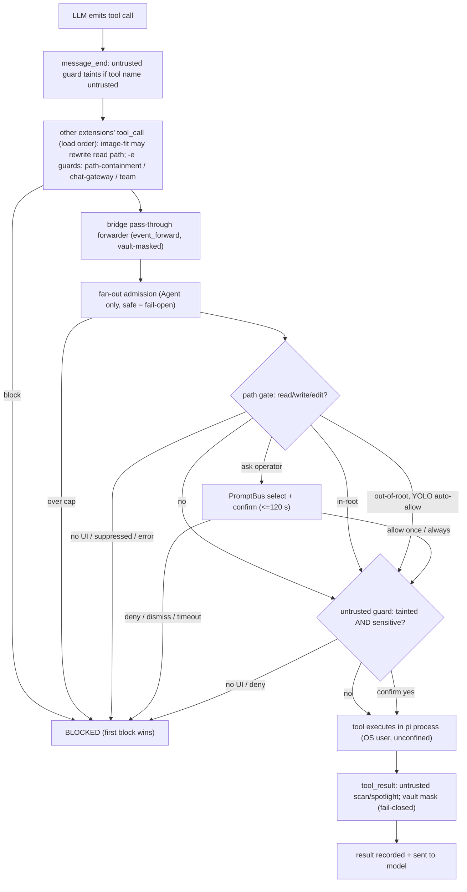
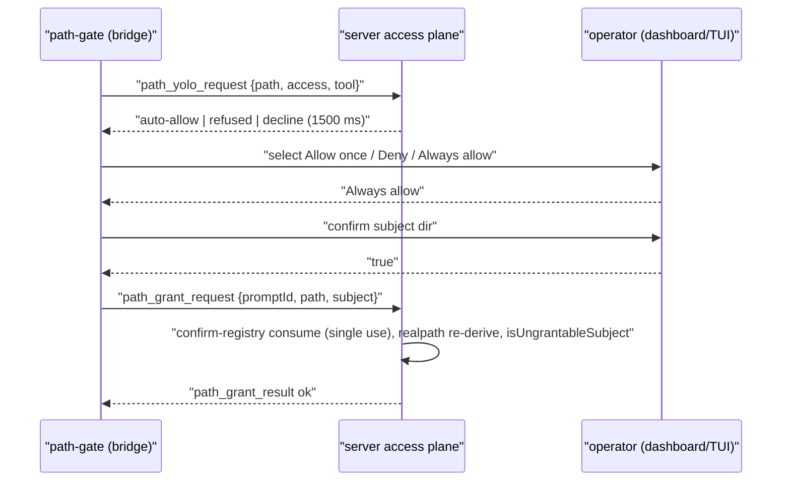
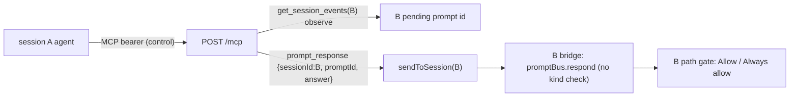

# Agent Tool-Call Guards
> Scope: every mechanism that intercepts, confirms, blocks, confines or redacts what the LLM agent (pi session) and its tools can do · Evidence base: HEAD e54074304 · Mapper: 04-tool-call-guards (prefix TOOL-) · Map index: [security-map.md](../security-map.md) · Register: [residual-risks.md](residual-risks.md)

## Summary
- No OS sandbox. pi tools (incl. `bash`) run in the pi process as the operator's OS user. Every guard here is a pi `tool_call` / `tool_result` hook or a server-side policy. None confines a spawned process. (`docs/research/agent-bash-sandboxing.md:15-25`, research only; pi docs `docs/extensions.md:5`.)
- pi dispatch: `tool_call` handlers run in extension load + registration order; first `{block:true}` wins; a throwing `tool_call` handler blocks (pi `docs/extensions.md:197,375`). `tool_call.input` is mutable in place, so later handlers see earlier mutations (`docs/extensions.md:208`).
- Default-ON guard for agent file tools: **Agent Path Gate** (`read`/`write`/`edit` only) — asks the operator when a path leaves session roots. Fail-closed on error / no UI / timeout. (`packages/extension/src/path-gate/handler.ts:40`, `:296`, `:345`; default `packages/shared/src/config.ts:979`.)
- `bash`, `grep`, `find`, `ls`, MCP and custom tools are NOT covered by the path gate (`handler.ts:40`; `docs/architecture.md:4003`).
- Opt-in hard guards exist but only on specific spawn paths: `path-containment-guard` (plugin spawn scope, no in-repo consumer), chat-gateway L3 guard (only when operator sets `toolPolicy` + `guardExtension`), team guard (team sessions).
- Untrusted-content guard (taint → confirm sensitive tools) is an OPTIONAL recommended pi package, not bundled; active in `strip` mode once installed (`packages/shared/src/recommended-extensions.ts:658-673`; `packages/untrusted-content-guard/src/settings.ts:30-36`).
- Credential-vault redaction masks exact vault values in `tool_result` / `message_end` / `user_bash` / forwarded events; values live in `process.env` of pi, so `bash` sees them; encoded forms not masked (`packages/extension/src/vault-delivery.ts:205`, `vault-masker.ts:5`).
- Every bridge-connected pi session receives a `control`-tier dashboard MCP bearer (`packages/mcp-server-plugin/src/server/tokens.ts:46,123`). That surface includes `prompt_response`, `send_prompt`, `spawn_session` against OTHER sessions — see TOOL-01. Correction 2026-10-22: premise wrong — see residual-risks.md#corrections; MCP `prompt_response` never reaches `promptBus.respond` (`server.ts:4166-4167` wraps it as `send_prompt`).
- `ctx.hasUI` is `true` in pi RPC mode (pi `docs/rpc-extension-ui.md:25`), so dashboard-spawned headless sessions prompt via dashboard; unanswered prompts fail closed on timeout.

## Inventory

### Guard inventory
| Guard | Package / file | Hook point | Tools covered | Decision | Default + enable | Fail mode | Bypass | Evidence |
|---|---|---|---|---|---|---|---|---|
| Agent Path Gate | `packages/extension/src/path-gate/` | pi `tool_call` (bridge, after fan-out gate), `before_agent_start` (resource capture) | `read`, `write`, `edit` | in-root → allow; out-of-root → PromptBus `select` (Allow once / Deny / Always allow) → optional `confirm` → server grant | ON. `agentPathGate.enabled` (`~/.pi/dashboard/config.json`), env `PI_DASHBOARD_AGENT_PATH_GATE=off|on` | closed: `no-ui`, `timeout`, `denied`, `recently-denied`, `error`, no PromptBus → deny. Open: gate disabled; empty/non-string `path` (pi rejects); stale bridge instance | YOLO auto-allow (server); persisted grants; built-in roots; `bash` | `handler.ts:40,272-278,290-296,307-325,345`; `index.ts:88`; `bridge.ts:1965-1967`; `config.ts:979,993-1001` |
| Path-gate grant store + Always-allow redemption | `packages/server/src/access/agent-grant.ts`, `agent-confirm-registry.ts`, `access-grants.ts`, `grant-store-id.ts` | bridge WS `path_grant_request` → `path_grant_result` | grants consumed by path gate (`read`/`write`/`edit`) | single-use confirm redemption, subject re-derived by realpath, `isUngrantableSubject` | ON with gate; Always allow offered only when `grantStoreId` matches | refuse on mismatch/expired; write failure → call still allowed once | same-user write of `access-grants.json` | `event-wiring.ts:1111`; `agent-grant.ts.AGENTS.md`; `docs/architecture.md:4047-4049` |
| YOLO (agent-path) | `packages/server/src/access/yolo-session.ts`, `agent-yolo.ts`, `yolo-env.ts`; bridge `path-gate/yolo-link.ts` | bridge WS `path_yolo_request` (1500 ms) | path-gate asks only | `auto-allow` / `refused` / `decline`→prompt | OFF. Operator activation 15/30/60 min; env `PI_DASHBOARD_GRANT_YOLO=<abs>|[..]|unscoped` (process lifetime) | decline on timeout/unsupported → normal prompt | `unscoped` covers every non-sensitive, non-system path | `yolo-session.ts:46,195-231,255-273,305-331`; `yolo-env.ts:26-40`; `event-wiring.ts:1132` |
| path-containment-guard | `packages/path-containment-guard/src/` | pi `tool_call` (loaded only via `-e` / `scope.extensions`) | `read`,`write`,`edit`,`grep`,`find`,`ls` + any `deniedTools` | hard block, never prompts | OFF. Plugin opts in with `withPathContainmentGuard`; env `PI_EXT_PATH_CONTAINMENT_GUARD_{ALLOWED_ROOTS,DENIED_TOOLS}` | closed: bad roots → path tools blocked; bad denied list / load fault → block all; resolver fault → `error` | not loaded = no guard; `bash` unless listed in `deniedTools` | `extension.ts:45-85`; `config.ts:75-86`; `decide.ts:33,56-78`; `scope.ts:29-56` |
| Untrusted-content guard | `packages/untrusted-content-guard/src/` | `before_agent_start` (spotlight guideline), `message_end`+`tool_result` (taint, scan, rewrite), `tool_call` (gate), `input` (reset), `/guard-clear` | taint sources default `fetch_content`,`web_search`,`get_search_content` + registry `untrusted` + `details.untrusted===true`; sensitive default `bash`,`*_send`,`*_reply`,`*_delete`,`*_trash`,`*_modify` (`preset:"strict"` adds `write`,`edit`) | `ctx.ui.confirm` while tainted; results: `warn`/`strip`/`block` + delimiters | OFF unless package installed; then `mode:"strip"`. Settings `untrusted-content-guard` in `<agentDir>/settings.json`, project `.pi/settings.json` only if project trusted | closed: no UI → block; confirm throw → deny; internal error → block | `mode:"off"`; registry `selfConfirming`; any `input` resets taint (`taintScope:"run"`); `/guard-clear` | `extension.ts:22-62`; `guard.ts:110-122,141-151,154-194,200-231`; `settings.ts:30-36,65-104`; `registry.ts:37-55` |
| Chat-gateway L3 guard | `packages/chat-gateway/src/guard/` | pi `tool_call` in gateway-SPAWNED sessions | all tools by name | `allow` / `approve` (`ctx.ui.confirm`, 60 s) / `deny` (deny-first) | OFF unless gateway config has BOTH `toolPolicy` and `guardExtension`; policy via env `PI_EXT_CHAT_GATEWAY_GUARD_POLICY` | closed: missing/unparseable env → deny-all; confirm timeout/throw → deny | attached sessions never guarded; config without guard → no guard | `guard/index.ts:49,55-110,125-143`; `policy.ts:46-56`; `server/gateway.ts:634,650-656`; `server/config.ts:97-111` |
| Team guard | `packages/team-plugin/src/extension/` | pi `tool_call`, `before_agent_start`, `input` | preset allowlist `chat`/`files`/`full`; path check on `read`,`write`,`edit`,`grep`,`find`,`ls` (`path`,`file_path`) | hard block; `.git`/`.pi`/`.claude` write-protected | ON for team-plugin sessions; env `PI_EXT_TEAM_TOOLS`/`_ROOT`/`_SKILLS` | closed: no/garbage policy → block all; `~`/scheme paths refused | preset `full` includes `bash` (unconfined) | `guard.ts:13-17,21,68,113-138`; `index.ts:47-54` |
| Subagent fan-out admission | `packages/extension/src/subagent-fanout-admission.ts` | pi `tool_call` (wrapped in `safe`) | `Agent` | block over in-flight cap (resource, not security) | ON | OPEN: `safe()` swallows throws (`bridge.ts:958-971`) | — | `bridge.ts:1957-1960`; `subagent-fanout-admission.ts:171-213` |
| Pi trust mirror (`project_trust`) | `packages/extension/src/project-trust.ts`, `project-trust-live.ts`, `bridge-handlers/lifecycle.ts` | pi `project_trust` (before project resources load) | gates loading of project `.pi/` extensions/settings | `yes` (this run) / `undecided` | `piTrustMirror.enabled:true`, `coverInteractive:false`, `liveQuery:true` | `undecided` on any error/timeout (pi default) | activation rule trusts the dashboard spawn cwd; YOLO + workspace sources mirror trust | `project-trust.ts:125-150,165-186`; `lifecycle.ts:197-231`; `config.ts:929-934` |
| Vault redaction | `packages/extension/src/vault-redaction.ts`, `vault-masker.ts`, `vault-forwarder.ts`, `vault-delivery.ts` | `tool_result`, `message_end`, `user_bash`, `ConnectionManager.outboundFilter` | all tool results + assistant text/tool-call args + forwarded events | exact-value `[REDACTED:<NAME>]` | ON when vault values delivered | closed: masking throw → output withheld | encoded/transformed values; values in `process.env` for `bash` | `bridge.ts:1132-1175`; `vault-redaction.ts:1-21,122`; `vault-masker.ts:1-19`; `vault-delivery.ts:205` |
| Gmail write confirm + level + lease | `packages/gmail-plugin/src/bridge/tools.ts`, `server/lease.ts`, `shared/scopes.ts` | tool `execute` + plugin request lane `gmail/lease` | `gmail_draft`,`gmail_send`,`gmail_reply`,`gmail_modify`,`gmail_trash`,`gmail_filter_create`,`gmail_filter_delete` | `ctx.ui.confirm` per write; server tier check per call | account tier default `readonly`; filters opt-in | closed: no UI → `blocked`; confirm false/throw → `denied`; `tier_denied` | tier raised by operator | `tools.ts:160-175`; `lease.ts:147-148`; `scopes.ts:7-10,70`; `server/routes.ts:249` |
| Gmail ↔ untrusted-guard declaration | `packages/gmail-plugin/src/bridge/index.ts` | `globalThis[Symbol.for("pi.untrusted-content-guard")]` | reads → `untrusted`; writes → `selfConfirming` | taint on read; skip double confirm | when both loaded | — | — | `bridge/index.ts:12-25` |
| `update_roles` confirm | `packages/extension/src/role-model-tools.ts` | tool `execute` | `update_roles` (writes `~/.pi/agent/providers.json`) | `ctx.ui.confirm` | ON | closed: no confirm fn → declined | — | `role-model-tools.ts:248-294` |
| `ask_user` | `packages/extension/src/ask-user-tool.ts` | tool | `ask_user` | human input, not a guard | ON | — | — | `ask-user-tool.ts:191` |
| `canvas` | `packages/extension/src/canvas-tool.ts` | tool (shape validation only) | `canvas` | `{ok:false}` on malformed/traversal; server normalizes | ON | — | — | `canvas-tool.ts:1-23,31` |
| craft_control host policy | `packages/craft-web-plugin/src/bridge/index.ts`, `client/control-host.ts`, `server/config.ts` | tool → lane `craft-web/control` → browser host | `craft_control` | command allowlist per app profile; rate 20/10 s | ON unless `plugins['craft-web'].liveControl:false` | closed: unlisted command refused | — | `bridge/index.ts:98`; `control-host.ts:149,308`; `server/config.ts:14-15`; `docs/craft-web-plugin.md:582-588,617-620` |
| Browser relay / dedicated deny sets | `packages/browser-plugin/src/server/relay/deny-list.ts`, `dedicated/dedicated-deny.ts` | CDP proxy (server) | agent CDP via `browser_connect` cdpUrl | deny cookie reads; scheme fence; `allowedDomains` on `Page.navigate`/`Target.createTarget` | ON; default target `@dedicated` | dedicated: unclassified method → DENIED | `Runtime.evaluate` / link click / redirect leave domain list (documented) | `deny-list.ts:10-31`; `dedicated-deny.ts:139,172,214`; `settings.ts:35` |
| `browser_await_human` | `packages/browser-plugin/src/bridge/index.ts` | tool | — | `ctx.ui.confirm` handoff | ON | no UI → `cancelled` | — | `bridge/index.ts:119` |
| Image-fit `read` rewrite (NOT a guard) | `packages/image-fit-extension/src/extension.ts` | pi `tool_call` (mutates `input.path`) | `read` of images | resizes into `os.tmpdir()` | optional package | open (fall-through) | interacts with path gate — TOOL-10 | `extension.ts:103-121` |
| Dashboard MCP server (tools EXPOSED to agents) | `packages/mcp-server-plugin/src/server/` | `POST /mcp`, bearer | 160 manifest rows (see below) | tier filter + self-target refusal + denylist | ON; session token minted per bridge | refuse on auth fail; throttle | indirect A→B loops permitted | `tokens.ts:46,123`; `dispatch.ts:552-567,612-634`; `guard.ts:1-19,77-96`; `tools.denylist.ts` |
| ACP permission bridge | `packages/server/src/acp-bridge/permission-bridge.ts`, `child-env.ts` | ACP `session/request_permission` | external ACP agent's own tools | dashboard select prompt | ON for ACP sessions | dismiss → `cancelled` | pi guards do not run in ACP agents | `permission-bridge.ts:1-15,85-90`; `child-env.ts:11-17,69` |
| Radius | `packages/server/src/auth/radius-mcp.ts`, `radius-override.ts` | server routes | none | model-provider login + MCP entry config | — | — | — | NOT a tool guard (`radius-mcp.ts.AGENTS.md`, `radius-override.ts.AGENTS.md`) |
| web-access-plugin | `packages/web-access-plugin/` | client renderer only | — | none | — | — | — | no server/bridge; fetch/search tools come from third-party `pi-web-access` (`packages/web-access-plugin/AGENTS.md`) |

### Dashboard MCP tools exposed to agents (tier summary)
| Item | Value | Evidence |
|---|---|---|
| Session caller tier | hard-wired `control` | `tokens.ts:46,123` |
| Device caller tier | from device registry; legacy fallback `operate` | `auth.ts:102-109` |
| Tier order | `observe` < `control` < `operate` | `packages/shared/src/tiers.ts:17` |
| Security-relevant control-tier rows | `send_prompt`, `spawn_session`, `abort`, `prompt_response` (bridge verb), `extension_ui_response`, `set_model`, `flow_control`, `retry_session` | `tools.manifest.ts:44-46,52,54-55,128,132` |
| Self-target refusal | any row with `sessionTargeting`; direct only (A→A) | `dispatch.ts:552-567`; `guard.ts:77-96` |
| Denylisted (never MCP) | `grant_response`, `/api/questions*`, `/api/plugins/gmail/`, pairing approve, system-one | `tools.denylist.ts:131-190` |
| Token delivery | `pi.registerMcpServer("pi-dashboard", {url, headers:{Authorization}})`, never env | `packages/extension/src/mcp-token-delivery.ts.AGENTS.md` |

### Tool × guard coverage matrix
Legend: ✔ covered · ◐ partial/conditional · ✘ not covered · — n/a
| Tool | Path gate | path-containment-guard (opt-in) | Untrusted guard (opt-in pkg) | Chat-gw guard (cond.) | Team guard (team) | Vault redaction | Own confirm |
|---|---|---|---|---|---|---|---|
| `bash` | ✘ | ◐ only via `deniedTools` | ◐ confirm while tainted | ✔ by name | ◐ name only (`full`), unconfined | ◐ output masked (exact) | ✘ |
| `read` | ✔ | ✔ | ◐ taint source only if listed | ✔ | ✔ | ✔ | ✘ |
| `write` / `edit` | ✔ | ✔ | ◐ `preset:"strict"` only | ✔ | ✔ + protected segs | ✔ args masked in transcript | ✘ |
| `grep` / `find` / `ls` | ✘ | ✔ | ✘ | ✔ | ✔ | ✔ | ✘ |
| web fetch/search (`pi-web-access`) | ✘ | ✘ | ✔ taint source + scan | ✔ | ✘ not in presets | ✔ | ✘ (no SSRF/domain policy in repo) |
| MCP tools (third-party, pi built-in MCP) | ✘ | ◐ `deniedTools` | ◐ only `*_send` etc. glob names | ✔ | ✘ not in presets | ✔ | ✘ |
| Dashboard MCP (`prompt_response`, `send_prompt`, `spawn_session`) | ✘ | ◐ | ✘ | ✔ | ✘ | ✔ | ✘ (tier + self-target only) |
| Browser (`browser_connect` + CDP via `bash` agent-browser) | ✘ | ✘ | ✘ (page content arrives via `bash`) | ✔ | ✘ | ✔ | server CDP deny set |
| `gmail_send`/`_reply`/`_draft`/`_modify`/`_trash`/filters | — | ◐ | `selfConfirming` (skipped) | ✔ | ✘ | ✔ | ✔ `ctx.ui.confirm` + tier |
| `Agent` (subagent) | — | ◐ | ✘ | ✔ | ✘ | ✔ | fan-out cap only |
| `craft_control` | — | ◐ | ✘ | ✔ | ✘ | ✔ | host command allowlist |
| `update_roles` | — | ◐ | ✘ | ✔ | ✘ | ✔ | ✔ confirm |

## Flows

### Single tool call through active hooks
Order inside the bridge is fixed by registration (`bridge.ts:1957`, `:1965`; forwarder before both per `docs/architecture.md:524-528`). Order BETWEEN extensions (bridge, untrusted guard, image-fit, `-e` guards) = pi load order of installed packages / `-e` flags — not fixed by repo code (Needs verification per install).

### Agent path gate — Always allow + YOLO

### Cross-session approval path (TOOL-01)

Correction 2026-10-22: premise wrong — see residual-risks.md#corrections; MCP `prompt_response` never reaches `promptBus.respond` (`server.ts:4166-4167` wraps it as `send_prompt`).

## Controls detail

### C1 Agent Path Gate
- Purpose: ask before pi `read`/`write`/`edit` leave session roots. Approval control, not sandbox (`docs/architecture.md:4003`).
- Enforcement: `createPathGateHandler` `handler.ts:263-347`; registered unwrapped `bridge.ts:1965-1967`.
- Gated set: `GATED_TOOLS = ["read","write","edit"]` `handler.ts:40`.
- Roots: cwd + checkout root (probe bound `PROBE_BOUND_MS=3000` `roots.ts:20`); read-only built-ins `agentDir`, docs, skill dirs, context files `roots.ts:132`; read+write built-ins `os.tmpdir()`, `/tmp`, session dir `roots.ts:135`; persisted project grants (`GrantCache`). Read-only set applies to `read` only `decide.ts:71`.
- Resolution: shared pi-parity resolver `packages/shared/src/tool-path-resolve.ts` (re-export `path-gate/resolve.ts`); dangling symlinks followed; loop → throw → `error` block.
- Default: `{enabled:true, timeoutSeconds:120}` `config.ts:979`. Config error → fallback enabled `handler.ts:270-272`. Env override `config.ts:993-1001`.
- Fail-closed: no UI `handler.ts:290-296`; suppression 120 s `suppression.ts:8`; no PromptBus → `undefined` answer → deny `index.ts:88`; unknown answer → deny `handler.ts:211`; any throw → `error` `handler.ts:343-346`.
- Fail-open: disabled `handler.ts:274`; missing/empty `path` `handler.ts:278` (pi rejects call itself); stale bridge instance `bridge.ts:1966`.
- Bypass: YOLO (C3) before mutex `handler.ts:303-325` — only non-sensitive, grantable, `path-yolo` advertised, same grant store.
- Sensitive (prompt w/o Always allow): `~/.ssh`, `~/.pi` only `packages/shared/src/forbidden-subjects.ts:112-113`.
- Log: `[path-gate] <outcome> …` control-chars stripped `handler.ts:96-102`.
- Tests: `packages/extension/src/path-gate/__tests__/` (per `path-gate/AGENTS.md`).

### C2 Always-allow grant redemption (server)
- `path_grant_request` handled `packages/server/src/event-wiring.ts:1111`.
- Binds connection session + single-use confirm registry entry (`agent-confirm-registry.ts.AGENTS.md`); re-derives subject by realpath; refuses ancestor/symlink swap; `isUngrantableSubject`; `recordGrant({scope:"project", via:"agent-prompt"})` (`agent-grant.ts.AGENTS.md`).
- Same-store proof: `grantStoreId` vs `~/.pi/dashboard/grant-store-id` (`path-gate/grant-link.ts`). Proves same host store, not operator presence (`docs/architecture.md:4049-4051`).
- Bridge reads `access-grants.json` directly; store path override `PI_ACCESS_GRANTS_STORE`.

### C3 YOLO
- Operator session: durations 15/30/60 min only `yolo-session.ts:46,204`; requires `hostGateMode === "enforce"` `yolo-session.ts:196,311` (default `enforce` `config.ts:1837`).
- Env session: `PI_DASHBOARD_GRANT_YOLO` `yolo-env.ts:26`; `unscoped` literal `yolo-env.ts:27,40`; process lifetime `yolo-session.ts:261-273`.
- `decideAgentPath`: realpath nearest ancestor; refuses ungrantable, system dirs (tmp exempt), out-of-scope, prior refusal `yolo-session.ts:305-331,334-345`.
- Bridge asks with 1500 ms deadline; any failure `decline` → ordinary prompt (`path-gate/yolo-link.ts`).

### C4 path-containment-guard
- Total factory: always registers one handler; load fault → block-all `extension.ts:45-55`.
- Order: config-all → denied tools (exact) → non-path allow → config-path → arg validation → resolve → canonical → containment `decide.ts:56-78`.
- Strict realpath faults (`EACCES`) → `error` `strict-env.ts:20-40`.
- Absent `DENIED_TOOLS` → deny nothing `config.ts:45-46`; no root → path tools blocked `config.ts:84`.
- Spawn env: inherited `PI_EXT_PATH_CONTAINMENT_GUARD_*` stripped `packages/server/src/spawn-process/process-manager.ts:439`.
- Consumers: none in repo — only plumbing; doc says consumers do not populate `scope` yet `docs/architecture.md:1645`.

### C5 Untrusted-content guard
- Taint set at `message_end` before calls run (parallel-safe) `guard.ts:141-151`; at `tool_result` `guard.ts:157`.
- Result rewrite: scan ≤ 2 MiB (`scanner/scan.ts:46`), layers unicode/ANSI/HTML/CSS/URL/phrase (`scanner/`), random per-run delimiter `guard.ts:179-193`; `block` mode replaces result on high finding `guard.ts:180-183`.
- Gate: tainted ∧ sensitive ∧ not `selfConfirming` → confirm `guard.ts:200-226`. No UI → block `guard.ts:208-213`. Internal error → block `guard.ts:227-230`.
- Reset: any `input` in `run` scope `guard.ts:115-118`; `/guard-clear` `extension.ts:56-62`.
- Settings: project layer only when `ctx.isProjectTrusted()` `extension.ts:26-34`, `settings.ts:101-104`.
- Registry writable by any extension in process `registry.ts:37-41`.

### C6 Chat-gateway L3 guard
- Loaded only on spawn path when `config.toolPolicy && config.guardExtension` `gateway.ts:634,650-656`; extension identifier operator-supplied, never invented.
- Policy deny-first; unknown tool → deny `policy.ts:46-56`; env missing → `{defaultAction:"deny"}` `guard/index.ts:125-138`.
- Approval: `ctx.ui.confirm` routed to chat (Discord) yes/no; 60 s → deny `guard/index.ts:49,62-87`.
- Attached (operator-owned) sessions ungated by design `guard/index.ts:13-15`.

### C7 Team guard
- Policy env `PI_EXT_TEAM_*`; garbage → null → block all `guard.ts:67-68,113-114`.
- Presets `chat`/`files`/`full` `guard.ts:13-17`; path keys `path`,`file_path`; `~` and `scheme:` refused `guard.ts:100-110`; write into `.git`/`.pi`/`.claude` refused `guard.ts:21,133-135`.
- `bash` (preset `full`) allowed by name, unconfined.

### C8 Pi trust mirror (`project_trust`)
- Order: pi store unreadable/recorded entry → activation rule → snapshot mirror → live query `project-trust.ts:125-150,165-186`.
- Activation rule: dashboard-spawned ∧ headless ∧ event cwd == activation cwd ∧ not forbidden → `yes` (this run, `remember:false`) `project-trust.ts:143-144`.
- Mirror sources default `worktreeInit, workflow, pinned, folderWorkspaces, yolo` on; `accessGrants` off `config.ts:929-934`.
- Effect on tool guards: trusted project may load project `.pi/` extensions and project `untrusted-content-guard` settings (incl. `mode:"off"`).

### C9 Vault redaction
- Handlers registered in bridge `bridge.ts:1148-1175`; `tool_result` throw → `[output withheld: vault redaction failed]` `bridge.ts:1149-1153`.
- Masks `content`, `details`, `structuredContent`, spill file `vault-redaction.ts:1-21`.
- Delivery writes values into `process.env` `vault-delivery.ts:205` → inherited by `bash` children.
- Exact-occurrence only `vault-masker.ts:5`. Residual (documented): another extension registering earlier can see raw text `vault-redaction.ts:15-17`.

### C10 Gmail writes
- Confirm per write, no UI → `blocked` `tools.ts:160-175`.
- Server lease re-checks tier every call `lease.ts:147-148`; tiers `readonly|draft|send` `scopes.ts:7-10`; new account default `readonly` `routes.ts:249`.
- Filter forward actions refused (`parseFilterSpec`, `bridge/AGENTS.md`).

### C11 Browser relay
- Cookie reads always denied `deny-list.ts:27-31`; downloads behaviour ack-and-drop `deny-list.ts:39`.
- `allowedDomains` = navigation guardrail only `deny-list.ts:15-18`.
- Dedicated Chrome: pipe, no TCP debug port; unclassified Browser/Target/Storage methods denied `dedicated-deny.ts:139`; `checkOpenUrl` https + domains `dedicated-deny.ts:214`.
- Audit detail string-only, chrome-extension URLs redacted (`server/AGENTS.md` `audit.ts`, `redact.ts`).
- Default target `@dedicated` `settings.ts:35`; real profile requires operator selection.

### C12 Dashboard MCP surface toward agents
- Session token `control` `tokens.ts:123`; mint replaces prior row; revoked on session end (`mcp-server-plugin/src/server/AGENTS.md`).
- `prompt_response` row `tools.manifest.ts:132` → `executeSession` → `sendToSession(target, {type, sessionId, ...rest})` `dispatch.ts:622-634` → bridge `promptBus.respond` with no kind filter `packages/extension/src/bridge-handlers/dispatch.ts:359-368`.
- Self-target guard direct only `guard.ts:13-18,77-96`. `SESSION_TARGETING_TOOLS` constant `guard.ts:27` unused by live code (enforcement uses manifest flag `dispatch.ts:552`).

### C13 ACP sessions
- Child env allowlist `PATH HOME USER LOGNAME SHELL TERM LANG LC_* TMPDIR TZ` (+Windows) `child-env.ts:11-17`; configured `PI_*`, `ELECTRON_*`, `NODE_OPTIONS` dropped `child-env.ts:15`; `shell:false` `child-env.ts:69`.
- Permission requests → dashboard select `permission-bridge.ts:1-15`.
- pi extensions (path gate, untrusted guard, vault redaction) do not run inside ACP agents.

## Config & env knobs
| Key | Default | Effect | path:line |
|---|---|---|---|
| `agentPathGate.enabled` | `true` | path gate on/off, read per call (signature) | `packages/shared/src/config.ts:979`; `path-gate/index.ts:64-80` |
| `agentPathGate.timeoutSeconds` | `120` | one budget for both prompts | `config.ts:979` |
| `PI_DASHBOARD_AGENT_PATH_GATE` | unset | `off`/`on` per process override | `config.ts:993-1001` |
| `PI_ACCESS_GRANTS_STORE` | `~/.pi/dashboard/access-grants.json` | grant store path (server + bridge) | `path-gate/AGENTS.md` (`grant-cache.ts`) |
| `PI_DASHBOARD_GRANT_YOLO` | unset | env YOLO: abs path / JSON array / `unscoped` | `packages/server/src/access/yolo-env.ts:26-40` |
| `hostGate.mode` / `PI_DASHBOARD_HOST_GATE` | `enforce` | YOLO requires `enforce` | `config.ts:1837`; `yolo-session.ts:196` |
| `PI_EXT_PATH_CONTAINMENT_GUARD_ALLOWED_ROOTS` | unset | JSON abs roots; none → path tools blocked | `path-containment-guard/src/config.ts:18-20,84` |
| `PI_EXT_PATH_CONTAINMENT_GUARD_DENIED_TOOLS` | unset (= none) | JSON tool names; malformed → block all | `config.ts:45-51,82` |
| `untrusted-content-guard.mode` | `strip` | `off|warn|strip|block` | `untrusted-content-guard/src/settings.ts:30-31` |
| `untrusted-content-guard.untrustedTools` | `fetch_content, web_search, get_search_content` | taint sources | `settings.ts:32` |
| `untrusted-content-guard.sensitiveTools` | `bash, *_send, *_reply, *_delete, *_trash, *_modify` | gated while tainted | `settings.ts:33` |
| `untrusted-content-guard.taintScope` | `run` (`session` under `preset:"strict"`) | reset on `input` | `settings.ts:35,80` |
| `PI_EXT_CHAT_GATEWAY_GUARD_POLICY` | unset → deny-all | chat-gw policy JSON | `chat-gateway/src/guard/index.ts:125-138` |
| chat-gateway `toolPolicy.defaultAction` | `deny` | unknown tools | `chat-gateway/src/server/config.ts:106-107` |
| chat-gateway `guardExtension` | unset → guard not loaded | guard entry for spawns | `chat-gateway/src/server/gateway.ts:634` |
| `PI_EXT_TEAM_TOOLS` / `_ROOT` / `_SKILLS` | set by team plugin | team policy; garbage → block | `team-plugin/src/extension/guard.ts:67-73` |
| `piTrustMirror.enabled` / `coverInteractive` / `liveQuery` | `true` / `false` / `true` | trust mirroring to pi | `config.ts:929-934` |
| `plugins['craft-web'].liveControl` | on (`!== false`) | craft_control kill switch | `craft-web-plugin/src/server/config.ts:14-15` |
| browser `defaultBrowser` | `@dedicated` | agent browser target | `browser-plugin/src/server/settings.ts:35` |
| Gmail account tier | `readonly` | allowed ops | `gmail-plugin/src/server/routes.ts:249` |
| `PI_IMAGE_FIT_DISABLE` | unset | disables read-path rewrite | `image-fit-extension/src/AGENTS.md` |

## Test/dev-only
| Item | Effect | Evidence |
|---|---|---|
| `PI_BROWSER_RELAY_FAKE=1` | seeds socket-less Fake relay instance | `browser-plugin/src/server/index.ts:172` |
| FakeCraft fixture profile | craft control test app | `docs/craft-web-plugin.md:624-628` |

## Planned (not shipped)
| Change | Content | Evidence |
|---|---|---|
| `openspec/changes/add-supervised-tool-approval` | Supervised mode: per-tool approval for `bash`/`write`/`edit` composing path-gate transport + chat-gw policy engine. PROPOSED only. | `openspec/changes/add-supervised-tool-approval/proposal.md:1-38` |
| `docs/research/agent-bash-sandboxing.md` | Research on just-bash / sandbox-runtime / agentfs / pi sandbox example. No change, no implementation. | `docs/research/agent-bash-sandboxing.md:3` |

## Findings
| ID | Sev | Title | Evidence (path:line) | Impact | Suggested remedy |
|---|---|---|---|---|---|
| TOOL-01 | Low (corrected 2026-10-22; was High) | Agent can answer another session's guard prompts via dashboard MCP `prompt_response` | `mcp-server-plugin/src/server/tokens.ts:123`; `tools.manifest.ts:132`; `dispatch.ts:622-634`; `extension/src/bridge-handlers/dispatch.ts:359-368`; `guard.ts:13-18` (indirect loops permitted); contrast `tools.denylist.ts:140,169` | Correction 2026-10-22: premise wrong — see residual-risks.md#corrections; MCP `prompt_response` never reaches `promptBus.respond` (`server.ts:4166-4167` wraps it as `send_prompt`). Reachable by agent/LLM (prompt injection). Session A (or a session it spawns via `spawn_session` + `send_prompt`) reads B's pending prompt id (`get_session_events`, observe) and answers path-gate `Allow once`/`Always allow` (persistent grant), untrusted-guard or chat-gw confirms routed via PromptBus. Defeats every human-in-the-loop guard. | Denylist `prompt_response` + `extension_ui_response` for `kind:"session"` callers, or refuse answers whose prompt `kind` is `agent-path-gate*`/guard confirms unless from browser origin. |
| TOOL-02 | Info | `bash`/`grep`/`find`/`ls`/MCP/custom tools bypass path gate; agent = OS user | `path-gate/handler.ts:40`; `docs/architecture.md:4003,4091` | Agent/LLM can read/write anywhere the user can. Documented non-goal. | Ship supervised mode / OS sandbox (Planned). |
| TOOL-03 | Medium | Agent can self-disable guards by editing config files via `bash` | `path-gate/index.ts:64-80` (re-read on signature change); `config.ts:979`; `untrusted-content-guard/src/settings.ts:101-104` | `bash` writes `agentPathGate.enabled:false` to `~/.pi/dashboard/config.json` → gate off from next call; or `mode:"off"` in `~/.pi/agent/settings.json` (next session). Same class as documented grant-store write, but not documented for config. | Document; optionally pin gate state at session start or require server-signed config for disable. |
| TOOL-04 | Medium | Path gate treats whole pi agent dir as read-only root — `auth.json`, `mcp-auth.json`, other sessions' transcripts readable without prompt | `path-gate/roots.ts:132`; `decide.ts:71`; pi `docs/configuration.md:17`, `docs/mcp.md:129` | Agent/LLM `read ~/.pi/agent/auth.json` → provider API keys/OAuth tokens into model context; exfil after injection. `~/.pi` "sensitive" flag never applies because in-root check wins. | Narrow read-only root to docs/skills/context files; mark `auth.json`, `mcp-auth.json`, `sessions/` sensitive. |
| TOOL-05 | Medium | Sensitive set only `~/.ssh` + `~/.pi`; other credential dirs grantable + YOLO auto-allowed | `packages/shared/src/forbidden-subjects.ts:112-113`; `yolo-session.ts:322-327` | `~/.aws`, `~/.config/gh`, `~/.gnupg`, `~/.kube`, `~/.docker`, `~/.netrc`, browser profiles: Always allow offered; YOLO `unscoped` auto-allows. | Extend `sensitive` list; exclude from YOLO. |
| TOOL-06 | Low | `/tmp` and `os.tmpdir()` are read+write roots without prompt | `path-gate/roots.ts:135` | Agent reads other processes' tmp files (shared `/tmp` on Linux), plants files there. | Restrict to per-session tmp subdir. |
| TOOL-07 | Medium | Chat-originated sessions unguarded unless operator sets both `toolPolicy` and `guardExtension` | `chat-gateway/src/server/gateway.ts:634,650-656`; `server/config.ts:97-99` | Remote chat user (Discord) drives full tool set (`bash`) in spawned session when guard config missing. Approvals answered in chat (Needs verification: which chat users may approve). | Refuse spawn when `toolPolicy` set but guard unresolved; default-load guard. |
| TOOL-08 | Medium (Needs verification) | Activation trust rule auto-trusts any dashboard-spawned cwd → project `.pi/` extensions + guard settings load | `extension/src/project-trust.ts:143-144`; `untrusted-content-guard/src/extension.ts:26-34`; `mcp-server-plugin/src/server/index.ts:106` (`spawn_session` at `control`) | Spawning a session in a hostile repo (by operator, or by agent via MCP `spawn_session` subject to core cwd admission) runs project extensions (arbitrary code) and can set untrusted guard `mode:"off"`. | Do not auto-trust on activation for MCP/plugin-originated spawns; ignore project `mode:"off"`. |
| TOOL-09 | Medium | Untrusted-content guard optional + narrow defaults | `recommended-extensions.ts:658-673` (`status:"optional"`); `settings.ts:32-33`; `guard.ts:115-118,205`; `registry.ts:37-41` | Not installed by default. Browser page text (via `bash` agent-browser), MCP tool output, `read` of downloaded files never taint. `write`/`edit`/MCP control tools not gated. Any `input` (incl. `send_prompt` from another session, chat inbound) clears taint. Any extension can declare a tool `selfConfirming`. | Bundle/enable by default; add browser/MCP sources; don't reset on non-human input. |
| TOOL-10 | Low (Needs verification) | image-fit `read` rewrite can sidestep path gate | `image-fit-extension/src/extension.ts:103-121`; pi `docs/extensions.md:208` | If image-fit loads before bridge: reads out-of-root image itself, rewrites `input.path` into tmpdir (in-root) → path gate never asks. Image content leaks. | Have image-fit skip out-of-root paths, or run after gate. |
| TOOL-11 | Info | TOCTOU symlink swap between gate decision and pi open | `docs/architecture.md:4091`; `yolo-session.ts:313-315` | Same-user process can swap a path after allow. Documented accepted residual. | OS sandbox. |
| TOOL-12 | Info | Vault values in `process.env`; masking exact-match only | `vault-delivery.ts:205`; `vault-masker.ts:5`; `vault-redaction.ts:15-17` | Agent `bash` prints encoded value (`base64`) → reaches model/transcript unmasked. Documented. | Deliver per-command, not process env; detect common encodings. |
| TOOL-13 | Low | Browser relay: `Runtime.evaluate` allowed; domain list navigation-only | `browser-plugin/src/server/relay/deny-list.ts:15-18,27-31` | With real-profile target the agent acts inside logged-in user sessions, reads non-HttpOnly tokens/localStorage. Documented guardrail; default `@dedicated` (`settings.ts:35`). | Gate real-profile connect behind per-session confirm; deny `Runtime.evaluate` on real profiles. |
| TOOL-14 | Info | No SSRF/egress policy for agent web fetch in repo | `packages/web-access-plugin/AGENTS.md` (client-only) | Fetch tools are third-party `pi-web-access`; `bash curl` unrestricted anyway. | Document; egress proxy if required. |
| TOOL-15 | Info | ACP sessions bypass all pi tool guards | `server/src/acp-bridge/child-env.ts:11-17`; `docs/acp-sessions.md:110` | External agent uses own tools; only ACP permission prompts. Documented. | Document in UI. |
| TOOL-16 | Info | path-containment-guard has no in-repo consumer | `docs/architecture.md:1645`; rg: only `process-manager.ts:439` references name | Hard confinement for plugin spawns available but unused (automation/flows/goal spawn unconfined). | Adopt in automation/goal spawns. |
| TOOL-17 | Low | Fan-out admission + `project_trust` handlers wrapped in fail-open `safe()` | `extension/src/bridge.ts:958-971,1957`; `bridge-handlers/lifecycle.ts:200` | Throw → allow (fan-out) / pi default (trust = undecided, safe). Resource guard only. | Keep; note fan-out is not a security control. |
| TOOL-18 | Low | YOLO `unscoped` via env is process-lifetime auto-allow | `yolo-env.ts:27,40`; `yolo-session.ts:261-262` | Operator opt-in; all non-sensitive/non-system out-of-root agent file access auto-allowed until restart. | Warn at startup; require bounded duration. |
| TOOL-19 | Info | Doc/code drift | `docs/architecture.md` observability list omits `yolo-allowed`/`yolo-refused` vs `handler.ts:26-36`; `guard.ts:27` `SESSION_TARGETING_TOOLS` unused vs manifest flag `dispatch.ts:552` | Audit confusion. | Update doc; remove dead const. |
