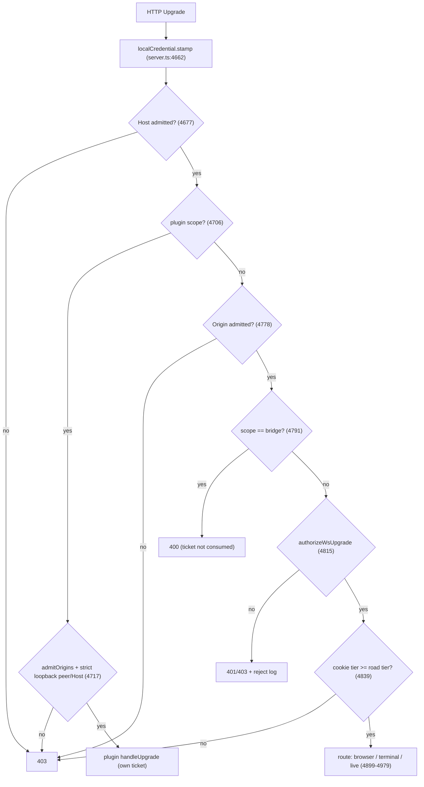
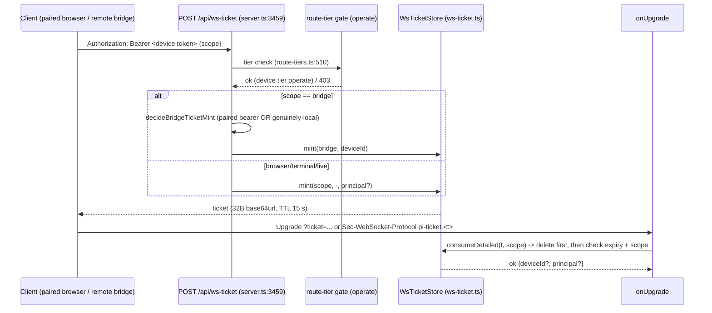
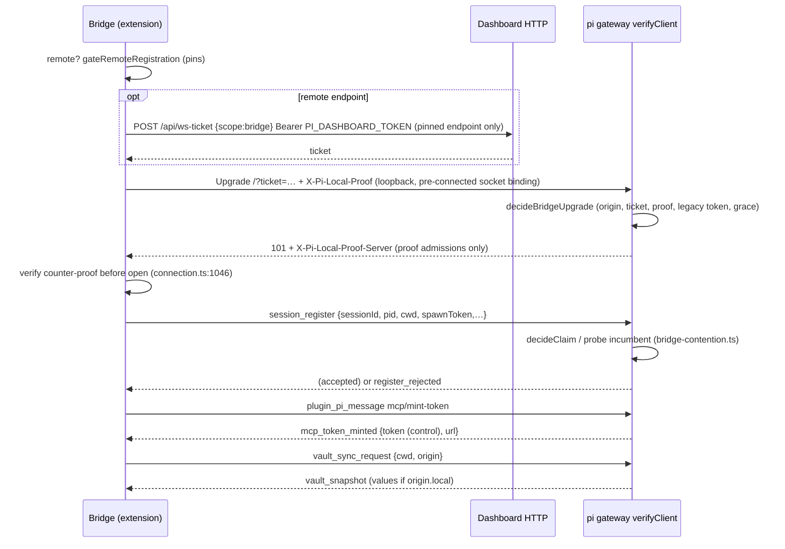
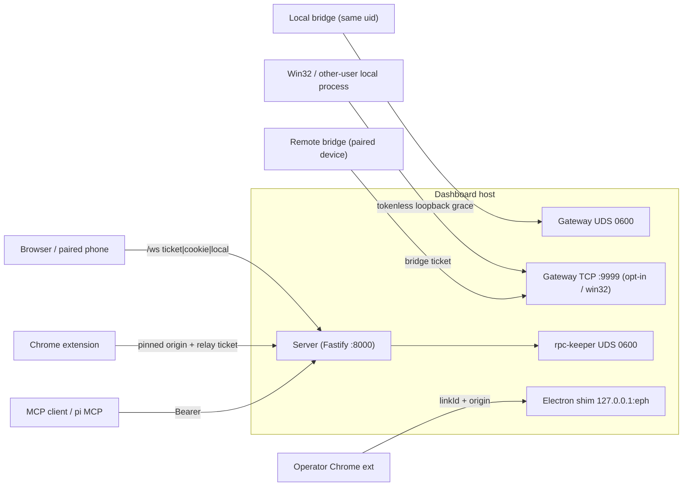

# WebSocket / streaming protocols + bridge ↔ server trust
> Scope: every WS listener (core `/ws`, `/ws/terminal/*`, `/live/*`, `/ws/bridge`, pi gateway UDS/TCP, plugin `ctx.registerWsRoute` scopes, Electron browser-host shim), rpc-keeper socket, dashboard `/mcp` transport; bridge identity/auth; browser→server and server→bridge side-effect messages; DoS bounds. · Evidence base: HEAD e54074304 · Mapper: 03-websocket-and-bridge (prefix WS-) · Map index: [security-map.md](../security-map.md) · Register: [residual-risks.md](residual-risks.md)

## Summary
- One shared upgrade switch `onUpgrade` on the dashboard HTTP port (and the optional TLS listener) routes 4 core scopes + plugin scopes: `packages/server/src/server.ts:4656`, `server.ts:4983`, `packages/server/src/tls/tls-listener.ts:234`.
- Gate order on dashboard port: local-credential stamp → Host admission → (plugin scope: plugin origin list + strict loopback peer) → Origin gate → `bridge` refused 400 → credential (`authorizeWsUpgrade`) → road tier → host policy: `server.ts:4662`, `:4677`, `:4706`, `:4778`, `:4791`, `:4815`, `:4839`, `:4875` (`gateRoadUpgrade`).
- Browser WS credential = any of: genuinely-local peer (proof required by default), valid local credential, single-use scope-bound ticket, login cookie, trusted network (`packages/server/src/auth/auth-plugin.ts:762-789`). Identity mode (resolver plugin active) = principal-bearing ticket ONLY (`auth-plugin.ts:744-756`).
- Tickets: 32 random bytes, 15 s TTL, in-memory, deleted on first attempt, bound to one core scope; minted by `POST /api/ws-ticket` (route tier `operate`): `packages/server/src/auth/ws-ticket.ts:51-52`, `:194-205`; `packages/shared/src/route-tiers.ts:510`. Not bound to Origin/IP.
- Per-message tier gate applies ONLY to cookie-session sockets; ticket / local / trusted-network sockets are un-tiered (`packages/server/src/pairing/ws-tier-gate.ts:4-12`, `:24-31`).
- Pi gateway default on POSIX = unix socket `~/.pi/dashboard/gateway-<piPort>.sock` (0600 in 0700 dir), no TCP. TCP only via `PI_GATEWAY_TCP` or where no UDS (win32 / long path) → `127.0.0.1:9999`: `packages/server/src/pi/gateway-transport-policy.ts:48-64`, `packages/shared/src/dashboard-paths.ts:178-183`.
- TCP bridge auth (`decideBridgeUpgrade`): any `Origin` → refuse; valid bridge ticket → allow; loopback + local proof/legacy token → allow; loopback with NOTHING → allow (deprecation grace, `requireTicketOnLoopback: false` hard-coded): `packages/server/src/pi/bridge-upgrade-auth.ts:109-177`, `server.ts:1304`.
- Bridge session identity = self-asserted `sessionId` string; contention rule protects a LIVE incumbent except a matching self-reported `pid`: `packages/server/src/pi/bridge-contention.ts:88-100`.
- Bridge socket capabilities beyond events: vault values (local origin), MCP `control`-tier token, plugin request lane (e.g. Gmail access-token lease), bridge-initiated spawn, cross-session `sessions_list` writes (see Findings).
- No core WS server sets `maxPayload` → `ws` 8.21.3 default 100 MiB (`node_modules/ws/lib/websocket-server.js:74`). Only the Electron shim caps (16 MiB). Server→browser back-pressure sheds at 4 MiB `bufferedAmount` (`packages/server/src/pairing/browser-gateway.ts:980`). Bridge inbound: prompt bucket 30/10 s, bash 4/session (`packages/extension/src/inbound-limits.ts:27-31`).

## Inventory

### WS / socket endpoints

| Path / socket | Server file:line | Peer | Upgrade auth | Origin check? | maxPayload / rate limits | Evidence |
|---|---|---|---|---|---|---|
| `GET /ws` (scope `browser`) | `packages/server/src/server.ts:4899` → `packages/server/src/pairing/browser-gateway.ts:658` | Browser SPA, paired phone, Electron renderer | Host gate → Origin gate → `authorizeWsUpgrade` (local / local-credential / ticket / cookie / trusted-net); identity mode: principal ticket only | Yes: `isWsOriginTrusted` → `isOriginAdmitted`; absent Origin admitted, `""`/padded refused | No `maxPayload` (100 MiB default). No inbound msg rate limit. Outbound shed at `MAX_WS_BUFFER` 4 MiB | `server.ts:4778`, `packages/server/src/auth/cors-origin.ts:292-305`, `auth-plugin.ts:697-789`, `browser-gateway.ts:980` |
| `GET /ws/terminal/<termId>` (scope `terminal`) | `server.ts:4941` → `packages/server/src/terminal/terminal-gateway.ts:48-75` | Browser xterm | As `/ws` (scope-bound ticket); cookie socket needs tier `operate` (`TERMINAL_TIER`); identity mode: owner equality + host policy `terminal.read` | Yes (same core gate) | No `maxPayload`. Resize floor only (cols/rows ≥2, no upper bound) | `terminal-gateway.ts:40`, `packages/shared/src/ws-message-tiers.ts:131`, `server.ts:4839-4847`, `packages/server/src/terminal/terminal-manager.ts:398-416` |
| `GET /live/<id>/…` (scope `live`) | `server.ts:4965` → `packages/server/src/live-server/live-server-proxy.ts:339` | Sandboxed preview iframe (HMR) | As `/ws` OR validated live capability path `/live/<id>/~c/<token>/`; cookie socket needs tier `control` | Yes; `Origin: null` admitted only with valid capability | Socket destroyed at principal expiry | `server.ts:4772-4777`, `cors-origin.ts:317-326`, `ws-message-tiers.ts:129` |
| `/ws/bridge` on dashboard port | `server.ts:4791-4805` | (none) | Always 400 + reject-log; ticket presence logged, NOT consumed | Gate runs before | n/a | `server.ts:4791` |
| Pi gateway UDS `~/.pi/dashboard/gateway-<piPort>.sock` | `packages/server/src/pi/pi-gateway.ts:1270-1304`, `packages/server/src/pi/gateway-socket-bind.ts:149-182` | pi bridge extension (same OS user) | None — file mode `0600`, dir `0700` (chmod best-effort) | n/a (`unixUpgrades` exempt) | No `maxPayload`; heartbeat/ping only | `pi-gateway.ts:1130-1133`, `gateway-socket-bind.ts:155-160,175-179` |
| Pi gateway TCP `host:piPort` (default `9999`; opt-in `PI_GATEWAY_TCP`, win32 / long-path default `127.0.0.1`) | `pi-gateway.ts:1098-1186` (`verifyClient`) | Remote bridge (paired device), Windows local bridge, container external pi | `decideBridgeUpgrade`: bridge ticket; loopback local proof; loopback legacy raw token; loopback tokenless grace | Refuses ANY `Origin` header | No `maxPayload`; counter-proof header `X-Pi-Local-Proof-Server` on proof admissions | `bridge-upgrade-auth.ts:109-177`, `pi-gateway.ts:1140-1182`, `packages/shared/src/config.ts:1629` |
| Pi gateway loopback fallback `127.0.0.1:piPort` (UDS bind failed) | `pi-gateway.ts:1309-1328` | local bridge | Ticket or local credential only (`requireLocalCredential: true` → no grace) | Refuses any `Origin` | as above | `pi-gateway.ts:1314`, `:1147`, `packages/server/src/pi/gateway-listeners.ts:56-73` |
| In-process ACP "local" connection | `pi-gateway.ts:1267` (`attachLocalConnection`) | ACP session adapter (in-process) | n/a (no socket) | n/a | n/a | `pi-gateway.ts:471-476` |
| Plugin scope `/ws/browser-ext/<guid>` (`browser-plugin`) | `packages/browser-plugin/src/server/ws-routes.ts:100-130` | Playwright Chrome extension | Core: host gate + exact `admitOrigins=[chrome-extension://mmlmfjhmonkocbjadbfplnigmagldckm]` + loopback peer + loopback `Host` + no forwarding header (proof skipped, `peerCredential:"plugin"`); plugin: single-use relay ticket `?ticket=` before guid lookup | Yes, exact pinned extension origin | No `maxPayload` | `server.ts:4706-4751`, `packages/server/src/auth/localhost-guard.ts:159-177`, `ws-routes.ts:43-47` |
| Plugin scope `/ws/browser-cdp/<guid>` | `ws-routes.ts:132-165` | Playwright `connectOverCDP` / `agent-browser connect` | Core strict loopback; plugin refuses any `Origin`, then single-use ticket | Any Origin → 403 | No `maxPayload` | `ws-routes.ts:139-150` |
| Any other plugin `ctx.registerWsRoute` scope | `packages/dashboard-plugin-runtime/src/server/ws-route-registry.ts:155-210` | plugin-defined | Core: host gate + origin (`admitOrigins` replaces dashboard policy if non-empty) + `isPluginScopePeerLocal` (loopback peer+Host, no 8 forwarding headers, strict proof unless `peerCredential:"plugin"`). Plugin scopes unticketable | Yes | plugin-defined | `server.ts:4706-4751`, `ws-ticket.ts:26-33` |
| Electron browser-host shim `ws://127.0.0.1:<ephemeral>/ws/browser-ext/<linkId>` | `packages/electron/src/lib/browser-host/shim.ts:92-135` | Stock Playwright extension in operator Chrome | Registered, unclaimed `linkId` (operator-allowed, single use, 60 s TTL) + pinned Origin; everything else 404 | Yes (not auth — forgeable by local process; linkId is credential) | `maxPayload` 16 MiB | `shim.ts:1-21`, `:33-36`, `:98-106` |
| rpc-keeper UDS `~/.pi/dashboard/sessions/<sessionId>.rpc.sock` / win32 `\\.\pipe\pi-rpc-<sessionId>` | `packages/server/src/rpc-keeper/keeper.cjs:198-240` | dashboard server (writes JSON lines to pi stdin) | None — file mode `0600` best-effort; win32 default pipe ACL | n/a | No line/buffer cap | `keeper.cjs:51-53`, `:234-237`, `:247-260` |
| `POST /mcp`, `/mcp/observe`, `/mcp/control` (HTTP, JSON-RPC; `subscriptions/listen` = long-lived NDJSON response) | `packages/mcp-server-plugin/src/server/routes.ts:188-300` | MCP clients, local pi sessions (built-in MCP) | Bearer ONLY (session MCP token or paired-device bearer); no loopback carve-out; cookie ignored | Not checked (header-only bearer) | `@fastify/rate-limit` 100 000/min, loopback allow-listed; failed-auth throttle per (ip, credential fingerprint) | `packages/mcp-server-plugin/src/server/auth.ts:1-23`, `routes.ts:105-118`, `:239-257` |

### Ports / sockets defaults

| Listener | Default | Defined |
|---|---|---|
| Pi gateway TCP port | `9999` (`PI_DASHBOARD_PI_PORT` → `PI_GATEWAY_PORT` → config `piPort`) | `packages/shared/src/config.ts:1629`, `:1667-1668` |
| Pi gateway TCP listener | absent on POSIX unless `PI_GATEWAY_TCP` truthy; win32 → `127.0.0.1` | `gateway-transport-policy.ts:19-21`, `:48-64` |
| Container gateway publish | `${PI_GATEWAY_BIND:-0.0.0.0}:9999`, `PI_GATEWAY_TCP=1` | `docker/compose.yml:28`, `:39` |
| Electron shim | `127.0.0.1:0` while ≥1 link registered | `shim.ts:28`, `:126-135` |

## Flows

### Upgrade gate order (dashboard port)

### WS ticket

### Bridge connect handshake (TCP, loopback marked dial)

### Trust boundaries

## Controls detail

### C1 Host admission (WS)
- Purpose: DNS-rebinding refusal before any ticket consumed. Enforcement `server.ts:4676-4689` (`evaluateHostGate`). Fail-closed 403. Applies to core + plugin scopes. Pi gateway TCP has no Host gate (ws `verifyClient` only).

### C2 Origin gate (CSWSH)
- Core: `isWsOriginTrusted` (`cors-origin.ts:317-326`) → `isOriginAdmitted` (`cors-origin.ts:292-305`). Absent Origin → admitted (non-browser clients). `""` → refused. Whitespace-padded → refused.
- `live`: `Origin: null` only with validated capability (`cors-origin.ts:324`).
- Plugin: non-empty `admitOrigins` replaces policy, exact match, absent refused (`cors-origin.ts:339-347`).
- Bridge TCP: any Origin refused (`bridge-upgrade-auth.ts:119-125`); `browser-cdp` same (`ws-routes.ts:142-145`).
- Tests: `packages/server/src/__tests__/ws-origin-gate.test.ts`, `packages/server/src/__tests__/plugin-ws-route.test.ts`.

### C3 Browser-scope credential (`authorizeWsUpgrade`)
- `packages/server/src/auth/auth-plugin.ts:697-789`. Order: identity-ticket-only mode (`:744-756`) → genuinely-local `isLocallyTrusted` (`:762`) → local credential (`:763`) → ticket (`:764-769`) → live capability → cookie JWT (+`isSessionLive`) → trusted networks (`:786-789`).
- `isLocallyTrusted` = loopback peer + no forwarding header + (strict ⇒ local proof cookie or local credential) (`localhost-guard.ts:93-101`). `requireLocalProof` default `true` (`packages/shared/src/config.ts:1839`, `:2814`).
- Fail-closed: 401 (auth secret set) / 403, reject log (`server.ts:4849-4865`).
- Tests: `packages/server/src/__tests__/authorize-ws-upgrade.test.ts`, `ws-upgrade-routing.test.ts`, `ws-upgrade-reject-log.test.ts`.

### C4 WS ticket store
- `ws-ticket.ts:150-216`. TTL 15 s (`:51`), 32 B (`:52`), delete-before-check (`:198`), scope equality (`:203`), lazy sweep of expired only on mint (`:161`, `:211-215`). No cap on outstanding tickets. No Origin / IP binding. Carriers: `?ticket=` or `pi-ticket.<t>` subprotocol (`:114-142`).
- Mint: `POST /api/ws-ticket` `preHandler: networkGuard` (`server.ts:3459-3508`); route tier `operate` (`route-tiers.ts:510`); plugin scope names → 400 (`server.ts:3470-3473`); `bridge` narrowed by `decideBridgeTicketMint` (paired bearer or genuinely-local) (`packages/server/src/auth/bridge-ticket-eligibility.ts:66-82`). Non-bridge ticket binds principal, NOT deviceId (`server.ts:3501-3506`).
- Tests: `packages/server/src/__tests__/ws-ticket.test.ts`, `bridge-ticket-eligibility.test.ts`, `bridge-ticket-scope.test.ts`.

### C5 Browser per-message gates
- Parse: `JSON.parse` + type cast, malformed dropped (`browser-gateway.ts:2001-2007`). No schema validation (zod absent); spot checks per handler (e.g. `retry_session`, `stop_after_turn` at `browser-gateway.ts:2175-2192`).
- Tier gate: `decideWsTier` (`browser-gateway.ts:2071-2088`; `ws-tier-gate.ts:24-31`); unlisted type ⇒ `operate` (`ws-message-tiers.ts:133-136`). Only cookie sockets carry `sessionTier` (`server.ts:4926`); terminal sockets get the stamp at upgrade since close-security-map-high-findings (`TerminalGateway.handleUpgrade` `sessionTier` arg), so `sweepRevokedSockets` (`pairing/ws-tier-gate.ts`, run from `onAuthReloaded` in `server.ts`) closes browser + terminal sockets of a refused/removed OAuth provider with `WS_CLOSE_SESSION_REVOKED` 4401 on auth reload. Live-preview sockets (`case "live"`) NOT swept → WS-18.
- Owner gate (identity mode only): `browser-gateway.ts:2099-2113`. Host policy gate (identity mode + policy): `browser-gateway.ts:2120-2136`. ACP guard: `browser-gateway.ts:2141`.
- Remote folder gate (pin/add/move folder): `packages/server/src/browser-handlers/folder-gate.ts:19-55`; locality stamped once at upgrade `packages/server/src/pairing/socket-locality.ts:16-24`.
- Tests: `packages/server/src/pairing/__tests__/ws-tier-gate.test.ts`.

### C6 Bridge upgrade auth (TCP)
- `decideBridgeUpgrade` (`bridge-upgrade-auth.ts:108-188`): unix allow (`:109`); Origin refuse (`:119`); loopback = loopback IP AND no forwarding header (`:136-137`); ticket (`:139-146`); proof `valid` (`:156`); `legacy` raw token (deprecated) (`:159-165`); tokenless grace unless `requireTicketOnLoopback` (`:167-175`).
- Wiring: `server.ts:1299-1308` sets `requireTicketOnLoopback: false`; only `startLoopbackFallback` forces it (`pi-gateway.ts:1147`, `:1314`). Win32 primary listener started with `kind:"loopback"` without `requireLocalCredential` (`gateway-listeners.ts:33-35`).
- Local credential verifier: `acceptLegacyToken: true` (`server.ts:768`). Proof = HMAC bound to connection's own local addr:port, ±30 s, replay cache (see `packages/server/src/auth/local-credential.ts`).
- Counter-proof for proof admissions: `pi-gateway.ts:1166-1168`, `:1178-1183`. Bridge verifies before open (`packages/extension/src/connection.ts:1046-1066`); opt-out `PI_DASHBOARD_ALLOW_UNPROVEN_LOCAL_SERVER` (`packages/extension/src/local-token-header.ts:53`).
- Refusal: 401, cause logged server-side only (`pi-gateway.ts:1156-1162`).
- Tests: `packages/server/src/__tests__/bridge-upgrade-auth.test.ts`, `gateway-transport-policy.test.ts`, `gateway-socket-bind.test.ts`, `pi-gateway-socket-transport.test.ts`, `packages/extension/src/__tests__/local-token-header.test.ts`.

### C7 Session origin attribution
- `attributeOrigin` (`packages/server/src/session/session-origin.ts:57`) from transport + peer loopback + ticket deviceId (`pi-gateway.ts:477-493`). Remote w/o device → `UNATTRIBUTED_REMOTE` (`session-origin.ts:26`). Origin derived from credential, never payload (`pi-gateway.ts:908-909`). Consumers: vault trust `decideVaultTrust` (`packages/server/src/vault/vault-delivery-hub.ts:37-42`).

### C8 Bridge session claim / contention
- `decideClaim` (`bridge-contention.ts:82-103`): unheld/closed/placeholder → accept; same self-reported pid → accept (displace live); else probe → `resolveProbe` (`:112-119`). Gateway `claim()` loop, max attempts (`pi-gateway.ts:564-631`).
- Auto-claim: first message with `sessionId` on unclaimed socket claims an unheld id + creates placeholder session (`pi-gateway.ts:764-791`).
- Ownership gate: named `sessionId` must map to this socket (`pi-gateway.ts:815`); `plugin_pi_message` attributed to connection's `currentSessionId` (`pi-gateway.ts:808-811`, `:1024-1029`).
- Move: provisional claims nothing; commit uses token's id, refuses live incumbent (`pi-gateway.ts:666-757`, `:834-870`).
- Tests: `bridge-contention.test.ts`, `pi-gateway-duplicate-register.test.ts`, `contention-refusal-side-effects.test.ts`.

### C9 Bridge-side identity of server (bridge → which server)
- Remote: `gateRemoteRegistration` — no pins at all ⇒ allow `unpinned-legacy` (`packages/extension/src/remote-registration-gate.ts:70`); pins ⇒ challenge or refuse. Device bearer only to pinned endpoint (`packages/extension/src/pinned-endpoint.ts`; per `packages/extension/src/AGENTS.md` row). Ticket client re-mints per attempt, `redirect:"error"` (`packages/extension/src/bridge-ticket-client.ts.AGENTS.md`).
- Discovery retarget: health + proof (`packages/extension/src/server-proof-probe.ts:74`).
- Instance verification on rendezvous endpoint (`packages/extension/src/instance-verification.ts`).

### C10 Bridge inbound bounds
- Prompt bucket per bridge process (burst 30, refill 10/s) over `send_prompt`, `retry_session`, `git_commit_draft`, `plugin_emit_event`, `promote_followup_entry`, `flow_management:run` (`packages/extension/src/bridge-handlers/dispatch.ts:28-41`, `:66-71`; defaults `inbound-limits.ts:27-31`).
- Bash concurrency 4/session (`inbound-limits.ts:27`; `packages/extension/src/command-handler.ts:1511`).
- Transcript request: own session only, no path field (`dispatch.ts:76-110`).
- Tests: `packages/extension/src/__tests__/inbound-limits.test.ts`.

### C11 Back-pressure / DoS
- Server→browser: shed transcript-class frames over `MAX_WS_BUFFER` 4 MiB (`browser-gateway.ts:980`, `:1025`); never-shed classes listed `browser-gateway.ts:105-160`.
- Plugin request lane payload cap 256 KiB (`packages/server/src/plugin-request-lane.ts:21`, `:80`).
- No `maxPayload` on `browser-gateway.ts:658`, `terminal-gateway.ts:40`, `pi-gateway.ts:1174`, `:1273`, `ws-routes.ts:97-98`.

### C12 `/mcp` transport
- Bearer from `Authorization` only; repeated header refused (`mcp-server-plugin/src/server/auth.ts:57-60`). Session token minted on bridge `mcp/mint-token`, attributed to connection id (`mcp-server-plugin/src/server/index.ts:206-227`); session tokens hard-wired tier `control` (`mcp-server-plugin/src/server/tokens.ts:46`, `:123`). In-memory, die with session (`index.ts:242-246`).
- Throttle before compare (`routes.ts:239-251`); global limiter allow-lists loopback (`routes.ts:113-118`).

## Inbound message handling

### Browser → server (side-effecting)

| Message type | Direction | Effect | Authorization check path:line |
|---|---|---|---|
| `send_prompt` | browser→server→bridge | Prompt into pi; `!`/`!!` prefix runs host bash | tier control `ws-message-tiers.ts:79`; dispatch `browser-gateway.ts:2165`; bash `command-handler.ts:366-373`, `:729` |
| `abort`, `stop_after_turn`, `retry_session` | →bridge | Abort / stop / retry turn | control `ws-message-tiers.ts:44,96,78`; `browser-gateway.ts:2168-2192` |
| `spawn_session`, `resume_session` | server | Spawn pi process at `msg.cwd` (preflight only) | control `ws-message-tiers.ts:95,77`; `browser-gateway.ts:2274-2288`; `packages/server/src/browser-handlers/session-action-handler.ts:789` |
| `shutdown`, `archive_session` | server/bridge | End session / terminate idle process | control `ws-message-tiers.ts:94,48`; `browser-gateway.ts:2222-2233` |
| `force_kill`, `kill_process` | server / bridge | Kill pi / kill arbitrary pgid on bridge host | operate `ws-message-tiers.ts:112,114`; `browser-gateway.ts:2207-2215`; forward verbatim `session-action-handler.ts:1209` |
| `create_terminal`, `open_inline_terminal`, `kill_terminal`, `rename_terminal`, `close_inline_terminal` | server | PTY lifecycle; cwd admission `admitRouteCwd` | operate `ws-message-tiers.ts:110-120`; `browser-gateway.ts:2488-2507`; `packages/server/src/browser-handlers/terminal-handler.ts:112` |
| Terminal input (binary/text frames on `/ws/terminal/*`) | server→PTY | Shell input, resize | Upgrade only (C3 + `TERMINAL_TIER`); `terminal-manager.ts:398-420` |
| `extension_ui_response`, `prompt_response`, `architect_prompt_response` | →bridge | Answer agent dialogs (MCP road removed — TOOL-01 closed by close-security-map-high-findings; this WS road remains, TOOL-20) | control `ws-message-tiers.ts:56,65,47`; `browser-gateway.ts:2392-2424` |
| `flow_control`, `flow_management` | →bridge | Flow run/stop/manage | control `ws-message-tiers.ts:58-59`; `browser-gateway.ts:2210`, `:2408` |
| `role_set`, `role_preset_*`, `role_remove` | →bridge | Model-role config | operate `ws-message-tiers.ts:121-125`; `browser-gateway.ts:2425-2465` |
| `ui_management` | →bridge | Re-emitted on `pi.events` | control `ws-message-tiers.ts:97`; `browser-gateway.ts:2473`; bridge `dispatch.ts:114-117` |
| `set_model`, `set_thinking_level`, `request_*`, `list_files` | →bridge | Closed forward set | `packages/server/src/browser-handlers/directory-handler.ts:608-634` |
| `pin_directory`, `add_folder_to_workspace`, `move_folder_to_workspace` | server | Widen browse roots | control + remote folder gate `folder-gate.ts:19-55`; `directory-handler.ts:31,362,432` |
| `grant_response`, `provision_response` | server | Access grants | operate `ws-message-tiers.ts:113,119`; operator socket `browser-gateway.ts:1802-1803` |
| `plugin_action`, plugin custom types | plugin | Plugin handler | `plugin_action` operate; unlisted ⇒ operate (`ws-message-tiers.ts:117`, `:133-136`); `browser-gateway.ts:2528-2552` |
| `browser_host_*`, `browser_relay_input` | browser-plugin | Real-browser input relay | operate `ws-message-tiers.ts:103-109` |
| Layout/workspace (`create_workspace`, `reorder_*`, `set_*`) | server persisted state | Shared UI state | control `ws-message-tiers.ts:43-100` |

### Server → bridge (makes pi act)

| Message type | Effect in pi process | Bridge-side check path:line |
|---|---|---|
| `send_prompt` | User message / slash command / `!` bash | prompt bucket `dispatch.ts:66-71`; bash slot `command-handler.ts:1511` |
| `retry_session`, `abort`, `stop_after_turn` | Turn control | bucket (retry) `dispatch.ts:31-33`; `command-handler.ts:976-1023` |
| `kill_process {pgid}` | `kill(-pgid, SIGTERM)` / `taskkill /T /F` | none (pgid truthy) `command-handler.ts:1184-1191`; `packages/shared/src/platform/process.ts:249` |
| `shutdown` | pi exits | `command-handler.ts:1193` |
| `vault_snapshot` | Writes granted secrets into `process.env` | `packages/extension/src/vault-delivery.ts` (hash-tracked) |
| `mcp_token_minted` | Registers `pi-dashboard` MCP server with token+URL | `packages/extension/src/mcp-token-delivery.ts` |
| `plugin_emit_event` | Re-emit on `pi.events` (may start turn) | bucket `dispatch.ts:34` |
| `git_commit_draft` | Runs commit-draft agent | bucket `dispatch.ts:33` |
| `transcript_request` | Reads own session file slice | own-session guard `dispatch.ts:80-90` |
| `server_restarting {quiesceMs}` | Pause auto-start ≤120 s | `dispatch.ts:132-140` |
| `ui_management`, `flow_management`, `role_*`, `credentials_updated`, `preferences_update` | Extension UI / flows / roles / provider reload | `dispatch.ts` (no auth; server is trusted) |

### Bridge → server (side-effecting)

| Message type | Server effect | Check path:line |
|---|---|---|
| `session_register` | Claim id, register session (cwd, pid, sessionFile self-reported) | contention `pi-gateway.ts:872`; `bridge-contention.ts:82-103` |
| any msg with `sessionId` (first frame) | Auto-claim unheld id + placeholder session | `pi-gateway.ts:764-791` |
| `event_forward`, `notify`, `prompt_request`, `extension_ui_request` | Stored + fanned out to browsers | ownership `pi-gateway.ts:815`; `event-wiring.ts:2445`, `:2553` |
| `asset_register` | Cache base64 asset in session, broadcast | non-empty strings only `event-wiring.ts:2622-2646` |
| `spawn_new_session {cwd}` | Server spawns pi at cwd | none `event-wiring.ts:2734-2757` |
| `sessions_list` | Register/update OTHER session ids' `sessionFile`/`sessionDir`; `broadcastToAll` | none on item ids `event-wiring.ts:2759-2790` |
| `process_list` | Stored + broadcast | `event-wiring.ts:2792-2804` |
| `vault_sync_request` | Vault values for self-reported cwd/origin | `decideVaultTrust` `vault-delivery-hub.ts:37-42` |
| `plugin_request` | Plugin handler (e.g. `gmail/lease` returns access token) | lane `plugin-request-lane.ts:57-80`; `event-wiring.ts:1103`; `packages/gmail-plugin/src/server/lease.ts:1-16` |
| `plugin_pi_message` (`mcp/mint-token`) | Mint `control` MCP token for connection's session | `pi-gateway.ts:808-811`; `mcp-server-plugin/src/server/index.ts:206` |
| `path_grant_request`, `path_yolo_request` | Persist "always allow" for raised confirm | `event-wiring.ts:1111`, `:1132` |
| `session_move_commit` | Routing transfer by token | `pi-gateway.ts:666-757` |

## Config & env knobs

| Key | Default | Effect | path:line |
|---|---|---|---|
| `PI_GATEWAY_TCP` / `config.gatewayTcp` | off (POSIX) | Adds TCP gateway on `host:piPort` | `gateway-transport-policy.ts:19-21`; `server.ts:3972` |
| `PI_DASHBOARD_PI_PORT` / `PI_GATEWAY_PORT` / `piPort` | `9999` | Gateway TCP port + UDS name | `config.ts:1629`, `:1667-1668` |
| `requireTicketOnLoopback` | `false` (hard-coded) | Tokenless loopback bridge grace | `server.ts:1304` |
| `acceptLegacyToken` | `true` (hard-coded) | Raw `X-Pi-Local-Token` accepted | `server.ts:768` |
| `requireLocalProof` | `true` | Strict genuinely-local (browser/terminal/live, ticket mint) | `config.ts:1839`, `:2814` |
| `PI_DASHBOARD_BRIDGE_MAX_BASH` | `4` | Concurrent bash per session | `inbound-limits.ts:27`, `:33` |
| `PI_DASHBOARD_BRIDGE_PROMPT_RATE` | `30/10` | Turn-starting command bucket | `inbound-limits.ts:29-34` |
| `PI_DASHBOARD_ALLOW_UNPROVEN_LOCAL_SERVER` | unset | Bridge skips server counter-proof | `local-token-header.ts:53` |
| `PI_DASHBOARD_REQUIRE_SERVER_PROOF` | spawn marker | Bridge demands counter-proof on endpoint | `packages/shared/src/local-credential-proof.ts:29` |
| `PI_DASHBOARD_TOKEN` | unset | Remote bridge device bearer | `bridge-ticket-client.ts.AGENTS.md` (`DEVICE_TOKEN_ENV`) |
| `maxWsBufferBytes` | 4 MiB | Server→browser shed threshold | `browser-gateway.ts:980` |
| `TICKET_TTL_MS` | 15 000 ms (const) | WS ticket lifetime | `ws-ticket.ts:51` |
| Container `PI_GATEWAY_BIND` / `PI_GATEWAY_TCP` | `0.0.0.0` / `1` | Gateway published to network | `docker/compose.yml:28`, `:39`; `docker/.env.example:20,30` |

## Test/dev-only

| Item | Note | Evidence |
|---|---|---|
| `peerAddressForTest` | Overrides peer address in origin attribution | `pi-gateway.ts:481-482` |
| `docker/compose.test.peer.yml` | Sets `PI_GATEWAY_TCP=1` for peer harness | `docker/compose.test.peer.yml:43` |

## Planned (not shipped)
- `openspec/changes/prove-vault-bridge-tls/` — TLS bridge listener (`tls.acceptBridges`), hub-local vault delivery requires UDS / proof / in-process (excludes legacy token + tokenless grace), withdraw on device revoke. PROPOSED only (`openspec/changes/prove-vault-bridge-tls/proposal.md`).

## Findings

| ID | Sev | Title | Evidence (path:line) | Impact | Suggested remedy |
|---|---|---|---|---|---|
| WS-01 | High | Tokenless loopback bridge grace still open; default transport on win32 (and long-UDS-path hosts) | `server.ts:1301-1304`; `bridge-upgrade-auth.ts:167-175`; `gateway-listeners.ts:33-35` (`kind:"loopback"`, no `requireLocalCredential`); `dashboard-paths.ts:178-183`; origin local `pi-gateway.ts:477-493`; vault `vault-delivery-hub.ts:39`; MCP `index.ts:206`, `tokens.ts:123` | Any local process (on win32 any OS user — loopback is host-wide; or any L4 forwarder `ssh -L`/socat) registers sessions with LOCAL origin ⇒ receives vault values for self-reported cwd/origin, mints `control` MCP token (drive all sessions), Gmail leases, session hijack (WS-02). HTTP plane meanwhile requires proof by default (`config.ts:1839`). Needs verification on a win32 host | Set `requireTicketOnLoopback: true` (or tie to `requireLocalProof`); require `valid` proof on primary win32 listener; drop grace (comment promises "refused from 1.0.0") |
| WS-02 | Medium | Self-reported `pid` displaces a LIVE bridge (session hijack) | `bridge-contention.ts:96-100`; `pi-gateway.ts:582-590`, `:903-904` | Any authenticated bridge peer that knows a session's id + pid (both visible to browsers / process list) takes the routing entry ⇒ receives user prompts, `vault_snapshot`, re-mints MCP token (old one dies), injects events. Same-uid on UDS = accepted risk; remote device bridge / WS-01 peers = real | Accept same-pid only when the incumbent fails the probe, or bind reconnect to a server-minted per-session secret issued at first register |
| WS-03 | Medium | Session id is an unauthenticated name: any bridge claims unheld / disconnected ids | `pi-gateway.ts:764-791` (auto-claim + placeholder); `bridge-contention.ts:88-90` (`unheld`, `incumbent-closed`) | During reconnect grace or after restart, a rival bridge claims the victim id ⇒ prompts typed in UI routed to attacker; placeholder session spam | Per-session reconnect secret; refuse auto-claim of ids with a recorded session from a different origin/device |
| WS-04 | Medium | Paired-device revocation does not close open sockets | revoke `packages/server/src/routes/pairing-routes.ts:617-628` (no socket teardown); browser ticket carries no deviceId `server.ts:3506`; ticket sockets un-tiered `ws-tier-gate.ts:7-10` | Revoked phone / remote bridge keeps live `/ws`, terminal and bridge sockets indefinitely (inert era: no principal expiry). Planned fix only for vault withdrawal | Record deviceId on every ticket-admitted socket; on revoke/hold close sockets (4401) |
| WS-05 | Medium | Plugin request lane has no origin gate — remote bridge leases Gmail access tokens | `plugin-request-lane.ts:1-12`, `:57`; `event-wiring.ts:1103-1106`; `packages/gmail-plugin/src/server/lease.ts:1-5` ("request lane is private but unauthenticated"); contrast vault `vault-delivery-hub.ts:37-42` | Remote-attributed bridge (paired device via `PI_GATEWAY_TCP`, plain `ws`) or WS-01 peer obtains OAuth access tokens held by hub; inconsistent with vault D3 remote refusal | Pass `SessionOrigin` in lane `meta`; plugins holding credentials refuse non-local / non-TLS origins by default |
| WS-06 | Low | No `maxPayload` on core WS servers (100 MiB default) | `browser-gateway.ts:658`; `terminal-gateway.ts:40`; `pi-gateway.ts:1174`, `:1273`; `ws-routes.ts:97-98`; `node_modules/ws/lib/websocket-server.js:74` | Any authenticated peer (incl. control-tier device, WS-01 peer) forces 100 MiB buffer + `JSON.parse` per frame ⇒ memory/CPU DoS. Unbounded `asset_register` cache `event-wiring.ts:2622-2635` | Set `maxPayload` per scope (e.g. 1–16 MiB); cap per-session asset cache |
| WS-07 | Low | Bridge-initiated `spawn_new_session` spawns pi at arbitrary cwd, no gate | `event-wiring.ts:2734-2757` | Any bridge (incl. remote device) spawns processes on hub in any dir; no origin/folder/tier check (browser path has preflight + control tier) | Refuse for non-local origin; apply known-folder admission |
| WS-08 | Low | `sessions_list` writes other sessions' `sessionFile`/`sessionDir` + broadcasts to all browsers | `event-wiring.ts:2759-2790` | Cross-session tampering of resume/transcript paths; spoofed session rows in every browser. Downstream file-read impact: Needs verification | Accept only items owned by connection / same cwd; never update existing session paths from a list |
| WS-09 | Low | `kill_process` pgid unvalidated end-to-end | `session-action-handler.ts:1205-1210`; `command-handler.ts:1184-1191`; `packages/shared/src/platform/process.ts:249` | Operate-tier caller sends `pgid:1` ⇒ `kill(-1,SIGTERM)` = every process of the user; any pid killable. Operate already has terminals ⇒ low uplift | Validate pgid ∈ session's last `process_list`; reject ≤1 |
| WS-10 | Low | `control` tier executes host shell (`!`/`!!` prompt prefix); terminals classed `operate` | `ws-message-tiers.ts:79`, `:131`; `command-handler.ts:366-373`, `:729` | Tier model implies control < operate for code exec; control-tier passkey user / device gets shell anyway (agent tools likewise) | Document control ≈ code-exec; optionally gate `!` prefix at operate |
| WS-11 | Info | No schema validation / per-socket rate limit on WS inbound | `browser-gateway.ts:2001-2007`; `pi-gateway.ts:653-656`; `terminal-manager.ts:398-420` | Type-confusion relies on per-handler spot checks; authenticated flooding unbounded on server | zod/valibot schemas for side-effecting types; token bucket per socket |
| WS-12 | Info | Legacy raw `X-Pi-Local-Token` accepted (HTTP + bridge) | `server.ts:768`; `bridge-upgrade-auth.ts:159-165` | Raw durable secret on wire; replayable vs proof | Remove `acceptLegacyToken` on schedule |
| WS-13 | Info | Doc/code mismatches | `docs/research/bridge-transport-and-identity.md:109-117` (":9999 NO auth" — superseded by `bridge-upgrade-auth.ts`, POSIX default no TCP); `server.ts:1301-1303` ("through 0.9.x, refused from 1.0.0" — HEAD is 0.10.0, still open); `dashboard-paths.ts:182` ("authorised by the local token" — code admits tokenless); `bridge-contention.ts:96-97` / `docs/architecture.md` "Same-pid reconnect exemption" ("never to grant one" — it grants displacement) | Auditors misread posture | Update research doc status; fix comments/reason strings |
| WS-14 | Info | Socket permission hardening is best-effort | `gateway-socket-bind.ts:156-160`, `:175-179`; `keeper.cjs:44-46` (no 0700 on sessions dir), `:234-237`; keeper line buffer unbounded `keeper.cjs:252-260` | chmod failure silently leaves umask mode; same-uid scope only | Fail closed if chmod fails on POSIX; cap keeper line length |
| WS-15 | Info | Ticket store unbounded outstanding set; not bound to Origin/IP | `ws-ticket.ts:157-170`, `:211-215` | Authenticated caller can grow map within 15 s windows; leaked ticket usable from any origin within TTL (Origin gate still applies to browsers) | Cap per caller; optionally bind to minting IP |
| WS-16 | Info | Remote bridge with no pins trusts any endpoint; plain `ws` allowed | `remote-registration-gate.ts:70`; vault notes no TLS proof `vault-delivery-hub.ts:10-13` | Prompts/events cleartext; first-use server not authenticated | Require `wss` + pin for remote; tracked by `prove-vault-bridge-tls` (proposed) |
| WS-17 | Info | `/mcp` global rate limit exempts loopback; session token tier fixed `control` | `routes.ts:113-118`; `tokens.ts:46`, `:123` | Any bridge connection ⇒ control-tier MCP over all sessions (self-target guard only); amplifies WS-01/WS-02 | Scope session tokens to own session/cwd by default Related TOOL-01 (closed by close-security-map-high-findings): MCP `prompt_response` + `extension_ui_response` removed from session-token surface; token tier still `control`. WS-17 NOT closed. |
| WS-18 | Low | Live-preview sockets not swept on auth reload (new, close-security-map-high-findings) | `case "live"` → `handleLiveServerUpgrade` (`packages/server/src/server.ts`); capability-URL scoped, no `sessionTier` | Open live socket of a refused-provider session lives until ticket expiry (`scheduleAtExpiry`); new refused cookie cannot open one (`isSessionLive`). | Owner none. |
