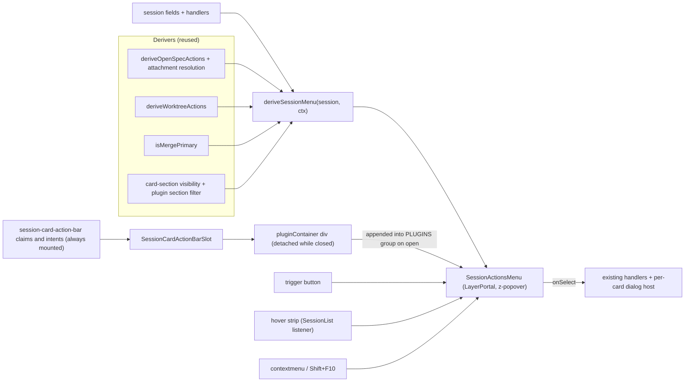

# Session actions menu

Desktop session card. One grouped menu replaces the card action chips.
Change: add-session-actions-flyout. Decisions cited as D1–D13 in `openspec/changes/add-session-actions-flyout/design.md`.

## 1. What it is

- Desktop card header: `⋯` trigger, `data-testid=session-actions-trigger-<id>`.
- Mobile card: unchanged. No menu. `pluginContainer` = `null` when `isMobile`.
- Menu root: `SessionActionsMenu.tsx`, rendered via `LayerPortal` at `z-popover`.
- Items derived by pure `deriveSessionMenu(session, ctx)` in `lib/session/session-menu-items.ts` → `SessionMenuGroup[]`.
- Group order, fixed: `NEXT · SESSION · OPENSPEC · GIT · PLUGINS · VIEW`.
- Empty group omitted. Group title shown. `OPENSPEC` subtitle = change name. `GIT` subtitle = branch.
- `PLUGINS` group rendered by menu host. Testid `session-menu-group-plugins`.
- Dialogs live on per-card dialog host, not inside menu (D3).
- Opening session menu closes folder menu (one open menu, D6).

Entry points (all open same menu, D11):

| Source | Trigger | Focus |
|---|---|---|
| `trigger` | click `session-actions-trigger-<id>` | moves to first enabled item |
| `hover` | pointer dwell in right strip (see §6) | never moves focus; opener = `null` |
| `contextmenu` | right-click on card | moves to first enabled item, at pointer |
| `keyboard` | `Shift+F10` or `ContextMenu` key on card | moves to first enabled item |

- Right-click on `a` / link: native menu kept.
- Keys inside menu `stopPropagation` so card keydown never sees them.

NEXT:
- At most one item. Emphasised primary.
- Merge wins when merge primary; OpenSpec primary stays reachable in OPENSPEC.

SESSION:
- Resume, Fork, New session, New worktree session, Rename…, Archive session, Exit pi session.
- Each only when control would be offered.
- `New worktree session` omitted when `gitWorktree` set.
- Rename omitted when ended.

OPENSPEC (by attachment state):
- Attached and active in session cwd: lifecycle row (Proposal, Design, Specs, Tasks, Archive) as one `role=group`; then Open change, Verify, Fast-forward, Explore…, Archive anyway….
- Archived, missing, unresolved, or active in main checkout: artifact letters only, then Detach.
- No attached change: Attach change…, New change…, Propose…, Explore… (active sessions only), Bulk archive… (when completed changes exist).
- Readiness gate = OpenSpec subcard gate (`session-card-subcards`):
  - `GLOBAL_OFF`, `OPTED_OUT`, `ABSENT`, `PENDING`: group omitted.
  - `BROKEN`, `STALE`: only Detach, when attached. Else omitted.
  - No `readiness` field (older server): degrades as subcard does.

GIT:
- Commit N changes… (when dirty), Switch branch….
- Worktree actions: Push, Open PR / View PR #N, Merge (not when NEXT), Close worktree….

VIEW:
- `Card sections…` → Session cards page of group folder (`gitWorktree.mainPath` for worktree sessions, else session cwd).
- `Card section defaults…` → global Session cards defaults in Settings.

Stays on card (not moved into menu):
- MEMORY subcard content.
- `session-card-badge` claims in STATUS (e.g. relay badge popover).
- Worktree card-section claims (e.g. KB re-index).
- Clickable status segments: mirrored in menu as `session-menu-segment-<id>`; skipped artifact inert in menu.

## 2. Data and slot flow

- Container created once per card: `useMemo(() => document.createElement("div"))`. Never in DOM while closed.
- Portal target: `createPortal(..., pluginContainer)` in `SessionCard.tsx`.
- Inside portal: `ActionListMenuContext.Provider` → `
` → `SessionCardActionBarSlot`.
- Menu `useLayoutEffect` appends container into `data-session-menu-plugins`. Cleanup removes it when `parentNode === host`.

## 3. Plugin author contract

No new API. Existing `session-card-action-bar` claims and intents.

- Claims stay mounted for card lifetime. Not mounted per menu open.
- Output renders only in menu PLUGINS group. Not on card.
- Each plugin wrapped in labelled `role="group"` (`wrapPlugin` in `slot-consumers.tsx`).
- Prefer `ui:action-list` intents. Render as `role="menuitem"` via `ActionListMenuContext` (`client-utils/src/ActionList.tsx`).
- React claim output: focusable controls join menu arrow-key order (APG roving focus).
- Enabled `button`, `a[href]`, `[role='menuitem']` activated in PLUGINS → menu closes (`close(false)`). Card never selected (click stopPropagation).
- Disabled items: `aria-disabled`, stay focusable, inert.
- Claim-owned dialogs survive menu closing. Dialogs use `DialogPortal` to `body`, outside detached container.
- Per-plugin visibility: `isPluginVisible` = `usePluginSectionFilter("actionbar", folderKey)`. Card-section id `actionbar-<pluginId>`. Filters claims and intents.
- Container detached while menu closed. Claim must not measure layout (no `getBoundingClientRect` / `offsetWidth` at mount).
- Throwing claim contained by per-claim `SlotErrorBoundary`. Other plugins unaffected.
- PLUGINS heading hidden when container has no element children. Checked on open; kept current by `MutationObserver` (`childList`, `subtree`, `characterData`) while open.
- Empty output → `hidden` attribute on group. No heading text.

## 4. Flows example

Two claims, two slots, two gates.

| Claim | Slot | Renders | Gate |
|---|---|---|---|
| `SessionFlowMenuClaim` | `session-card-action-bar` | Run Flow…, Open flow…, New, Edit…, Delete (`ui:action-list`) + their dialogs | `flowsActionsAvailable(sessionId)` |
| `SessionFlowActionsClaim` | `session-card-flows` (FLOWS subcard) | `FlowActivityBadge`: status + abort only | `shouldRenderFlowsSubcard(session)` |

- `flowsActionsAvailable(id)` = `hasFlowsCommand(commandsList)` OR `sessionHasFlowEvents(id)`.
- `hasFlowsCommand`: `flows` or `flows:*`. Ignores `flows:new`.
- `shouldRenderFlowsSubcard(session)` = `sessionHasFlowEvents(session.id)` (any flow event).
- Edit-mode reconcile hosted by `SessionFlowMenuClaim` (moved from `SessionFlowActionsClaim`).
- Files: `packages/flows-plugin/src/client/{SessionFlowMenuClaim,SessionFlowActions,flowsActionsGate,shouldRender}.ts(x)`.

## 5. Test hooks

| Testid | Element |
|---|---|
| `session-actions-trigger-<id>` | header `⋯` trigger |
| `session-actions-menu-<id>` | menu panel (`role="menu"`) |
| `session-menu-group-<groupId>` | group wrapper; `groupId` ∈ `next`, `session`, `openspec`, `git`, `view` |
| `session-menu-group-plugins` | PLUGINS group |
| `session-menu-item-<id>` | item (override via `item.testId`) |
| `session-menu-more-<groupId>` | inline `More…` expander (≥ 2 rare items) |
| `session-menu-reason-<id>` | disabled-reason text |
| `session-menu-lifecycle` | lifecycle artifact row |
| `session-menu-segment-<id>` | lifecycle segment (`proposal`, `specs`, `archive`, …) |
| `session-card-spawn-sibling` | legacy: New session item |
| `session-card-spawn-worktree` | legacy: New worktree session item |

- Legacy spawn ids preserved via `testId` on items in `session-menu-items.ts`.
- Test files: `components/session/__tests__/SessionActionsMenu.test.tsx`, `SessionList.actions-menu.test.tsx`, `lib/session/__tests__/session-menu-items.test.ts`.

## 6. Hover strip and tuning

`session-hover-intent.ts` (single module, constants only):

| Constant | Value | Role |
|---|---|---|
| `HOVER_STRIP_PX` | 32 | right-edge strip width |
| `HOVER_DWELL_MS` | 300 | dwell before open |
| `HOVER_SPEED_CUTOFF` | 0.4 px/ms | open only if speed below |
| `HOVER_SPEED_WINDOW_MS` | 100 | speed sample window |
| `HOVER_CLOSE_GRACE_MS` | 300 | close delay outside card ∪ gap ∪ menu |

- Listener: one `pointermove` on `document`, created by `SessionList` (`createHoverIntent(document, …)`).
- Active only when `(hover: hover) and (pointer: fine)` matches.
- Card lookup: `closest('[data-session-card]')`. Rect read ≤ once per frame.
- Skipped when: target in `button, a`; renaming or dragging; click-opened menu open; `[role='dialog'][aria-modal='true']` present.
- Bridge: union rect of card + gap + menu. Keeps menu open while pointer crosses gap.
- Only open/close touch React state. Refs for everything else.
- Speed: ring buffer of last `HOVER_SPEED_WINDOW_MS` samples.
- Tuning: retune constants from accidental-open rate. No spec or task change needed.

Rejected:
- Invisible overlay per card. Would steal clicks from ✕, Archive, stepper.
- Per-card listeners. N listeners, N rect reads per frame.
