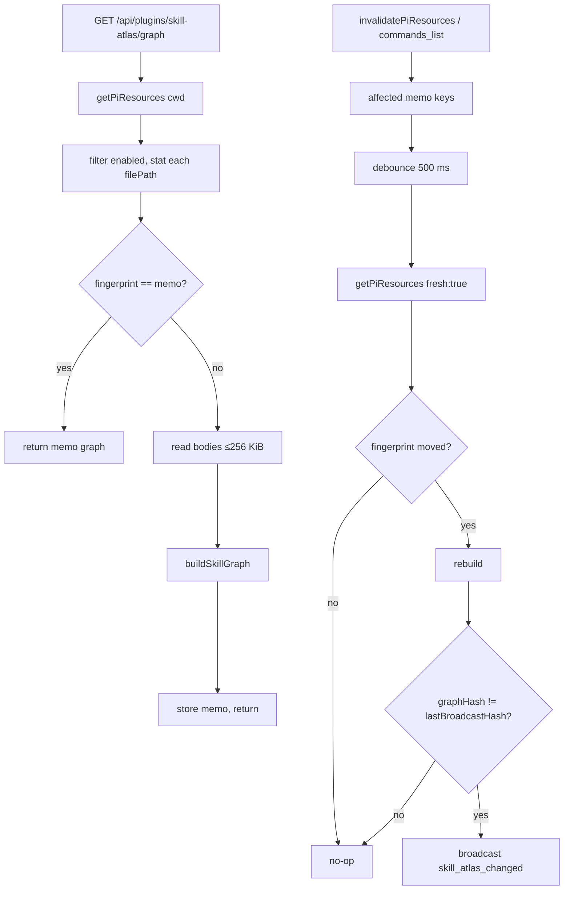

# Skill Atlas

Plugin `skill-atlas` (`packages/skill-atlas-plugin`, npm `@blackbelt-technology/pi-dashboard-skill-atlas-plugin`).
Shows every skill pi loads: per folder (project atlas) or global (global atlas).
Views: cards, force graph, links table. See change: add-skill-atlas-screen.

## What it shows

- Node per skill: `id` (frontmatter `name`), `description`, `filePath`, `origin`, `pkg?`, `degree`.
- Origin: `project` | `global` | `package`.
- Typed links, undirected or directed (below).
- Detail panel: description + "Open SKILL.md" (escaped text only).
- SKILL.md bodies never leave the server.

## Relation rules

| Type | Direction | Rule |
|---|---|---|
| `references` | A → B | A's SKILL.md names B. Hyphenated id: `(^\|[^A-Za-z0-9_-])<id>([^A-Za-z0-9_-]\|$)`, case-insensitive. Single-word id: `/skill:<id>\b`, `\bskill:\s*<id>\b`, `\b<id> skill\b`. Ids < 4 chars skipped. Ids regex-escaped. |
| `bundle` | undirected | Same non-empty `pkg`. Group size 2–14 inclusive. Loose skills (`pkg` undefined) never bundle. |
| `shares-tool` | undirected | Shared backticked snake_case token `` `[a-z][a-z0-9]*(_[a-z0-9]+)+(\(\))?` `` (trailing `()` stripped). Token used by 2–6 skills in scope. One link per pair; `why` lists all shared tokens, sorted. |

Rules to keep in mind:

- Undirected links canonical: `source = min(id)`, `target = max(id)`.
- Self-links and duplicate `(pair, type)` dropped.
- `shares-tool` counts per scope: same pair may link in project atlas, not in global.
- Every link carries `why`. Relation toggle in UI.

## Builder

- `buildSkillGraph(inputs) → { skills, links }`, pure, in `src/shared/`.
- No `node:` imports, no fs, no clock, no hashing.
- Duplicate ids deduped. Priority: `project` > `package` > `global`. Tie: smallest `filePath`.
- Nodes sorted by id. Links sorted by `(source, target, type)`.
- Enums (`SkillLinkType`, node `kind`) open for growth.

## Freshness

Two paths keep graph current:

1. **Pull (GET).** Stat fingerprint on every request.
   - Fingerprint = sha256 over `scope`, `degraded`, sorted lines of `id\0origin\0pkg\0description\0filePath\0mtimeMs\0ctimeMs\0size`.
   - Unchanged → memo hit, zero body reads.
   - Changed → read bodies (cap 256 KiB each), rebuild.
   - Body edit visible on next GET (stat covers body via mtime/ctime/size).
   - Membership (skill folder add/remove) shows on first GET after background rescan, or sooner via push.
2. **Push.** Host seam `onPiResourcesInvalidated` → plugin → `skill_atlas_changed`.
   - Sources: `invalidatePiResources(cwd)` (watcher), `commands_list` arrival (session register/reload/flow).
   - Per affected memo key: 500 ms debounce → `getPiResources(cwd, { fresh: true })` → re-fingerprint → rebuild if moved.
   - Broadcast `{ type: "skill_atlas_changed", scope, cwd? }` only when `graphHash !== lastBroadcastHash`. Content-neutral touch sends nothing.

Memo: LRU 32. Key `global` or `project:<normalized abs cwd>`. Relative `cwd` → 400.

## Route

`GET /api/plugins/skill-atlas/graph?scope=project|global&cwd=<abs>`

- `networkGuard`-protected. Rate-limited (`@fastify/rate-limit`, loopback allow-listed).
- `scope=project` requires `cwd` → else 400. `scope=global` ignores `cwd`.
- Host seam missing → 501.
- Response: `{ success, data: { scope, cwd?, fingerprint, builtAt, degraded, skills, links, warnings[] } }`.
- Node payload has no body.
- Tier row `observe` in `route-tiers.ts`. MCP-denylisted.

## Host seams

Both optional on `ServerPluginContext`. Plugin route → 501 without them.

- `getPiResources?(cwd?, { fresh? }) → Promise<PiResourcesResult>`. See [`plugin-seams.md`](plugin-seams.md#host-read-seams-getpiresources--onpiresourcesinvalidated).
- `onPiResourcesInvalidated?(handler) → () => void`.

Atlas consumes raw scan result (membership), not provenance-joined `GET /api/pi-resources` payload.

## Entry points

| Surface | Route / slot | Notes |
|---|---|---|
| Folder actions menu → **Skill Atlas** | `useFolderMenuItem`, group `open`, id `skill-atlas` | Project atlas at `/folder/:encodedCwd/atlas/*?` (`shell-overlay-route`, `presentation:"content"`, `depth:2`). |
| Settings ▸ Resources ▸ **Skill Atlas** | `settings-section`, `nav.group:"resources"` | Promoted via `PROMOTION_GROUP_ALLOWLIST` (`models`, `resources`). Compact global summary + "Open atlas". |
| Global atlas `/atlas/*?` | `shell-overlay-route`, `presentation:"content"`, `depth:2`, `parentPath:"/settings/skills"` | Underlay + Back = Global Skills page (`overlay-claim-underlay.test.ts` forbids `/` as underlay). |
| Skills pages (Folder + Global) | `resource-page-section` (`resourceType:"skill"`) | Compact summary, most-connected chips, "Open atlas". |

Folder entry: `sidebar-folder-section` mount calls `useFolderMenuItem` then renders `null` (no pill).

## Slot: `resource-page-section`

- Multiplicity `many`, react-only. Declared in `packages/shared/src/dashboard-plugin/slot-types.ts`.
- Props `ResourcePageSectionProps`: `resourceType`, `scope` (`"folder"|"global"`), `cwd?` (present iff `scope === "folder"`), `pluginContext`.
- Rendered above grid by `ResourceGridPanel`.
- `scope` = `"folder"` when `scopes` includes `"local"`, else `"global"`.
- Claim manifest `resourceType` filter applied by consumer.

## Perf budget

- P1: memo hit, 100 skills, p95 < 100 ms (`atlas-perf.test.ts`).
- P2: rebuild, 300 × 256 KiB bodies, < 500 ms (`atlas-perf.test.ts`).
- Measured (Apple silicon dev box):
  - 300 `stat` ≈ 3–4 ms.
  - 300 × 256 KiB read ≈ 30–55 ms.
  - `buildSkillGraph` ≈ 75 ms (≈ 500 ms before linear per-body mention index).
- Graph tab disabled above 300 nodes.
- Memo LRU 32. Push debounce 500 ms per key.

## Known limits

- Global atlas scans `process.cwd()` (same as Global Skills page). Project-scope disables in server cwd shape global list.
- Arbitrary `cwd` accepted (parity with `/api/pi-resources`, same `networkGuard`).
- Only `SKILL.md` basename files resolved via `GET /api/pi-resource-file`. Paths outside allowed roots (e.g. local-path package) refused → inline error.
- Prompts, agents, extensions: not nodes in v1.

## Files

- `packages/skill-atlas-plugin/src/shared/` — builder, types.
- `packages/skill-atlas-plugin/src/server/` — `atlas-service.ts`, `routes.ts`, `inputs.ts`, `index.ts`.
- `packages/skill-atlas-plugin/src/client/` — `SkillAtlasPage.tsx`, `useSkillGraph.ts`, `graph-layout.ts`, views.

Tests: `src/server/__tests__/` (service, perf P1/P2), `src/client/__tests__/` (UI, `graph-layout`).
