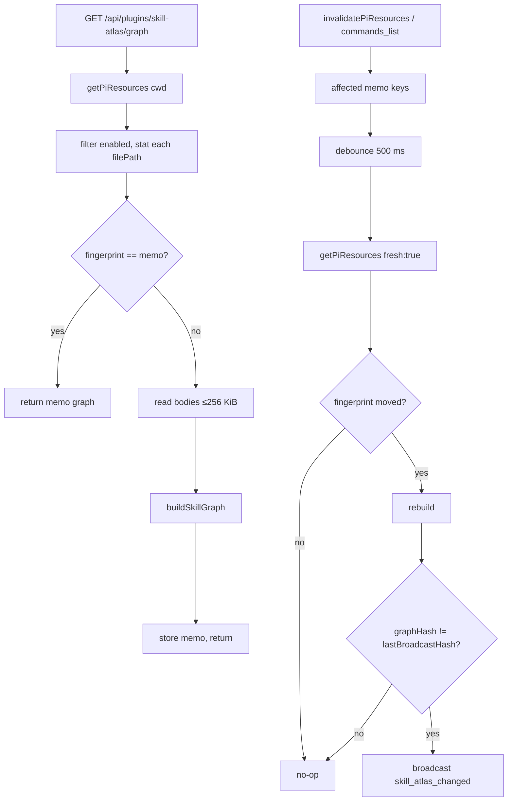

# Skill Atlas

Plugin `skill-atlas` (`packages/skill-atlas-plugin`, npm `@blackbelt-technology/pi-dashboard-skill-atlas-plugin`).
Shows every skill pi loads: per folder (project atlas) or global (global atlas).
Views: cards, force graph, links table. See change: add-skill-atlas-screen.

## What it shows

- Node per skill: `id` (frontmatter `name`), `description`, `filePath`, `origin`, `pkg?`, `degree`.
- Origin: `project` | `global` | `package`.
- Typed links, undirected or directed (below).
- Detail panel: description + "Open SKILL.md" (escaped text only).
- SKILL.md bodies never leave the server.

## Relation rules

| Type | Direction | Rule |
|---|---|---|
| `references` | A → B | A's SKILL.md names B. Hyphenated id: `(^\|[^A-Za-z0-9_-])<id>([^A-Za-z0-9_-]\|$)`, case-insensitive. Single-word id: `/skill:<id>\b`, `\bskill:\s*<id>\b`, `\b<id> skill\b`. Ids < 4 chars skipped. Ids regex-escaped. |
| `bundle` | undirected | Same non-empty `pkg`. Group size 2–14 inclusive. Loose skills (`pkg` undefined) never bundle. |
| `shares-tool` | undirected | Shared backticked snake_case token `` `[a-z][a-z0-9]*(_[a-z0-9]+)+(\(\))?` `` (trailing `()` stripped). Token used by 2–6 skills in scope. One link per pair; `why` lists all shared tokens, sorted. |

Rules to keep in mind:

- Undirected links canonical: `source = min(id)`, `target = max(id)`.
- Self-links and duplicate `(pair, type)` dropped.
- `shares-tool` counts per scope: same pair may link in project atlas, not in global.
- Every link carries `why`. Relation toggle in UI.

## Builder

- `buildSkillGraph(inputs) → { skills, links }`, pure, in `src/shared/`.
- No `node:` imports, no fs, no clock, no hashing.
- Duplicate ids deduped. Priority: `project` > `package` > `global`. Tie: smallest `filePath`.
- Nodes sorted by id. Links sorted by `(source, target, type)`.
- Enums (`SkillLinkType`, node `kind`) open for growth.

## Freshness

Two paths keep graph current:

1. **Pull (GET).** Stat fingerprint on every request.
   - Fingerprint = sha256 over `scope`, `degraded`, sorted lines of `id\0origin\0pkg\0description\0filePath\0mtimeMs\0ctimeMs\0size`.
   - Unchanged → memo hit, zero body reads.
   - Changed → read bodies (cap 256 KiB each), rebuild.
   - Body edit visible on next GET (stat covers body via mtime/ctime/size).
   - Membership (skill folder add/remove) shows on first GET after background rescan, or sooner via push.
2. **Push.** Host seam `onPiResourcesInvalidated` → plugin → `skill_atlas_changed`.
   - Sources: `invalidatePiResources(cwd)` (watcher), `commands_list` arrival (session register/reload/flow).
   - Per affected memo key: 500 ms debounce → `getPiResources(cwd, { fresh: true })` → re-fingerprint → rebuild if moved.
   - Broadcast `{ type: "skill_atlas_changed", scope, cwd? }` only when `graphHash !== lastBroadcastHash`. Content-neutral touch sends nothing.

Memo: LRU 32. Key `global` or `project:<normalized abs cwd>`. Relative `cwd` → 400.

## Route

`GET /api/plugins/skill-atlas/graph?scope=project|global&cwd=<abs>`

- `networkGuard`-protected. Rate-limited (`@fastify/rate-limit`, loopback allow-listed).
- `scope=project` requires `cwd` → else 400. `scope=global` ignores `cwd`.
- Host seam missing → 501.
- Response: `{ success, data: { scope, cwd?, fingerprint, builtAt, degraded, skills, links, warnings[] } }`.
- Node payload has no body.
- Tier row `observe` in `route-tiers.ts`. MCP-denylisted.

## Host seams

Both optional on `ServerPluginContext`. Plugin route → 501 without them.

- `getPiResources?(cwd?, { fresh? }) → Promise<PiResourcesResult>`. See [`plugin-seams.md`](plugin-seams.md#host-read-seams-getpiresources--onpiresourcesinvalidated).
- `onPiResourcesInvalidated?(handler) → () => void`.

Atlas consumes raw scan result (membership), not provenance-joined `GET /api/pi-resources` payload.

## Entry points

| Surface | Route / slot | Notes |
|---|---|---|
| Folder actions menu → **Skill Atlas** | `useFolderMenuItem`, group `open`, id `skill-atlas` | Project atlas at `/folder/:encodedCwd/atlas/*?` (`shell-overlay-route`, `presentation:"content"`, `depth:2`). |
| Settings ▸ Resources ▸ **Skill Atlas** | `settings-section`, `nav.group:"resources"` | Promoted via `PROMOTION_GROUP_ALLOWLIST` (`models`, `resources`). Compact global summary + "Open atlas". |
| Global atlas `/atlas/*?` | `shell-overlay-route`, `presentation:"content"`, `depth:2`, `parentPath:"/settings/skills"` | Underlay + Back = Global Skills page (`overlay-claim-underlay.test.ts` forbids `/` as underlay). |
| Skills pages (Folder + Global) | `resource-page-section` (`resourceType:"skill"`) | Compact summary, most-connected chips, "Open atlas". |

Folder entry: `sidebar-folder-section` mount calls `useFolderMenuItem` then renders `null` (no pill).

## Slot: `resource-page-section`

- Multiplicity `many`, react-only. Declared in `packages/shared/src/dashboard-plugin/slot-types.ts`.
- Props `ResourcePageSectionProps`: `resourceType`, `scope` (`"folder"|"global"`), `cwd?` (present iff `scope === "folder"`), `pluginContext`.
- Rendered above grid by `ResourceGridPanel`.
- `scope` = `"folder"` when `scopes` includes `"local"`, else `"global"`.
- Claim manifest `resourceType` filter applied by consumer.

## Graph view

- Engine: `d3-force@^3`, direct dep of `@blackbelt-technology/pi-dashboard-skill-atlas-plugin`.
- Sim: stateful, `src/client/atlas-simulation.ts`. Pure helpers: `src/client/graph-layout.ts`.
- Supersedes archived Q8/D9 hand-rolled layout. `layoutGraph`, `fitTransform` removed.
- Sim nodes = all skills of graph. Sim links = links of visible relation types (`relations` prop from `SkillAtlasPage`).
- Origin toggles hide nodes only. Never re-layout.
- `presettle` runs sync, seeded → deterministic.
- Presettle: velocityDecay 0.4; alphaDecay so cooling ≤ 220 ticks; ≤ 60 extra ticks until forest discs disjoint.
- After presettle: velocityDecay 0.72 (heavy damping) for all visible motion.
- SVG hidden until fitted.
- Relation toggle → forests recomputed → damped re-settle (`alpha(0.35).restart()`).
- Reduced motion → one-step `presettle`.
- BREAKING (behaviour): filters move nodes.
- Live refetch → new sim seeded from surviving positions, presettled gently (alpha 0.3).
- Old graph stays until swap.
- Forests = connected components over drawn links (`forests`, union-find).
- Forest ≥ 2 skills → rounded padded convex-hull outline (`outlinePath`, pad 20).
- Outline stroke `--accent-blue-text`, dashed; solid when zoomed.
- Outline fill: radial gradient on `--accent-blue`.
- Singletons: no outline.
- `forestSeparation` force (position-based, skips pinned nodes) keeps outlines apart on open.
- Click outline (press < 4 px) → zoom to forest.
- Other forests dimmed (outline opacity 0.4).
- Chip `Group: N skills` + `<button>` "Show all".
- Click another outline → switch.
- Esc / Show all / empty-space click → back.
- Esc leaves zoom before clearing selection.
- Press ≥ 4 px on background or outline → pan.
- Forest zoom pointer-only. Accepted WCAG 2.1.1 exception. Links table = text equivalent.
- Drag node = standard d3 drag.
- Drag start: pin at 4 px threshold + `alphaTarget(0.3)`.
- Drag moves: rAF-batched. Neighbours follow via link forces.
- Release / `pointercancel` / `lostpointercapture` → unpin, `alphaTarget(0)`, slow settle.
- Positions not persisted.
- Camera `{k,x,y}` (`fitView`).
- Fit once at first rest.
- Camera moves only on: pan/wheel/zoom buttons, Fit, focus change, forest enter/exit, resize while `userMoved` false.
- `userMoved` = user has not panned/zoomed since last fit.
- Selection, re-settle, drag never move camera.
- View changes ease 380 ms. Reduced motion → instant.
- Nothing runs at rest.
- `visibilitychange` hidden → stop. Visible → resume if still settling.
- Nodes: hollow dots. Radius `max(5, 4 + √degree)` ≤ 9.
- Node outline `--text-secondary`, fill `--bg-primary`.
- Origin by inner mark:
  - Global: none.
  - Package: filled dot r `0.3·r` (`--text-secondary`).
  - Project: ring r `0.62·r`, stroke `--accent-green-text`.
- Legend reuses same dot.
- Labels: `placeLabels`, four anchors (right, left, below, above).
- Labels never overlap labels, nodes or frame.
- Hovered, then selected, placed first. May cover a node.
- Hovered label always shown, clamped into frame.
- Widths: cached canvas `measureText` 11px system-ui. Fallback 6.3 px/char + 2.
- i18n keys (zh-CN + hu): `groupChip`, `showAll`, `outlineTitle`.

See change: add-skill-atlas-forest-aura.

## Perf budget

- P1: memo hit, 100 skills, p95 < 100 ms (`atlas-perf.test.ts`).
- Graph first paint: `performance.mark("atlas-graph-rendered")` after first visible paint per mount. e2e P4: `atlas-graph-start` → `atlas-graph-rendered` < 500 ms (`tests/e2e/skill-atlas.spec.ts`).
- Unit P1: `presettle` 300 skills median < 350 ms (`graph-layout.test.ts`).
- P2: rebuild, 300 × 256 KiB bodies, < 500 ms (`atlas-perf.test.ts`).
- Measured (Apple silicon dev box):
  - 300 `stat` ≈ 3–4 ms.
  - 300 × 256 KiB read ≈ 30–55 ms.
  - `buildSkillGraph` ≈ 75 ms (≈ 500 ms before linear per-body mention index).
- Graph tab disabled above 300 nodes.
- Memo LRU 32. Push debounce 500 ms per key.

## Known limits

- Global atlas scans `process.cwd()` (same as Global Skills page). Project-scope disables in server cwd shape global list.
- Arbitrary `cwd` accepted (parity with `/api/pi-resources`, same `networkGuard`).
- Only `SKILL.md` basename files resolved via `GET /api/pi-resource-file`. Paths outside allowed roots (e.g. local-path package) refused → inline error.
- Prompts, agents, extensions: not nodes in v1.

## Files

- `packages/skill-atlas-plugin/src/shared/` — builder, types.
- `packages/skill-atlas-plugin/src/server/` — `atlas-service.ts`, `routes.ts`, `inputs.ts`, `index.ts`.
- `packages/skill-atlas-plugin/src/client/` — `SkillAtlasPage.tsx`, `useSkillGraph.ts`, `graph-layout.ts`, `atlas-simulation.ts`, `SkillGraphView.tsx`, views.

Tests: `src/server/__tests__/` (service, perf P1/P2), `src/client/__tests__/` (UI, `graph-view.test.tsx` interaction, `graph-layout.test.ts` helpers + simulation).
