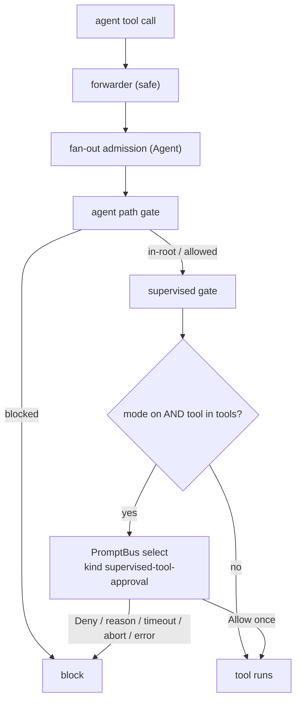

# Supervised mode (tool approval)

Per-session operator approval of risky agent tool calls. Dashboard card. Allow once / Deny.
See change: add-supervised-tool-approval.

## What it is

- Approval gate. Asks operator before a risky tool runs.
- NOT a sandbox. Approved tool runs with full session rights. Confines nothing.
- Need isolation → run session in Docker path. See `docker/README.md`.
- Default off (`supervisedMode.default: "full"`). Opt-in per session.

## Scope

Gated:
- Agent-initiated `tool_call` events in the session.
- `Agent` call itself.

NOT gated:
- `!` user_bash (operator's own command; separate pi event).
- Extension-initiated execution.
- Subagent child calls. Child = separate in-process `AgentSession`, own runner. Parent `tool_call` never sees it. Approving `Agent` = only coverage. Card says so.

Known gap:
- Approved input = snapshot gate saw. Extension loaded after bridge can still mutate `event.input` before run. Not detected.
- Hostile in-process extensions out of scope.

## Config

`~/.pi/dashboard` key `supervisedMode` (`packages/shared/src/config.ts`, `SupervisedModeConfig`):

| Key | Default | Rule |
|---|---|---|
| `default` | `"full"` | `"full"` \| `"supervised"`. Read at session start. |
| `timeoutSeconds` | `120` | 10–3600. Outside, non-numeric, parse error → 120. `PUT /api/config` normalises on write. |
| `tools` | `["bash","powershell","write","edit","Agent"]` | Configured set authoritative. No hidden read-family exemption. Add `read` → `read` gated. |

UI: Settings ▸ Security ▸ "Tool approval (Supervised mode)" (`SupervisedModeSection.tsx`). No allow-list exposed (allow beats approval in engine → silent un-gate).

### Allow-first gap

- Policy = `{ approval: tools, defaultAction: "allow" }`.
- Tool not in `tools` runs unasked.
- Applies to unclassified MCP / plugin tools.
- Example: context-mode `ctx_execute` runs shell, runs without prompt until added to `tools`.
- Gate logs once per session: `[supervised] unclassified tool <name>`.
- pi `annotations` (`readOnlyHint`…) NOT used. Unverified hints.
- Name compare case-insensitive (`Agent` vs `agent`) in supervised policy builder. Shared engine stays exact-match.
- `codemode` / `tool_search` = wrappers. Nested calls hit `tool_call` individually with `parentToolCallId`. Each gated on own.
- L1 drift test pins pi built-in tool list. New built-in unclassified → test fails.

## Flow

- Supervised gate = 4th `tool_call` handler in `bridge.ts`. After path gate.
- Registered WITHOUT `safe()`. Own try/catch → `{ block: true, reason: "supervised: error" }`.
- Per-session mutex. Parallel calls prompt one at a time. Own mutex, not path gate's.
- Mode flag read per call. Flip applies to next call same turn. Pending approval never auto-resolved by flip.
- Off-session cost: in-memory boolean read. Budget p95 < 1 ms.
- `!ctx.hasUI` → immediate block `supervised: no-ui`. No wait.
- Abort (`ctx.signal`) checked before and after mutex. Cancels pending prompt → `supervised: aborted`.
- Pending `Agent` approval holds fan-out permit up to timeout. Accepted. Block releases permit (pi emits `tool_execution_end` for blocked calls).

## Approval card

- `ToolApprovalCard.tsx` (`interactive-renderers/`). `SelectRenderer` branch on `metadata.kind === "supervised-tool-approval"`.
- Options `Allow once`, `Deny`. No preselect, no autofocus.
- Metadata: `tool, summary, cwd, path?, diffStat?, diff?, command?, deadline, toolCallId`. `plainMessage` twin for TUI.
- Countdown from `metadata.deadline`. Collapsed diff. Diff cap 16 KiB, ends `… (truncated)`.
- Deny with reason: `allowOther: true`. Answer `Allow once` → allow. Other text → deny + reason.
- Reason hygiene: strip control chars, cap 500, delivered as `supervised: denied — operator said: "<text>"`.
- TUI shows plain Allow once / Deny. No reason field.
- Unknown / empty answer → deny.
- First response wins. Cross-surface dismissal, reconnect replay via PromptBus.

## Single approval clock

`deadline = max(1s, min(supervisedMode.timeoutSeconds, busTimeout − 1s))`

- `busTimeout` = `askUserPromptTimeoutSeconds`. ≤ 0 = infinite → use cfg value.
- No per-request bus override. Bus timer = backstop only. Gate timer fires first.
- 10 s floor applies to configured value. Bus timeout < 11 s → shorter window. Settings warns.
- Clock starts when prompt opens (after mutex). Queued call waits first.

## Outcomes and block reasons

Outcomes: `approved | denied | dismissed | timeout | aborted | error`.

- `denied` = explicit Deny or reason.
- `dismissed` = cancel gate did not start (client dismiss, bus backstop).
- `timeout` / `aborted` = gate self-cancel (`selfCancel` reason set before `cancel(id)`).
- `error` = gate threw.
- Every non-approved outcome blocks. Reason form `supervised: <outcome>`. Plus `supervised: no-ui`.
- Shape of bus cancel cannot tell causes apart (always `source: "__bus__"`) → attribution by gate action.

## Composition with agent path gate

- Path gate runs first. Block there → supervised never runs. Denied path never raises action prompt.
- Session supervised-in-effect (mode on AND `toolGateOwner !== "chat-gateway"`) AND tool in `tools` → path prompt enriched with `+N −M` stat + byte-capped diff / new content. `metadata.supervised: true`.
- Enriched path prompt answered **Allow once** → path gate records `toolCallId` in per-session hand-off set (64 ids, FIFO). Supervised gate consumes id, allows without asking. Audit `via: "path-gate"`.
- **Always allow** (+ confirm) = durable dir grant. No hand-off. Supervised asks.
- Path gate allowed without asking (in-root, existing grant, YOLO) → no hand-off. Supervised asks.
- YOLO does not answer supervised. YOLO scope = fs plane, workdir plane, path gate only. Supervised = explicit opt-in to be asked.
- Fail-safe exceptions → second prompt, never skipped: no `toolCallId`; mode flipped on while path prompt open; id evicted.
- Response `source` never used for trust (client-supplied string).

## Gateway-owned sessions

- Chat-gateway guard wins in spawned session. Supervised self-disables. No double gate.
- Owner slot: `globalThis[Symbol.for("pi-dashboard.toolGateOwner")]` = `Map<sessionId, owner>`. Process-global because pi loads extensions via jiti `moduleCache: false` (module var would differ per extension).
- API: `markToolGateOwner` / `clearToolGateOwner` / `toolGateOwner` (`packages/shared/src/tool-gate/`). Guard marks on `session_start`, clears on `session_shutdown`.
- Bridge reads slot per call (authoritative). Reports `toolGateOwner` to server; UI may lag, never decides.
- Client: toggle replaced by static "Gateway policy" chip when owner = `"chat-gateway"`.
- Gateway-spawned session without guard keeps toggle. Attached session: operator may still enable.
- Older guard never marks slot → up to two prompts. Accepted fail-safe.
- Path gate independent. Still runs in gateway sessions.

## Chat gateway and question stack

- Chat gateway never renders supervised approvals. Skips `metadata.kind === "supervised-tool-approval"` and enriched path prompts (`metadata.supervised === true`). Channel member cannot approve.
- Chat-only operator: risky calls time out → blocked. Answer on dashboard or TUI.
- Question stack lists them read-only. Never answerable via `POST /api/questions/:id/answer`. Never LLM-briefed. Command text never sent to a model.
- Limit: browser WS `prompt_response` owner-gated like `send_prompt`; no kind check. Session-owner WS = dashboard. No per-principal check added.
- `answeredSurface: "chat-gateway"` never produced by supervised.

## Mode persistence

Two durable copies per session id.
- Session entry: `pi.appendEntry("supervised-mode", { on, rev })` on every flip. Restored on `session_start` (new / resume / fork / switch) before any tool call. Survives `/reload`, pi restart, server down.
- Server meta: `session-to-meta.ts` field. Restored on registration. Server re-sends `set_supervised { on, rev }` after register / reconnect.
- Per-session monotonic `rev`. Higher `rev` wins. Tie with different values, or missing `rev` → Supervised.
- Restore failure (entry read throws) → Supervised. Logs `[supervised] mode restore failed`.
- Bridge state = `Map<sessionId, boolean>`. No leak across session switch. Mode map, mutex chains, hand-off sets cleared on `session_shutdown`.
- Bridge → server: `{ on, rev }` + `toolGateOwner` on registration; `supervised_state { on, rev, toolGateOwner }` on later change. Server → bridge: `set_supervised`. Malformed payload ignored. Never resolves a pending prompt.
- Server files: `packages/server/src/session/supervised-reconcile.ts`, `supervised-sync.ts`; handler `packages/server/src/browser-handlers/supervised-handler.ts`.
- Flip request = session-owner only (same gate as `send_prompt`, `ws-message-scope.ts`). Others dropped silently, mode kept.

## Audit

- Durable: `pi.appendEntry("supervised-tool-decision", record)`. Fields incl. `tool`, `summary`, `outcome`, `answeredSurface` (`dashboard | tui | chat-gateway | timeout | error`), `via` (`supervised | path-gate`).
- Summary capped 500 chars, secret-redacted.
- Console line: `[supervised] <outcome> tool=… via=… surface=… session=… summary=…`.
- Server log per flip: `[supervised] mode on|off rev=<n> session=<id> source=<connId>`.
- `answeredBy` (who) not obtainable; surface logged instead.

## Attention

- `awaitingToolApproval` derived from pending `supervised-tool-approval` prompts (sibling of `awaitingFileAccess`, `event-wiring.ts`).
- Shared predicate `awaitingOperatorApproval = awaitingFileAccess || awaitingToolApproval` drives "Needs you" lane, urgency, pairing gateway, toast.
- No modal. No list badge in v1.

## Code map

| Area | Path |
|---|---|
| Shared engine (policy, guard core, owner slot) | `packages/shared/src/tool-gate/` |
| Bridge gate | `packages/extension/src/supervised-gate/` |
| Path gate hand-off | `packages/extension/src/path-gate/` |
| Server handler + sync | `packages/server/src/browser-handlers/supervised-handler.ts`, `packages/server/src/session/supervised-*.ts` |
| Card | `packages/client/src/components/interactive-renderers/ToolApprovalCard.tsx` |
| Settings | `packages/client/src/components/settings/SupervisedModeSection.tsx` |

Related: [architecture.md](architecture.md) Agent Path Gate section. Isolation: [`docker/README.md`](../docker/README.md).
