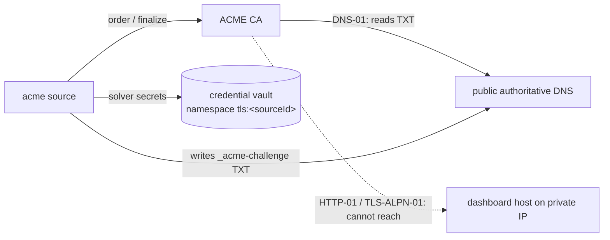

## Context

See proposal.md — Why. Builds on `add-tailscale-cert-tls` (must be merged first): its `CertSource` interface (`id`, `names()`, `configFingerprint(name)`, `obtain(name, onStage)` → `{ certPem, keyPem, advertise, kind, details? }`, `readiness()` → `{ gates, details? }`, `onRemoved?()`, `RetryAfterError`), `CertManager` (12 h tick, renew at <1/3 validity, single-flight per `(sourceId, name)`, `trigger(sourceId, name?)`, exponential backoff capped 6 h, pruning, **gate-before-obtain** — an unmet source-wide or name-scoped gate skips the attempt without calling `obtain()` and without counting a failure — and an **attempt deadline** per source `attemptTimeoutMs`, after which the attempt is counted failed and its late result discarded; prereq design D3 and spec "Certificate lifecycle management"), `TlsCertStore` (exact → single-label wildcard SNI, fail-closed), `tls` config deep-merge + route-level validation (`openspec/changes/add-tailscale-cert-tls/design.md` D7), disclosure-gated `/api/health.tls` listing every name from the source's last `names()` (held, waiting on a gate, or being issued) with `nextAttemptAt`, plus source-level `details` (its D8), `POST /api/tls/issue` (its D10), and `tlsListenerUrls()` feeding enumeration and the pairing reachable-URL closure.

This change adds one source type and uses only behaviour the prerequisite's specs already state. It changes no prerequisite code: it registers `acme` through the prerequisite's source-type registry (`registerCertSourceType({ type: "acme", validate, create })`, prereq D3) and its Gateway group through `registerTlsSourceGroup("acme", GatewayAcmeSource)` (prereq D11). The prerequisite owns the common entry checks (type registered, `id` pattern, uniqueness, `"tailscale"` reserved); `validate()` adds the acme rules (D5). D12 lists the prerequisite behaviours used and the one request back to it.

Credential storage follows `openspec/specs/credential-vault/spec.md` ("one hub-owned store for credentials"): solver secrets are vault accounts (D5), not a separate file. `absorb-service-secrets-into-vault` uses the same pattern for managed-service secrets (namespace `service:<id>`).



## Goals / Non-Goals

**Goals**: DNS-01 only. Two solvers that together cover every DNS host: Cloudflare directly, everything else through acme-dns CNAME delegation. Staging first. No inbound internet exposure. No change to the prerequisite's specified behaviour. Solver secrets live in the credential vault.

**Non-Goals**: HTTP-01/TLS-ALPN-01; IP certificates; per-vendor solvers beyond these two; managing the A/AAAA record that points the domain at the mesh IP (operator's job — readiness shows what public DNS returns); EAB (External Account Binding) flows; advertising wildcard names (served, never enumerated — no concrete URL); delivering solver secrets to pi sessions or plugins.

## Decisions

### D1 — `acme-client` for the protocol
RFC 8555 needs JWS signing, nonce handling, order/authorization polling, CSR generation. `acme-client@^5` (MIT, shipped TS types; deps `@peculiar/x509`, `asn1js`, `axios`, `debug`, `node-forge`) implements it. We use its low-level API instead of `auto()`, so each stage calls `onStage` and cleanup is ours:

1. `createAccount` (`termsOfServiceAgreed` from `agreeTos`) → `createOrder` → `getAuthorizations` — stage `order`.
2. Per authorization, pick the challenge with `type === "dns-01"`; fail the attempt when none is offered. The low-level API does no selection, and `challengePriority` applies to `auto()` only (unverified against the 5.4.0 source until spike 1.3).
3. Solver publish — stage `dns-publish`; propagation wait (D3) — stage `propagation`; `completeChallenge` + `waitForValidStatus` — stage `validation`; `finalizeOrder` + `getCertificate` — stage `finalize`.

`acme-client` exposes no abort signal, so hangs are bounded in layers:

1. A per-request timeout of 30 s on the library's own axios instance (`acme.axios.defaults.timeout`; that instance is separate from the server's global axios). The library retries 5xx/429 itself, so one API call may exceed 30 s in total. The outer deadline still bounds the whole attempt.
2. `AbortSignal.timeout(30_000)` on every solver and DoH `fetch`.
3. Bounded polling (`backoffAttempts`/`backoffMax`).
4. Deadlines in two layers. The source's own **attempt deadline** is 10 minutes, measured from when the attempt body starts: after any acme-dns mutex wait (D2), not from `obtain()` entry. On expiry, `obtain()` rejects with a timeout error, so the manager records the failure and frees its single-flight slot. The source also declares `attemptTimeoutMs` (prereq D3) as a **backstop** only: `10 min + 30 s` for Cloudflare, and `(10 min + 30 s) × domains.length` for acme-dns, so queue time never trips it. The manager's own race therefore fires only when the source itself hangs. The inner deadline stays even though the manager has a generic one: `obtain(name, onStage)` receives no abort signal, so only the source can stop its own calls, release the acme-dns mutex and run cleanup at the 10-minute mark. If the prerequisite later passes an `AbortSignal` to `obtain()`, the inner timer can go (optional, D12).

On the source deadline the attempt is **aborted**. Each attempt carries a generation number, which closes two gaps:
- Every step checks it before **starting** a CA or solver call.
- A request interceptor on `acme.axios` rejects any request issued for an aborted attempt, including the library's internal polls and its own 5xx/429 retries. `acme.axios` is one module-level instance shared by all sources, so a request carries no attempt id of its own: each attempt body runs inside an `AsyncLocalStorage` context holding its generation, and the interceptor reads that context. Spike 1.3 verifies that the context survives the library's polling and retry timers, and that retries pass through interceptors. If either fails, the per-step check is the only guard and late library requests are accepted as harmless reads.

As a result an aborted attempt starts no new call except challenge cleanup.
- A request already on the wire cannot be cancelled; it may finish, and its result is ignored.
- The acme-dns source mutex (D2) is released at the abort. Any late write by the aborted attempt lands in a two-value acme-dns slot that the next attempt also writes, so validation still sees the new value.
- Cleanup runs for every `publish` ref known at abort time. A Cloudflare `publish` that resolves after the abort is deleted by its record id as soon as it resolves; its ref is never kept.
- A late certificate is discarded.
- Cleanup is idempotent: a Cloudflare 404 on `DELETE` counts as success, so the attempt's own `finally` may run it again harmlessly.

`acme.setLogger(() => {})` (`types/index.d.ts` setter) only redirects the library's log lines; `src/logger.js` still calls `debug()`, so `DEBUG=acme-client` prints them. They hold URLs, statuses and nonce notes, never bodies (checked against `acme-client@5.4.0` `src/*.js`; re-checked in spike 1.3 for the pinned version), so this is accepted. A test asserts that no body text reaches the server log.

*Alternatives*: hand-rolled RFC 8555 (~500 lines of crypto-sensitive code) — rejected; shelling out to `lego`/`certbot` (external binary per OS) — rejected for v1.

### D2 — Solver interface
```ts
interface Dns01Solver {
  readonly type: "cloudflare" | "acme-dns";
  publish(domain: string, value: string): Promise<{ ref: string }>;   // domain may be "*.x" → owner _acme-challenge.x
  cleanup(ref: { ref: string }): Promise<void>;                       // idempotent
  check(domain: string): Promise<{ ok: boolean; hint?: string }>;     // per-domain readiness
}
```
- **cloudflare**: plain `fetch` to `api.cloudflare.com/client/v4`.
  - Strip a leading `*.`.
  - Find the zone: when the source config carries a non-secret `zoneId`, use it with no lookup. Otherwise query `GET /zones?name=<candidate>` for each suffix of the owner name, longest first, and take the first exact match. Exact-name queries need no pagination.
  - `POST dns_records` creates the TXT (TTL 60). Cleanup `DELETE`s it in `finally`.
  - Token scope: **Zone → DNS → Edit**, limited to one zone, plus **Zone → Zone → Read** unless `zoneId` is set (zone lookup needs Read; lego and Traefik document the same pair — unverified, spike 1.3).
  - `check` = `GET /user/tokens/verify` (account-owned tokens may need `/accounts/<id>/tokens/verify` — spike 1.3) plus the zone lookup.
- **acme-dns**: `POST <server>/update` with `X-Api-User`/`X-Api-Key`, `subdomain` and `txt` (acme-dns README; unverified until spike). `cleanup` is a no-op.
  - Config carries the non-secret `server` (must be `https://`), `subdomain` and `fulldomain`. All three come from the operator's one-time `POST <server>/register`. Its response also carries `username` and `password`, which go to the vault (D5).
  - An acme-dns subdomain holds at most two TXT values, so an acme-dns registration runs **one non-aborted order at a time** (mutex around the attempt body, released on abort, D1). The mutex lives in a module-level map keyed by `(server, subdomain)`, not in the source object: the prerequisite rebuilds source instances from their entries on every reconcile (prereq D3), and an order started by the old instance must still hold the lock against the new one. Two sources sharing one registration share the lock.
  - The 10 min source deadline starts when the mutex is acquired, not when the attempt is queued, and the backstop `attemptTimeoutMs` covers the queue (D1), so a third or later name is not abandoned before it runs. N names on one acme-dns source still issue one after another, so first issuance takes N × (typically 2–4 min, at most 10 min). Guidance: a separate acme-dns registration (source) for each few names.
  - **Queue allowance.** A queued attempt waits for the lock at most `attemptTimeoutMs − (10 min + 30 s)`. If it cannot get the lock in that time, `obtain()` rejects with "acme-dns registration busy" (a normal failure) before any CA or DNS call. `obtain()` therefore always settles before the manager's backstop fires, and a queued attempt can never start after the manager has abandoned it. On acquiring the lock the attempt also re-checks its generation (D1) and the source's removal flag (D5), and returns without any call if either is stale.
  - Sharing one registration between two sources works through the shared lock, but the second source's allowance does not count the first source's names, so it may fail with "registration busy" and back off. The Gateway route (D5) therefore rejects a second acme source with the same `(server, subdomain)`; a hand-written `PUT /api/config` can still create one and gets this degraded behaviour.
  - Credential validity: acme-dns has no read-only way to test credentials, so the check writes. It runs only after a credentials save and on a forced refresh (reconcile, `POST /api/tls/issue`), never on the unforced pre-attempt or 15-minute re-check (D9). It tries to **acquire** the lock without waiting. If it gets it, it sends one `POST <server>/update` with a fixed 43-character placeholder value and releases it; a 401/403 marks the `credentials` gate unmet. If the lock is busy, an order is running, so it writes nothing and keeps the last result. The placeholder only occupies one of the two rolling slots and never overlaps a running challenge.
  - `check(domain)` = CNAME at `_acme-challenge.<domain minus a leading "*.">` → the configured `fulldomain`, queried against that zone's **authoritative** servers (D3 discovery), not a recursive resolver, so a negative answer cached before the record existed cannot mask the fix. The hint shows the exact record.

### D3 — Propagation check against authoritative servers
Recursive resolvers may cache the pre-publication negative answer for the zone's SOA minimum (often 30 min), so polling them gives false timeouts. Instead:

1. Resolve the zone's NS set through DoH, which avoids split-horizon DNS and MagicDNS.
2. Query **each authoritative server directly**: one `dns.Resolver` per server with `{ timeout: 3000, tries: 1 }`, outbound UDP/TCP 53 only. Rounds run every 5 s until all servers return the TXT value, for up to 180 s. A server that does not answer within 3 s counts as lagging for that round, so one hung server cannot stall the round cadence.

Discovery: find the zone of the owner name by walking suffixes for an `SOA` answer over DoH, read its `NS` names, then resolve each NS name to its A/AAAA addresses over DoH. For Cloudflare the owner is `_acme-challenge.<domain>`. For acme-dns the TXT lives at `fulldomain`, so the zone is the one containing `fulldomain`, not the CNAME's zone. A dead nameserver fails the attempt. That is accepted: the CA may query any of them, and the error names the lagging server.

**Fallback** when direct port 53 is blocked: require **both** DoH resolvers (`cloudflare-dns.com`, `dns.google`) to return the value. This is weaker, because recursive visibility does not prove every authoritative server has the value. The spec allows it explicitly. Status marks it in source `details` (`propagationMode: "doh-fallback"`).

### D4 — Advertisement classification and re-issue scope
- `production` → `advertise: true`.
- `staging` → `advertise: false`, `staging: true`.
- The known set is exactly two URLs: `https://acme-staging-v02.api.letsencrypt.org/directory` (staging) and `https://acme-v02.api.letsencrypt.org/directory` (production). An explicit URL equal to one of them after D5 canonicalization becomes that keyword. Every other URL is custom.
- Any other `https://` directory → `advertise: source.advertise === true` (an operator assertion).
- Wildcard names keep their directory's `advertise` value: the flag classifies the issuer. The prerequisite's emission never enumerates wildcard names (its D5), and the UI labels them "served, not listed". Host admission takes exact certificate names only, and only while the listener is enabled and bound (prereq D6): a wildcard is never admitted on the main port, so a subdomain used through it must be added to `allowedHosts` (stated in the editor).

`configFingerprint(name)` covers the **canonical directory and the effective advertise value** (after classification) plus that one name, never the list (prereq D3 rule). The spec states re-issuance on a change of `directory` or of the effective `advertise` value, so toggling `advertise` on `staging` or `production`, where it has no effect, changes nothing. The prerequisite's design names "directory/advertise/solver + name" as an example fingerprint for ACME (prereq D3). **Disagreement, recorded for the prerequisite:** leaving the solver out is deliberate, because the solver does not change the certificate and including it would re-issue every name on a solver switch (Let's Encrypt duplicate-certificate limit). The prerequisite's normative rule ("only settings that affect that name's certificate") is met either way. `advertise` does not change the certificate bytes but does change the stored certificate's metadata, which only a re-issue refreshes today (request R6); it matters only for custom directories, where no Let's Encrypt quota is involved.
- Email, solver type and solver endpoints do not change the certificate. Changing them re-checks readiness (D9) instead of re-issuing, which avoids Let's Encrypt duplicate-certificate pressure.
- The domain list is not in the fingerprint. Added names have no certificate, so they are issued; removed names are pruned by the prerequisite. Editing one domain therefore never re-issues the others.

Status fields `directory`, `staging` and `solverType` are returned through `ObtainedCert.details` for held certificates and, from config, through `readiness()` source-level `details` (`directory`, `staging`, `solverType`), so names without a certificate show them too. The last `propagationMode` the instance saw is kept in memory and returned in the same `details` (lost on instance rebuild; diagnostic only). Per-domain CNAME and credential gates are name-scoped `Gate`s; check times are in source-level `details` (D9). Endpoint `kind: "domain"`.

### D5 — Config, validation, vault-backed credentials, route
**Config entry** (`tls.sources[]`):
```jsonc
{ "type": "acme", "id": "home", "domains": ["dash.example.com", "*.lab.example.com"], "email": "ops@example.com",
  "agreeTos": true, "directory": "staging", "advertise": false,
  "solver": { "type": "cloudflare", "zoneId"?: "…" } | { "type": "acme-dns", "server": "https://auth.acme-dns.io", "subdomain": "…", "fulldomain": "….auth.acme-dns.io" } }
```

**Writes go through per-entry routes, not the whole array.** The prerequisite's `PUT /api/config` replaces `tls.sources` as a whole array (prereq D7), so two tabs can overwrite each other. The Gateway editor therefore uses:
- `PUT /api/tls/acme/:sourceId` — upsert one acme entry (body = the entry);
- `DELETE /api/tls/acme/:sourceId` — remove it.

Both read config, replace only the entry with that `id` in `tls.sources`, and write through `writeConfigPartial`. `PUT` answers 400 when the body `id` differs from `:sourceId`, and when another acme source already uses the same acme-dns `(server, subdomain)` (D2). They run on the same serialized chain as `saveConfigAndMirror` (`packages/server/src/routes/system-routes.ts:123-155`, `configSaveTail`), so they cannot interleave with another save. Then they run the prerequisite's reconcile. Every other source is untouched by construction.

Both refuse with 409 when `config.json` exists but does not parse. Today `writeConfigPartial` starts fresh from `{}` in that case (`packages/server/src/config-api.ts:227-228`), which would drop every other key. A new `readConfigState()` returns `absent | ok | corrupt` for this check and for GC.

`PUT /api/config` stays valid for acme entries too: hand edits and the API keep working under the same validator.

**Validation** is the prerequisite's `tls` validator (route-level, before `writeConfigPartial`; prereq D7) with the acme type's `validate(entry)` registered in it, so `PUT /api/config` and the per-entry routes run the same checks. The per-entry routes run it over the merged `tls.sources` array. No other server path writes `tls.sources`: the other `writeConfigPartial` callers (`routes/system-routes.ts`, `access-routes.ts`, `known-servers-routes.ts`, `server.ts`) touch other keys. Each failure answers 400 naming the entry.

**Normalization.** `validate()` returns only a message, so it cannot rewrite the entry. One pure `normalizeAcmeEntry(entry)` is therefore used in three places: `validate()` checks the normalized copy (so counts are taken after deduplication), `create()` builds the source from it, and the per-entry route stores it. An entry written through `PUT /api/config` is stored as sent but behaves identically, because the runtime and the fingerprint only see the normalized form. `names()` returns the normalized domain list; it is never `null` (the list is local config, so pruning is always safe).

- `id` follows the prerequisite's rule (`^[a-z0-9][a-z0-9-]{0,31}$`, unique across all sources, `tailscale` reserved), checked by the prerequisite. The acme type sets no `defaultId`, so `id` is required. The Gateway editor shows `id` read-only after the first save; a rename through the API is a remove plus an add (secrets are not carried over).
- `domains` has 1–20 entries after normalization. Each entry is normalized: lowercase, one trailing dot stripped, duplicates removed. Each must then be a hostname of ≤ 253 octets whose every label matches `^[a-z0-9]([a-z0-9-]{0,61}[a-z0-9])?$` (LDH, no leading or trailing hyphen, no `_`), or `*.` followed by one. IP literals (v4, v6 with or without brackets), ports, schemes, empty labels, the root `.`, bare `*` and non-ASCII are rejected; IDNs must be entered as `xn--` (lengths measured on that form).
- `email` is shaped like an email address; stored trimmed and lowercased.
- `agreeTos === true`.
- `directory` is `staging`, `production`, or an `https://` URL without userinfo. A URL is canonicalized: lowercase host, default port dropped, one trailing slash removed; a URL equal to a Let's Encrypt directory becomes its keyword.
- acme-dns `server` is an `https://` URL without userinfo; `subdomain` is present; `fulldomain` is a hostname under the same rules as `domains` (no wildcard). Cloudflare `zoneId`, when present, is 32 hex characters.
- `solver.configured` is stripped **first**, so a round-tripped `GET /api/config` projection saves cleanly. The solver object is then allowlisted per type: any other key (for example a hand-written `token`) answers 400, so no secret can be persisted in `config.json`.

**Secrets in the credential vault.** Each source's secrets are vault accounts of kind **`tls-solver`** (not `key`) in namespace `tls:<sourceId>`.

| solver | provider | label |
|---|---|---|
| cloudflare | `cloudflare` | `cloudflareToken` |
| acme-dns | `acme-dns` | `acmeDnsUser`, `acmeDnsKey` |

Using a distinct kind lets the vault's existing `kind === "key"` checks keep these accounts off every delivery path:
- binding default — `vault-bindings.ts:43-46` `assertKeyAccount`;
- grant override — `vault-grants.ts:166-182` `assertGrantable`;
- grant and delivery resolution — `keyAccountById` `vault-grants.ts:129-135`, `getKeyValue` `vault-store.ts:249-253`;
- plugin reads — `vault-plugin-read.ts:57-59`;
- generic rotate — `rotateAccount` `vault-store.ts:262-275`.

The delivery paths stay closed on **older builds after a downgrade**, which preserve unknown kinds (credential-vault "Account storage") but deliver only `key` accounts. One generic path lacks a kind check: revoke (`vault-grants.ts:247-255`, `DELETE /api/vault/accounts/:id`). It gains one here: `tls-solver` accounts answer 409. An older build lacks that check, so after a downgrade an operator can revoke a solver account from the vault page; the source then reports its `credentials` gate unmet (no secret leaks).

The vault store gets three **internal** methods, which no HTTP route exposes directly. Today `makeKeyAccount` hard-codes kind `key` and namespace `user` (`vault-store.ts:192-203`) and `addAccount` always appends (`:254-261`).
- `upsertTlsSecrets({ sourceId, provider, entries: [{ label, value }] })`: one locked update; for each label, find the account by `(namespace, label)`, rotate it if present, else add it. The acme-dns user and key are therefore written together or not at all.
- `deleteTlsNamespace(sourceId)`.
- `readTlsSecret(sourceId, label)`: the only reader of `tls-solver` values, used by the solvers.

The vault's 8-character minimum applies. Cloudflare tokens (40 chars) and acme-dns credentials (UUID user, 40-char key) exceed it; test fixtures use ≥ 16 characters.

The Accounts tab lists `tls-solver` accounts like any account, with "what uses it" = "Gateway source `<id>`", grouped under "TLS certificates". They have no rotate or revoke action and link to the Gateway. The credential-vault delta records this: ADDED "TLS solver accounts", MODIFIED "Account rotation and revocation".

**`configured`** is true only when every secret the solver type needs is present (Cloudflare: `cloudflareToken`; acme-dns: `acmeDnsUser` and `acmeDnsKey`).

**Unreadable vault.** A corrupt or unreadable vault (`status()` reports it; `listAccounts` returns `[]` then) makes the source's `credentials` gate unmet with the hint "credential vault unavailable". `GET /api/config` then projects `configured: false`, and the gate carries the reason. No CA or DNS call is made.

**GC.** One routine `acmeGc()` deletes every `tls:<id>` namespace whose `id` is no longer a configured acme source, and every orphaned account key (D8). It runs from three places, so no path leaks:
- each acme source's `onReconciled()` (prereq D3);
- the removed source's `onRemoved()`, which covers removing the last acme source (no instance remains to receive `onReconciled()`);
  Before it runs GC, `onRemoved()` sets the instance's removal flag and aborts its in-flight attempts (D1 generation), so they make no further CA or DNS call. Account keys are written only while the removal flag is clear, so a late `createAccount` cannot leave a key behind after GC.
- once at server start, when the acme type registers, which covers a config hand-edited while the server was down.

It runs only when `readConfigState()` is `ok`, with or without a `tls` block, and only when the vault `status()` is healthy; otherwise it is left for the next run. Concurrent calls are coalesced.

**Credential route**: `PUT /api/tls/acme/:sourceId/credentials`. It writes into the vault, so it is a vault management route.
- It uses the vault's own guard: `canManageVault` (`packages/server/src/vault/vault-routes.ts:119`), which means `operate` authority, or a locally trusted caller honouring strict local-proof mode, under the identity-principal policy (credential-vault "Values never leave the hub").
- It is registered `operate` in `packages/shared/src/route-tiers.ts`, together with `PUT` and `DELETE /api/tls/acme/:sourceId`, which use the `PUT /api/config` authorization. The completeness test fails an unlisted `/api/*` route.
- `:sourceId` must match the id rule and name a configured acme source; otherwise 404 before any vault access.
- The body carries only the fields of that source's solver type.
- It writes through `upsertTlsSecrets`, invalidates the readiness cache and forces a refresh. It calls `CertManager.trigger(sourceId)` only when the `credentials` gate was unmet before the save: new credentials unblock the source at once, while replacing working credentials never bypasses a retry wait (for example the 1 h floor after a CA validation failure, D7).

`GET /api/config` projects `solver.configured: boolean` from the vault listing for `tls:<id>` (no values read).

"Issue now", "Renew now" and the gate's "Check now" are **not** ACME routes. They call the prerequisite's `POST /api/tls/issue { sourceId, name? }`: same authorization, forced `readiness()` refresh, 202, joins a running issuance.

**Concurrent edits.** The per-entry routes write one entry each on the serialized save chain, so a save from another tab can no longer drop a source. The only edits to `tls.sources` that still replace the whole array are hand-written `PUT /api/config` calls, which are outside the Gateway.

### D6 — Redaction
- Never log raw `axios`/`acme-client` error objects. Log `{ sourceId, domain, stage, status, problemType }` plus a message passed through a redactor.
- The redactor replaces the source's current secret values in raw, URL-encoded (percent-escapes matched case-insensitively, single and double encoded), JSON-escaped, base64 and base64url (with and without padding) form, plus any `Authorization`/`X-Api-Key`/`X-Api-User` header value and any `token=` query parameter.
- `obtain()` only ever throws `Error`s whose message has already been redacted and truncated in that order, so the prerequisite's `lastError` (500 chars) and its persisted metadata never see a raw value.
- `acme-client`'s logger is a no-op (D1).

### D7 — Retry policy
- CA-side `invalid` challenge → `RetryAfterError(1h)`.
- Propagation timeout, DNS API 5xx, network error → plain error (the manager's exponential backoff).
- DNS API 401/403 inside an attempt → a plain error (one counted failure, normal backoff) **and** the `credentials` gate is marked unmet in the readiness cache. From then on the prerequisite's gate-before-obtain rule skips the source without counting failures, until a credentials save or a forced refresh finds the credentials valid again. Problems known before an attempt never reach `obtain()`: they are gates.
- Readiness check errors: a timeout, 5xx or network error keeps the last result and adds the hint "check failed: <reason>" (no last result → the gate is unmet with that hint). A Cloudflare zone that cannot be found is a name-scoped `dns-zone` gate.
- **Gate-blocked names are not attempts.** Missing credentials, an unreadable vault and a missing CNAME delegation are reported as gates from `readiness()`: `credentials` is source-wide; the CNAME gate is scoped to the name. The prerequisite's gate-before-obtain rule skips such names without calling `obtain()` and without counting a failure. Status lists them with the gate, and no CA order or DNS write happens. "Check now" (`POST /api/tls/issue`) refreshes readiness and proceeds as soon as the gate is met.
- The operator trigger (`POST /api/tls/issue`) is the only bypass and is single-flight, so it cannot stack parallel orders. It does not respect the 1 h floor after a CA `invalid`. Let's Encrypt limits failed validations per account and hostname per hour, so the editor warns next to "Try again now" after a CA validation failure (trade-off, Risks). Retry times reach status as the prerequisite's per-name `nextAttemptAt`.

### D8 — Keys and accounts
- Certificate and account keys are ECDSA P-256.
- There is one ACME account per (normalized directory, lowercase email). Its key lives at `~/.pi/dashboard/tls/acme-account-<sha256(canonicalDirectory + "\n" + lowercaseTrimmedEmail) hex[:32]>.key`, mode `0600`, written atomically. Normalizing the directory (D4) means the keyword and the explicit Let's Encrypt URL share one account.
- GC (`acmeGc()`, D5): list every `acme-account-*.key` and delete each whose hash no configured acme source produces. This covers removal, email change and directory change. It runs under the same parsed-config guard and at the same three points as the vault GC.

### D9 — Readiness caching
- `check(domain)` results are cached 5 min per `(sourceId, domain)`.
- `readiness({ force: true })` re-runs every check. The prerequisite forces it on reconcile (every `tls` config change, which also rebuilds the instance) and inside `POST /api/tls/issue`; the credential route invalidates the cache.
- `readiness()` without `force` re-runs only entries older than 5 min, and never the acme-dns credential write (D2). The manager calls it before every attempt and on its 15-minute re-check of a gated name (prereq D3), so a fixed CNAME is picked up without operator action.
- Status never triggers a check. This relies on the prerequisite's status path reading the manager's last readiness result rather than calling `readiness()` (request R1, D12).
- Each entry keeps the time its check ran. `readiness()` returns it in source-level `details` as `checkedAt:<domain>` → ISO time, because the prerequisite's `Gate` has no time field.

### D10 — Test seams for the Pebble harness
The docker test harness gains an overlay `docker/compose.test.acme.yml`, layered through the **existing** `TEST_EXTRA_COMPOSE` hook (`docker/test-up.sh:254-256`). There is no new `TEST_ACME` switch. It contains:
- `letsencrypt/pebble` (ACME CA);
- `letsencrypt/pebble-challtestsrv` (authoritative DNS for the test zone `dash.test`);
- a minimal acme-dns double (`register` returns fixed test credentials; `update` writes the value to challtestsrv for `fulldomain`), so the acme-dns solver has an end-to-end path too;
- a ~50-line Cloudflare-API shim that maps `GET zones` and `POST/DELETE dns_records` onto challtestsrv's `/set-txt` / `/clear-txt`. challtestsrv keeps values per host and `/clear-txt` clears the whole host (unverified, spike 1.3). The shim therefore keeps its own per-host record set and, on `DELETE`, clears the host and re-sets the remaining values, so deleting one record never drops a sibling (apex plus wildcard share `_acme-challenge.<parent>`).

`test-up.sh` records the overlay list it layered in the harness state file. `docker/test-down.sh` (`:74-77` runs `down -v` on `compose.yml` + `compose.test.yml` only) reads that list, so a teardown run without the env var (for example ship-it's trap) still includes the overlay, and adds `--remove-orphans`. When the state file is absent or unreadable, teardown includes every `docker/compose.test.*.yml` it finds and logs that it fell back. Overlay containers never survive teardown.

Two overrides point the server at the overlay, honoured **only when `PI_E2E_SEED=1`** (the same gate as the existing e2e seams, `packages/server/src/server.ts:713`):
- `PI_E2E_CLOUDFLARE_API` — shim base URL;
- `PI_E2E_DNS_AUTHORITATIVE` — `host:port` used instead of NS discovery.

Each must name `localhost` or a host under `.test`. The overlay gives its services `.test` network aliases (`cf-shim.test`, `acme-dns.test`, `challtestsrv.test`, `pebble.test`). Otherwise the server logs a refusal and ignores the override, so a stray seed flag cannot send a real token to another host. Plain `http` is accepted only for these hosts.

The overlay sets `tls.host` to the dashboard container's network address, because the prerequisite now defaults it to `127.0.0.1` and a loopback bind emits no endpoint (prereq D9).

Pebble's root reaches Node through `NODE_EXTRA_CA_CERTS`, which is set **only in the overlay's container environment**, not by server code. Node reads it at start, and it trusts the root process-wide inside that test container only. With the gate off, production code paths are unchanged.

### D11 — Gateway editor (mockup: `mockups/gateway-tls.html`, `mockups/ui-plan.md`)
The prerequisite owns the "Built-in HTTPS" section (`add-tailscale-cert-tls/mockups/tls.html`):
- its Certificates list;
- the per-certificate row (name · facts · pill · Renew now / Try again now → `POST /api/tls/issue`);
- the Accessible-at restyle.

This change adds one "Domain certificates" group per acme source inside that list, registered with `registerTlsSourceGroup("acme", GatewayAcmeSource)` (prereq D11). The group maps its stage values (`order` … `finalize`) to step labels; any other value shows the prerequisite's "Working…". The endpoint kind pill is the prerequisite's neutral chip with the word "Domain". All copy speaks of pairing a device, never of signing in (the TLS origin offers no OAuth).
- **Group gates.** `credentials`; per-name CNAME with the record, Copy, **Check now** → `POST /api/tls/issue {sourceId, name}`, and the check time from `details`.
- **Rows.** Extra badges (staging, not advertised, wildcard served-not-listed) and stage steps (`order` → `dns-publish` → `propagation` → `validation` → `finalize`).
- An **"Add domain certificate"** button.
- An **editor** with its own Save/Cancel. For acme-dns it has `server`, `subdomain` and `fulldomain` fields plus the registration hint; for Cloudflare an optional zone id. `id` is read-only once saved.

**Renewal blocked.** When a held certificate is inside its renewal window and a gate for its name is unmet, the row shows a warning "Renewal blocked: <gate>" with the expiry date, because the prerequisite counts no failures for gate-skipped names and its "renewal failing" state never appears.

Save order: `PUT /api/tls/acme/:sourceId` (one entry, D5) → `PUT /api/tls/acme/:sourceId/credentials`, the second only when a secret was entered. "Remove source" calls `DELETE /api/tls/acme/:sourceId`. If the second call fails, the source stays saved and the group shows the credentials gate plus the error. The typed secret lives only in component state. It is cleared on success, on Cancel and on unmount, and is never written to the URL or to browser storage. Retrying sends only the credentials call. Save is disabled until `agreeTos`, with the reason beside it. After a CA validation failure, the row shows a note next to "Try again now" that Let's Encrypt limits failed validations per hour.

### D12 — Prerequisite behaviours used (all specified in `add-tailscale-cert-tls`)
- Source-type registry `registerCertSourceType({ type, validate, create })` with the common id checks (design D3, D7) → D5. `type` is a string; no prerequisite edit.
- Reconcile rebuilds instances via `create()`, calls `readiness({ force: true })`, then `onReconciled()`; `onRemoved()` on removal (design D3) → D2 lock placement, D5/D8 GC, D9 cache.
- `names()` may return `null` (no prune); acme always returns a list (D5).
- Gate-before-obtain without counting a failure, re-check after 15 min / on reconcile / on trigger (spec "Certificate lifecycle management"; design D3) → D7 gate-blocked names, D9.
- Per-source `attemptTimeoutMs`, abandonment counted as a failure, slot freed (a later trigger starts new), late result discarded (design D3) → D1 backstop.
- Status lists every produced name (held, waiting on a gate, issuing) with `nextAttemptAt`; stage `"idle"` or a source-defined string (design D3, D8) → the ACME status requirement.
- `POST /api/tls/issue`: forced readiness refresh, `409` when disabled before `404`, `404` only against a definitive names list, `route-tiers.ts` row owned by the prerequisite (design D10) → Renew now, Try again now, Check now.
- `registerTlsSourceGroup(type, Component)` and the shared cert row (design D11) → D11.
- An `invalid-source` gate for a stored entry that fails validation → hand-edited acme entries.
- `tls.host` defaults to `127.0.0.1` (design D9) → the L3 harness sets it explicitly (D10).

Requests back to the prerequisite:
- **R1 (needed):** the status path reads the manager's last readiness result and never calls `source.readiness()`. Otherwise the acme cache cannot keep "status reads make no external call" once an entry is older than 5 min.
- **R2 (optional):** pass an `AbortSignal` to `obtain()`; the inner deadline (D1) could then be dropped.
- **R3 (needed):** the enable switch seeds `sources: [{ type: "tailscale" }]` "when empty" from the client (prereq D11). A tab loaded before an acme source was added sees an empty list and its write replaces the whole array, so the acme source is dropped and acme GC then deletes its vault secrets. Seed on the server, only when the stored list is empty, or never send `sources` from the switch.
- **R4 (needed):** on source removal, abandon the source's in-flight attempts and discard their results **before** deleting `~/.pi/dashboard/tls/<sourceId>/`, so a late result cannot re-create key files for a removed source (acme also aborts its own attempts in `onRemoved()`, D5).
- **R5 (needed):** define how a certificate name maps to its directory name. `*.lab.example.com` cannot be a Windows path segment (`*` is reserved), and the repo ships Windows builds.
- **R6 (optional):** refresh `meta.advertise` from the source on reconcile without re-issuing. Until then `advertise` stays in the acme fingerprint (D4), because a re-issue is the only way the stored flag changes.
- **Fingerprint example (non-blocking):** drop "solver" from the ACME example in prereq D3 (D4 above).
- The named form of `POST /api/tls/issue` is read as also never re-issuing a valid, current certificate (prereq spec "Operator-triggered issuance"); "Check now" on a gate relies on that.

Task 1.1 checks these against the merged prerequisite before building.

### Spike results (task 1.3, `acme-client@5.4.0`)
- **Axios timeout:** `acme.axios` is a separate `axios.create()` instance; `acme.axios.defaults.timeout = 30_000` applies to every library request (set once by `configureAcmeLib`).
- **Interceptor + abort context:** a request interceptor on `acme.axios` sees every request, including internal polls and the 5xx/429 retries (they go through the same instance). The `AsyncLocalStorage` context set around the attempt body is visible inside it; tests (`acme-source-timing.test.ts` X3) reject a stale poll through it.
- **Logger:** `setLogger` is an exported setter; `src/logger.js` still calls `debug('acme-client')`, which logs URLs, statuses and nonce notes, never bodies. Accepted (D1).
- **Challenge choice:** the low-level `Client` methods do not choose a challenge type; the source picks `type === "dns-01"` itself and fails the attempt when none is offered. The key authorization of a `dns-01` challenge is already the TXT digest value.
- **Invalid authorization:** `waitForValidStatus` rejects with the CA problem detail for `invalid` and with a generic pending error after its polls run out. The source re-reads the authorizations after a failure and treats an `invalid` one as the CA failure (`RetryAfterError` 1 h); anything else stays a plain error.
- **challtestsrv:** `/clear-txt` clears the whole host (verified in the overlay), so the Cloudflare shim keeps its own per-host record set and re-sets the remainder on `DELETE`. More than about five TXT values on one name break Pebble's lookup, so specs must clean up their records. challtestsrv follows a CNAME when answering TXT queries (`/set-cname`), which the acme-dns double relies on.
- **Not live-verified (manual QA M1/M2):** the Cloudflare token scope pair (Zone:DNS:Edit + Zone:Zone:Read) and account-owned token verification, and the acme-dns `/register` + `/update` request shape. Both follow the vendors' documentation and the lego/acme-dns READMEs.
- **Recorded gap:** the merged prerequisite forces readiness on the manager's 15-minute re-check of a gated name (`forceReadiness`), while D9 assumes an unforced re-check. For acme-dns that means one placeholder `/update` roughly every 15 minutes while a name is gated, only when the registration lock is free. Accepted: it occupies one rolling slot and never overlaps a running challenge.

## Risks / Trade-offs

- [DNS API token = ability to rewrite the zone] → least-privilege guidance (single zone, Zone:Read + DNS:Edit); recommend acme-dns delegation, whose secret can only change one TXT value.
- [Let's Encrypt rate limits] → staging default, 1 h floor after CA failure, single-flight manual trigger, no re-issue on email/solver/no-op-advertise edits. Manual "Try again now" bypasses the 1 h floor; the editor warns about the failed-validation limit.
- [Staging certificates are served on the real domain during setup → browser warnings] → intended for pipeline verification; status labels them `staging`; UI prompts the switch to production.
- [Domain names land in public CT logs; A record exposes a private IP] → stated in setup guidance and in the editor before first save.
- [Operator lists the ACME domain in `publicBaseUrls` while only a staging cert is held] → that path is operator-asserted and bypasses `advertise`; documented, not enforced.
- [Wildcard-only source is served but never advertised] → documented; pair via a concrete name.
- [A stale tab's enable switch can replace `tls.sources` with `[tailscale]` (prereq D11 seeds the list client-side) → acme GC then deletes the dropped source's vault secrets] → blocked on request R3 (D12); task 1.1 checks it before the per-entry routes land.
- [Corrupt `config.json` is overwritten by any `PUT /api/config` today (`config-api.ts:227-228`, pre-existing)] → the acme per-entry routes refuse instead; fixing `writeConfigPartial` itself is out of scope.
- [Every authoritative nameserver must serve the TXT] → one dead NS fails the attempt; the error names it.
- [DoH fallback is weaker than the authoritative check] → only when port 53 is blocked; marked in status.
- [acme-dns serializes all names of a source] → the deadline starts at mutex acquisition; documented; split names across registrations.
- [acme-dns credential check writes a placeholder TXT] → only after acquiring the free mutex; it occupies one rolling slot.
- [`DEBUG=acme-client` prints library log lines] → URLs, statuses and nonces only, no bodies (D1).
- [Crash between Cloudflare publish and cleanup leaves one TXT record] → harmless to later validations (the CA looks for its own value); documented, no sweep in v1.
- [Dependency weight] → server package only; pinned major; reviewed under doubt-driven-review.
- [Shorter CA lifetimes coming] → renewal is lifetime-relative.

## Migration Plan

Additive; requires `add-tailscale-cert-tls` merged and the credential vault (archived `add-credential-vault`). No existing data moves. Rollback: remove the `acme` source → reconcile deletes its certificates/keys, its `tls:<id>` vault accounts and any orphaned account key; revoke the DNS token at the provider. Older versions preserve unknown vault namespaces (credential-vault "Account storage").
