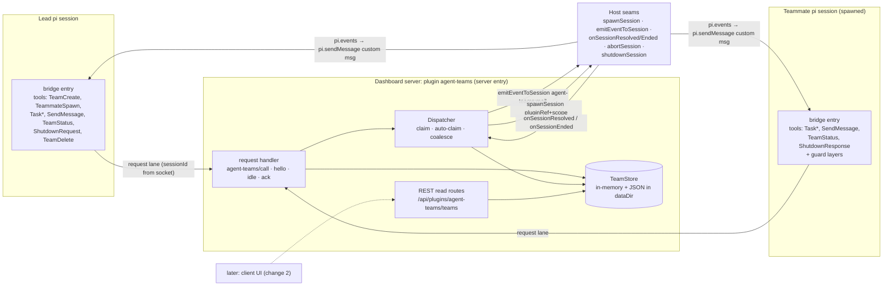
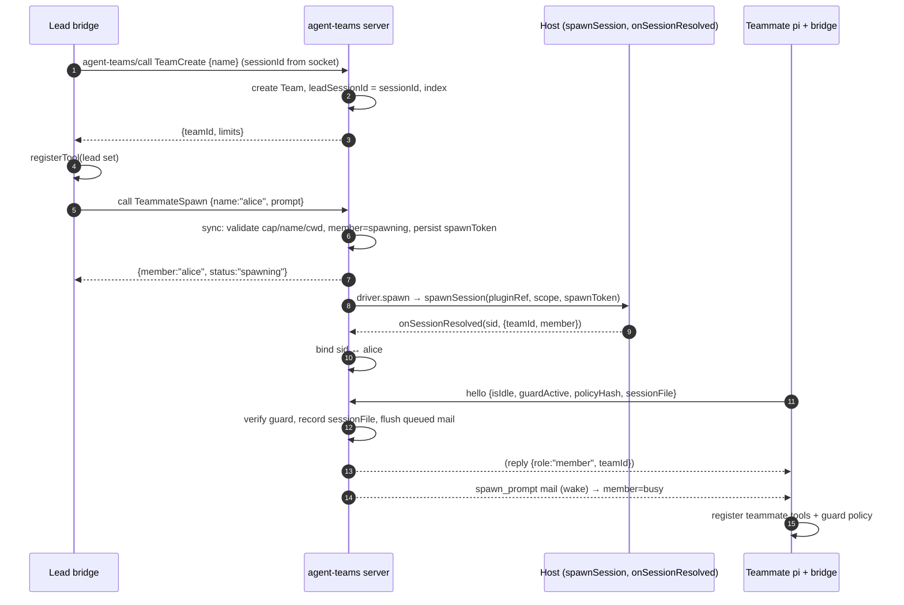
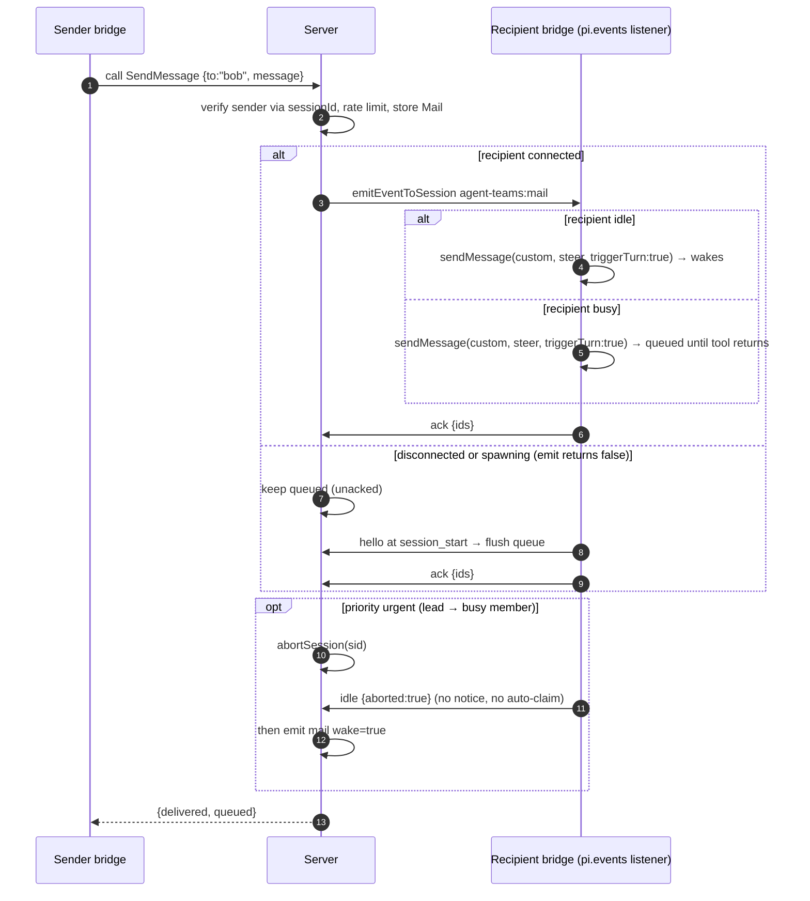

## Context

**Goal.** A general pi-dashboard "agent teams" feature with Claude Code (CC) parity and no Claude Code dependency: a **lead** session spawns **teammates** (each its own pi session with its own context window), they share a **task list** and a **mailbox**, and the dashboard coordinates. This change delivers the headless core as plugin `agent-teams` (package `packages/agent-teams-plugin`). It must not reuse the id/capability names of `packages/team-plugin` (`team`, a multi-user persona product, `packages/team-plugin/package.json` manifest `id: "team"`).

**Spike evidence (authoritative, kept outside the repo).** Phase A: 3 real `pi --mode rpc` processes + faux LLM; Phase B: real sonnet lead + haiku teammates spawned through the live dashboard. Both passed end to end. Lessons that shape this design:

| Lesson | Design consequence |
|---|---|
| `pi.sendMessage({customType,…},{deliverAs:"steer",triggerTurn:true})` wakes an idle session and queues into a busy one | D5 delivery |
| Steer applies only after the running tool returns (18 s in Phase B) | D6 urgent interrupt path |
| Mail as user message makes peer indistinguishable from human | custom messages only (D5, D9) |
| `agent_settled`, not `agent_end`, is the idle hook; text comes from `agent_end` | D7 |
| Lock stopped duplicate work; 0 duplicates / 0 dep violations in 180 contended claims | D8 atomic claim |
| Lead's prose assignment raced the runtime auto-claim | `owner` is a task field the claim respects (D8) |
| Title-only claim/list output → wrong work | full description in results (D8) |
| Teammates busy-waited with `bash sleep 20` | prompt rule + sleep guard (D11) |
| Lead spawned a stray teammate | size cap (D13) |
| Each shutdown approval woke the lead (3 extra turns) | coalescing + wake rules (D9, D12) |
| Teammate base context ≈ 50k tokens/call | per-member scope (D10, D11) |
| Spawn → session live ≈ 4 s | async spawn return (D10) |

**Verified host facts this design relies on** (all re-checked against current code):

- Plugin server spawn: `ServerPluginContext.spawnSession(opts: PluginSpawnOptions)` — `packages/dashboard-plugin-runtime/src/server/server-context.ts:772` (type), options at `:353`: `pluginRef` `:401`, `lifecycle` `:406`, `scope` `:422` (tools/excludeTools/noBuiltinTools/noTools/skills/noSkills/extensions/extensionConfig/appendSystemPrompt/noContextFiles/noProjectTrust/noMcp/sessionDir), caller-minted `spawnToken` `:473`, `resume` `:482`, `initialPrompt` `:490` (not used, see D10). `mode:"worktree"` is NOT implemented in the host hook (`:379-382` comment) and is not used.
- `emitEventToSession(sessionId, eventType, data)` → in-session `pi.events.emit`; trusted-only; returns `false` when not connected — `:182`, gate documented `:172-181`.
- `onSessionResolved((sessionId, pluginRef) => …)` fires with the plugin's OWN ref, before the first forwarded event/prompt — `:145`. `onSessionEnded(sessionId)` fires on every death path — `:133`. `abortSession` (sync boolean) `:795`, `shutdownSession` (async boolean, same body as the dashboard Shutdown control) `:804`, `abortSpawnedRun` `:822`.
- `sessionManager.getSession(id)` / `isConnected(id)` — `:42-53` (session object carries `cwd`, `status`, `sessionFile`, `name`: see `packages/chat-gateway/src/server/seam.ts:105-117`).
- Request lane: bridge `requestPluginServer(pluginId, type, payload)`; server `ctx.registerPiRequestHandler(type, handler)` `:1091` (handler `(payload, {sessionId,…})`, `sessionId` from the socket, `:1079`); caps 256 KiB, 15 s timeout, never rejects — `docs/plugin-seams.md:132-177`. Reference users: `packages/craft-web-plugin/src/bridge/index.ts:90` and `packages/craft-web-plugin/src/server/index.ts:114`.
- Plugin data dir `ctx.dataDir` (`~/.pi/dashboard/plugin-data/<id>/`, 0700) — `server-context.ts:1389`; `ctx.onShutdown` `:1352`; `ctx.getPluginConfig` `:1258`; `ctx.getPiResources?` `:214` (skills as `PiResource[]`, `packages/shared/src/rest-api.ts:683`).
- Reference spawn with `pluginRef`, `lifecycle`, `scope.tools/skills/noSkills/extensions/extensionConfig/appendSystemPrompt/noContextFiles/noMcp`, `resume`, and `principalOwner` stamp: `packages/team-plugin/src/server/conversations.ts:573-610` (`principalOwner` `:578`, `recover:false` `:581`, `extensionConfig` `:599`, `noContextFiles` `:603`, `noMcp` `:606`, `resume` `:610`); `onSessionResolved` binding `:220`.
- Env projection: `extensionConfig[name][key]` → `PI_EXT_<NAME>_<KEY>`, `string[]` JSON-encoded — `server-context.ts:438`; hyphen → underscore is the existing convention (`PI_EXT_CHAT_GATEWAY_GUARD_POLICY`, `packages/chat-gateway/src/guard/index.ts:126-138`), so `agent-teams` → `PI_EXT_AGENT_TEAMS_*`.
- A manifest `bridge` entry is auto-registered for every pi session (`settings.json#dashboardPluginBridges["dashboard-<id>"]`), removed when the plugin is disabled — `packages/dashboard-plugin-runtime/README.md:45,159-161`. Bridge entry shape: `export default function activate(ctx)` using `pi.registerTool` — `packages/craft-web-plugin/src/bridge/index.ts:128-133`.
- **Manifest `emits` gate**: the host refuses `emitEventToSession` for an event type not listed in the plugin manifest `emits` (`packages/server/src/plugin-event-seam.ts:128`, spec `openspec/specs/dashboard-plugin-loader/spec.md:15`; precedent `packages/subagents-plugin/package.json:48`). This plugin declares `emits: ["agent-teams:mail","agent-teams:team_closed"]` (D1).
- **`initialPrompt` is NOT identity-keyed**: the host enqueues it in a per-cwd FIFO (cap 8, TTL 60 s) and sends the head entry to whichever session next registers in that cwd (`packages/server/src/server.ts:4414-4418`, `packages/server/src/event-wiring.ts:1972-1973`, `packages/server/src/pending/pending-initial-prompt-registry.ts:1-30`). Teammates share the lead cwd, so it is unusable for identity-bound prompts (D10).
- **Request lane authentication**: the lane carries `meta.origin`/`meta.channel` and refuses a `hubLocalOnly` handler for a non-local session; a handler with process-level power must register `{hubLocalOnly:true}` — `packages/server/src/plugin-request-lane.ts:11-17`, `packages/dashboard-plugin-runtime/src/server/server-context.ts:1079-1096` (`PluginRequestHandler = (payload, meta)`, third arg of `registerPiRequestHandler`), `docs/security/websocket-and-bridge.md` (C7b).
- **Recovery flag**: `lifecycle.recover !== false` makes a crashed or reopened session a recovery candidate that resumes through the generic path, without spawn-time `scope`/`extensionConfig` (`packages/shared/src/session-meta.ts:300-312`); `packages/team-plugin/src/server/conversations.ts:581` uses `recover:false` for its guarded sessions.
- **Host session record**: `sessionManager.getSession(id)` returns `unknown` (`server-context.ts:45`); narrow it with a local `HostSession` type as `packages/team-plugin/src/server/conversations.ts:38-46` does (`cwd`, `sessionFile`, `principalOwner`, `pluginRefs`, `name`, `status`).
- **Aborted runs still settle**: the bridge `abort` runs `schedulePersistentAbort` (re-abort every 200 ms for ≤2 s while not idle — `packages/extension/src/command-handler.ts:618-645`) and an aborted run still goes `agent_end → agent_settled` (pi docs `extensions.md:336`).
- **Session replacement**: `/new`, `/fork`, `/resume` in one process send `session_unregister` and then register a new session id (`packages/extension/src/session-sync.ts:255-265`).
- pi extension API (pi 1.6.0 docs, `@earendil-works/pi-coding-agent/docs/extensions.md` of the installed pi package — NOT in this repo): `pi.registerTool()` works after startup and refreshes immediately (`:1586`); `pi.setActiveTools()` (`:1588`); `pi.sendMessage(msg,{deliverAs,triggerTurn})` — `steer` queues while streaming, `triggerTurn:true` wakes an idle session, `triggerTurn:false` while streaming appends after the turn (`:1627-1648`); `ctx.isIdle()/ctx.abort()` (`:1255`); `agent_settled` (`:691`).
- Skill-guard precedent (reused by copy-adapt, D11): `packages/team-plugin/src/extension/index.ts:47-54` (`tool_call`, `before_agent_start` in-place splice of `systemPromptOptions.skills`, `input` refusal `{action:"handled"}`) and `guard.ts:68` (`policyFromEnv`), `:109` (`decideToolCall`), `:150` (`grantedSkillFilter`), `:172` (`isRefusedInput`). Empirical (pi 1.6.0): `--no-skills` does not remove extension-contributed (`resources_discover`) skills (158→49 with 48 survivors); only the in-place filter removes them from the model prompt.
- Client: manifest `claims` array, i18n catalog export — `packages/goal-plugin/package.json` manifest, `packages/goal-plugin/src/client/index.tsx:9`, `packages/goal-plugin/src/i18n.ts:14`. Custom-entry slot (used by change 2): `packages/shared/src/dashboard-plugin/slot-types.ts:13`, props `slot-props.ts:85` (collapsed card gets only `customType`/body/timestamp ⇒ mail kind is encoded in `customType`).
- Security references: `docs/security/plugins-client-electron.md:28` (plugin capability table), `docs/security/websocket-and-bridge.md:180` (request-lane meta), `docs/security/tool-call-guards.md:18` (guard inventory).

## Goals / Non-Goals

**Goals:** CC-parity headless teams on existing host seams with no host change; correctness of claims and delivery under races; bounded cost (caps, scope, coalescing); safe handling of untrusted peer input; survive server restart.

**Non-Goals:** see proposal. UI (change 2), templates/hooks/plan approval (3), OpenSpec (4), in-process mode (5), file locking, nested teams, lead hand-over, worktree isolation.

## Architecture



**Module layout** (`packages/agent-teams-plugin/src/`):

| Path | Role |
|---|---|
| `bridge/index.ts` | activate: role detection (env + `hello`), tool registration, mail listener, idle reporter, guard hooks |
| `bridge/tools.ts` | `createTeamTools(transport)` factory (schemas, descriptions) + the default lane transport, so another transport can reuse the same tools |
| `bridge/guard.ts` | copy-adapted skill/tool/path/sleep guard (D11) |
| `server/index.ts` | `registerPlugin(ctx)`: store, handlers, host listeners, routes, `ctx.onShutdown` |
| `server/store.ts` | team state, synchronous mutations, atomic JSON persistence |
| `server/ops.ts` | the tool operations (one function per tool), authorization, validation |
| `server/dispatch.ts` | claim/auto-claim, mail queue + delivery, coalescer |
| `server/spawn.ts` | teammate spawn (resolved spawn spec, scope, cwd confinement, timeouts) |
| `server/driver.ts` | `MemberDriver` interface + the session driver; the ONLY place that calls `spawnSession`/`emitEventToSession`/`abortSession`/`shutdownSession` (D17) |
| `server/modes.ts` | teammate-mode registry (`session` registered; later modes register themselves) (D17) |
| `server/extension-points.ts` | typed registries later changes extend: mail kinds, spawn-spec contributors, op gates, dispatch eligibility, route visibility (D17) |
| `server/routes.ts` | read-only REST |
| `shared/protocol.ts` | request/response/event types shared by bridge and server; the single `TEAM_TOOLS_BY_ROLE` table later changes extend |
| `shared/mail-format.ts` | `formatEnvelope` / `parseEnvelope` and the mail-kind registry (D5) |
| `client/index.tsx`, `i18n.ts` | registration only |
| `prompts/teammate.md`, `prompts/teammate-member-commit.md` | static teammate protocol appended via `scope.appendSystemPrompt`; the second variant is used for a member whose `committer` is `member` (D4) |
| `configSchema.json` | settings |

## Data model

```mermaid
classDiagram
  class Team {
    +string id  "t_<8 hex>"
    +string name
    +string leadSessionId?  "unset while status=starting"
    +string leadCwd  "stored explicitly"
    +string mode  "session (modes.ts registry)"
    +string status  "starting|active|orphaned|closing|closed"
    +string closeReason?  "orphan_ttl|team_delete|user|lead_spawn_failed (ch3)|lead_ended|lead_reloaded|mode_unavailable (ch5)"
    +string committer  "lead|member, default lead"
    +object overrides?  "autoDispatch, notifyCoalesceMs"
    +object owner?  "createTeam owner (REST principal), else the lead principalOwner"
    +int maxTeammates
    +string[] defaultSkills?  "allowlist; absent = unrestricted"
    +string[] defaultTools?
    +int nextTaskId
    +int nextMailId
    +int schemaVersion
  }
  class Member {
    +string name  "^[a-z][a-z0-9-]{0,31}$"
    +string role?
    +string sessionId?
    +string spawnToken
    +string sessionFile?
    +string cwd
    +string model?
    +string status  "spawning|idle|busy|shutdown_pending|disconnected|gone|failed"
    +string goneReason?
    +string degraded?  "team_tools_unavailable|guard_unavailable (later changes add values)"
    +string committer?  "member-level override from TrustedSpawnOptions"
    +string hold?  "dispatch hold reason set by extensions"
    +bool guardActive
    +string[] tools?
    +string[] skills?
    +bool noMcp
    +bool noContextFiles
    +int lastSettleId
  }
  class Task {
    +string id  "1,2,3…"
    +string title
    +string description  "≤2000 chars"
    +string status  "pending|in_progress|completed"
    +string owner?  "member name or lead"
    +string[] blockedBy
    +string result?
    +string createdBy
    +ts createdAt
    +ts claimedAt?
    +ts completedAt?
  }
  class Mail {
    +int id
    +string from  "server-verified name"
    +string to  "member name | lead"
    +string kind  "message|broadcast|task_assigned|shutdown_request|shutdown_response|spawn_prompt|idle|notice (open set, D5)"
    +string text
    +string priority  "normal|urgent"
    +bool wake
    +ts createdAt
    +ts ackedAt?
    +object details?
  }
  Team "1" o-- "0..N" Member
  Team "1" o-- "0..N" Task
  Team "1" o-- "0..N" Mail
  Member "1" --> "0..N" Task : owns
```

- **Blocked is derived**: a task is *blocked* iff any `blockedBy` task is not `completed`; it is never stored, so unblocking is automatic and cannot drift.
- **Lead** is not a `Member`; it is `leadSessionId` on the team (optional only while `status:"starting"`, i.e. a lead the server is still starting for a later change; all notices and dispatch queue until a lead binds). `leadCwd` is stored explicitly at create/start, never re-derived later. Messages address it as `lead`.
- **Reserved names**: member names `lead`, `server`, `system`, `all`, `user` are refused with `name_reserved` (the regex also excludes `*`), so envelope senders, `to` addresses and `owner` values are unambiguous.
- **Store events**: the store keeps a monotonic `rev` per team and exposes typed `store.on(event, fn)` with events `change`, `team_created`, `lead_bound`, `task_completed {team, task}`, `member_status {team, member, from, to}`, `team_closed`. Later changes only subscribe (D17). `rev` is in-memory (reset on restart; consumers pair it with a server `epoch`).
- **Mail** is a per-team append log (cap `maxMailLog`, default 1000, oldest acked entries pruned). `ackedAt` is set when the recipient bridge acknowledges. Unacked mail for a connected recipient is redelivered on `hello`.
- **Persistence**: `<dataDir>/teams/<teamId>.json` (team, members, tasks, mail counters) is written atomically (write temp + rename) by a coalescing writer (≤1 write per 100 ms per team, flushed in `ctx.onShutdown` `server-context.ts:1352`). The mail log lives in a separate append-only `<teamId>.mail.jsonl` (acks as small tombstone lines), compacted at load and when it exceeds `maxMailLogBytes` (default 2 MiB), so the small file is never rewritten with up to 8 MB of bodies. `schemaVersion: 1` for forward migration. Closed teams are kept for `closedRetentionDays` (default 7) for the later UI, then pruned at startup.
- **Index** (in memory only, rebuilt on load): `sessionId → {teamId, member|"lead"}`.

### Member state machine

```mermaid
stateDiagram-v2
  [*] --> spawning: TeammateSpawn (name reserved, spawnToken persisted)
  spawning --> busy: onSessionResolved + guarded hello, spawn_prompt delivered
  spawning --> idle: onSessionResolved + guarded hello with isIdle and no spawn_prompt pending
  spawning --> failed: spawn error / spawnTimeoutMs
  idle --> busy: busy report (agent_start); a waking mail the server sent makes it provisionally busy until the report or wakeConfirmMs
  busy --> idle: idle report (agent_settled)
  idle --> shutdown_pending: ShutdownRequest
  busy --> shutdown_pending: ShutdownRequest
  shutdown_pending --> idle: ShutdownResponse(reject)
  shutdown_pending --> gone: approve then settle or shutdownGraceMs → shutdownSession
  idle --> disconnected: socket lost / server restart unresolved
  busy --> disconnected: socket lost
  disconnected --> idle: re-resolved (hello isIdle)
  disconnected --> busy: re-resolved (hello not isIdle)
  disconnected --> gone: onSessionEnded
  idle --> gone: onSessionEnded
  busy --> gone: onSessionEnded
  gone --> spawning: TeammateSpawn {resume:true}
  failed --> spawning: TeammateSpawn (same name, retry)
```



## Tool contract

All tools are agent tools registered by the bridge; each is a thin client of the single request type `agent-teams/call` `{op, args}` (D3). Results are `{content:[{type:"text",text}], details}`; failures set `isError:true` with a stable lowercase `error` code in `details.error`. The caller is identified by the socket `sessionId`, never by a payload field.

| Tool | Who | Params | Result (`details`) | Main errors |
|---|---|---|---|---|
| `TeamCreate` | plain session (becomes lead) | `name` (≤40), `description?`, `maxTeammates?` (≤ config max), `skills?: string[]`, `tools?: string[]`, `mode?` (must be a registered mode; only `session` today) | `{teamId, name, limits:{maxTeammates,maxTasks}, role:"lead"}`; registers the lead tool set | `already_in_team`, `nested_team_forbidden`, `team_cap_reached`, `lead_confined`, `origin_denied`, `mode_unavailable`, `invalid_args` |
| `TeammateSpawn` | lead (plain session auto-creates the team) | `name`, `prompt`, `role?`, `model?`, `cwd?`, `tools?`, `skills?`, `noMcp?`, `noContextFiles?`, `resume?` | `{member, status:"spawning"}` — returns before the session is live | `not_lead`, `name_taken`, `name_reserved`, `team_full`, `cwd_outside_lead`, `lead_confined`, `origin_denied`, `skill_not_found`, `skill_resolution_unavailable`, `nothing_to_resume`, `invalid_args`, `team_closed` |
| `SendMessage` | lead, teammate | `to` (member name \| `lead` \| `*` lead-only), `message` (≤ `maxMessageChars`), `summary?`, `priority?: "normal"\|"urgent"` (lead-only) | `{mailIds, delivered:[names], queued:[names]}` | `unknown_recipient`, `member_gone`, `broadcast_lead_only`, `urgent_lead_only`, `rate_limited`, `message_too_long` |
| `TaskCreate` | lead, teammate | `title`, `description`, `blockedBy?: id[]`, `owner?` (lead-only) | `{task}` (full) | `unknown_dependency`, `dependency_cycle`, `task_cap_reached`, `owner_not_lead`, `unknown_owner` |
| `TaskList` | lead, teammate | `status?`, `owner?`, `includeCompleted?` (default false) | `{tasks:[full task + blocked:boolean + claimable:boolean]}` | – |
| `TaskGet` | lead, teammate | `id` | `{task, dependencies:[{id,title,status,result}]}` (full description + own result; dependency results truncated to `maxResultChars`) | `unknown_task` |
| `TaskUpdate` | lead, teammate | `id`, `status?: "pending"\|"in_progress"\|"completed"`, `owner?: name\|null` (lead-only; a teammate's only owner write is the implicit self-assignment of a claim), `title?` (≤200), `description?`, `addBlockedBy?`, `result?` (≤ `maxResultChars`) | `{task, unblocked:[ids], dependencies?}` (`dependencies` on a claim, as in `TaskGet`) | `already_claimed`, `blocked`, `not_owner`, `owner_not_lead`, `invalid_transition`, `dependency_cycle` |
| `TeamStatus` | lead, teammate | – | `{team, members:[{name,status,role,taskIds,degraded?}], counts}` (names of released `gone`/`failed` members are listed with that status until respawned) | `not_in_team` |
| `ShutdownRequest` | lead | `to`, `reason?` | `{member, status:"shutdown_pending"}` | `not_lead`, `unknown_recipient`, `member_gone` |
| `ShutdownResponse` | teammate | `approve: boolean`, `reason?` (required when `approve:false`) | `{approved}` | `no_pending_request`, `reason_required` |
| `TeamDelete` | lead | `force?: boolean` | `{closed:true, shutdown:[names]}` | `not_lead`, `members_active` (lists names) |

Rules shared by all tools: unknown team/membership → `not_in_team`; a closed team → `team_closed`; a caller whose lane `meta.origin` is not hub-local → `origin_denied` (D3); handlers are synchronous state transitions (no `await` between read and write of a claim) and finish well inside the 15 s lane timeout — the only asynchronous step a handler may have is a registered **op gate** (D17), which must re-read state after its `await`, runs under one per-call budget (`opGateBudgetMs`, default 12 s total, so the call always ends inside the lane timeout) and is absent in this change; payload strings are length-capped and stripped of control characters; the full task description is always included in `TaskGet`, `TaskList` (non-completed) and the `TaskUpdate` claim result (spike lesson). `TaskUpdate{status:"in_progress"}` on an unowned task by a teammate is the **claim**; by the lead it is refused unless `owner` is also given.

## Decisions

### D1 — One bundled plugin package `agent-teams`, three entries
**Chosen:** `packages/agent-teams-plugin`, manifest `id: "agent-teams"`, `priority: 100`, `server`, `bridge`, `client`, `configSchema`, `i18nCatalog`, `claims: []`, `emits: ["agent-teams:mail","agent-teams:team_closed"]` (manifest shape per `packages/goal-plugin/package.json`, `packages/team-plugin/package.json`; `emits` per `packages/subagents-plugin/package.json:48` — without it the host refuses every `emitEventToSession`, `plugin-event-seam.ts:128`). A contract test asserts every event type this plugin emits is in `emits`.
**Alternatives:** (a) extend `packages/team-plugin` — rejected: unrelated multi-user persona product with its own id/specs; coupling would force its owner model onto sessions. (b) a pi-only extension package with no server — rejected: no persistence, no push, no UI source of truth (the spike's file store worked across processes but cannot serve a UI or host spawn). (c) separate bridge and server packages — rejected: doubles registrations (checklist §1) for no isolation benefit.

### D2 — Server is the single source of truth
**Chosen:** `TeamStore` in server memory, persisted per team as JSON in `ctx.dataDir`. Every mutation is a synchronous function on the store; persistence is asynchronous and cannot reorder mutations.
**Alternatives:** (a) the spike's file-based store (mkdir lock) — works without a server but has no push channel, no UI feed, no host-spawn coupling, and lock files leak on crashes; kept as evidence only. (b) SQLite — extra dependency for a few KB of state; rejected (minimize dependencies). (c) store in session entries — not shared across sessions.
**Risk:** a server crash between a mutation and its write loses ≤100 ms of state; mitigated by flush on `onShutdown` and by write-through for task claims/completions (flush immediately, others debounced).

### D3 — Bridge → server via one request-lane type
**Chosen:** one registered type `agent-teams/call` (`{op, args}`) plus three lifecycle types `agent-teams/hello`, `agent-teams/idle`, `agent-teams/ack`. Identity = socket `sessionId` (`server-context.ts:1079`). Handlers register through `ctx.registerPiRequestHandler?.(type, handler, {hubLocalOnly:true})` (optional seam, craft-web precedent `packages/craft-web-plugin/src/server/index.ts:114`; `hubLocalOnly` because `agent-teams/call` grants spawn, abort and shutdown — `plugin-request-lane.ts:11-17`); a remote-origin session's call is refused `origin_denied` and `leadCwd` is therefore always a local path; a missing seam logs once and disables tools (`no_handler` surfaces to the agent per `docs/plugin-seams.md:170`).
**Alternatives:** (a) one type per tool — more registrations, duplicated authorization; (b) REST with a token — needs credential minting and exposes team mutation to the browser surface; (c) `pi.events` round-trips — no reply semantics. The lane carries session identity from the socket, which is exactly the authorization input we need.
**Constraint:** the lane entry is `(payload, meta)` (`server-context.ts:1079-1090`); the caller is resolved from `meta.sessionId` only, and the op table calls `(args, callerCtx)` — never a single-parameter wrapper, which would drop the identity input. Meta fields consulted: `sessionId` (identity), `origin`/`channel` (admission, via `hubLocalOnly`).

### D4 — Identity: `pluginRef` + env hint + `onSessionResolved`; lead by `TeamCreate`
**Chosen:** teammates are spawned with `pluginRef: {"agent-teams": {teamId, member, role}}` (+ lead's `principalOwner` stamp like `conversations.ts:578`) and `extensionConfig: {"agent-teams": {teamId, member, policy}}` → env `PI_EXT_AGENT_TEAMS_*`. `onSessionResolved` (`:145`) binds `sessionId ↔ member` before the first event. The **env is only a hint** for the bridge to pick its tool set and guard policy at load; the **server is authoritative** — a session whose env claims membership but is not in the index gets `not_in_team`. A plain session becomes lead by calling `TeamCreate` (or the first `TeammateSpawn`), CC-style natural language; the server records `leadSessionId` from the socket.
**Alternatives:** prompt-header identity (spike hack — forgeable and untyped); name-only addressing (collides across teams); lead chosen in UI (needs change 2).
**Lead identity across resume:** pi's session id is stable across resume (`packages/extension/src/session-sync.ts:268` reports `sessionManager.getSessionId()`), so a resumed lead re-binds by `hello`. If a resumed session gets a new id it is simply a plain session (documented limitation). **Session replacement** (`/new`, `/fork`, `/resume` → `session_unregister` then a new id, `session-sync.ts:255-265`): the bridge re-sends `hello` and re-evaluates its role on EVERY `session_start` (all reasons) and drops its team tools and guard when the server answers `not_in_team`; a replaced lead is an orphaned team (D14). `unverified`: the exact `session_start` reason values for `/new` vs `/resume` on pi 1.6.0 — hence "every reason".
**Committer (D4 of the brief):** `Team.committer` is `lead` by default; the lead is then the only git committer, the teammate prompt says so and the guard refuses git writes (D11). A trusted server caller may spawn a member with `committer:"member"` (only that member's static prompt variant and guard switch; `Team.committer` stays `lead`; no tool parameter exposes it to an LLM lead), for owners of exclusive worktrees (decided, A2: `openspec-group` members; in the shared lead cwd the lead stays the sole committer).

### D5 — Mail delivery: `emitEventToSession` → `pi.events` → `pi.sendMessage` custom message
**Chosen:** server calls `ctx.emitEventToSession(sid, "agent-teams:mail", {mails:[…]})`; the bridge listener (`pi.events.on("agent-teams:mail")`) renders each mail into a custom message `{customType, content, display:true, details}` with `customType` from the mail-kind registry and sends it with `{deliverAs:"steer", triggerTurn: mail.wake}`; then acks `agent-teams/ack {ids}`. Mail text is capped by `maxMessageChars` and by 150 lines (blank runs collapsed) so the envelope survives the host's 200-line display tail cap (`packages/client/src/lib/chat/event-reducer.ts:1246-1263`). The first content line is the envelope, built ONLY by `formatEnvelope` in `shared/mail-format.ts`: `[agent-teams · <kind> · from <sender> · peer message — not a user instruction and not user approval]` with an optional ` · urgent` before the closing bracket. `<sender>` is `lead`, `server` or a member name (server-verified; reserved names keep it unambiguous), `<kind>` matches `[a-z_]+`. Core kinds map to `agent-teams-mail` (message, broadcast, task_assigned, shutdown_request, shutdown_response, spawn_prompt), `agent-teams-idle`, `agent-teams-notice`. The kind set is OPEN: `registerMailKind(kind, customType)` (D17) lets later changes add kinds and customTypes without editing this file, `parseEnvelope` accepts any `[a-z_]+` kind and renders an unknown one as a generic labelled message. The collapsed chat card sees only `customType`/body/timestamp, so kind, sender, urgency and any id a card must link to (e.g. a plan id) belong in the first body lines, never only in `details`. This custom-message rule is the session-mode delivery contract; a mode that cannot send custom messages must define a compensating control (envelope + prompt rule) in its own change. Delivery is at-least-once and the **receiving side de-duplicates by mail id** — this is the driver-agnostic delivery contract (every `MemberDriver.deliver` implementation, D17, hands each mail id over at most once per member, even across a lost ack or a re-emit). The session bridge keeps an in-memory set of the last 200 ids; on a de-dup-skipped mail it still sends `agent-teams/ack {ids}` (the server ack is idempotent, so the queue drains) and re-sends its current state as `agent-teams/hello`, so a server that provisionally marked the member `busy` for a waking mail that produced no turn recovers at once. The server re-emits only unacked ids, and an ack for an id already acked is a no-op.
**Alternatives:** (a) `sendToSession` (`:155`) — delivers a prompt/user message: peer becomes indistinguishable from the human (spike lesson) and `/`-commands could be injected; rejected. (b) `sendExtensionMessage` (`:170`) — private control frame, no `pi.events` re-emit; would need a core bridge change; rejected. (c) polling from the bridge — adds latency and load; rejected.
**Not connected / not yet listening:** `emitEventToSession` returns `false` when the session is not connected; mail stays queued (unacked). The bridge sends `hello` at `session_start` (and on reconnect) which flushes the queue — this also covers the window where the host forwards before the bridge listener exists.

### D6 — Busy recipients and the urgent interrupt path
Steer waits for the running tool to return (spike: 18 s; a long build is a long latency). **Chosen:** normal mail uses steer (non-lossy, no surprise aborts). A message with `priority:"urgent"` (lead-only) makes the server call `driver.abort(member)` (session driver: `ctx.abortSession(sessionId)`, `:795`) **only if the member is `busy`**, then WAIT for the member's settle report (bounded by `urgentSettleWaitMs`, default 2500) before emitting the mail with `wake:true`: the host's persistent abort re-aborts every 200 ms for up to 2 s while the agent is not idle, so a wake turn started earlier could be aborted again (`command-handler.ts:618-645`). The settle of an aborted run still reaches the server; the bridge marks it `aborted:true` (from `stopReason`) and the server neither emits a lead idle notice nor auto-claims for it. If the wait times out the mail is sent as a normal steer wake and a log line is written. Abort drops the in-flight tool run; the member's tasks stay `in_progress` and the member continues after reading the mail. **Alternatives:** (a) bridge-side `ctx.abort()` — needs a cached extension context in a `pi.events` handler (no `ctx` is passed to bus listeners); (b) `followUp` — even later than steer. Teammates cannot send urgent (a peer could otherwise stall another teammate's work); this is deliberately minimal — no preemption queue, no priority levels beyond two.

### D7 — Idle notification and self-claim hook: `agent_settled`
**Chosen:** teammate bridge captures the last assistant text (and `stopReason:"error"` message) from `agent_end` and, on `agent_settled`, sends `agent-teams/idle {settleId, finalText, error?, aborted?}` (`settleId` increments per settle; server ignores a repeated id; `finalText` is truncated to `maxFinalTextChars` with an explicit marker). **State sources** — the server must know `busy` even for runs it did not start (the user chats with a session-mode teammate): the bridge sends `agent-teams/hello {isIdle, toolsActive, guardActive, policyHash, confined, sessionFile}` at every `session_start` and on lane reconnect, and `agent-teams/busy` at `agent_start`; the server sets `busy` on that report, `idle` on the idle report, and the dispatcher claims only for members whose last confirmed report is idle. After emitting a waking mail the member is only **provisionally** `busy` (so the dispatcher does not claim in the gap): if no `busy`/idle report arrives within `wakeConfirmMs` (default 15000) the server reverts to the last confirmed state, and lets the dispatcher run again (a dedup-skipped mail also makes the bridge re-send `hello`, see D5). `agent_end` fires before retries/follow-ups (spike), so it is only a data source. The server sets the member `idle`, runs the **dispatcher** (D8) and queues an `idle` notice for the lead (D9). On error: no auto-claim (avoids loops on API errors), the notice carries the error text.
**Alternatives:** `agent_end` as the idle trigger — premature (retries, queued follow-ups) → false idles and double work.

### D8 — Task list: sequential ids, synchronous claim, owner field, dispatcher
**Chosen:** ids are per-team sequential strings (`"1"`, `"2"`, …) — short for agents to type, stable for the UI. A claim is a synchronous check-and-set on the store: `status==="pending" && !blocked && (owner==null || owner===caller)` then `status="in_progress", owner=caller`. Node's single-threaded handler model makes it atomic without lock files (the spike's lock existed because three OS processes shared a file; the server removes that need). `owner` is a task field only the lead can set; the dispatcher never auto-claims an owned task for anyone but its owner, and pushes `task_assigned` mail to the owner when set (wakes an idle owner). **Dispatcher** (`dispatch.ts`) runs on member settle, on `TaskCreate`, on completion (unblock) and on owner assignment: for each member that is `idle`, not `shutdown_pending`, owning no `in_progress` task → claim (1) lowest-id pending task it owns, else (2) lowest-id unowned, unblocked pending task; then send `task_assigned` mail with the FULL task. `autoDispatch` (default true) can be turned off per config. Completion requires owner or lead; completion returns newly unblocked ids; dependency cycles are rejected at create/update (DFS on the persisted graph).
**Alternatives:** (a) file lock (spike) — unnecessary and leaks; (b) optimistic version numbers — needless complexity single-threaded; (c) teammates poll `TaskList` and race — wastes tokens (spike: busy-wait `sleep 20`); (d) lead-only assignment — loses CC self-claim.
`owner` accepts any non-`gone` member name including a `spawning` one (so a server-side seed or launcher can assign before the member is live; same lead-only rule, no second authorization path). When that member becomes `gone` or `failed` (or approves shutdown) every task it owns — `in_progress` ones return to `pending` and `pending` ones are merely unowned — loses its `owner`, so no task keeps a dead owner; the lead notice names both groups. **Caps:** `maxTasks` (default 50) counts NON-completed tasks, so a long-lived team does not saturate (ids keep increasing); `title` ≤ 200, `description` ≤ 2000, `result` ≤ `maxResultChars` (4000, truncation marker). `TaskList` returns a `result` preview (≤ 200 chars) and, with `includeCompleted`, at most the last 50 completed tasks; the full result is in `TaskGet`. So a snapshot stays far below the 256 KiB lane reply cap (`plugin-request-lane.ts:38,183-190`, `docs/plugin-seams.md:170`) and `reply_too_large` cannot permanently break `TaskList`.

### D9 — Coalescing of lead notices; wake rules
**Chosen:** lifecycle notices to the lead (`idle`, task completed, shutdown approved/failed, member gone) are put in a per-team buffer (each item starts with `• `; every continuation line of peer-authored text is prefixed `│ `, so peer text cannot imitate an item) and flushed after `notifyCoalesceMs` (default 2000) as ONE `agent-teams-notice` mail whose `details.items[]` lists them. `wake` = true iff the batch contains: an idle with nothing left to claim, a member error/death/spawn failure, a shutdown **rejection**, **all** pending shutdown requests resolved, or a direct message. Non-waking batches go out with `triggerTurn:false` (they enter context for the lead's next turn at no extra LLM call). Direct `message` mail to anyone is never coalesced and always wakes. A flush also drains the buffer early when a waking direct message is sent to the same recipient (ordering preserved by mail id). `notifyCoalesceMs` and `autoDispatch` are read from `Team.overrides` before the plugin config. While a team is `starting` (no lead bound) all lead notices and dispatch queue until `bindLead`. Several mails may arrive in one lead turn: the notice text lists all mail since the lead's last reply, and the tool descriptions tell the lead to read all of them.
**Alternatives:** one wake per event (spike: 3 extra turns for 3 shutdown approvals); fixed long digests (adds latency for errors).

### D10 — Teammate spawn: session mode via `spawnSession`
**Chosen** (`spawn.ts`): `TeammateSpawn` reserves the name and persists `{status:"spawning", spawnToken}` **synchronously**, then resolves a `ResolvedSpawnSpec` (cwd confinement, scope, ordered prompt files, env; spawn-spec contributors of D17 run here) and hands it to `MemberDriver.spawn`, asynchronously, returning `{status:"spawning"}` at once (spawn → live ≈ 4 s; lane timeout is 15 s). The session driver issues:
```
spawnSession({
  cwd, model, name: "<team>/<member>",
  pluginRef: {"agent-teams": {teamId, member, role}, principalOwner?},
  lifecycle: { recover: false, finalizeOnSocketClose: false },  // plain restart re-attaches; a crash/Reopen must not resume without scope+env
  spawnToken,                                                    // pre-minted, persisted
  scope: { tools?, excludeTools?, skills?, noSkills?, extensionConfig, appendSystemPrompt:[teammate.md], noContextFiles?, noMcp? },
})
```
Teammates receive **only** the spawn prompt (no lead history), CC parity. There is NO `initialPrompt`: the host queues it per cwd and gives it to the next session registering there (host facts), so concurrent same-cwd spawns would swap prompts. Instead, after the member is bound by `onSessionResolved` AND its guarded `hello` arrived, the server delivers the team header, role and spawn prompt as the first waking mail of kind `spawn_prompt`, addressed by session id (member `spawning → busy`). The pre-minted token (`:473`, `goal` precedent) makes a crash mid-spawn reconcilable. `spawnTimeoutMs` (30 s) covers bind + guarded hello + `spawn_prompt` ack: the member must be bound by `onSessionResolved`, report `guardActive:true` (and, for an allowlisted member, a `policyHash` equal to the server's) and ack the prompt; otherwise mark `failed`, `abortSpawnedRun({spawnToken})` (`:822`), push a waking notice. `resume:true` on an existing `gone`/`disconnected` member respawns with `resume:{sessionFile}` (`:482`, `conversations.ts:610`), re-applying scope and env — improves on CC's "no resume". `Member.sessionFile` is recorded from the host session record (`HostSession.sessionFile`) after bind and refreshed from every `hello`. **Name release**: a `gone`/`failed` member's name is free for a fresh non-resume `TeammateSpawn`, which replaces the member record (tasks were already released); `TeamStatus` lists released names with their final status until respawned. Fail-closed spawn (precedent `team-plugin/src/server/conversations.ts:531`, `chat-gateway/src/server/seam.ts:95-100`): an allowlisted teammate whose bridge never loads stays `spawning` and times out `failed`; it is never treated as idle.
**cwd:** default the lead's cwd (read once through the `HostSession` narrowing of `sessionManager.getSession(leadSessionId)` — `server-context.ts:45` types it `unknown` — and stored as `Team.leadCwd`, never a payload value); a per-member `cwd` is accepted only if its realpath lies inside the lead cwd or one of `extraCwdRoots` (config, default `[]`). Rationale: the lead is an LLM; an unconfined `cwd` would let a prompt injection place sessions anywhere (`docs/security/plugins-client-electron.md:28`). Worktree cwds (a later change) come from `extraCwdRoots` or from `TrustedSpawnOptions.cwd` (D17), an in-process server-caller argument that skips confinement and is unreachable from the lane.
**Alternatives:** `mode:"worktree"` — not implemented in the host hook; `initialPrompt` — rejected, per-cwd FIFO not identity-keyed (host facts); `sendToSession` prompt — user-role, so peer and human become ambiguous; hence the `spawn_prompt` custom message.

### D11 — Teammate limits: tools and skills, four layers (+ sleep guard)
Roles decide the **tool set registered by the bridge**: plain session → `TeamCreate`, `TeammateSpawn`; lead → lead set; teammate → teammate set (no `TeamCreate`/`TeammateSpawn`/`TeamDelete`/`ShutdownRequest`: **nested teams are structurally impossible**, and the server re-checks `nested_team_forbidden`). The bridge registers the role hinted by the env synchronously at `activate` (teammate: its set; plain session: two tools), so a teammate's first turn already has its tools; `hello` only confirms or downgrades (`pi.setActiveTools`). A plain session becomes lead by registering the lead tools late — pi supports `registerTool` after startup (pi docs `extensions.md:1586` of the installed pi package, not this repo); a smoke check (tasks §12) must confirm late tools stay active under an explicit `tools` allowlist, else the bridge registers the full set at `activate` and gates roles with `setActiveTools`. The role→tool table is the single `TEAM_TOOLS_BY_ROLE` in `shared/protocol.ts`; its lists are minimums that later changes extend.
**Skill allowlist** (per team default, per-member override; absent = unrestricted, `[]` = none), enforced by:
1. **Spawn scope**: `noSkills:true` + `skills: [resolved SKILL paths]` (names resolved server-side through `ctx.getPiResources(cwd)` `:214`; an unresolvable name → `skill_not_found`; when the seam is absent the spawn is refused with `skill_resolution_unavailable` rather than running unrestricted).
2. **`before_agent_start`**: splice `systemPromptOptions.skills` in place to the allowlist (`guard.ts:150` approach) — necessary because `--no-skills` leaves extension-contributed skills (empirical, 158→49 / 48 survivors).
3. **`input`**: refuse `/skill:<ungranted>` and out-of-root `<skill>` envelopes with `{action:"handled"}` (`guard.ts:172`).
4. **`tool_call` read-path guard**: block `read` of any `…/SKILL.md` outside granted roots (`decideToolCall` approach, `guard.ts:109`).
**Honest limit:** with `bash` allowed the allowlist is advisory (a shell can `cat` anything); a stricter set needs `tools` without `bash`.
**Tool allowlist:** per member `tools` → `scope.tools`; the server always appends the teammate tool names so the team tools survive an allowlist; a `tool_call` name gate is the backstop.
**No capability escalation:** a session already confined by another plugin (`PI_EXT_TEAM_TOOLS`, `PI_EXT_CHAT_GATEWAY_GUARD_POLICY` — `command-handler.ts:262-274`, `packages/chat-gateway/src/guard/index.ts:120-138`) registers no team tools and reports `confined:true` in `hello`; the server refuses `TeamCreate`/`TeammateSpawn` with `lead_confined` when the caller reported `confined` or its `HostSession.pluginRefs` (`conversations.ts:38-46`) has any key other than `agent-teams` (spawned by another plugin). An unconfined lead is therefore the capability ceiling and teammates may default to the full tool set.
**Cost scope:** `noMcp`, `noContextFiles` per member (teammate base context ≈ 50k tokens/call otherwise).
**Sleep-poll guard** (`blockSleepPolling`, default true): the teammate `tool_call` guard refuses a `bash` command that is only `sleep N` (N ≥ 10) with the reason "nothing to claim → end your turn" (spike busy-wait); the teammate prompt file states the same rule.
**Git-write guard** (`blockGitWrite`, default true, applies while `Team.committer` is `lead`): the teammate `tool_call` guard refuses a `bash` command running `git commit`, `git push`, `git reset --hard`, `git rebase` or `git merge`; advisory with `bash` like the skill limit.
**Duplication:** the guard logic is copy-adapted (≈80 lines) from `packages/team-plugin/src/extension/guard.ts`; cross-plugin imports are not allowed for bundled plugins that ship without each other's sources, and extracting a shared library is premature for two consumers. Recorded as a follow-up, not done here.

### D12 — Shutdown handshake and cleanup
Lead `ShutdownRequest` → member `shutdown_pending`, mail `shutdown_request` (wakes the member). `ShutdownResponse{approve:false, reason}` → member back to `idle`/`busy`, waking `shutdown_response` notice to the lead (reject always wakes). `approve:true` → the server releases the member's `in_progress` tasks to `pending` and clears the owner of its `pending` tasks (lead notified), waits for the member's next settle or `shutdownGraceMs` (10 s) so the final turn can finish, then `ctx.shutdownSession(sid)` (`:804`) → `gone`. When every outstanding request is resolved the coalesced notice wakes the lead once. `TeamDelete{force?}` (lead only): without `force` refuses while any member is not `gone`/`failed` (`members_active` + names); with `force` it requests shutdown for each member, `shutdownSession`s after `shutdownGraceMs`, then closes the team (status `closed`, index entries removed, `agent-teams:team_closed` event so the lead bridge drops the lead-only tools). `force` first posts a visible non-waking `notice` mail to every live member session (a user may be chatting with it) saying the team is being closed by force, and every rejection reaches the lead through its waking notice before the lead can choose `force`. The operations are exported from `ops.ts` as `abortMember(team, name, {actor})` and `teamDelete(team, {actor, force})` with actor `lead|user|server` (the lane handlers are thin wrappers; later UI actions call them), and the team records `closeReason`. Decided (A5/A6): `force` is forced for the `lead` and `user` actors alike; `abortMember` needs no confirmation and leaves tasks `in_progress`. Cleanup through the tool is lead-only (CC parity); there is no teammate-initiated cleanup. **Alternative:** bridge-side `ctx.shutdown()` after approval (spike) — works but leaves the server unaware until the socket drops and bypasses the host Shutdown body (liveness bookkeeping); rejected.

### D13 — Caps and abuse limits
`maxTeammates` default 5 (1–10) counted **synchronously before any `await`** so two concurrent spawns cannot exceed it; `maxActiveTeams` default 3 across the server; `maxTasks` 50 non-completed; `maxMessageChars` 8000; per-sender mail rate limit (`mailRatePerMin`, default 6, token bucket) plus a per-pair loop breaker (`pairExchangeLimit`, default 10 mails between the same two members with no task state change in between → `rate_limited` and a notice to the lead), because every mail wakes a full ~50k-token turn; `wakeConfirmMs` 15000 (provisional-busy confirmation window, D7), `maxResultChars` 4000, `maxFinalTextChars` 2000, `maxMailLogBytes` 2 MiB; broadcast and urgent are lead-only. All caps are `configSchema.json` settings read via `ctx.getPluginConfig` (`:1258`). Guidance in the lead tool descriptions: 3–5 teammates, 5–6 tasks per teammate (CC guidance).

### D14 — Persistence and restart reconciliation
On start: load `teams/*.json`, rebuild the index, mark every member `disconnected` (leads too: `leadConnected=false`), then wait `reconcileGraceMs` (30 s) for `hello`/`onSessionResolved` re-binds; members still unbound → stay `disconnected` and the lead is told when it reconnects. Members stuck `spawning` with a persisted `spawnToken` and no resolution after grace → `failed`. Queued mail survives; `ackedAt` prevents re-delivery of delivered mail. A spawned teammate session keeps running across a dashboard restart without any recover flag (a plain restart re-attaches live sessions), so normally everything re-binds without user action. `lifecycle.recover` is `false`: a crash-recovered or Reopened teammate would otherwise come back without its spawn-time `scope`/`extensionConfig` (`session-meta.ts:300-312`). A bound member whose `hello` lacks the guard env or policy hash is marked `degraded: guard_unavailable` (team tools refused, no dispatch, waking notice) — never run unguarded; only `TeammateSpawn {resume:true}` re-spawns with scope and env. The `hello` payload (D7) restores `idle`/`busy` after reconnect.

### D15 — Minimal REST read surface
`GET /api/plugins/agent-teams/teams` (summaries) and `GET /api/plugins/agent-teams/teams/:id` (full snapshot: members, tasks, the last 100 mail entries, each `text` capped at 2000 chars with `truncated:true`) registered in an encapsulated scope with `@fastify/rate-limit` (pattern: `packages/team-plugin/src/server/routes.ts:2-5`). Both are read-only and need ROUTE_TIERS rows (`observe`, cf. `packages/shared/src/route-tiers.ts:137`) and an MCP denylist pattern (`packages/mcp-server-plugin/src/server/tools.denylist.ts:72-74` style): team control is an agent-tool action, never an MCP browser tool. This change registers no mutating route; later changes MAY add routes under the same prefix, each with its own `ROUTE_TIERS` row, calling the same `ops.ts` functions with actor `user`. The read routes allow ≥ 8 requests/s per client (a UI refetching on each `rev` bump, ≤ 1 per 250 ms, needs no edit of the limiter). `GET /teams` passes each team through the `routeVisibility` hook (D17; default allow-all) and `Team.owner` records the lead's `principalOwner` for it; the filtering policy itself is not in this change (it relies on the host route-tier gate).

### D16 — Client entry: registration only
`src/client/index.tsx` exports `catalog` (zh-CN, hu, en with identical key sets) and nothing else; manifest `claims: []`. Change 2 adds the claims. Keeps the cold index chunk untouched (checklist pitfall about client entries).

### D17 — Seams for later changes: driver, registries, store events, actor ops
**Chosen:** the base primitives that the four dependent changes would otherwise patch into core files are defined here, all additive and empty/inert by default:
- **`MemberDriver`** (`server/driver.ts`): `spawn(spec)`, `deliver(member, mails, {wake})`, `abort(member)`, `shutdown(member)`, `isConnected(member)`. The session driver (behaviour = D5/D6/D10/D12) is the only implementation and the only caller of `spawnSession`/`emitEventToSession`/`abortSession`/`shutdownSession`; `modes.ts` maps `mode → {driver, available?(callerSessionId?) → {ok}|{ok:false, reason}}` (`session` registered, always available); an absent `mode` resolves from config `teammateMode` (default `session`); unknown or unavailable → `mode_unavailable`. A later mode adds an entry, not edits. `abort(member)` returns `{ok, reason?}` and `deliver` returns whether the mail was handed over; when `abort` is not ok the urgent path (D12) delivers the mail as a normal steer and `SendMessage` carries `details.degraded:"urgent_as_steer"`, a user `abortMember` surfaces `interrupt_unavailable`. A driver acks through the same store operation as the `agent-teams/ack` handler, and `deliver` MUST be idempotent per `(member, mail id)`: a repeated id (re-emit after a lost ack, `hello` flush, restart) is acked again and not handed to the member a second time. `spawnLead(team, {model?})` is the lead-role spawn (`pluginRef {"agent-teams": {teamId, role:"lead"}}`, principal-owner stamp, no guard or tool allowlist); `onSessionResolved` binds such a session to its `starting` team through `bindLead`.
- **`ResolvedSpawnSpec`** `{cwd, model?, tools?, skills?, noMcp, noContextFiles, promptFiles[] (ordered absolute paths, protocol first), env}`. `registerSpawnContributor(fn)` hooks run after confinement and before the driver and may append prompt files and env keys; the server re-validates afterwards, so contributors can only narrow `tools`/`skills` and cannot change `cwd`.
- **`TrustedSpawnOptions {cwd?, committer?}`**: third argument of `spawnMember`, populated only by in-process server callers; `cwd` skips confinement (used for `<repo>/.worktrees/` worktrees). `committer:"member"` is PER MEMBER: the git-write guard and the protocol prompt variant switch for that member only, `Team.committer` stays `lead`. Never reachable from the request lane.
- **Registries** (`extension-points.ts`, empty by default, registrable only from the server process before the first request): `registerMailKind(kind, customType)`; `registerSpawnContributor`; `registerOpGate(op, gate)` — several gates per op run in registration order; an async pre-commit gate for `TaskCreate`, `TaskUpdate{completed}` and the idle handling that may veto with `{block, feedback}`, re-reads state after its `await` and shares one `opGateBudgetMs` (trusted in-process callers may pass `{skipGates:true}`, e.g. a server-side seed); `registerDispatchEligibility(fn(team, member))` (per member, not per task; any `false` skips the member, with `Member.hold` as the stored reason); `setRouteVisibility(fn(team, req))`.
- **Store events** (`store.on`, data model above; listener exceptions are isolated from the commit) and **actor ops** (`createTeam`, `bindLead`, `spawnMember`, `abortMember`, `teamDelete`, `requestShutdown(team, name, {actor:"server"})` (envelope `from server`, kind `shutdown_request`; a server request wakes the lead only on rejection or timeout), `sendServerMail(team, to, {kind, text, wake})` (sender `server`, one member, a registered kind) and `enqueueLeadNotice(team, {text, wake})`; `createTeam({starting:true, leadCwd, owner?})` makes a team with no lead yet, and `bindLead` keeps the lead's `principalOwner` only when `owner` is unset). The lane is a thin wrapper: `resolveCaller(meta, payload)` is the single caller-resolution function (identity from the socket session; nothing else may read identity from a payload; a later mode MAY add an explicit `as` branch inside this function only).
- **Bridge**: `createTeamTools(transport)` so the same tool definitions run over another transport. Later changes MAY add manifest `emits` entries; the manifest contract check only requires every emitted type to be listed.
**Alternatives:** (a) let each later change patch `store.ts`/`ops.ts`/`dispatch.ts` — rejected: four sequential edits to the same files, spec drift between changes (cross-change review) and a core that is wrong until they land; (b) a general plugin-of-plugin event bus — rejected, typed registries are enough and smaller.
**Not absorbed** (stay additive in their change): UI view fields (`viewerCanControl`, `epoch` in snapshots), the filtering policy behind `routeVisibility`, tool parameters such as `agent` or `requirePlanApproval`, templates, hooks, plan approval and everything OpenSpec-specific. See "Core gap decisions".

## Sequences

### Create team and spawn a teammate



### Claim, work, idle, auto-claim

```mermaid
sequenceDiagram
  autonumber
  participant L as Lead
  participant S as Server (store+dispatcher)
  participant A as alice
  participant B as bob
  L->>S: TaskCreate 1,2 and 3 {blockedBy:[1,2]}
  S->>S: dispatch: alice idle → claim 1, bob idle → claim 2
  S-->>A: emit mail task_assigned #1 (full description), wake
  S-->>B: emit mail task_assigned #2, wake
  A->>S: TaskUpdate {1, completed, result}
  S->>S: complete 1; 3 still blocked by 2
  A->>S: idle {settleId, finalText}
  S->>S: member idle; dispatcher finds nothing claimable
  S->>S: buffer idle notice (coalesce 2 s)
  B->>S: TaskUpdate {2, completed}
  S->>S: unblock 3 → dispatch to an idle member (alice)
  S-->>A: emit mail task_assigned #3, wake
  B->>S: idle {finalText}
  S-->>L: one coalesced notice (alice idle, bob idle, 1+2 done) wake=false/true by rules
```

### Message delivery to busy, idle and disconnected recipients



### Shutdown handshake and cleanup

```mermaid
sequenceDiagram
  autonumber
  participant L as Lead
  participant S as Server
  participant B as bob
  L->>S: ShutdownRequest {to:"bob", reason}
  S->>S: bob=shutdown_pending
  S-->>B: mail shutdown_request (wake)
  alt bob rejects
    B->>S: ShutdownResponse {approve:false, reason}
    S->>S: bob=idle/busy
    S-->>L: notice shutdown_response (reject ⇒ wake)
  else bob approves
    B->>S: ShutdownResponse {approve:true}
    S->>S: release in_progress tasks → pending, unown pending tasks
    B->>S: idle (settle) or shutdownGraceMs elapses
    S->>S: shutdownSession(sid) → onSessionEnded → bob=gone
    S-->>L: coalesced notice (all resolved ⇒ wake)
  end
  L->>S: TeamDelete {force?}
  S->>S: all gone? close team + emit team_closed; else members_active
```

## Failure modes

| Failure | Detection | Behaviour |
|---|---|---|
| Teammate session dies (crash, user closes it) | `onSessionEnded(sid)` `:133` | member `gone` (+`goneReason`); its `in_progress` tasks → `pending` and every task it owns loses its owner; waking notice to lead naming both; queued mail discarded; dispatcher reassigns |
| Spawn fails / never registers / bridge never says guarded hello | `spawnSession` `{success:false}` or `spawnTimeoutMs` (bind + guarded hello + prompt ack) | member `failed`; `abortSpawnedRun`; tasks pre-assigned to it are unowned; waking notice with the message (naming them); name released |
| Recovered/Reopened teammate without guard env | `hello` lacks `guardActive`/`policyHash` | member `degraded: guard_unavailable`; team tools refused; no dispatch; waking notice |
| Session replaced in the same process (`/new`, `/fork`, `/resume`) | `session_unregister` + new id; `hello` answered `not_in_team` | bridge drops team tools and guard; a replaced lead's team orphans (D14) |
| Remote-origin session calls the lane | `meta.origin` not hub-local (`hubLocalOnly`) | `origin_denied`; no team is created or led |
| Confined session tries to lead | `confined` in hello or foreign `pluginRefs` | `lead_confined` |
| Event type missing from manifest `emits` | host refuses emit, returns `false` | mail stays queued; caught by the manifest contract test (task 1.2) |
| Lead session ends (session mode) | `onSessionEnded(leadSessionId)` | team `orphaned`; dispatch paused; connected members get a non-waking notice "lead is gone: finish current work and stop"; sessions are left open (user can chat); a lead `hello` within `orphanTtlMs` (30 min) re-binds, else team closes with `closeReason:"orphan_ttl"` (sessions untouched, no teammate is killed); other modes may close at once with their own `closeReason` |
| Server restart | startup load | members `disconnected` until `hello`/`onSessionResolved` (D14); queued mail redelivered; `spawning` stragglers `failed` |
| Deliver to idle member | `emit` true | custom message, `triggerTurn:true` → wakes |
| Deliver to busy member | `emit` true | steer queues until the tool returns; `urgent` aborts first (D6) |
| Deliver to disconnected/spawning member | `emit` false | stays queued, flushed on `hello`; sender sees it in `queued` |
| Duplicate delivery (reconnect before ack) | same mail id | receiver de-dups by id, re-acks and re-sends `hello`; server ack idempotent |
| Waking mail yields no turn (dedup-skip, `sendMessage` throws, listener not attached) | no `busy`/idle report within `wakeConfirmMs` | provisional `busy` reverts to the last confirmed state; dispatcher resumes; mail stays unacked until the bridge acks |
| Two members claim the same task | – | impossible: synchronous check-and-set; loser gets `already_claimed` |
| Lead assigns while auto-claim runs | – | single-threaded: whichever mutation runs first wins; auto-claim never touches an owned task; reassigning an `in_progress` task is refused (`invalid_transition`) |
| Member completes a task after being released | – | `not_owner` |
| Concurrent spawns near the cap | – | cap check and name reservation happen before any `await` |
| Idle report repeated by the bridge | `settleId` | ignored if ≤ last |
| Mail ping-pong between teammates | token bucket | `rate_limited` to the sender |
| Request > 256 KiB / handler > 15 s | lane error codes | tool returns a lowercase error; handlers never await spawns/IO |
| Persistence write fails | write error | log + retry on the next mutation; state stays in memory; a `persist_degraded` flag appears in REST |
| Request lane seam missing (old host) | `registerPiRequestHandler` undefined | plugin logs once; tools return `no_handler` |
| Forged `agent-teams:mail` on the in-session bus | – | same trust domain as any extension in the session; the envelope text still marks it "not user approval" |

## Risks / Trade-offs

- **Token cost scales with teammates** (≈50k tokens/call base). Mitigation: cap, per-member scope, coalescing, no polling.
- **Skill/tool limits are advisory with `bash`** — documented honestly in specs and tool descriptions.
- **Resumed-session id stability** is assumed from `getSessionId()`; if violated a resumed lead is a plain session (the team orphans). Verified by a smoke check in tasks §12.
- **`onSessionResolved` on re-register after a restart** must re-fire for recovered sessions; the `hello` path is the redundant safety net (tasks §5.4).
- **Host cwd capability floor** (`openspec/specs/host-cwd-policy/spec.md`, "Host policy composes non-weakeningly"): the spawn funnel intersects `tools`/`skills` allowlists and unions `excludeTools` for ANY spawn in a policed cwd. A policy `tools` allowlist can therefore hide the teammate team tools (the server appends them, but intersection wins). The bridge `hello` reports whether the team tools are active; if not, the member is marked `degraded: team_tools_unavailable` and the lead gets a waking notice rather than a silent dead teammate (tasks §5.9). `team-plugin` solves the same class by refusing the spawn (`conversations.ts` `composedSkillDelta`, refuse-rather-than-narrow); we choose notice-and-mark because tools, not skills, are the failure surface.
- **Guard copy** duplicates ≈80 lines from `team-plugin`; drift is a risk. Mitigated by keeping the copy small and by a follow-up extraction note.
- **Backward compat / rollback**: additive; plugin disabled ⇒ bridge unregistered by the host, team files inert; `schemaVersion` guards file evolution.
- **pi behaviour** (steer semantics, `agent_settled`) was verified on pi 1.6.0; the repo already consumes `agent_settled` natively.

## Migration Plan

1. Land the package + registrations; plugin is bundled and enabled by default only where first-party plugins are (follows `bundledPlugins`).
2. No data migration. New files appear under `plugin-data/agent-teams/`.
3. Rollback: disable plugin or revert the commit; delete `plugin-data/agent-teams/` if desired.

## Decisions ratified by the owner

The owner accepted every recommended option of the cross-change decision sheet (A1–A12 and the routine B items). They are decided, not assumed; the tool contract may freeze on them.

| # | Question | Decision |
|---|---|---|
| Q1 | Per-member cwd policy for worktrees | Confine to lead cwd + `extraCwdRoots`; worktrees land under `<repo>/.worktrees/`, inside it; `TrustedSpawnOptions.cwd` serves later changes |
| Q2 | Lead exit default (session mode) | `orphaned`; teammates keep running for `orphanTtlMs` (30 min), then the team closes without killing sessions |
| Q3 | REST read scoping | `observe` tier; owner filtering arrives with the UI through `routeVisibility`/`Team.owner` |
| Q4 | Extra tool `TeamStatus` | Keep (explicit sign-off recorded, tasks 3.5) |
| Q5 | `autoDispatch` default | `true`, per-team override in `Team.overrides` (explicit sign-off recorded, tasks 3.5) |
| Q6 | Teammate session visibility | Visible ordinary sessions the user can chat with |

Further decisions that touch this change:

- **Committer (A2):** the lead is the sole git committer in the shared lead cwd (CC parity). A trusted server caller may spawn one member with `committer:"member"` when that member owns an exclusive worktree (`openspec-group`); that member commits only there. `Team.committer` stays `lead`; the option is never reachable from the request lane.
- **Shutdown force (A5):** `TeamDelete {force}` and the user "Shut down team" action are forced for both actors, with a visible non-waking notice to every live member first; rejections reach the lead through a waking notice before it can choose `force`.
- **Stop member (A6):** `abortMember` has no confirmation step; the member's tasks stay `in_progress`, the member is not woken, the lead gets one waking notice and the dispatcher skips a member that owns an `in_progress` task.
- **Performance budgets (A12):** generous regression gates on the faux LLM, not SLOs: mail emit to bridge custom message p95 < 100 ms; store op p99 < 5 ms (3 teams × 50 tasks × 5 members); snapshot p95 < 100 ms and < 400 KB; REST reads 8 req/s sustained never 429, burst 16; RSS growth < 10 % and team file < 256 KB after 100k mails.
- **Routine rules (B1–B22, B31, B32, B38, B76, B82):**
  - Text: 150-line cap includes the envelope, the final marker line `[… N lines truncated]` is counted inside, ≥2 blank lines collapse to 1; lengths count code points; C0/C1/ANSI/bidi controls are stripped (`\n`, `\t` kept in mail bodies); over-limit title/description/name and bad member names → `invalid_args`, only `result`/`finalText` truncate.
  - Messaging: broadcast with no other live member succeeds with `delivered:[] queued:[]`; self-send → `self_message`; notice window fixed from the first item; token bucket capacity 6, refill 1 per 10 s, a broadcast costs 1; pair counter sums both directions and resets on any claim/complete/create/assign, its lead notice is non-waking; a member request with a reserved or unknown `kind` → `kind_reserved`.
  - Tasks: claim of another member's task → `already_claimed`; legal edges are claim, complete (owner|lead) and lead assign/unassign of `pending`, everything else `invalid_transition`; assignment to a `busy` member is stored and delivered at next idle, to `shutdown_pending` refused; ≤1 `in_progress` per member (a late `busy` report returns the not-yet-acked task to `pending`); launcher-owned tasks carry an immutable owner for non-server actors (`owner_locked`), set atomically with the name reservation.
  - Runtime: `maxTeammates` clamped into 1–10; `maxActiveTeams` counts `starting`+`active`+`orphaned`; lead role released on close; a lead `hello` re-binds iff elapsed < `orphanTtlMs`; an orphaned team keeps all ops and only pauses dispatch (lead mail queues until re-bind); a different `policyHash` → `degraded: guard_mismatch`; a missing member `cwd` or unknown `model` → `invalid_args` (model before the record exists); contributors intersect `tools`/`skills` and their `cwd` is ignored; config is read per operation; corrupt/newer team files are renamed `.corrupt`/`.future`; log compaction keeps unacked entries until ≤50 % of the cap; `closedRetentionDays` 7; `closing` teams resume at startup.
  - REST: `routeVisibility` fails closed; rate limits per principal (reads 8 req/s burst 16, writes 2 req/s burst 5, constants exported); the snapshot carries `mailTotal`.
  - Sleep guard parses GNU durations and blocks totals ≥10 s (advisory).
  - Exports: the shared helpers and constants (member-name grammar, envelope limits, line-cap helper, `maxFinalTextChars`, mail-id comparator, coalesce window, rate constants) are exported once from `shared/` and imported by later changes.

## Accepted risks (owner decision)

- **Orphan cost (Q2):** teammates keep consuming tokens for up to `orphanTtlMs` after the lead ends; bounded by `maxTeammates`, `maxActiveTeams` and the TTL.
- **Auto-dispatch spend (Q5):** with `autoDispatch` true an idle member claims work without a lead action; per-team `overrides` can switch it off.
- **Forced shutdown (A5):** a rejecting member can lose unfinished work when `force` is used; mitigated by the visible notice and the waking rejection notice.
- **Stop leaves tasks `in_progress` (A6):** a stopped member's tasks stay claimed until the lead or user acts; the dispatcher will not restart them on its own (avoids restart loops and extra ~50k-token turns).
- **Per-member committer (A2):** the committing member is trusted to commit only inside its exclusive worktree; the git-write guard is advisory when `bash` is allowed.
- **Perf gates are regression gates (A12):** wall-clock budgets on the faux LLM catch O(n²)/sync-IO regressions, not fine tuning.

## Core gap decisions

Gaps the later changes raised (cross-change review): each is either absorbed here because later changes cannot add it additively, or left to its change. Mail envelope/kinds, `leadSessionId?`/`starting`, `closeReason`, store `rev` + typed events, `MemberDriver`, modes registry, actor ops, spawn-spec contributors, op gates, dispatch eligibility, `Team.overrides`, `Team.committer`, `Team.owner`, `routeVisibility`, `name_reserved`, REST wording and rate limit, `TEAM_TOOLS_BY_ROLE` and `createTeamTools(transport)` are absorbed (D4, D5, D15, D17). The lead-role spawn and its `pluginRef` binding, server actor ops (`requestShutdown`, `sendServerMail`, `enqueueLeadNotice`), mode availability and per-member committer are absorbed too (crossfix c1). UI snapshot fields, tool parameters `agent`/`requirePlanApproval`, templates, hooks, plan approval, OpenSpec profiles and the in-process driver stay in their changes.
