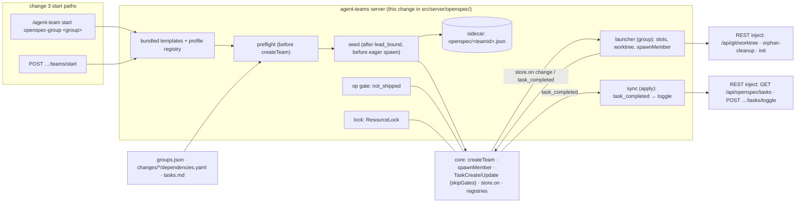
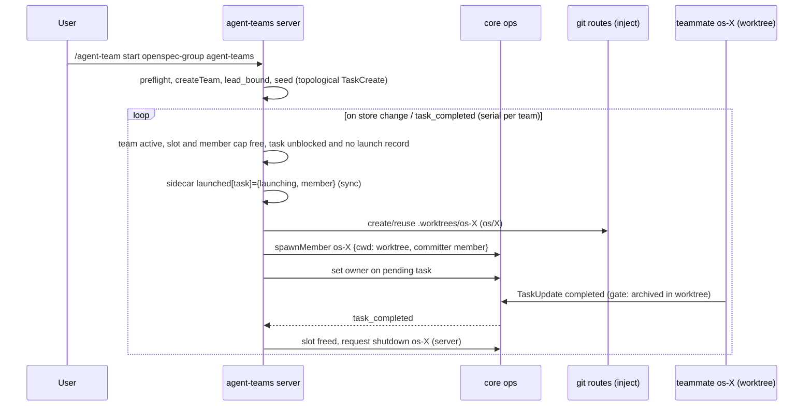
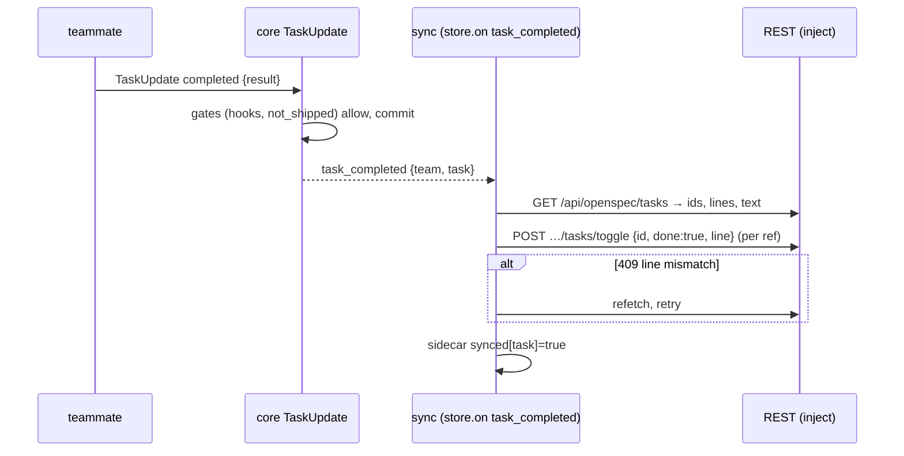
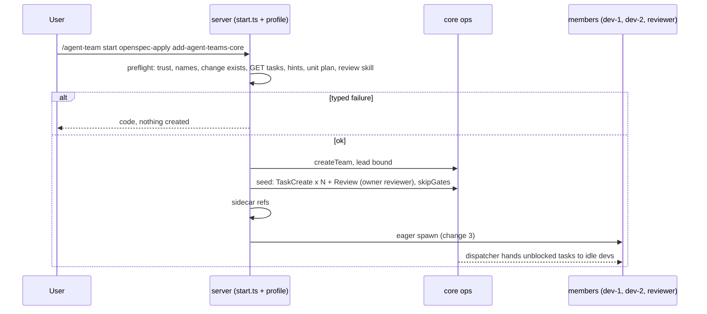

## Context

Change 4 of the `agent-teams` group. It builds on drafted, unarchived changes whose names and contracts are reused verbatim (no redefinition). Seam names below are those of the updated core, ui and templates-hooks changes.

- `add-agent-teams-core` — plugin `agent-teams`, store, tools `TeamCreate`/`TeammateSpawn`/`SendMessage`/`TaskCreate`/`TaskList`/`TaskGet`/`TaskUpdate`/`TeamStatus`/`ShutdownRequest`/`ShutdownResponse`/`TeamDelete`, sequential string task ids, `owner` field (lead sets it on a `pending` task, `spawning` members allowed), atomic claim, dispatcher, caps `maxTeammates` 5 / `maxTasks` 50, title ≤ 200 / description ≤ 2000, member name `^[a-z][a-z0-9-]{0,31}$` (`name_reserved` for `lead|server|system|all|user`). Seams this change **consumes**: `store.on(event)` (`change`, `team_created`, `lead_bound`, `task_completed {team, task}`, `member_status`, `team_closed`), `registerSpawnContributor`, `registerOpGate` + `{skipGates:true}`, `registerDispatchEligibility`, `registerMailKind`, `TrustedSpawnOptions {cwd?, committer?}` (3rd arg of `spawnMember`), `Team.overrides {autoDispatch?, notifyCoalesceMs?}`, `Team.committer` + `prompts/teammate-member-commit.md`, `TEAM_TOOLS_BY_ROLE`, `Team.status` (`starting|active|orphaned|closing|closed`), `abortSpawnedRun`, `emits` manifest. Core's reconcile marks every member `disconnected` at start for `reconcileGraceMs`.
- `add-agent-teams-ui` — Team view; consumes the same store events. `ResourceLock` uses the generic tool row (an optional tool-renderer claim can be added to ui's data-driven table later).
- `add-agent-teams-templates-hooks` — templates (`.pi/teams/*.md`, `<piAgentDir>/teams/*.md`), command `/agent-team start <template> <goal…>`, REST `POST /api/plugins/agent-teams/teams/start`, server-started lead (`createTeam({starting:true})` → lead spawn → `lead_bound`), `host.isProjectTrusted`, op-gate hooks (≤ 12 s total), `autoDispatch` / `notify.coalesceMs` overrides (a `wakeOnIdle` knob was dropped), `{{goal}}`/`{{cwd}}`.

### Verified host facts used here

- **Worktree creation is an HTTP flow today.** `POST /api/git/worktree {cwd, base, newBranch?, path?}` answers `{success, data:{path, branch, excludeAppended}}` or `{success:false, code}` (409 `branch_in_use|branch_exists|path_exists`) (`packages/server/src/routes/git-routes.ts:693-745`), orphan cleanup `POST /api/git/worktree/orphan-cleanup` (`:755`), init `POST /api/git/worktree/init`. ship-batch's `ensureWorktree` reuses a registered worktree, else checks out an existing local or `origin/` branch, else forks from `develop`; one orphan-cleanup retry; init `init_untrusted` halts (`.pi/skills/ship-batch/scripts/runner.ts:693-735`). Host `spawnSession({mode:"worktree"})` is not implemented (`server-context.ts:379-385`) and core's driver spawns only with a `cwd`, so a worktree must exist *before* `spawnMember`; core made `TrustedSpawnOptions.cwd` for exactly this.
- **ship-it** runs inside `.worktrees/os-<change>`, derives the change from the dir basename, needs docker for the e2e harness (`.pi/skills/ship-it/SKILL.md:39-41`). `docker/test-up.sh` refuses an extra harness by memory arithmetic only (`:44-81`).
- **Group data.** `openspec/groups/groups.json`: `schemaVersion, groups[], assignments{change→groupId}, changeOrder{groupId→[change]}`. ship-batch ranks remaining members by `statusRank` then name (`scheduler.ts:105-106,150-152`); the team has no status data and orders by name (deliberate difference).
- **Dependencies.** `readDependenciesFile` / `parseDependenciesFile` (`packages/shared/src/openspec-dependencies.ts:75,158`, kind `invalid` possible), importable as `@blackbelt-technology/pi-dashboard-shared/openspec-dependencies.js`. The REST dependencies endpoint is gated on a warm OpenSpec cache (503), so the file is read directly.
- **tasks.md parser.** `CHECKBOX_RE` and `parseTasksMarkdown` (`packages/server/src/openspec/openspec-tasks.ts:63-96`) skip every line that is not a `##` heading or a column-0 checkbox; ids are `1.1` or synthesized `L<line>` (`synthesizeId(lineNo)`). **Re-verified empirically (openspec CLI 1.14.3, this fixer pass):** a standalone `<!-- after: -->` line is ignored by `openspec instructions apply --json` (3 tasks with or without it); a trailing comment stays in the task description. The CLI numbers tasks `1,2,3…` and exposes no `1.1` id, so the dashboard parser is the id source.
- **Checkbox seam.** `GET /api/openspec/tasks?cwd=&change=` and `POST /api/openspec/tasks/toggle {cwd, change, id, done, line}` (`openspec-routes.ts:1160,1190-1235`): `409` on line mismatch, byte-preserving, `refreshOpenSpec` broadcast. The toggle and git routes are tiered/guarded (`route-tiers.ts:399`, `networkGuard`); whether a bare `ctx.fastify.inject` as loopback passes is **unverified** (mcp-server-plugin precedent adds a `host` header, `dispatch.ts:690-726`) — a task verifies it end to end.
- **Hooks are short.** Op gates share one 12 s budget (core `opGateBudgetMs`); a `mvn verify` cannot run in a hook.

## Goals / Non-Goals

**Goals:** two bundled templates that turn an OpenSpec group or a wide change into a running team with one command; per-teammate worktrees; a single writer for `tasks.md` checkboxes; a minimal harness mutex; a documented judo-style example.

**Non-Goals:** see proposal. No change to ship-batch/ship-it, no planning teams, no merge/cleanup of worktrees, no file locking.

## Architecture



## Decisions

### D1 — Bundled template source; profiles are bound to the bundled source by name

**Chosen.** The package ships `templates/openspec-group.md` and `templates/openspec-apply.md` (format of change 3). A `bundled` source is listed after `project` and `user` (shadowable), is trusted (no hook TOFU), declares no `TaskCreated` hook and pins `mode: session` (the group needs worktree cwds and per-member committer; in-process members cannot have a worktree). A *profile* is selected by the template **name** and only when the resolved source is `bundled`; a shadowing template runs as a plain template. No frontmatter key selects a profile.
**Why.** A profile can create worktrees and write `tasks.md`; letting a committed repo file switch that on would widen the trust surface of `.pi/teams/`.
**Relation to change 3.** Change 3 lists two sources and says "no pre-authored tasks". Base specs are unarchived so no MODIFIED block exists yet; this change states the two exceptions in its own requirement "Relation to the template requirements of change 3" and records a crossfix so change 3's text names them. **At archive**, if change 3 has not absorbed the wording, convert the exceptions into MODIFIED blocks on `agent-teams-templates`.
**Start hook points (gap G-A, kept here).** Core-gaps decisions leave "bundled source / seed at bind" to changes 3/4. This change registers each profile through `registerStartProfile(name, {preflight, seed})`, an entry defined by change 3's `start.ts`: `preflight(goal, cwd)` runs inside `team.start` **before** `createTeam`, any lead spawn or member spawn (so typed failures create nothing); `seed(team)` runs once after `lead_bound` (or the command-path bind) and **before** eager members spawn. Change 3 defines the seam (task 3.12).
**Alternatives.** (a) `profile:` frontmatter honoured for every source — gives repo files server powers (owner question Q1). (b) Hard-code in `team.start` — bypasses the template format.

### D2 — Preflight, then seed through core ops

**Chosen.** *Preflight* (before any creation): project trust (`host.isProjectTrusted(cwd)`, fail closed → `project_untrusted`), name/goal validation, repo-root check (group), ship-batch lock (group), skill resolution (`getPiResources(cwd)`, **unverified** seam; same one as core `skill_not_found`), config validation, group/change resolution, task-count checks. Codes are scoped per profile (see spec) and evaluated in a **fixed precedence** (owner decision B67): `invalid_args → project_untrusted → profile_unavailable → invalid_config → group_*/groups_invalid/change_unknown/tasks_unreadable → lead_not_repo_root → batch_runner_active → ship_skill_missing/review_skill_missing → base_not_found → too_many_tasks → nothing_to_do → change_in_use`; the first failing check wins. Names and goals are at most 64 characters (`invalid_args` beyond). The trust check has a 2 s timeout (timeout ⇒ `project_untrusted`). Repository files (`groups.json`, `dependencies.yaml`, `tasks.md`) are read as regular files only (`lstat`), at most 1 MiB, with a bounded YAML alias count; a violation fails `groups_invalid`/`tasks_unreadable` or skips that change. Preflight returns a **snapshot plan** that the seed consumes (one read, no TOCTOU). At init the plugin self-checks the upstream seams it consumes: a missing seam leaves the bundled templates listed but fails the start `profile_unavailable` (one error log); an unavailable skill resolver fails `ship_skill_missing` with detail `resolver_unavailable`. *Seed* after bind: tasks are created through the core `TaskCreate` path as the lead with `{skipGates:true}` — no hook runs, so the seed is fast and needs no per-task `await` budget; core still enforces caps and cycles. Tasks are created in **topological order** (core requires `blockedBy` to reference existing tasks), with the seed's own cycle detection skipping cycle members. Core ids go to the sidecar (`{schemaVersion:1, kind, goal, repo, seeding, seeded, refs, launched, synced, locks}`, atomic temp+rename like core's store). **The sidecar fails closed:** a write failure refuses the operation `sidecar_write_failed` and advances nothing; a missing, corrupt or future-version sidecar of a live profile team marks it `sidecar_missing` (launcher, sync and lock off, one waking notice, never a relaunch from empty state); a persisted `noticed` flag per record keeps notices from repeating across restarts. Pruning waits for team-store hydration.
**Crash-safety.** `seeding {startedAt}` is written before the first task and `seeded:true` after the last. At start, `seeding && !seeded` ⇒ `seed_incomplete`: never re-seed (core persisted the tasks write-through, so a re-seed would duplicate), no launcher/sync, waking lead notice; the lead may create the rest by hand.
**Data, not instructions.** Titles are capped at 200 chars, descriptions at 2000, counted in code points and cut on a code-point boundary; C0/C1, ANSI and bidi formatting characters are stripped silently and newlines in titles collapse; the briefing says task text comes from repository files and is data. This does not make a malicious `tasks.md` safe — it is the same trust level as the repo's own skills, hence the project-trust gate.
**Why seed in the server.** A deterministic function of files; an LLM transcribing 40 checkboxes costs tokens and drifts ids that later drive file writes. The exception is explicit and bundled-only.
**Alternatives.** (a) Lead tool `OpenSpecSeed` — new agent-callable surface. (b) Lead creates tasks from a playbook. (c) `ref` as a field on core's `Task` — would modify core; the sidecar keeps core frozen.

### D3 — `openspec-group`: a server launcher spawns one teammate per change, lazily



**Chosen.** One team task per change; member `os-<change>` is spawned **only when its task is unblocked and a slot is free**, in `changeOrder` order. Slot occupancy is **derived from state**: a `launching` change, or a `launched` one whose task is not completed and whose member is not `gone`/`failed`. `disconnected` counts, so a server restart (core marks every member `disconnected` for the grace) cannot over-launch. A group with more included changes than core `maxTasks` fails `too_many_tasks` in preflight. A launch also needs live members < `maxTeammates` (core counts every live member, including a completed one still in `shutdown_pending`); a full team just waits and is re-evaluated on every team change, and a `team_full` raced at `spawnMember` removes the record and retries the same way. The launcher is gated on `Team.status === "active"` (core pauses dispatch for `orphaned`/`closing`/`closed`) and is serial per team (the per-repo git lock). The template sets `autoDispatch: false` (core knob; owned tasks are still delivered, only the unowned branch is off) and `notify.coalesceMs: 10000` (the maximum, to dampen idle wakes; a `wakeOnIdle` knob does not exist — see tradeoffs). The launcher sets the member as owner of its task **atomically with the name reservation** (core's lead op `owner` already accepts `spawning` names), and the owner of a launcher-owned task is immutable for non-server actors (`owner_locked`); if core refuses the atomic form the fallback is the previous order (set after the reservation, a claim by the member is allowed while the owner is empty-or-self).
**Idempotency.** `launched[task] = {state, member, code?}` is written to the sidecar synchronously **before** worktree creation or spawn, as `launching`; it becomes `launched` once core reserved the name and `launch_failed` (with the code) when an earlier step fails, which frees its slot. A `launching` record after a restart becomes `launch_failed` `launch_interrupted`. The server never relaunches by itself; the lead gets one waking notice (core releases a failed member's name, so name absence alone cannot be the marker). **Relaunch.** The lead has no tool that names a change, so recovery is a plugin route `POST /api/plugins/agent-teams/openspec-relaunch {teamId, change}` (tier `operate`, owner rule of the Team routes) that clears a `launch_failed` record, or a `launched` one whose member is `gone`/`failed` with the task pending, and re-evaluates the launcher (`not_relaunchable` otherwise). The notice names the route; a UI button is a follow-up. **Bounds.** A launch is `launch_failed launch_timeout` after 120 s overall (a late success is ignored, the worktree left); a core refusal such as `name_taken` fails the launch with that code, frees the slot and never adopts a foreign member (strays only delay launches through the cap). **Abandon.** No new surface in v1: a stuck launcher task is fixed and relaunched, or the team is deleted (`TeamDelete`); an owner-only `openspec-skip` route is a follow-up.
**Member name.** `os-<change>` when ≤ 32 chars, else `os-` + first 22 chars (trailing `-` trimmed) + `-` + first 6 hex of `sha256(change)`; mapping in the sidecar.
**Completion.** The member completes its task only when the change is *shipped*. A registered op gate (`registerOpGate("TaskUpdate", …)`, acts only on completion of a launcher-owned task) requires the change to be shipped, else blocks `not_shipped` with feedback (fail closed). Two end states, because `ship-change` step 10 removes `.worktrees/os-<change>` after the squash-merge: (a) worktree present → an archive entry with `archivedChangeName(dir) === <change>` (`packages/shared/src/openspec-dependencies.ts`, exact `YYYY-MM-DD-<change>`, never a suffix glob) present and `openspec/changes/<change>/` absent there; (b) worktree gone → `git fetch origin <merge>` (bounded by `openspecFetchTimeoutMs`, default 8000, maximum 10000; the gate runs first so the fetch plus the hook stay within the 12 s op-gate budget) and `ls-tree origin/<merge> openspec/changes/archive/` lists such an entry, where `<merge>` is `openspecMergeBase` (default `develop`, the ship skill's merge target; `openspecWorktreeBase` only forks the branch) (ship-batch's check, `runner.ts:302-315`); a failed or timed-out fetch blocks with `not_shipped` reason `fetch_failed`. The teammate completes through the `TaskUpdate` bridge tool, which needs no cwd, so a removed worktree does not stop it; the removal itself may be refused by the resident session, which `ship-change` already handles. State (a) checks the archive, not the merge — an honest limit. A hand-back is reported to the lead by message; the task stays `in_progress` so dependents stay blocked (matches ship-it's own dependency gate).
**Slot release.** On `task_completed` the slot is free at once (the member still counts against `maxTeammates` until `gone`); the server then asks core to request the member's shutdown (core actor op `requestShutdown(team, name, {actor:"server"})`, defined by core). A rejection or silence notifies the lead but never holds the slot (the shutdown no longer gates scheduling).
**Why lazy per-change members.** A member's cwd is fixed at spawn; a pooled idle member cannot move between worktrees. One change = one teammate also keeps each context free of other changes.
**Skills.** No skill allowlist for group teammates (`ship-it` composes several skills). **Skill invocation.** Core delivers the spawn prompt as the first custom `spawn_prompt` mail (no `initialPrompt`), so a literal `/skill:ship-it` cannot be first and a post-bind `sendToSession` would race it (core decision). The briefing says "load and follow the skill `openspecShipSkill` as your first action"; the `not_shipped` gate is the deterministic backstop for a teammate that never ran it (tradeoffs Q5).
**Dependency mapping.** For each included change read `<repo>/openspec/changes/<change>/dependencies.yaml` with the shared reader; in-group `blocked_by` entries become `blockedBy`; others are left out and listed in the lead's start notice (ship-it asks about them at its own gate). `invalid` files skip their change. Only the declared file is read. A change skipped for an `invalid` file or a cycle skips its dependants transitively (named in the notice); an absent or archived blocker is treated as out-of-group (listed, no edge).
**Alternatives.** Lead drives every `TeammateSpawn` (LLM mistakes, tokens); pre-spawn all (N × ≈50k tokens idle); reuse the ship-batch runner (a project skill, detached, no questions).

### D4 — Worktrees: created by the plugin before `spawnMember` (REST inject), not by host `mode:"worktree"`

**Chosen.** `ensureWorktree(change)` (one function, `worktree.ts`) injects the dashboard git routes the way ship-batch does: reuse a registered worktree on `os/<change>`; else check out an existing local or `origin/os/<change>` branch; else fork from `openspecWorktreeBase` (default `develop`, ship-batch's base; the git route requires an explicit `base`, so there is no host default; preflight fails `base_not_found` when neither the ref nor `origin/<ref>` resolves); one orphan-cleanup retry on `path_exists`; then `…/worktree/init` — `init_untrusted` fails the launch `init_untrusted` (never auto-trusted). It passes the explicit path `<repo>/.worktrees/os-<change>` and checks the returned `data.path` (realpath under the lead cwd's `.worktrees/`, basename `os-<change>`), then calls `spawnMember(…, {cwd: path, committer: "member"})` — core's `TrustedSpawnOptions`, unreachable from any lead tool.
**Why.** Core's driver spawns with a `cwd` only and core named `TrustedSpawnOptions.cwd` for this change. Host `mode:"worktree"` is unimplemented and would need a core spec field; REST inject works today with the same logic ship-batch already runs. `add-plugin-spawn-worktree` is therefore **not** a dependency any more (see tradeoffs: option B swaps `ensureWorktree` for a host call once that change lands and core's spawn spec carries a worktree block).
**cwd policy.** The lead's cwd must be the main checkout root (`lead_not_repo_root` for `openspec-group` only; `openspec-apply` may run anywhere, including inside `.worktrees/os-<change>`), so worktrees land under `<repo>/.worktrees/`, inside the lead cwd, and no `extraCwdRoots` is needed.
**Unverified:** that an injected call passes `networkGuard`/tier gates as loopback (task 3.3 verifies); that the git route honours an explicit `path`.

### D5 — Commit rule: D4 holds; the owner of a worktree's branch is the committer there (trade-off)

> **RATIFIED by the owner (decision A2): option A, per-member committer.** The owner of an exclusive worktree commits only there; the lead is the sole committer in the shared cwd of `openspec-apply`. If core ships the committer team-wide, the fallback of the tradeoffs file applies.

Owner decision D4: the lead is the sole git committer, teammates never commit. In `openspec-apply` (one shared cwd) this holds unchanged: `Team.committer` stays `lead`. In `openspec-group` every worktree and branch has exactly one writer and `ship-it` itself commits, pushes and merges through `ship-change`; a strict-D4 group would break ship-it. D4 is **not silently overridden**: the group profile passes the core per-member `committer: "member"` via `TrustedSpawnOptions` (team-wide `Team.committer` stays `lead`, the lead commits nothing and remains the sole committer in the shared cwd), and the member-commit protocol prompt tells the teammate it may commit only in its own worktree. The options (per-member committer, team-wide `member`, strict D4 with hand-back) are recorded in the tradeoffs file; the owner chose per-member. D4's rationale (concurrent commits on ONE tree) does not apply to exclusive worktrees, and no LLM-reachable parameter selects the committer. The core `blockGitWrite` guard switches off only for that member (needs core to pin per-member semantics — crossfix).

### D6 — Resource lock: a tiny server-owned named mutex, persisted

**Chosen.** `ResourceLock {action, name}` is added to the teammate list of `TEAM_TOOLS_BY_ROLE`, registered by the bridge only when the member's spawn env carries a profile with resources (spawn contributor env `PI_EXT_AGENT_TEAMS_OPENSPEC_PROFILE=group`) and served through the core op table; the server answers `no_resources` for teams without a profile and `unknown_resource` for undeclared names (group: `harness`). `acquire` returns `{granted:true}` or `{granted:false, holder, position}` and enqueues FIFO; the server hands the lock over synchronously and sends a waking `lock_grant` mail (kind registered with `registerMailKind`, sender `server`; the mail kind and the tool are new public surface beyond the D1 cut, listed in the proposal). Holder, grant time and queue are **persisted in the sidecar** on every change and reloaded at start; after reconcile, `gone`/`failed` holders or waiters are dropped and the next waiter granted. Release on `release`, **settled** holder idle (not at `agent_end` before a retry), `gone`/`failed`, shutdown, TTL, team close; a `disconnected` holder keeps the lock until reconcile or TTL. The briefing says "do not end your turn while holding". A full queue answers `queue_full`; a queued waiter's `release` dequeues it; handoff skips `gone`/`failed`/`shutdown_pending` waiters while a `disconnected` waiter keeps its position. The sidecar records `grantMailed`: at reload the grant is re-sent to a holder without it and the TTL is re-armed from `grantedAt` (released at once when elapsed). A member `SendMessage` with kind `lock_grant` is refused `kind_reserved` (or core's generic invalid-kind code when it exists). The Team view shows `lock_grant` through the generic text fallback of the message log (one-line requirement in the ui change). A sidecar write failure fails the lock op `sidecar_write_failed`. `openspecLockTtlMs` is clamped into `[60000, 86400000]`.
**Why not rely on `test-up.sh`.** It refuses by memory arithmetic and does not queue. **Why not tasks.** Completion is terminal. **Why not a file lock.** A stale `mkdir` lock after a crash needs manual cleanup.
**Honest limit.** Advisory like all prompt rules; the memory guard is the hard backstop.

### D7 — `openspec-apply`: seed from tasks.md, granularity, dependencies, reviewer

**Chosen.** Read tasks through the dashboard parser's shape via `GET /api/openspec/tasks` (`ctx.fastify.inject`); a second pass over the raw file extracts **hints only**.
- *Unit.* One team task per unticked checkbox when the count ≤ `maxTasks − 2`; otherwise one per `##` section; more units than the cap ⇒ `too_many_tasks`; nothing unticked ⇒ `nothing_to_do`; a failing tasks read ⇒ `tasks_unreadable`. Ticked lines are skipped and count as satisfied blockers.
- *Section tasks* list each remaining checkbox as id + first 80 chars, cut before 2000 chars with the pointer "full list: tasks.md section <n>"; refs keep all ids.
- *Ids and refs.* Numeric ids stay in the title; refs hold `{id, textHash}` per checkbox so id-less (`L<line>`) boxes survive inserted lines.
- *Default `blockedBy`.* Barrier on the previous section that still has an unticked box (emptiness after skipping ticked lines).
- *Hints.* `<!-- after: … -->` (own line under a task, or trailing; under a `##` heading it applies to the section; empty = no blockers). List items are checkbox ids or `§<n>`; a bare number tries the checkbox id first, then the section. Unknown entries reported. Trailing hints are stripped from titles. The keyword is case-insensitive and whitespace-tolerant, a hint holds at most 64 entries, forward/self/cyclic/duplicate entries are dropped and reported, the first hint on a box wins (a second is reported) and hints in fenced code or on sub-bullets are ignored.
- *Review task + reviewer.* Final `Review` task blocked by all, owned by `reviewer` (`tools: [read, grep, find, ls, bash]`, `skills: ["review-code"]`, no write/edit tool). Core's dispatcher would otherwise give an idle reviewer an unowned implementation task, so the profile registers `registerDispatchEligibility` making `reviewer` eligible only for tasks it owns (`owner === "reviewer"`), never for an unowned one (this also covers late lead-created tasks). `review-code` lives in `packages/eng-disciplines/.pi/skills`; `openspecReviewSkill` is resolved at preflight (`review_skill_missing`).
**Alternatives.** `openspec instructions apply --json` (ids `1,2,3`, rejected); a second parser (drifts from `CHECKBOX_RE`); sections only (loses fidelity); a `tasks.deps.yaml` file.

### D8 — The runtime is the sole writer of checkboxes



**Chosen.** *Trigger:* core's `task_completed` store event (fires after gates and commit; a handler exception cannot break the commit because core isolates listeners — **unverified**, task 5.1 asserts it). *Write:* the existing toggle endpoint via inject (a plugin cannot import `toggleTask`; writing directly would skip the byte-preserving check and the `refreshOpenSpec` broadcast). Per-change serial promise chain. *Matching:* by id **and** text hash, else a unique text match; no match ⇒ `ref_missing` logged and synced; several ⇒ unsynced, lead notice, no retry. `409` ⇒ refetch + retry, three attempts (250 ms and 1 s backoff, 10 s per call), then a waking notice, `synced` false and a restart reconcile retries; a missing `tasks.md` (404) makes every ref `ref_missing`, synced, with a lead notice. Closing the team waits at most 5 s for the per-change queue to drain, else persists `synced:false` and notifies the lead. `401`/`403` ⇒ no retry, `sync_forbidden` notice (opt-in `requireLocalProof` could refuse a credential-less loopback inject). The sync only runs while the team is `active`.
**Why a single writer.** Teammates in a shared cwd editing one `tasks.md` would race, and a self-ticked box defeats the gates; the guard backs it up and the lead commits the diff.
**Alternatives.** Lead ticks (LLM turn, forgetting); teammates tick; a `TaskCompleted` hook calling curl (hooks run before commit and are quality gates, not state writers).

### D9 — Guards and profile arguments are not agent-callable

The bridge `tool_call` guard (core D11 family) additionally blocks `write`/`edit` for members of an `apply` team when the realpath (symlinks and `..` resolved) is `<lead cwd>/openspec/changes/*/tasks.md` or under `…/specs/`; the lead is not guarded; `group` teams do **not** get it (ship-it edits those files in its own worktree). The guard is switched on by the spawn contributor env, not by a lead-visible parameter. The guard compares with `realpath.native` plus `dev`/`ino` for existing targets (hardlinks) and case-folds on case-insensitive volumes. `bash` stays an advisory hole (briefing says so; same for the reviewer). No lead tool takes a branch, path or change name; change names are validated and must have an `openspec/changes/<name>/` directory; `openspecShipSkill`/`openspecReviewSkill` and `openspecWorktreeBase` are validated at preflight (`invalid_config`) because they reach prompts and git.

### D10 — Coexistence with ship-batch

ship-batch holds `<repo>/.worktrees/.ship-batch/lock` `{pid, hostname, groupId, heartbeatAt}`, stale after 10 minutes (`lock.ts:4,18`). The group preflight refuses `batch_runner_active` when the lock is live by ship-batch's own rules (reusing its lock reader): heartbeat younger than 10 min, not more than 60 s in the future, and not a dead pid on the same host. A change already driven by another active team (found in the sidecars of active teams, independent of any host seam) fails the later start `change_in_use`. It skips (and lists) any change whose worktree already hosts a resident session (`runner.ts:365`); the session-by-cwd lookup seam is **unverified** — when unavailable the check is skipped and noted in the start notice. The reverse direction is out of scope.

### D11 — judo-ng-style per-module example (documentation only)

`packages/agent-teams-plugin/examples/judo-modules.md` is never scanned. It uses features of change 3 only:

```markdown
---
name: judo-modules
description: One teammate per Maven module, in rank order
mode: session
maxTeammates: 4
autoDispatch: false
spawn: lead
hooks:
  TaskCompleted: [{ command: "bash scripts/team-verify-stamp.sh", timeoutMs: 8000 }]
members:
  - { name: core,   prompt: "Module judo-core.   Run scripts/verify-module.sh judo-core before completing." }
  - { name: engine, prompt: "Module judo-engine. Needs core." }
  - { name: ui,     prompt: "Module judo-ui. Needs engine." }
---
You lead modules of {{goal}} in {{cwd}}. For each module in rank order create one task titled `<module>`
(blockedBy the tasks of lower rank), assign it to the matching member (`TaskUpdate owner`), and spawn the members
with TeammateSpawn (they run in {{cwd}}). You commit; teammates do not.
```

Rank → `blockedBy` is done by the lead from the playbook. The `TaskCompleted` hook cannot run `mvn verify` (≤ 12 s): the pattern is a **verification stamp** — the teammate runs `scripts/verify-module.sh <module>` in its own turn, which writes `<module>/target/.team-verify` with the tree hash; the hook only compares it with the current module hash and exits 2 with "run scripts/verify-module.sh" when missing or stale. Both scripts live in the consuming repo.

## Sequences

Group launch: D3. Checkbox sync: D8.

### Start `openspec-apply`



## Failure modes

| Failure | Behaviour |
|---|---|
| Goal unknown / empty / path-like, untrusted project, bad config | typed code from preflight; nothing created |
| Lead not at repo root (group) / ship-batch live / skill unresolvable | `lead_not_repo_root` / `batch_runner_active` / `ship_skill_missing` or `review_skill_missing`, before any creation |
| Crash or core refusal mid-seed | `seed_incomplete`, no re-seed, no launcher, waking notice |
| Restart with live members | all `disconnected` during grace; slots stay occupied; sidecar `launched` blocks relaunch |
| Crash between marker and spawn | no second launch; one waking notice |
| Worktree step fails (`git_failed`, `branch_in_use`, `init_untrusted`, `worktree_path_unexpected`) | no member spawned; record `launch_failed`, slot free; task stays pending; waking notice with the code; no auto retry; owner relaunches via the route |
| `team_full` at spawn / team at the member cap | record removed / nothing written; retried on the next team change |
| Teammate dies mid-ship-it | core releases the task; no auto relaunch; owner relaunches via the route |
| Completion without a shipped change | gate blocks `not_shipped`; task stays `in_progress`; worktree already removed ⇒ judged on `origin/<merge>`, fetch failure blocks |
| Shutdown request rejected after completion | lead notified; slot already free |
| Lock holder crashes / server restarts | released on `gone`/`failed`; holder and queue persisted; TTL backstop |
| Toggle 409 / network | refetch + retry, then waking notice; `synced` false; restart retries |
| Toggle 403/401 | no retry; `sync_forbidden` notice |
| tasks.md edited by a human | id+text matching; removed ⇒ `ref_missing` synced; ambiguous ⇒ notice |
| Team orphaned/closing | launcher and sync start nothing |
| Sidecar write fails / sidecar lost | `sidecar_write_failed`, nothing advanced / `sidecar_missing`, launcher, sync and lock off, one waking notice |
| Hanging launch step / `name_taken` at spawn | `launch_failed launch_timeout` after 120 s / `launch_failed name_taken`, slot free, member never adopted |
| Same change in two teams | later start refused `change_in_use` |
| Upstream seam missing at init | start fails `profile_unavailable`; plain templates unaffected |
| Fetch for the shipped gate times out | `not_shipped` reason `fetch_failed` |

## Risks / Trade-offs

- **Seams now defined upstream:** core `requestShutdown` (server actor), per-member committer, `sendServerMail`; change 3 `registerStartProfile` and the trusted `bundled` source (crossfix c1).
- **Token cost.** A group team costs ≈ `parallel` × base context + lead; defaults are conservative (`parallel` 2; `noMcp`/`noContextFiles` unchanged since ship-it needs AGENTS.md). Q7-B (`openspecGroupParallel: 1` default) trades parallelism of non-harness work for cost and no lock need; default stays 2 with the advisory lock.
- **Advisory limits.** `ResourceLock`, the tasks.md guard, "one task only" and the reviewer's `bash` are prompt/guard level; the memory guard, the `not_shipped` gate and the sole-writer toggle are the hard parts.
- **Seed drift.** Seeds are a snapshot; later edits to `groups.json`/dependencies are not re-read.
- **Already-shipped detection** is weaker than ship-batch's (`origin/develop` archive listing); the lead should be on an up-to-date `develop`.
- **Lead wakes.** Idle reports of finishing teammates can wake the lead (core wake rule); coalescing at 10 s mitigates it.

## Migration Plan

Additive. New config keys with defaults, new sidecar dir on first seed, no schema change to core's store. **Rollback:** remove `templates/` entries and `src/server/openspec/`; teams started from the bundled templates keep working as plain teams (their sidecar is ignored; locks are forgotten, un-synced checkboxes stay unticked). Compatibility with change 3: with the profile module absent the start flow behaves as specified.

## Accepted risks (owner decision)

The owner accepted every recommended option of the decision sheet (A1–A12, B-items). Risks consciously carried:

- **A2 — per-member committer.** In `openspec-group` each member commits in its own worktree; the git-write guard stays advisory whenever `bash` is allowed, so the "member commits only in its worktree" rule is a prompt plus guard, not a sandbox. The lead remains the sole committer in `openspec-apply`.
- **A1 — core defaults ratified.** Lead exit ⇒ `orphaned` with teammates running up to `orphanTtlMs` (30 min, a cost exposure); REST reads on the `observe` tier; teammate sessions visible and chattable; `TeamStatus` and `autoDispatch` default true are public contract (the group template overrides `autoDispatch` to false).
- **A12 — no latency SLOs.** Perf rows gate call counts and structure; cost is measured manually (a group costs about `parallel` × base context plus the lead).
- **B78 — no abandon surface.** A stuck launcher task needs a fix and relaunch or `TeamDelete` in v1.
- **B86 — idle = release.** A holder that backgrounds the harness and ends its turn releases the lock; the memory guard of `test-up.sh` is the backstop and the briefing forbids ending the turn while holding.
- **B92 — team-wide committer fallback** if core does not ship the per-member semantics.

## Resolved decisions

The former open questions (D4 committer ratification, worktree route, lead wakes, skill invocation, worktree probe) are settled: per-member committer (A2), REST-inject worktrees (no probe), accepted idle wakes coalesced at 10 s, briefing-text skill invocation with the `not_shipped` backstop. History: `/tmp/agent-teams-plan/rev/add-agent-teams-openspec-tradeoffs.md` and `/tmp/agent-teams-plan/decisions/decisions.md`.
