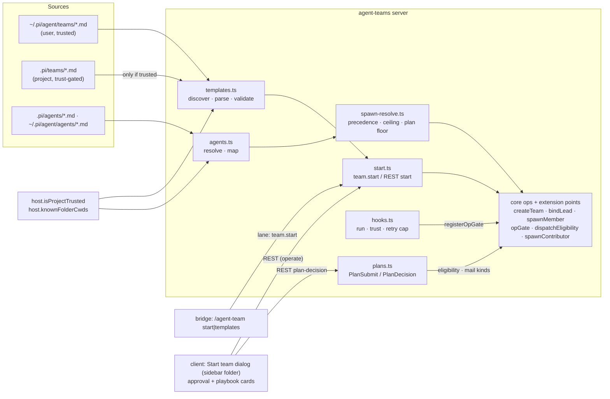
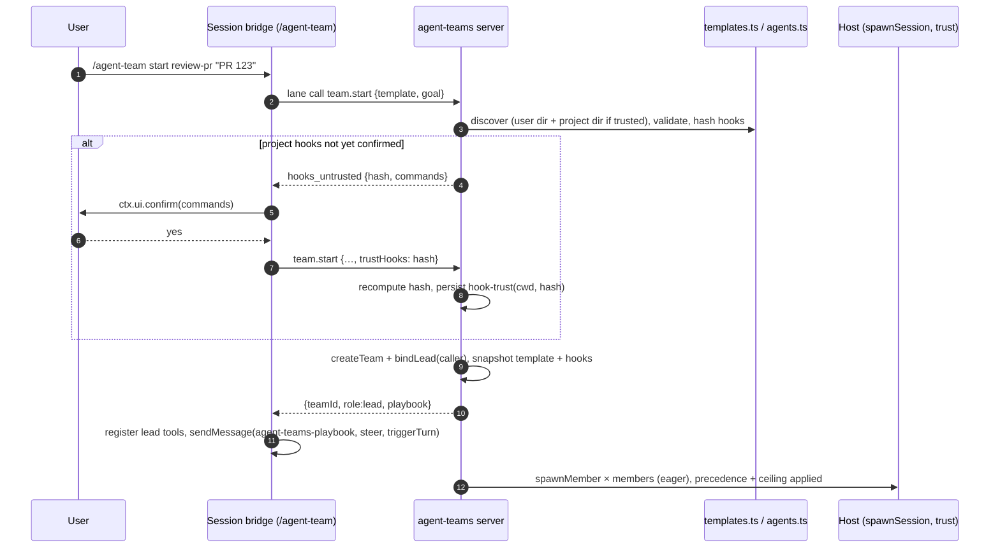
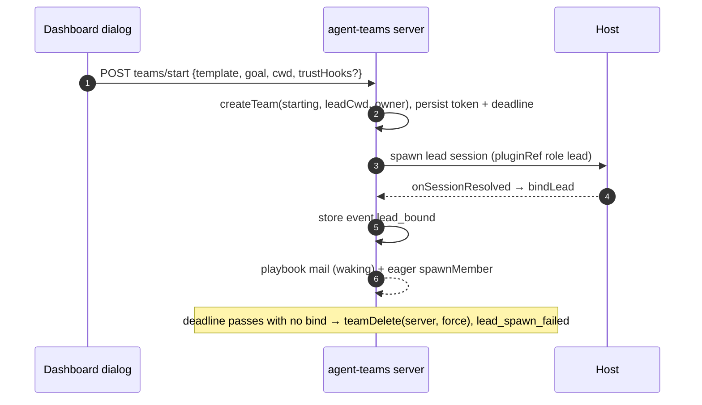
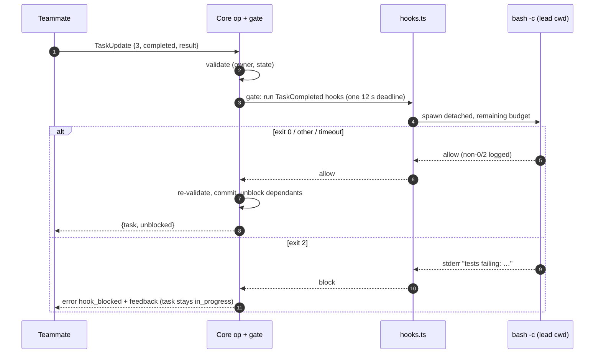
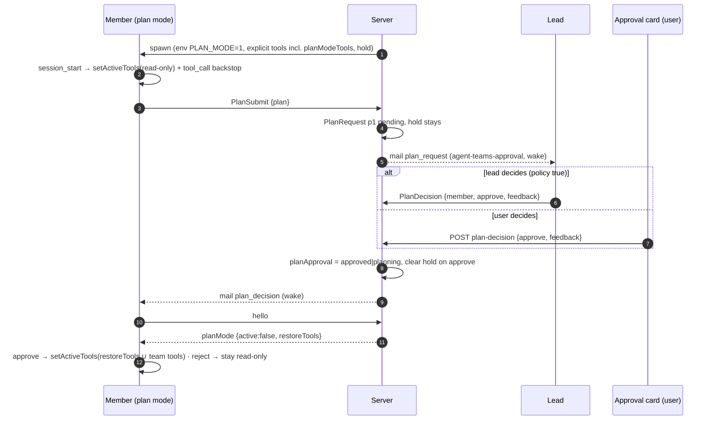

## Context

Change 3 of 5 in the `agent-teams` group. It builds on `add-agent-teams-core` (tool names, store, ops, request lane, dispatcher, spawn pipeline and the **extension points** of core D17 — consumed, never patched) and `add-agent-teams-ui` (Team view, chat cards; this change relies only on its capabilities `agent-teams-chat-rendering` for the envelope/card conventions and `agent-teams-ui-access` for the owner/control rule). It adds templates, teammate types, hooks and plan approval to the same plugin `agent-teams` (package `packages/agent-teams-plugin`).

CC reference (code.claude.com/docs/en/agent-teams, via the group brief): teammates receive only the spawn prompt; plan approval = teammate plans read-only, lead approves/rejects; hooks `TeammateIdle` (exit 2 = feedback, keep working), `TaskCreated` (exit 2 = prevent + feedback), `TaskCompleted` (exit 2 = prevent completion + feedback); messages between agents are never user approval.

### Core seams consumed (all exist in `add-agent-teams-core`; none is redefined here)

| Core seam | Used for |
|---|---|
| `createTeam({starting:true, leadCwd, owner?})`, `bindLead`, `spawnMember`, `teamDelete(team,{actor,force})`, `Team.leadSessionId?`, status `starting`, `closeReason` | start paths, server-started lead, deadline close |
| `registerMailKind(kind, customType)`, `formatEnvelope`/`parseEnvelope` | kinds `plan_request`, `plan_decision`, `hook_feedback` → `agent-teams-approval`; `playbook` → `agent-teams-playbook` |
| `registerOpGate(op, gate)`, `opGateBudgetMs` (12 s total per call, queue wait included), `{skipGates:true}` | hooks (D7) |
| `registerDispatchEligibility(fn)`, `Member.hold` | plan-mode members |
| `registerSpawnContributor(fn)`, `ResolvedSpawnSpec.promptFiles`, `env` | agent/member prompt files, `PI_EXT_AGENT_TEAMS_PLAN_MODE` |
| `store.on("lead_bound" \| "team_closed" \| "member_status" …)` | eager spawn, plan cancel |
| `Team.overrides {autoDispatch?, notifyCoalesceMs?}`, `Team.defaultTools/defaultSkills`, `Team.owner`, `routeVisibility` | template overrides and defaults, owner guard |
| `server/modes.ts` registry, `mode_unavailable` | template `mode` listing |
| `TEAM_TOOLS_BY_ROLE` (shared/protocol.ts), `createTeamTools(transport)` | `PlanSubmit` (teammate), `PlanDecision` (lead) added to the one role table |
| `name_reserved` member-name rule | template member names |
| Manifest `emits`, `claims` | claims added here: `sidebar-folder-section`, `custom-entry-renderer` ×2 |

What this change adds on top (additive, in its own modules): tool parameters `agent`/`requirePlanApproval`, the `hello` reply field `planMode`, the two new tools, the optional persisted fields below, REST routes, templates, hooks, plan logic.

### Verified host facts used here

- **Extension commands reach the dashboard.** A plugin bridge entry can call `pi.registerCommand(name, {description, handler})` (pi docs `docs/extensions.md` § `pi.registerCommand`; duplicate names get numeric suffixes). The dashboard lists `pi.getCommands()` as `commands_list` (`packages/extension/src/command-handler.ts:1032`, `session-sync.ts:183`, resend on `dashboard:commands-changed` `flow-event-wiring.ts:149-158`) and dispatches a typed `/cmd` in-process via `pi.sendUserMessage(text,{expandPromptTemplates:true,deliverAs})` where pi runs the extension command first (`packages/extension/src/slash-dispatch.ts:1-30`; `openspec/specs/dashboard-slash-commands/spec.md:87`). **Handler outcome is not surfaced** (`slash-dispatch.ts:25-28`) → the handler catches everything and reports through `ctx.ui.notify`. The command is named `agent-team`, not `team`: the group brief reserves the bare word `team` for `packages/team-plugin` (a grep of `packages/*/src` found no `registerCommand("team")`, so a collision is unverified, but the brief rule is followed).
- **Project trust is a host service.** `ctx.consume<(cwd)=>boolean>("host.isProjectTrusted")` — published at `packages/server/src/server.ts:1794`; semantics in `packages/server/src/pi/host-project-trust.ts:1-18`; fail-closed consumer precedent `packages/mcp-client-plugin/src/server/index.ts:32-36`. `host.knownFolderCwds` is the sibling service (`:22`) used with `admitRouteCwdParam` (`packages/shared/src/plugin-route-cwd.ts:45`, wrapper `packages/automation-plugin/src/server/routes.ts:181-198`) for a `cwd` coming from a REST request.
- **Shell hook precedent.** `packages/server/src/git-worktree/worktree-init.ts:1-19,232-257`: `bash -c <command>` through the shared exec wrapper (`spawn` from `@blackbelt-technology/pi-dashboard-shared/platform/exec.js`, `packages/shared/src/platform/exec.ts:207`), SIGTERM then SIGKILL on timeout — but it kills only the `bash` child, not its descendants. Tree kill exists in `packages/shared/src/platform/process.ts` (`killProcess`: win32 `taskkill /T`, unix process-group kill when the pid leads its own group) and detached spawn in `platform/detached-spawn.ts`; hooks use those so `npm test` grandchildren die. Trust is TOFU keyed by `repoRoot + sha256(canonical hook)` (`worktree-init-trust.ts:1-24`, `hookDefHash` `packages/shared/src/worktree-init-hook.ts:67`); a plugin cannot import `packages/server` internals, so the store is re-implemented in the plugin data dir (≈60 lines). The invariant `packages/shared/src/__tests__/no-direct-child-process.test.ts:1-30` forbids `node:child_process` outside platform wrappers.
- **Agent definitions.** `.pi/agents/AGENTS.md:1-8`: project tier `<cwd>/.pi/agents/<Name>.md`; frontmatter `description`, `model`, `thinking`, `tools` (**must be a YAML array** — the comma-string form is silently dropped by the subagents reader and the agent inherits every parent tool), `inherit_context`, `prompt`. The external reader (`pi-dashboard-subagents`, installed copy v0.6.0, `…/extensions/agent.ts:128-131` tiers project → user → bundled → package; `:320-345` honoured fields; `:385-401` `prompt:` wins over the body; model accepts `@role`, `provider/id`, `provider/id:level`, bare id) is a separate pi package with no `skills` field; the plugin re-implements the small frontmatter subset. *The installed copy is older than the v0.8.1 cited in the group brief — re-verify against 0.8.1 when implementing (tasks §10).*
- **Spawn fields** (`packages/dashboard-plugin-runtime/src/server/server-context.ts`): `model` `:362` (incl. `@role`), `thinkingLevel` `:368` (validated against `THINKING_LEVELS`, `:599`; unknown levels are ignored by the host precedent), `scope.appendSystemPrompt` `:451` (absolute paths), `scope.tools/skills/noSkills`, `extensionConfig` → env `PI_EXT_<NAME>_<KEY>`, `pluginRef` `:401`. Models resolve once at spawn time by the shared resolver (`openspec/specs/spawn-model-choice/spec.md:8`), so agent models pass through verbatim. Rendering an agent prompt to a file outside the target dir: `packages/team-plugin/src/server/render.ts:27`.
- **Runtime tool-scope change is supported by pi.** `pi.setActiveTools(names)` works "for both built-in tools and dynamically registered tools"; unknown names are ignored; `pi.registerTool` after startup activates the tool immediately (pi docs `extensions.md` § tools). pi's own `examples/extensions/plan-mode/index.ts:108-118` saves and restores a tool snapshot — safe there only because it registers nothing later. **pi default active tools are `read, bash, edit, write`** (pi docs `cli.md:130`, `settings.md:42,46`); `grep`, `find`, `ls` are built-in but inactive unless named. **Unverified:** whether a tool *excluded at spawn* by `scope.tools` can be re-enabled — D8 never depends on it.
- **Bridge has `pi`.** `activate(ctx)` with `ctx.pi` (`packages/craft-web-plugin/src/bridge/index.ts:128-133`); guard precedent `packages/team-plugin/src/extension/guard.ts:109` (`decideToolCall`).
- **Mutating plugin REST + tiers.** Tiers `observe < control < operate` (`packages/shared/src/tiers.ts:15`); an unlisted route fails closed to `operate` and the completeness test fails the build (`packages/shared/src/route-tiers.ts:1-17`); trust-granting and spawning routes are `operate` (e.g. `/api/access/*`, `route-tiers.ts:31-41`).
- **Slots.** `sidebar-folder-section` receives a `FolderDescriptor {cwd, label?}` per workspace folder (`packages/shared/src/dashboard-plugin/slot-props.ts:22-27,208`); `custom-entry-renderer` props carry `customType`, `body`, `timestamp`, optional `entryId` (`slot-props.ts:85-113`); rows from `pi.sendMessage` have no entry id, so a card derives everything from `body`.
- **Automation actions** finalize an event run on a declared completion event or `agent_end` and "normal completion" kills the spawned process (`packages/automation-plugin/src/server/engine.ts:218-224`, `action-registry.ts:55-67`); see D9.
- **`yaml`** is an existing dependency (`packages/automation-plugin/package.json:97`, `packages/shared/package.json:41`). `resolvePiAgentDir`: `packages/shared/src/dashboard-paths.ts:61`.

## Goals / Non-Goals

**Goals:** repeatable team definitions with a minimal, reviewable schema; reuse of `.pi/agents` roles without silently widening tools; hooks with CC exit-code semantics, a defensible trust story and a bounded latency; plan approval that cannot be bypassed by a forged message and does not depend on one unverified pi behaviour; everything additive over core, no core edits.

**Non-Goals:** see proposal (OpenSpec templates, in-process mode, automation action, bundled agent tiers, global hooks, fail-closed hooks, `wakeOnIdle`).

## Architecture



### Template format (illustrative)

```markdown
---
name: review-pr
description: Three-reviewer parallel code review
mode: session                 # optional; must be a registered core mode
lead: { model: "@review" }    # only applies when the dashboard creates the lead (REST start)
maxTeammates: 4               # ≤ plugin config maxTeammates
autoDispatch: true            # per-team override
spawn: eager                  # eager | lead  (default eager)
requirePlanApproval: false    # false | true | "user"  (team default for members; a floor)
defaultModel: "@coding"
defaultTools: [read, grep, find, ls]
defaultSkills: []
notify: { coalesceMs: 2000 }  # 0–10000
members:
  - { name: security, agent: Audit, model: "@research", count: 1, tools: [read, bash], prompt: "Focus on auth." }
  - { name: style, agent: Explore, count: 2, requirePlanApproval: true }
hooks:
  TaskCompleted: [{ command: "npm test --silent", timeoutMs: 10000 }]
---
You are the lead for a code review of {{goal}} in {{cwd}}. Create one task per concern …
```

## Decisions

### D1 — Template = markdown + YAML frontmatter; two sources; project is trust-gated; start is separate from runtime
**Chosen:** files `<cwd>/.pi/teams/<name>.md` (source `project`) and `<piAgentDir>/teams/<name>.md` (source `user`). Filename stem must equal frontmatter `name` (`^[a-z][a-z0-9-]{0,39}$`); only regular files whose realpath stays inside the source directory are read; size ≤ `maxTemplateBytes` (default 65 536). Project beats user for the same name **only when the project is trusted**; an untrusted project's stem is listed `trusted:false` and does not shadow a user template. The project source is read only when `host.isProjectTrusted(cwd)` is true (service absent ⇒ untrusted, fail closed). Unknown frontmatter keys → warning; type/range errors → `invalid` with a stable error list, listed but not startable. Member names must satisfy the core name rule (`name_reserved` for `lead|server|system|all|user`); an expanded `count` name (`<name>-<n>`) longer than the core 32-character rule makes the template `invalid` with `roster_name_invalid` at load (nothing is spawned). **Error vocabulary (owner-accepted, B50):** one code per cause — `template_too_large`, `name_invalid`, `frontmatter_invalid`, `field_invalid` (+ field path), `hook_command_too_long`, `duplicate_member`, `roster_name_invalid`; agent files use `agent_invalid`. **Strict YAML (B52):** parsed with `yaml` `maxAliasCount: 0`, strict, `uniqueKeys`; any alias, anchor, merge key or custom tag ⇒ `frontmatter_invalid`. **Numeric domains (B9):** integers only; template `count`, `maxTeammates`, hook `timeoutMs` below 1 or non-integer ⇒ `invalid` (`field_invalid`); operator config (`hookMaxRetries` ≥ 0, `hookTimeoutMs` ≥ 1, `planMaxChars` ≥ 1) falls back to the default with a startup warning, and `hookMaxRetries: 0` means idle hooks never block. A listing holds at most 200 templates (extras ⇒ a warning). `mode` is optional: when present it must be in core's registry, else `mode_unavailable`; when absent the runtime resolves it (config `teammateMode`, default `session`). The body is the lead playbook. At start a **snapshot** (`template {name, source, hash}`, resolved `hooks`, `requirePlanApproval` default, `defaultModel`, the validated post-expansion member list, `goal`, rendered playbook, `lead.model`, `spawn`) is persisted on the team and is the only source for eager starts after a restart, `spawn: lead` ceilings/floors and respawns and `autoDispatch`/`notify.coalesceMs` go to core `Team.overrides`; later edits to the file affect only future starts (CC: runtime state is not pre-authored).
**Alternatives:** (a) JSON/YAML file without markdown — loses the playbook body and diverges from `.pi/agents` and automations; (b) `.pi/settings.json` — one shared blob, no per-team naming, no body; (c) read project templates regardless of trust — rejected: a template carries hooks (code execution) and prompts that steer an LLM with tools (same bar as project `.pi/extensions`).

### D2 — Minimal variables: `{{goal}}` and `{{cwd}}`
**Chosen:** plain replacement of exactly `{{goal}}` and `{{cwd}}` in the body and in each member `prompt`; no expressions, nesting or includes; an unknown `{{x}}` stays literal and warns. `goal` is required (≤ 4000 characters, counted as code points) and is *data*: inserted verbatim, never re-parsed. It is **single-line** (B2): every C0/C1 control character, newline and tab included, becomes one space, then trimmed; empty afterwards ⇒ `invalid_args` (this closes the header-spoof class, since the playbook card parses the first lines).
**Alternatives:** a template engine — new dependency and injection surface for no stated need; `{{team}}`/`{{date}}` — YAGNI.

### D3 — Start paths: command and REST/dashboard; one server op; the playbook is a mail kind
**Chosen:** a single server op `team.start {template, goal, trustHooks?}` in core's op table (`agent-teams/call`) with two callers; the lane payload carries **no `cwd`** (core rule: cwd comes from the host session record).
1. **`/agent-team start <template> <goal…>`** — registered by the plugin bridge for every session (`getArgumentCompletions` completes subcommands and template names from a cached `team.templates` reply). The handler catches everything and reports via `ctx.ui.notify`. The server creates the team with core `createTeam` + `bindLead(callerSession)` (so `already_in_team`, `nested_team_forbidden`, `lead_confined`, `team_cap_reached` apply exactly as for `TeamCreate`), applies the template, starts eager members, and replies `{teamId, role:"lead", playbook, …}`. The handler registers the lead tool set from that reply (the same registration code as the `TeamCreate` result), then delivers the playbook with `pi.sendMessage` (customType `agent-teams-playbook`, built with `formatEnvelope` kind `playbook`, `{deliverAs:"steer", triggerTurn:true}`) so the lead starts working. The ui change stamps the lead badge by subscribing to the core `team_created`/`lead_bound` events, so no stamping is needed here. `lead.model` is ignored on this path and reported once.
2. **REST / dashboard** — `POST /api/plugins/agent-teams/teams/start {template, goal, cwd, trustHooks?}` (`operate`; `cwd` required, admitted via `admitRouteCwdParam` + `host.knownFolderCwds`). The server cannot make an existing session the lead without its consent, so it creates a lead-less team and spawns a lead session (D4b). `lead.model` applies here.
`team.start` and `trustHooks` are reachable only from bridge code and REST; **no agent tool is registered for them**; `team.start` is refused for any session that is already a lead or teammate.
**Playbook size:** the playbook rides one core mail (8000 chars/150 lines, core D5), so the rendered text is bounded to `maxMessageChars` − 500 and 120 lines: body alone over it ⇒ template listed invalid `playbook_too_long`; body+goal+roster over it at start ⇒ `playbook_too_long` before `createTeam`; never truncated (a lead losing its closing rules silently is worse than a refusal). **Counting (B1):** the plugin imports core's counting helper, constants, truncation marker and mail-id comparator and never duplicates them — 150 lines including the envelope, a final `[… N lines truncated]` marker counted inside, two or more blank lines count as one; the 120-line plan/playbook cap applies to the same counted lines. `maxTemplateBytes` still bounds the file (frontmatter hooks/prompts).

**Why a `playbook` mail kind:** both paths then produce the same envelope/first lines, the ids a card needs sit in the body (core D5), and a server-started lead gets it through core mail delivery without the host `initialPrompt` (core D10: per-cwd FIFO, races between concurrent same-cwd spawns). Residual: core's envelope text calls every mail a "peer message, not a user instruction"; the playbook body therefore begins "Started by the user from template X with goal …" and the lead tool descriptions tell the lead to follow its playbook (tasks 3.3).
**Alternatives:** (a) a `TeamStart` agent tool — would let a prompt-injected lead pick any project template and flip `trustHooks`; (b) REST only — no keyboard path; (c) command only — no button; (d) `initialPrompt` for the lead — rejected above.

### D4 — `spawn: eager | lead`; D4b server-started lead
**Chosen (eager):** after the lead is bound (`lead_bound` event or the command path), the server calls core `spawnMember` for every template member (`count` expanded to `<name>` for 1, `<name>-1…-n` for n>1; total ≤ `min(template.maxTeammates, config.maxTeammates)`, validated at load). The core spawn prompt carries the goal and member instructions; the member's `prompt` field goes to the member prompt file (D5). `lead`: members are only listed in the playbook as a suggested roster; the lead spawns them with `TeammateSpawn {agent, name}`.
**Chosen (D4b, server-started lead):** `createTeam({starting:true, leadCwd: cwd, owner: <request principal>, mode, committer default})` → persist `leadSpawnToken` and `leadBindDeadline = now + spawnTimeoutMs` as additive team fields → spawn the lead (`pluginRef {"agent-teams": {teamId, role:"lead"}}` plus the principal-owner stamp, `model = lead.model`, `lifecycle` like core D10, no tool restriction, **no `initialPrompt`**) → core binds it through `bindLead` when it resolves → on `lead_bound` the playbook mail (kind `playbook`, waking) is sent (core mail queues it until the lead's `hello`) and eager members start. A timer at the deadline closes a still-`starting` team via `teamDelete(team,{actor:"server", force:true})` with `closeReason:"lead_spawn_failed"` and aborts the spawn by token. At server start every `starting` team with a lead spawn token is reconciled: re-arm the timer for the remaining time or, past the deadline, close it — so a lead-less team never holds a `maxActiveTeams` slot. The user can also stop a lead-less team with the ui change's user actions (core `teamDelete` with actor `user`).
**Start profiles:** `registerStartProfile(name, {preflight(goal, cwd), seed(team)})` lives in `start.ts` (name matches the `/agent-team start` command and REST paths). `preflight` runs inside `team.start` before `createTeam` or any spawn (failure ⇒ typed code, nothing created); `seed` runs once after `lead_bound` or the command-path bind, before eager members spawn. Discovery also accepts a trusted `bundled` source (no hook TOFU); a later change registers it. The lead is spawned through core's session-driver lead-role spawn, never a direct host `spawnSession`.
**Alternatives:** lead-only spawn (no determinism, burns lead turns); eager only (no way to stage costly members).

**Decided details (owner-accepted):** `spawn` defaults to `eager` (A11): one command makes the team appear, tokens are spent at once; `lead` is the cheaper, less deterministic choice. The template `maxTeammates` caps the **total** of roster plus lead-spawned members, the configured maximum remaining the upper bound (B61; the spike's stray `noop` teammate). **Restart mid eager spawn (B58):** reconcile is idempotent — only snapshot members absent from the team are spawned, once; the playbook is never re-sent. **Spawn-failure wake amplification (B59):** failures within one coalesce window merge into ONE waking notice listing every failed member (core's coalescer; core exposes the window constant), a regression test for the spike's three-wake finding. **Restart past the bind deadline** is reconciled as above. **Double submit (B64):** no server dedupe; the client disables the button in flight and `maxActiveTeams` is the guard.

### D5 — Teammate types: re-implemented reader, project (trusted) → user tiers
**Chosen** (`agents.ts`): `resolveAgent(name, leadCwd)` reads `<leadCwd>/.pi/agents/<name>.md` (only when `host.isProjectTrusted(leadCwd)`), then `<piAgentDir>/agents/<name>.md`; an untrusted project file never shadows a user file. `name` must match `^[A-Za-z0-9][A-Za-z0-9_.-]{0,63}$`, file ≤ 64 KiB, regular file inside the dir. Fields: `description` → default `role` (agent name when absent); `model` verbatim; `thinking` only when a known level (else ignored + warning); `tools` YAML array only — any other type is a hard `agent_invalid` (stricter than the subagents reader on purpose); `prompt:` else markdown body (possibly empty) → rendered to `<dataDir>/prompts/<teamId>/<member>.agent.md`; the template member `prompt` → `<member>.member.md`. Both are appended by a core **spawn contributor** after the protocol file, in that order (core `ResolvedSpawnSpec.promptFiles`), so the in-process mode can build the same prompt list. `inherit_context` is **ignored** (CC: teammates get no lead history). No `skills` field in agent files. Bundled and package tiers are not read in v1 (B66: project (trusted) + user dirs only; revisit when `pi-dashboard-subagents` becomes a dependency in change 5). A name failing the regex, a file over 64 KiB or a non-string `tools` element ⇒ `agent_invalid`.
**Alternatives:** depend on `pi-dashboard-subagents` (external package, first planned coupling is change 5); a new `.pi/teammates/` dir (duplicates definitions); honour `inherit_context` (contradicts CC parity, leaks lead context/cost).

### D6 — Precedence, ceiling and floor
**Chosen:** the resolver (`spawn-resolve.ts`) wraps the `TeammateSpawn` op's additive params (`agent`, `requirePlanApproval`) and the eager spawn, then calls core `spawnMember`. Per field, first defined wins:

| Field | spawn arg | template member | agent definition | team default | else |
|---|---|---|---|---|---|
| `model` | 1 | 2 | 3 | 4 (`defaultModel`) | host default |
| `thinkingLevel` | – | – | 1 (`thinking`) | – | host default |
| `tools` | 1 | 2 | 3 | 4 (`defaultTools`) | unrestricted |
| `skills` | 1 | 2 | – | 3 (`defaultSkills`) | unrestricted |
| `cwd` | 1 | 2 | – | team cwd | lead cwd |
| `requirePlanApproval` | **floor** (may only strengthen) | 2 | – | 3 (template top-level) | false |

`cwd` always passes core's confinement. **Ceiling rule:** when a *template* declares `tools` or `skills`, a lead-supplied list is **intersected** with it (`tools_outside_template` / `skills_outside_template`). **Plan floor:** the template's `requirePlanApproval` is a floor; a spawn arg may only move `false → true → "user"` — a prompt-injected lead cannot drop an owner-authored approval policy. `model` is **not** floored (A9, owner-accepted): a spawn-arg model wins over the template model (cost steering is the lead's call, bounded by `maxTeammates`/`maxActiveTeams`); a per-member `modelPolicy: pinned|free` is the follow-up if cost surprises appear. **Presence rule (B62):** a `tools`/`skills` key that is present is a ceiling and `[]` allows nothing optional (`skills_outside_template` for any lead-supplied skill; team tools only). Tools/skills ceilings and the plan floor are therefore tightened relative to literal precedence (A9: tools/skills (a)). Agent-definition `tools` is not a ceiling. After resolution the server appends the teammate tool names from `TEAM_TOOLS_BY_ROLE` (core D11), which this change extends with `PlanSubmit` (teammates) and `PlanDecision` (lead) — always registered, inert (`plan_not_required`/`unknown_plan`) unless plan approval is in play, which removes any dynamic tool registration on the lead.
**Alternatives:** literal "spawn arg wins" everywhere (lets a lead drop a template's restriction); union of lists (widens).

### D7 — Hooks: server-run, trusted sources only, frozen at start, bounded by the core op-gate budget
**Chosen** (`hooks.ts`). Config `hooks: {<Event>: [{command, timeoutMs?}]}` for `TeammateIdle | TaskCreated | TaskCompleted`; ≤ 3 commands per event, command ≤ 2000 chars. Hooks are installed through core **op gates**: `registerOpGate("TaskCreate", …)`, `registerOpGate("TaskUpdate", …)` (acts only when completing) and the idle gate. Core already makes the gate async-pre-commit, re-validating state after the `await`; its invariant "handlers never await" is relaxed only for these gates. Trusted in-process callers pass `{skipGates:true}` (e.g. a seed) and run no hooks.

| Aspect | Rule |
|---|---|
| Runner | `spawn("bash", ["-c", command])` through `platform/exec.js` (as `worktree-init.ts:232`), **detached** so the group can be killed, cwd = `Team.leadCwd`, stdio pipes, event JSON on stdin then closed |
| stdin | `{hook_event_name, team:{id,name}, cwd, member?, memberCwd?, task?:{id,title,description,status,owner,blockedBy,result?}, idle?:{settleId,finalText≤4000,error?}}` from the store, never from agent-supplied hook input |
| Env | allowlist: `PATH, HOME, USER, LANG, LC_*, TMPDIR, SHELL` + `AGENT_TEAMS_EVENT/TEAM_ID/MEMBER/TASK_ID`; not the server env |
| Budget | **one deadline per event** = core `opGateBudgetMs` (12 s total incl. queue wait; lane timeout is 15 s). Each command's `timeoutMs` (default `hookTimeoutMs` 10 000) is capped by the *remaining* budget; the gate answers by the deadline and kills the tree in the background (SIGTERM, SIGKILL after 2 s, `platform/process.js killProcess`; also on `ctx.onShutdown`) |
| Exit 0 / 2 | allow / block + stderr feedback (control chars stripped, ≤ 2000) |
| Other exit, timeout, overflow | log + count, **allow** (CC non-blocking). First timeout per event per team also sends the lead a non-waking notice |
| Spawn error (e.g. no `bash` on Windows) | allow, **loud**: lead notice on the first `spawn_error` per team |
| Concurrency | ≤ 2 running per team, ≤ 4 server-wide; excess queues inside the same deadline. A hook that never **started** before the deadline does not pass silently: Task gates fail with `hook_blocked` + feedback `hook_busy` (retryable, no state change); the idle gate lets the idle through and counts it |
| Output | stdout ignored except logged length; both streams ≤ 64 KiB |

Event semantics. **TaskCreated** (gate on `TaskCreate`): hooks run, then core re-validates (cap, dependency cycle, team open) and commits; exit 2 ⇒ tool error `hook_blocked` + feedback. **TaskCompleted** (gate on `TaskUpdate`→completed): a per-task in-flight flag makes a concurrent completion fail with `hook_blocked` + feedback `hook_pending`; exit 2 ⇒ the task stays `in_progress`. **TeammateIdle** (gate on the idle report): skipped for `shutdown_pending` members and for idles carrying `error`/`aborted`; allow ⇒ core idle handling; exit 2 ⇒ core keeps the member `busy`, no lead notice, and this change delivers a `hook_feedback` mail (server-sent, waking, envelope says it is a quality-gate message from the team configuration). Retry cap `hookMaxRetries` (default 3) per member for consecutive blocks; reset on any accepted idle; after the cap the idle is accepted and the lead is notified (prevents idle↔feedback loops). After the hook, the gate compares the member's wake sequence recorded at report time: a waking mail meanwhile ⇒ the idle is dropped. **No double commit on retry:** because the whole gate fits in 12 s < 15 s and the commit happens inside the call, a lane timeout cannot occur for a healthy server; a call either committed or failed before replying, so an agent retry after an error cannot duplicate (no idempotency key needed).
**Trust and freeze:** hooks come from the **template only**; `user` source ⇒ trusted; `project` source ⇒ `host.isProjectTrusted(cwd)` **and** a recorded confirmation for `realpath(cwd) + sha256(canonical(hooks))` in `<dataDir>/hook-trust.json` (TOFU; editing any command re-prompts). Without it `team.start` returns `hooks_untrusted {hash, commands}`; the dialog/command shows the exact commands and retries with `trustHooks: "<that hash>"`; the server computes the hash again and refuses `hash_mismatch` unless equal (no confirm-then-edit TOCTOU), then records it. `POST /hook-trust {cwd, hash}` records (same hash check); `DELETE /hook-trust?cwd=&hash=` revokes (query string, not body, because some proxies/tunnels strip DELETE bodies; no `hash` ⇒ all for that cwd). The resolved hooks are copied into the team record at start; no op, tool or route edits them afterwards, so **agent input can never add or change a hook**. A team without a template has no hooks.
**Decided details (owner-accepted):** *Trust bar (A7):* project trust **plus** per-hash confirmation (TOFU; an edited hook re-prompts); repo files never silently get shell power. *Failure policy (A7):* fail-open on error, timeout and overflow with counters and a lead notice after 3 consecutive errors; no per-hook `failClosed` (a fail-closed gate would stall teams). *Revocation (A7):* hooks are frozen at start, so revoking project trust or a confirmation does **not** affect a running team; it gates only later starts. *Hash (B56):* SHA-256 over event names, command text, command order and effective `timeoutMs`; key order, comments and whitespace are ignored. *Degenerate exit 2 (B54, B55):* exit 2 with empty stderr blocks with feedback `hook blocked (no output)`; exit 2 with more than 64 KiB of output still blocks, feedback = first 2000 characters after stripping, overflow counted (a noisy failing gate must not pass). *Performance budgets (A12, regression gates not SLOs):* hook gate `true` overhead p95 ≤ 150 ms and p99 ≤ 400 ms; listing 200 templates cold p95 ≤ 300 ms, warm ≤ 20 ms.
**Alternatives:** (a) CC-style `settings.json` hooks — no single plugin settings surface, project settings are trust-gated by pi only, not by confirmation; (b) project trust only — one pinned parent folder would silently run committed commands; (c) hooks in the bridge — a teammate could be steered into tampering; (d) fail-closed — a broken script would stall teams (non-goal; CC is fail-open); (e) `shell: true` — platform-dependent quoting. **Guidance:** a gate expected to run longer than ~10 s (a full test suite) should be a quick check or an async pattern (a hook that records a request and a later task), not a blocking hook.

### D8 — Plan approval: read-only until approved; three enforcement layers
**Chosen** (`plans.ts`, `bridge/plan-mode.ts`). A member whose resolved policy is `true`/`"user"` starts in plan mode, with states `planning → pending → approved` (`planning` again after a rejection):
1. **Spawn**: the resolver gives the member an **explicit** tool list = (resolved list, or pi's default four when unrestricted) ∪ `planModeTools` ∪ team tools, so `grep`/`find`/`ls` are available at start and everything the member may use later is registered; a spawn contributor adds env `PI_EXT_AGENT_TEAMS_PLAN_MODE=1`; the server sets `planApproval:"planning"` and `Member.hold` so the dispatcher skips it. (Trade-off: a plan member loses non-default extension/MCP tools unless its `tools` names them.)
2. **Narrowing**: on `session_start` the bridge reads the env hint (fail-safe) and calls `pi.setActiveTools(planTools)` with `planTools = (getAllTools() ∩ planModeTools) ∪ team tools ∪ {PlanSubmit}`, `planModeTools` default `[read, grep, find, ls]` (`bash`, `edit`, `write` and unknown tools are excluded; bash behind a regex filter is a known leaky filter). Team tools are registered synchronously at `activate` from the env hint (core D11), so they exist before narrowing. The `hello` reply carries the authoritative `planMode {active, restoreTools}`; a reload re-derives it.
3. **Backstop**: a `tool_call` handler (guard precedent `team-plugin/src/extension/guard.ts:109`) blocks any tool outside `planTools` while plan mode is on, independent of `setActiveTools` success.
Flow: the member explores, then calls **`PlanSubmit {plan}`** (≤ `planMaxChars`, default 6000, never above core `maxMessageChars` − 500, and ≤ 120 lines so core's 8000-char/150-line mail cap never truncates it; longer ⇒ `message_too_long`, never cut) → server stores `PlanRequest {id:"p<N>", member, plan, status:"pending"|"approved"|"rejected"|"superseded"|"cancelled", createdAt}` (a new submit marks a pending one `superseded`; ≤ 20 stored per team, oldest decided dropped, pending never dropped), sets `pending`, and delivers a `plan_request` mail (customType `agent-teams-approval`, waking) whose first body lines are `plan <id> · team <teamId> · member <name>` (the card needs no fetch and no entry id). **`PlanDecision {member, planId, approve, feedback?}`** (lead-only tool) or the user's `POST …/teams/:id/members/:name/plan-decision {planId, approve, feedback?}` resolve it, and a decision binds to the named plan only: a decided/superseded/cancelled plan ⇒ `already_decided`, an unknown id ⇒ `unknown_plan`, the member's current plan never touched (a stale card cannot approve an unseen newer plan); the user may always decide, `"user"` only removes the *lead's* right (`user_decision_required`). Approve ⇒ server sets `approved` and clears the hold **first**, then sends a `plan_decision` mail (waking); on that mail the bridge re-sends `hello`, the reply says `planMode.active:false` and the bridge restores **the server-provided `restoreTools` ∪ registered team tools** — never an in-memory snapshot, so approval after a reload or with late-registered team tools still works. Reject ⇒ back to `planning`, feedback delivered. `PlanSubmit` outside plan mode or after approval ⇒ `plan_not_required`. `decidedBy` comes from the server-verified caller (socket session for the tool, request principal for REST), never from message text; a teammate's claim "I was approved" is ignored. If narrowing is unavailable or `PlanSubmit` is missing at hello (host cwd policy can intersect it out, core `team_tools_unavailable`), the member is marked `degraded:"plan_tools_unavailable"` and the lead is told; the backstop still refuses.
**Dispatch/hook interaction:** `registerDispatchEligibility` excludes `planning` and `pending` members (a `planning` member may still claim explicitly); `pending` members trigger no `TeammateIdle` hook; a pending plan whose member session ends becomes `cancelled`. **Decided details (owner-accepted):** a `pending` member that ends its turn produces **no** idle notice for the lead, which already got `plan_request` (B60). Empty or whitespace-only plans ⇒ `invalid_args`; decision `feedback` uses the plan bound and counting and over it ⇒ `message_too_long` with the decision not recorded (B53, never truncated). `planModeTools` entries `bash`, `edit`, `write` and unknown names are dropped with a startup warning (B63). **Restart (B57):** states, holds and plans persist; a member not re-registered within `spawnTimeoutMs` of the restart has its pending plan `cancelled`.
**Alternatives:** (a) spawn read-only and widen later — depends on re-enabling an excluded tool (unverified); (b) respawn after approval — loses the exploration; (c) prompt-only plan mode — no enforcement; (d) bash behind a safe-command allowlist — leaky; (e) lead decision by prose message — forgeable; the tool + server identity is the channel.
**Honest limit (decision authority):** `PlanDecision` as a tool is lead-only, but `plan-decision` and `hook-trust` are REST routes callable by any same-user process holding the local token (`~/.pi/dashboard/local/token`, `docs/security/http-gates-and-routes.md:63-64`, CRED-07), including a lead with `bash`. Without enforced identity `"user"` is therefore only as strong as that boundary — the same advisory limit as core D5 and the skill allowlist; documented in the security note (tasks §9), which never calls `"user"` a security boundary (A8, owner-accepted; requiring a browser-session principal for `"user"` once the host exposes principal kind is a follow-up). Under enforced identity the route records the principal and the owner/control guard (D13) applies.

### D9 — Automation action: deferred
An `agent-teams.start` automation action would be an event run that the engine finalizes on a declared completion event or `agent_end` and kills the session on "normal completion" (`engine.ts:218-224`); a lead outlives its first turn, so a naive action would kill the lead. A correct action needs `completion: {eventType: "agent-teams:team_closed"}`, an orphan/timeout policy and unattended hook-trust semantics (a scheduled run cannot confirm hooks). The REST start (D3) is the primitive it would call. **Not implemented**; no `automation-action-editor` claim.

### D10 — Per-team overrides
`autoDispatch` and `notify.coalesceMs` (0–10 000, validated) map to core `Team.overrides {autoDispatch?, notifyCoalesceMs?}`, which core's dispatcher and coalescer already read before config; `defaultTools`/`defaultSkills` map to core `Team.defaultTools/defaultSkills`; `defaultModel` has no core field and lives in the stored template snapshot, read by the resolver. Errors, rejections, plan requests, deaths, spawn failures and direct messages always wake (core D9). A `wakeOnIdle` knob (`each|never`) was dropped: core has no seam for it and the wake rules are core's.

### D11 — Dashboard integration (owned by this change; no dependency on ui internals)
**Entry:** the ui change deliberately has no creation entry (its Team view is session-keyed and reached only after a team exists). This change therefore claims **`sidebar-folder-section`** (per workspace folder, `FolderDescriptor.cwd`) with a compact "Start team" action opening `StartTeamDialog` (template select with source/validity/untrusted badges, goal textarea, hook-confirmation step showing the exact commands and retrying with the shown hash). `/agent-team start` is the keyboard path. The cwd is the folder, so it is always a known folder; the route still admits it.
**Cards:** the plugin claims `custom-entry-renderer` for `agent-teams-approval` and `agent-teams-playbook` (a lazy module). The ui change's cards for `agent-teams-mail/-idle/-notice` issue no request and offer no approval control; the approval card is a **separate, requestful** card owned here: its controls call `POST …/plan-decision` through the plugin REST client, reading plan id, team id and member from the first body lines (no payload, no entry id, no fetch) and posting the parsed `planId`. A stale or superseded card gets `already_decided`. The same card branches on the envelope kind: `plan_request` has controls; `plan_decision` and `hook_feedback` (free hook text to a member) render text only. The playbook card is collapsed-only (template and goal). `PlanSubmit`/`PlanDecision` have no structured tool renderer in v1 (the generic tool row is used); one may be added as an optional `tool-renderer` claim later.
i18n keys (zh-CN, hu, en identical key sets, core D16). Cross-change notes (ui scope sentences) are tracked in the review artifacts, not here.

### D12 — Core seams consumed
See the table in Context. Historical note: an earlier draft added server-created teams, mail kinds, overrides, awaiting hooks and dispatcher exclusion as "additive requirements" (including the server-started lead, referenced by change 4 as D12-G1); core now defines these seams and this change only consumes them, so the server-started lead lives in D4b.

### D13 — Owner and access for the new routes
`POST teams/start` records `Team.owner` from the request principal (REST) or the session's `principalOwner` (command path, as core `bindLead` does), and stamps the spawned lead's `principalOwner`, so an owner-filtered Team view shows the starter its own team. `GET teams/:id/plans` uses core `routeVisibility`; `plan-decision` adds the team-control rule defined by `agent-teams-ui-access`; a caller that fails either gets the same 404 as for an unknown team. `hook-trust` and `templates` are cwd-scoped, not team-scoped: tier plus `admitRouteCwdParam`. **Tier rationale:** start, plan decision and hook trust are `operate` (they spawn sessions, widen a tool scope or grant code execution); supervision actions of the ui change are `control`. Route param is `:name` everywhere (route-tier rows are literal strings).

## Sequences

### Start from a template (command path)



### Server-started lead (REST / dashboard)



### Hook gate on task completion



### Plan approval



## Failure modes

| Failure | Behaviour |
|---|---|
| Template file invalid / symlink escape / oversize | Listed `invalid` with error codes; `team.start` → `template_invalid`; nothing spawned |
| Project untrusted or trust service missing | Project templates listed untrusted, not parsed; start → `project_untrusted`; user templates unaffected |
| Template `mode` not registered | `mode_unavailable` at listing and start |
| Roster exceeds `maxTeammates` / duplicate, reserved or over-long expanded member names | `template_invalid` at load with `roster_exceeds_max` / `duplicate_member` / `name_reserved` / `roster_name_invalid` |
| Agent definition missing / untrusted project / `tools` not an array | `agent_not_found` / `agent_untrusted` / `agent_invalid` at spawn; member `failed`, lead gets a waking notice (core spawn failure path) |
| One eager spawn fails | That member `failed` (core), others continue; lead notified |
| Hook exit ≠ 0/2, timeout, overflow, spawn error | Logged, counted, **allow**; first timeout / first spawn error per team notifies the lead |
| Hook cannot start before the deadline | Task gates fail `hook_blocked`/`hook_busy` (retry); idle passes through, counted |
| Hook blocks forever on TeammateIdle | Capped by `hookMaxRetries`, then idle accepted + lead notice |
| Server restart mid-hook | The awaiting tool call fails with a lane error; no partial commit (commit happens only after the gate). Hook trees are killed on `ctx.onShutdown`; after a crash/SIGKILL descendants may survive until they exit (the hook runs detached and is killed by group only while the server lives) |
| Server restart while a team is `starting` | Reconcile at start: re-arm the bind timer or close with `lead_spawn_failed` |
| Bridge reload while a member is in plan mode | `hello` reply re-derives `planMode`; narrowing re-applied, or restore applied if already approved |
| `setActiveTools` cannot narrow / `PlanSubmit` missing | Backstop still refuses; member `degraded:"plan_tools_unavailable"` + lead notice |
| Lead ends (orphan) with pending plans | Plans remain decidable by the user; if the member's session ends the plan is `cancelled` |
| Plan decision for non-pending / unknown plan | `already_decided` / `unknown_plan` |
| REST start for unknown cwd / missing cwd | cwd admission refusal (403) / `cwd_required` (400), nothing created |
| Server restart in the middle of eager spawning | Idempotent reconcile: only missing snapshot members are spawned, once; playbook not re-sent |
| Server restart with `planning`/`pending` members | States, holds and plans persist; a member not re-registered within `spawnTimeoutMs` has its pending plan `cancelled` |
| Project trust or hook confirmation revoked while a team runs | The frozen hooks keep running for that team; only later starts are gated |
| Several eager spawns fail at once | One coalesced waking notice listing all failed members |
| Rollback of this change with a member still awaiting approval | Member keeps the read-only scope until its session ends (documented in README); no data corruption |

## Risks / Trade-offs

- **Code execution from repo content (hooks).** Mitigations: trust gate + hash-bound confirmation + freeze + sanitized env + never agent-addressable. Residual: a trusted project hook runs with the user's privileges (same as project extensions); documented in `docs/security/` (tasks §9).
- **Local-token REST callers can approve/trust** (D8 honest limit) — advisory under no enforced identity.
- **Plan-mode enforcement relies on in-session extension logic.** The backstop covers re-activation by other extensions, not a malicious extension. Same limit as core's guard layers.
- **Explicit tool list for plan members** drops non-default extension/MCP tools after approval unless named in `tools` (needed to avoid depending on re-enabling excluded tools).
- **Lead-chosen model overrides the template model** (cost); bounded by `maxTeammates` (accepted, see Accepted risks).
- **Subagents frontmatter drift.** Mitigation: strict subset, unknown keys ignored with a warning, re-verification task, convergence in change 5.
- **Fail-open hooks** can let a broken gate pass silently; counters, first-occurrence notices and a lead notice after 3 consecutive errors mitigate.
- **Playbook envelope wording** ("peer message, not a user instruction") may make a lead cautious; the body states the user started the team.

## Accepted risks (owner decision)

The owner accepted every recommended option of the consolidated decision sheet. The following are risk acceptances, not open items:

- **Fail-open hooks (A7).** A hook that errors, times out or overflows lets the event proceed; a broken gate can pass silently. Mitigation: counters, first-occurrence notices and a lead notice after 3 consecutive errors. No per-hook `failClosed` in v1.
- **Trusted project hooks run with the user's privileges (A7).** Project trust plus per-hash confirmation (TOFU); a confirmed hook is arbitrary shell as the user, like a project extension.
- **Revocation is a start-time gate (A7).** Revoking trust or a confirmation does not stop the hooks of a running team (frozen at start); only future starts are refused.
- **`requirePlanApproval: "user"` is advisory (A8).** A same-user local-token caller (including a lead with `bash`) can call the decision route; the mode is never presented as a security boundary in docs. A browser-session principal requirement is a follow-up.
- **Spawn-arg model beats the template model (A9).** A prompt-injected lead can choose an expensive model; bounded by `maxTeammates` and `maxActiveTeams`. `modelPolicy` is the follow-up if cost surprises appear. Tools/skills are ceilings and plan approval is a floor, so the security-relevant fields are not exposed.
- **Eager spawn spends tokens immediately (A11).** Deterministic start over cost; `spawn: lead` is available per template. Automation start stays deferred.
- **Performance gates are regression gates, not SLOs (A12).** Thresholds catch O(n²)/sync-IO regressions without flaky wall-clock CI.

## Migration Plan

1. Land code and registrations after core and ui. 2. Optional: users add `.pi/teams/*.md`. 3. No data migration: additive optional fields on the persisted team record (`template`, `hooks`, `plans[]`, `leadSpawnToken`, `leadBindDeadline`; member `agent`, `planApproval`) — `schemaVersion` stays 1, core ignores unknown optional fields. New `<dataDir>/hook-trust.json` and `<dataDir>/prompts/<teamId>/`. **Rollback:** revert; stored extra fields are inert, delete `hook-trust.json` and `prompts/` if desired; teams created from templates keep running as plain core teams (no hooks, no plan gate).

## Resolved Questions

All questions below were settled by the owner (every recommended option accepted); none remain open.

| # | Question | Decision |
|---|---|---|
| Q1 | Hook trust bar for project templates | Project trust **plus** hash confirmation (TOFU) (A7) |
| Q2 | Template `tools`/`skills` as ceiling vs literal precedence | Ceiling (intersection; key present ⇒ ceiling, `[]` allows nothing); `requirePlanApproval` is a floor; model stays literal (A9) |
| Q3 | Default `spawn` | `eager` (A11) |
| Q4 | Who decides plans | `true` → lead or user; `"user"` → user only for the lead's tool, advisory (A8) |
| Q5 | Plan-mode tools | `read, grep, find, ls`, no bash (config `planModeTools`, dangerous entries dropped) (B63, B65) |
| Q6 | Automation action | Deferred (D9, A11) |
| Q7 | Agent tiers | Project (trusted) + user only (B66) |
| Q8 | Hook failure policy | Fail-open with notices; no `failClosed` flag (A7) |
| Q9 | Core gaps | Closed: core now provides the seams (Context table); core Q1–Q6 defaults ratified (A1) |
| Q10 | Start entry and cards | Owned here: `sidebar-folder-section` claim, `agent-teams-approval`/`-playbook` card claims; ui scope sentences amended in the ui

## Review outcomes (task 1.8)

Doubt-driven pass over three contracts (uncommitted tree, implementation read against spec + design; no source/test edits). Method: degraded single-perspective inline review (no subagent-spawn tool in this environment, so no fresh-context `doubt-reviewer` and no cross-model pass) + targeted suite runs: `plans` 37 passed; `hooks` + `templates` + `spawn-resolve` 191 passed / 1 skipped; `hook-trust` + `hook-trust-start` + bridge `plan-mode` 49 passed.

Contracts reviewed: (a) template schema (`server/template-parse.ts`, `template-yaml.ts`, `template-render.ts`, `templates.ts`, `hook-hash.ts`) vs design D1/D2/D4 + `specs/agent-teams-templates`; (b) hook stdin/exit contract (`server/hook-payload.ts`, `hook-engine.ts`, `hook-run.ts`, `hooks.ts`, `hook-trust.ts`, `templates-routes.ts`) vs design D7 + `specs/agent-teams-hooks`; (c) PlanSubmit/PlanDecision/hello `planMode` contract (`server/plans.ts`, `plan-policy.ts`, `plan-store.ts`, `spawn-precedence.ts`, `bridge/plan-mode.ts`, `shared/protocol.ts`, `shared/plan-mode.ts`) vs design D8 + `specs/agent-teams-plan-approval`.

Verified (no action): exit 0/2/other + timeout/overflow/spawn-error semantics incl. first-2-ends-sequence, 2000-char stripped feedback, `hook blocked (no output)`, overflow-still-blocks; `hook_busy` (task veto) vs idle pass-through; `hook_pending` in-flight guard (sync add before await); one 12 s deadline with 50 ms margin, per-command clamp, 2/team + 4/server limiter; TOCTOU-safe trust (recompute-then-record, `hash_mismatch` on edit-between-prompt-and-confirm); prepare-before-`createTeam` ordering with `playbook_too_long` on the rendered text; `{{goal}}` verbatim single-pass substitution; strict-YAML + integer-domain rejections with stable codes; ceiling (`tools_outside_template`/`skills_outside_template`) + plan floor (`strongerPolicy`) + model-literal precedence; approve-clears-hold-before-mail; server-provided `restoreTools` restore; 20-plan cap that never drops pending; `hookMaxRetries: 0` and invalid-config fallbacks.

| # | Severity | Location | Finding | Tag |
|---|---|---|---|---|
| R1 | minor | `design.md` D1 | Error-vocabulary sentence lists 7 codes; spec + `protocol.ts` `TEMPLATE_ERROR_CODES` use ~15 (`name_mismatch`, `too_many_hooks`, `outside_source_dir`, `roster_exceeds_max`, `name_reserved`, `notify_out_of_range`, `mode_unavailable`, `playbook_too_long`, `unknown_*` warnings). Behaviour matches spec; sentence is illustrative. | accepted (spec/protocol govern; no code change) |
| R2 | minor | `server/hooks.ts:134` | Idle skip covers `shutdown_pending`, `error`, `pending` — but `OpGateInput.idle` (`extension-points.ts:62`) has no `aborted` field while design D7 + spec say "error or abort". If core signals abort any way other than `error`, aborted idles run hooks. | n-a (needs core check: confirm aborts arrive as `error`; else add an `aborted` skip) |
| R3 | minor | `server/plans.ts:87-92` | `locateDecision` checks `user_decision_required` before plan existence: lead + `"user"` member + unknown `planId` answers `user_decision_required`, not `unknown_plan`. Deterministic, spec-silent. | accepted (document precedence in a `protocol.ts` comment for change-4 card/route consumers; no behaviour change) |
| R4 | minor | `bridge/plan-mode.ts:36,117` | Pre-first-hello enforcement depends on the spawn env hint surviving: a hint-less plan member has full tools until the hello reply flips `active` on. All spawns set the hint and the backstop + `plan_tools_unavailable` degraded flag engage at the first hello; no cheap full fix exists (bridge cannot know the role without the hint). | accepted (residual covered by D8 honest limit; re-attaching the handler eagerly changes nothing while `active` is false) |
| R5 | minor | `server/hook-hash.ts:14-19` | Hash covers parsed command text, so a behaviour-identical reformat that changes the string (e.g. plain scalar to `\|` block scalar adds `\n`) re-prompts. Fail-safe direction (never silently passes). | n-a (note for change-4: always show `describeHooks` commands, already the flow; no change) |

Decision: contracts stand as implemented; no fixed-needed defects. R2 is the only item that could become a defect pending a core answer; R1/R3/R4/R5 are accepted or n-a with rationale above. change |
