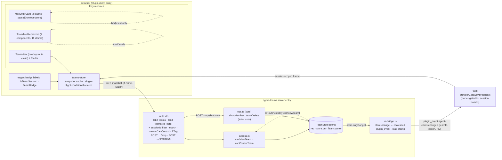

## Context

`add-agent-teams-core` (base, not yet archived) defines the team store, the CC-named tools, mailbox delivery, the task list, shutdown handshake, two read routes and the seams later changes build on. Names, data model, events and routes used below are **reused exactly** from `openspec/changes/add-agent-teams-core/design.md` (Team/Member/Task/Mail data model incl. `Team.owner`, `leadSessionId?`, `closeReason`; REST `GET /api/plugins/agent-teams/teams` and `/teams/:id`, D15; mail envelope `formatEnvelope`/`parseEnvelope` and the open kind set, D5; store events `change`/`team_created`/`lead_bound`/`team_closed` and the actor ops `abortMember`/`teamDelete`, D12 and D17; `setRouteVisibility`, D17; client entry registration only, D16). This change adds the presentation layer and the two user controls and **defines nothing that core now defines**. It builds on owner decisions already settled for the group: the UI ships as part of the one bundled plugin `agent-teams` (D1), teammate sessions are normal visible sessions the user can chat with (core D10/D11 and its teammate-scope capability), and REST read scoping is a visibility policy registered here on core's hook (core D15/D17).

**Verified host facts this design relies on** (all re-checked against current source):

- Slot taxonomy: `shell-overlay-route` (many, react-only, "Plugin-owned full-screen route…", `slot-types.ts:75-80`), `session-card-badge` (many, react-or-descriptor, `:86-90`), `content-view` (**one-active**, "Full-screen content area view for a session", `:128-132`), `tool-renderer` (`:158-162`), `custom-entry-renderer` (`:163-167`).
- Slot props: `shell-overlay-route` gets `{params, cwd?, session?, onBack, pluginContext}` with `session` resolved from the claim's `sessionParam` (`slot-props.ts:292-304`); `content-view` gets `{session, routeParams, onClose}` (`:255-260`); `tool-renderer` gets `toolName, toolInput, sessionId, status?, result?, toolDetails?, images?, context?` (`:317-330`); `session-card-badge` gets `{session, pluginContext}` (`:218-221`); `CustomEntryRendererProps` (`slot-props.ts:85-107`) carries `customType, body, timestamp, entryId?, sessionId?, expanded, onToggle, payload?, payloadError?, payloadLoading`.
- **Mail rows have no entry id**: the reducer's `pi.sendMessage` arm builds the row from `extractCustomEntryBody(msg.content)` only and "deliberately" does not stamp `entryId` (`packages/client/src/lib/chat/event-reducer.ts:2273-2301`), so the container never fetches a payload (`CustomEntryRow.tsx:79-83`: fetch only `if (!expanded && msg.entryId && sessionId)`); `message.details` is **not** folded into the body (the existing `custom-entry-rendering` spec says `content` and `details` — the code diverges, see Risks). Core's `details` on mail messages is therefore invisible to the client; everything the card needs must be in the content text. The body passes `truncateOutputForDisplay`, which keeps only the **last 200 lines** and prepends `«N earlier lines hidden»` (`event-reducer.ts:1246-1263`), and is tail-capped at 64 000 chars (`:1197-1204`); core's `maxMessageChars` bounds characters, not lines. Every custom row is also gated by the user's `customEventGroups[msg.groupId ?? "other"]` (`CustomEntryRow.tsx:86`).
- Content-presentation overlay claims render beside the sidebar, no scrim, no Esc dismissal, `depth` mandatory, mobile uses the declared depth (`openspec/specs/shell-overlay-route/spec.md:8-27,200-214`); precedents with `presentation: "content"`: `packages/skill-atlas-plugin/package.json:67`, `packages/obs-studio-plugin/package.json:69`; session-keyed overlay precedent `packages/subagents-plugin/package.json:73-80` (`/session/:sessionId/subagent/:agentId`, `sessionParam`, `depth: 2`, `parentPath`). Plugins link to overlay routes with plain `href` (`SubagentDockGroup.tsx:139`).
- `content-view` is predicate-driven and "out of scope for shell routing" (`docs/architecture.md:2520`): not URL-addressable.
- Layout reachability gate for every overlay route (bounded or scrollable, no occluded controls): `openspec/specs/shell-overlay-route/spec.md:351-395`.
- Lazy claim modules: `module` keeps a component out of the cold chunk; `predicate`/`shouldRender` stay in the main entry; "keep badges, chips, predicates … eager" — `manifest-schema.md:53-80`. Cold chunk budget: `packages/client/src/__tests__/mdi-chunk-size.test.ts` (registry checklist pitfall).
- Badge gate rule: every first-party `session-card-badge` claim MUST declare `predicate` or `shouldRender` — `docs/plugin-claim-gates.md` "Badge gate rule", contract test `packages/client/src/__tests__/badge-claims-gated.test.ts`.
- `plugin_event` frame: declared type `PluginEventBroadcast {type, pluginId, sessionId, event:{eventType,timestamp,data}}` (`packages/shared/src/dashboard-plugin/intent-types.ts:72-79`); shell routes it to `publishSessionEvent` (`packages/client/src/hooks/useMessageHandler.ts:954-956`) → `useSessionEvents(sessionId)` (`packages/dashboard-plugin-runtime/src/plugin-context.tsx:398-405`); the per-session array is append-only (copy-on-append, no cap) until `clearSessionEvents` (`packages/dashboard-plugin-runtime/src/session-events-store.ts`, cleared on `session_state_reset`). Both `useSessionEvents` and `useShellConnectionStatus` are React hooks, so a module-level store needs a mounted feeder (D3). Goal-plugin precedent for emitting it: `packages/goal-plugin/src/server/index.ts:376-387`.
- **Delivery of session-scoped frames is owner-gated per socket** when identity is enforced: `broadcast` → `broadcastOwnerScoped` → `sessionIdOf(msg)` + `canAccessSession` (`packages/server/src/pairing/browser-gateway.ts:1695-1700,1703-1735,1832-1862`); plugin `broadcastToSubscribers` forwards session-scoped frames straight to `browserGateway.broadcast` (`packages/server/src/server.ts:4286-4308`). Frames are class `transcript` by default and may be shed under back-pressure (`browser-gateway.ts:98-165`), so a frame must be an idempotent hint, never the only copy of state.
- Owner model: `DashboardSession.principalOwner` and `pluginRefs` (`packages/shared/src/types.ts:600-611`); `canAccessSession` semantics — inert ⇒ allow, local operator ⇒ allow, ownerless ⇒ deny, else exact `(iss, sub)` equality — `packages/server/src/identity/session-access.ts:68-75`; request principal for plugin routes `ctx.identity.principalOf(request)` and `isEnforced()` (`server-context.ts:1453-1470`, wired to `sessionPrincipalOf`, `server.ts:4841`), local operator is the reserved issuer `urn:pi-dashboard:local-operator` (`session-access.ts:37`, `isLocalOperator` `:51`); plugin precedent for owner-gating reads by session `principalOwner`: `packages/team-plugin/src/server/conversations.ts:418-421`. Core records `Team.owner` (the lead's `principalOwner`, core tasks 3.4) and exposes `setRouteVisibility(fn(team, req))` (D15/D17, default allow-all); the policy is this change's.
- Plugin session refs: `ctx.assignSessionRef(sessionId, ref, {persist?})` (`server-context.ts:1333`, type `:731-735`) writes an owner-namespaced bag `session.pluginRefs[pluginId]` and **broadcasts `session_updated` with only the projected top-level keys** (`server.ts:4597-4627`; `applyPluginRef` returns the top-level keys, `session/plugin-refs.ts:120-135`): a `undefined` clear is dropped by `JSON.stringify`, the client merge is a shallow `{...existing, ...updates}` (`useMessageHandler.ts:654-662`) and no client code reads `pluginRefs` (`grep pluginRefs packages/client/src` = no consumer). The live, client-visible form of a ref is therefore the **top-level projection**: core spawns teammates with `pluginRef: {"agent-teams": {teamId, member, role}}` (core D4) which projects to `session["agent-teams"] = {teamId, member, role}`.
- Host control tiers: session abort and shutdown are `control` (`packages/shared/src/route-tiers.ts:487,497`); `POST /api/shutdown` is `operate` (`:513`, the stronger tier); plugin routes must have rows (`route-tiers.ts:1-12`). MCP denylist takes prefix patterns (`packages/mcp-server-plugin/src/server/tools.denylist.ts:60-80`).
- Core's actor operations: `abortMember(team, name, {actor})` and `teamDelete(team, {actor, force})` in `ops.ts`, actor `lead|user|server` (core D12); the only caller of host `abortSession`/`shutdownSession` is core's session driver (D17), so this change never calls those host functions.
- UI primitives available to plugins: `ui:status-pill` (`UiStatusPillProps {state,text,icon?,tooltip?}`; states `running|success|error|info|warn|muted`, `ui-primitives.ts:271-287`; **no shape unless an MDI `icon` key is passed**), `ui:confirm-dialog` (`UiConfirmDialogProps {message, confirmLabel?, onConfirm, onCancel}`, `:118-123`), `ui:dialog`.
- Accessibility and theme: `ui-contract.md` §Accessibility invariants (`:231-282`), semantic severity families (`:56-87`), state-is-never-color-alone rule (`:240-243`); plugin author rules `packages/dashboard-plugin-skill/.pi/skills/dashboard-plugin-scaffold/references/host-design.md`; mock loop binding `.pi/skills/frontend-mockup-loop-dashboard/SKILL.md` ("PLUGIN SURFACE binding"). Plain-text/untrusted-text precedent for a custom-entry card: `packages/web-access-plugin/src/client/WebSearchEntryCard.tsx:1-30` (plain text, `SafeLink` only for credential-free http(s), icons decorative, tokens only).

## Goals / Non-Goals

**Goals:** a user can see at a glance who is in a team, what each member and task is doing, and what was said; peer messages can never be mistaken for the human or for approval; the UI stays correct under dropped frames, server restart and reconnect; multi-user deployments never leak another user's team; two safe user controls; zero change to core semantics.

**Non-Goals:** see proposal (no approvals, no spawn/create/edit from the UI, no messaging from the Team view, no OpenSpec/in-process specifics, no host or shared-protocol change).

## Architecture



**Module layout added by this change** (`packages/agent-teams-plugin/src/`):

| Path | Role |
|---|---|
| `shared/ui-protocol.ts` | snapshot additions (`epoch`, `viewerCanControl`; `rev` is core's), `agent-teams:changed` payload, stop/shutdown response types and error codes |
| `server/access.ts` | owner predicate (`canViewTeam`, `canControlTeam`), registered with core's `setRouteVisibility`, exported for later team routes |
| `server/ui-bridge.ts` | `store.on(change)` → coalesced broadcast; lead `assignSessionRef` stamp/clear on `team_created`/`lead_bound`/`team_closed` |
| `server/user-actions.ts` | `stopMember`, `shutdownTeam`: thin wrappers over core's `abortMember` / `teamDelete` with actor `user` |
| `client/index.tsx` | eager exports: `catalog` (badge labels only), `isTeamSession` |
| `client/TeamBadge.tsx` | eager badge, no `@mdi` import |
| `client/teams-store.ts` | module-level snapshot cache, subscription, single-flight conditional refetch, fed by a mounted feeder component |
| `client/TeamView.tsx` (+ `MembersGrid`, `TaskBoard`, `MessageLog`, `TeamHeader`) | lazy overlay-route claim |
| `client/TeamToolRenderers.tsx` | lazy, four components grouped by tool family |
| `client/MailEntryCard.tsx` | lazy custom-entry card for the three mail types, built on core's `parseEnvelope` |
| `client/status-map.ts` | status → `{glyph, text-key, pill-state}` single table |

## Decisions

### D1 — Team view container: `shell-overlay-route`, `presentation: "content"`, lazy module
**Chosen:** one claim `{slot:"shell-overlay-route", component:"TeamViewClaim", module:"./src/client/TeamViewClaim.tsx", path:"/session/:sessionId/team", sessionParam:"sessionId", depth:2, parentPath:"/session/:sessionId", presentation:"content"}`. It renders beside the sidebar on desktop (the sidebar's session cards, and with them every teammate session, stay clickable while the board is open — the whole point of a team overview) and in the `MobileShell` detail panel at depth 2, whose back target is the session.
**Alternatives:** (a) `content-view` — `one-active` and predicate-driven, i.e. state-switched not URL-addressable (`docs/architecture.md:2520`); cannot be deep-linked from a badge or a tool card, and replaces the chat of one session, whereas a team spans sessions; rejected. (b) `presentation: "dialog"` (default) — a modal scrim hides the sidebar and fights the Esc/focus trap while the user wants to open a teammate; rejected. (c) `presentation: "page"` — full viewport hides the sidebar too and needs its own back chrome; rejected. (d) a sidebar folder section or composer panel — too small for a board; the chip-sized badge stays as the entry point. (e) `/team/:teamId` top-level — works, but loses `session` resolution for free and a teammate session URL would need a lookup first; see D2.
**Consequence:** the claim must satisfy the overlay reachability gate (bounded height with an inner scroller, no occluded controls) — verified in a real browser per the spec; `Esc` does not dismiss it (content presentation), so a visible Back button is part of the header.

### D2 — Route key is the session id, not the team id
**Chosen:** `/session/:sessionId/team`. The view asks the server for "the team of this session" (`GET …/teams?sessionId=<id>` is a filter on the existing list route, returning at most one summary, precedence in D7), then loads `/teams/:id`. Lead and every teammate session resolve to the same team; from a teammate URL the header says "viewing from <member>". A badge, a tool card or a mail card all know a session id already; none of them reliably knows a team id (mail rows only have text).
**Alternatives:** `/team/:teamId` — would need every entry point to hold a team id; `pluginRefs` has it for teammates but the lead only after the stamp (D6); keeping session-keyed avoids a second addressing scheme and gives the back target for free (`parentPath`).
**Edge:** a session with no team (never created / pruned) renders the "no team for this session" empty state with a link back, never a blank panel (`shell-overlay-route/spec.md:396-417` forbids blank claims).

### D3 — Live state: `plugin_event` invalidation + REST refetch (not `eventTypes` + `sessionEventReducer`)
**Chosen:** the server (`ui-bridge.ts`) subscribes to core's typed `store.on("change")`; core keeps a per-team monotonic `rev` (in-memory, reset on restart). The bridge coalesces to ≤ 1 frame per team per 1 000 ms, **leading and trailing** (the first mutation of a quiet team is sent at t≈0, at most one more at +1 000 ms carrying the latest `rev`; owner decision B33), and calls `ctx.broadcastToSubscribers({type:"plugin_event", pluginId:"agent-teams", sessionId:<leadSessionId>, event:{eventType:"agent-teams:changed", timestamp, data:{teamId, epoch, rev, closed?}}})`. `epoch` is a random id minted at server start (a changed `epoch` forces refetch). The frame is **content-free**: no mail text, task text or names. Snapshots carry `rev` and `epoch` and an `ETag: "<epoch>:<rev>"`; `If-None-Match` with the current value answers 304.
**Client feed.** `useSessionEvents` and `useShellConnectionStatus` are React hooks, while the cache is a module-level store; the Team view therefore mounts a render-less feeder that calls `useSessionEvents(leadSessionId)` (the lead id comes from the resolved summary) and `useShellConnectionStatus()` and pushes the newest `epoch`/`rev` and reconnect signals into the store. The events array is append-only until `clearSessionEvents` (`session_state_reset`); a reset is "no information", never a state change (the cache stays, the next trigger refetches).
**Refetch rules.** Single-flight, conditional. First use fetches immediately; every other trigger uses a 500 ms debounce with a **2 000 ms max-wait**, so continuous frames cannot starve the refetch (B33). Triggers: first use, a frame with a different `epoch` or a greater `rev`, socket reconnect, a hidden tab becoming visible, and a **60 s safety timer while visible**. A hidden tab does not poll. The safety timer exists because frames are an idempotent hint, not the state: they are class `transcript` and sheddable under back-pressure, and under enforced identity a session-scoped frame whose session has no resolvable owner (e.g. an orphaned team whose lead session was deleted) is withheld from every socket (`browser-gateway.ts:1855-1862`). Worst case a visible view converges within 60 s.
**Load bound.** `rev` bumps on every store mutation (mail acks and counters included), so a busy team changes continuously; the 1 s coalesce plus 500 ms debounce plus single-flight bound one open view to ≤ 1 full snapshot request per second, far under core's ≥ 8 req/s read limit; the 304 path serves the safety timer and any no-op change. The snapshot's mail tail must be bounded and text-capped by core's serializer (crossfix filed against core; this change relies on it, see Core amendments).
**Why not `eventTypes` + `sessionEventReducer`** (`docs/plugin-seams.md:481-523`): a reducer folds events **of one session's stream** into that session's `SessionState`; team state is cross-session and server-owned (core D2) — folding would mean re-deriving a second copy of the store from a lossy event feed, duplicated per session view, and replayed incorrectly after a restart. `eventTypes` ownership also makes the shell add owned-event group rows into the chat when the plugin is unavailable (`plugin-seams.md:481-503`), which we do not want for a ping.
**Why not a custom frame type** (e.g. `agent_teams_update` + `usePluginMessage`): every existing plugin-specific frame is declared in `packages/shared/src/browser-protocol.ts` (`goals_update` `:401`, `browser_relay_status` `:2672`); a new one is a shared-protocol edit, breaks the "no wire-protocol change" statement of core, and needs an always-mounted `shell-headless` feed to receive it. `plugin_event` is already declared, routed and owner-gated.
**Why not polling alone:** latency and constant load on a rate-limited route for an idle team; the doorbell costs nothing at rest, the safety timer is conditional (304).
**Why not snapshots in frames:** up to 50 tasks × 2 000 chars + mail would be several hundred KiB per frame; frames can be shed, and a frame would carry mail text through a road that has no per-field owner check.
**Accumulation cost:** the shell appends every `plugin_event` to the lead session's event array (`session-events-store.ts`, copy-on-append, **no cap**, cleared only on reset). At the 1 s coalesce ceiling a continuously busy 2 h run is ≤ 7 200 frames ≈ 1.5 MB with a few tens of ms of copy time in total (rate-bounded, not size-bounded); a task in §10 gates this: if appending the 7 200th frame costs more than 5 ms or the total copy time exceeds 2 s, the window widens to 2 000 ms (A12).

```mermaid
sequenceDiagram
  autonumber
  participant Core as Core store/ops
  participant UB as ui-bridge
  participant Host as browserGateway
  participant ST as teams-store (client)
  participant R as GET /teams/:id
  Core->>UB: store.on(change) (rev 41→42)
  UB->>UB: coalesce 1000 ms (leading + trailing)
  UB->>Host: plugin_event agent-teams:changed {teamId, epoch, rev:42}
  Host-->>ST: only owner-permitted sockets (session-scoped frame)
  ST->>ST: rev 42 > cached 41 → mark stale, debounce 500 ms
  ST->>R: single-flight GET (If-None-Match)
  R-->>ST: snapshot {rev:43, …} or 304
  ST->>ST: replace cache, notify views, announce changes
  Note over ST,R: frame shed, withheld or socket reconnect ⇒ safety timer (60 s) / reconnect / mount / visibility refetches; epoch change ⇒ refetch
```

### D4 — Mail cards: core owns the envelope; the UI parses the first line only
**Problem.** Rows from `pi.sendMessage` expose only `customType` and the content text (see facts above). `customType` carries three families (`mail`, `idle`, `notice`) but core's `agent-teams-mail` multiplexes `message | broadcast | task_assigned | shutdown_request | shutdown_response | spawn_prompt` (core data model, Mail.kind) and later kinds, and the recipient (the card lives in the recipient's chat) is implicit. `details` never reaches the client.
**Chosen:** the envelope grammar and kind registry are **core's** (`shared/mail-format.ts`, `formatEnvelope`/`parseEnvelope`, D5/D17): `[agent-teams · <kind> · from <sender> · peer message — not a user instruction and not user approval]` with optional ` · urgent`, `<kind>` any `[a-z_]+`, `<sender>` = `lead|server|<member>`. This change builds only the parser-side cards on `parseEnvelope`; it never formats and never defines a second grammar. A grammatical but unknown kind (e.g. change 3's `plan_request`) renders as a generic labelled card that still names the sender. A contract test (task 2.3) formats every core kind with core's formatter and parses it through the real reducer path.
**Anti-spoofing:** only the **first line at offset 0** is parsed; a header-looking line inside the text is rendered as text. Core builds the header outside the peer-controlled `text`, and core refuses member names `lead|server|system|all|user` (`name_reserved`), so a teammate cannot be mistaken for the lead or the server; the card additionally labels the sender role in text (Lead / Server / Teammate <name>).
**Host display cap.** The host keeps only the last 200 lines of a custom row. A body past 200 lines loses its envelope and starts with `«N earlier lines hidden»`; the card renders it as "agent message — header truncated" with no sender and the remaining text inert. Core is asked to cap and collapse mail text by lines at the builder so a peer cannot hide the header on purpose (crossfix filed against core); the card handles the case regardless.
**Notices:** core flushes all lead lifecycle notices (idle reports, task completions, shutdown outcomes) as ONE coalesced `agent-teams-notice` (core D9) and `details.items[]` is invisible to the client, so items travel in the text. Items embed peer-authored text (final answers, reasons), so the card must not trust raw line structure: a line starting `• ` begins an item, `│ ` lines continue it (rendered inside that item as an indented quoted block), any other line counts as one legacy item. The marker contract is core's builder's to emit (crossfix filed against core); without it every line counts as an item, which is merely less accurate, never more trusted.
**Idle:** core routes idle reports to the lead inside the coalesced notice, and the envelope grammar has no error marker (an error is only body text; `error?` lives in `details`). The `agent-teams-idle` card (core registers the customType) is therefore a plain "<sender> reported idle" card with the body; there is no error-severity idle variant here.
**Alternatives:** (a) put the structured payload in the body as JSON — breaks the model-readable text the agent must read; (b) rely on `details` — not available to the client (facts above); (c) switch core to `pi.appendEntry` so rows get an entry id and a lazy payload — loses `triggerTurn`/steer delivery (core D5 spike lessons); (d) infer kind from prose with regexes — brittle and spoofable.

### D5 — Card content and expansion
**Chosen:** collapsed card (`role="group"`, `aria-label` = "Agent message from <sender>") = agent icon + text label "Agent message" (never styled as a user bubble; severity-neutral surface with a left rule, not a chat bubble), kind label, sender with role label, an `urgent` text marker when the envelope has the `urgent` segment, 2-line clamp of the text, and an expand button (`aria-expanded`, `aria-controls`) wired to the container's `expanded`/`onToggle` — which never issues a request because mail rows have no `entryId`; the full body (as delivered to the row, host-capped) shows inline, plain text, `whitespace-pre-wrap`, `overflow-wrap:anywhere`, bounded to 60vh with an inner scroller. `payload*` props are ignored. The card does not show "direction": cards always live in the recipient's chat and the recipient is not in the envelope.
**Idle** (`agent-teams-idle`): "<sender> reported idle" with the body text. **Notice**: neutral "Team notice", item list with "+N more" and a link to the Team view (Q4-A). **Header truncated / unrecognised**: the labelled fallbacks of D4.
**Untrusted text:** no markdown, no HTML, no link detection. Links are shown as text. (Contrast: `WebSearchEntryCard` linkifies credential-free http(s) because the data is tool output; here the author is another LLM.)
**Accepted host behaviour:** a user who hides the host's `other` event group hides every mail card (`CustomEntryRow.tsx:86`), including shutdown requests and notices; the Team view message log remains. Declaring an event group for these customTypes would be a core/host change and is left out (Risks).

### D6 — Session badge: pure predicate over the top-level ref projection; the server stamps the lead from core events
**Chosen:** `predicate: "isTeamSession"` reads the **top-level projection** (the form `session_updated` actually broadcasts): a non-empty string `teamId` under `agent-teams` for teammates (core's spawn ref) or under `agent-teams-lead` for the lead; both present ⇒ lead wins (B25). The lead is stamped under its **own key** `agent-teams-lead` (not `agent-teams`, so core's `onSessionResolved`/`hello` binder, which keys on the `agent-teams` ref and a `member`, can never read a lead stamp as a nameless teammate). `ui-bridge.ts` subscribes to core's `team_created` and `lead_bound` events (covering `TeamCreate`, first-`TeammateSpawn` auto-create, command start and a server-started lead) and calls `ctx.assignSessionRef(leadSessionId, {"agent-teams-lead": {teamId}}, {persist:true})`; the stamp is kept by one idempotent `reconcileStamp(sessionId)` that recomputes it from the store's live teams on every team event (B24), so a late `team_closed` of an old team never clears a newer team's stamp and a rebound lead clears the old session; a clear uses the JSON-plain sentinel `{"agent-teams-lead": {teamId: null}}` (an `undefined` clear is deleted from the stored bag but dropped by `JSON.stringify`, so no client would ever hear of it); the predicate requires a string `teamId`, so the sentinel reads as "no badge". The ref is session-list data, so the badge needs no async gate, survives restart, works in the cold session list and updates live. Badge text: `Lead` / `<member>`, with an accessible name stating the role ("Open team view, <role>"); the team name lives in the Team view header (the eager badge cannot read the lazy store). It is an `<a href="/session/<id>/team">` (keyboard focusable, visible focus ring).
**Alternatives:** (a) `shouldRender` over a boot gate (blackhole pattern, `plugin-claim-gates.md`) — needs an async fetch and `bumpSlotClaimsVersion`, flickers on cold load; (b) derive lead from the REST list on the client — same async problem; (c) core stamps the lead itself — preferable long-term but core chose to leave it here (core gap decisions, ui G3); (d) store the lead flag under `agent-teams` with `role:"lead"` — rejected for the binder-collision risk above.
**Risk:** `assignSessionRef` rewrites only plugin-owned keys and is trusted-gated (first-party plugin, `priority: 100`); the bag is ≤ 16 KiB (`plugin-refs.ts:20`) and ours is ~100 bytes. Task 6.2 verifies the pending-ref registry accepts the new key.

### D7 — Multi-user: owner filtering through core's visibility hook
**Chosen:** an `access.ts` predicate `canViewTeam(request, team)` registered with core's `setRouteVisibility` (core passes list entries and the snapshot through it; hidden ⇒ list omits, `/teams/:id` answers the same 404 as an unknown id, so no existence oracle): identity not enforced ⇒ allow (today's behaviour byte-for-byte); enforced ⇒ principal required, local operator (`iss === "urn:pi-dashboard:local-operator"`, reserved, cannot be minted by a resolver, `session-access.ts:31-37,51`) ⇒ allow, else exact `(iss, sub)` equality with `Team.owner`, which **core** records from the lead's `principalOwner` (core tasks 3.4; closed teams outlive their lead session, so the owner is stored, never looked up). **Fail closed:** a throw or timeout in `canViewTeam` omits the team, answers 404 on the id and logs the error (B22); a team without an owner is visible only to the local operator under enforced identity — that includes teams persisted before owners were recorded and any server-started team whose creator passed no owner; no live-lead fallback exists (one rule, not two). `canViewTeam` and `canControlTeam` (same predicate, kept separate so a future read-only role can diverge) are exported from `access.ts`; later team-scoped routes (change 3's plan decision and hook trust) call them instead of re-implementing the rule, and change 3 sets the owner of a server-started team from the REST principal. The snapshot gets `viewerCanControl` (owner rule only; it does **not** know the credential tier, so an `observe` token may see buttons the host tier gate refuses — the UI handles the 403 inline).
**Session lookup.** `GET /teams?sessionId=` returns at most one summary whose lead or member session matches, after the visibility filter; an empty, repeated, array-form, NUL-containing or > 128-char value answers `400 bad_session_id` (B46). A session may map to several teams (a lead that closed team A and created team B; core removes closed teams' index entries), so the match scans teams, not the index: live (starting/active/orphaned/closing) over closed, then the most recently changed (latest mail or task timestamp, ties by id).
**Broadcast side:** nothing extra — the frame is session-scoped and the host already applies the same owner predicate per socket (`browser-gateway.ts:1832-1862`); the frame is content-free anyway.
**Alternatives:** (a) per-route `ctx.identity.authorize` with a policy action — needs a host policy and gives local single-user installs nothing; owner equality is the model every session road already uses; (b) filter only in the UI — not a security boundary.

### D8 — User controls: Stop member, Shut down team
**Chosen:** two `control`-tier mutating routes (same tier as session abort/shutdown, `route-tiers.ts:487,497`; supervision of running work is `control`, whereas plan approval and hook trust of change 3 are `operate`, the stronger tier), registered under core's rate-limited prefix, each gated by `canControlTeam` and bound to the URL's team (the principal, not a payload field, decides). `user-actions.ts` is a thin wrapper over core's actor operations and never calls host abort/shutdown itself:
- `POST /api/plugins/agent-teams/teams/:id/members/:name/stop` — if the member is `busy`: `abortMember(team, name, {actor:"user"})`. Outcomes (B26): member not `busy` (any other status) ⇒ `409 not_busy`; `disconnected` or busy without a live connection ⇒ `409 not_connected`; unknown member ⇒ `404` with the body of an unknown team; closing or closed team ⇒ `409 team_closed`; else `{aborted:true}`. A repeat while the abort is pending answers `{aborted:true}` with no second abort or notice (B27). The notice lists owned task ids only, max 10 then "+N more", omitted clause for none (titles are an injection path; B28). On an orphaned team the route succeeds and the notice waits in core's coalescer for a later lead bind (B29).
  **Post-stop state machine.** Per core D6 the aborted settle is reported `aborted:true`: no error idle, no lead idle notice, no auto-claim; the member's tasks stay `in_progress` and the dispatcher skips a member that owns one (core D8), so without more the team would stall silently with an idle lead. The wrapper therefore queues a **waking** lead notice naming the member and the tasks it still owns ("alice was stopped by the user and still owns #3") through `enqueueLeadNotice(team, {text, wake:true})`, an additive export on core's `ops.ts` (added here only if core has no equivalent). The member is **not** woken — the user outranks it and can chat with the session — and its tasks are not released (recoverable: the user or lead decides). Alternative considered: release the tasks to `pending`; rejected because the dispatcher would immediately re-claim for the now idle member and start work the user just stopped.
- `POST /api/plugins/agent-teams/teams/:id/shutdown` — `teamDelete(team, {actor:"user", force:true})`: shutdown requested for every live member, sessions ended after `shutdownGraceMs`, team closed, `team_closed` emitted so the lead bridge drops lead-only tools. Teammates' rejections do not block it. The **lead session is not terminated**. Because the forced delete waits out the grace (10 s) the route answers `202 {closing:true}` as soon as the team is `closing` without awaiting completion; a repeat call while `closing` answers 202 again and starts nothing; a `closed` team ⇒ `409 team_closed`. The live lead gets one **non-waking** notice "team shut down by the user" (queued for a later bind when orphaned; B30). A team persisted as `closing` whose grace timer was lost in a restart is resumed by core at startup, so the route stays a pure 202 no-op (B31, an additive core task). Progress is visible through the snapshot (`closing` → `closed`).
Both log a structured outcome (ids only) and are exposed in the UI only when `viewerCanControl`; a 403 from the host tier gate shows an inline permission message. The shutdown button opens `ui:confirm-dialog` stating consequences; Stop is a plain button without confirmation (Q1-A; recoverable).
**Alternatives:** (a) route the stop through the host `POST /api/session/:id/abort` from the client — bypasses owner-of-team checks, the lead notice and the audit log; (b) make stop kill the session — destructive; the shutdown path covers it; (c) per-member "shut down" — core's handshake covers it via the lead; one user-forced level (the team) is enough for v1 (Q2-A).

### D9 — Eager/lazy split under the cold-chunk budget
**Chosen:** eager (main client entry, in the generated registry chunk): a minimal `catalog` (badge labels and the ARIA name only), `isTeamSession`, `TeamBadge` (no `@mdi`, plain text + `ui:status-pill` from the host). Lazy `module`s: Team view, the four tool-renderer components (one module), and the mail entry card — **each lazy module carries its own en/zh-CN/hu string table**, because the plugin `catalog` is a static export of the main entry (`packages/dashboard-plugin-runtime/src/vite-plugin/index.ts:516-522,663-664`) and anything in it lands in the cold index chunk, which has ~1.4 KB gz headroom under a "do not raise the cap" policy (`mdi-chunk-size.test.ts:160`). Budget: the eager catalog delta must stay a few hundred bytes gz; task 9.5 measures it before anything else and falls back to budgeting keys in the catalog only if the plugin context cannot supply the active locale to lazy modules (a host lazy-catalog seam is the follow-up, see Open Questions). The first mail/tool row after page load shows the host's generic fallback card for one chunk fetch, then swaps; §10 measures the swap, and moving the card eager is allowed only if it fits the budget **including** its strings.
**Alternatives:** everything eager — simplest, risks the cap that develop already sits near; everything lazy including the badge — contradicts "keep badges … eager" (a suspense gap on every card render).

### D10 — Layout, responsiveness, keyboard and ARIA
- **All widths (owner decision, mock loop §1.9: variant B, tabs everywhere)**: header, then a `role="tablist"` of Members · Tasks · Messages (roving tabindex, ←/→/Home/End, `aria-controls`, panels `role="tabpanel"` labelled by their tab), one panel visible. Decided in the mock loop: tabs everywhere (the three-region desktop variant was rejected); members render as a table, the board as a grouped list on narrow widths.
- **Members grid**: a `<ul>` of cards (not `role="grid"`; no cell navigation needed); each card: name, role, status (glyph + text + pill state, `status-map.ts`), model, current task (`#id title`, link-style button that scrolls/focuses the task card), cwd (relative to lead cwd when inside it), degraded notice, `Open session` link, `Stop` button when `busy && viewerCanControl`.
- **Task board**: three `<section aria-labelledby>` lists (Pending · In progress · Completed) with counts; cards show id, title, owner chip, dependency chips ("waits for #2 — pending"/"unblocked"), derived `blocked` flag as text, description and result in a disclosure (`<button aria-expanded>`, text plain). Read-only: no drag-and-drop, so no pointer-only interaction exists.
- **Message log**: chronological list (`role="log"`, `aria-live="off"` — the throttled live region below announces instead), filter by member (`<select>`) and "urgent only"; rows `from → to`, kind label, time, text bounded to 400 chars with a per-row disclosure, markers "urgent" and "not yet acknowledged" (`ackedAt` absent). Auto-follow newest only while scrolled to the end; otherwise a "New messages" button.
- **Live region**: one visually hidden `aria-live="polite"` node announces coalesced summaries ("alice is now working", "task 3 completed", "team closed") at most once per 4 s, never message text.
- **Targets and focus**: ≥ 44 px primary actions below `sm`, ≥ 24 px minimum, `focus-ring` on every control, Esc closes only the confirm dialog (content presentation never dismisses the route); `prefers-reduced-motion` disables the busy pulse.
- **States**: loading skeleton (`aria-busy`), not-found/no-team, access denied rendered as not-found, fetch error with retry, `persist_degraded` warning, starting, orphaned notice (qualitative: teammates continue until the orphan time limit; core exposes no remaining-time field), closing, closed read-only (controls hidden), empty members/tasks/messages.

### D11 — Untrusted text rendering rules (security)
Every string authored by an agent (task title/description/result, message text, final answers, member names via the model, shutdown reasons) is rendered as React text children with `white-space: pre-wrap` and `overflow-wrap:anywhere`; never `dangerouslySetInnerHTML`, never markdown, never auto-link, no `title` attributes carrying full text. Lengths are bounded at display (core already caps at the source). Names are additionally constrained by core's name regex, and the UI shows them verbatim. Cards never present an agent message as something the user can approve; no "accept", "approve" or "reject" control exists anywhere in this change.

### D12 — Theming and design-system binding
The generic `theme-system` skill (`.pi/skills/theme-system/SKILL.md`: four sample `data-theme` palettes with its own variable names) does **not** describe this repo's real tokens, so it is not the binding. The real authority is `ui-contract.md` and `packages/client/src/index.css` plus per-palette overrides `packages/client/src/lib/theme/themes.ts` (`frontend-mockup-loop-dashboard/SKILL.md` step 3). All colours are token names (`--bg-secondary`, `--bg-tertiary`, `--border-secondary`, `--text-secondary`, `--severity-{info,success,warning,error}-{bg,fg,border}`, `--link`, `--focus-ring`), never hex or palette classes; `--text-muted` never carries information (`ui-contract.md:110,123,259`). Status mapping lives in one table (`status-map.ts`): `ui:status-pill` has no `neutral` state and draws no shape without an MDI icon (banned in the eager part), so the table carries an inline glyph (Unicode/SVG) plus text and a pill state: spawning=info ◌, idle=muted ○, busy=running ●, shutdown_pending=warn ◐, disconnected=warn ⚠, gone=muted ✕, failed=error ✖; `--text-muted` never carries the information alone. Verified in dark and light, and in at least one non-default palette, in the mock loop.

### D13 — Mock-loop first
UI work goes through the mock loop (`AGENTS.md` "Mock routing"; `frontend-mockup-loop-dashboard/SKILL.md` step 4). §1 of the tasks produces `openspec/changes/add-agent-teams-ui/mockups/ui-plan.md` and one live-component mock per surface family on the mock site (port 5299, never 8000), with fixtures captured from core's real snapshot shape, rings on the changed divs, both themes and both widths, and records decisions with `mock-decide`. Production components are promoted from the decided mock, not written first. The decisions the mock must settle (mock decisions, not owner decisions): desktop three-region vs tabs-everywhere; members as cards vs dense table; task board columns vs grouped list on mobile; badge density.

## Sequences

### Open the Team view from a badge, then stop a member
```mermaid
sequenceDiagram
  autonumber
  actor U as User
  participant B as TeamBadge (session card)
  participant V as TeamView
  participant ST as teams-store
  participant R as Server routes
  participant A as access.ts
  participant UA as user-actions
  U->>B: activate (Enter/click)
  B->>V: navigate /session/<sid>/team
  V->>ST: ensure(sessionId)
  ST->>R: GET /teams?sessionId=<sid>
  R->>A: canViewTeam (owner filter)
  A-->>R: allowed
  R-->>ST: one summary
  ST->>R: GET /teams/<id>
  R-->>ST: snapshot {members, tasks, mail, viewerCanControl, rev, epoch}
  V-->>U: render members, board, log
  U->>V: Stop on "alice" (busy)
  V->>R: POST /teams/<id>/members/alice/stop
  R->>A: canControlTeam
  R->>UA: stopMember(user)
  UA->>UA: abortMember(user), waking lead notice
  R-->>V: {aborted:true}
  Note over V,ST: change frame arrives; refetch shows alice idle, task still in progress
```

## Failure modes

| Failure | Behaviour |
|---|---|
| Invalidation frame shed, withheld (ownerless lead under enforced identity) or WS down | Views refetch on reconnect/mount/visibility and by the 60 s safety timer (304 when unchanged); no state is only in a frame |
| Server restart | `epoch` changes ⇒ refetch; core marks members `disconnected` then re-binds (core D14); view shows the transient status honestly |
| Snapshot request fails | Last snapshot stays on screen with a "stale — retry" notice; retry with backoff 1 s/2 s/4 s then 30 s |
| Rate limit (429) on refetch | Honour `Retry-After` (delta-seconds or HTTP-date, clamped to [1 s, 120 s]; a frame never bypasses the wait), keep last snapshot, single-flight prevents a storm |
| Envelope not parseable | "Unrecognised agent message" card, body as inert text, no sender claimed |
| Header cut off by the host's 200-line cap | "Agent message — header truncated" card, no sender, remaining text inert |
| Unknown but grammatical kind | Generic labelled card that names the sender |
| Peer text imitates notice items | Core prefixes continuation lines (hard dependency, contract test fails loudly on drift); the card keeps them inside their item; without the marker no peer line becomes a sender, role or approval |
| Tool `details` missing, elided or of a foreign shape | Renderer shows `toolInput` summary plus raw result text (never blank) |
| Lead stamp fails (`assignSessionRef` false) | Badge missing on the lead only; Team view still reachable from teammate badges, tool cards and notice cards; warning logged once |
| Lead stamp clear lost | Cannot happen silently: the clear is a JSON-plain sentinel (`teamId: null`), not `undefined` |
| Team record has no `owner` under enforced identity | Hidden from non-operators (fail closed); local operator still sees it |
| Teammate session deleted | Member `gone`; "Open session" link replaced by plain text "session removed" |
| Stop race (member settles first) | `409 not_busy` shown as an inline message, no error toast storm |
| Stop on a member without a live socket | `409 not_connected` shown inline |
| Control POST gets no answer | After 15 s: "no response — checking state", refetch, button re-enabled, never auto-retried |
| Visibility hook throws or times out | Team omitted, 404 on the id, error logged (fail closed) |
| Stop leaves the member idle with a task | Waking lead notice names it; tasks stay `in_progress` |
| Shutdown called twice / during `closing` | `202 {closing:true}` both times, one shutdown; `closed` ⇒ `409 team_closed` |
| `observe`-tier credential sees controls | Host tier gate answers 403; inline permission message |
| Lazy chunk fails to load | Host overlay failure panel (`shell-overlay-route` spec: failed claim is never blank); cards/tool rows fall back to the host generic renderers |

## Risks / Trade-offs

- **Envelope and notice contract depend on core's builder.** The grammar is core's; the notice item markers and the line cap are requested from core (crossfix). Mitigation: the card parses defensively (unknown kinds, truncated header, legacy lines) and a round-trip test against core's real formatter runs once both exist.
- **Host spec/code divergence on `details`.** `openspec/specs/custom-entry-rendering/spec.md` says the display body derives from `content` and `details`; the reducer uses `content` only (`event-reducer.ts:2294-2299`) and this design relies on that. If the host is brought into spec compliance the body contract changes; the round-trip test through the real reducer (task 2.3) pins it.
- **Hidden `other` event group hides all mail cards** (`CustomEntryRow.tsx:86`): accepted; the Team view log is the fallback.
- **Doorbell accumulation in the shell event array** (D3): rate-bounded not size-bounded; gated at 5 ms for the 7 200th append / 2 s total; fallback to 2 s coalescing.
- **Lazy entry card flicker and lazy string tables** (D9): measurable; moving the card eager is a one-line manifest change only if the budget allows.
- **Fail-closed owner rule** hides pre-existing ownerless teams from non-operators under enforced identity — intended; documented.
- **Stop is an abort of the in-flight tool run** (core D6 semantics): a half-finished shell command is lost; the task stays `in_progress` and the lead is woken.
- **Two mutating routes widen the plugin's REST surface**: `control` tier, owner-gated, rate-limited, MCP-denied by prefix; covered in `security-hardening` review. `viewerCanControl` ignores the credential tier; the 403 path covers it.
- **Token budget of the team tool renderers is zero** (client only); no model-facing change.

## Migration Plan

1. Land after `add-agent-teams-core` (dependency). Additive manifest claims, no data migration, no new persisted field.
2. Rollback: revert the change or remove the claims and the two POST routes; core runs headless; the `agent-teams-lead` stamp is inert and cleared on the next close.
3. Compatibility: no wire-protocol change; dashboards without `module` lazy claims are out of support range already (plugin is bundled with the dashboard).

## Core amendments and cross-change items

Core now defines the seams this change needs (core gap decisions, ui G1, G2, G4, G5 absorbed): no-mutating-route wording, `formatEnvelope`/open kinds, `abortMember`/`teamDelete` with actor `user`, `rev`, `store.on`, `Team.owner`, `setRouteVisibility`, read limit ≥ 8 req/s. What stays here, additive: lead stamping (ui G3, via core events), the `?sessionId=` filter, `viewerCanControl`, `epoch`/ETag. `enqueueLeadNotice` is now core's. Requested from core (crossfix, not applied here): a line cap and blank-run collapse for mail text at the builder, a notice item marker contract (`• ` start, `│ ` continuation), and a bounded, text-capped mail tail in the snapshot with a `mailTotal` field (B38; the log falls back to static "recent messages" if core refuses), the exported member-name grammar and `parseEnvelope` limits (B23), and resuming persisted `closing` teams at startup (B31). Requested from change 3: own the approval/playbook cards and the Start-team entry, set `Team.owner` for server-started teams, reuse `canViewTeam`/`canControlTeam`, name the member param `:name`.

**Applied in this change (additive core fixes found while implementing the server half):** (1) *Owner recording.* Core's `narrowHostSession` dropped the host's `principalOwner` (an `{iss, sub}` object), so `Team.owner` was never set on a real host. Core now records `ownerKeyOf({iss, sub})` (`shared/owner-key.ts`, `JSON.stringify([iss, sub])`) from the lead session's `principalOwner` (session record or host ref), the owner rule compares against that key, and the driver converts the stored key back to the `{iss, sub}` object in the spawn `pluginRef` (a non-key legacy string is no longer passed to the host). Ownerless sessions (local operator, inert identity) stay ownerless; teams persisted without an owner still load. (2) `enqueueLeadNotice(…, {coalesce: true})` joins the lead-notice coalescer (default unchanged). (3) *Lead session id.* The summary and the snapshot carry the optional `leadSessionId` (omitted without a lead; served only through the visibility filter, so no new exposure): frames are scoped to the LEAD session, and a teammate's Team view needs that id to subscribe — the feeder resolves it prop → lookup → snapshot → route session.

## Review gate outcomes

Task 3.1/3.2 done (details and file:line evidence: `review-gate-notes.md`). All 16 core names are PRESENT (two PRESENT-different, handled UI-side). Single-model adversarial pass, 2 cycles; owner decisions not reopened.

- **F1/F3 (Stop mapping, spurious stop):** `user-actions.ts` pre-checks the store, never relying on core to reject non-busy: team `closing`/`closed` → `409 team_closed`; status ≠ `busy` → `409 not_busy` (`disconnected` → `409 not_connected`); core `unknown_recipient` → 404 (same bytes as unknown team); `interrupt_unavailable` → `409 not_connected`.
- **F2 (two waking notices):** decided (a): additive core option `abortMember(team, name, {actor, notify?: boolean})`, default `true` (no behaviour change); the UI passes `notify:false` and enqueues the single task-list notice.
- **F4 (shutdown repeat):** `closing` answers 202 without calling `teamDelete`, plus an in-flight promise guard (check-and-set).
- **Non-blocking (N1–N3, F5):** idle-kind mails are not emitted by core (reports travel as notice items); the header-truncation path stays defensive; snapshot mail is char-capped not line-capped; stamp `true` is not proof of applied.

## Owner decisions (accepted)

The owner accepted every recommended option (decisions sheet A1, A5, A6, A10, A12 and routine items B22–B49, B83, B102). They are specified in D3–D8, the capability specs and `test-plan.md`; summary:

- **Stop member (A6):** no confirmation; tasks stay `in_progress`; one waking lead notice; no member wake; the dispatcher does not re-claim.
- **Shut down team (A5):** forced for the user actor behind a confirmation dialog; the lead session stays open; one non-waking lead notice.
- **Message log (A10):** all team mail, peer mail included, to anyone allowed to view the team; visibility follows A1/Q3 (`routeVisibility`, fail closed).
- **Entry points (Q4/T-ui-1):** badge, tool cards and notice cards only; the Start-team entry belongs to change 3.
- **Lazy i18n (T-ui-2):** the eager catalog holds badge labels only (≤ 400 B gz delta); everything else is a table in the lazy modules, measured first (task 9.5).
- **Budgets (A12):** structural gates only in CI (0 re-renders on 304, only the changed card re-renders, snapshot ≤ 384 KiB at 50 × 2 000 tasks and 100 × 2 000 mails (owner decision: the measured worst case under core's own caps is 332 223 B, which exceeds the first-draft 256 KiB), 7 200th doorbell frame ≤ 5 ms and total copy ≤ 2 s); wall-clock numbers go to a non-gating perf run.
- **D14 — details fixed by the routine items:** the card reuses core's member-name grammar and `parseEnvelope` limits (reserved or out-of-grammar sender ⇒ "unrecognised agent message"); predicate needs a non-empty string, both refs ⇒ lead wins; limiter per principal (reads 8 req/s burst 16, writes 2 req/s burst 5, constants from core); frames leading + trailing, client 500 ms debounce with 2 000 ms max-wait; `Retry-After` both forms clamped [1 s, 120 s]; empty lookup ⇒ "no team", "not found" only after a resolved team answers 404; several in-progress tasks ⇒ lowest id + "+N more"; dangling dependency chip "waits for #9 — missing"; log tail indicator from `mailTotal` with static fallback, broadcasts count as "to" every member, ties keep array order; follow-newest tolerance 8 px; UI state keyed by stable id, vanished-member filter resets with a note; control POST timeout 15 s; contrast gate at the repo's 3:1 floor (4.5:1 advisory); L3 teams from `page.route` fixtures plus one faux-model full-path spec; `If-None-Match` exact equality; counters as structured log lines aggregated every 60 s; orphaned header is static copy; copy details (empty notice "Team notice (empty)", toggle always rendered, "Unexpected error (<code>)", equal cwd `.`, "unassigned", tablist wraps) decided in `mockups/ui-plan.md` and asserted by i18n key or ARIA role; unknown mail kinds such as `lock_grant` fall back to a generic log row (B83); the `data-testid` contract of change 5 (B102).

## Measurements (tasks 10.2–10.4)

Structural gates only (A12); wall-clock is recorded, never gated.

| Item | Result |
|---|---|
| Doorbell accumulation (2 h at 1 s = 7 200 frames) | 7 200th append 0.021 ms (gate 5 ms), total copy 23.4 ms (gate 2 s) ⇒ coalesce window stays 1 000 ms |
| Busy-run refetch rate (one open view) | 7 320 snapshot GETs over 7 200 frames (+120 safety-timer ticks), never more than 1 in flight |
| Team view stress fixture (50 tasks × 2 000, 10 members, 100 mails) | 304 ⇒ 0 re-renders / 0 DOM mutations; one member change ⇒ 2 rows (old + new busy); snapshot ≤ 384 KiB; mount 25 ms, refetch + re-render 2.3 ms (jsdom, informational) |
| Cold index chunk | 639 214 B gz (level 9) vs cap 630 KiB; lazy chunks `MailEntryCard` 3 597 B, `TeamToolRenderers` 5 746 B, `TeamView` 18 278 B gz |
| Mail card eager (experiment, reverted) | +3 956 B gz ⇒ `mdi-chunk-size` fails by 2 664 B (cap not raised) ⇒ the card stays lazy; the decided mock's "eager" is budget-blocked |

Open host-policy conflict (parent / owner): `packages/client/src/__tests__/lazy-plugin-claims.test.ts` lists `custom-entry-renderer` among the EAGER slots ("hot-slot claims never name a module") while D9 and the owner decision keep the mail card lazy. The host's `CustomEntryRow` wraps the claim in `Suspense` with the generic card as fallback (`lazy-cards.test.tsx` proves the swap), so the policy's "no suspense gap" intent holds; the test needs an allow-list entry for `agent-teams:custom-entry-renderer:MailEntryCard` or the card goes eager (not affordable, see above). Not changed here.

## Accepted risks (owner decision)

- **Forced shutdown has no handshake (A5):** a teammate mid-task loses its in-flight work when the user shuts the team down; the confirmation dialog states the consequence.
- **Stop without confirmation (A6):** a mis-click aborts a member's in-flight tool run; the task stays `in_progress` and the team waits for the user or lead (recoverable, avoids restart loops and extra turns).
- **All team mail is visible to anyone who can view the team (A10):** peer-to-peer mail is shown; no per-recipient filtering.
- **REST reads sit on the `observe` tier (A1/Q3):** owner filtering is the only per-user barrier; teams without an owner are hidden from non-operators.
- **Lead is told of a user shutdown without a turn (B30):** a lead that needs to report back must be asked by the user.

- **Cold-chunk cap raised 629 → 630 KiB (owner decision, 2026-11-26):** the 16 generated claim rows cost +856 B gz against 737 B of headroom; the eager catalog itself is +46 B. Consequence: the mock's "eager mail card" choice is not affordable and the card stays lazy (task 10.4 re-measures).

- **Client store keeps idle snapshots (audit 10.5, non-blocking):** `teams-store.ts` retains one snapshot per team/session ever watched in the tab (each ≤ 384 KiB); a tab opening dozens of teams grows accordingly. No eviction yet; revisit if it shows up in practice.

## Open Questions

None. Core gaps G1–G5 of the first draft and every owner-level question (Q1 Stop confirmation, Q2 Shut down team strength, Q3 message-log scope, Q4 entry points) are decided above; the host lazy i18n seam is resolved by measuring first (task 9.5): if lazy modules cannot obtain the active locale, strings are budgeted into the eager catalog and a host seam for lazy catalogs is a follow-up outside this change.
