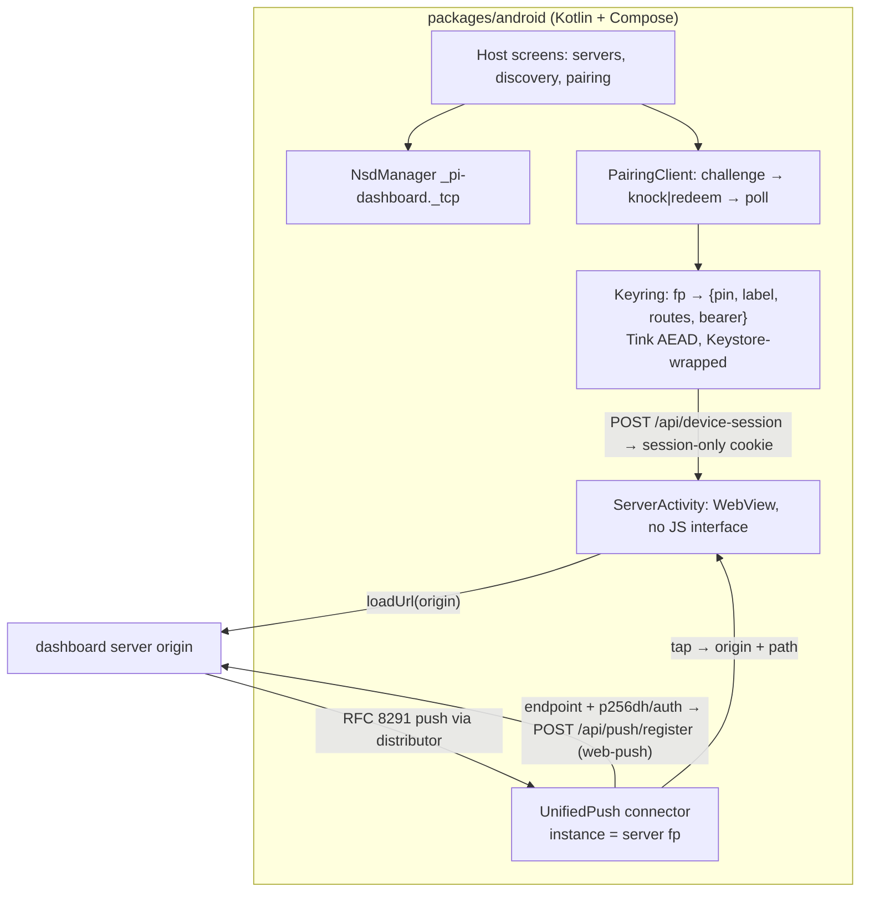

## Context

Replaces the bundled-client Capacitor plan. Evidence comes from the 2026-10-24 spike:

- Android 14 `sdk_gphone64_arm64`, system WebView `113.0.5672.136`, Capacitor `7.6.9`.
- Isolated server `HOME=/tmp/pi-spike-home`, port 8123, `trustedNetworks: ["127.0.0.1"]`, so the LAN IP is untrusted and the real auth path runs.

The reproducible recipe is the project-memory skill `spike-android-webview-host` (`~/.pi/agent/projects-memory/pi-agent-dashboard/skills/spike-android-webview-host/SKILL.md`, outside the repo). Spike APK sources are under `/tmp/pi-android-spike` and are not committed.

| # | Spike | Result |
|---|---|---|
| S1 | Plain WebView, native `POST /api/device-session` → `CookieManager.setCookie(origin, Set-Cookie)` → `loadUrl(origin)` | Dashboard authenticated: `/api/ws-ticket 200`, `/api/plugins/runtime-clients 200`, import map present, 192/192 chunks import, 0 console errors. First attempt got `415` (form-encoded default body). |
| S1b | Device revoked via `DELETE /api/paired-devices/:id`, app relaunched | Page loads; `/api/*` returns `403`; in-page banner "Disconnected… Retrying" / "Server offline" (misleading). |
| S2 | `network_security_config` with `<domain>192.168.0.0/16</domain>` + `<domain>10.0.2.2</domain>`, base cleartext false | `192.168.16.203` refused (`HttpURLConnection` IOException and WebView `ERR_CLEARTEXT_NOT_PERMITTED`); `10.0.2.2` allowed. CIDR not supported; the WebView enforces the config. |
| S3 | Page on `https://appassets.androidplatform.net` → `http://` / `ws://` LAN | `fetch` blocked (Mixed Content); `new WebSocket` throws `SecurityError`. |
| S4 | WebView feature probe | `PublicKeyCredential`, `Notification`, `PushManager` undefined; androidx.webkit `WEB_AUTHENTICATION` false; `BarcodeDetector`, `crypto.subtle`, `serviceWorker`, `clipboard` present. |
| S5 | Capacitor 7, `allowNavigation: ["*"]`, local page navigates to LAN server | `window.Capacitor` absent but `window.androidBridge` present (`addJavascriptInterface` fallback in Capacitor's `MessageHandler.java`). The remote page's `Preferences.set/get` and `CapacitorCookies.getCookies` succeeded. A scheme-qualified entry (`http://host:port`) does not navigate in-app. |
| S6 | `@capacitor/preferences` | `context.getSharedPreferences(group, MODE_PRIVATE)`; value read back in plaintext from `shared_prefs/CapacitorStorage.xml`. |

Existing server behaviour reused unchanged (verified 2026-10-24):

- **Identity challenge:** `POST /api/pair/challenge`, Ed25519 signed nonce (`openspec/specs/neutral-shell-pairing/spec.md` "Pinned identity verification").
- **Knock:** `POST /api/pair/request`. Response carries `{pendingId, confirmCode, expiresAt, fingerprint}` (`packages/server/src/routes/pairing-routes.ts:392-399`).
  - Admitted only when `pairing.acceptLanRequests` is `true`; the default is `false` (`packages/shared/src/config.ts:1842`).
  - Admitted only from an on-link private peer, or from a configured network (`openspec/specs/lan-knock-pairing/spec.md` "Knock admission gates", "Configured networks extend knock eligibility").
  - Refusal codes include `knock_disabled`, `knock_not_lan`, `knock_pending`, `knock_rate_limited`, `knock_busy`.
- **Poll:** `POST /api/pair/poll`. The approved answer is `{status:"approved", token, routes}` with **no fingerprint** (`pairing-routes.ts:526-528`).
- **Redeem:** `POST /api/pair/redeem` → `{pendingId, confirmCode}`.
- **Device session:** `POST /api/device-session` sets `pi_dash_device` whose **value is the bearer**: `HttpOnly`, `SameSite=Strict`, `Path=/api/`, 400-day max-age (`packages/server/src/auth/bearer-auth.ts:118-131`). `DELETE /api/device-session` clears it (`bearer-auth.ts:134-135`).
- **Tiers:** `POST /api/ws-ticket` and `POST /api/push/register` both require `operate` (`packages/shared/src/route-tiers.ts:507`, `:446`). Pairing defaults to `operate` (`openspec/specs/bearer-device-auth/spec.md` "tier").
- **Web Push:** the `web-push` transport exists only when `push.webPush.contactEmail` is set (`packages/server/src/push/push-service.ts:57-61`).
  - Registration requires an `https` endpoint plus `keys.p256dh` and `keys.auth` (`packages/server/src/routes/push-routes.ts:63-68`).
  - All `/api/push/*` routes answer `404` while push is disabled (`openspec/specs/push-notifications/spec.md` "Opt-in by default").
- **mDNS:** `_pi-dashboard._tcp`, `SERVICE_TYPE = "pi-dashboard"` (`packages/shared/src/mdns-discovery.ts:13`), TXT `{version,pid,piPort,fp,name}` (`openspec/specs/mdns-discovery/spec.md`).
- **Routes:** `openspec/specs/server-identity-routes/spec.md` is a reuse contract:
  - route kinds (`:31`);
  - stored fields host, port, scheme and source (`:48`);
  - challenge as the reachability check, at most 6 in flight, all settled within 8 s, a challenge answered after more than 2 s counts as unreachable (`:51`, `:79-83`);
  - delivered routes validated before storing: https, origin only, a DNS name that is not an IP literal, `localhost` or `.local`, at most 8 kept, host at most 253 chars (`:117`);
  - short fingerprint is `sha256:` plus the first 16 characters (`:251`).
- **Poll result:** `pending | approved | rejected | unknown` (`packages/server/src/pairing/pairing.ts:194-198`). `approved` is answered once.
- **Refusal bodies:**
  - `device-session` `401` body is `{success:false, error:"device bearer required"}` (`bearer-auth.ts:120-122`);
  - Host-gate refusal is `403 host_not_allowed` (`packages/server/src/auth/host-gate.ts:267`).
- **CSP mode:** defaults to `report`; `enforce` only with `PI_DASHBOARD_CSP=enforce` (`packages/server/src/auth/csp.ts:82-84`).
- **Server CSP:** `connect-src 'self' ws: wss:` (`packages/server/src/auth/csp.ts:64`).
- **Runtime plugins:** skipped whenever the client runs cross-origin (`packages/client/src/lib/plugins/runtime-plugin-loader.ts:268`).

Sibling model: Electron server windows (`openspec/specs/electron-server-windows/spec.md`; decisions in `openspec/changes/archive/2026-10-14-add-electron-server-windows/design.md` D3–D8). Deliberate deviations are listed in D11.

## Goals / Non-Goals

**Goals**
- A native host that owns discovery, identity, pairing, credential storage and push. Remote pages only render.
- Each server's own client on its own origin: no client fork, no version skew, runtime plugins work.
- No JavaScript bridge reachable from any server page.
- LAN `http` servers work. Hostnames over cleartext are refused.
- Push without any vendor secret on user servers.
- Zero server and web-client changes (contingency in D9).
- The bearer is never at rest in plaintext in app-owned files and never in logs or URLs. The WebView jar copy is session-only, with the accepted app-private residual in D4.

**Non-Goals**
- iOS, Play Store listing, offline UI, bundled client.
- Several server screens open at once (D5).
- Passkey / OIDC login in the WebView (S4). Device-bearer pairing is the only v1 credential.
- Protecting the bearer *in transit* on plain-`http` LAN servers. The existing server posture permits LAN http for browsers and Electron (`lan-knock-pairing` "Dashboard works from a non-secure LAN origin"). The app shows an "Unencrypted connection" badge and recommends https or a tunnel (trade-off, see Risks).
- Restricting what the server's own page may fetch. It runs with the same capabilities it has in a browser; the server CSP governs it.
- Making the in-page `ServerSelector` host-aware. Same as the Electron non-goal.
- `/live/` and `/editor/` from networks the server does not trust (the device cookie is `Path=/api/`).
- Server-side pruning of a revoked device's push tokens (D9 residual).

## Decisions

### D1 — Native host + server-origin WebView; reject bundled client, Capacitor, TWA, native rewrite

| Option | Verdict |
|---|---|
| Bundled client (Capacitor / asset loader) | Rejected. S3 mixed content to LAN. Runtime plugins skipped in remote mode (`runtime-plugin-loader.ts:268`). Client/server version skew. 40+ non-test `window.location.(host\|origin\|protocol)` call sites in `packages/client/src` (`rg -n 'window\.location\.(host\|origin\|protocol)' -g '!**/__tests__/**'`). |
| Capacitor for server pages | Rejected. S5 bridge exposure with `allowNavigation: ["*"]`; scheme-qualified entries don't navigate in-app. |
| Capacitor for host screens only | Rejected for v1. It adds a JS toolchain and a second WebView to an Android-only app to reuse a small amount of `packages/shell` UI. |
| TWA / Bubblewrap | Rejected. Locked to one verified origin (`docs/research/mobile-app-bubblewrap-vs-capacitor.md`). |
| Native UI rewrite | Rejected. About 1,800 client TS/TSX files, plus Monaco, xterm, mermaid, pdf.js and a DOM-based plugin system. |

### D2 — Project layout and toolchain

- **Project:** `packages/android/` is a standalone Gradle project: committed wrapper, Kotlin, Compose, `minSdk 29`, `compileSdk`/`targetSdk 35`, AGP 8.x, JDK 17.
  - No `package.json`. Task 2.6 verifies that pnpm, vitest, knip and `scripts/check-conventions.mjs` ignore it. If they don't, add an exclusion.
- **Modules:**
  - `:core` is pure Kotlin/JVM with no `android.*` imports and holds every policy. JUnit tests:
    - `PairingPayload.decode`, `expectedIdentity`
    - `CleartextPolicy`, `decideNavigation`, `safeDeepLinkPath`
    - `classifyExchange`, keyring model, `RouteSelector`
    - `versionCodeFor`, `LogRedactor`
  - `:app` holds the Android adapters.
- **Dependencies:**
  - androidx core / activity / compose;
  - `androidx.webkit` (WebView compat);
  - `androidx.browser` (Custom Tabs);
  - Google Tink (`tink-android`): Ed25519 verify on API < 33, and a Keystore-wrapped AEAD;
  - a QR decoder: ML Kit barcode (unbundled) or ZXing core, decided in task 4.1;
  - UnifiedPush `connector` 3.x.
- **`applicationId`:** `com.blackbelttechnology.pidashboard`. It is the Electron `appId` `com.blackbelt-technology.pi-dashboard` (`packages/electron/electron-builder.yml:19`) with the hyphens dropped, because Android application IDs cannot contain `-`. Irreversible once published (task 1.4 doubt-review).

### D3 — Identity and pairing (no server change)

- **Expected identity:** `expectedIdentity(pin, advertFp, payloadFp)`:
  - a pin plus a different advert or payload fingerprint → `Mismatch` (refuse before any request);
  - pin present → pin;
  - else payload → payload;
  - else advert → advert;
  - else → `NeedsUserConfirm`.
  - This mirrors `server-identity-routes` "Pair action": text whose fingerprint is not the entry's is refused.
  - `NeedsUserConfirm` covers a manual address **and a discovered advert without `fp`**. The app shows the proven fingerprint and proceeds only after the user confirms. It pins on approval only.
  - A pin never changes silently. A different identity requires Forget, then re-pair.
- **Prove:** `POST /api/pair/challenge` with a fresh random 32-byte nonce.
  - Verify the Ed25519 signature against the returned SPKI.
  - The fingerprint is `sha256:<b64url>(spki)` and must equal the expected one.
  - No redirects, 4 KiB response cap (`PROVE_MAX_BODY_BYTES`, `packages/shared/src/server-pinning.ts:182`), 2 s timeout (`server-identity-routes` `:83`).
  - Pairing and challenge responses use the `{success, data}` envelope (`packages/server/src/routes/pairing-routes.ts:285-292`, `:392-399`, `:527-528`); the poll state is `data.status`.
- **Path A — LAN knock:**
  - Precondition: the operator has enabled "Accept LAN requests" (`pairing.acceptLanRequests`, default `false`).
  - The phone is on-link with the server, or its network is a configured knock network. A Tailscale/CGNAT peer is off-link and is refused with `knock_not_lan` unless configured.
  - Flow:
    1. prove;
    2. `POST /api/pair/request {name}`;
    3. **compare the knock response `fingerprint` with the proven fingerprint before polling**; on mismatch, abort;
    4. show the confirm code;
    5. poll `/api/pair/poll` every 2 s until `approved`, `rejected` or `unknown` (shown as "expired");
    6. on approved, store the bearer.
  - **Delivered routes:** each entry is first validated syntactically, before any contact (https, origin only, a DNS name that is not an IP literal, `localhost` or `.local`, host at most 253 chars, first 8 valid kept). It is then stored with `source: "pairing"` only after a challenge at it proves the pin.
  - **Recovery:**
    - before showing the confirm code, the app persists `{pendingId, expiresAt, fp, route}` in the keyring;
    - a relaunch resumes polling until `expiresAt`;
    - on `approved` the keyring entry, with the encrypted bearer, is written atomically **before** the success UI. `approved` is answered only once, so a lost write cannot be retried. The app then says "Paired on the server but not saved on this phone — ask the operator to remove '<device name>' and pair again".
    - **"Stop waiting"** clears the pending record and stores nothing, and tells the user the request stays visible to the operator until it expires (mirrors `electron-server-windows` "Main-process LAN knock pairing", `openspec/specs/electron-server-windows/spec.md:51-76`).
  - **Before sending:** for an `http` target the screen states that the request and the resulting access travel unencrypted. The confirm-before-send screen shows the server label, the short fingerprint and an editable device name (sent as `{name}`; default "Android · <device model>").
  - Refusal codes map to user text, reusing the wording of `lan-knock-pairing` "Browser 'Request access' landing":
    - `knock_disabled` → "Ask the operator to turn on LAN requests";
    - `knock_not_lan` → "Pair from the same network, or scan the pairing QR";
    - `knock_pending` → "A request from this device is already waiting";
    - `knock_rate_limited` and `knock_busy` → "Try again shortly";
    - `host_not_admitted` → "This server does not accept requests at this address — ask the operator".
- **Path B — QR or paste:**
  - `PairingPayload.decode` accepts the same forms as `neutral-shell-pairing` (`https://…/pair#<payload>`, `pi:pair:v1.<b64url>`, bare b64url, raw JSON).
  - Refuse up front when a stored pin differs from the payload `id` (`expectedIdentity`).
  - Prove `id` at a `urls[]` entry (2 s per challenge, at most 6 in flight).
  - `POST /api/pair/redeem {code}` **at that same proven URL**.
  - Show the 8-digit confirm code; poll every 2 s; store.
  - The poll response carries no fingerprint, so the identity binding is the challenge at the redeeming URL.
- **Tier:** a usable server screen needs `operate`, because `POST /api/ws-ticket` is `operate` (`route-tiers.ts:507`).
  - After the exchange **at open** (not on the resume re-check), the app probes `POST /api/ws-ticket` natively. The ticket is single-use and discarded; it expires server-side.
  - Caveat: in `"legacy"` trust mode a bearer from a trusted network is not tier-refused (`openspec/specs/bearer-device-auth/spec.md:303`), so the probe passes and the page works with the network's exemption.
  - `403` with `insufficient_scope` → the server is shown as "Needs full access — ask the operator to re-pair this device", and the page is not loaded.
  - Pairing defaults to `operate`, so this only triggers when the operator deliberately picks a lower tier.

### D4 — Keyring and credential custody

- **File:** `files/servers.json`, app-private.
  - Shape: `{version:1, servers:{"<fp>":{label, pinnedPubkey, routes:[{scheme,host,port}], bearer:{enc:"tink-aead", data}, pushTokenId?, needsPairing, pairedAt}}}`.
  - Atomic write (temp file + `rename`).
  - `routes`: `{scheme, host, port, source}` with `source` ∈ `saved | mdns | pairing` (`server-identity-routes` `:48`). Pairing-delivered: at most 8. `saved` and `mdns`: at most 5, most recent first. `https` is preferred at selection.
  - `lastOpenedAt` per entry, updated on every successful open. The launch rule (spec "Launch reopens the last server") picks the maximum.
  - Pending knock record `{pendingId, expiresAt, fp, route}` (D3), at most one at a time.
  - `pushTokenId` plus `pendingPushTokenId` (D9 rotation).
  - Unknown version or parse failure → rename to `servers.corrupt-<ts>.json` and start empty.
- **Encryption:** the bearer is encrypted with a Tink AEAD keyset whose master key lives in the Android Keystore (`AndroidKeysetManager`).
  - Decrypt failure → drop the bearer, set `needsPairing`, keep pin, label and routes.
- **Bearer copy in the WebView jar:** the device cookie value **is** the bearer (`bearer-auth.ts:124`). The app therefore never lets the jar keep it:
  - the cookie is copied **session-only**: `Max-Age` and `Expires` are stripped before `CookieManager.setCookie`;
  - `CookieManager.removeSessionCookies` runs at app start and whenever the server screen closes;
  - the exchange runs again on every open (D5).
  - Task 1.2 verifies by grep that the bearer never appears under `app_webview/` after open, close and process death.
  - If Chromium still persists session cookies, the residual is app-private storage only. It is accepted and documented (user decision 2026-10-24).
- **Backup:** `android:allowBackup="false"`, plus `dataExtractionRules` excluding `files/` and `app_webview/` from cloud backup and device transfer.
- **Logs:** short fingerprint (`sha256:` plus 16 chars, the repo convention), host and outcome only, via `LogRedactor`. Never bearer, pairing code, confirm code, cookie value or push endpoint.

### D5 — Server screen, cookie bootstrap, one server at a time

- `ServerActivity` hosts one `WebView`. Opening a server runs:
  1. **Route select** (D6).
  2. **Exchange:** native `POST <origin>/api/device-session` with `Authorization: Bearer`, `Content-Type: application/json`, body `{}`, no redirects. Form encoding gets `415` (S1).
  3. **Classify** (D7).
  4. **Tier probe** (D3).
  5. **Push reconciliation:** if `pendingPushTokenId` is set, best-effort delete the old `pushTokenId` and promote the pending id (D9).
  6. **Cookie:** session-only copy into `CookieManager.setCookie(origin, value)`, then `flush()`.
  7. **Load:** `loadUrl(origin + (safeDeepLinkPath ?: "/"))`.
- **Switching servers:** a notification tap or an open request for server B while A is shown closes A's screen (session cookies removed), then runs B's open sequence.
- **One server at a time:** `CookieManager` is per process and cookies are host-scoped, not port-scoped. Two servers on one host but different ports would overwrite each other's `pi_dash_device`.
  - v1 shows one server at a time and re-runs the exchange on every open, so the current server's cookie always wins.
  - Multi-process isolation (`WebView.setDataDirectorySuffix` per process) is deferred.
- **Forget a server:**
  1. while still authenticated, `DELETE /api/push/register/:pushTokenId` (best-effort) and `DELETE /api/device-session`;
  2. `CookieManager.removeSessionCookies` and expire `pi_dash_device` for the origin;
  3. `WebStorage.getInstance().deleteOrigin(origin)` and `WebView.clearCache(true)`;
  4. unregister the UnifiedPush instance;
  5. remove the keyring entry.
  - Task 1.2 verifies that no cookie, localStorage, IndexedDB or Cache Storage entry for the origin survives.
  - Forget does not revoke the device on the server.

### D6 — Route selection

- **Candidates:**
  - stored routes;
  - plus current mDNS addresses whose advert `fp` equals the pin. The app browses for up to 2 s during route selection, so a tap from a notification or at launch also heals.
  - Discovery results come from `NsdManager` resolution as IP addresses (`NsdServiceInfo.getHost()`), so they are IP literals for `CleartextPolicy`. Capped at 3.
- **Selection:** candidates are challenged against the pin: each challenge at most 2 s, at most 6 in flight, within a 5 s overall deadline (the Electron host-selection bound, `electron-server-windows/spec.md:119`). The most preferred one that proves the pin wins: stored `https` → stored `http` → discovered.
- **Heal:** a discovered winner is inserted into `routes` after any `https` route.
- None proves the pin → "Unreachable or identity unverifiable"; nothing loads.

### D7 — Refusal classification, revocation, re-proof

- **`classifyExchange(status, body)`:**
  - `200` → ok;
  - `401` **with a dashboard JSON body** (`{success:false, …}`, `bearer-auth.ts:120-122`), or `403` with `error == "network_not_allowed"` → refused;
  - a `403 host_not_allowed` (Host gate, `host-gate.ts:267`), if one ever reaches the exchange, is unreachable with "This server does not accept this address — ask the operator to allow it". No call site applying it to `/api/device-session` was found, so this is fallback wording only;
  - anything else, including a `401` without a dashboard body (a tunnel or proxy auth page) and a `403` with any other error → unreachable.
- **Refused:**
  - set `needsPairing`;
  - clear bearer and cookie;
  - unregister the server's UnifiedPush instance locally, so the phone stops decrypting that server's pushes;
  - load nothing;
  - offer "Pair again / Forget".
- **Unreachable:** change nothing, load nothing.
- **Re-check while open:**
  - on every `onResume` and every 5 min while the screen is in the foreground, re-run the exchange (at most once per 5 min per server);
  - additionally, where the platform reports it (`WebViewClient.onReceivedHttpError` for a `401`/`403` under `origin + "/api/"`, verified in task 1.2), re-run the exchange at most once per 60 s. A revocation shortly after the last check is therefore seen within a minute rather than five.
  - Refused → stop the page, then the refused flow. Ok → nothing (no reload loop).
  - This fixes S1b: the in-page client otherwise mislabels revocation as "Server offline".
- **Identity re-proof while open:** mirrors `electron-server-windows` "One window per paired server" re-verification.
  - The pin is re-proven at the open origin on resume and every 60 s while the screen is in the foreground.
  - On mismatch: `loadUrl("about:blank")`, clear the cookie, show an identity-mismatch error. The bearer is kept, because the pinned server itself was not shown to refuse.
  - When the challenge cannot complete (transport failure): keep the page loaded, show "not reachable" in the top bar, and retry at the next trigger. This mirrors `openspec/specs/electron-server-windows/spec.md:119`.
- In `"legacy"` trust mode a network match admits `/api/*` without a credential, so mid-session revocation from a trusted network is detected only at the next open. In `"pair"` mode a network match grants nothing (`openspec/specs/trusted-networks/spec.md` "Network match does not authenticate in pair mode"), so the re-checks above detect it while open. The exchange itself always verifies the bearer (`bearer-auth.ts:118-122`).

### D8 — WebView hardening and cleartext policy

- **Settings:**
  - JavaScript and DOM storage on;
  - `setAllowFileAccess(false)`, `setAllowContentAccess(false)`;
  - `mixedContentMode = MIXED_CONTENT_NEVER_ALLOW`;
  - `setSupportMultipleWindows(false)`;
  - Safe Browsing default;
  - `setWebContentsDebuggingEnabled` only in debug builds.
  - **No `addJavascriptInterface`, no `addWebMessageListener`, no `addDocumentStartJavaScript`.**
- **`decideNavigation(serverOrigin, target)`:**
  - **Canonicalisation:** lowercase scheme and host, one trailing host dot stripped, default port elided, IPv6 bracketed.
  - **Decision:**
    - equal origin → `Allow`;
    - other `http`/`https` → `External` (Custom Tab via `androidx.browser`);
    - `mailto:` → `External` (system intent);
    - any other scheme (`intent:`, `file:`, `javascript:`, `data:`, `content:`) → `Drop`.
  - **Where applied:** `shouldOverrideUrlLoading` for main-frame navigations **including server redirects** (`WebResourceRequest.isRedirect`). An off-origin redirect is cancelled, then routed as External or Drop, like the Electron `will-redirect` handling.
  - `onCreateWindow` → deny.
- **Deep links:** `safeDeepLinkPath(path)` accepts only `/` or `/session/<id>`, where `<id>` is `[A-Za-z0-9_-]{1,128}`; the payload `url` is `/session/<sessionId>` (`push-notifications` "Push payload"). Anything else, including `/api/*`, absolute or `//` URLs, backslashes and control characters, falls back to `/`.
- **Permissions:**
  - `onPermissionRequest` denies every resource (`VIDEO_CAPTURE`, `AUDIO_CAPTURE`, `PROTECTED_MEDIA_ID`, `MIDI_SYSEX`);
  - geolocation is denied;
  - clipboard is not a WebView permission resource (`navigator.clipboard` present in S4).
- **File chooser:** `onShowFileChooser` → `ACTION_OPEN_DOCUMENT`.
- **Downloads:** `DownloadListener` → the app downloads natively.
  - For a URL where `sameCanonicalOrigin(serverOrigin, url)` holds, the request carries `Authorization: Bearer`. It is the same `:core` predicate `decideNavigation` uses: one implementation, one test suite, same host on another port → false.
  - Any other URL is fetched without credentials.
  - The file is saved via the system document picker (`ACTION_CREATE_DOCUMENT`).
  - The system `DownloadManager` is not used, so no credential header lands in the system download database.
- **Cleartext:**
  - `network_security_config` uses `base-config cleartextTrafficPermitted="true"` (CIDR unsupported, S2).
  - **`CleartextPolicy`** is the gate: an `http` route is accepted only when its host is an **IP literal** (from mDNS or typed) in loopback, RFC 1918, link-local (`169.254/16`, `fe80::/10`), CGNAT (`100.64/10`) or ULA (`fc00::/7`).
  - Hostnames, including `.local`, must use `https`. Because there is no name resolution for cleartext, there is no check-then-resolve gap: native requests and `loadUrl` connect to the vetted literal. Over https, TLS binds the name.
  - Public IP literals over `http` are refused with "Use https or a tunnel for servers outside your network".
  - CGNAT `100.64/10` is admitted for Tailscale-style overlays, matching the knock gate's private set (`server-identity-routes` `:31`). Caveat: on a carrier-grade NAT the same range can hold other subscribers.
  - Host normalisation before the check follows `server-identity-routes` `:31`: lower-case, one trailing dot removed, IPv6 brackets and zone id removed, IPv4-mapped IPv6 converted to IPv4. `localhost` is a name, so it is refused over `http`; `127.0.0.1` is admitted.
  - Deviation from `server-identity-routes` route kinds: that spec classes `http` single-label, `.lan`, `.home.arpa`, `.internal` and `.local` names as `lan`/`mdns`. The app refuses cleartext to any hostname, so there is no check-then-resolve gap. Discovery yields IP literals; typed names need the IP or https.
  - http routes show an "Unencrypted connection" badge in the server list and server screen.
- **Not restricted (scope of the cleartext policy):** `CleartextPolicy` governs app-initiated connections only (routes, challenge, knock, exchange, push registration, downloads). Because cleartext is permitted at base level, the server page's own subresource and WebSocket targets can be cleartext to any host, as in a browser. This is listed in D11.
  - The page runs with the same capabilities it has in a browser. The server CSP `connect-src 'self' ws: wss:` (`packages/server/src/auth/csp.ts:64`) restricts it only when the server runs `PI_DASHBOARD_CSP=enforce`; the default is `report` (`csp.ts:82-84`).
  - Cross-origin requests carry no `pi_dash_device` (host-scoped, `HttpOnly`), so the bearer is not exposed by them.
  - `shouldInterceptRequest` does not reliably cover WebSocket upgrades (unverified, not relied on).

### D9 — Push via UnifiedPush, registered as a Web Push subscription

- **Why not FCM:** FCM HTTP v1 must be signed with a service-account key of the app's Firebase project, so every self-hosted server would need that admin key. A project-run relay (the Home Assistant / Nextcloud model) is new infrastructure. Rejected for v1.
- **Server preconditions,** stated in the UI and in docs:
  - `push.enabled: true`;
  - `push.webPush.contactEmail` set, otherwise the `web-push` transport is disabled (`push-service.ts:57-61`);
  - the distributor endpoint must be `https` (`push-routes.ts:66`). An http-only self-hosted ntfy cannot be used.
- **Model:**
  - **Instances:** the app is a UnifiedPush connector. Each paired server is one connector **instance** (instance id = server `fp`).
  - **Endpoint:** the distributor (e.g. ntfy, NextPush) hands the app an endpoint URL plus a public key set (`p256dh`, `auth`, RFC 8291).
  - **Registration:** `POST /api/push/register {transport:"web-push", deviceToken: JSON.stringify({endpoint, keys:{p256dh, auth}}), label:"Android · <device model>"}` with the bearer. The returned `tokenId` is stored in the keyring.
  - **Responses:**
    - `404` → "Notifications are not enabled on this server";
    - `400` → the server's `error` text is shown. "https" wording appears only when the error is the web-push shape error; SSRF refusals show their own text;
    - `403` → tier message;
    - `409` → "This server's notification list is full".
  - **Delivery check:** registration answers `200` even when the `web-push` transport is disabled for a missing `push.webPush.contactEmail` (`push-routes.ts:123-141`, `push-service.ts:57-61`).
    - After registering, the app calls `POST /api/push/test` and shows a success notification only when this token's result is `ok: true`.
    - Otherwise it shows "The server cannot deliver notifications — check its push settings (contact email)" and keeps the toggle off.
  - **Delivery:** the server's existing `web-push` transport encrypts the `PushPayload` with VAPID and POSTs to the endpoint. The distributor wakes the app; the connector decrypts.
  - **Integrity:** a message that fails decryption, or does not parse as a `PushPayload`, is dropped before any instance-to-server mapping or notification. The endpoint is a capability URL that third parties could post to.
  - **Display:** a notification on channel `session-attention`, titled from `title`/`body`. Tap → `ServerActivity(fp, safeDeepLinkPath(payload.url))`.
- **Lifecycle:**
  - Endpoint change → register the new endpoint **first**, then delete the old `tokenId`. A failed registration keeps the old one, except on `409` (registry full): the old endpoint is dead, so delete the old token, then retry the registration once.
  - No distributor → the toggle explains "Install a UnifiedPush distributor (e.g. ntfy)".
  - Android 13+ requests `POST_NOTIFICATIONS` on enable.
- **Residual:** revoking a device on the server does not delete its push tokens (`packages/server/src/pairing/paired-devices.ts:168-175`).
  - The app unregisters the instance locally on refusal (D7), destroying the RFC 8291 private keys, and clears `pushTokenId`.
  - The server keeps posting **encrypted** payloads, unreadable by the distributor or anyone else, until the distributor answers `410` (`push-notifications` "Token persistence and lifecycle"). Some distributors (e.g. ntfy topics) may never answer `410`. Residual: traffic and timing metadata only.
  - The same applies after Keystore loss or keyring corruption.
  - Any contingency transport (below) must keep payloads end-to-end encrypted to the app's key and must ship with server-side prune-on-revoke. Otherwise it violates spec "Only authentic push messages are shown" and this residual.
- **Rotation crash-safety:**
  - the new token id is stored as `pendingPushTokenId` before the old one is deleted;
  - on the next successful open, any leftover old id is deleted and the pending id promoted;
  - a crash leaves at most one extra token, well under the 50-token cap.
- **Assumptions, verified in task 1.3:**
  - (a) connector 3.x exposes RFC 8291 keys;
  - (b) the ntfy distributor, against `ntfy.sh` and a self-hosted **https** ntfy, accepts a VAPID-authenticated `aes128gcm` POST;
  - (c) the server's `web-push` validation admits the endpoint.
- **Contingency:** if (a)–(c) fail, re-plan through `plan-proposal` before section 9. That means a server transport with authenticated, end-to-end encrypted delivery and prune-on-revoke, plus a `push-notifications` delta. No transport is pre-designed here.
- **Display in the dashboard:** a labelled `web-push` token shows as `"<label> (<endpoint host> browser)"`, e.g. `Android · Pixel 7 (ntfy.sh browser)` (`packages/server/src/push/push-token-display.ts:22`).

### D10 — Release, signing, CI

- **Upload keystore:** generated once, stored base64 in `secrets.ANDROID_KEYSTORE_BASE64` (plus password and alias secrets), backed up offline.
- **Signing:** the in-place upgrade guarantee covers sideload → sideload only. For a later Play listing, Play App Signing must be enrolled **with this same key as the app-signing key** (upload an existing key). Otherwise Play-installed and sideloaded builds differ in signature and cannot upgrade each other. That is a decision for the Play-listing change.
- **`ci-android.yml`:** runs on PRs touching `packages/android/**`. JDK 17, `./gradlew test assembleDebug`, no secrets.
- **`publish.yml` job `mobile-android`:**
  - `needs: [resolve, publish, github-release]` (job ids at `.github/workflows/publish.yml:44`, `:237`, `:643`); no matrix.
  - Builds `assembleRelease bundleRelease`, then uploads the APK to the existing release with `gh release upload`. The AAB goes to workflow artifacts.
  - `github-release` does **not** depend on it, so an Android failure never blocks or alters the release.
  - A missing keystore secret fails only this job, with the secret's name.
  - `github-release` runs only when the electron and runtime-asset jobs succeed (`publish.yml:643-645`), so an electron failure also skips `mobile-android`. `site-redeploy` and `discord-announce` may announce before the APK is attached. Both are accepted; the asset appears minutes later.
  - Runs only for final tags matching `^v\d+\.\d+\.\d+$`; prerelease tags skip it.
- **Versioning:** `versionName` = tag without the leading `v`. `versionCode = versionCodeFor(major, minor, patch) = major*1_000_000 + minor*1_000 + patch`. `versionCodeFor` fails the build when minor or patch ≥ 1000 or the result exceeds 2,100,000,000.
- **Contract test:** `packages/shared/src/__tests__/android-workflow-contract.test.ts`, exemplar `packages/shared/src/__tests__/e2e-electron-workflow-contract.test.ts`. It pins:
  - the `ci-android.yml` path filter;
  - the `mobile-android` `needs` list;
  - `github-release` not depending on `mobile-android`;
  - the final-tag guard;
  - the asset name `pi-dashboard-<version>.apk`.

### D11 — Deliberate deviations from `electron-server-windows`

| Electron | Android | Why |
|---|---|---|
| One partition (cookie jar) per server, several windows | One process jar, one server at a time | Android has one `CookieManager` per process (D5). |
| Persistent partition for remembered servers | Session-only cookie, re-exchange per open | The cookie value is the bearer (D4). |
| Route provenance `source` per host | Not stored | Not needed for the policy; logs carry the outcome. |
| Knock only (no QR) | Knock + QR / paste | A phone camera makes QR the natural path for tunnel servers. |
| `http` hostnames (`.local`, `.lan`, single-label) admitted as `lan`/`mdns` | `http` only to private IP literals | No check-then-resolve gap for a bearer-carrying cleartext request (D8). |
| Discovery browses for the whole app lifetime | Browses while the list is visible, plus 2 s at open | Battery, plus the Android multicast lock. |
| Any exchange `401` is a refusal | Only a `401` with the dashboard JSON body | A tunnel or proxy auth page must not unpair the device. |
| Tier refusal does not unpair; the window still loads | Below `operate` the page is not loaded ("Needs full access"), the device stays paired | Without a WS ticket the page is unusable and mislabels the state as offline (S1b). |
| `http` to `localhost` (loopback kind) | `http` to loopback IP literals only | Names are never resolved for cleartext. |
| Page traffic is the remote page's business | Same, documented: base-config cleartext lets the page reach any host | `network_security_config` cannot express ranges (S2). |

## Risks / Trade-offs

- **Bearer in transit on LAN http (accepted, user decision 2026-10-24).** A passive sniffer on the same Wi-Fi can read the bearer from the exchange, the push registration and the knock poll response. This is the same posture as browsers and Electron on LAN http today. Mitigation: "Unencrypted connection" badge, docs recommend https or a tunnel. The challenge defeats an impostor at an address, not an active relay (`lan-knock-pairing` "Native knocking clients…").
- **Session cookie persistence (accepted residual).** If Chromium persists session cookies despite D4, the bearer sits in app-private WebView storage. Task 1.2 measures this; the result is recorded here.
- **Old system WebView.** All chunks were measured running on WebView 113 (S1). The client has no explicit build target, so Vite 6.4.3's default `modules` target (chrome87) applies; behaviour between 87 and 112 is unmeasured. The runtime floor is therefore the measured 113. Below it the app shows a blocking "Update Android System WebView" screen with a Play Store link and "Continue anyway". A future client build-target change must re-measure and update this floor.
- **Shared cookie jar.** One server at a time. Two dashboards on one host but different ports overwrite each other's cookie; the per-open exchange keeps the current one correct.
- **Distributor dependency.** Push needs a third-party distributor app with an `https` endpoint. No distributor → no push, stated in the UI. ntfy topic URLs are capability secrets and are never logged.
- **Revoked device keeps server-side push tokens until a `410`** (D9 residual: encrypted payloads only, keys destroyed).
- **Push before spike.** The push requirements assume task 1.3 passes. If it fails, the contingency re-plans the spec through `plan-proposal` before section 9; nothing is improvised during apply.
- **Signing key loss** orphans every install. Offline backup is required before the first public release.

## Migration Plan

Purely additive distribution. No server, client or data migration.

1. Run tasks 1.x. If 1.3 fails, re-plan D9 (contingency transport plus spec delta) before section 9.
2. Generate and back up the upload keystore; configure secrets.
3. Land `packages/android` and CI. The first final release tag attaches the APK.
4. Rollback: delete the APK asset and remove the job. Servers are unaffected. Tokens registered by the app are ordinary `web-push` tokens, removable in Settings → Push.

## Open Questions

- QR decoder: ML Kit unbundled (Play-services dependency) vs ZXing core (larger, no GMS). Decided in task 4.1.
