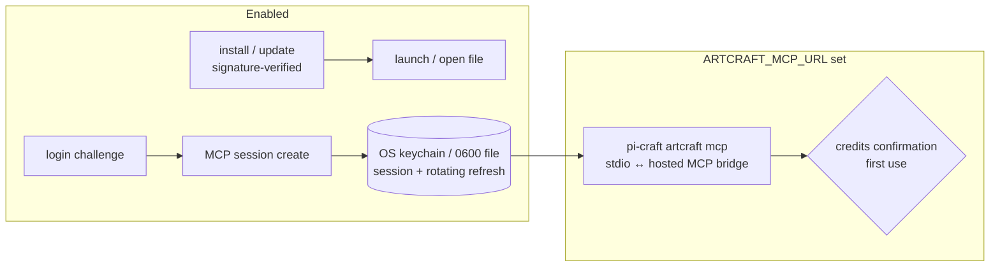

## Context

ArtCraft studio is GUI-only (Tauri). Agent value today = lifecycle management + hand-off; tomorrow = ArtCraft's hosted MCP, whose session API is live but whose transport endpoint is unpublished.

## Decisions

### D1. Integrity without SHA256SUMS
ArtCraft releases have no sums file. Verification = platform code signature with a pinned identity (macOS: `codesign --verify --deep --strict` + `spctl -a -t install`, Team ID pinned in the registry; Windows: Authenticode valid + publisher pinned). Optional per-version SHA-256 pins in the registry for releases we have tested. Unsigned or wrong-identity installers fail closed. Team ID/publisher values are captured in the gating task.

### D2. Session storage: keychain first, vault later
`credential-vault` stores user-entered, user-rotated values and gives plugins read-only access to approved bindings. ArtCraft refresh tokens rotate on every refresh (each refresh invalidates the previous token), requiring atomic machine write-back. v1 uses the OS keychain (macOS Keychain, Windows Credential Manager, libsecret) with a `0600` file fallback under `<pi agent dir>/tools/artcraft/`, written atomically (write-temp + rename) under a file lock so two refreshers cannot both invalidate each other. Follow-up change: vault "machine-rotated account" kind.

### D3. Hosted MCP bridge is flag-gated and confirm-gated
Disabled unless `ARTCRAFT_MCP_URL` is set (no guessing endpoints). The bridge speaks stdio to pi and the hosted transport upstream, injects `Authorization` with the session token, refreshes once on 401 then fails, serialises `tools/call` (same proxy rules as the app servers), and treats remote tool output as untrusted content (no auto-execution of returned instructions; skill states this). First use requires `--accept-credit-use` once per machine (recorded), because calls spend credits.

### D4. Login challenge semantics unverified
The exact flow (browser approval vs code entry) is confirmed in a gating task by reading the desktop app's use of `login_challenge_client`; the CLI shows the URL/code and polls with backoff and a timeout.

## Risks / Trade-offs

- Unpublished API surface may change → feature flag, version-tolerant errors, gating spike against the live endpoint when published.
- ToS: using the session/MCP API from a third-party client → confirm with ArtCraft team before enabling by default; ask on Discord (cheap).
- Linux has no ArtCraft desktop build → `install/launch` report "unsupported on linux"; account + hosted MCP still work.

## Open Questions

- Hosted MCP transport URL, protocol (streamable HTTP vs SSE) and tool catalog.
- Code-signing identities (Team ID / Authenticode publisher) per platform.
- Whether ArtCraft accepts third-party MCP clients (`maybe_mcp_client_vendor` suggests yes).
