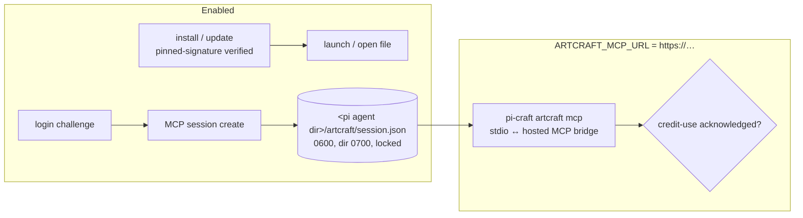

## Context

ArtCraft studio is GUI-only (Tauri). Agent value today = lifecycle management + hand-off. Later = ArtCraft's hosted MCP, whose session API is live but whose transport endpoint is unpublished.

Existing code this builds on (archived `add-craft-apps-core`):
- `packages/craft-apps/src/bin/craft.ts` — dispatch; exit codes `0`/`1`/`69` (`craft.ts:11`, usage `craft.ts:38-44`).
- `packages/craft-apps/src/launcher-install.ts` — the only existing desktop-installer path (`pi-craft launcher install`, SHA256SUMS fail-closed via `provision.ts` `downloadVerified`, which refuses without a sums file — `provision.ts:373-380` — so ArtCraft cannot reuse it).
- `packages/craft-apps/src/mcp-proxy.ts` — stdio framing: one `tools/call` in flight, non-JSON stdout → stderr, SIGINT/SIGTERM → `130`/`143` (`mcp-proxy.ts:256-257`). Bound to a spawned child (`mcp-proxy.ts:235`), so the bridge mirrors its rules rather than reusing it.
- `packages/craft-apps/src/mcp-register.ts` — `serverName` = `craft-<id>` (`mcp-register.ts:35-37`), unconfined refusal (`mcp-register.ts:64`), symlink/malformed-file guards; `registerMcp` takes a registry `CraftApp` (`mcp-register.ts:48`) and writes only `{command,args}` (`mcp-register.ts:99`). Task 3.1 factors out a registry-free entry writer that both paths call.
- `packages/craft-apps/src/provision.ts` — cache root `CRAFT_HOME` else `<pi agent dir>/tools` (`provision.ts:129-133`); Gatekeeper result is advisory for CLI binaries (`provision.ts:638-643`); extraction is zip-oriented on darwin (`ditto -x -k`, `provision.ts:304`) and `assertTreeSafe` rejects every link (`provision.ts:284-296`) — unusable for a signed `.app` tarball.
- `packages/craft-apps/src/registry.ts:12-28` — 13 `APP_IDS`; ArtCraft is deliberately **not** added.

## Decisions

### D0. A subcommand group, not a registry app
`artcraft` is a fixed group `pi-craft artcraft `, dispatched before the `<app>` branch in `craft.ts`. It does not enter `APP_IDS`. That keeps `apps`/`status`/`install <app…>`, the "13 app ids" usage and the CLI-asset/confinement assumptions untouched. `pi-craft install artcraft` stays an unknown-app usage error; its message adds a hint naming `pi-craft artcraft install`.

### D1. Integrity without SHA256SUMS: pinned signature, fail closed
ArtCraft releases have no sums file. This is the second explicit desktop-installer exception to `craft-binary-provisioning` (MODIFIED delta). It lives in its own module, `src/artcraft/`, outside the provisioner's checksum, extraction and cache requirements. The delta says so explicitly. Order: download to staging → verify → optional digest → install → write `install.json`. Any failure deletes the staging files and exits `69`.
- Asset selection (table in `identity.ts`): darwin (any arch) → exactly one release asset ending `.app.tar.gz`; win32/x64 → exactly one ending `.msi`; every other host → exit `69`. Zero or several matches → exit `69`, nothing downloaded.
- macOS: download the `.app.tar.gz` and extract it with `tar -xzf` into staging after listing the entries. Reject absolute paths, `..` segments, hard links, special files, and symlinks that are absolute or resolve outside the `.app`. Relative in-bundle symlinks are allowed, because signed bundles use them (`Frameworks/*/Versions/Current`). Then verify the **extracted `.app`** with `codesign --verify --deep --strict` + `spctl -a -t exec`. The `codesign -dv` `TeamIdentifier` must equal the pinned Team ID. Install = move to `~/Applications/ArtCraft.app` (per user). The `.dmg` is not used (it needs mounting).
- Windows: the `.msi`. Authenticode `Status` must be `Valid` (PowerShell `Get-AuthenticodeSignature`), and the parsed signer certificate subject CN must equal the pinned publisher (not a raw DN string compare). Then `msiexec /i <msi> MSIINSTALLPERUSER=1 ALLUSERS=2 /qn`. Whether the ArtCraft msi honours per-user install is unverified. Gating 0.1 decides it statically and records `windowsPerUser: boolean` in `identity.ts` (no runtime detection). `false` ⇒ Windows `install/update` exit `69` stating per-machine-only installers are not supported.
- Pins live in `src/artcraft/identity.ts`. **No pin for the host ⇒ refuse before downloading (exit `69`), never warn-and-continue.** This is unlike CLI Gatekeeper, which stays advisory. Optional per-version SHA-256 pins are checked when present.
- Install record: `<pi agent dir>/artcraft/install.json` = `{version, path}` written after a verified install. `status`/`launch`/`open`/`update` read it and confirm the path still exists, so there is no per-OS registry or plist probing. `latest` comes from the same 24 h latest-release cache shape as provisioning, filled by `install`/`update`. `status` never queries the network (matches `status.ts` "never touches the network"). Version order = semver after stripping one leading `v`. A non-semver tag makes `update` exit `1`.
- Pin values are captured in gating task 0.1. Task 1.2 may not merge with no pin for either platform.

### D2. Session storage: one 0600 file, one lock
`credential-vault` holds user-entered, user-rotated values. ArtCraft refresh tokens rotate on every refresh, which needs machine write-back. `plugin-credential-store` is a server-plugin API that a standalone CLI cannot reach. OS keychains were rejected for simplicity: the stock CLIs (`security add-generic-password -w`, `cmdkey /pass:`) take the secret as an argument (behaviour per their docs, unverified here), and a keychain still needs an external lock.
- Store: `<pi agent dir>/artcraft/session.json` = `{sessionToken, refreshToken, accountLabel, expiresAt}`; `accountLabel`/`expiresAt` come from the create/refresh responses, and the field names are confirmed in 0.2 (pi agent dir = `PI_CODING_AGENT_DIR` or `~/.pi/agent`). Deliberately independent of `CRAFT_HOME`, which relocates binary caches, not credentials. Directory `0700`, file `0600`, written write-temp + `rename`. An existing dir/file with group/other bits is tightened when owned by the user, and refused (exit `1`, path named) when it is not. An unparseable `session.json` is treated as "no session" (callers name `login`). `login` overwrites it and deletes `ack.json` (a new login may be a different account); logout and rotation-loss are the only other deleters. `artcraft/` and every file in it (`session.json`, `session.lock`, `ack.json`, `install.json`) are refused (exit `1`, path named) when they are or resolve through a symlink, mirroring `mcp-register.ts`'s symlink refusal.
- Single-flight refresh: exclusive lock `session.lock` (O_EXCL create; content = pid + timestamp) held across **re-read → refresh request → write-back**. The refresh request has a 20 s timeout. A lock counts as stale only when it is older than 60 s **and** its pid is not alive (`process.kill(pid, 0)` → ESRCH), so a live slow holder is never stolen from. Waiters poll every 250 ms for at most 90 s, then fail with exit `1` without sending a refresh. A process that acquires the lock re-reads first; if the stored refresh token differs from the one it was about to use, it adopts the stored session and sends no request.
- Transport failure (timeout, connection drop, 5xx): `session.json` is kept unchanged and the call fails. If the server had already rotated the token (a lost response), the next refresh is rejected as invalid and the rotation-loss rule applies. Whether the server has a grace period is unverified.
- Rotation loss: the refresh endpoint rejects the token as invalid (consumed or revoked) → **compare-and-delete** under the lock: delete `session.json` only if it still holds the rejected refresh token, otherwise adopt the stored one. The caller fails naming `pi-craft artcraft login`. No retry loop.
- Logout deletes `session.json` **and** `ack.json`, so the credit acknowledgement never carries over to another account. An offline logout leaves the server session valid until it expires. This is reported, with no retry queue (trade-off).
- Tokens never appear on stdout/stderr/logs or in any child-process argv. Errors carry status + endpoint path only.
- Follow-up: credential-vault "machine-rotated account" kind (task 4.5).

### D3. Hosted MCP bridge: flag-gated, host-pinned, acknowledgement-gated
Disabled unless `ARTCRAFT_MCP_URL` is an `https` URL whose host is `storyteller.ai` or one of its subdomains (the allowlist in `identity.ts`, extendable once 0.3 names the real endpoint). The session token is never sent to an arbitrary host set by a project or shell profile. There is no endpoint guessing and no network traffic when disabled. Upstream transport = the protocol confirmed in 0.3; before 0.3 only a local fake is tested (via an injected allowlist).
- Stdio side mirrors the `mcp-proxy.ts` rules in new code (the proxy is child-bound): one `tools/call` in flight, stdout carries MCP messages only, every diagnostic goes to stderr and is token-free, and SIGINT/SIGTERM exit `130`/`143` without waiting for an in-flight upstream call.
- No bridge-side upstream timeout (long video generations; pi's MCP client timeout governs). Upstream unreachable / 5xx → token-free MCP error for that request, bridge keeps running.
- Injects `Authorization: Bearer <session>`. On 401: refresh once (D2), retry once, else fail the call with an MCP error.
- `tools/call` is blocked locally with an MCP error until `pi-craft artcraft mcp --accept-credit-use` has been recorded (`ack.json`, `0600`, cleared by login and logout).
- Mode matrix for `pi-craft artcraft mcp`: no flag = run the bridge; `--accept-credit-use` = record the acknowledgement and exit `0` (needs neither a session nor the URL flag); `--register` = write the entry and exit. Combining `--accept-credit-use` with `--register` is a usage error (exit `1`). `initialize`/`tools/list` pass through: they spend no credits, and the agent needs the catalog to see what would be gated.
- Remote tool output is untrusted content: relayed verbatim as MCP results, never executed or interpreted by the bridge. The skill says so.
- Registration: `pi-craft artcraft mcp --register` writes the literal entry `craft-artcraft` with args `["artcraft","mcp"]` and `env: {ARTCRAFT_MCP_URL: <validated url>}`, so the spawned bridge sees the flag. It goes through the registry-free entry writer (same symlink, malformed-file, preservation and notice rules). It refuses (exit `1`) when `ARTCRAFT_MCP_URL` is unset or not allowlisted. The confinement policy, `--allow-unconfined` and `--compact` do not apply: the bridge exposes no local file access, and passing those flags is a usage error.

### D4. Login challenge semantics pending gating
Polling: backoff 2 s → 10 s cap; timeout = server challenge expiry when returned, else 10 min. Exact flow (browser approval vs code entry) is confirmed by gating task 0.2 from the desktop app's use of `login_challenge_client`. The spec fixes only observable behaviour: show what to approve, poll with backoff, timeout, store nothing unless the session was created. If 0.2 contradicts this, the spec delta is updated before task 2.2.

## Risks / Trade-offs

- Unpublished API surface may change → feature flag, version-tolerant errors, live test only after 0.3.
- ToS: using the session/MCP API from a third-party client → confirm with the ArtCraft team (0.3) before documenting the bridge as usable.
- Linux has no ArtCraft desktop build → `install/update/launch/open` exit `69` (unsupported host, same class as provisioning); account + hosted MCP still work.
- Host allowlist may block the real endpoint if 0.3 reveals a different domain → `identity.ts` is updated in that change; a misconfigured URL fails closed.
- Session dir ignores `CRAFT_HOME` → two isolated craft caches still share one ArtCraft account; intended.
- File store vs keychain: the token sits at rest in a `0600` file protected only by OS user isolation. Accepted for simplicity and argv safety. The vault follow-up is the upgrade path.
- Signature pinning breaks on a legitimate signer change (new Team ID) → install fails closed until the pin is updated in a release. Acceptable: a silent signer change is exactly what pinning should stop.

## Open Questions

- Hosted MCP transport URL, protocol (streamable HTTP vs SSE) and tool catalog (0.3).
- Code-signing identities per platform (0.1).
- Whether ArtCraft accepts third-party MCP clients (0.3).
