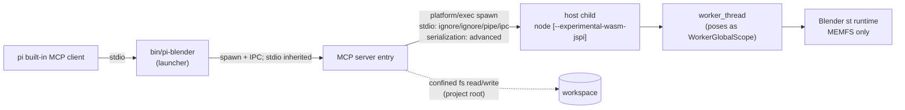

# Design

## Context

See proposal.md for motivation. Everything below comes from current code and the 2026-10-24 spike (`/tmp/blender-spike/`, not committed; evidence files listed at the end).

- **Runtime.** `@knervous/blender-web@0.0.5` publishes two browser runtimes: `runtime/st/` (single-threaded, needs WebAssembly JSPI) and `runtime/mt/` (pthreads). Its `dist/node/` session code exists, but the Node *runtime build* it needs is unpublished (package README, "Node").
  - The pinned tarball is 66,057,129 bytes with 73 entries, all regular files.
  - Its sha512 matches the pin below (verified by download).
- **Session host code.** `dist/browser/index.js`:
  - It statically imports `../project/protocol.generated.js` and `./brotli.js` (`:1-2`).
  - It loads `<runtimeUrl>manifest.json` with `fetch` and accepts it only when `content-type` contains `json` (`:28-36`).
  - With `"encoding": "br"` it loads `brotli-decode.wasm` and the `.br` files; otherwise it fetches the raw files (`:86-105`).
  - It compiles with `WebAssembly.compileStreaming`, which needs `application/wasm` (`:100-103`).
  - `directory()` and `startWorker()` (`:123-129`) read `self.location.href` when `document` is undefined.
  - The session worker URL defaults to `runtimeUrl + "session-worker.js"` (`:214`).
  - Request ids are `String(++nextId)` (`:266`), and a response resolves on the worker's `<<<BW_DONE id>>>` line (`:235-239`).
- **Session worker.** `runtime/session-worker.js`:
  - It loads the glue with `importScripts` (`:175`) and routes `printErr` to `print`, so stdout and stderr are one line stream (`:188`).
  - It matches `<<<BW_DONE id>>>` on every printed line (`:143-147`).
  - Then `finish()` collects and deletes everything under `/out` and posts it to the host; it removes `/job` but never `/in` (`:114-118`).
- **Request protocol.** `dist/project/protocol.py` `handle()`:
  - It runs the job script (`:417`), then writes `/out/geo/*` when `reportGeometry` (default true, `:426`), `/out/session.blend` when asked (`:439`), and always `/out/report.json` (`:443`).
  - On an exception, `report.json` holds `{"error": <traceback>}` (`:479`).
- **Glue.** It picks its environment from `globalThis.process?.versions?.node` and `globalThis.WorkerGlobalScope` (`st/blender.js:72-80`); with `process` present it takes the Node branch, which was not built in. Its socket layer connects through the global `WebSocket` and turns a constructor failure into `ErrnoError` (`st/blender.js:18341-18379`).
- **Published runtime layout.** `runtime/manifest.json` has `"encoding": "br"`. `runtime/st/` holds `.br` files plus `blender.js` and a per-flavour `manifest.json` with `files`/`raw` size and sha256 entries. Upstream `installRuntime` writes expanded files and a top-level manifest **without** `encoding`; the spike booted from that layout.
- **Spike result: the browser `st` runtime runs in Node.**
  - It runs inside a `worker_thread` that deletes `process` and defines `WorkerGlobalScope`, `self`, `location`, `importScripts` (a file read plus `vm.runInThisContext`) and `postMessage`. The parent defines `self`/`location` and replaces `Worker` and `fetch` (a `file://` resolver with per-extension `content-type`).
  - A `node:vm` realm fails ("WebAssembly.Table.set(): Argument 1 is invalid").
- **JSPI by host Node version** (measured):

  | Node | V8 | `WebAssembly.Suspending` |
  |---|---|---|
  | 22.19, 22.22.0, 22.22.3 | 12.4 | absent, even with `--experimental-wasm-jspi` (the flag is accepted) |
  | 24.15 | 13.6 | present only with the flag |
  | 25, 26 | — | not measured |

  An unknown V8 flag exits 9 with `bad option`. Repo `engines`: `>=22.19.0 <27`. CI (`.github/workflows/ci.yml`) runs Node 22 only.
- **Measured cost** (macOS arm64, warm cache):
  - Boot 1.4–1.6 s; requests ~70 ms; RSS 1.2–1.6 GB.
  - After `session.close()` RSS was still ~1.0 GB; a reboot plus one request took ~1.3 s.
- **Formats** (`evidence-p-io.log`, `evidence-p-io2.log`):

  | Format | Status |
  |---|---|
  | GLB, FBX, OBJ (+ `.mtl`), STL, PLY | round trip OK |
  | `.gltf` | export only as `GLTF_SEPARATE` (`.gltf` + `.bin`; `GLTF_EMBEDDED` is not offered) |
  | `.blend` | save and open OK |
  | SVG | import OK |
  | USD, Alembic, X3D | operators absent |
  | Render engines | EEVEE only |

  Missing: OpenSubdiv, Draco, meshopt, `ctypes`, `_multiprocessing`.
- **Sandbox surface:**
  - The filesystem is MEMFS only.
  - There are no `js` or `emscripten` modules, and no `ctypes`.
  - `subprocess` raises `OSError`.
  - **With `WebSocket` present, a Python `socket.connect` to a local port reported success** (`evidence-socket-with-websocket.log`). With `WebSocket` deleted in the worker it raises `OSError: [Errno 23]` (`evidence-socket-no-websocket.log`).
  - A blocking HTTP request with `WebSocket` present made the worker `fatal` (`evidence-p-http.log`).
  - `os.abort()` makes the session fail with "Blender aborted: native code called abort()" (`evidence-abort.log`).
- **House patterns:**
  - `packages/craft-apps`: launcher `bin/pi-craft` (prefers `src` + tsx in a checkout, else `dist`).
  - Cache root `CRAFT_HOME`, else `<PI_CODING_AGENT_DIR or ~/.pi/agent>/tools` (`src/provision.ts:134-139`).
  - `singleFlight` plus `commitTree` (`:497-520`) and `sweepStaleStaging` (`:575`).
  - Registration (`src/mcp-register.ts`): `{command: execPath, args}` (`:96-99`); symlink refusal (`:70-75`); non-object `mcpServers` refusal (`:90-93`); notes (`:109-111`); project-root warning (`:77`, `:122`).
  - Multi-file commit with rollback: `commitOutputs` (`src/region-replace.ts:467`).
  - Line-framed JSON-RPC (`src/mcp-proxy.ts`).
  - Subprocesses only through `pi-dashboard-shared/platform/exec.js` `spawn` (`packages/shared/src/platform/exec.ts:207`). Own children are signalled with `ChildProcess#kill` (allowed by `no-direct-process-kill.test.ts`; precedent `mcp-proxy.ts:254`).
  - pi's MCP client truncates the middle of text results over ~20 KB (pi docs `mcp.md`).

## Goals / Non-Goals

**Goals:**
- No native Blender. The runtime arrives on first use.
- Agent Python reaches host files only through confined staging and collection, and reaches no network.
- A wedged, crashed, idle or orphaned Blender returns all its memory, and the MCP server survives anything agent code does.
- Hosts without JSPI fail fast with one actionable message and never download.

**Non-Goals:**
- Rendering, the pthread flavour, the Blender UI, a dashboard viewer, a native fallback.
- Rebuilding or attesting the upstream wasm.
- Concurrent sessions per server, or scene sharing across pi sessions.
- Multi-file assets through `blender_import` (use `blender_python` + `inputs`).
- Automatic eviction of superseded cached versions.

## Decisions

### D1. Three-level process tree: launcher → MCP server → disposable Blender host

- **Launcher:** spawns the server entry with an IPC channel. The server and the host each exit on IPC `disconnect`, so killing any ancestor, even with SIGKILL, tears down the descendants.
- **Server:** owns MCP framing, validation, confinement, input reads (at dequeue), output re-checks and commits, the queue, timeouts and idle shutdown.
- **Host:** receives `{op, args, files, nonce}` over IPC and returns `{ok, code?, result, files, output}`. It never sees a workspace path. Blender runs on its worker thread, so the host main thread stays responsive (IPC `disconnect`, kill) even while agent code loops.
- **Host main thread, before importing the session module:**
  - `self = globalThis`; `location` = a `file://` URL inside the runtime dir.
  - `fetch` = a resolver confined to the runtime dir (`content-type`: `.json` → `application/json`, `.wasm` → `application/wasm`, else `application/octet-stream`; plus `content-length`).
  - `Worker` = a worker_thread wrapper (`resourceLimits.maxOldGenerationSizeMb: 4096`) watching `error`/`exit`.
  - `WebSocket`, `EventSource`, `XMLHttpRequest` and `WebSocketStream` are deleted.
  - Then `createBlenderSession({ runtimeUrl: <absolute file:// runtime dir URL ending "/">, threads: false })`.
- **Worker bootstrap:**
  - Deletes `process`; defines `WorkerGlobalScope`, `self`, `location`, `importScripts` (reads confined to the runtime dir) and `postMessage`.
  - `fetch` rejects; `WebSocket`, `EventSource`, `XMLHttpRequest` and `WebSocketStream` are deleted **before the glue loads**. That makes every Python socket connect fail with `OSError` (measured).
- **Host exits non-zero** on worker `error`/`exit`, session `fatal`/abort, a rejected request, or a corrupt response (D4).
- Rationale: in-process `close()` keeps ~1 GB. Only a process kill reliably frees memory, ends a wedged JSPI call and contains an OOM or abort.

### D2. JSPI probe before any provisioning; entry resolution

- **Entry resolution** follows `bin/pi-craft`: in a checkout (`src/` present and `tsx` resolvable), `--import tsx src/...ts`; otherwise `dist/...js`. That applies to the server entry and to the host (`src/host/host.ts` | `dist/host.js`). V8 flags always come before `--import`.
- **Host `--probe`** prints `{"jspi": boolean, "node": process.version}` without the runtime.
- **The supervisor probes once per process:**
  1. Without the flag → `native` when JSPI is present.
  2. Else with `--experimental-wasm-jspi` → `flag`.
  3. Exit 9 / `bad option` or still absent → `unavailable`.
- On `unavailable`, Blender tool calls fail with `jspi-unavailable` (naming `process.version` and "Node 24 or newer") and `ensure` exits 69. There is no network I/O.
- Feature gating covers Node 25/26 either way.

### D3. Runtime provisioning pinned in source; committed layout is upstream `installRuntime`'s st-only shape

- **Pin:** `{name: "@knervous/blender-web", version: "0.0.5", bytes: 66057129, integrity: "sha512-2zvq0fCeoqEe7usry4k7hwgD7xc7gWHvzNq29vnk0VXL6PEaa+CoSiA95by1Z5P7BHwJUYtyXGHaY/j+4rv+rg==", tarball: "https://registry.npmjs.org/@knervous/blender-web/-/blender-web-0.0.5.tgz"}`. No registry metadata is read at run time.
- **Cache root:** `BLENDER_WASM_HOME`, else `<PI_CODING_AGENT_DIR or ~/.pi/agent>/tools/blender-wasm` (user-confirmed). Each version lives at `<root>/<version>/`.
- **Staging and races:**
  - Staging lives in `<root>/.staging-<pid>-<rand>/`. Each run sweeps `.staging-*` older than 1 hour.
  - In-process `singleFlight`; cross-process `commitTree` semantics (reuse a valid winner). A loser removes its own staging.
- **Download budget:** 600 s overall, 60 s without bytes, and the body must not exceed the pinned `bytes` → `download-failed`.
- **Pipeline:**
  1. Stream to staging, computing sha512 → `integrity-mismatch` (file deleted).
  2. List the gunzipped tar first. Accept regular files, directory entries and PAX/GNU metadata headers (`x`, `g`, `L`). Abort `unsafe-archive` on absolute paths, `..`, symlinks, hardlinks, device/FIFO entries or more than 500 entries.
  3. Extract the allowlist: `package/dist/browser/{index.js,brotli.js}`, `package/dist/project/*.js` (no `.map`/`.d.ts`) and `protocol.py`, `package/runtime/session-worker.js`, `package/runtime/st/{blender.js,blender.wasm.br,blender.data.br,manifest.json}`, `package/{LICENSE,THIRD-PARTY-LICENSES.md,package.json}`.
  4. Expand both `.br` files with `node:zlib` and check against `st/manifest.json` `raw` (bytes + sha256) → `runtime-manifest-mismatch`. Delete the `.br` files.
  5. Write `runtime/manifest.json` = `{forkRevision, flavors: {st}}` with **no** `encoding`.
  6. Write the stamp `.blender-wasm.json` = `{version, integrity, files: {<relpath>: {bytes, sha256}} for every committed file}` last, then commit.
- **Required files** (cache validity and override check, in this order): `package.json`, `runtime/manifest.json`, `runtime/session-worker.js`, `runtime/st/blender.js`, `runtime/st/blender.wasm`, `runtime/st/blender.data`, `runtime/st/manifest.json`, `dist/browser/index.js`, `dist/browser/brotli.js`, `dist/project/protocol.generated.js`. (`package.json` carries `"type": "module"`, which the ESM session files rely on.)
- **Cache validity:** the stamp matches the pin, and every stamped file exists with its stamped size. Sha256 is checked at provisioning and on repair.
- **Repair:** after a `boot-failed` on a downloaded copy, re-hash **every** stamped file. On any mismatch, delete `<root>/<version>/`, so the next call re-provisions.
- **Override:** `BLENDER_WASM_DIR` must hold the committed layout without the stamp. `override-invalid` names the first missing required file. It is never re-hashed or deleted. `licence` = the `license` field of its `package.json`, or `unknown`.
- **Alternatives:**
  - `.br` + `brotli-decode.wasm`: ~175 MB of wasm brotli decoding per boot.
  - Upstream `installRuntime`: both flavours.
  - Importing craft-apps: couples us to 13 apps (see Risks).

### D4. Tool surface, result encoding and the job wrapper

**Result encoding.**
- `content[0]` is a text block holding JSON `{sessionReset, durationMs, ...result}` on success, or `{code, message, sessionReset, durationMs}` with `isError: true`.
- When an op produced printed output, `content[1]` (last) is a text block holding it: the **last** 16 KiB (tracebacks sit at the end), with `outputTruncated` in `content[0]`. That keeps results under pi's ~20 KB truncation.

**Envelope fields.**
- `durationMs` runs from the moment the call leaves the queue to its result, including any probe, provisioning or boot it triggered.
- `sessionReset` is true on the first result after a live session was lost (timeout, crash, cancel, idle, repair), whether that result succeeds or fails. It is false otherwise, including on the first boot.

**Common rules.**
- Every tool accepts optional `timeoutSec` (1–600, default 120).
- Unknown tool names, schema violations and a non-regular-file import path → `invalid-arguments`.

| Tool | Input | Result |
|---|---|---|
| `blender_python` | `code` (≤ 1 MiB), optional `inputs[]`, optional `outputDir` (default `blender-out`) | `outputs[]` |
| `blender_scene` | optional `limit` (1–1000, default 200) | Blender + runtime version, `total`, `truncated`; up to `limit` objects with name, type, parent, location, rotation, scale, dimensions, material names, mesh vertex/face counts |
| `blender_import` | `path` (`.glb .gltf .fbx .obj .stl .ply .svg .blend`) | imported object names; `.blend` replaces the scene via the protocol's `load: {kind: "blend"}` |
| `blender_export` | `path` (`.glb .gltf .fbx .obj .stl .ply .blend`), optional `selectedOnly` (rejected for `.blend`) | `files[]` (target + sidecars, e.g. `.mtl`, `.bin`) with sizes |
| `blender_reset` | optional `mode` (`factory`, `empty`) | — |

**Job wrapper.** Every request sends `reportGeometry: false` and a fresh random `nonce`. The host wraps the op in Python:
1. Inputs are staged at `/in/<root-relative path>`.
2. Prologue: remove any leftover `/x`.
3. The op runs. Python code writes to `/out/`. Export writes into `/x/`.
4. Epilogue on success:
   - for export, move `/x/*` → `/out/u/`, refusing a name collision with `export-failed`; for python, move `/out/*` → `/out/u/`;
   - sum the sizes; over the output limit → delete `/out/u`;
   - write the status file `/out/.status-<nonce>.json` = `{ok | limit}`.
5. `finally`: remove `/in` and `/x`.

**Host response validation.**
- A response lacking `report.json` or the nonce status file is corrupt. It comes from agent output that mimicked `<<<BW_DONE id>>>` (agent code can print anything, but cannot know the nonce). The host kills the session and exits; the call fails `session-crashed`.
- `report.json` `error` → `python-error`, `import-failed` or `export-failed` with the traceback. Status `limit` → `limit-exceeded`.
- The host **re-sums** the returned `/out/u/**` bytes and refuses (`limit-exceeded`) before posting over IPC, because the in-session check runs beside agent code and can be tampered with.
- Only `/out/u/**` is returned. `report.json`, `geo/`, `session.blend` and the status file never are.

**Format rules.**
- `.gltf` import with a non-`data:` buffer or image URI → `unsupported-format`. The `blender_export` description warns that its own `.gltf` output must be re-imported through `blender_python` + `inputs`.
- Extensions are case-insensitive; anything else → `unsupported-format`.
- Tool descriptions state the build limits.

### D5. Confinement, limits and commits

- **Root:** server cwd, or `--root`. It must exist and be a directory, otherwise the server prints an error and exits 1 at start. It is realpath-resolved.
- **Path checks, in order:**
  1. Relative only.
  2. Realpath containment, or the nearest existing ancestor with no symlink among the components to be created (`path-outside-root`).
  3. Existence (`input-not-found`).
  4. A regular file for inputs and imports (`invalid-arguments`).
- **Limits:**
  - At most 64 input files and 256 MiB of inputs, read at dequeue.
  - 1 MiB of code.
  - 512 MiB of outputs, checked in the session, re-checked by the host before IPC and re-checked by the server before commit.
  - Queue depth 32 → `limit-exceeded`.
  - `BLENDER_WASM_MAX_{INPUT,OUTPUT}_MB` may only lower the byte limits.
- **Commit** (all-or-nothing, mirroring `commitOutputs`):
  1. Normalise and confine every key first.
  2. Write temp siblings.
  3. Move existing targets to backups, then rename the temps in.
  4. On failure: remove the renamed-in files, restore the backups, remove the created directories.
  5. Delete the backups after success.

### D6. Session lifecycle

- **Lazy:** no probe, provisioning or boot before the first Blender tool call.
- **First-call order:** probe → provision (`provision-failed` + D3 code) → spawn and boot (120 s → `boot-failed` + repair). `timeoutSec` covers only the op.
- **Queue:** FIFO, one in flight, depth ≤ 32. Cancelling a queued call drops it and sends no response. Cancelling the in-flight call kills the host and sends no response.
- **Timeout:** kill → `timeout`.
- **Crash during a call:** `session-crashed` with the last 20 stderr lines.
- **Idle:** `BLENDER_WASM_IDLE_SEC` (default 600), armed only while the queue is empty and nothing is in flight.
- **Server stdin end, SIGINT or SIGTERM:** kill the host, then exit. Ancestor death → the IPC-disconnect exits (D1).
- Kill = `ChildProcess#kill("SIGKILL")`.
- **First-use latency:** a cold first call can take minutes (download + boot), so registration notes and the skill recommend running `pi-blender ensure` first.

### D7. CLI, registration, skill

- `bin/pi-blender` exit codes: `0` ok or `--help`; `1` usage or register failure; `69` provisioning or JSPI failure.
- **Subcommands:** `ensure [--json]` (probe → provision), `status [--json]` (cache, every cached version, probe; never downloads), `mcp [--root]`, `mcp --register [--root]`.
- **Registration** follows `craft-apps/src/mcp-register.ts` with one deliberate difference: it **merges** into an existing `blender-wasm` entry, replacing only `command` and `args` and keeping every other key (`enabled`, `env`, `cwd`, exposure settings). pi's rule that a disabled server stays disabled (`mcp-client-config`) therefore holds.
  - `args` = `[<absolute launcher>, "mcp", ("--root", <absolute realpath>)?]`.
  - It refuses a symlinked `.pi`/`mcp.json`, invalid JSON, a non-object root and a non-object `mcpServers` (byte-identical, exit 1).
  - Atomic temp + rename.
  - It prints the notes, warns without `.git`/`.pi/`, and suggests running `pi-blender ensure`.
- The skill content is listed in the CLI spec.

### D8. MCP protocol implementation

- A hand-rolled newline-delimited JSON-RPC 2.0 server, framed like `craft-apps/src/mcp-proxy.ts`.
- **Methods:** `initialize` (negotiates `2024-11-05`, `2025-03-26`, `2025-06-18`; unknown → latest), `notifications/initialized`, `ping`, `tools/list`, `tools/call`, `notifications/cancelled`. Anything else → `-32601`; bad JSON → `-32700`.
- **Tool codes:** `invalid-arguments`, `jspi-unavailable`, `provision-failed`, `boot-failed`, `path-outside-root`, `input-not-found`, `unsupported-format`, `limit-exceeded`, `python-error`, `import-failed`, `export-failed`, `timeout`, `session-crashed`.
- Alternative: `@modelcontextprotocol/sdk`. That is a new runtime dependency with no repo precedent.

### D9. Test strategy for runtime-dependent behaviour

- **Fakes:** unit tests use a fake host or supervisor and run anywhere.
- **Real-runtime suites** run only when `BLENDER_WASM_E2E=1` **and** the D2 probe is not `unavailable`; otherwise they skip with the reason. They use a fixed test cache `BLENDER_WASM_HOME=<os tmp>/pi-blender-wasm-test-cache` (outside the per-file temp HOME, so it downloads once per machine) and a 300 s test timeout.
- **CI:** a Node 24 job matrix over `ubuntu-latest`, `macos-latest` and `windows-latest` (user decision) sets `BLENDER_WASM_E2E=1` and caches that dir keyed by OS and pin integrity. The same suites assert the performance budget: warm boot ≤ 15 s, `blender_scene` ≤ 2 s, host RSS ≤ 2.5 GB, read from the host pid. Kill-latency assertions use `timeoutSec + 5 s` for the result and 5 s for host exit (user decision).
- **Socket guard:** `NODE_OPTIONS=--require <socket-guard>` (inherited by the server and host processes) wraps `net.Server.prototype.listen`, `net.Socket.prototype.connect`, `dgram.createSocket` and `globalThis.WebSocket` and logs calls to a file. The no-listener and no-outbound scenarios run the e2e under the guard, plus a local listener that must see no connection.
- **Crash trigger:** `os.abort()` (measured to abort the session).

## Risks / Trade-offs

- **Upstream is v0.0.x, single maintainer, `-dirty` fork revision.** → Integrity pin, README trust statement, native fallback deferred.
- **Mirroring craft's commit logic instead of sharing it** (~60 lines). → Accepted; extraction is a follow-up.
- **~1.2–1.6 GB per live session, ~175 MB of cache per version, no automatic eviction.** → Child process plus idle shutdown; `status` lists versions; the README documents manual cleanup.
- **Agent Python can crash its own session** (abort, OOM; the worker heap is capped, wasm memory is not). → `session-crashed`; the server survives.
- **Agent output mimicking protocol markers can end its own call early.** → Detected through the missing nonce status, then reported as `session-crashed`; it never produces a false success.
- **Symlink race from a concurrent bash process.** → Same exposure as craft; accepted.
- **`blender_wasm` vs `blender-wasm` name normalisation in pi.** → Documented; registration only touches `blender-wasm`.
- **GPL runtime** (`GPL-3.0-or-later` per npm metadata and README; Blender sources GPL-2.0-or-later). → Fetched on demand, never redistributed.
- **Electron-hosted pi records an Electron binary as `process.execPath`.** → Same as craft; manual check (task 6.5).
- **Missing OpenSubdiv silently disables Subsurf.** → Tool descriptions and the skill.

## Migration Plan

New package only. Publish, then add the optional recommended-extensions entry; users opt in with `pi-blender mcp --register`. Rollback: deprecate the package, delete the `blender-wasm` entry and `<agent dir>/tools/blender-wasm/`. No server, client or protocol code changes.

## Spike evidence

`/tmp/blender-spike/` (2026-10-24):

| Script / file | Shows |
|---|---|
| `node-host.mjs` + `node-worker-boot.cjs` | Node path over HTTP |
| `node-host-file.mjs` + `node-worker-boot-file.cjs` | `file://` path; RSS after close and reboot |
| `node-host-nows.mjs` + `node-worker-boot-nows.cjs` | worker with network globals deleted |
| `evidence-socket-with-websocket.log`, `evidence-socket-no-websocket.log` | outbound connect possible with `WebSocket`, `OSError` without |
| `evidence-p-http.log`, `evidence-abort.log` | `fatal` paths |
| `evidence-p-io.log`, `evidence-p-io2.log` | formats, sidecars, engines |
| `pin.tgz` | pinned tarball: size, sha512, entry list |
| `www/apps/craft-blender/blender-runtime/` | bootable layout (no `encoding`) |
