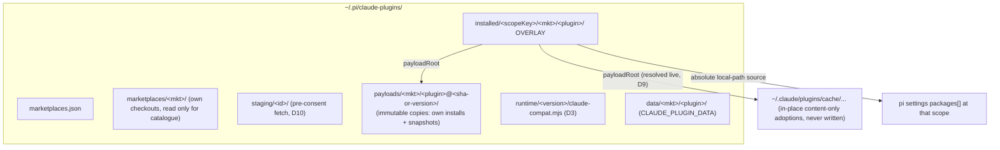

# Design

## Context

See proposal.md (Why). The current state that constrains the approach.

**Claude plugins on disk.** Census of `~/.claude/plugins/` (2026-10-24):
- 348 catalogue entries. Plugin `source` shapes: relative path 86, `url` 164, `git-subdir` 98.
  - `github` occurs 0 times as a *plugin* source, but it is the source shape of all 5 *marketplaces* in `known_marketplaces.json`.
- Marketplace entries declare components inline, with or without `strict: false`:
  - `lspServers` in 13 entries;
  - `skills` at custom paths in 4 entries (e.g. `box` has inline `skills` and no `strict` key);
  - `strict: false` in 15 entries.
- `source: "./"` (the marketplace root) occurs.
- `plugin.json` `userConfig` occurs in 2 plugins.
- `.mcp.json` comes in two shapes:
  - flat `{name: cfg}` (9) or wrapped `{mcpServers: {...}}` (5);
  - some entries are `type: "http"`, with a URL and no command.
  - `${VAR}` expansion is used, e.g. `${GITHUB_PERSONAL_ACCESS_TOKEN}`.
- Variable usage: `${CLAUDE_PLUGIN_ROOT}` 482, `CLAUDE_ENV_FILE` 42, `CLAUDE_PROJECT_DIR` 32, `CLAUDE_SKILL_DIR` 10, `CLAUDE_PLUGIN_DATA` 8.
  - 5 commands use `` !`cmd` ``.
  - 12 `SKILL.md` files reference `${CLAUDE_PLUGIN_ROOT}` (scripts shipped with the plugin).
- Hooks are all `type: "command"`:
  - timeouts are given in seconds (5–180);
  - `SessionStart` matchers are session sources (`startup|clear|compact`);
  - some `PreToolUse` hooks have no matcher, which means match-all (hookify);
  - hooks call external interpreters (`python3`, `node`, `bun`).
- Names: 13 plugin names occur in more than one marketplace. Skill names repeat across plugins (`configure` ×3, `access` ×3), and so do agent names (`code-reviewer` ×2). Agents reference each other plugin-qualified, e.g. `claude-security:scan-verifier`.
- Claude's installed list, `installed_plugins.json` (v2), has entries `{scope: user|project, projectPath?, installPath, version}`. `installPath` is version-specific: `cache/<mkt>/<plugin>/<version>`.
- At least one hook writes under Claude's plugin directory through a hard-coded path: claude-mem `scripts/smart-install.js:13-14,318`.

**pi SDK** (`dist/core/extensions/types.d.ts`, `dist/core/agent-session.js`):
- `resources_discover` returns `{skillPaths, promptPaths, themePaths}` (`types.d.ts:558`).
- Prompt flow (`agent-session.js:1636-1660, 1932-1937`):
  - extension commands run **before** the `input` event;
  - `pi.sendUserMessage` delivers with `source: "extension"`;
  - the dashboard bridge sends every dashboard prompt through `sendUserMessage` (`packages/extension/src/bridge.ts:1569`).
- `input` returns only `continue | transform | handled` (`:922-930`).
- `before_agent_start` may return a `message` (`CustomMessage`) for this run (`:1125`).
- `tool_call` returns `{block, reason}`; input is modified by mutating `event.input` (`:1089`).
- `ctx.ui.notify(message, type)` exists (`:80`).
- `session_start.reason` is `startup|reload|new|resume|fork` (`:578`). `session_compact` exists (`:614`).
- `agent_settled` fires once per prompt. `agent_end` can fire several times.
- `RegisteredCommand` has `description`, `getArgumentCompletions` and `handler`; there is no argument-hint field (`:1171`).
- `registerMcpServer` throws for a name another extension registered, and a `mcp.json` entry wins (`:1380-1383`).
- Async extension factories are awaited (`docs/extensions.md:56`).
- pi creates a **separate API object per extension** (`dist/core/extensions/loader.js:513-516`).
- `installAndPersist` stores local-path packages **relative** to the scope's settings directory (`dist/core/package-manager.js:1160-1168`).
- The bridge expands dashboard `/skill:` and template prompts itself, before `input` (`packages/extension/src/bridge.ts:1562-1569`). Dashboard follow-ups typed while streaming go into the bridge-owned buffer (mid-turn-prompt-queue spec).

**pi skills.** The system prompt lists name, description and path. The model reads `SKILL.md` with `read`. `/skill:name` injects the body explicitly (`docs/skills.md:43-45`).

**Subagents** (`pi-dashboard-subagents/extensions/agent.ts`):
- Tier order is project > user > bundled > package.
- The package tier covers user-scope packages only. Between packages, the first source in sort order wins, silently (`:200-262`).
- `tools` is honoured only as a non-empty array (`:375-378`), and is intersected with the active tool set (`:1108`).
- `Agent` is always stripped from children (`:1103`).
- `@role` models need a `model:resolve` handler; without one the spawn errors (`:704-712`).

**Dashboard.**
- The resource scanner takes skills from pi's resolver only (`openspec/specs/pi-resource-scanning/spec.md:276-280`), and lists package agents at both scopes (`:233-236`).
- `POST /api/packages/move` and `/api/packages/cleanup` act on any source (package-management, package-health specs).

## Goals / Non-Goals

**Goals:**
- One import pipeline for own-store and adopted plugins.
- Upstream plugin files are never modified by the dashboard.
- Each install (plugin × scope) is independent.
- At most one active instance of a plugin per pi session.
- No dashboard operation writes under `~/.claude/plugins`, and no root handed to plugin code points there unless the plugin is pure content.

**Non-Goals:**
- Byte-exact Claude Code behaviour: the `Stop` "block = keep going" loop, transcript format parity, `PermissionRequest`.
- Enforcing a command's `allowed-tools` for its turn. It is shown in the consent dialog only.
- Policing third-party code that hard-codes absolute paths.
- Project-scope subagent discovery in `pi-dashboard-subagents` (follow-up change).
- `plugin.json` `userConfig` prompting. Plugins with required `userConfig` are unsupported.
- **pi-specific hook events (follow-up change).** Only Claude's own event keys are accepted (D7); other keys are recorded unsupported. Deferred items:
  - `pi:*` keys mapped to pi events Claude lacks;
  - `bus:<channel>` keys on the notify-only `pi.events`;
  - `claude-compat` emitting its own bus events;
  - exposing dashboard-level hooks.

  Notify-only variants can reuse the D7 runner and stdin protocol. Blockable variants would extend the protocol.

## Decisions

### D1: Store layout, with one overlay per install



- **`scopeKey`** is `global`, or `project-<first 12 hex of sha256(realpath(cwd))>`. `claude-import.json` also records `projectPath` in plain text, for display and for GC (D11).
- **Payloads are immutable copies.** That holds for every own-store install, including relative-source plugins (copied out of the marketplace checkout at the checkout's commit) and local-directory marketplaces. Marketplace refresh or removal therefore never changes an installed plugin.
- **The overlay is the pi package.** It contains:
  - `package.json` (`name: "claude--<mkt>--<plugin>--<scopeKey>"`, unique per install so package-health never groups a global and a local install as duplicates; `pi.extensions: ["./extension.mjs"]`);
  - `extension.mjs` (D3);
  - `agents/` (D4);
  - `claude-import.json`: provenance, `payloadRoot`, resolved component paths (D8), classification, warnings, `projectPath`.
- **Settings entries.** pi stores the overlay path **relative** to the scope's settings directory. The dashboard always resolves an entry against that directory before delegation or GC. A local install therefore adds a machine-specific entry to the project's `.pi/settings.json`; the consent dialog says so.
- **Payloads** are reference-counted by overlays and deleted when unreferenced. Adopted in-place payloads are never deleted.
- **`data/<mkt>/<plugin>/`** is shared by all installs of a plugin, as in Claude, which keys data per plugin. It is deleted when the last install is removed. Install independence therefore covers plugin files and generated files, but not plugin data (trade-off).
- **Cross-marketplace refusal.** Installing plugin `x` from marketplace B is refused while `x` from marketplace A is installed at an overlapping scope (same scope, or global vs any local). This prevents MCP-name and command-namespace collisions between same-named plugins. It does **not** prevent skill or agent name collisions between *different* plugins; those are detected and shown (D4).

### D2: Skills and variables resolved at runtime

- **Skills.** `claude-compat` answers `resources_discover` with absolute `skillPaths` inside `payloadRoot`, for the winning install only (D3). The **dashboard resource scanner** also reads each overlay's `claude-import.json`, so imported skills appear in the Resources view under the overlay package (`pi-resource-scanning` MODIFIED).
- **`read` results.** `tool_result` for `read` substitutes `${CLAUDE_PLUGIN_ROOT}` and `${CLAUDE_SKILL_DIR}` when the realpath of the target is inside the owning plugin's realpath `payloadRoot`.
- **`/skill:<name>`** for an imported skill:
  - typed in the TUI, the raw command is handled in `input`: the body is loaded, substituted, and returned as `transform`;
  - sent from the dashboard, the bridge has already expanded it into a `<skill location="…">` block. `input` substitutes inside blocks whose location is under an active plugin's `payloadRoot`.
- **Resources view.** Imported skills appear as **read-only rows** labelled "managed by Claude plugin `<x>`", with no toggle (user decision; `pi-resources-view` MODIFIED). They are reported enabled exactly when that install is the active one.
- **Child processes** (hooks, inline `!`, MCP stdio) get the variables as env vars. Content reached through `bash cat` is not substituted; this is a trade-off, since the model normally works from the substituted `SKILL.md`.

### D3: Runtime copied into the store; the stub fails closed and visibly

- At boot the server copies the bundled `packages/claude-compat` runtime (a single ESM file) to `runtime/<version>/claude-compat.mjs`. Overlays import it through `pathToFileURL`, never from the install location. This is safe under Electron `asar`, Windows, and npm-global upgrades.
- The stub is an async factory, which pi awaits:
  ```js
  import { pathToFileURL } from "node:url";
  export default async function (pi) {
    try {
      const m = await import(pathToFileURL("<store>/runtime/<version>/claude-compat.mjs").href);
      return m.registerClaudePlugin(pi, { overlayRoot: "<overlay abs path>" });
    } catch (e) {
      pi.on("session_start", (_ev, ctx) =>
        ctx.ui.notify("Claude plugin <mkt>/<plugin>: runtime unavailable", "error"));
    }
  }
  ```
- At boot, stubs are re-stamped to the newest runtime. Old runtime versions are deleted only when no stub references them. `doctor` reports stubs whose runtime file is missing.
- **Module caching and the per-session registry.** Native `import()` is cached for the whole process, subagent child sessions share that process, and pi gives **each extension its own API object**. The runtime therefore keys its registry by **session id**, read from `ctx` in `session_start`.
  - Every stub records its plugin identity and scope there.
  - The **election** (local wins over global) happens in the first `resources_discover` handler, which runs after every extension's `session_start` (spike 1.4 confirms the order).
  - Only the winning stub registers anything; losers register nothing.
  - Entries are dropped on `session_shutdown`.
- **Registration order is fail-closed.** The winner registers hooks first, then skills, then MCP servers, then commands. The first failure stops all later steps, and one notification names the plugin. MCP servers registered before a failure are unregistered.
- **Reload limitation.** `/reload` does not pick up a re-stamped runtime within the same process. A new runtime takes effect for new processes. This is accepted and documented.

### D4: Agents translated into the overlay

| Claude frontmatter | Overlay output |
|---|---|
| `tools` (string or list) | non-empty YAML list of mapped pi names |
| some names unmappable | dropped; warning; shown per agent in the consent dialog |
| **all** declared names unmappable | **agent not imported** (`no-mappable-tools`) |
| `tools` absent | absent; consent: "inherits the parent's tools (except spawning subagents)" |
| `model: sonnet / opus / haiku` | always `@coding / @planning / @fast`, resolved live at spawn (user decision). Unassigned at spawn → the harness errors, naming the role. The consent dialog warns if a role is unassigned at install time |
| `model: inherit`, absent, or any other value | omitted; a non-alias value adds a warning |
| `skills` (agent-scoped skills) | dropped, with warning |
| body `${CLAUDE_PLUGIN_ROOT}` | substituted with `payloadRoot`; regenerated whenever `payloadRoot` changes (update, or D9 live resolution) |

- **Tool alias table** (shared by agents, `allowed-tools` and hook matchers):

  | Claude | pi |
  |---|---|
  | Bash | bash |
  | Read | read |
  | Edit, MultiEdit | edit |
  | Write | write |
  | Grep | grep |
  | Glob | find |
  | LS | ls |
  | AskUserQuestion | ask_user |
  | WebFetch, WebSearch | the fixed tool names of the dashboard web-access tools; tools inactive at spawn are removed by the harness |
  | Task / `Agent(...)` | dropped (children cannot spawn) |
  | any scoped form, e.g. `Bash(git:*)`, `Read(path)` | dropped with a warning; it is never widened to the bare tool |
  | TodoWrite, NotebookEdit, Skill | dropped |

  Spike 1.3 checks whether `grep`/`find`/`ls` exist in subagent sessions. If they don't, those three map to `bash`.
- **Names.** Agent files keep the Claude agent name, so plugin prompts that use unqualified names still work. Plugin-qualified references (`plugin:agent`) are not rewritten; that limitation is listed in warnings when the plugin's text contains them.
- **Collisions.** At consent and in details, the dashboard lists every agent and skill whose name collides with another installed package's agent or skill (`shadowed by <package>`). It also lists agents shadowed by a user or bundled agent. Project-tier shadowing is computed for the scope being viewed.
- **Local scope.** At local scope, agents are never resolvable (the package tier is user-only). A plugin whose only supported components are agents is therefore **not installable at local scope**; the dialog offers global instead.

### D5: Commands registered by `claude-compat`

- **Registration.** Each command is registered with `pi.registerCommand`, each call wrapped in try/catch: a failed registration yields one warning and never fails the plugin. The description is `"<description> <argument-hint>"`.
- **Names.** `/<plugin>:<command>` is always registered. A bare `/<command>` alias is added when no other active imported plugin in the **same session** has that name. The decision uses the per-`pi` registry (D3).
- **Handler:**
  1. Run `UserPromptSubmit` hooks on the raw `/<command> args` text (D7). Commands bypass `input`, so this is the only place they run for commands.
  2. Expand the body:
     - `` !`cmd` `` in the **template body**: session cwd, 30 s timeout, failure note;
     - `@path` in the body: realpath inside the realpath of cwd or `payloadRoot`;
     - `${CLAUDE_*}`;
     - finally `$ARGUMENTS` / `$n`, literally and never re-scanned.
  3. When idle, send with `pi.sendUserMessage` as a fresh turn. While the agent is streaming, **hand the text to the bridge** on the `pi.events` follow-up handoff channel (user decision; `mid-turn-prompt-queue` ADDED). The bridge buffers it like a dashboard-typed follow-up: visible, editable, drained in order on `agent_settled`. When no bridge is present (handoff unacknowledged within 200 ms), the command is refused with a notification to run it when the agent is idle.
  4. Record the sent text in the per-`pi` "self-sent" set, so the `input` handler skips it.
- Frontmatter `model` is mapped as in D4 for that turn.

### D6: MCP

- Both `.mcp.json` shapes are accepted, plus inline `mcpServers` in `plugin.json` or the marketplace entry. stdio and http/sse entries are both supported.
- Expanded variables: `${CLAUDE_*}`, `${VAR}`, `${VAR:-default}`. A missing variable without a default means the server is not connected, with a warning `missing-env:<VAR>`.
- The server name is `<plugin>__<server>`.
- **The consent dialog lists**:
  - for stdio: the command and args;
  - for http: the URL;
  - every environment variable name the configuration expands, values never shown. This makes it visible which secrets would be sent to which URL or process.

### D7: Hooks (phase 2)

| Claude event | pi trigger | Matcher subject | Outcome handling |
|---|---|---|---|
| SessionStart | `session_start` reasons startup→`startup`, new→`clear`, resume/fork→`resume`; `session_compact`→`compact`. **`reload` does not fire.** | source | stdout / `additionalContext` → `before_agent_start` `message` (`display: false`) on the next run, once |
| UserPromptSubmit | `input` when `source` is interactive or rpc, **or** the text was announced as user-originated by the bridge on `pi.events` (`mid-turn-prompt-queue` ADDED); never for self-sent text (D5) or other extension messages. Also in the D5 command handler for imported commands | none | exit 2 / block → `handled` + `ctx.ui.notify(reason)`; context → `before_agent_start` `message` when the prompt starts a run; for a queued prompt (`streamingBehavior` set) the context is dropped with a warning; user text unchanged |
| PreToolUse | `tool_call` | Claude tool name | block, or `updatedInput` → mutate `event.input` (composition below); crash, timeout or missing interpreter → block |
| PostToolUse / PostToolUseFailure | `tool_result` (`isError` selects which) | Claude tool name | `additionalContext` appended to the result; failure → warning |
| Stop / StopFailure | `agent_settled` (`aborted` selects StopFailure) | none | observe only; a block decision is ignored with a warning |
| any other key | n/a | n/a | unsupported, never runs |

- **Matcher semantics.** Absent, `""` or `*` matches all. Otherwise it is a regex that must fully match the subject. For pi tools with no Claude name, a match-all hook receives the pi tool name and raw input; a specific matcher never matches them.
- **Protocol.**
  - stdin JSON fields: `session_id`, `transcript_path` (pi JSONL), `cwd`, `hook_event_name`, `tool_name`, `tool_input`, `tool_response`, `source`, `prompt`.
  - Exit 0 means proceed; exit 2 means block, with stderr as the reason; JSON `{decision, reason, hookSpecificOutput}` is honoured where the table allows.
  - `timeout` is in seconds (default 60). Hooks run sequentially within an event.
- **Interpreter preflight.** The first token of each hook command is resolved on PATH at consent time (shown in the dialog) and at session start.
  - At session start, a missing interpreter marks the plugin `degraded`, with one notification.
  - Its `PreToolUse` hooks still **block** the calls they match (fail-closed), with the reason "hook interpreter `<x>` missing — disable plugin `<p>` or install `<x>`".
- **Tool-input translation.**
  - `edit {path, edits[]}` → `Edit {file_path, old_string, new_string}`, with one run per replacement;
  - `read {path, offset, limit}` → `Read {file_path, offset, limit}`;
  - `write {path, content}` → `Write {file_path, content}`;
  - `bash {command, timeout}` → `Bash {command, timeout}`.
- **Output cap.** Hook stdout or `additionalContext`, and inline `` !`cmd` `` output entering context, are capped at **50,000 characters** per run, then truncated with a note naming the plugin (scenario-design gate).
- **Composition.** Any run that blocks blocks the whole call. Updates are applied only if every run's update maps back without conflict; otherwise the call is blocked.
- **`CLAUDE_ENV_FILE`.** A per-session file. Exports written by `SessionStart` hooks apply to later hooks and inline commands. **For pi's `bash` tool** (user decision), when the file is non-empty, claude-compat's own `tool_call` handler first runs all `PreToolUse` hooks on the **original** command. Only if none block does it prefix the command with `. "<file>" && `.
  - The prefix is visible in the transcript.
  - Other extensions' `tool_call` guards that run after claude-compat see the prefixed command; accepted trade-off.
- **`transcript_path` readers** are flagged best-effort (D12 warning).

### D8: Source and component resolution

| `source` | Fetch |
|---|---|
| `"./path"` or `"./"` | copied out of the marketplace checkout |
| `{source:"url", url, ref?}` | branch/tag ref: shallow `git clone --depth 1 --branch ref`; 40-hex commit ref: `git init` + `git fetch --depth 1 origin <sha>` + checkout |
| `{source:"git-subdir", url, path, ref?}` | same ref rules, plus sparse checkout of `path` |
| `{source:"github", repo, ref?}` | as `url`, with `https://github.com/<repo>.git` |
| any other | `unsupported: unknown-source` |

- **Component paths** are the union of:
  1. defaults (`skills/`, `commands/`, `agents/`, `hooks/hooks.json`, `.mcp.json`, `.lsp.json`);
  2. paths declared in `.claude-plugin/plugin.json`;
  3. components declared **inline in the marketplace entry, whatever the value of `strict`**.

  With `strict: false`, the marketplace entry is authoritative and `plugin.json` is ignored.
- **Path safety.** A new server helper does realpath-based containment. Each component must lie inside its plugin root. A plugin root must lie inside one of:
  - the marketplace checkout;
  - the dashboard store;
  - for in-place adoption, the `installPath` recorded in Claude's `installed_plugins.json` (itself inside Claude's plugins cache).
- **Git invocation** uses `execFile` argv arrays only, with a **120 s** timeout per operation (scenario-design gate). On timeout, the partial directory is deleted and prior state kept.
- **Self-import guard.** `pi-dashboard@pi-agent-dashboard` is classified `unsupported: native-equivalent`. It is keyed by name, which is best effort.

### D9: Adoption is hybrid (user decision), "content-only" decides in place

- **Scope mapping.** Claude `scope: user` → global; `scope: project` → local for `projectPath`.
- **Content-only plugins** are adopted **in place**. A plugin is content-only when it has no hooks, no MCP, no `` !`cmd` `` in commands, and no executable or script files (anything other than `.md`, `.json`, images and plain text) in its payload.
  - `payloadRoot` is resolved live at session start from `installed_plugins.json` `installPath`.
  - When that path changes, `claude-compat` **re-classifies** the new version before use. If it is no longer content-only, the plugin contributes nothing, and a notification asks the user to re-adopt it (consent). Otherwise the overlay's agents are regenerated (atomic temp file + rename, in the dashboard store only).
  - If the entry is gone, the plugin contributes nothing, with one notification.
- **Every other adopted plugin** is **snapshot-copied** into `payloads/` after consent. "Check for updates" compares Claude's recorded `version` and offers a re-snapshot.
- **Result:** no root handed to plugin code points into `~/.claude/plugins`. Hard-coded paths in third-party code remain out of scope.

### D10: Inspect before consent

- **Local plugins** are classified from the checkout.
- **Remote plugins** show "components unknown" with an **Inspect** action (Install implies Inspect). Inspect fetches into `staging/<id>/`, classifies, and opens the consent dialog. Cancel deletes the staging directory; Confirm moves it into `payloads/`.
- **At boot, staging directories older than one hour are swept.**

### D11: Package-route delegation, identity, GC, and one instance per session

- **Delegation.** It runs inside the package routes **after** the existing cwd admission (`core-cwd-admission`), so a refused `cwd` never reaches it. Package routes resolve each source against its scope's settings directory. Sources whose **realpath lies inside `~/.pi/claude-plugins/installed/`** are delegated:
  - `remove`: pi package remove + overlay delete + payload reference count + `data/` when last;
  - `update` / `check-for-updates`: upstream ref or Claude version;
  - `move`: create a new install at the destination **reusing the source install's payload** (no re-fetch, no new consent, same version), then remove the source install, with **one** reload after the remove (`package-management` MODIFIED).
    - 409 when the plugin is already installed at the destination.
    - 400 when moving an agent-only plugin to local scope.

    Move stays available, and each scope keeps its own overlay.
- **Cross-scope identity.** Claude-plugin rows carry `claudeIdentity: "<mkt>/<plugin>"`. Cross-scope badges for Claude plugins key on it instead of on `source` (`package-browse` MODIFIED "Cross-scope installed badges SHALL be keyed by `source`").
- **GC.** At boot and after every package operation, an overlay is deleted (then the payload is reference-counted) when the settings file for its scope exists and no longer lists it. This covers `/api/packages/cleanup`, `pi remove` and hand edits. When the recorded `projectPath` no longer exists, the overlay is kept and `doctor` reports it as an orphan candidate.
- **One instance per plugin per session.** The per-session-id registry and election are described in D3. Local wins; the losing install contributes nothing, and details show it as `overridden by local`.
- **Agents are the exception.** They resolve only from the global install (subagent package tier), whatever wins elsewhere. Details state this.

### D12: Consent and trust

- The confirmation lists:
  - component counts;
  - hooks (event, matcher, command, required interpreter and whether it was found);
  - MCP (command or URL, expanded env var names);
  - per agent: dropped tools, model mapping or `role-unassigned`, inherit-all, not imported, shadowing;
  - skill name collisions;
  - unsupported components with reasons;
  - `transcript_path` readers;
  - for local scope, the agents note;
  - for adoptions, in place vs snapshot.
- Hooks and MCP are labelled "runs third-party code on this machine".
- Local-scope installs are subject to pi project trust.

### D13: Observability

- **Server:** one structured log line per marketplace fetch, staging, import, GC and delegation operation (marketplace, plugin, operation, duration, outcome).
- **`claude-compat`:**
  - a `ctx.ui.notify` for every hook block, crash, timeout, missing interpreter, stub failure, and missing adopted payload;
  - one extension-log line per hook run (plugin, event, matcher, exit status, duration).

## Risks / Trade-offs

- **Spikes (tasks §1), with their fallbacks:**
  - `resources_discover` accepts absolute skill paths outside the package. Fallback: own-store only, via a `pi.skills` copy inside the overlay; in-place adoption then becomes a snapshot.
  - `/skill:name` reaches `input` before body injection. Fallback: imported skills get no explicit invocation path; the agent still reads them.
  - `grep`/`find`/`ls` availability in subagent sessions. Fallback: map to `bash`.
  - Every extension's `session_start` completes before the first `resources_discover` handler runs. Fallback: elect in the first `before_agent_start`, and register skills via a `/reload` request once.
  - Bridge-announced user prompts can be matched to the following `input` event (same text, same tick). Fallback: an id carried in a hidden marker.
- **Resources view toggle.** Toggling a Claude plugin's `extension.mjs` off disables the whole plugin (skills, commands, MCP, hooks), because everything flows through it. The UI states this.
- **The bridge shows raw events.** A hook-blocked call appears as a `tool_call` plus a blocked result. A dashboard prompt blocked by a `UserPromptSubmit` hook may leave its optimistic bubble until the next state sync; the notification carries the reason.
- **Agent and skill name collisions between different plugins** are shown, not resolved. Plugin-qualified agent references are not rewritten.
- **Agents of local installs never resolve.** Agent-only plugins are therefore not installable locally (D4).
- **Missing hook interpreter + match-all `PreToolUse`** blocks every tool call until the plugin is disabled or the interpreter installed. This is the price of fail-closed; it is surfaced with an actionable message.
- **`CLAUDE_ENV_FILE` sourcing in bash** is visible in the transcript, and other extensions' bash guards see the prefixed command (user decision).
- **Machine-specific local entries.** Local installs write a relative path into `~/.pi/claude-plugins` into the project's `.pi/settings.json`. Collaborators who commit that file get a missing-path package; package-health reports it.
- **`/reload` keeps the old runtime module** within the same process (D3).
- **Supply chain.** Mitigated by consent (D12), no auto-install, and installs only from registered marketplaces.
- **Format drift** leads to `unsupported` with a reason, plus warnings. Dropped agent fields are listed as warnings.

## Migration Plan

Additive: a new store root, new routes, a new package, a delegation branch in the package routes, and a scanner addition. Rollback:
1. Remove the Claude-plugin package entries via normal package remove.
2. Delete `~/.pi/claude-plugins/`.

## Performance

No latency budgets were set (scenario-design gate decision): neither for claude-compat's per-tool-call overhead nor for catalogue listing. Performance is not a release gate for this change. D13 logs durations, so a budget can be introduced later from real data.

## Open Questions

- Whether the model-to-role map should be editable in the settings UI or only in config. Deferrable: one table either way. The default role names are `DEFAULT_ROLE_NAMES` in `packages/shared/src/role-schema.ts:53-58`.

## Doubt-review reconciliation

**Cycle 1** ran `@research` plus cross-model `@propose-review-1`. Fixes:
- per-install overlays;
- the hybrid snapshot (user decision);
- proposal/design consistency;
- delegation;
- the cross-marketplace refusal;
- all-unmappable agents not imported;
- argument injection;
- the fail-closed stub;
- live `installPath`;
- inline components;
- both `.mcp.json` shapes and env expansion;
- `Stop`→`agent_settled`;
- no argument-hint field;
- source matchers;
- realpath containment;
- multi-run composition;
- inspect-before-consent;
- consent completeness;
- the self-import guard.

**Cycle 2**, same reviewers. Fixes:
- `UserPromptSubmit` runs for all sources except self-sent text and in the command handler, because dashboard prompts arrive as `source: "extension"` and commands bypass `input`;
- in-place adoption narrowed to content-only plugins;
- containment roots include Claude's `installPath`;
- skill/agent collisions surfaced;
- registries keyed per `pi` instance, since subagents share the process;
- `deliverAs` while streaming;
- http MCP and env names in consent;
- matcher semantics and interpreter preflight;
- move via re-import (move stays available, so `package-management` and `pi-resources-view` are not contradicted);
- GC of orphaned overlays;
- imported skills shown in the resource scanner;
- roles left unset when unassigned;
- inline components regardless of `strict`;
- `CLAUDE_ENV_FILE` for the bash tool;
- `Task` dropped;
- cross-scope identity key;
- immutable payload copies;
- agents regenerated live;
- `reload` does not fire `SessionStart`;
- stub failure notified;
- non-alias models omitted;
- staging sweep;
- hook timeout in seconds;
- local agent-only plugins not installable.

**Cycle 3**, same reviewers; stop condition reached and escalated to the user. Four user decisions:
- busy commands → bridge follow-up handoff;
- live `@role`;
- read-only Resources rows;
- bash env prefix after hooks.

Mechanical fixes:
- per-session-id registry + `resources_discover` election (pi API objects are per extension);
- relative settings paths;
- dashboard `/skill:` substitution in expanded blocks;
- `UserPromptSubmit` limited to user-originated prompts via the bridge announcement;
- hooks-first fail-closed registration;
- re-classification of in-place versions;
- move reusing the payload, with 409/400 refusals and a single reload;
- `package-browse` MODIFIED instead of a conflicting ADDED;
- scoped tool forms never widened;
- per-install package names;
- SHA refs;
- data sharing stated as a trade-off.

**Post-fold collateral re-scan** found new candidates. None conflict:
- `command-routing`: imported commands are step-9 extension commands, and same-named user flows win at step 8, as D5 states;
- `core-cwd-admission`: delegation runs after admission;
- `pi-api-feature-detection`, `agent-session-context-injection`, `bridge-extension`, `event-reducer`: these share event names only, with no behavioural overlap.

Classified noise, with evidence:
- `tool_call` blockability (`types.d.ts:1089`);
- self-import vs the `claude-code-plugin` install scenario (that scenario concerns Claude Code installing, not pi-dashboard importing);
- the async factory question (`docs/extensions.md:56`).
